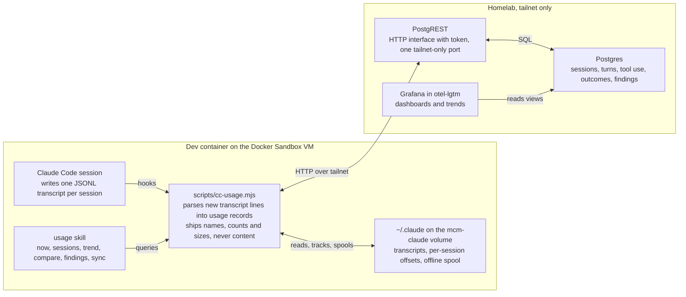

# Proposal: Claude Code Token Usage Capture and Efficiency Analysis for MCM

Nov 20, 2026 · @Steve

## Summary

Recommendation: build a small custom capture script, driven by Claude Code hooks, that ships per-session records to a Postgres store on the homelab. Wrap the same script in a `usage` skill for in-session questions.

The design in one paragraph: Claude Code already writes every session to a JSONL transcript under `~/.claude/projects/`, which sits on the `mcm-claude` volume. A zero-dependency Node script (`scripts/cc-usage.mjs`) parses those transcripts into session, turn and tool records. Hooks committed in `.claude/settings.json` run it automatically at session start, after each turn and at session end. Records go over HTTP to a new two-container stack on the homelab (Postgres + PostgREST), with Grafana in the existing `otel-lgtm` container for trends.

Why this over the alternatives:

- **Attribution.** Only the transcripts carry the git branch, worktree, skill invocations, tool calls and subagent split. Correlating activity types with usage needs all of them.
- **No manual step, and it survives the sandbox idle-stop.** Hooks are fired by Claude Code itself. The sandbox VM stops about 30 seconds after the last connection, so any daemon or terminal monitor would be killed regularly.
- **A baseline on day one.** Transcripts from past sessions are still on the volume, so a one-time backfill gives history before the first new session.
- **No context cost.** Hooks run silently in the background. The skill loads only when invoked. The measurement must not spend the tokens it is measuring.

The three tools named in the brief each get a role. The custom script is the capture layer. ccusage is the cross-check that proves the script's totals. Claude-Code-Usage-Monitor is an optional personal live gauge. Native OpenTelemetry export is a later add-on, not the foundation.

Nothing in the repository was changed to produce this proposal. Implementation touches `infrastructure-as-code/`, so it goes through the spec, plan and tasks gate first.

## Goals and requirements

The goal is to capture token usage per Claude Code session, analyze it across sessions, relate it to the kind of work being done, and recommend changes that lower tokens per outcome.

| # | Requirement | How this proposal meets it |
| --- | --- | --- |
| 1 | Per-session usage, monitored over time | One row per session, plus per-turn and per-tool detail, in Postgres. Grafana dashboards for trends. |
| 2 | Capture runs in the MCM dev container on Docker Sandbox | A Node script already satisfied by the baked toolchain. No daemon, no new package, no image change. |
| 3 | Metrics persist on a homelab container | New `prod-dev-usage` Komodo stack. Data outlives dev container rebuilds and `sbx rm`. |
| 4 | Compare ccusage, Claude-Code-Usage-Monitor and a custom script | See Options compared. Native OpenTelemetry is included as a fourth option. |
| 5 | No manual action at session start or end | Claude Code hooks trigger capture. A sweep on every hook picks up sessions that ended without a clean exit. |
| 6 | Interact with usage data during a session, including history and trends | A `usage` skill over the same script: current session from the local transcript, history from the homelab. |
| 7 | Recommendations for token efficiency per outcome | Outcome records per branch and spec, efficiency metrics, and a findings report with evidence. |

Two constraints follow from how the repository already works and are treated as requirements too:

- **Measuring must cost close to zero tokens.** No MCP server, no text injected at session start, compact skill output.
- **No content leaves the container.** Records hold names, counts and sizes. Prompt text, tool output and command arguments are never shipped.

## Current state

No session usage capture exists today, but most of what the design needs is already in place. I read the dev container config, `.claude/`, `AGENTS.md`, the egress allowlist, the observability and Komodo files, and the sandbox runbooks. `.env` files, `secrets/` and dependency folders were not opened.

| What the repository shows | Where | Consequence for the design |
| --- | --- | --- |
| `~/.claude` is a named volume and `CLAUDE_CONFIG_DIR` points at it | `.devcontainer/sandbox/devcontainer.json` | Transcripts survive a dev container recreate, so past sessions can be backfilled. They do not survive `sbx rm`, so the homelab copy is the durable one. |
| The sandbox VM stops when idle and Docker restores the container. `postStartCommand` does not fire on that restart. | same file, `devcontainer-sandbox.md` §2 | Nothing can depend on a long-running process or on a start hook of the container. Capture must be triggered by Claude Code itself. |
| Egress is deny-by-default, enforced host-side from a generated allowlist. The forge host is injected at runtime and never committed. | `egress-allowlist.json`, `gen-egress-policy.mjs` | The homelab endpoint is reachable the same way the forge is. Its host must be injected from the environment, not written into git. |
| The allowlist forbids Claude Code telemetry endpoints by rule | `egress-allowlist.json` `$mustNeverAppearHere` | Shipping to your own homelab does not conflict with this rule. The proposal adds no third-party destination. |
| `.claude/settings.json` holds only plugin marketplaces. No hooks, no `env`. | `.claude/settings.json` | Hooks can be added there without displacing anything. |
| The only hook today is RTK's `PreToolUse`, patched into user settings at container creation | `ensure-rtk-hook.sh` | There is a working precedent for hook wiring that needs no manual step. RTK coverage is also something to measure. |
| Coding sessions run on the Claude Max subscription. The API key is deliberately hidden from Claude Code. | `AGENTS.md` first gate | Dollar figures are notional. Tokens and plan-limit share are the real units. |
| Several sessions share the container, each in a worktree on a branch named `NNN-slug` | `AGENTS.md` worktree gate | Capture must be safe under concurrency. Branch names map sessions to spec features for free. |
| Work moves through Spec Kit skills, a Forgejo backlog script and a CI status script | `.claude/skills/`, `scripts/backlog.mjs`, `scripts/ci-status.mjs` | Skill invocations mark the phase of work. Backlog and CI give outcome signals without new tooling. |
| A priced usage summary already exists for wiki runs, with the rule that missing data is "not captured", never zero | `scripts/wiki-usage.mjs` | Reuse the pattern: dated price table, pure functions, guard tests, and the same negative rule. |
| The homelab runs `otel-lgtm` with Grafana on the tailnet and OTLP ports unpublished. Stacks are declared in Komodo ResourceSync. | `observability/compose.prod.yaml`, `komodo/stacks.toml` | Grafana is available for dashboards. A new stack is a TOML entry plus a compose file, using upstream images only. |
| `AGENTS.md` is about 39.6 KB and is imported into every session | `CLAUDE.md`, `AGENTS.md` | Every session and subagent starts with a fixed context cost. That is one of the first things the data should quantify. |

## Options compared

None of the off-the-shelf tools ships data off the machine or attributes usage to branch, skill and tool, which are the two things this goal depends on. A custom script is the only option that meets every requirement, and it is small because Claude Code already records the raw data.

| Criterion | [ccusage](https://github.com/ryoppippi/ccusage) | [Claude-Code-Usage-Monitor](https://github.com/Maciek-roboblog/Claude-Code-Usage-Monitor) | Custom script + hooks | [Native OpenTelemetry](https://code.claude.com/docs/en/monitoring-usage) |
| --- | --- | --- | --- | --- |
| What it is | Node CLI that reports from local transcript files | Python live terminal monitor, with one-shot and statusline modes | Repo-owned Node script run by Claude Code hooks | Built-in export of metrics and events to a collector |
| Per-session token totals | Yes, `session` report with JSON output | Focused on plan windows and burn rate, not session records | Yes, plus per-turn and per-tool | Yes, as counters labelled with session ID |
| Branch, skill, tool and subagent attribution | Not in its documented reports | No | Yes, all of it is in the transcript | Partial: model, main vs subagent, skill and tool names. No git branch. |
| No manual step | Only if you wire it into hooks yourself | Live view needs a terminal left open | Yes | Yes, once env vars are set |
| Survives the sandbox idle-stop | Yes, it is a one-shot command | Live view does not. Statusline mode does. | Yes, with a catch-up sweep | Unflushed data can be lost when the VM stops |
| Persists on the homelab | No, local analysis only | No, its history warehouse is local only | Yes | Yes, but needs the OTLP port published and retention configured |
| In-session query of history | Local history only | Local history only | Yes, through the skill | Needs a PromQL or LogQL client wrapped in a skill |
| New dependency or egress | npm package, or an `npx` fetch per run | `uv tool install` in the personal layer | None | None in the container. One new port on the homelab. |
| Main risk | Cannot answer the correlation questions | Solves a different problem: live limit pacing | Transcript format is undocumented and can change | Aggregated data. Session-level joins are awkward. |
| Role here | Cross-check of the script's totals | Optional personal live gauge | Capture layer | Later add-on for per-request latency and errors |

How each fits:

- **ccusage** reads the same files and is widely used, so it is the right oracle. A guard test compares the custom parser's per-session totals against `ccusage session --json` on fixture transcripts. It runs in CI and on demand, not in every session.
- **Claude-Code-Usage-Monitor** answers "will I hit the limit this window". Version 4 captures Claude Code's official rate-limit figures through a statusline hook. That idea is borrowed in phase 3. The tool itself stays optional and personal.
- **Custom script** costs about a day or two of work and one guard-tested parser. The repository already maintains scripts of this shape (`backlog.mjs`, `ci-status.mjs`, `wiki-usage.mjs`).
- **Native OpenTelemetry** is officially supported and format-stable, which the transcript format is not. It is worth adding later for API latency, errors and retries. It cannot be the foundation because it has no notion of branch or spec and reports aggregated counters.

## Recommended architecture

Capture happens inside the dev container and storage lives on the homelab, with one HTTP path between them.



Claude Code fires the hooks, the script reads only new transcript lines from the volume, and records pass the sandbox egress policy to PostgREST. The skill uses the same script and the same path in reverse.

| Design choice | Reason |
| --- | --- |
| Transcripts as the source | They already exist, cost nothing to produce, and carry branch, skill, tool and subagent detail |
| Hooks, not a daemon or sidecar | The VM idle-stops and container start hooks do not fire on its restart. Claude Code firing the capture is the only trigger that is always there. |
| HTTP, not a database connection | No driver dependency in the container, and it matches how the script already reaches the forge |
| Postgres with PostgREST | Both are upstream images, so the stack deploys through Komodo with no CI image build. SQL views serve the skill and Grafana alike. |
| Its own stack, separate from `prod-observability` | Dev tooling data should not share fate with the production control tower, and unlike that telemetry it is worth backing up |
| Host injected from the environment | Keeps the tailnet host out of git, as the forge host already is |

## Automatic capture

Three hooks in the committed `.claude/settings.json` run the script, so every session in every worktree is captured without anyone starting or stopping anything.

| Hook event | What the script does | Why |
| --- | --- | --- |
| `SessionStart` | Sweeps every transcript on the volume and ships any bytes not yet shipped. Flushes the offline spool. | Catches sessions that died without a clean exit, such as a VM idle-stop, and sessions on branches that predate the hooks. |
| `Stop` (end of each turn) | Ships the new lines of the current session only | Limits how much a session that dies can leave unshipped. Lag is acceptable, so shipping is capped at once every 15 minutes: see Runtime cost. |
| `SessionEnd` | Ships the tail and records the end reason | Marks the session complete. Almost nothing is left to send, which matters because this hook has a short time budget. |

The sketch below shows the shape. Exact field names should be confirmed against the installed Claude Code version before the spec is written.

```json
{
  "hooks": {
    "SessionStart": [{ "hooks": [{ "type": "command", "async": true,
      "command": "node \"$CLAUDE_PROJECT_DIR/scripts/cc-usage.mjs\" hook" }] }],
    "Stop":         [{ "hooks": [{ "type": "command", "async": true,
      "command": "node \"$CLAUDE_PROJECT_DIR/scripts/cc-usage.mjs\" hook" }] }],
    "SessionEnd":   [{ "hooks": [{ "type": "command", "timeout": 10,
      "command": "node \"$CLAUDE_PROJECT_DIR/scripts/cc-usage.mjs\" hook" }] }]
  }
}
```

Rules the script follows:

- **Never blocks and never fails a session.** Every path exits 0. The start and turn hooks run in the background.
- **Prints nothing.** Standard output from a `SessionStart` hook is added to Claude's context, so the script stays silent.
- **Incremental.** It keeps a byte offset per transcript in `~/.claude/usage/`, one state file per session. See Concurrent sessions below for the overlap cases.
- **Idempotent.** Rows are upserted on session ID plus message ID. Re-sending a range is harmless, and duplicated streaming entries collapse.
- **Offline-safe.** If the homelab is unreachable, records queue in a spool directory on the volume and go out on the next hook.
- **Honest about gaps.** Each session carries a capture status of complete, partial or not captured. A gap is never reported as zero.
- **Self-checking.** `cc-usage.mjs doctor` reports the last successful ship, spool depth and any transcript with unshipped bytes.

Backfill needs no separate action. The first `SessionStart` after the change merges sweeps everything still on the volume. Claude Code removes transcripts after about 30 days by default, so expect roughly a month of history.

Hooks live in project settings, not user settings, because the file is committed, reviewed, and identical in every worktree. The cost is that a session on a branch cut before the merge has no hooks. The sweep from any later session still captures it.

Configuration follows the existing credential pattern. Two values, `MCM_USAGE_INGEST_URL` and `MCM_USAGE_INGEST_TOKEN`, are added to the sandbox env file that `gen-container-secrets-env.sh` already turns into `--env-file` input. The token is read from the environment and sent as a header. It never appears in a command line or in git.

### Concurrent sessions

Several sessions run in this container at once, so the script must stay correct when its hooks overlap. Correctness rests on idempotent writes. The local state files are only an optimization and are allowed to lose a race.

| Situation | What could go wrong | Rule |
| --- | --- | --- |
| Two sessions run their own hooks at the same time | Nothing shared is touched | Each session has its own transcript and its own state file. No lock is needed. |
| A `SessionStart` sweep processes a transcript whose owning session is still running | The sweep and the owner's `Stop` hook ship the same lines and both write the offset | Rows upsert on session ID plus message ID, so duplicates collapse. The offset file is written to a temporary name and renamed, and an offset never moves backwards. |
| Several sessions start together and each one sweeps | The same catch-up work is done several times | A sweep takes a lock file with a short expiry. A process that finds it held skips the sweep and ships only its own session. |
| Two hooks flush the offline spool together | The same spooled batch is sent twice, or one process deletes a file the other is reading | Each process writes its own spool file. A flusher claims a file by renaming it before sending, and deletes it only after the homelab confirms. |
| A range is shipped twice | Session totals double if they are counters | Totals are never incremented. They are derived from the per-message rows in a view, or recomputed on each upsert. |
| Two sessions work on the same branch | Outcomes are attributed twice | Outcomes are keyed by branch and spec, not by session. Sessions link to the outcome. |
| The skill is invoked in one of several sessions | It reports a neighbour's numbers | The session ID is passed in explicitly. The script never guesses from the most recent transcript. |

A guard test runs several hook invocations in parallel against the same fixture transcripts and asserts that row counts and totals match a single serial run.

### Runtime cost

Nothing polls. The script runs only when Claude Code fires a hook or the skill is invoked, and each run is a short-lived process. The figures below are estimates to be measured in phase 0.

| Trigger | How often | Work done |
| --- | --- | --- |
| `SessionStart` | Once per session start or resume | Stats every transcript, ships unshipped bytes, flushes the spool |
| `Stop` | Once per turn | Checks a timestamp and exits. Ships at most once every 15 minutes per session. |
| `SessionEnd` | Once per session | Ships the tail |
| Skill | On demand | One or two GETs. A requested sync ships the current session at once. |

A turn here is one user prompt and everything Claude does in response, until it finishes responding. One turn can contain many model calls and tool calls, and can run for minutes or for most of an hour in an autonomous implement run. `Stop` fires once at the end of it. Subagents fire their own event and do not trigger `Stop`.

Expected footprint per run:

- **CPU and memory.** A Node process with roughly 50 to 100 ms of startup and a few tens of MB while it runs. Small against the container's 10 GB limit, even with five sessions.
- **Network.** A few KB to a few tens of KB per ship over the tailnet, at most four times an hour per session from hooks.
- **Homelab.** Postgres and PostgREST idle at perhaps 100 to 200 MB combined, with negligible write load.

Four cases need explicit handling so the cost stays small:

- **First backfill.** The first sweep parses about a month of transcripts. It runs at low priority, in batches, and yields between files.
- **Homelab unreachable.** Every network call has a connect timeout of about two seconds. A failure writes a back-off marker, and hooks skip the network for a few minutes while it is fresh.
- **Large transcripts.** Hooks read from the stored offset, never from the start. `usage now` reuses the same incremental summary instead of re-parsing the file.
- **Long turns.** Because `Stop` fires only when a turn ends, the homelab can lag by the length of a long autonomous turn. `usage now` is unaffected because it reads the local transcript. That lag is accepted. No mid-turn hook is added, because it would start a process on every tool batch just to check the clock.

**Frequency cap.** Low run frequency matters more here than fresh data. Each session ships at most once every 15 minutes from hooks, plus once at session end. Between ships the per-turn hook only compares a timestamp and exits, with no parsing and no network. A sweep is likewise capped at once every 15 minutes across the container. The one exception is a sync you ask for: the skill's sync command ships the current session immediately, ignores the cap, and resets the 15-minute timer. Claude runs it only when you request it, never on its own initiative. If even that brief per-turn process is unwanted, the `Stop` hook can be removed entirely. Capture then relies on `SessionEnd` and the next sweep, at the cost of a longer wait for sessions that end abnormally.

## Data model

Six small tables hold everything, with the turn as the unit of analysis and the session and branch as roll-ups.

| Table | One row per | Main fields |
| --- | --- | --- |
| `sessions` | Session | Start and end, platform, worktree, branch, spec number, Claude Code version, models, token totals by type split into main and subagent, turns, compactions, end reason, capture status |
| `turns` | User prompt and the work it triggered | Time, duration, idle gap before it, tokens by type, context size, model, activity label, SDD phase |
| `tool_use` | Session, turn and tool | Tool name, command family, call count, result size, RTK flag, repository area touched |
| `skill_use` | Session and skill | Invocation count, first turn |
| `outcomes` | Branch or spec | Commits, lines changed, tasks checked off, pull request, merged or not, CI runs red and green, backlog items closed |
| `findings` | Rule hit in an analysis run | Rule, evidence, recommendation, status, metric before and after |

Tokens are stored as the four types Claude Code reports: input, output, cache write and cache read. A fifth derived figure, weighted tokens, applies price-ratio weights from a dated table so that a cache read is not counted like an output token. This follows the `wiki-provider-prices.json` pattern. On the subscription it is a comparable unit, not a bill.

### What is deliberately not stored

Prompt text, assistant text, tool output, file contents and command arguments never leave the container. For a Bash call the script keeps only the command family, meaning the first word such as `pnpm`, `git` or `docker`. This matters here because command output in this environment has exposed live credentials before, through a process listing.

### Labelling activity

Each turn gets one label from deterministic rules, applied in order. A session is then described by its mix, for example 55% implement, 30% test, 15% CI diagnosis by weighted tokens. Sessions rarely do one thing, so a single label per session would hide the pattern.

| Label | Signal in the transcript |
| --- | --- |
| Specify, clarify, plan, tasks | The matching `speckit-*` skill was invoked |
| Implement | `speckit-implement`, or edits under `frontend/`, `backend/`, `agents/`, `mcp-servers/` |
| Test | Bash family and target match a test tier: `nx test`, `nx e2e`, Playwright, Maestro, `cargo test` |
| CI diagnosis | `ci-status.mjs` or `ci-failure-digest.mjs` was run |
| Explore | Read and search tools dominate and nothing was edited |
| Infra and dev environment | Docker, compose or `sbx` commands, or edits under `.devcontainer/` and `infrastructure-as-code/` |
| Docs and wiki | Edits under `docs/` or `openwiki/`, or the `wiki-refresh` skill |
| Backlog | `backlog.mjs` was run |
| Git and pull request | Git commands or the pull request API |
| Conversation | No tool calls |

Two more dimensions come for free. The spec number is parsed from the branch name. The repository area is the top-level directory of the files touched.

A turn that matches no rule is stored as unclassified and reported, so the rules improve over time instead of guessing. An optional `/usage tag <label>` lets you name a session by hand, but nothing depends on it.

## Usage skill

A project skill at `.claude/skills/usage/SKILL.md` gives Claude a short guide to one script, the same way `forgejo-issues` fronts `backlog.mjs`. It costs context only when invoked.

| Command | What it answers | Data from |
| --- | --- | --- |
| `usage now` | This session so far: tokens by type, context size, largest tool outputs, subagent share, and how it compares with the median for similar work | Local transcript, plus medians from the homelab |
| `usage sessions --since 7d` | Recent sessions, filterable by branch, spec, activity or area | Homelab |
| `usage trend --by week` | Trend lines by week, activity, spec or area | Homelab |
| `usage compare <a> <b>` | Two sessions, specs or date ranges side by side | Homelab |
| `usage findings` | Open recommendations with their evidence and status | Homelab |
| `usage sync` | Ships the current session to the homelab now, ignoring the 15-minute cap. Run only when you ask for it. | Local transcript |
| `usage tag <label>` | Optional manual label for the current session | Homelab |
| `usage doctor` | Whether capture is healthy, including the time of the last ship | Local state |

Design points:

- **Knows which session it is in.** `SKILL.md` passes `${CLAUDE_SESSION_ID}` to the script, so concurrent sessions in the same container never read each other's numbers.
- **Works offline for the current session.** `usage now` reads the local transcript directly. History degrades to a clear "homelab unreachable" line.
- **Frugal output.** Fixed-width tables capped at a few rows, with `--json` for anything larger. Host names are redacted from output, as in `backlog.mjs`.
- **Read path is plain HTTP.** The script calls PostgREST views and functions with `fetch`. No database driver and no MCP server.
- **The skill file carries judgment, not syntax.** It tells Claude when a number is worth acting on and when the sample is too small to say anything.

Questions this makes answerable mid-session:

- "How heavy is this session compared with my usual implement sessions?"
- "Which activity cost the most per merged pull request this month?"
- "Did the change to `AGENTS.md` two weeks ago lower the starting context?"

For monitoring outside a session, a Grafana dashboard on the existing `otel-lgtm` instance reads the same Postgres views.

## Efficiency analysis

Efficiency here means weighted tokens per unit of outcome, never raw token count. A session that uses more tokens and merges cleanly beats a cheap one that triggers three CI fix loops.

### Outcomes

Outcomes are collected per branch, because several sessions usually contribute to one feature. All of them come from sources the repository already has:

- Commits and changed lines on the branch, from local git.
- Tasks checked off in the feature's `tasks.md`.
- Pull request opened and merged, and CI runs red or green, from the forge API with the existing read token.
- Backlog items closed, from the same API.

### Metrics

| Metric | Definition | What a poor value points to |
| --- | --- | --- |
| Tokens per outcome | Weighted tokens per merged pull request, per completed task and per spec | The headline. Compared by activity mix and area, not across unlike work. |
| Rework share | Share of a branch's tokens spent after its first red CI run, or in repeated test and fix cycles | Verification happening too late, or the wrong test tier being run |
| Session floor | Context size at the first turn | Always-loaded instructions, tool schemas or plugins that most sessions do not need |
| Cache-read ratio | Cache-read tokens over all prompt tokens | Context being rebuilt instead of reused |
| Idle tax | Cache-write tokens on turns that follow a gap longer than the cache lifetime | Long pauses inside large sessions |
| Context growth | Context size per turn, and compactions per session | Phases that should be separate sessions sharing one context |
| Tool-output weight | Result size by tool and command family, with the share of Bash calls passing through RTK | Unfiltered command output, whole-file reads, noisy test reporters |
| Re-read rate | Files read more than a few times in one session | Lost context, or exploration that belongs in a subagent |
| Subagent return ratio | Subagent tokens against the size of what they hand back | Delegation that costs more than it saves, or too little delegation of exploration |
| Model mix by activity | Share of tokens per model for each activity label | A premium model doing low-judgment work |
| Limit burn | Plan-limit percentage consumed per activity (phase 3) | Which kind of work is using up the week |

### How recommendations are produced

Recommendations come from two layers, so that numbers are deterministic and judgment is explicit.

1. **Rules in the script.** Each metric is compared with your own baseline for the same activity label, using the median and the 90th percentile. A rule fires only above a minimum sample size. Below it the report says "not enough data".
2. **Interpretation in the skill.** `usage findings` hands Claude the fired rules with their evidence rows. Claude reads the relevant repository files and proposes a specific change, the expected effect, and the metric to watch.

Every accepted recommendation is stored as an experiment with a start date, a target metric and its baseline. Later runs of `usage findings` show before and after, so a change that did not help is visible and can be reverted. Larger ones can be filed as backlog items through `backlog.mjs`.

A finding looks like this. The values are placeholders that show the format, not measurements:

```text
RULE      tool-output-weight / bash:pnpm
EVIDENCE  <n> sessions, <x>% of prompt tokens in implement turns came from
          pnpm output; RTK rewrote <y>% of those calls
SUGGEST   route the unfiltered target through RTK or a quieter reporter
WATCH     tool-output weight for bash:pnpm; rework share must not rise
```

### Guardrails on the analysis

- **Every token metric is paired with a quality counter-metric.** A change that lowers tokens but raises rework share or lowers the CI first-pass rate is recorded as a regression.
- **The first two weeks are baseline only.** No recommendations until there is enough data per activity label.
- **Small samples are stated.** One developer produces few sessions per label per week, and model behavior varies between identical runs. Findings carry their sample size and are worded as hypotheses.

## Implementation plan

Four phases, each usable on its own, with capture first so data accumulates while the rest is built. Effort figures are rough estimates for agent-assisted work.

1. **Phase 0: verify by measurement (about half a day).** Probe the assumptions listed under Risks and open questions inside the sandbox container. No repository change. Exit: findings written into the spec's research notes.
2. **Phase 1: capture (2 to 3 days).** One numbered spec. The parser, hook mode, spool and `doctor`. Guard tests on fixture transcripts, including the ccusage cross-check. The homelab stack. Env plumbing. A runbook. Exit: one week of sessions with `doctor` clean and totals matching ccusage on the fixtures.
3. **Phase 2: skill, labels and dashboards (about 2 days).** The `usage` skill, the activity rules, outcome collection, and the Grafana dashboard. Exit: `usage now` and `usage trend` answer in-session, and unclassified turns are a small minority.
4. **Phase 3: findings (about 2 days, after a two-week baseline).** The rule set, experiment tracking, and plan-limit capture from the statusline input. Exit: the first findings report with evidence and at least one tracked experiment.

A possible phase 4 adds native OpenTelemetry export to `otel-lgtm` for API latency and error data. It is not needed for the stated goal.

### What would change

| Path | Change | Notes |
| --- | --- | --- |
| `.claude/settings.json` | Add the `hooks` block | Existing plugin settings untouched |
| `scripts/cc-usage.mjs`, `scripts/lib/` | New script: `hook`, `now`, `sessions`, `trend`, `compare`, `findings`, `tag`, `doctor` | Zero dependencies, same style as `backlog.mjs` |
| `scripts/__tests__/` | Parser, labelling and privacy guard tests with fixture transcripts | A test asserts that no prompt text or command argument appears in any shipped record |
| `scripts/cc-usage-weights.json` | Dated token weight table | Same idea as `wiki-provider-prices.json` |
| `.claude/skills/usage/SKILL.md` | New skill | User-invocable |
| `.devcontainer/gen-container-secrets-env.sh` | Pass the two new variables through | Sandbox path |
| `.devcontainer/devcontainer.json` | `${localEnv}` passthrough for the same two variables | Docker Desktop path, until the two configs are collapsed |
| `infrastructure-as-code/docker/dev-usage/` | New `compose.prod.yaml` and schema SQL: tables, views, an insert-and-read role | Upstream images only, so no CI image build. Under the SDD gate. |
| `infrastructure-as-code/komodo/stacks.toml` | New `prod-dev-usage` stack entry | Secrets as Komodo Variables |
| `docs/runbooks/` and `openwiki/` | Runbook and its wiki page | Refreshed in the same pull request, per the wiki rule |

Three things sit outside the repository and are yours to do:

- Add the two values to the sandbox env file, and to the Windows host if host sessions should be captured.
- Allow the homelab endpoint in the sandbox network policy with `sbx policy allow network`.
- Add a `pg_dump` of the new database to the homelab backup script, next to the existing ones.

### Homelab stack

Two upstream containers: Postgres for storage and PostgREST as the HTTP interface. PostgREST publishes one port in the reserved 19000 to 19099 range, bound the same way as the other operator ports and reachable only over the tailnet. Requests carry a signed token mapped to a database role that can insert, update and read in one schema and cannot delete. Grafana in `otel-lgtm` reads the database over the shared backend network.

## Risks and open questions

The largest risk is that the transcript format is undocumented. It is contained here because the Claude Code version is baked into the toolchain image and self-update is blocked, so the format can only change when you rebuild the image.

| Risk | Mitigation |
| --- | --- |
| Transcript format changes with a Claude Code upgrade | Guard tests on fixtures run with every image refresh. The ccusage cross-check flags drift in totals. Unknown fields degrade to partial capture, not wrong numbers. |
| A hook does not fire on some entry path, such as the VS Code extension or a resumed session | The sweep at the next session start captures it. `doctor` shows any transcript with unshipped bytes. |
| The homelab is down, rebooting, or the laptop is off the tailnet | Spool on the volume and retry. For about 30 days the data can also be rebuilt from transcripts. |
| The homelab database is damaged by a hard reboot, as happened to Forgejo's Postgres | Daily `pg_dump` in the existing backup script |
| The ingest token is readable by every process in the container | The role cannot delete, and the records hold no content. Rotation is one Komodo Variable. |
| A new port is exposed on the homelab | Tailnet-only through the host firewall, and token-checked |
| Optimizing the metric instead of the work | Outcome-normalized metrics, each paired with a quality counter-metric |
| The measurement itself costs tokens | Hooks are silent and asynchronous. The skill loads only on request and caps its output. |

### To verify in phase 0

These are assumptions from documentation that I could not test from outside the container:

- [ ] Which fields the installed Claude Code version writes per transcript line: token usage, model, git branch, working directory, message and request IDs.
- [ ] How subagent activity is stored: inline entries or separate files.
- [ ] That `SessionStart`, `Stop` and `SessionEnd` hooks fire for CLI and VS Code sessions, and what happens to `SessionEnd` when the VM idle-stops.
- [ ] That `$CLAUDE_PROJECT_DIR` resolves to the worktree in a worktree session, and that `${CLAUDE_SESSION_ID}` is substituted in a project skill.
- [ ] Whether the sandbox policy rule is per host or per host and port, and whether the new port needs its own approval.
- [ ] That the statusline input carries `rate_limits` on your plan and version.
- [ ] The actual transcript retention on the volume.

* [ ] Hook duration and peak memory in the sandbox container, for a normal turn and for the first backfill, and whether `Stop` fires when a turn is interrupted.

### Decisions for you

- [ ] **Store.** New Postgres and PostgREST stack, as recommended, or reuse the LangFuse instance already on the homelab. LangFuse gives a ready LLM-session UI. It couples dev tooling to the production observability stack, is weaker for ad hoc SQL, and its data is not in the backup today.
- [ ] **Host sessions.** Capture Claude Code sessions run on the Windows host too, or only the dev container.
- [ ] **Path detail.** Store only the top-level repository area per tool call, as proposed, or repo-relative file paths for finer analysis.
- [ ] **Other assistants.** The repository also configures Codex and OpenCode. This proposal covers Claude Code only.
- [ ] **Retention.** Keep turn-level rows indefinitely, which is small, or roll up after some months.

## Sources

- [Claude Code hooks reference](https://code.claude.com/docs/en/hooks): events, input fields, async hooks, `SessionEnd` time budget, `SessionStart` output
- [Claude Code monitoring (OpenTelemetry)](https://code.claude.com/docs/en/monitoring-usage): metrics, events, attributes, defaults
- [Claude Code statusline](https://code.claude.com/docs/en/statusline): rate-limit and context fields in the statusline input
- [Claude Code skills](https://code.claude.com/docs/en/skills): project skills and string substitutions
- [ccusage guide](https://raw.githubusercontent.com/ryoppippi/ccusage/main/docs/guide/index.md) and [repository](https://github.com/ryoppippi/ccusage)
- [Claude-Code-Usage-Monitor README](https://raw.githubusercontent.com/Maciek-roboblog/Claude-Code-Usage-Monitor/main/README.md)
- Repository files read on 2026-11-20: `.devcontainer/devcontainer.json`, `.devcontainer/sandbox/devcontainer.json`, `.devcontainer/egress-allowlist.json`, `.devcontainer/ensure-rtk-hook.sh`, `.devcontainer/persist-claude-config.sh`, `.claude/settings.json`, `.claude/skills/forgejo-issues/SKILL.md`, `AGENTS.md`, `scripts/wiki-usage.mjs`, `infrastructure-as-code/docker/observability/compose.prod.yaml`, `infrastructure-as-code/komodo/stacks.toml`, `docs/runbooks/devcontainer-sandbox.md`
