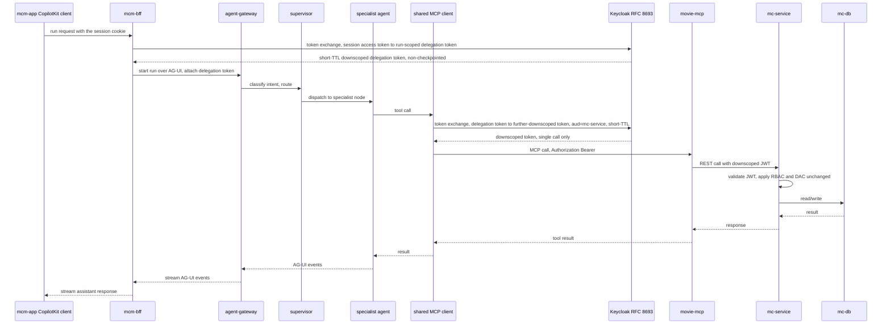

# AI Agents layer architecture (features 012/014/018/040/047/059/085)

This page covers the *architectural shape* of the AI Agents layer — the call chain, its security
boundary, and how per-user state and config are threaded through it. For the
[Agent Gateway](../projects/agent-gateway.md) service itself (its MCP servers, tool-invocation
chokepoint, terminal-error seams, and env-scoped model provider), see that page. Both cite the same
canonical source, `docs/runbooks/agent-layer.md`; see also [System overview](./system-overview.md)
for where the agent layer sits relative to `mc-service`.

## Call chain and security boundary

*The call chain: identity flows through two successive RFC 8693 token exchanges, and the agent
process itself never holds the member's session token.*

The defining design choice is **AG-UI-native**: the LangGraph runtime emits AG-UI events natively,
so `mcm-bff` only needs to host the CopilotKit runtime bridge (`CopilotRuntime` + the AG-UI
`HttpAgent` from `@ag-ui/client`, wired to a vendored `ExperimentalEmptyAdapter` — no LLM call and
no orchestration in the BFF) rather than author a hand-rolled per-event translation layer. Using
`LangGraphHttpAgent` instead of the AG-UI `HttpAgent` is a real mistake to guard against: that
binding speaks the LangGraph Platform REST protocol and 404s against this AG-UI-native gateway. The
Agent Gateway and its `agent-db` (LangGraph checkpoint store) are private-network only; only the BFF
ever reaches them. See [Auth chain](../invariants/auth-chain.md) for how this fits the rest of the
system's identity flow.

Two boundary rules belong to this chain rather than to either service page:

- **The thread id is bound to its first user before any gateway call.** A CopilotKit `thread_id` is
  generated client-side and the gateway keys its LangGraph checkpoint solely on it, so a user
  presenting someone else's `thread_id` could otherwise read that checkpoint's pending proposal
  (collection and movie names). The BFF claims each thread for the first user who uses it (Redis
  `SET NX`, TTL = the session's absolute window) and refuses any later mismatch with `403` *before*
  the gateway is reached. Cross-user *writes* were already blocked — the subject token is re-minted
  from the resuming member's session, so `mc-service` DAC returns `404` — but the preview disclosure
  was a real isolation gap.
- **Nothing reaches the graph through the request body.** The run-scoped subject token, the
  sanitized UI snapshot, the import-file handle and the per-run agent config ride as headers
  (`Authorization`, `X-UI-Snapshot`, `X-Import-File`, `X-Agent-Config`), are captured into
  request-local ContextVars by pure-ASGI middlewares, and are bridged into
  `config["configurable"]` at `prepare_stream`. That bridge is load-bearing, not decorative: a
  ContextVar set at the ASGI boundary does not reliably propagate into LangGraph's per-node executor
  tasks, so the token would simply be invisible to the node that needs it. See
  [Agent Gateway](../projects/agent-gateway.md) for the bridge's implementation.

## Token custody: why a "run-scoped delegation token", not the session token

The BFF never hands the gateway the member's actual session token. Instead:

1. At run handoff, the BFF performs its own OAuth2 Token Exchange (RFC 8693) to mint a **short-TTL,
   run-scoped, audience-narrowed** delegation token and passes that to the gateway as an ephemeral,
   non-checkpointed value. The requester is the BFF's own confidential
   `agent-subject-token` client; the minted token's reported expiry is capped defensively at
   180 s, and the exchange call itself is bounded so a hung identity provider is a refusal, never a
   hung turn.
2. At tool-call time, the gateway's **single shared, in-process MCP client** exchanges that token
   again for a **downscoped, `aud=mc-service`** token, attached only to that call.
3. A paused (HITL) run holds **no token at all** — only checkpointed graph state plus
   `userId`/`threadId`. Because every resume is itself an authenticated BFF request, the BFF always
   supplies a fresh subject token on resume, so pause duration never matters.

This is why raw tokens (subject or exchanged) must never be written to checkpointed state, traces,
or logs — the pause-robustness property depends on tokens never outliving a single active run
segment. The invariant is enforced, not merely documented: `state.forbid_token_fields` raises before
any state is persisted if a top-level state key's *name* looks like a credential (`token`, `jwt`,
`bearer`, `secret`, `apikey`, `agent_config`, …), and an AST token-leak scan over the agent and MCP
source trees fails the unit tier on a logged token-named variable.

### The member's own tokens are server-held too (feature 085)

The exchange in step 1 does not start from a client-held credential. Keycloak's access and refresh
tokens never reach the client: they are sealed beside the Redis session (AES-256-GCM, bound to the
session id and its owner) and renewed by the BFF itself, **at most once per session at a time**
behind a short Redis lock — Keycloak rotates refresh tokens, so a second concurrent renewal would
end the member's session. The client holds exactly one credential, the opaque `mcm_session_id`
cookie, and a bearer credential presented to the BFF is refused in every environment, dev and test
included. The run-scoped subject token is minted from that server-held access token.

A **refused mint fails closed** rather than letting the turn run without identity:

- Keycloak rejects the member's credential → `401 AGENT_IDENTITY_REJECTED`; the client's agent
  transport renews once and then sends the member to sign in.
- Keycloak unreachable, timed out, `5xx`, or a non-credential `4xx` → retryable
  `503 AGENT_IDENTITY_UNAVAILABLE`. The member is not signed out for an outage.
- Either way the gateway is never called identity-less — the alternative is the unexplained
  "No caller identity is available" refusal this replaces.
- **Measured:** Keycloak 26.5 answers a revoked or malformed subject token with
  `400 invalid_request "Invalid token"`, not the RFC's `invalid_token`. That exact description is
  required to classify it as a credential rejection, because Keycloak also uses `invalid_request`
  for configuration faults such as "Requested audience not available" — which are outages, not a
  reason to send the member back to sign-in.

### Gateway-side re-exchange mechanics

- **OPA authorizes the exchange before it happens.** The gateway asks "may this agent act for this
  user against this audience?" with non-sensitive inputs only (`user_id`, `audience`,
  `agent_origin`) — never a token. With `OPA_URL` unset the check is skipped with a warning; with it
  set, the decision **fails closed**: any deny, non-2xx, malformed response or unreachable policy
  engine denies the exchange.
- **No `audience` parameter is sent.** The `agent-gateway` client's audience mappers stamp
  `aud=[movie-collection-manager, mc-service]`, so the *unchanged* `mc-service` accepts the token
  (it validates `aud ⊇ movie-collection-manager`) while `mc-service` remains the distinct
  agent-origin binding signal. Sending no `audience` also sidesteps Keycloak's "Requested audience
  not available" precondition. The exchanged token's TTL is bounded to ≤60 s by the client's
  `access.token.lifespan`, capped again defensively in code.
- **A burst of tool calls reuses one token — but never past its safe life, and never across
  subjects.** The downscoped token is cached in process memory, keyed by
  `(user_id, audience, sha256(subject token))`, with a **15 s expiry skew**: the cache expires the
  entry ahead of the reported lifetime because the reported `expires_in` is measured at mint time
  while `mc-service` validates the JWT's real `exp`. Without that margin a long bulk apply (a large
  import) hit a cluster of `401`s at each TTL boundary and rows reported "could not be imported".
  The digest is load-bearing, not a convenience: `user_id` is the subject token's `sub` decoded
  *without* a signature check, and a cache hit returns **before** OPA and the Keycloak re-exchange,
  so a `user`-only key would hand a victim's cached token to any JWT naming that user's `sub`
  (spec 094). Keying on the digest means only the token that minted an entry can read it, and the
  subject token itself is never held. Entries are also dropped on read once stale and pruned on
  every `put`, since per-token keys outnumber per-user ones.
- **The token rides out-of-band, never as a tool argument.** It is injected as the MCP request's
  `Authorization: Bearer` by a dynamic auth object reading a request-local ContextVar set
  synchronously just before the call — never an LLM-visible tool argument, and never a baked-in
  client default header, which would outlive its call and keep a credential-bearing auth object
  alive.

## Per-user agent config (feature 018): opt-in, bring-your-own-credentials

The assistant is **off by default** and shares no shared model or TMDB credentials. Each user opts
in from the Profile screen and supplies their own provider credential (Ollama base URL or an
Anthropic key) and TMDB key. These are **AES-256-GCM-encrypted at rest** in the BFF's own
`mcm-bff-db` (physically separate from `mc-db` — see
[Secrets management](../invariants/secrets-management.md)), and the CopilotKit dock mounts only for
a config that is actually **runnable** (enabled + provider credential + TMDB key) — an un-opted-in
user cannot trigger a billable run.

Per-run injection happens through `resolveForRun(userId)`: the config is decrypted **in memory
only**, never returned to the client, logged, persisted to a checkpoint, or written anywhere at
rest outside `mcm-bff-db` — and it reaches the gateway as the `X-Agent-Config` header on the run
request, scoped to that one run. The TMDB key leaves that header only for web-api-mcp calls, where
it rides out-of-band as `X-TMDB-Key`; it is never attached to a user-identity MCP call. The
per-user `costLimitUsd` is deliberately **not** sent to the gateway at all — it is a BFF-only
ceiling, and the BFF serialises just the four gateway-relevant fields.

Gatekeeping for a billable run happens at the BFF, before any gateway call: a per-user request rate
limit and a per-user/session cost ceiling (the personal `costLimitUsd` overrides the global
default), a cross-user thread-ownership check, and the runnable-config check. Only the LLM run
operation is billable — the CopilotKit handshake reads (`availableAgents`, `loadAgentState`,
`hello`) run no model, so cost-gating them would lock an over-ceiling user out of merely *opening*
the dock; the rate limit and thread guard still apply to every POST. The UI-snapshot and single-use
import-file bridges key off the same "this request actually runs the graph" signal, because a
handshake landing between an upload and the import turn would otherwise silently consume the
single-use handle and the import would reach the gateway with nothing.

Models are **environment-scoped** (Ollama for dev/test/iterative E2E, Anthropic for the
golden gate and production) — see [Model-provider scoping](../invariants/model-provider-scoping.md)
for why, the code-default model ids, and the CI-vs-production supervisor-pin distinction; that page
is authoritative and owns those details, not this one.

The user-supplied Ollama base URL is a live SSRF surface (a server-side fetch to an
attacker-influenceable address), and it is guarded in **both** processes: the BFF
(`agent-config-ssrf.ts`) and the gateway (`src/ollama_guard.py`, called from `models.py`) each
independently resolve the name and check every answer, because a check made in one process can be
stale by the time the other process connects. See
[the SSRF-guard gotcha](../gotchas/agent-config-ssrf-guard.md) for the residual-risk table and the
policy detail — this page does not restate it.

## Conversation stages and generative UI (features 040/047/059)

Multi-turn flows (navigate, organize, import, add-with-ownership-question) park a `*_stage` value
on graph state so the *next* turn is guarded back into the owning node — otherwise a bare
follow-up answer ("yes", a bare collection name) gets re-classified as an unrelated intent and the
flow silently derails. Feature 059 extended the add flow further: the full chain is now `awaiting_childrens` →
`awaiting_ownership` → `awaiting_media` → `awaiting_ripped` → `awaiting_rip_quality` →
proposal. The children's question sits at the front deliberately: the 047 questions are
conditional on ownership, so any later placement would skip the answer for every not-owned add.
Three distinct generative-UI selection components exist; see `docs/runbooks/agent-layer.md` for the exact
node/tool/testID mapping before touching any of them:

| Tool | Component / testID | Used by |
|---|---|---|
| `render_selection` | `selection-options` | navigator `_clarify`, import picks, search scope, US4 ownership Yes/No, 059 children's Yes/No |
| `render_disambiguation` | `disambiguation-options` | curator's ambiguous movie-candidate list only |
| `render_multi_select` (047) | `multi-select-options` | US4 media-format / rip-quality toggle lists |

## Observability and audit are opt-in Control Tower profiles

LangFuse, OTel/Grafana, OPA, and Unleash run under `--profile observability`; the OpenSearch audit
sink runs under its own, separate `--profile audit`. Every one of these is env-gated and no-op when
unconfigured — the agent layer must work in a plain dev environment with none of them running.

## Gotchas

- **A paused run's safety depends on tokens never being checkpointed.** If a future change adds any
  token value to `agent-db`-persisted state, it defeats the entire "pause length is irrelevant"
  design goal described above — treat any PR that touches checkpoint serialization as auth-review
  sensitive. `state.forbid_token_fields` is the guard that will (correctly) reject it, so a change
  that "fixes" that rejection is the change to scrutinize.
- **Stage-continuation guards must be paired with a state-reset.** Every `*_stage` guard
  (`search_stage`, `organize_stage`, `import_stage`, `navigate_stage`, `add_stage`) has a matching
  `_STATE_RESET` — a finished flow that skips its reset can leak stage state into a later, unrelated
  turn.
- **Adding a stage means updating BOTH `graph.py`'s guard AND `curator.py`'s passthrough set.** A
  stage-continuation guard keeps the turn in the flow, but the curator still runs first. It must
  PASS THROUGH for every ownership stage — otherwise a bare reply (`"yes"`, `"Selected: DVD"`)
  finds no movie, clears `candidate`, and drops the member mid-flow. Missing the curator passthrough
  produces a reset on exactly the turn you forgot.
- **An ANSWER to a pending question is never a new command.** The escape hatch "a clear new command
  leaves the flow" is only safe if the guard resolves the reply against the pending question
  **BEFORE** consulting the classified intent. Without that ordering a prose-like answer
  (`"Selected: none"`) classifies as `query`/`search` and the in-progress flow is silently
  discarded. **This bug is provider-dependent** — it passes on local Ollama and fails on Anthropic
  in CI; a green local run proves nothing. The import guard already has the safe shape (resolve the
  pending prompt's options, then route a cancel, and escape only on a clearly-new write/nav
  command); **`navigate_stage` does NOT** — it escapes to whatever the classifier said on *any*
  reply that fails to resolve against the offered collections, so check it before extending the
  navigate flow.
- **`render_selection` vs. `render_disambiguation` vs. `render_multi_select` — pick the right one.**
  The US4 ownership Yes/No and navigation collection-choice buttons are BOTH `render_selection`;
  `render_disambiguation` is *only* the curator's ambiguous movie-candidate list; `render_multi_select`
  is *only* the 047 media-format/rip-quality toggles. Picking the wrong selector silently matches
  nothing.
- **The import-handle indirection exists because checkpoint bloat timed out large imports.** A
  parsed spreadsheet is stashed once in spreadsheet-mcp's transient store and only the small opaque
  `import_handle` is checkpointed across clarification turns — re-serializing the whole parsed
  workbook per turn was the actual cause of a prior "it timed out" failure on large imports.
- **Vault is a foundational platform secret store, not part of the Control Tower**, and it holds
  only shared infrastructure secrets (the gateway's Keycloak OAuth client secret, the BFF's master
  encryption key) — never user, model-provider, or TMDB credentials, which are per-user by design
  (see the per-user config section above).
- **The generic degrade reply (`"Sorry — I couldn't complete that just now."`) has exactly two
  sources; the circuit breaker has exactly one input.** `_degrade_node` is reachable only through
  the supervisor's model call (classifier raised, or breaker already open). The other three degrade
  sites are specialist-model failures. `ErrorRateBreaker` is fed by exactly ONE signal:
  `circuit.record(...)` in the supervisor — a tool failure, MCP outage, or rate-limit breach records
  nothing. **An open breaker therefore always means the supervisor's model call is failing.** The
  navigator can neither emit this message nor raise; a generic reply on a navigate turn is never
  the navigator's.
- **A control gated on a stage is unreachable from the TERMINAL step of the flow it exits (050 /
  item #149).** The mirror image of the guard rule above, and it shipped to a member. 047 gave the
  web search card a Cancel button that posts the canonical `exit search`; the search node honoured
  that control under `if stage and …`. But the card is the flow's *last* step, and `_web_card`
  returns `_SEARCH_RESET` **before** rendering it — so by the time the button is on screen there is
  no stage, the guard is false by construction, and the value fell through to the fresh-search branch
  as a movie **title**. The member who pressed Cancel was answered with *"I couldn't find "exit
  search" in your "Wish List" collection. Want to look elsewhere?"* — plus a real `list_movies`
  read, a `render_selection` that re-offered the search, and `search_stage` left at
  `awaiting_pick`. It did not fail neutrally: it put the member back INSIDE the flow they were
  leaving, capturing their next message too.
  The trap is that "universal control" is ambiguous — comments asserted the node "already treats it
  as a universal control", which was true across *stages* and false at *no stage*. **Ask
  specifically: is this control offered anywhere the flow has already been cleared?** If yes, it
  cannot be stage-gated.
  Two rules fell out of the fix:
  - **A cancel is routed BEFORE `classifier(messages)` in `graph.py`**, not after — mirroring
    `is_cancel_import`. Not only because a model might classify it away (provider-dependent, exactly
    as the ownership-guard bug was), but because a classifier *exception* returns `degraded` before
    any routing runs at all: a provider outage would answer "get me out of here" with "Sorry — I
    couldn't complete that just now." An escape hatch that needs a healthy LLM is not an escape hatch.
    The cancel route also sits above the error-rate breaker, which would otherwise degrade the turn
    exactly when a stuck member wants out — and a routed cancel makes no provider call, so letting it
    past costs the cooldown nothing. It stays *below* the kill switch: a disabled assistant must still
    do nothing.
  - **A stage-free route matches EXACTLY** (whole message, trimmed, case-folded) — never a
    substring, which would hijack a real title like *"How to Exit Search a Building"*, and never
    the bare synonyms (`cancel`, `never mind`), which belong just as much to the import and organize
    flows. Those stay scoped to a live stage, where the stage itself establishes intent.
- **`rated` is no longer hardcoded `"NR"` — it is the film's real US certification or `null`.**
  Before 059 US1, `to_movie_payload` wrote the literal string `"NR"` for every assistant-added
  movie regardless of its actual rating. `web-api-mcp.get_movie_details` now appends
  `release_dates` to the TMDB call it already makes and returns the first non-empty US
  certification, validated against `{G, PG, PG-13, R, NC-17, NR, Unrated}`. The value comes
  through as `EnrichedMovieCandidate.rated` (defaults `None`). There is **no** rename from
  `PG-13` to `PG13`: `UsaRating` in mc-service carries `#[serde(rename = "PG-13")]`, TMDB
  publishes the hyphenated form, and renaming would send a value mc-service rejects. `None`
  (unknown certification) reaches the payload as `"rated": null` — a present key with a null
  value. **Do not omit the key or substitute `"NR"`: `CreateMovieDto` types `rated` as
  `Option<T>` without `serde(default)`, so a missing key 422s the add.**
- **A node-level test passing does NOT mean the graph-level path works.** Calling a node function
  directly bypasses every supervisor guard and every stage-continuation check. **If a change
  touches routing, a guard, or a `*_stage`, drive `build_graph(...)` — not the node.**
- **Writing a `build_runtime_graph(..., force=True)` test? Stub EVERY model seam, and assert the
  test reached its subject.** `RuntimeNodeConfig` carries three separate extraction seams:
  `extract` (curator/search), `plan` (organizer), and `query_extract` (query). Stubbing only
  `extract` leaves the other two on their real model-backed defaults, which raise and degrade the
  turn before any tool call — so the test passes while exercising nothing. Also set
  `spreadsheet_mcp_url` — without it the import/export nodes answer "isn't available right now"
  and never read anything.
- **Watch the SKIP COUNT, not just the pass count.** The agent integration tier silently skips
  whatever MCP server is down, and a skipped test reads as a pass. Run with
  `MCM_REQUIRE_LIVE_STACK=1` to escalate a non-allowlisted skip to a failure naming the unreachable
  server.

See `docs/runbooks/agent-layer.md` for the full node/intent table, the containerized E2E procedure and its
three durable gotchas (DNS-rebinding protection, missing MCP URLs, per-user rate limits), and the
complete observability/audit environment-variable reference.
