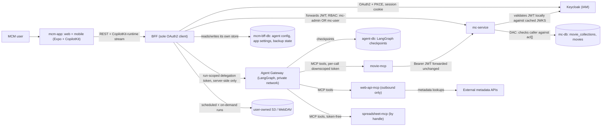

# System overview (MCM)

MovieCollectionManager is a multi-user movie-collection tracker: a universal Expo/React Native app
(`mcm-app`) whose server-side BFF ([BFF](../projects/bff.md)) is the only component the client talks
to, a Rust/Axum domain service ([mc-service](../projects/mc-service.md)) that owns all
collection/movie logic, and Keycloak as the external IAM provider. An additive AI Agents layer
([Agent Gateway](../projects/agent-gateway.md), [MCP servers](../projects/mcp-servers.md), and the
[agent-layer architecture](./agent-layer.md)) sits alongside these without changing `mc-service` or
any existing `mcm-app` screen.

Component shape, distilled ([MCM-Architecture.md](../../docs/MCM-Architecture.md) owns the full
component list, the container diagrams and the diagrammed mc-service layer table — this page does not
restate them; the *Core Components* section is the canonical list):

- **`mcm-app`** — the universal frontend where users view/manage the collections they have access
  to, fronted by the BFF. It also mounts CopilotKit (`@copilotkit/react-native`) for the
  conversational UI.
- **BFF** — server-side code inside the same Expo Router process; the sole OAuth2 client, session
  custodian, and the only component that reaches `mc-service`, the Agent Gateway, and the backup
  destinations. It owns its own Redis cache and its own MongoDB, `mcm-bff-db` — physically separate
  from `mc-db` (see the gotcha below).
- **`mc-service`** — owns all movie-collection domain models and business logic; the sole writer to
  `mc-db`. See [mc-service](../projects/mc-service.md) for its Clean Architecture layering, CQRS,
  and specification pattern — the [data model](./data-model.md) page covers its domain entities.
- **`mc-db`** — a single shared MongoDB database (`mc_db`) with two shared collections:
  `movie_collections` (collection metadata + ACLs) and `movies` (movie records, denormalized owner).
- **[Keycloak](../projects/keycloak.md)** — external IAM. Expects a client named
  `movie-collection-manager` in a realm, and two client roles: `mc-admin`, `mc-user`. New
  self-registrations default to `mc-user`. See [Auth chain](../invariants/auth-chain.md) for how a
  token flows end to end.
- **AI Agents layer** — additive by design: `movie-assistant` (the Python LangGraph supervisor +
  specialist graph), `movie-mcp` (MCP wrapper over the `mc-service` REST API), `web-api-mcp`
  (outbound TMDB/IMDB lookups), `spreadsheet-mcp` (token-free CSV/`.xlsx` parse and build over a
  transient handle), and `agent-db` (a dedicated PostgreSQL holding LangGraph checkpoints, logically
  isolated from `mc-db`). The gateway and `agent-db` are private-network only: the client never
  reaches them, and only the BFF starts a run. See [agent-layer](./agent-layer.md) and
  [mcp-servers](../projects/mcp-servers.md) for detail.
- **Control Tower (optional)** — LangFuse + `otel-lgtm` (OpenTelemetry → Grafana/Tempo/Prometheus/
  Loki), the OpenSearch append-only audit sink, and OPA + Unleash are profile-gated and **no-op with
  a safe in-code default when unconfigured**, so the app and the agent layer run without them and
  each control is switched on by configuration in the environments that need it (the architecture
  document's *AI Agents Layer* section).
- **Production secrets (Komodo Variables)** — shared *infrastructure* secrets (among them the
  gateway's Keycloak OAuth client secret and the BFF's master encryption key) live in Komodo's masked
  variable store and are injected at deploy into each stack's gitignored env file; **no** user,
  model-provider or TMDB credential is ever stored there, because those are per-user by design.
  HashiCorp Vault is deployed in production **dormant** (uninitialized and sealed) and is not a
  secret source for any core stack — see
  [ADR-0001](../decisions/adr-0001-prod-secrets-management.md).
- **Per-user scheduled backups (feature 073)** — the BFF runs an in-process scheduler that copies a
  user's own collections to an S3-compatible or WebDAV destination *the user owns and supplies*,
  keeping the last N versions and offering a restore that only ever creates new collections (never
  overwrites live data). An unattended run authenticates as the user via a Keycloak offline token
  they explicitly consented to, and destination secrets are sealed under their own encryption key,
  separate from the agent-config key. Since feature 083 that consent round trip runs as its **own**
  Keycloak client (`mcm-backup-consent`, selected by `BACKUP_CONSENT_CLIENT_ID`) rather than the
  login client, because Keycloak attaches the offline grant to the member's existing SSO session and
  revoking a login-client grant ends that session; unset, the BFF falls back to the login client.
  This is a BFF-owned capability, not a `mc-service` or `mc-db` concern — see the
  [backups runbook](../runbooks/backups.md) for the operating detail.

*Where identity is enforced and where data lands: RBAC gates at the BFF and mc-service tiers by
Keycloak role, DAC gates inside mc-service against each collection's own ACL, and both the Agent
Gateway and the backup scheduler reach mc-service through that same RBAC/DAC path, never around it.*

## Runtime shape: four Compose stacks

Local dev/test infrastructure is four independently operable named Compose projects under
`infrastructure-as-code/docker/stacks/` (the architecture document's *Docker Infrastructure*
section) — `auth`, `mcm`, `audit`, `observability` — each a thin `include:`-only aggregator over that
stack's component compose files, each with its own lifecycle. No stack is profile-gated as a whole:
`auth` and `mcm` each start services with no profile at all, and the per-service `profiles:`
assignments live **in the included component files**, not re-declared in the aggregator. The root
`compose.yaml` is retired to a pointer that names the four.
[Infrastructure stacks](../projects/infrastructure-stacks.md) has the per-stack profile table and
the production Komodo half; [Dev stack env files](../projects/stacks.md) covers how each stack's
secrets reach Compose.

The `mcm` stack is the one holding the application. Its no-profile services are the test infra
(`mc-service-store-mongo` + rs-init, `mcm-bff-cache-redis`, `mcm-bff-store-mongo`); `app` adds
`mc-service`, `bff-nonsecure` / `bff-secure` add the BFF, and `agents` / `agents-metro` add the agent
layer. Two ordering facts are load-bearing:

- **There is no cross-project `depends_on`, so `auth` must come up before the `mcm` app profile**
  (`pnpm nx up-auth` then `pnpm nx up-mcm`, or `pnpm nx up-all`, which serialises them). Getting this
  wrong looks like a broken login, not a bring-up error — the same symptom as the Keycloak-outage
  gotcha below.
- **The agent chain needs every hop up**: `movie-mcp` calls `mc-service` with the user's token, so an
  end-to-end agent flow requires Keycloak, `mc-service`, `movie-mcp`, the gateway and the BFF.

Production admin/UI ports are a separate convention with its own CI gate — see
[published-port reservation](../invariants/published-port-reservation.md).

## Access control: two layers, not one

RBAC and DAC are separate mechanisms enforced at different layers — mixing them up is the most
common source of confusion when reasoning about "why can't this user do X":

- **RBAC** (coarse, Keycloak-issued client roles): `mc-admin` (full access to everything) vs.
  `mc-user` (normal use — create/view/update/delete *owned* collections). Enforced by JWT role
  validation before a request reaches domain logic. In `mc-service` this is centralized as a tower
  layer (`KeycloakAuthLayer<Role>`) plus a `require_app_role` middleware applied to the whole
  `/api/v1` sub-router, so a newly added route is protected by default and no handler performs its
  own auth check; `/health` and `/metrics` are the only unauthenticated routes.
- **DAC** (fine-grained, per-collection): each collection has an owner plus zero or more
  contributors/viewers, recorded in that collection's own ACL entry in `movie_collections`. The owner
  is *meant* to grant and revoke contributor or viewer rights — the seam exists and is exercised, but
  the grant/revoke workflow is not built yet (see the gotcha below). This is enforced *inside*
  `mc-service`, not by Keycloak — Keycloak has no notion of individual collections. One shared
  application-layer helper authorizes every movie operation against the parent collection's ACL,
  deny-by-default, and reports a missing collection and an unauthorized caller *identically* as
  `404` so collection existence does not leak.

## Gotchas

- **RBAC and DAC solve different problems and neither substitutes for the other.** A `mc-user` role
  says "you may use the app"; it says nothing about *which* collections you may touch. All
  per-collection authorization is DAC, driven off the `acl` array — see the
  [data model](./data-model.md) for how the ACL and role hierarchy are shaped.
- **Grant/revoke of contributor/viewer rights is not yet built.** Per `docs/MCM-Architecture.md`, the
  ACL seam is exercised (mc-service authorizes against it, tests populate it), but the
  UI/endpoints to actually grant or revoke a non-owner role do not exist yet — every real collection
  today only has its owner entry. Do not assume a contributor/viewer workflow exists in the product
  just because the domain model supports it.
- **The AI Agents layer is additive by design, not a rewrite.** `mc-service` and existing `mcm-app`
  screens are unchanged; the agent stack talks to `mc-service` only through the same RBAC/DAC path a
  human request would use (via [movie-mcp](./agent-layer.md), never a bypass), carrying a downscoped,
  audience-bound token rather than the user's session token. If a change to the agent layer appears
  to require touching `mc-service` auth code, that is a sign the design principle is being violated —
  check the [Auth chain](../invariants/auth-chain.md) first.
- **`mc-db` runs as a single-member replica set, not a plain standalone `mongod`.** This is a
  correctness requirement (the cascade-delete transaction needs it), not an optional production
  hardening step — see [mc-service](../projects/mc-service.md) gotchas for what breaks if you
  substitute a bare `mongo` container. **The BFF's own store is the opposite case:** `mcm-bff-db` is a plain
  standalone `mongod` with no replica set, because the BFF does single-document upserts only — do not
  "fix" it to match `mc-db`, and never point one service at the other's database. That standalone
  posture has a second consequence feature 073 leans on: with no multi-document transactions
  available, exactly-once backup scheduling rests on a **single-document atomic claim**, and the
  Redis leader lock beside it is an optimisation with a TTL guess in it rather than the guarantee —
  see the [backups runbook](../runbooks/backups.md).
- **The dev `mc-db` container carries two dev-only resource tunings, and the reason they exist is
  the part worth keeping.** `--wiredTigerCacheSizeGB 1` caps a cache whose WiredTiger default is
  roughly half of host RAM, and `--setParameter wiredTigerFileHandleCloseIdleTime=30
  --setParameter wiredTigerFileHandleCloseMinimum=250` restore WiredTiger's *own* sweeper thresholds
  in place of the raised pair MongoDB ships (`closeIdleTime=600 s`, `closeMinimum=2000`). Without
  that second pair, the integration harness's per-test database churn left 65,844 WiredTiger data
  handles open for 2 live collections, nothing was ever eligible for sweeping, and `mongod` was
  OOM-killed mid-run — surfacing as "unexpected end of file" / "Connection refused" /
  server-selection timeouts that read exactly like a MongoDB consistency bug (item #468). Both flags
  are startup-only (`setParameter` is refused at runtime) and neither reaches production, where
  `compose.prod.yaml` carries its own `mongod` command. The churn itself was then removed at the
  harness, not only at mongod: `common::test_db()` leases a bounded pool slot (`mc_test_s<slot>`) and
  resets on acquire, and `cleanup_db` is a deliberate no-op (item #470) — see
  [mc-service](../projects/mc-service.md) for the full measurement.
- **Both MongoDB stores run the same pinned `9.0-ubi9` image, and every service that mounts
  `/data/db` starts as root only to re-own the data directory, then drops to the image's `mongod`
  user with `setpriv` — `mongod` itself never runs as root.** The wrapper is not hygiene theatre:
  9.0-ubi9 runs `mongod` as uid 1000 where `8.0.8-ubi9` ran it as 998, so a volume written by the
  older image is foreign-owned and 9.0 dies at start with `Unable to read the storage engine metadata
  file ... storage.bson` (`FileNotOpen`) — measured on a copy of the dev volumes before any data was
  touched. Remove the wrapper and the next uid change, or a restore made by a different image, is an
  outage on a populated store; remove the drop and `mongod` runs as root.
  `scripts/__tests__/mongo-data-owner.guard.test.mjs` asserts both halves across all four compose
  files, and runs the wrapper against stubs so the assertion is about what it *does* rather than how
  it is spelled.
- **mc-service does not wait for Keycloak, so a Keycloak outage looks like an auth bug, not a
  startup failure.** OIDC discovery and the JWKS fetch run in a background task, so the service binds
  and serves immediately; with Keycloak unreachable it still answers `/health` but rejects *every*
  protected request with 401. The symptom is a working-looking backend that refuses every login —
  pinned by `unauthenticated_401_is_returned_even_when_keycloak_is_unreachable` in
  `backend/mc-service/tests/integration/health_test.rs`. Note also that a *failed* discovery still
  marks the auth instance ready, so tests must gate on discovery actually succeeding.
- **The backup destinations are not in the `mcm` stack, and a profile would not have isolated them
  from it.** Feature 073's destination containers (the S3-compatible and WebDAV servers the
  integration tier tests against) live in their own compose file,
  `infrastructure-as-code/docker/backups/compose.yaml`, brought up explicitly. This is a correction
  rather than a style preference: the `mcm` stack is one Compose project whose `include:` pulls in
  each component file, and Compose interpolates every service of an included file at *parse* time
  regardless of which profiles are selected — so a required `${VAR:?}` inside a profile-gated
  service aborted `up` for the **whole** stack. The failing reference was the S3 destination's
  image, which then needed `REGISTRY_HOST`; the error named that image, and it took CI's `app-e2e`
  bring-up down with it even though that job wanted none of those services. **A profile is not
  isolation from interpolation.** Feature 080 retired that from-source image in favour of upstream
  RustFS pinned by digest, so the offending variable is gone and CI's bring-up step passes no
  registry input of any kind — but the file split stays, because the next required variable would
  reintroduce exactly the same failure. `app-e2e` now *does* want these services, and brings them up
  in its own `app-e2e-bring-up-backup-destinations` step rather than folding two image pulls into
  the Keycloak bring-up, where a slow pull reads as "Keycloak would not start".
- **The destinations are a second Compose invocation with its own lifecycle, and their reachability
  is deliberate.** The file is standalone: it attaches to the `mcm` stack's `mcm-bff-network` as an
  `external` network, so `up` fails if the `mcm` stack is not already up (correct — the BFF is what
  writes there), and because it is a separate file in the same project, the stack's own `down` does
  not reach it — teardown needs a second `docker compose ... -f .../backups/compose.yaml down`. Both
  servers bind to `127.0.0.1` only. They are also **real servers rather than fixtures** — the S3
  driver's oracle is upstream RustFS pulled by digest, WebDAV is Apache `mod_dav` on the official
  `httpd` image — which is the point: the drivers run in the integration tier so the dialect under
  test is a real server's. The suites escalate a skip to a hard failure under
  `MCM_REQUIRE_BACKUP_TARGETS=1` (CI's BFF integration step sets that alongside
  `MCM_REQUIRE_LIVE_STACK=1`, and the web E2E gate forwards `E2E_REQUIRE_BACKUP_TARGETS=1`), because
  a credential- or connectivity-driven skip otherwise reads as a pass. Note the guard interaction:
  the BFF's backup-destination guard denies loopback by default (the inverse of the Ollama guard), so
  these hosts are reachable in dev only because `scripts/gen-dev-env.mjs` seeds them into
  `BACKUP_ALLOWED_DESTINATION_HOSTS`. That is the guard working, not a misconfiguration to route
  around.
- **Both destination images were forced by CI gates, and the reasons are the maintenance manual.**
  WebDAV runs on the official **Debian** `httpd:2.4` image — not the small purpose-built
  `ghcr.io/hacdias/webdav` Go server it replaced, and not `httpd:2.4-alpine`. The CVE sweep is
  fail-closed and the CI runner has no Docker socket, so Trivy falls back to `remote` and `ghcr.io`
  answers its anonymous token request with `DENIED`: an unreadable image is a red required check,
  not a skipped one. Alpine's `apr-util` ships no DBM driver at all, so `mod_dav_fs` cannot load the
  `DavLockDB` it consults on every write and answers 500; Debian's `apr-util` carries one. Its config
  and password file arrive in a named **volume** written by a one-shot, not a bind mount — the dev
  container's Docker is a sandbox microVM that shares only `/workspaces`, so a source path outside it
  does not exist in the VM and the daemon silently creates an empty directory there and mounts that.
- **Bringing the destinations up is two servers plus two one-shots, and CI asserts all four.** The
  store does not auto-create a bucket, and a driver suite failing on `NoSuchBucket` looks exactly
  like a driver bug, so `mcm-bff-backup-rustfs-init` PUTs the test bucket;
  `mcm-bff-backup-webdav-init` writes the Apache config and a bcrypt `htpasswd` into the shared
  volume. Both take their credentials from the container's own environment (`$$VAR`), never through
  Compose interpolation, so the value never lands in the container's argv where `docker inspect` or a
  `ps` inside it can read it. Each server carries its own healthcheck — RustFS its `/health/ready`,
  WebDAV the 401 an *unauthenticated* request earns, probed over bash `/dev/tcp` because that image
  ships no curl, wget or nc — and the mcm-app integration preflight re-probes the same two endpoints
  under `MCM_REQUIRE_BACKUP_TARGETS=1`. CI's bring-up step cannot use `--wait` (it exits 1 for a
  service that exits 0, which both one-shots do), so it waits for both servers to report `healthy`
  and both one-shots to have exit code 0, printing the offending container's logs on failure.
- **The backup scheduler is silent when nothing is due, and does not run under Metro.** In dev,
  `pnpm start` runs the app through Metro and `server.js` never executes, so **no tick fires** — call
  the tick route directly. The scheduler is also disabled outright when `BACKUP_TICK_SECRET` is unset
  (announced once at boot, because a silent never-ran scheduler is the worst way for the feature to
  fail). See the [backups runbook](../runbooks/backups.md) for how to confirm it is actually ticking.

See `docs/MCM-Architecture.md` for the full purpose/roadmap statement, the complete component list,
the container diagrams, and the diagrammed mc-service layer table.
