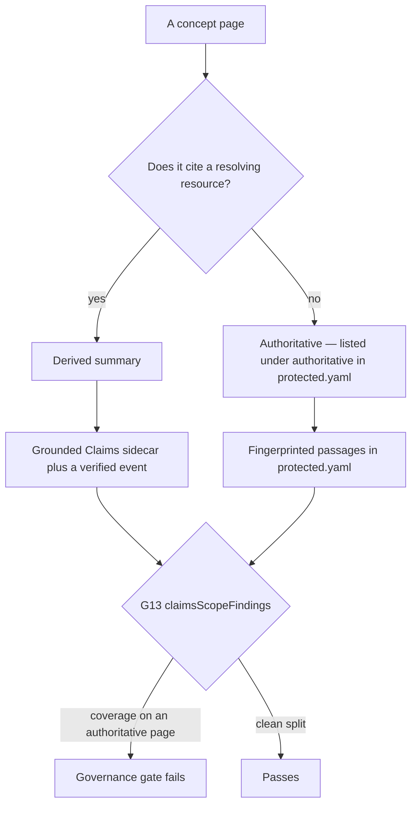

# ADR-0003: Grounded Claims and protected-passage fingerprints are complements

Accepted governance decision (2026-11-01, item #513) settling that the two mechanisms protecting this
bundle answer **different questions about different kinds of page**, so neither supersedes the other:

- **Grounded Claims** live on **derived** pages only — a concept that cites a `resource` and is written
  by the generator. A Claim certifies a *fact the generator wrote*, against the source it derived it
  from.
- **Fingerprints** in [`openwiki/protected.yaml`](../../openwiki/protected.yaml) live on **authoritative**
  pages only — a concept listed under `authoritative:` with no upstream document. A fingerprint freezes
  *prose we wrote*, byte-exact.
- **No page is both**, and the governance gate enforces that as **G13**.

The decision is recorded in full, with its rationale and rejected alternatives, in
[`docs/decisions/ADR-0003-claims-and-fingerprints.md`](../../docs/decisions/ADR-0003-claims-and-fingerprints.md).
Sibling records: [ADR-0001](./adr-0001-prod-secrets-management.md) and
[ADR-0002](./adr-0002-stateful-major-upgrades.md).

## The split, in one picture

Which mechanism protects a page follows from the page's own classification, and G13 fails any page that
carries both.

## What keeps the two sets disjoint

The ADR is explicit that this is **policy, not luck** — the two sets did not merely happen to be
separate on the day it was written. Four existing rules do the work:

- **G3 keeps the generator off authoritative pages.** `actor: generator` is permitted only under
  `openwiki/` in [`openwiki/policy.yaml`](../../openwiki/policy.yaml) (the `GENERATOR_SCOPE_PREFIX` in
  [`scripts/openwiki-policy.mjs`](../../scripts/openwiki-policy.mjs)), and every authoritative page is
  declared `event-driven, actor: agent`. Claims are written only by the generator, so they cannot attach
  to a page the generator may not write. This is the reason a widening of the generator's write scope is
  a separate decision rather than a convenience edit.
- **G11 requires each concept to be exactly one of derived or authoritative** — citing a `resource`
  that resolves, or listed under `authoritative:` in the manifest. A page that is both, or neither,
  fails, so there is no ambiguous middle where the two mechanisms could overlap. A *dangling* citation
  classifies as neither, not as derived.
- **G12 keeps an authoritative concept from being `regenerate`.** An authoritative page has no upstream
  document, so a refresh has nothing to refresh FROM — it could only paraphrase, which is exactly what
  the fingerprinted passages exist to prevent. `event-driven` is the only coherent policy there.
- **G7 rejects a protected passage on a page that declares a `resource`.** Freezing a derived summary
  against the document it summarizes would fail every legitimate refresh, which is precisely why
  protection is refused there rather than merely discouraged.

The Claims side is declared rather than inferred as well: `openwiki/.claims/**` and
`openwiki/.page-manifest.json` carry their own `regenerate, actor: generator` entries in
[`openwiki/policy.yaml`](../../openwiki/policy.yaml) instead of falling under the `openwiki/**`
catch-all, so the coverage mechanism's scope is stated where the other rules are stated.

## G13: the scope gate and its three failure modes

`claimsScopeFindings` in [`scripts/openwiki-claims.mjs`](../../scripts/openwiki-claims.mjs) implements
the check; [`scripts/check-openwiki-governance.mjs`](../../scripts/check-openwiki-governance.mjs) runs it
as rule **G13** in the always-on governance gate. That gate is offline and keyless by construction, and
CI runs it in the `okf` job of `guardrails` on every push to `main` and every pull request —
`--selftest` first, then the scan, alongside the OKF conformance gate. The whole gate is also run
against the working tree by `verifySlice` in [`scripts/wiki-maintain.mjs`](../../scripts/wiki-maintain.mjs)
after **every** slice, so a slice that broke the split fails inside the run rather than waiting for CI to
notice the proposal. `verifySlice` skips that gate — out loud, never silently — only for a fixture bundle
that carries no `openwiki/protected.yaml`; the real repository always has one, and the CI job fails
closed without it.
G13 itself fails three shapes, and each is a different way for the disjointness assumption to break:

1. **An authoritative page carrying Claims coverage** — a sidecar, or an entry in
   `.page-manifest.json`. This is the case a future generator version could produce, and the failure
   message says so: the generator wrote a page policy does not let it write.
2. **A sidecar with no page** — orphaned evidence for a page that no longer exists.
3. **A page carrying a front-matter `verified:` event with no sidecar** — it claims a verification that
   nothing records.

G13 is what surfaces the first case. Without it, an openwiki release that began writing Claims for pages
it did not generate would silently create a **second, conflicting protection** on authoritative pages
rather than failing a pull request. The scope check is pinned by tests in
[`scripts/__tests__/openwiki-claims.test.mjs`](../../scripts/__tests__/openwiki-claims.test.mjs), and the
governance gate's own `--selftest` proves G13 still detects its case.

## G13 and V16 are different invariants — do not conflate them

Both read Claims sidecars, from the same module, but they ask unrelated questions:

- **G13 is about *where* coverage may exist.** It compares `protected.yaml`'s `authoritative:` list
  against sidecar files and `.page-manifest.json` keys, and it never hashes a page: the only page bytes
  it reads are the front matter it scans for a `verified:` event that has no sidecar.
- **V16 is about *durability*.** It checks that a page with a `.page-manifest.json` entry still hashes
  to the `pageVersion` its sidecar certifies, and a page with no manifest entry is not checked at all —
  openwiki leaves an uncovered page for full review.
- **V16's failure is severe, and exactly two rewrites are exempt from it.** openwiki re-proves every
  covered page before a run can advance and refuses the **whole run** — every slice, every page, before
  any generation — when a page no longer matches its certified hash, which is why a hand edit has to go
  red at review time instead of bricking the next paid run. wiki-maintain is the only harness that moves
  a covered page's bytes, and it does so in exactly two places, each carrying the certified hash into
  the sidecar and the manifest entry in the same step so the harness cannot break the invariant it
  enforces: the deterministic link-form normalization (also exposed as `--normalize-links`), and the
  restoration of the keys openwiki's own minimal front-matter rebuild dropped (`type`, `description`,
  `resource`, `tags`, `timestamp`) from `HEAD` (item #777). Both go through `carryClaimsHash`, which
  declines to carry a hash for a page that was already broken — so neither path can launder a real break
  into a consistent one.

A covered page whose bytes were hand-edited fails V16; an authoritative page that acquired a sidecar
fails G13. A change can break either without touching the other, which is why both gates exist.

## Why swapping either mechanism into the other's scope would defeat it

- **A Claim on an authoritative page would have nothing to cite but the page itself.** Claims are
  evidence-backed propositions checked against a source; an authoritative page is canonical precisely
  because no such source exists yet.
- **A fingerprint on a derived page would fail every legitimate refresh** — the very thing a derived
  page exists to receive.

## The rejected alternative, and what it would actually cost

Making Claims supersede fingerprints for some pages was considered and rejected. It is not a policy
edit: it would convert those authoritative pages into derived ones, and each would first need an
**upstream document to derive from**, which by definition does not exist — the text would have to move
into a canonical source, with the concept citing it. That is a **content migration, so it needs a spec**,
and no measured problem called for it. Treat any request framed as "just let Claims cover these pages"
as a migration proposal, not a configuration change.

One consequence is deliberately left alone: **V12 drift remains the only drift signal for derived pages
that carry no Claims.** For covered pages the evidence recheck is the richer signal, but it does not
replace drift detection for the rest.

## When to revisit

The ADR's own re-check trigger is a change in **where openwiki writes Claims** — for example, Claims on
pages it did not generate, or evidence that may cite the page itself. G13 is what will surface the first
case. Nothing else in the decision is a standing invitation to revisit it.

## Operating a failed evidence recheck

This page deliberately does not restate the procedure. When a claim's evidence goes `stale` or
`unresolved`, and when a covered page has to be uncovered before a hand edit, the handling is in
[wiki-maintenance runbook §9](../../docs/runbooks/wiki-maintenance.md#9-claims-sidecars-openwikiclaims).
The related concept pages are [OpenWiki knowledge-bundle maintenance](../runbooks/wiki-maintenance.md)
and [OpenWiki bundle generation and maintenance](../process/wiki-maintenance.md); the scope and
canonical-home rules the generator reads are in
[`openwiki/INSTRUCTIONS.md`](../../openwiki/INSTRUCTIONS.md).
