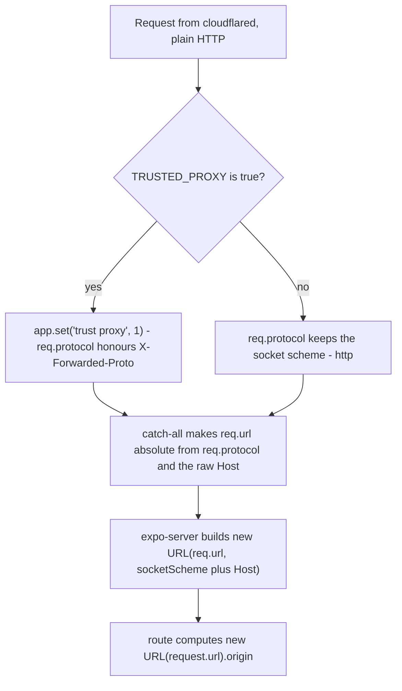
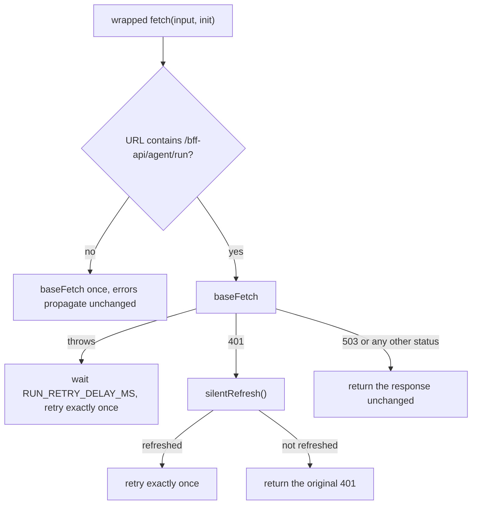

# Expo Router server export and agent-transport traps

`frontend/mcm-app/server.js` is the BFF's production entrypoint and the seam this page is about: a
small CommonJS Express adapter that `require`s `expo-server/adapter/express`, hands the exported
`dist/server` bundle to `createRequestHandler({ build: DIST_SERVER })`, and serves `dist/client` as
static assets. It runs *outside* the Metro bundle, so it cannot import anything from `src/` — every
trap below follows from that boundary.

Feature 087 moved this file off the unmaintained `@expo/server` package: `expo-server` is now a
direct dependency of the package and one of the two prune roots the BFF image's dependency closure
is walked from (`STATIC_ROOTS = ['express', 'expo-server']`), and `@expo/server` appears in no
manifest, prune root or test stub. The adapter option `mode` is gone with it — the constructor now
takes `{ build, isDevelopment? }`. Any surviving mention of `@expo/server` is history, and reading
it as the current package name will send you to the wrong source.

Four traps live here, discovered the hard way (a hang, a silent 404 regression, a Keycloak
`redirect_uri` refusal, and a silent auth failure on the agent route) and each with a narrow,
load-bearing fix that looks removable if you don't know why it is there: the exported bundle's
missing `import.meta.url` registry, the express 5 behaviours that changed under the hosting layer,
the public-scheme fix behind the TLS-terminating proxy (which needs *two* halves — a `trust proxy`
setting and an absolute-URL rewrite), and the CopilotKit React Native streaming-fetch path that
bypasses the app's axios token-refresh interceptor, so the agent run's 401 recovery had to be
reimplemented at the `fetch` level.

## `import.meta.url` crashes the exported server bundle

Metro rewrites `import.meta.url` in bundled dependencies to
`globalThis.__ExpoImportMetaRegistry.url`. The Metro *dev* server populates that registry
automatically; the exported `expo-server` runtime used in the Docker/production build does not.
Any bundled dependency that internally calls `createRequire(import.meta.url)` — this has bitten
`@copilotkit/runtime`'s lazily-required adapter on the `/bff-api/agent/run` path — crashes with
`TypeError: Cannot read properties of undefined (reading 'url')`, and the request simply hangs.

`frontend/mcm-app/server.js` pre-seeds `globalThis.__ExpoImportMetaRegistry = { url:
pathToFileURL(__filename).href }` before `createRequestHandler` loads the bundle. Metro uses one
shared registry object for every module, so pointing it at the server module itself is enough for
`createRequire` to resolve correctly against the deployed `node_modules`.

- **Do not remove this without understanding why it's there** — it looks like dead defensive code
  until a dependency that uses `import.meta.url` is bundled in, at which point removing it
  reintroduces a silent hang (not an obvious error) on a specific agent route in production only.

- **The throw is invisible to the route's own error handling.** It happens asynchronously inside
  the streaming `respond` pipeline, so the `/bff-api/agent/run` handler's `try`/`catch` never sees
  it — the client just hangs, with no 500 and no log line pointing at the cause. That is why
  "the agent route never answers, in the container only" is the symptom to pattern-match, not an
  ordinary server error.

- **The dependency is named as a bare string, which is a second, build-time consequence of the
  same mechanism.** Because `@copilotkit/runtime` reaches its provider adapters through
  `createRequire(globalThis.__ExpoImportMetaRegistry.url)`, a static closure walk cannot see the
  string. The BFF image build compensates with a bundle check that re-derives those specifiers
  from the freshly exported `dist/server` and fails if one is not accounted for — see
  [BFF](../projects/bff.md) for the image shape this sits in.

- **The `if (!globalThis.__ExpoImportMetaRegistry)` guard is intentional.** If a future
  `expo-server` version populates the registry itself, this becomes a harmless no-op rather than
  clobbering the real value.

## express 5 hosting traps in the same `server.js`

The express 4 → 5 major bump (path-to-regexp v8, serve-static 2, router 2) changed exactly the
behaviours `server.js` depends on, and none of the three is visible from the code alone — each
reads like a stylistic choice rather than a compatibility fix.

- **The catch-all must be the named, braced `'/{*splat}'`, not `'*'`.** path-to-regexp v8 rejects a
  bare wildcard at BOOT: `app.all('*', …)` throws `Missing parameter name at index 1: *` while the
  routes are being registered, so the process never reaches `app.listen` and the container will not
  start. The wildcard is therefore NAMED, and the braces make it optional so `/` itself still
  matches the Expo handler.

- **`app.all` rather than `app.use` is load-bearing, and so is the route form.** A route decodes its
  params, so a malformed percent-encoded path (`/bff-api/%E0%A4%A`) is answered `400` by express
  before the Expo handler ever sees it; a `app.use` mount would forward the raw path through. The
  same registration forwards every method (GET/POST/PUT/DELETE/PATCH) and the raw query string —
  bracket syntax included — which is what the `/bff-api/*` API surface and the SSR pages both need
  from one catch-all. The suite's raw `node:http` client is deliberate here: `fetch` would normalise
  the malformed path before it reached the server.

- **serve-static 2 changed the `dotfiles` default, and the fix is two `express.static` instances.**
  `expo export` writes every asset a dependency ships — the Outfit brand fonts, expo-router's icons,
  45 files — under `dist/client/assets/node_modules/.pnpm/…`, which is a DOT-DIRECTORY. express 4
  (serve-static 1) ignored only a path whose LAST segment is a dotfile and served files inside
  dot-directories; express 5 (serve-static 2) ignores both, which silently 404s all 45 assets. So
  `server.js` selects between a default (`ignore`) instance and an `allow` one on the last DECODED
  segment of the request path — decoded, because `/%2Eenv` must count as a dotfile (send decodes
  before it checks), and an undecodable path falls to the strict instance, which rejects it exactly
  as express 4 did. The regression is silent in the worst way: the page still renders, just in the
  fallback font.

- **`tests/unit/bff-server-adapter.test.ts` is the pin for all three, and one of only two suites
  that exercise this layer at all.** It copies the real `server.js` and `web-security-headers.js`
  into a temp directory next to a fixture `dist/client`, then boots it in a child process with only
  `expo-server/adapter/express` replaced by a `node -r` preload
  (`tests/unit/fixtures/expo-adapter-stub.cjs`) whose stub handler echoes what express delivered to
  it. That stub is the right tool here and the wrong tool for the scheme trap below: it asserts the
  express layer *in front of* the handler, and it once also echoed an origin it computed itself,
  which is how a green suite hid a production refusal (see the scheme section).
  `tests/unit/bff-server-trust-proxy.test.ts` boots the same real `server.js` but against the REAL
  adapter — no stub at all. express itself resolves from the package's own `node_modules` via
  `NODE_PATH`, so the version under test is the declared one. The unit tier imports TS modules and
  the integration tier calls route handlers, and both bypass `server.js` — which is why the font
  case needs this test. No
  other test would catch it either: `tests/e2e/web/font-fallback.spec.ts` aborts every font request
  on purpose and asserts the app still renders on the system fallback, so it passes whether or not
  the real fonts are servable.

## The public-scheme trap in the same `server.js`

This one is a *hosting* trap that lives in the same file, not an express 5 regression: the major
bump did not touch `req.protocol`, and the line exists because of where the process is deployed.
It also reads the same env var that already meant something else, which is part of why it looks
removable. The part most likely to be misread is that the fix has two halves and either alone is
useless: `trust proxy` only makes `req.protocol` correct, and the adapter ignores `req.protocol`
entirely unless `server.js` hands it an already-absolute URL.

*The two halves of the public-scheme fix, and why the setting alone changes nothing a route can
see.*

- **The adapter takes the scheme from the SOCKET, not from `req.protocol`.** `expo-server`'s
  express entry builds each request as `new URL(req.url, `${proto}://${req.headers.host}`)`, with
  `proto` derived from `socket.encrypted` — so behind the tunnel it is always `http`, whatever
  express believes. An absolute `req.url` makes that base irrelevant, and it is the only hook the
  adapter offers. This is the SDK-58-era behaviour that the old `@expo/server` adapter did not have
  (it interpolated `req.protocol` itself), which is why the `trust proxy` line that was sufficient
  before feature 087 is no longer sufficient on its own.

- **`server.js` therefore makes `req.url` absolute in the catch-all**, at the same registration that
  forwards everything else: `` req.url = `${req.protocol}://${req.get('host')}${req.url}` `` before
  `expoHandler(req, res, next)`. Removing that wrapper must turn the `https` rows of
  `tests/unit/bff-server-trust-proxy.test.ts` red — that is the required proof the fix is exercised
  through the real adapter, and it is how feature 087 verified the change.

- **What it cost in production: an unregistered `http://` redirect_uri.** TLS terminates at the edge
  proxy (Cloudflare) and a tunnel reaches this process over plain HTTP, so before the fix the origin
  a route computed read `http` — and the two routes that derive an OAuth callback from
  `new URL(req.url).origin` (the backup consent callback and the account-deletion re-authentication
  callback, feature 076) sent Keycloak an unregistered `http://` redirect_uri. Keycloak refused the
  authorization request outright with `Invalid parameter: redirect_uri` (measured in production
  2026-10-25, item 843). CI and dev never saw it, because there the BFF serves HTTPS itself on
  `:8443` — which is why this is pinned by a unit suite that boots the real `server.js` rather than
  by the web E2E run. The measured record is
  [spec 083 T010](../../specs/083-backup-consent-session-isolation/tasks.md#t010--the-bff-must-see-the-public-scheme-behind-the-tls-terminating-proxy-item-843-added-2026-10-25);
  the rewrite and its contract are in
  [spec 087 research R1](../../specs/087-expo-sdk-58/research.md) and
  [the hosting contract](../../specs/087-expo-sdk-58/contracts/hosting.md).

- **`app.set('trust proxy', 1)` — the number is the point, not a shorthand.** It is set only when
  `TRUSTED_PROXY === 'true'`, at boot and above the routes. A numeric value compiles to a hop-count
  predicate over the socket hop index (`i < val`), so `1` means "the immediate peer is the proxy I
  chose" and nothing wider — which is exactly the topology: one hop (the tunnel) in front of this
  process. `true` would trust *any* peer, including a client connecting directly, and an address
  list or CIDR would have to be kept accurate forever; the hop count is the narrowest form that
  still describes the deployment. It is deliberately gated rather than unconditional so the setting
  can never be stronger than the deployment actually is.

- **Only the SCHEME moves, which is what makes this safe to enable.** `trust proxy` changes
  `req.protocol`; it does not change `req.get('host')`, which is a raw header read
  (`this.headers['host']`) with no proxy logic in it at all. That distinction is the whole reason
  the trap is contained: express's *own* `req.host`/`req.hostname` getters do consult
  `X-Forwarded-Host` once the socket address is trusted, but `server.js` does not use them — it calls
  `req.get('host')`. So `X-Forwarded-Host` cannot move the origin a callback is derived from, and a
  forged `Host` cannot either — it would only produce a redirect_uri that is not registered on the
  client, which Keycloak refuses instead of honouring. The suite pins this explicitly: a request
  carrying `X-Forwarded-Proto: https` and `X-Forwarded-Host: attacker.test` still yields the origin
  built from the raw `Host`.

- **Unset must stay unset, and unset is the default.** `TRUSTED_PROXY` defaults to `false`
  (`src/config/env.ts`), so a directly exposed BFF keeps ignoring a client-supplied
  `X-Forwarded-Proto`: otherwise any client could talk the process into believing it serves `https`
  and emit callback URLs for a scheme it is not on. The same variable is also the BFF's rate-limit
  client-identity flag (feature 009, finding #4), read *inside the bundle* by `extractClientIp` for
  the right-most `X-Forwarded-For` hop — see [BFF](../projects/bff.md). The two consumers are
  independent: setting `trust proxy` here does not change rate-limit identity, and `extractClientIp`
  does not change the scheme. Production is the case that sets it (`TRUSTED_PROXY: "true"` in
  `compose.prod.yaml`, for the same proxy, not for this fix).

- **A stand-in that mirrors the production logic can hide the very defect it guards.** Until feature
  087 this trap was "pinned" by a suite running against a stub that computed and echoed the origin
  itself (`X-Test-Origin`), so the assertion tested the stub's belief about the adapter rather than
  the adapter's behaviour — green throughout, while production refused the callback. Feature 087
  deleted that echo, moved the scheme assertion onto the real adapter, and left the stub only where
  the subject really is the express layer in front of the handler. Treat any harness that
  re-implements the thing it is checking as unpinned.

- **Pinned by `tests/unit/bff-server-trust-proxy.test.ts`, which boots the real `server.js` against
  a fixture `dist/server` and the REAL adapter** — `fixtures/real-adapter-build/` holds a minimal
  `_expo/routes.json` (empty `htmlRoutes` and `notFoundRoutes`, one API route) plus one function
  returning `Response.json({ url: request.url })`, so the URL a route actually receives is
  observable from outside the child process and nothing is stubbed on that path. It boots twice —
  once as production runs it (`TRUSTED_PROXY=true`), once without — and asserts the four rows of the
  hosting contract. Measured RED before the fix: 2 failed, 2 passed — the two `TRUSTED_PROXY=true`
  cases asserting `https` failed with `http://…`, while the two that assert `http` (the proxy saying
  nothing, and no trusted proxy at all) passed already. If an SDK changes the manifest shape the
  fixture stops loading and the suite fails: that is the intended prompt, not flakiness.

## CopilotKit's RN streaming-fetch bypasses the axios refresh interceptor

The agent chat's client-side network layer normally goes through an axios instance whose response
interceptor turns a 401 into a silent refresh plus one retry (`utils/api-client.ts` →
`utils/token-refresh`). But CopilotKit's React Native runtime issues its `/bff-api/agent/run`
request through its own streaming-fetch polyfill (built on `XMLHttpRequest`), which never passes
through that interceptor. Cookie auth still works — RN's `XMLHttpRequest` defaults
`withCredentials` to `true`, so the credential cookie rides along automatically — but a 401 on the
run route has no interceptor to catch it, which is why this recovery has to live at the `fetch`
level.

What that 401 *means* changed with feature 085, and the change is worth stating because the
surrounding comments did not all follow it. The member's tokens are now held by the BFF inside the
session, so `requireAuth` renews a nearly expired access token on the very request that needs it: an
access-token expiry mid-session no longer reaches the client at all, and the only cookie the client
holds is the opaque `mcm_session_id` (`mcm_access_token` / `mcm_refresh_token` are retired, never
read, and only ever cleared). A `/run` 401 now means the session or its identity was refused — in
practice a refused run-scoped subject-token mint, `401 AGENT_IDENTITY_REJECTED`. The wrapper answers
it the way it always has: `silentRefresh()` (`POST /bff-api/auth/refresh`, which renews the
server-held tokens and re-sets only the session cookie) and one retry; if that still fails, the
member is sent to sign in.

`frontend/mcm-app/src/utils/agent-fetch-refresh.ts` wraps `globalThis.fetch` (installed by the
assistant polyfill loader, the very first import in `app/_layout.tsx` — on native
`assistant-polyfills.native.ts`, after the crypto/streaming polyfills; on web
`assistant-polyfills.ts`, which installs only the wrapper — and before CopilotKit issues any run) to
detect a 401 on the agent run route specifically, call `silentRefresh()`, and retry the run once. The
401 retry is immediate; the 250 ms settle delay applies only to a *thrown* transport error.

*The two bounded recoveries in `createRefreshingFetch` — a status-code path and a thrown-transport
path — both scoped to the agent route and both capped at one retry. A 503, the identity provider
being unreachable, is deliberately neither of them.*

- **The cookie is carried by RN's *default* behavior, not an explicit flag.** CopilotKit's polyfill
  itself does not set `init.credentials`; if a future React Native or CopilotKit upgrade changes
  that default, the cookie stops riding along automatically and this breaks silently — there is no
  compile-time or type-level signal that would catch it. The Android E2E flow is the intended
  regression net for this.

- **A 503 must not refresh, and that is a pinned behavior rather than an oversight.** The BFF's
  refusal vocabulary distinguishes the two: `401 AGENT_IDENTITY_REJECTED` (Keycloak rejected the
  member's credential — renew once, then sign in) versus a retryable `503
  AGENT_IDENTITY_UNAVAILABLE` (Keycloak unreachable or erroring, including a misconfigured exchange
  client's `403 access_denied`). An outage is not a reason to touch the member's session, so the
  wrapper passes a 503 straight through. The unit suite carries the mutation test for it: making the
  wrapper refresh on 503 turns that case red.

- **The member-facing half of the refusal lives in a different module.** CopilotKit reports a
  refused `/run` through its `onError` subscription — never as a rejected promise — and for a
  non-2xx response the error's message *is* the response body, so the BFF's `code` decides the text.
  `src/components/agent/assistant-run-failure.ts` maps the session-ending codes
  (`AGENT_IDENTITY_REJECTED`, `REFRESH_FAILED`, `SESSION_NOT_FOUND`, `SESSION_EXPIRED`,
  `SESSION_IDLE_TIMEOUT`, `SESSION_ABSOLUTE_TIMEOUT`, `UNAUTHORIZED`) to "Your session has expired.
  Please sign in again." and the retryable set (`AGENT_IDENTITY_UNAVAILABLE`, `KEYCLOAK_UNAVAILABLE`,
  `SESSION_RENEWAL_PENDING`) to "The assistant is temporarily unavailable. Please try again.",
  falling back to a generic message that names no internals. Before 085 a failed turn showed the
  member nothing at all.

- **Install order matters.** The refresh wrapper must be installed after the streaming-fetch
  polyfill but before any CopilotKit run — `assistant-polyfills.native.ts` is structured specifically
  to guarantee that ordering (crypto, then the polyfills, then the wrapper); don't reorder its
  `require()` calls. (`app/_layout.tsx`'s comment still points at `assistant-polyfills.ts`, which since
  feature 077 is the web variant.)

- **A *second*, distinct recovery lives in the same wrapper: the transport-drop retry.** A dropped
  connection mid-stream (a reset adb-reverse tunnel; server-side it surfaces as `Cannot pipe to a
  closed or destroyed stream`) rejects RN's XHR streaming polyfill as a **thrown** fetch error, not
  a 4xx. Without handling it the run silently produces no `render_selection` /
  `render_disambiguation` tool call and the dock panel never renders. `createRefreshingFetch` catches
  a throw on the agent route only, waits `RUN_RETRY_DELAY_MS` (250 ms) for the tunnel to
  re-establish, and retries **exactly once**. The retry is justified in the source comment by a
  dropped connection aborting the upstream gateway turn through the adapter's `AbortController`,
  making the cut turn idempotent-on-failure — but treat that justification as asserted rather than
  measured: feature 087's research records that the express entry does not pass the abort `signal`
  the plain `http` entry does, and that the new adapter's `respond` now guards `writableEnded` /
  `destroyed`, so whether this failure still surfaces in the same shape is an open reading to take
  from current counts rather than assume. What is not open is the bound: one retry, in code and in
  tests. Non-agent throws propagate unchanged, and a real 4xx returns a `Response` (never throws), so
  it is never retried. This is the one behavior on this page whose trigger is a *thrown* error rather
  than a status code — do not "simplify" it into the 401 branch.

- **Neither recovery loops.** A still-401 response after a successful refresh is returned as-is
  (one retry maximum), a failed refresh returns the original 401 with no retry, and a second
  consecutive throw is propagated. `createRefreshingFetch` is a pure factory taking an injected
  `baseFetch` + `refresh`, so both paths are unit-tested without any global in
  `src/utils/unit-tests/agent-fetch-refresh.test.ts`.

- **The client-side orchestration of the 401 → refresh → retry is still not proven end to end over
  a real refused run.** What *has* been proven is the server half of the chain, and it has been
  re-scoped by feature 085: `tests/e2e/web/agent-session-refresh.spec.ts` no longer drops an access
  cookie (there is none). It ages the session's **server-held** access token to expired in the dev
  BFF's Redis store through `tests/e2e/web/setup/bff-session-store.ts` — the expiry times sit in
  clear beside the sealed tokens precisely so a test can do this without the encryption key — and
  then asserts the renewal is *transparent*: the protected route still answers `200` with no 401 and
  no token cookie set, the expiry moved forward, and `POST /bff-api/auth/refresh` (the client's
  fallback) succeeds on the session cookie alone and re-sets only `mcm_session_id`. The client-side
  orchestration over a real refused run, and the RN-default cookie delivery, still rest on the
  Android harness.

- **The web and native loaders are deliberately split, and the split is load-bearing for bundle
  size.** `assistant-polyfills.ts` (the default/web variant) installs *only* the refresh wrapper —
  on web the crypto/streaming globals are native. `assistant-polyfills.native.ts` loads the
  CopilotKit crypto and streaming polyfills and *then* the wrapper. Static `require`s meant the
  polyfill libraries landed in the entry chunk for every web user even though they could never
  execute there, so the platform boundary is where they are dropped. See
  [Expo/React Native app](../projects/expo-app.md) for the surrounding app shape.

See [Expo/React Native app](../projects/expo-app.md) for the broader client-side app shape
this hosting/transport layer sits in, [BFF](../projects/bff.md) for the server-side surface
`server.js` serves, and [AI Agents layer architecture](../architecture/agent-layer.md) for the
call chain the agent transport feeds. This page is about the *build and transport* surfaces;
for the router-shape gotcha (`collections/[collectionId]/` as a directory route rather than a file
route) see [Directory-based collection routing in Expo Router](expo-router-collection-routing.md),
and for the auth chain the cookie on this transport ultimately satisfies see
[Authentication and authorization chain](../invariants/auth-chain.md). The harnesses the
verification split above rests on are described in the
[E2E testing runbook](../../docs/runbooks/e2e-testing.md).
