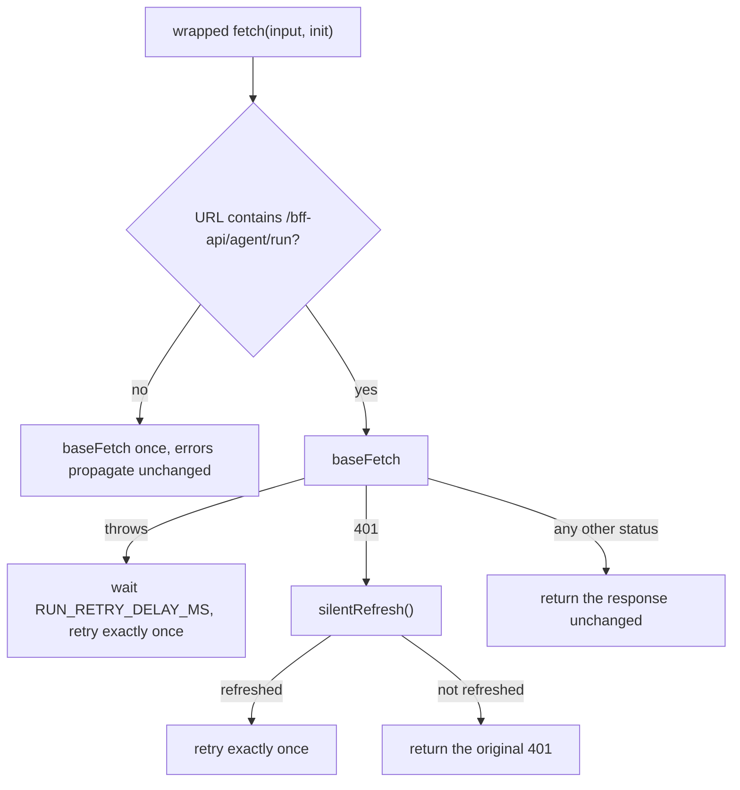

# Expo Router server export and agent-transport traps

`frontend/mcm-app/server.js` is the BFF's production entrypoint and the seam this page is about: a
small CommonJS Express adapter that `require`s `@expo/server/adapter/express`, hands the exported
`dist/server` bundle to `createRequestHandler`, and serves `dist/client` as static assets. It runs
*outside* the Metro bundle, so it cannot import anything from `src/` — every trap below follows from
that boundary.

Three of them live here, discovered the hard way (a hang, a silent 404 regression, and a silent auth
failure) and each with a narrow, load-bearing fix that looks removable if you don't know why it is
there: the exported bundle's missing `import.meta.url` registry, the express 5 behaviours that
changed under the hosting layer, and the CopilotKit React Native streaming-fetch path that bypasses
the app's token-refresh interceptor.

## `import.meta.url` crashes the exported server bundle

Metro rewrites `import.meta.url` in bundled dependencies to
`globalThis.__ExpoImportMetaRegistry.url`. The Metro *dev* server populates that registry
automatically; the exported `@expo/server` runtime used in the Docker/production build does not.
Any bundled dependency that internally calls `createRequire(import.meta.url)` — this has bitten
`@copilotkit/runtime`'s lazily-required adapter on the `/bff-api/agent/run` path — crashes with
`TypeError: Cannot read properties of undefined (reading 'url')`, and the request simply hangs.

`frontend/mcm-app/server.js` pre-seeds `globalThis.__ExpoImportMetaRegistry = { url:
pathToFileURL(__filename).href }` before `createRequestHandler` loads the bundle. Metro uses one
shared registry object for every module, so pointing it at the server module itself is enough for
`createRequire` to resolve correctly against the deployed `node_modules`.

- **Do not remove this without understanding why it's there** — it looks like dead defensive code
  until a dependency that uses `import.meta.url` is bundled in, at which point removing it
  reintroduces a silent hang (not an obvious error) on a specific agent route in production only.

- **The throw is invisible to the route's own error handling.** It happens asynchronously inside
  the streaming `respond` pipeline, so the `/bff-api/agent/run` handler's `try`/`catch` never sees
  it — the client just hangs, with no 500 and no log line pointing at the cause. That is why
  "the agent route never answers, in the container only" is the symptom to pattern-match, not an
  ordinary server error.

- **The dependency is named as a bare string, which is a second, build-time consequence of the
  same mechanism.** Because `@copilotkit/runtime` reaches its provider adapters through
  `createRequire(globalThis.__ExpoImportMetaRegistry.url)`, a static closure walk cannot see the
  string. The BFF image build compensates with a bundle check that re-derives those specifiers
  from the freshly exported `dist/server` and fails if one is not accounted for — see
  [BFF](../projects/bff.md) for the image shape this sits in.

- **The `if (!globalThis.__ExpoImportMetaRegistry)` guard is intentional.** If a future
  `@expo/server` version populates the registry itself, this becomes a harmless no-op rather than
  clobbering the real value.

## express 5 hosting traps in the same `server.js`

The express 4 → 5 major bump (path-to-regexp v8, serve-static 2, router 2) changed exactly the
behaviours `server.js` depends on, and none of the three is visible from the code alone — each
reads like a stylistic choice rather than a compatibility fix.

- **The catch-all must be the named, braced `'/{*splat}'`, not `'*'`.** path-to-regexp v8 rejects a
  bare wildcard at BOOT: `app.all('*', …)` throws `Missing parameter name at index 1: *` while the
  routes are being registered, so the process never reaches `app.listen` and the container will not
  start. The wildcard is therefore NAMED, and the braces make it optional so `/` itself still
  matches the Expo handler.

- **`app.all` rather than `app.use` is load-bearing, and so is the route form.** A route decodes its
  params, so a malformed percent-encoded path (`/bff-api/%E0%A4%A`) is answered `400` by express
  before the Expo handler ever sees it; a `app.use` mount would forward the raw path through. The
  same registration forwards every method (GET/POST/PUT/DELETE/PATCH) and the raw query string —
  bracket syntax included — which is what the `/bff-api/*` API surface and the SSR pages both need
  from one catch-all.

- **serve-static 2 changed the `dotfiles` default, and the fix is two `express.static` instances.**
  `expo export` writes every asset a dependency ships — the Outfit brand fonts, expo-router's icons,
  45 files — under `dist/client/assets/node_modules/.pnpm/…`, which is a DOT-DIRECTORY. express 4
  (serve-static 1) ignored only a path whose LAST segment is a dotfile and served files inside
  dot-directories; express 5 (serve-static 2) ignores both, which silently 404s all 45 assets. So
  `server.js` selects between a default (`ignore`) instance and an `allow` one on the last DECODED
  segment of the request path — decoded, because `/%2Eenv` must count as a dotfile (send decodes
  before it checks), and an undecodable path falls to the strict instance, which rejects it exactly
  as express 4 did. The regression is silent in the worst way: the page still renders, just in the
  fallback font.

- **`tests/unit/bff-server-adapter.test.ts` is the pin for all three, and the only test that
  exercises this layer at all.** It copies the real `server.js` and `web-security-headers.js` into a
  temp directory next to a fixture `dist/client`, then boots it in a child process with only
  `@expo/server/adapter/express` replaced by a `node -r` preload
  (`tests/unit/fixtures/expo-adapter-stub.cjs`) that echoes what express delivered to the handler.
  express itself resolves from the package's own `node_modules` via `NODE_PATH`, so the version
  under test is the declared one. The unit tier imports TS modules and the integration tier calls
  route handlers, and both bypass `server.js` — which is why the font case needs this test. No other
  test would catch it either: `tests/e2e/web/font-fallback.spec.ts` aborts every font request on
  purpose and asserts the app still renders on the system fallback, so it passes whether or not the
  real fonts are servable.

## CopilotKit's RN streaming-fetch bypasses the axios refresh interceptor

The agent chat's client-side network layer normally goes through an axios instance with a
token-refresh interceptor (`utils/token-refresh`). But CopilotKit's React Native runtime issues its
`/bff-api/agent/run` request through its own streaming-fetch polyfill (built on
`XMLHttpRequest`), which never passes through that interceptor. Cookie auth still works — RN's
`XMLHttpRequest` defaults `withCredentials` to `true`, so the `mcm_access_token` cookie rides along
automatically — but when that short-lived cookie expires (Keycloak's ~5 minute access-token
lifespan) mid-session, the run 401s with no refresh attempted.

`frontend/mcm-app/src/utils/agent-fetch-refresh.ts` wraps `globalThis.fetch` (installed by the
assistant polyfill loader, the very first import in `app/_layout.tsx` — on native
`assistant-polyfills.native.ts`, after the crypto/streaming polyfills; on web
`assistant-polyfills.ts`, which installs only the wrapper — and before CopilotKit issues any run) to
detect a 401 on the agent run route specifically, call `silentRefresh()`, and retry the run once. The
401 retry is immediate; the 250 ms settle delay applies only to a *thrown* transport error.

*The two bounded recoveries in `createRefreshingFetch` — a status-code path and a thrown-transport
path — both scoped to the agent route and both capped at one retry.*

- **The cookie is carried by RN's *default* behavior, not an explicit flag.** CopilotKit's polyfill
  itself does not set `init.credentials`; if a future React Native or CopilotKit upgrade changes
  that default, the cookie stops riding along automatically and this breaks silently — there is no
  compile-time or type-level signal that would catch it. The Android E2E flow is the intended
  regression net for this.

- **Install order matters.** The refresh wrapper must be installed after the streaming-fetch
  polyfill but before any CopilotKit run — `assistant-polyfills.native.ts` is structured specifically
  to guarantee that ordering (crypto, then the polyfills, then the wrapper); don't reorder its
  `require()` calls. (`app/_layout.tsx`'s comment still points at `assistant-polyfills.ts`, which since
  feature 077 is the web variant.)

- **A *second*, distinct recovery lives in the same wrapper: the transport-drop retry.** A dropped
  connection mid-stream (a reset adb-reverse tunnel; server-side it surfaces as `Cannot pipe to a
  closed or destroyed stream`) rejects RN's XHR streaming polyfill as a **thrown** fetch error, not
  a 4xx. Without handling it the run silently produces no `render_selection` /
  `render_disambiguation` tool call and the dock panel never renders. `createRefreshingFetch` now
  catches a throw on the agent route only, waits `RUN_RETRY_DELAY_MS` (250 ms) for the tunnel to
  re-establish, and retries **exactly once**. The retry is safe because a dropped connection aborts
  the upstream gateway turn via `@expo/server`'s `AbortController`, making the cut turn
  idempotent-on-failure. Non-agent throws propagate unchanged, and a real 4xx returns a `Response`
  (never throws), so it is never retried. This is the one behavior on this page whose trigger is a
  *thrown* error rather than a status code — do not "simplify" it into the 401 branch.

- **Neither recovery loops.** A still-401 response after a successful refresh is returned as-is
  (one retry maximum), and a second consecutive throw is propagated. `createRefreshingFetch` is a
  pure factory taking an injected `baseFetch` + `refresh`, so both paths are unit-tested without any
  global in `src/utils/unit-tests/agent-fetch-refresh.test.ts`.

- **Whether the retry actually recovers a real mid-session expiry (versus flakiness seen under an
  unstable Windows/Metro test harness) was, per the source comments, still an open verification
  item** at the time this was written — treat a related test failure as needing investigation, not
  an automatic false positive. What *has* since been proven is the server half of the chain: the
  web E2E `tests/e2e/web/agent-session-refresh.spec.ts` drops only the access cookie, observes the
  `no_token` 401 the agent route sees, and shows `/bff-api/auth/refresh` rotating the cookie so the
  retry succeeds. The client-side orchestration over that chain, and the RN-default cookie
  delivery, still rest on the Android harness.

- **The web and native loaders are deliberately split, and the split is load-bearing for bundle
  size.** `assistant-polyfills.ts` (the default/web variant) installs *only* the refresh wrapper —
  on web the crypto/streaming globals are native. `assistant-polyfills.native.ts` loads the
  CopilotKit crypto and streaming polyfills and *then* the wrapper. Static `require`s meant the
  polyfill libraries landed in the entry chunk for every web user even though they could never
  execute there, so the platform boundary is where they are dropped. See
  [Expo/React Native app](../projects/expo-app.md) for the surrounding app shape.

See [Expo/React Native app](../projects/expo-app.md) for the broader client-side app shape
this hosting/transport layer sits in, [BFF](../projects/bff.md) for the server-side surface
`server.js` serves, and [AI Agents layer architecture](../architecture/agent-layer.md) for the
call chain the agent transport feeds. This page is about the *build and transport* surfaces;
for the router-shape gotcha (`collections/[collectionId]/` as a directory route rather than a file
route) see [Directory-based collection routing in Expo Router](expo-router-collection-routing.md),
and for the auth chain the cookie on this transport ultimately satisfies see
[Authentication and authorization chain](../invariants/auth-chain.md). The harnesses the
verification split above rests on are described in the
[E2E testing runbook](../../docs/runbooks/e2e-testing.md).
