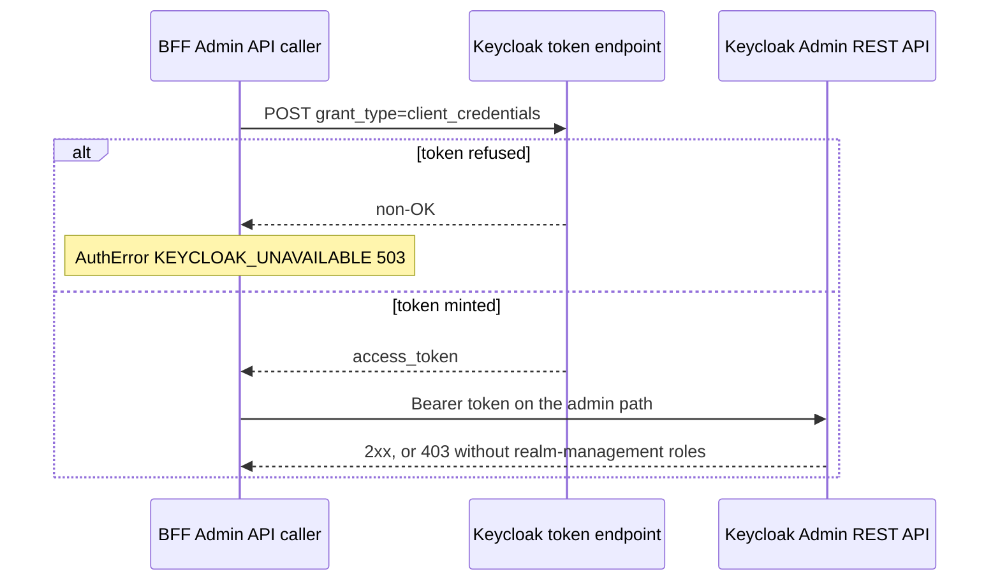

# Service account vs admin credentials — Keycloak Admin API calls

Every BFF call into Keycloak's Admin REST API (`keycloakAdminApiBase`, derived from the *internal*
`keycloakUrl` — see [Docker internal DNS](docker-internal-dns.md)) — user lookup, user creation,
role assignment, forced session logout, email verification, redirect-URI registration —
authenticates as a dedicated Keycloak service account via the OAuth2 client-credentials grant, not
the realm admin password. `getAdminToken()` in `keycloak.ts` posts `grant_type=client_credentials`
with `keycloakServiceClientId` / `keycloakServiceClientSecret` to the realm's token endpoint and
returns the resulting `access_token`; every Admin API caller (`keycloak.ts`, `email-service.ts`)
goes through this helper. See [the auth chain](../invariants/auth-chain.md) for how this fits
alongside the user-facing authorization-code flow.

One Admin API call: a freshly minted client-credentials token, and the two failure shapes the BFF
never passes through unchanged.

## Failure-mode mapping

What each Admin API caller does with what Keycloak answers. Nothing here surfaces as a Keycloak
status code — `403` in particular is never propagated.

| Caller | Keycloak answers | BFF behaviour |
|---|---|---|
| `getAdminToken()` | token request non-OK | `AuthError` `KEYCLOAK_UNAVAILABLE`, **503** |
| `deleteUser` | 404 | treated as success (a retry after a partial delete must not fail) |
| `deleteUser` | anything else non-OK | `KEYCLOAK_UNAVAILABLE`, **502** |
| `countUsersInClientRole` | client lookup or role-members non-OK | `KEYCLOAK_UNAVAILABLE`, **502** — never `0` |
| `createUser` | 409 | `DUPLICATE_USERNAME` or `DUPLICATE_EMAIL`, **409** |
| `createUser` | other non-OK (a 403 included) | `INVALID_INPUT`, **400** |
| `sendVerificationEmail` (both copies) | non-OK | `KEYCLOAK_UNAVAILABLE`, **502** |
| `getUserById`, `isEmailVerified` | non-OK | `UNAUTHORIZED`, **404** |
| `getUserIdByEmail` | non-OK | returns `null` — indistinguishable from "no such user" |
| `assignMcUserRole` | any | nothing is checked at all |
| `logoutUserSessions`, `revokeToken` | any | ignored |
| `ensureClientRedirectUris` | any | ignored (bare `catch`) |

## Gotchas

- **Service account vs admin credentials**: Keycloak Admin API calls use a dedicated service account
  (client credentials grant), not the admin password.
- **The service account client is distinct from the user-facing app client.** `keycloakServiceClientId`
  (`KEYCLOAK_SERVICE_CLIENT_ID`, default `mcm-bff-service`) and its secret are separate credentials
  from `keycloakClientId` (`KEYCLOAK_CLIENT_ID`, the app's OAuth2/PKCE client used for
  `exchangeCodeForTokens`/`refreshTokens`). Do not reuse one client's credentials for the other's
  grant type.
- **`email-service.ts` duplicates its own `getAdminToken()`** rather than importing `keycloak.ts`'s,
  specifically to avoid a circular dependency. If the admin-token logic changes (grant params, error
  handling, endpoint), both copies need the same fix.
- **The two copies are not otherwise identical, so "fix both" is not a copy-paste.** `keycloak.ts`'s
  copy goes through its local `keycloakFetch()` wrapper, which attaches the request's `X-Request-Id`
  header; `email-service.ts`'s copy calls bare `fetch`, so its token request is untraceable in the
  request-scoped logs. `sendVerificationEmail` also reads the client id from a different source in
  each copy (`env.keycloakClientId` in `keycloak.ts`, `keycloakConfig.clientId` in
  `email-service.ts`) — same value in practice, two places to keep in step.
- **A missing or wrong service-account secret fails as a 503 `KEYCLOAK_UNAVAILABLE`**, not a 401 —
  `getAdminToken()` maps any non-OK token response to that error code, so an admin-token failure looks
  the same as Keycloak being down. Check the service-account secret first when Admin-API-backed routes
  (registration, forced logout, role assignment) start failing.
- **A service account whose `realm-management` roles are missing fails differently — not 503.**
  The realm seeds `service-account-mcm-bff-service` with `view-users`, `manage-clients` and
  `manage-users` from the `realm-management` client; without them the client still authenticates (the
  503 path above never triggers) and Keycloak rejects each Admin API call with 403 — which the BFF
  never passes through. Each function re-maps it: `deleteUser`, `countUsersInClientRole` and
  `sendVerificationEmail` answer 502 `KEYCLOAK_UNAVAILABLE`, `createUser` answers 400 `INVALID_INPUT`,
  and `logoutUserSessions` ignores the failure entirely. Do not look for a 403 in BFF responses. A realm export does not
  carry service-account role mappings, so the export script has to reconstruct them explicitly — a
  partial import can therefore produce a service account that mints tokens and authorizes nothing.
  The reconstruction lives in [`scripts/export-ci-realm.mjs`](../../scripts/export-ci-realm.mjs),
  which writes `service-account-<clientId>` users carrying each service account's realm and client
  roles; [the Keycloak project page](../projects/keycloak.md) covers how the committed realm variants
  are derived from it.
- **`ensureClientRedirectUris()` is a second Admin API path, and it swallows every failure.** Called
  from the app-mount route `GET /bff-api/auth/init` with the complete list of redirect URIs this
  client needs (see [the BFF project page](../projects/bff.md)), it mints an admin token, looks up the
  named client, and PUTs the client back with `[...existing, ...missing]`. Feature 083 gave it a
  `keycloakClientId` parameter defaulting to the login client, so the backup-consent client's own
  callback can be registered on *that* client — on the login client alone, Keycloak refuses the
  consent authorization request. Its whole body sits inside a `try` with a bare `catch {}`: a service
  account without `manage-clients`, or a Keycloak outage, silently leaves the redirect URI
  unregistered, with nothing logged and nothing returned to the caller. The symptom arrives later and
  elsewhere — Keycloak rejects the authorize request for the flow whose URI went missing — and the
  operator has to add the entry by hand. The helper is also one-shot per client id per process
  lifetime (a module-level `Set`), and the id is recorded only after a successful run, so a failed
  first call is retried on the next `/bff-api/auth/init`.
- **A swallowed 403 can read as a successful no-op.** `getUserIdByEmail` returns `null` for *any*
  non-OK Admin response, and `/bff-api/auth/resend-verification` deliberately answers success for an
  unknown email (it must not be a user-enumeration oracle) — so a service account that lost
  `view-users` produces "if that email is registered and unverified, a link has been sent" rather
  than an error. `assignMcUserRole` never inspects the response to its role-mapping POST (and does
  not check the role-lookup GET either), so a registration can report success while the `mc-user`
  role assignment failed; the user then authenticates and is refused by the role gate.
- **The admin token is minted per call, never cached.** Each Admin API function in `keycloak.ts`
  calls `getAdminToken()` itself (unlike the discovery document, which is cached), so one user-facing
  operation can make several token requests — registration mints for `createUser`,
  `assignMcUserRole` and `sendVerificationEmail`, and the resend route mints for the lookup and again
  for the send — and a rotated/mistyped secret takes every Admin API call down at once rather than
  degrading it.
- **The swallowed paths are not uniform, and the differences are deliberate.** `deleteUser` counts a
  404 as success because a retry after a partial failure re-issues the delete against an account the
  first attempt already removed; treating that as an error would break the retry that rescues a
  half-finished deletion. `logoutUserSessions` and `revokeToken` ignore failures because the BFF
  session and token are already gone and the token expires anyway. Contrast the offline-token
  revocation in `backup-offline-token.ts`, which deliberately does *not* reuse `revokeToken` and
  instead reports whether the revocation worked: an offline token never expires, so "revocation
  failed" has to be a fact the caller can see.
- **Both credential sets are used on the account-deletion path, deliberately.** `account-deletion.ts`
  calls `deleteUser` and `logoutUserSessions` (service-account Admin API) alongside `revokeToken` (the
  app client's `revoke` endpoint) in one ordered run — only the Admin API steps depend on the
  service-account secret, so a 503 there says nothing about the token revocation step. The identity
  deletion runs last, and its 404-as-success rule above is what makes a retry of that pipeline
  completable.
