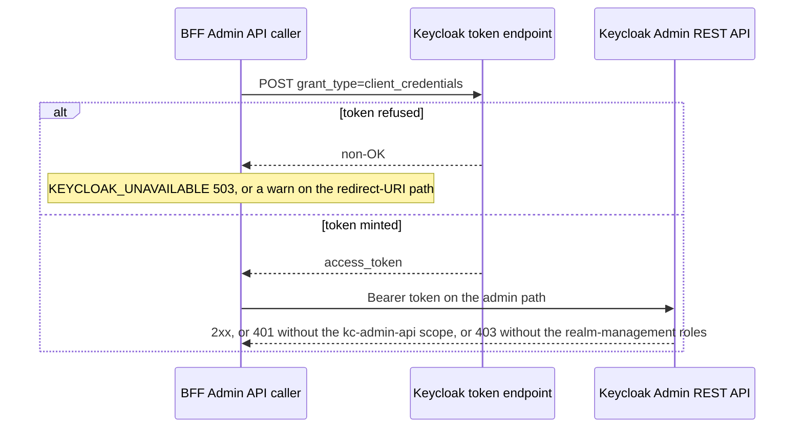
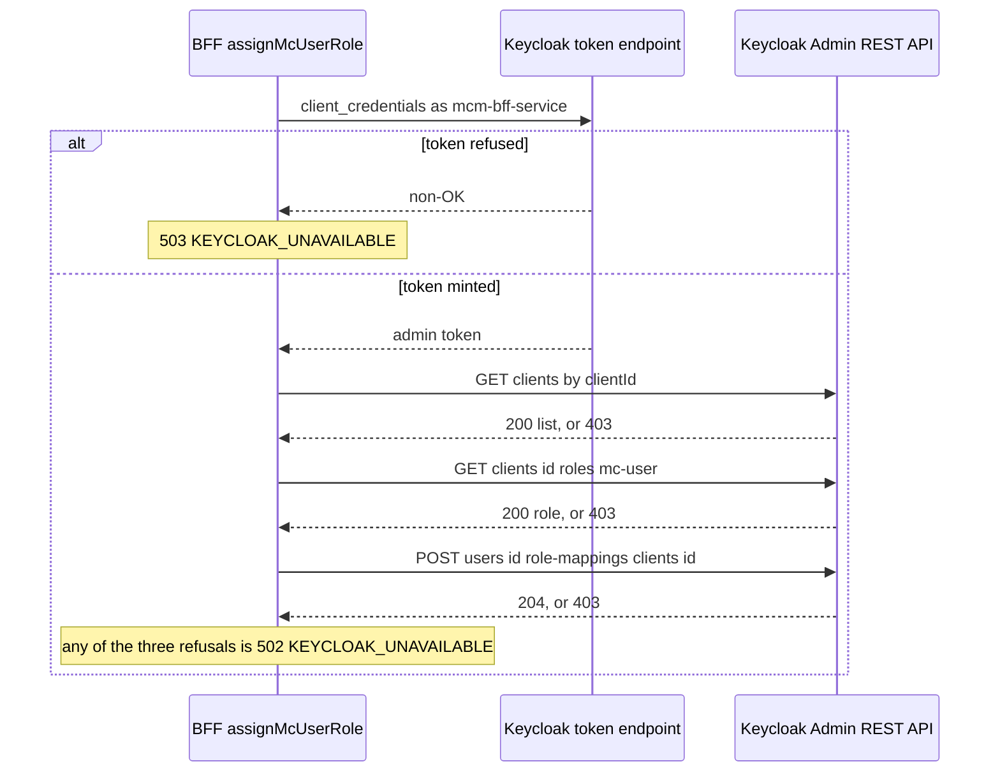

# Service account vs admin credentials — Keycloak Admin API calls

Every BFF call into Keycloak's Admin REST API (`keycloakAdminApiBase`, derived from the *internal*
`keycloakUrl` — see [Docker internal DNS](docker-internal-dns.md)) — user lookup, user creation,
role assignment, forced session logout, email verification, redirect-URI registration —
authenticates as a dedicated Keycloak service account via the OAuth2 client-credentials grant, not
the realm admin password. `getAdminToken()` in `keycloak.ts` posts `grant_type=client_credentials`
with `keycloakServiceClientId` / `keycloakServiceClientSecret` to the realm's token endpoint and
returns the resulting `access_token`; every Admin API caller (`keycloak.ts`, `email-service.ts`)
goes through this helper. See [the auth chain](../invariants/auth-chain.md) for how this fits
alongside the user-facing authorization-code flow.

One Admin API call: a freshly minted client-credentials token, and the refusal shapes the BFF never
passes through unchanged — except on the redirect-URI path, which converts every one of them into a
warning instead.

A minted token is only half the requirement. Keycloak judges each admin call against *two* realm
facts the token has to carry — the client scope that gives it the Admin API audience, and the
service account's own `realm-management` roles — and a failure of either arrives as a status the BFF
re-maps rather than propagates.

## What the realm must provide

**The client scope (feature 090).** From Keycloak 26.8.2, a token used against the Admin REST API
must carry the `kc-admin-api` client scope. Without it every BFF admin call is refused with 401,
logged by Keycloak as `Expected audience not available in the token` — user lookup, registration,
verification email, forced logout and the last-administrator check all fail together, because they
all mint the same kind of token. The 26.8.2 migration creates the scope and gives it to `admin-cli`
and `security-admin-console`, but not to `mcm-bff-service`, so neither an upgrade nor a bare
reference in a realm file is enough:

- **A fresh realm** gets it from the realm files, which must *define* the scope (with the
  `oidc-admin-api-audience-mapper` protocol mapper) **as well as** assign it to `mcm-bff-service` as
  a default client scope. Import ignores a reference to a scope the file does not define, logging
  `Referenced client scope 'kc-admin-api' doesn't exist. Ignoring`.
- **An existing realm** — production, or a local stack with an existing Postgres volume, since
  import is `IGNORE_EXISTING` — needs
  [`ensure-admin-api-scope.mjs`](../../infrastructure-as-code/docker/keycloak/scripts/ensure-admin-api-scope.mjs),
  which reports what is missing and changes nothing until it is given `--apply`. Run it *before*
  the upgrade and there is no outage; it also repairs a realm already upgraded. It signs in as a
  password-only admin, so it cannot be used where the admin has two-factor — production takes the
  console route instead (add the scope to `mcm-bff-service` as a default client scope).
  `scripts/__tests__/keycloak-admin-api-scope.guard.test.mjs` pins the definition, the mapper and
  the assignment in all three realm files, plus the script's argument contract.

**The service-account roles.** The roles are attached to a reconstructed
`service-account-mcm-bff-service` user, and the set differs deliberately by realm variant:

| Realm file | `realm-management` client roles on `service-account-mcm-bff-service` |
|---|---|
| `ci-realm.json`, `dev-realm.json` | `view-users`, `manage-clients`, `manage-users` |
| `prod-realm.json` | `view-users`, `view-clients`, `manage-users` |

`manage-clients` is **not** granted in production on purpose: it would let the BFF edit any client,
and production has no need for it because every address `/bff-api/auth/init` registers is listed in
the realm already — the route finds nothing to add and attempts no write. `query-clients` is not a
substitute for `view-clients`: the client lookup answers 200 with an empty list, so the BFF sees
"client not found" rather than a refusal. `scripts/__tests__/keycloak-service-account-roles.guard.test.mjs`
asserts each file carries `view-users` and `manage-users` plus `view-clients` *or* `manage-clients`,
that production carries exactly its three, and (a separate concern) that production lists every
address `init` registers. [The Keycloak project page](../projects/keycloak.md) covers the
realm-variant and redirect-address detail; the roles themselves are this page's subject.

**Production's realm was configured by hand and drifted.** `prod-realm.json` defined no service
account at all, so production's roles were set in the console and drifted from what the BFF needs:
it held `manage-users`, `view-users`, `query-groups` and `query-users`, and its client lookup
answered 403. Account deletion failed for an administrator, and registration created an account and
then failed to give it a role. CI could never see any of it, because CI imports its own realm file
into a fresh volume on every run. Feature 092 recorded the requirement in the realm file and added
the guard; the operator corrects the running realm by hand, because a realm file applies only when
a realm is first created.

## Failure-mode mapping

What each Admin API caller does with what Keycloak answers. Nothing here surfaces as a Keycloak
status code — `401` and `403` in particular are never propagated.

| Caller | Keycloak answers | BFF behaviour |
|---|---|---|
| `getAdminToken()` | token request non-OK | `AuthError` `KEYCLOAK_UNAVAILABLE`, **503** |
| `deleteUser` | 404 | treated as success (a retry after a partial delete must not fail) |
| `deleteUser` | anything else non-OK | `KEYCLOAK_UNAVAILABLE`, **502** |
| `countUsersInClientRole` | client lookup or role-members non-OK | `KEYCLOAK_UNAVAILABLE`, **502** — never `0` |
| `createUser` | 409 | `DUPLICATE_USERNAME` or `DUPLICATE_EMAIL`, **409** |
| `createUser` | other non-OK (a 403 included) | `INVALID_INPUT`, **400** |
| `sendVerificationEmail` (both copies) | non-OK | `KEYCLOAK_UNAVAILABLE`, **502** |
| `getUserById`, `isEmailVerified` | non-OK | `UNAUTHORIZED`, **404** |
| `getUserIdByEmail` | non-OK | returns `null` — indistinguishable from "no such user" |
| `assignMcUserRole` | client lookup non-OK | `KEYCLOAK_UNAVAILABLE`, **502** |
| `assignMcUserRole` | `mc-user` role lookup non-OK | `KEYCLOAK_UNAVAILABLE`, **502** |
| `assignMcUserRole` | role-mapping POST non-OK | `KEYCLOAK_UNAVAILABLE`, **502** |
| `logoutUserSessions`, `revokeToken` | any | ignored |
| `ensureClientRedirectUris` | any | warns `redirect_uri_registration_failed` with a `step` and `status`, and stays unrecorded; the caller still gets `{ok: true}` |

`assignMcUserRole` is the one caller whose whole chain is status-checked. Registration gives a new
account its access here, so a refusal at any of its three steps has to surface rather than leave an
account that authenticates and is then refused by the role gate (feature 092, FR-004):

Three checked steps, one refusal shape: every refusal in the role-assignment chain is a 502.

`unit-tests/keycloak-assign-role.test.ts` pins each step — a refused client lookup, a refused role
read and a refused assignment all raise `KEYCLOAK_UNAVAILABLE` with status 502, and a refused role
read stops the chain instead of posting the error body as if it were the role. Before feature 092
the client lookup was not status-checked and the role-mapping POST was never inspected at all, so a
refusal there reported success for an account with no access.

The `step` on the last table row is one of `client_lookup`, `client_fetch`, `update` or `error`, so
a 403 from a service account without `manage-clients` lands in the logs as an `update` (or
`client_lookup`) warning rather than in any BFF response. A **401** — the `kc-admin-api` shape —
follows the same per-function re-mapping as a 403 and is just as invisible to the caller.

## Gotchas

- **Service account vs admin credentials**: Keycloak Admin API calls use a dedicated service account
  (client credentials grant), not the admin password.
- **The service account client is distinct from the user-facing app client.** `keycloakServiceClientId`
  (`KEYCLOAK_SERVICE_CLIENT_ID`, default `mcm-bff-service`) and its secret are separate credentials
  from `keycloakClientId` (`KEYCLOAK_CLIENT_ID`, the app's OAuth2/PKCE client used for
  `exchangeCodeForTokens`/`refreshTokens`). The realm files keep the two apart by capability, not just
  by name: `mcm-bff-service` is a confidential client with `serviceAccountsEnabled: true` and
  `standardFlowEnabled: false`, while `movie-collection-manager` has `standardFlowEnabled: true` and
  `serviceAccountsEnabled: false`. Do not reuse one client's credentials for the other's grant type.
- **`email-service.ts` duplicates its own `getAdminToken()`** rather than importing `keycloak.ts`'s,
  specifically to avoid a circular dependency. If the admin-token logic changes (grant params, error
  handling, endpoint), both copies need the same fix.
- **The two copies are not otherwise identical, so "fix both" is not a copy-paste.** `keycloak.ts`'s
  copy goes through its local `keycloakFetch()` wrapper, which attaches the request's `X-Request-Id`
  header; `email-service.ts`'s copy calls bare `fetch`, so its token request is untraceable in the
  request-scoped logs. `sendVerificationEmail` also reads the client id from a different source in
  each copy (`env.keycloakClientId` in `keycloak.ts`, `keycloakConfig.clientId` in
  `email-service.ts`) — same value in practice, two places to keep in step.
- **A missing or wrong service-account secret fails as a 503 `KEYCLOAK_UNAVAILABLE`**, not a 401 —
  `getAdminToken()` maps any non-OK token response to that error code, so an admin-token failure looks
  the same as Keycloak being down. Check the service-account secret first when Admin-API-backed routes
  (registration, forced logout, role assignment) start failing.
- **A service account whose `realm-management` roles are missing fails differently — not 503.** The
  client still authenticates, so the 503 path above never triggers, and Keycloak rejects each Admin API
  call with 403 — which the BFF never passes through. Each function re-maps it: `deleteUser`,
  `countUsersInClientRole`, `sendVerificationEmail` and every step of `assignMcUserRole` answer 502
  `KEYCLOAK_UNAVAILABLE`, `createUser` answers 400 `INVALID_INPUT`, `ensureClientRedirectUris` logs a
  warning and retries, and `logoutUserSessions` ignores the failure entirely. Do not look for a 403 in
  BFF responses. The role set differs by variant — production deliberately holds no `manage-clients`,
  which is why `/bff-api/auth/init` cannot register an address there — and a realm export does not
  carry service-account role mappings, so the export script has to reconstruct them explicitly: a
  partial import can therefore produce a service account that mints tokens and authorizes nothing.
  The reconstruction lives in [`scripts/export-ci-realm.mjs`](../../scripts/export-ci-realm.mjs),
  which writes `service-account-<clientId>` users carrying each service account's realm and client
  roles; [the Keycloak project page](../projects/keycloak.md) covers how the committed realm variants
  are derived from it and how production's own realm is corrected.
- **A minted token can still be refused for lacking the `kc-admin-api` scope.** The client-credentials
  grant succeeds, so no 503 fires; the Admin API then answers 401 with
  `Expected audience not available in the token` on 26.8.2 and later, and every caller re-maps that
  401 the same way it re-maps a 403. The realm files now define and assign the scope, but a *running*
  realm that predates the change does not have it — a local stack with an existing Postgres volume
  included, since import is `IGNORE_EXISTING`. Check the scope before the roles when an upgraded
  Keycloak starts refusing every admin call at once.
- **`ensureClientRedirectUris()` is a second Admin API path, and it never fails the request — it
  warns and stays unrecorded.** Called from the app-mount route `GET /bff-api/auth/init` with the
  complete list of redirect URIs this client needs (see [the BFF project page](../projects/bff.md)),
  it mints an admin token, looks up the named client, fetches its full representation, and PUTs that
  representation back with `redirectUris: [...existing, ...missing]`. Feature 083 gave it a
  `keycloakClientId` parameter defaulting to the login client, so the backup-consent client's own
  callback can be registered on *that* client — on the login client alone, Keycloak refuses the
  consent authorization request — and `init` makes a second call with
  `env.backupConsentClientId` only when that differs from the login client. Its whole body sits
  inside a `try`, and no path rethrows: `GET /bff-api/auth/init` always answers `{ok: true}`.
  Every failure path instead goes through a local `unrecorded(step, status)` helper that logs
  `logger.warn('redirect_uri_registration_failed', { action: 'ensure_redirect_uris', step, status })`
  with `step` one of `client_lookup`, `client_fetch`, `update` or `error` (feature 085, item #753) —
  never the admin token, the client representation or the URI list. So a service account without
  `manage-clients`, or a Keycloak outage, still leaves the redirect URI unregistered and still tells
  the caller nothing; what changed is that the failure is no longer silent. The symptom still arrives
  later and elsewhere — Keycloak rejects the authorize request for the flow whose URI went missing —
  but the warning now names the registration step and status that should have prevented it, instead
  of an operator having to add the entry by hand with nothing to go on.
- **The per-process "done" mark is set only when Keycloak confirmed the work.**
  `ensureClientRedirectUris` is one-shot per client id per process lifetime, tracked in a module-level
  `Set`, and the client id is added to that `Set` only when nothing was missing or the `PUT` answered
  2xx. A rejected update, a failed lookup or a thrown error leaves the id absent, so the next
  `GET /bff-api/auth/init` retries it rather than skipping it permanently. Before feature 085 a
  rejected `PUT` still latched the mark, so an address that was never registered stayed that way
  until a restart — with nothing logged.
  `unit-tests/redirect-uri-registration.test.ts` pins each case, one client id per case because the
  mark is per client per process: a rejected update (`403`/`400`/`500`) is warned and retried, a
  successful update is not repeated, nothing-missing is not repeated, and a failed client lookup stays
  unrecorded and is retried. It also asserts the warning carries no admin token, client secret or URI
  value.
- **The service-account secret is shared three ways, and the BFF is only one of its readers.** The
  committed dev/CI realm files declare `mcm-bff-service`'s secret as the placeholder
  `${KEYCLOAK_SERVICE_CLIENT_SECRET}`, which Keycloak resolves from the keycloak container's env at
  `--import-realm`; `scripts/gen-dev-env.mjs` projects the *same* value into the BFF env files, so
  realm-secret equals BFF-secret by construction (in CI both come from one Forgejo secret). That script
  also verifies the equality rather than assuming it: it runs a real `client_credentials` grant against
  the running realm and refuses to write the files if the realm rejects the credentials. Outside the
  BFF the same credentials are used by
  [`add-container-redirect-uris.mjs`](../../infrastructure-as-code/docker/keycloak/scripts/add-container-redirect-uris.mjs),
  which reads `KEYCLOAK_SERVICE_CLIENT_SECRET` from the environment and falls back to
  `frontend/mcm-app/.env.docker`, and by
  [`backup-consent-redirect-uri.integration.test.ts`](../../frontend/mcm-app/tests/integration/backup-consent-redirect-uri.integration.test.ts),
  which mints its own client-credentials token and skips itself unless that variable is set (it throws
  when `MCM_REQUIRE_LIVE_STACK=1`). A realm re-import that resolves the placeholder to a different
  value, or a rotation applied on only one side, leaves every one of them failing with the same
  503 `KEYCLOAK_UNAVAILABLE`.
- **A missing service-account secret is not a startup failure.** `keycloakServiceClientSecret` is read
  with an empty-string fallback (`requireEnv('KEYCLOAK_SERVICE_CLIENT_SECRET', '')`), so an unset
  variable produces an empty `client_secret` on the token request rather than a boot error — the
  failure only appears when an Admin-API-backed route is exercised, as the 503 described above. The
  login client's secret is loaded the same way, for the same reason: both are optional for a public
  client and required for a confidential one.
- **One Admin API caller still hides failures outright, and registration is no longer one of them.**
  `getUserIdByEmail` returns `null` for *any* non-OK Admin response, and
  `/bff-api/auth/resend-verification` deliberately answers success for an unknown email (it must not
  be a user-enumeration oracle) — so a service account that lost `view-users` produces "if that email
  is registered and unverified, a link has been sent" rather than an error. `assignMcUserRole` used to
  read the same way for its role-mapping POST; since feature 092 (FR-004) it status-checks all three of
  its calls and throws 502 `KEYCLOAK_UNAVAILABLE` on any refusal, so a registration can no longer
  answer 201 with the `mc-user` role unassigned and the user then refused by the role gate. What the
  failure leaves behind is the account `createUser` already created — removing it is explicitly out of
  scope — so a retry meets the duplicate path rather than repairing the user.
- **The register route now logs a server-side failure, and stays quiet about refusals the caller
  caused.** Feature 092 (FR-005) gave `POST /bff-api/auth/register` a
  `logger.error('registration failed', { action: 'register_failed', ip, code, error })` on the
  failure path — for statuses 500 and above only, so a failed role assignment is now traceable instead
  of silent — and it never includes the request body: no password, no email. A refusal the caller
  caused (a duplicate username or email, a weak password, the disabled self-registration gate, a rate
  limit) is *not* logged as a server-side failure; the disabled gate has its own audit event. The
  caller still sees the generic `KEYCLOAK_UNAVAILABLE` message, so the log is the only place the real
  cause appears.
- **The admin token is minted per call, never cached.** Each Admin API function in `keycloak.ts`
  calls `getAdminToken()` itself (unlike the discovery document, which is cached), so one user-facing
  operation can make several token requests — registration mints for `createUser`,
  `assignMcUserRole` and `sendVerificationEmail`, and the resend route mints for the lookup and again
  for the send — and a rotated/mistyped secret takes every Admin API call down at once rather than
  degrading it.
- **The swallowed paths are not uniform, and the differences are deliberate.** `deleteUser` counts a
  404 as success because a retry after a partial failure re-issues the delete against an account the
  first attempt already removed; treating that as an error would break the retry that rescues a
  half-finished deletion. `logoutUserSessions` and `revokeToken` ignore failures because the BFF
  session and token are already gone and the token expires anyway. Contrast the offline-token
  revocation in `backup-offline-token.ts`, which deliberately does *not* reuse `revokeToken` and
  instead reports whether the revocation worked: an offline token never expires, so "revocation
  failed" has to be a fact the caller can see.
- **Both credential sets are used on the account-deletion path, deliberately.** `account-deletion.ts`
  calls `deleteUser` and `logoutUserSessions` (service-account Admin API) alongside `revokeToken` (the
  app client's `revoke` endpoint) in one ordered run — only the Admin API steps depend on the
  service-account secret, so a 503 there says nothing about the token revocation step. The identity
  deletion runs last, and its 404-as-success rule above is what makes a retry of that pipeline
  completable.
