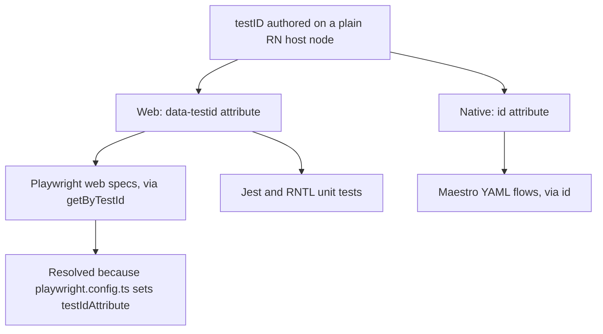

# Playwright testID mapping — React Native Web renders testID as data-testid

React Native components take a `testID` prop, not a web `data-testid` attribute. When
[the Expo/React Native app](../projects/expo-app.md) is compiled for web via React Native
Web, `testID` is rewritten to the DOM attribute `data-testid`. `playwright.config.ts` sets
`testIdAttribute: 'data-testid'` (see the inline comment "React Native Web renders testID as
data-testid") so that `page.getByTestId(...)` and `[data-testid="..."]` locators resolve against
components authored with `testID`, not a web-only attribute.

As of this refresh the config still carries both halves at `frontend/mcm-app/playwright.config.ts`
— the comment on the line above and `testIdAttribute: 'data-testid'` in the `use` block — so no
part of the original claim has moved or changed.

One authored `testID` prop, three consumers — the same source string reaches all of them.

## Gotcha

- **Every `data-testid` selector in `tests/e2e/web/**` depends on this config line matching React
  Native Web's actual output attribute.** If a future Playwright default changes (its default test-id
  attribute is `data-testid` already, but do not rely on the default silently staying correct) or the
  RN Web version changes how `testID` is rewritten, every test using `[data-testid="..."]` or
  `getByTestId()` breaks at once, across the entire web E2E suite — not just one spec.
- Author components with `testID`, never a raw `data-testid` prop directly, so the same source works
  for both the Playwright web suite and Maestro's native mobile suite.
- **A `testID` that never reaches the DOM fails silently.** A `[data-testid="..."]` locator matching
  zero elements does not error — the click *times out*, which reads as a broken screen rather than a
  bad selector. The design system's `Switch` was exactly this: it destructured `...rest` and never
  spread it, so a passed `testID` reached nothing, and it was worked around twice before the cause was
  found. It now spreads the remaining view props onto the `Pressable` — the element that actually
  receives the press — and `controls.test.tsx` guards both halves: the id lands on the press target,
  and the role and accessible name that `getByRole` locators depend on survive the spread.

## The host-node rule, and what it does *not* mean

The repository's rule is that a stable external-contract selector sits on a **plain React Native host
node** — a `View` or `Pressable` from `react-native` — with the visual treatment staying on the
Tamagui component nested inside it. `packages/design-system/components/navigation/Tabs.tsx` and
`NavList.tsx` document the rule for a per-tab and per-row `testID`, and
`frontend/mcm-app/src/screens/not-found-screen.tsx` applies it directly to a screen node.

The rule is right, and the reason usually given for it is narrower than the truth in this tree.
Tamagui 3 does map `testID` to `data-testid` on its web path, and this tree relies on that: the
design system's `Card` and `Banner` take a `testID` on a Tamagui node, and web specs target them
through `[data-testid="..."]` — `backup-schedule-editor` and `backup-error-banner` in
`tests/e2e/web/backups.spec.ts`, and app-level `YStack` selectors such as `collection-card` in
`tests/e2e/web/collections.spec.ts`. So the trap is **per-component prop plumbing, not a blanket
Tamagui limitation**: a component that drops or re-destructures the prop (the `Switch` case above)
makes the attribute vanish, and one that passes it through does not. The host-node placement is what
removes that variable — it is the placement that is always safe, not the only placement that ever
works. Do not "prove" a Tamagui `testID` works by reading a jest test: `jest-expo` renders React
Native, not React Native Web, so a `testID` on a Tamagui component passes the unit tier and can still
emit nothing on web.

`tests/e2e/web/settings.spec.ts` carries the discriminating check for that, and says so itself: its
"sub-navigation is locatable" case is "the ONE check that tells a React Native host node from a
Tamagui component". If it fails while the design-system jest suite is green, the `testID` landed on
the Tamagui component and the fix is incomplete — not the test.

The rewrite is also why one authored prop serves three consumers: the RN host node maps `testID` →
`data-testid` on web and → `id` on native, so the Jest/RNTL unit tests, the Playwright web specs and
the Maestro YAML flows (`tests/e2e/mobile/*.yaml`, which assert `id: "home-route"` and friends) all
locate the same element. That is why `frontend/mcm-app/README.md` states "Preserve every `testID`"
and points at the recorded selectors baseline as a contract: renaming one silently splits the web
and mobile suites apart.

The coupling extends beyond the spec files. `tests/e2e/web/setup/global-setup.ts` and the helpers
under `tests/e2e/web/setup/` drive the shared login and fixture seeding through the same
`[data-testid="..."]` locators, and `scripts/cleanup-e2e-data.ts` uses them too — so a testID
mismatch fails before any spec body runs, in setup, and is easy to misread as an auth or boot
problem rather than a selector-mapping problem.

See [Testing tiers and what gates a merge](../invariants/testing-tiers.md) for which web/mobile E2E
tests block a merge, and the [E2E testing runbook](../runbooks/e2e-testing.md) for how to run the
suites and which BFF target each mode uses.
