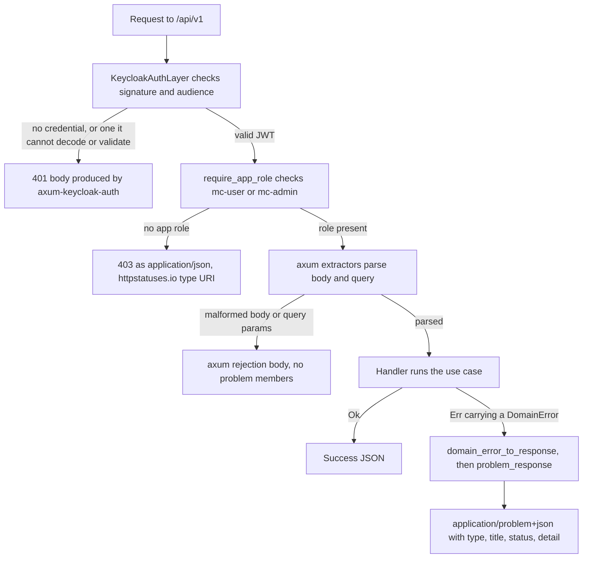
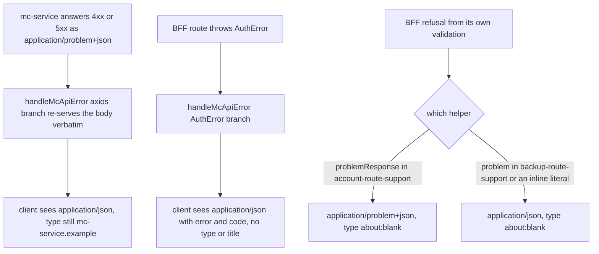

# mc-service errors are RFC 9457 Problem Details, never a stack trace

Every `DomainError` mc-service raises is converted to an HTTP response by
`domain_error_to_response()` in `error_handler.rs`, which calls the shared `problem_response()`
helper. The response is `application/problem+json` per [RFC 9457](https://www.rfc-editor.org/rfc/rfc9457):
a JSON body with `type`, `title`, `status`, and `detail` fields, never a bare error string and never
a stack trace. The
[constitution](../../.specify/memory/constitution.md) makes that the service-wide rule twice over —
*API-First Design → REST Guidelines → Error Handling* names RFC 9457 for HTTP APIs, and
*Security → Error Handling → Safe Error Responses* forbids exposing stack traces, internal file
paths, database schemas, framework details or any system internals to the client.

Which of mc-service's error paths produce a `problem+json` body, and which do not.

## Gotchas

- **`type` is a stable, non-resolvable URI under `.example`, not the deployment domain.**
  `problem_response()` builds it as `https://mc-service.example/errors/{ERROR_CODE}` (RFC 2606
  reserves `.example` for exactly this). Do not "fix" this by pointing it at the real service
  hostname — that would leak deployment topology into an API contract field that clients may
  persist or log. The integration suite matches the URI's **suffix**, deliberately, so an assertion
  cannot quietly "correct" the namespace to a real host.
- **`detail` is a fixed, hand-written message for every variant except one.** `DomainError::Internal(msg)`
  logs `msg` via `tracing::error!` server-side but returns the generic "An unexpected error occurred.
  Please try again later." to the client — the internal message never crosses the response boundary.
  The exception is `DomainError::ValidationError(msg)`: its arm passes `msg` straight into `detail`
  as a `400 INVALID_INPUT`, so it is the one variant where a constructed message *is* the response
  body. Existing producers keep that safe by constructing a fixed sentence rather than interpolating
  raw input — `"Invalid pagination cursor"` in the keyset decoder and `"Search text is not a valid
  pattern"` when a search string cannot be escaped into a BSON regex, both in the movie repository,
  the three fixed sentences in `validate_external_ids()` (`domain/specifications/http_url.rs`), and
  the command-layer messages such as `"Movie title is required"` / `"Year must be a 4-digit number"`
  in the create/update movie commands — but the rule for a new one is simple: **a `ValidationError`
  message is client-visible**, so write it as user-facing text and never interpolate a stored value,
  a credential or a driver error into it. Note that `validate_sort()` in `api/movies/list.rs` already
  interpolates the rejected parameter (`Invalid sortBy: {sb}`); that is a bounded echo of a query
  parameter, not a template to copy for anything else.
- **There is no fallback path that serializes a panic or Rust backtrace to the client.** Every
  variant of `DomainError` is exhaustively matched in `domain_error_to_response()`, so adding a new
  domain error without a matching arm is a compile error, not a code path that could leak internals
  through an unhandled case. The suite pins the property from the outside too: the cross-tenant
  refusal body is asserted against the **whole** body string for `panicked`, `backtrace`, `src/`,
  `.rs:`, and driver error text such as `mongodb::` / `WriteError` / `Kind::` — a leak can arrive in
  a field the DTO does not declare.
- **Axum's own extractor rejections never reach `problem_response()`.** Handlers take their inputs as
  `Json(dto)` and `Query(params)` (`api/collections/create.rs`, `api/movies/create.rs`,
  `api/movies/list.rs`), so a request the extractor cannot turn into the declared types is refused
  **before the handler body runs** — a body that is valid JSON but the wrong shape (a missing required
  field, a wrong type) is axum's own `422`, a syntactically invalid body its `400`, a missing or wrong
  `Content-Type` its `415`, and query parameters that fail to deserialize its `400`. Those responses
  come from axum's rejection types rather than from `problem_response()`: the body is axum's text, and
  no layer in this repository rewrites it, so neither the `.example` namespace nor the `type` /
  `title` / `detail` members appear. The router installs no rejection mapper (`api/router.rs` layers
  only `auth_layer`, `require_app_role`, the Prometheus extension and the logging middleware).
  This matters because
  [`api-specs/mc-service-api.yaml`](../../api-specs/mc-service-api.yaml) declares
  `application/problem+json` for its `BadRequest`, `Unauthorized`, `Forbidden`, `NotFound` and
  `Conflict` responses **and declares no `422` at all**: a malformed or wrongly-typed request body is a
  *different* failure from a domain validation failure even when both answer `4xx`, the `422` has no
  schema in the contract, and a client or contract test that assumes a problem document on every `4xx`
  will fail to parse it. The `422` is corroborated from the other side too: `docs/runbooks/agent-layer.md`
  records that the agent's movie payload sends `rated` as a present key precisely because
  `CreateMovieDto` "422s an omission". No test in the suite covers this path — the `400 INVALID_INPUT`
  assertions call the command handlers directly, not over HTTP.
- **The error-code string is the stable machine-readable identifier, not `title` or `detail`.**
  Clients and tests match on the `type` URI's trailing segment: `COLLECTION_NOT_FOUND`,
  `MOVIE_NOT_FOUND`, `DUPLICATE_COLLECTION_NAME`, `DUPLICATE_MOVIE`, `INVALID_INPUT`,
  `OWNED_MEDIA_WHEN_NOT_OWNED`, `RIP_QUALITY_WHEN_NOT_RIPPED`, `ACCESS_DENIED`, `INTERNAL_ERROR`.
  `title`/`detail` text is meant for humans and is free to be reworded. The code is **not** derived
  from the Rust variant name — `DomainError::ValidationError` becomes `INVALID_INPUT` — so never
  generate an expected code by naming the enum variant.
- **A 404 is a refusal as often as it is an absence — never read it as proof that a record is gone.**
  `COLLECTION_NOT_FOUND` and `MOVIE_NOT_FOUND` are returned both for a genuinely missing record and
  for a caller who is not authorized on it, and the two are deliberately indistinguishable.
  `authorize_collection_access()` in `application/access_control.rs` documents the rule at the
  application layer, and the repository filters reach the same result from the other side: reads and
  writes are scoped by `ownerId`/`collectionId`, so a foreign-owned document simply matches nothing
  and yields `CollectionNotFound` / `MovieNotFound`. The OpenAPI contract states it in the
  `NotFound` response description. The consequence for a client: a 404 means "not yours, or not
  there", and no code path may treat it as evidence of deletion, of a race, or of an id that needs
  re-creating. For the same reason a **403 is the bug, not the safe answer**, on a cross-tenant
  request — a 403 confirms the resource exists, which is the existence leak this design prevents.
  The integration tests assert `!= 403` explicitly, and check the refused document is still present
  and unmodified, so the 404 cannot be mistaken for an absent row.
- **`require_app_role`'s 403 bypasses `problem_response()` entirely — so the "every error is
  problem+json" rule holds for `DomainError` paths only.** `require_app_role` in
  `api/middleware/auth.rs` returns `axum::Json` directly as its error type, so its refusal is served
  as `application/json` with `"type": "https://httpstatuses.io/403"` — not the
  `mc-service.example` namespace, and not the problem media type. The body still carries `type`,
  `title`, `status` and `detail`, so it is *shaped* like RFC 9457 without being *served* as it. A
  content-type assertion written against the role refusal therefore fails; feature 046 recorded this
  as the reason its `403` case is out of scope, and named aligning the middleware with
  `problem_response` as the prerequisite for ever testing it. The `401` is a third, similar
  exception: it comes from `KeycloakAuthLayer`, not from `problem_response()`, and its body is
  library-produced — the credential-less case is asserted only as "non-empty JSON, not a panic trace",
  and the malformed-credential case asserts the library's `{"error":"invalid_token"}`.
  **An unparseable credential is a `401` here, and that changed under a dependency bump.**
  `axum-keycloak-auth` 0.8.3 answered a token that is not a JWT at all with `400 Bad Request` and the
  parse error in the body; **0.8.4** replaced that with the same generic answer it gives every token
  it cannot decode or validate — `401` with `{"error":"invalid_token"}` — and upstream lists the
  change under Security. mc-service stays on that line
  ([`Cargo.toml`](../../backend/mc-service/Cargo.toml) asks for `0.8`, and spec 091's FR-003
  explicitly forbids pinning back to 0.8.3), so today the only way to distinguish "the layer tried to
  decode a bad credential" from "no credential was sent" is the body, not the status: both are `401`.
  `movie_metadata_rejects_a_malformed_token` asserts exactly that pair, and
  [`spec.md`](../../specs/091-keycloak-auth-084-test/spec.md) records that the old `400` assertion
  was the only thing that broke — every other auth assertion already expected `401` or `403`, and no
  production code changed. The lasting trap is for a reader carrying the older assumption: a `400` on
  a protected route is still a domain-validation failure, and **a test asserting `400` for a
  malformed bearer token is now asserting the withdrawn behaviour** — do not restore it. The
  library's status change also moved malformed tokens into the audit trail:
  `api/middleware/logging.rs` emits `auth_failure` on any `401`, so they are logged where the old
  `400` was not. Also note
  `DomainError::AccessDenied` — the one variant that *would* produce a `403 ACCESS_DENIED`
  problem document — has no production producer today; it appears only in mocked unit tests.
- **`serde_json` must keep `features = ["preserve_order"]`, because the member order is part of the
  bytes on the wire.** `problem_response()` builds the body with `json!`, so the emitted key order is
  whatever `serde_json` preserves. bson 2 switched `preserve_order` on implicitly (its own
  `serde_json` dependency names it); bson 3 does not. During the bson 2 → 3 bump the feature was
  therefore lost with **every test green** and the body silently went alphabetical, `detail,status,title,type`
  instead of `type,title,status,detail`. It is now named explicitly in
  [`Cargo.toml`](../../backend/mc-service/Cargo.toml) and pinned by
  `problem_body_keeps_rfc_9457_member_order_on_the_wire` in `error_handler.rs`, which compares the
  response body as a literal string (mutation RED: dropping the feature fails it). Do not remove the
  feature as "just ordering" — nothing else would fail, and only a byte-comparing assertion would
  notice.

## Contract-vs-implementation gaps worth knowing

- **The OpenAPI schema declares an `instance` member that the handler never emits.**
  `ProblemDetail` in [`api-specs/mc-service-api.yaml`](../../api-specs/mc-service-api.yaml) lists
  `instance` among its optional properties; `problem_response()` writes exactly `type`, `title`,
  `status` and `detail`, so no response will ever carry `instance`. Reading the schema alone would
  suggest a correlation identifier is available in the body — it is not; correlate through the
  `request_id` span field described in [Logging and audit](../invariants/logging-and-audit.md).
- **The BFF re-serves a proxied mc-service problem as `application/json`; only its account routes
  actually serve `application/problem+json`.** `handleMcApiError()` in
  [`mc-api-error.ts`](../../frontend/mcm-app/src/bff-server/mc-api-error.ts) forwards an upstream
  mc-service body and status **verbatim** through
  `Response.json(err.response.data, { status, headers: securityHeaders() })` — and `securityHeaders()`
  sets only CSP, `X-Frame-Options`, `X-Content-Type-Options` and `Referrer-Policy`, never a
  `Content-Type`. The Fetch `Response.json()` default therefore wins, and the refusal reaches the
  client as `application/json`. The body keeps the `mc-service.example` `type` URI; the **media type
  does not survive the hop.** The one BFF producer that does serve the problem media type is
  `problemResponse()` in
  [`account-route-support.ts`](../../frontend/mcm-app/src/bff-server/account-route-support.ts),
  which sets `Content-Type: application/problem+json` explicitly before constructing the `Response`.
  Everything else that answers with an `about:blank` problem document goes through `Response.json()`,
  so it is served as `application/json`: `problem()` and its `notFound()` wrapper in
  [`backup-route-support.ts`](../../frontend/mcm-app/src/bff-server/backup-route-support.ts) — which
  are the **single** refusal helper for every `/bff-api/backups/*` route (validation 400s, the 404
  that means "not yours" as well as "not there", the 409 for a destination with no stored credential,
  the 422 for a failed artifact verification, the 502 for a refused consent revocation) — plus the
  inline literals in the agent-config, agent-config-test and backups-tick routes. That makes the gap
  the normal case rather than a corner: a problem-media-type assertion holds only against mc-service
  directly or on the account-deletion routes, and fails on any backups route. The two helpers agree on
  everything else, which is what lets a client parse both: each writes `type`, `title` and `status`,
  adds `detail` only when one was supplied (rather than emitting `null`), and puts the same number in
  the body's `status` as on the HTTP status line. Closing the media-type gap needs no new plumbing —
  `securityHeaders()` takes an optional `HeadersInit` and copies it before stamping the four baseline
  headers, so a caller can pass `{ 'Content-Type': 'application/problem+json' }` (which is what
  `problemResponse()` achieves by setting it on the returned `Headers` afterwards). Two consequences
  for a client or a test: a client keying on the `type` namespace must expect both
  `https://mc-service.example/errors/{CODE}` and `about:blank`, and the `about:blank` form means "no
  more specific type than the status code" by RFC 9457, not "unknown service". The same BFF file's
  `errorStatus()` deliberately discards a thrown error's message, because one can carry a hostname, a
  connection string or a Keycloak diagnostic.
- **The BFF's own API contracts claim the problem media type their implementations do not serve.**
  The backups contract declares `application/problem+json` for its destination-creation `400` and its
  restore `422` (`specs/073-scheduled-backups/contracts/bff-backups-api.yaml`) and the movies-count
  contract documents `4xx application/problem+json (via handleMcApiError)`, while `problem()` in
  `backup-route-support.ts` and the proxy branch of `handleMcApiError()` both answer with
  `application/json`. The declared *shape* is right — the backups `Problem` schema is `type`,
  `title`, `status`, `detail` and never an upstream body — so a generated client will parse the
  bodies correctly, but any assertion on the `Content-Type` header derived from the contract will
  fail. The account-deletion contract
  ([`bff-api.md`](../../specs/076-account-deletion/contracts/bff-api.md)) has the mirror-image drift:
  it describes its errors as RFC 9457 Problem Details "via `backup-route-support`'s `problem()`",
  and that is precisely the helper that does *not* serve the problem media type — the routes import
  `problemResponse()` from `account-route-support.ts`, which does. Do not "fix" this by trusting the
  contract alone in either direction: read the media type off the response, and treat the contract's
  media type as intent.

Where each BFF error shape ends up, and which of them actually carry the problem media type.

A related client-side consequence: the BFF has two error dialects, and the shared client helper
understands only one of them. The auth and admin routes (`auth/login`, `auth/refresh`,
`auth/logout`, `auth/user`, `auth/register`, `auth/resend-verification`, `auth/verify-email`,
`admin/settings`) answer in the same `{ error, code }` vocabulary as `handleMcApiError()`'s
`AuthError` and unexpected-error branches — no `type`, no `title`, no `detail`. (`auth/register` is
the clearest case: every branch funnels through its local `extractError()` into
`Response.json({ error, code }, …)`, and it re-maps the code to a user-facing sentence in
`getUserMessage()` rather than exposing anything upstream.) The generic `getErrorMessage()` in
`src/utils/errors.ts` is built for exactly that vocabulary: it reads a `code` member and maps it
through `AUTH_ERROR_MESSAGES`, so a problem-shaped refusal (`title`/`detail` with no `code`) collapses
to "An unexpected error occurred. Please try again." Several call sites therefore read the problem
members directly instead of going through it — `extractErrorMessage()` in `src/hooks/use-movies.ts`
(`detail`, then `title`, then `message`), `backupErrorMessage()` in
`src/hooks/backup-error-message.ts` (`detail` then `title`, falling back to `getErrorMessage`), the
upload catch in `src/hooks/use-spreadsheet-import.ts` (`detail`), `failureReason()` in
`src/bff-server/backup-restore-writer.ts` (`title`, then `mc-service answered HTTP {status}`), and
`test()` in `src/hooks/use-assistant-config.tsx` (`title`) — and `backupErrorMessage`'s comment
records that the general gap was left for its own item rather than widened inside the auth error
mapper.

See [mc-service](../projects/mc-service.md) for the Clean Architecture layering that produces
`DomainError` in the application/domain layers before this API-layer handler ever sees it, and
[BFF](../projects/bff.md) for the proxy routes that forward these bodies. The 404-as-refusal rule is
also a layer boundary, not only an error-format one — see
[Role enforcement is a layer](./role-enforcement-is-a-layer.md) and
[Auth chain](../invariants/auth-chain.md) for where authorization is decided, and
[Keyset pagination](./keyset-pagination.md) / [External ID links](./external-id-url-opening.md) for
the two `ValidationError` producers whose messages reach a client.
