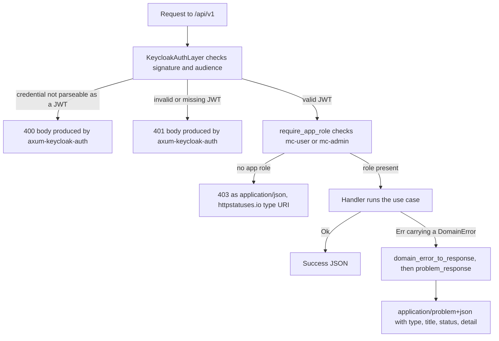

# mc-service errors are RFC 9457 Problem Details, never a stack trace

Every `DomainError` mc-service raises is converted to an HTTP response by
`domain_error_to_response()` in `error_handler.rs`, which calls the shared `problem_response()`
helper. The response is `application/problem+json` per [RFC 9457](https://www.rfc-editor.org/rfc/rfc9457):
a JSON body with `type`, `title`, `status`, and `detail` fields, never a bare error string and never
a stack trace. The
[constitution](../../.specify/memory/constitution.md) makes that the service-wide rule twice over —
*API-First Design → REST Guidelines → Error Handling* names RFC 9457 for HTTP APIs, and
*Security → Error Handling → Safe Error Responses* forbids exposing stack traces, internal file
paths, database schemas, framework details or any system internals to the client.

Which of mc-service's error paths produce a `problem+json` body, and which do not.

## Gotchas

- **`type` is a stable, non-resolvable URI under `.example`, not the deployment domain.**
  `problem_response()` builds it as `https://mc-service.example/errors/{ERROR_CODE}` (RFC 2606
  reserves `.example` for exactly this). Do not "fix" this by pointing it at the real service
  hostname — that would leak deployment topology into an API contract field that clients may
  persist or log. The integration suite matches the URI's **suffix**, deliberately, so an assertion
  cannot quietly "correct" the namespace to a real host.
- **`detail` is a fixed, hand-written message for every variant except one.** `DomainError::Internal(msg)`
  logs `msg` via `tracing::error!` server-side but returns the generic "An unexpected error occurred.
  Please try again later." to the client — the internal message never crosses the response boundary.
  The exception is `DomainError::ValidationError(msg)`: its arm passes `msg` straight into `detail`
  as a `400 INVALID_INPUT`, so it is the one variant where a constructed message *is* the response
  body. Existing producers keep that safe by constructing a fixed sentence rather than interpolating
  raw input — `"Invalid pagination cursor"` in the keyset decoder and `"Search text is not a valid
  pattern"` when a search string cannot be escaped into a BSON regex, both in the movie repository,
  the three fixed sentences in `validate_external_ids()` (`domain/specifications/http_url.rs`), and
  the command-layer messages such as `"Movie title is required"` / `"Year must be a 4-digit number"`
  in the create/update movie commands — but the rule for a new one is simple: **a `ValidationError`
  message is client-visible**, so write it as user-facing text and never interpolate a stored value,
  a credential or a driver error into it. Note that `validate_sort()` in `api/movies/list.rs` already
  interpolates the rejected parameter (`Invalid sortBy: {sb}`); that is a bounded echo of a query
  parameter, not a template to copy for anything else.
- **There is no fallback path that serializes a panic or Rust backtrace to the client.** Every
  variant of `DomainError` is exhaustively matched in `domain_error_to_response()`, so adding a new
  domain error without a matching arm is a compile error, not a code path that could leak internals
  through an unhandled case. The suite pins the property from the outside too: the cross-tenant
  refusal body is asserted against the **whole** body string for `panicked`, `backtrace`, `src/`,
  `.rs:`, and driver error text such as `mongodb::` / `WriteError` / `Kind::` — a leak can arrive in
  a field the DTO does not declare.
- **The error-code string is the stable machine-readable identifier, not `title` or `detail`.**
  Clients and tests match on the `type` URI's trailing segment: `COLLECTION_NOT_FOUND`,
  `MOVIE_NOT_FOUND`, `DUPLICATE_COLLECTION_NAME`, `DUPLICATE_MOVIE`, `INVALID_INPUT`,
  `OWNED_MEDIA_WHEN_NOT_OWNED`, `RIP_QUALITY_WHEN_NOT_RIPPED`, `ACCESS_DENIED`, `INTERNAL_ERROR`.
  `title`/`detail` text is meant for humans and is free to be reworded. The code is **not** derived
  from the Rust variant name — `DomainError::ValidationError` becomes `INVALID_INPUT` — so never
  generate an expected code by naming the enum variant.
- **A 404 is a refusal as often as it is an absence — never read it as proof that a record is gone.**
  `COLLECTION_NOT_FOUND` and `MOVIE_NOT_FOUND` are returned both for a genuinely missing record and
  for a caller who is not authorized on it, and the two are deliberately indistinguishable.
  `authorize_collection_access()` in `application/access_control.rs` documents the rule at the
  application layer, and the repository filters reach the same result from the other side: reads and
  writes are scoped by `ownerId`/`collectionId`, so a foreign-owned document simply matches nothing
  and yields `CollectionNotFound` / `MovieNotFound`. The OpenAPI contract states it in the
  `NotFound` response description. The consequence for a client: a 404 means "not yours, or not
  there", and no code path may treat it as evidence of deletion, of a race, or of an id that needs
  re-creating. For the same reason a **403 is the bug, not the safe answer**, on a cross-tenant
  request — a 403 confirms the resource exists, which is the existence leak this design prevents.
  The integration tests assert `!= 403` explicitly, and check the refused document is still present
  and unmodified, so the 404 cannot be mistaken for an absent row.
- **`require_app_role`'s 403 bypasses `problem_response()` entirely — so the "every error is
  problem+json" rule holds for `DomainError` paths only.** `require_app_role` in
  `api/middleware/auth.rs` returns `axum::Json` directly as its error type, so its refusal is served
  as `application/json` with `"type": "https://httpstatuses.io/403"` — not the
  `mc-service.example` namespace, and not the problem media type. The body still carries `type`,
  `title`, `status` and `detail`, so it is *shaped* like RFC 9457 without being *served* as it. A
  content-type assertion written against the role refusal therefore fails; feature 046 recorded this
  as the reason its `403` case is out of scope, and named aligning the middleware with
  `problem_response` as the prerequisite for ever testing it. The `401` is a third, similar
  exception: it comes from `KeycloakAuthLayer`, not from `problem_response()`, and its body is
  library-produced — an integration test only asserts it is non-empty JSON rather than a panic trace.
  **The auth layer's statuses are not the ones you would guess.** A credential that cannot be parsed
  as a JWT at all is answered with `400 Bad Request`, not `401`; only a well-formed but invalid token
  yields `401`. `movie_metadata_rejects_a_malformed_token` pins the `400` as the shared layer's real
  behaviour and records that it was verified identical on the pre-existing `/api/v1/collections`
  route — so a `400` on a protected route is not necessarily a domain-validation failure, and an
  assertion that expects `401` there is testing an aspiration rather than the service. Also note
  `DomainError::AccessDenied` — the one variant that *would* produce a `403 ACCESS_DENIED`
  problem document — has no production producer today; it appears only in mocked unit tests.
- **`serde_json` must keep `features = ["preserve_order"]`, because the member order is part of the
  bytes on the wire.** `problem_response()` builds the body with `json!`, so the emitted key order is
  whatever `serde_json` preserves. bson 2 switched `preserve_order` on implicitly (its own
  `serde_json` dependency names it); bson 3 does not. During the bson 2 → 3 bump the feature was
  therefore lost with **every test green** and the body silently went alphabetical, `detail,status,title,type`
  instead of `type,title,status,detail`. It is now named explicitly in
  [`Cargo.toml`](../../backend/mc-service/Cargo.toml) and pinned by
  `problem_body_keeps_rfc_9457_member_order_on_the_wire` in `error_handler.rs`, which compares the
  response body as a literal string (mutation RED: dropping the feature fails it). Do not remove the
  feature as "just ordering" — nothing else would fail, and only a byte-comparing assertion would
  notice.

## Two contract-vs-implementation gaps worth knowing

- **The OpenAPI schema declares an `instance` member that the handler never emits.**
  `ProblemDetail` in [`api-specs/mc-service-api.yaml`](../../api-specs/mc-service-api.yaml) lists
  `instance` among its optional properties; `problem_response()` writes exactly `type`, `title`,
  `status` and `detail`, so no response will ever carry `instance`. Reading the schema alone would
  suggest a correlation identifier is available in the body — it is not; correlate through the
  `request_id` span field described in [Logging and audit](../invariants/logging-and-audit.md).
- **The BFF re-serves a proxied mc-service problem as `application/json`; only its account routes
  actually serve `application/problem+json`.** `handleMcApiError()` in
  [`mc-api-error.ts`](../../frontend/mcm-app/src/bff-server/mc-api-error.ts) forwards an upstream
  mc-service body and status **verbatim** through
  `Response.json(err.response.data, { status, headers: securityHeaders() })` — and `securityHeaders()`
  sets only CSP, `X-Frame-Options`, `X-Content-Type-Options` and `Referrer-Policy`, never a
  `Content-Type`. The Fetch `Response.json()` default therefore wins, and the refusal reaches the
  client as `application/json`. The body keeps the `mc-service.example` `type` URI; the **media type
  does not survive the hop.** The one BFF producer that does serve the problem media type is
  `problemResponse()` in
  [`account-route-support.ts`](../../frontend/mcm-app/src/bff-server/account-route-support.ts),
  which sets `Content-Type: application/problem+json` explicitly before constructing the `Response`.
  The BFF's other `about:blank` bodies — `problem()` in
  [`backup-route-support.ts`](../../frontend/mcm-app/src/bff-server/backup-route-support.ts) and the
  inline literals in the agent-config and backups-tick routes — go through `Response.json()` as well,
  so they are served as `application/json`, the same split `require_app_role` has on the mc-service
  side. Two consequences for a client or a test: a problem-media-type assertion holds neither through
  the proxy routes nor on the BFF's own problem-shaped refusals — assert it against mc-service
  directly or on the account routes — and a client keying on the `type` namespace must expect both
  `https://mc-service.example/errors/{CODE}` and `about:blank`. The `about:blank` form means "no more
  specific type than the status code" by RFC 9457, not "unknown service". The same BFF file's
  `errorStatus()` deliberately discards a thrown error's message, because one can carry a hostname, a
  connection string or a Keycloak diagnostic.

See [mc-service](../projects/mc-service.md) for the Clean Architecture layering that produces
`DomainError` in the application/domain layers before this API-layer handler ever sees it, and
[BFF](../projects/bff.md) for the proxy routes that forward these bodies. The 404-as-refusal rule is
also a layer boundary, not only an error-format one — see
[Role enforcement is a layer](./role-enforcement-is-a-layer.md) and
[Auth chain](../invariants/auth-chain.md) for where authorization is decided, and
[Keyset pagination](./keyset-pagination.md) / [External ID links](./external-id-url-opening.md) for
the two `ValidationError` producers whose messages reach a client.
