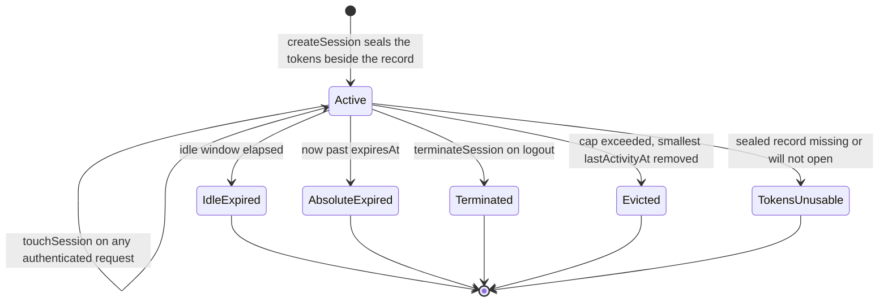
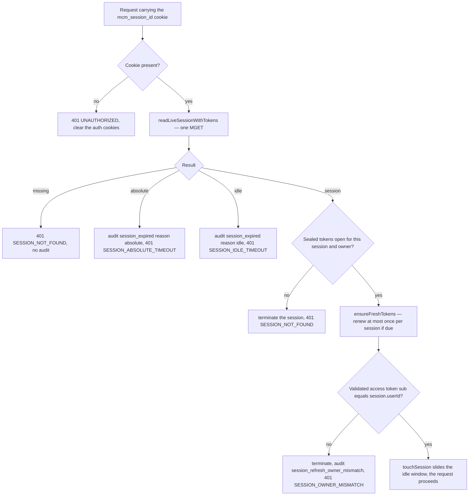

# Session ID vs JWT — Redis session lifecycle and concurrent-session eviction

The BFF's Redis session (`session-manager.ts`) and the underlying Keycloak JWT are two separate
lifecycles. The session tracks its own idle timeout and absolute timeout independently of however
long the JWT itself is valid for, and it additionally enforces a per-user cap on concurrent sessions
(`MAX_CONCURRENT_SESSIONS`) that has nothing to do with token expiry. Since feature 085 the session
also *owns* the member's tokens: they are sealed into a value beside the session record, and the
client holds only the opaque session ID. See [the auth chain](../invariants/auth-chain.md) for where
this session sits in the full login-to-request sequence.

## Gotchas

- **Session ID vs JWT**: the Redis session tracks timeout and concurrent-session limits independently
  of the JWT lifetime. Killing a session does not invalidate an already-issued JWT, and an expired
  access token does not by itself end the session — the BFF renews it from the session's own sealed
  refresh token on the request that finds it due.
- **The timeout is enforced in `requireAuth()`, not in a session helper.** The old
  `session-timeout.ts` / `validateSessionTimeout()` pair (which only `/bff-api/auth/user` called) is
  gone. Every authenticated route goes through `requireAuth()` in `bff-server/auth.ts`, which reads
  the session, checks absolute before idle, opens the sealed tokens, renews them if due, validates the
  access token, and only then slides the idle window. Idle expiry therefore *is* a per-authenticated-
  request rule today.
- **Concurrent session eviction**: when a user exceeds `MAX_CONCURRENT_SESSIONS`, `session-manager.ts`
  evicts the **least-recently-active** session — the one with the smallest `lastActivityAt`, which is
  not necessarily the oldest by `createdAt`. Nothing is returned to the caller: the cap is enforced by
  silent eviction, never by a refusal, so `SESSION_LIMIT_EXCEEDED` exists in the error enum but no
  code path throws it.
- **The client stores only the session ID, not tokens.** The React Native client never touches raw
  JWTs — the BFF owns all token handling server-side, and the only persisted client-side value is the
  opaque session ID (native SecureStore; nothing at all on web).
- **A bearer credential is not a credential here.** `Authorization: Bearer` is not read at all, in any
  environment (FR-008/FR-009), and the `X-Session-Id` header the login response still sets is never
  read back — only the `mcm_session_id` cookie is. A request naming a session in that header changes
  nothing.
- **Eviction has a documented TOCTOU race under simultaneous logins.** `createSession()` checks the
  session count before adding the new session, then re-checks and trims after adding — this two-step
  pre/post-check exists specifically because the pre-add check alone is racy under concurrent logins
  (feature 009 FR-018). The post-add trim loop breaks out on "no progress" to avoid spinning forever
  against stale set members whose session objects are already gone.
- **The session manager never checks who owns a session.** Nothing in `session-manager.ts` verifies
  that a session ID belongs to the caller; the boundary does. Since the cookie is the only credential,
  the refresh and logout routes hold ownership *by construction* — but `requireAuth()` still compares
  the validated access token's `sub` against `session.userId` on every request, and a mismatch ends
  the session.

## The session record, its keys and its TTL

A `Session` (`frontend/mcm-app/src/types/auth.ts`) is five fields: `sessionId` (a `randomUUID()`),
`userId`, `createdAt`, `lastActivityAt`, and `expiresAt` — no token material, no roles, no profile.
`createSession(userId, tokens)` sets `lastActivityAt = createdAt = now` and
`expiresAt = now + env.sessionAbsoluteTimeoutMs`, then seals the tokens next to it. Since 085 the
function *requires* the member's tokens, so there is no code path that produces a tokenless session
(`tests/integration/helpers/session-token-fixture.ts` exists precisely so tests that only care about
the record can seal placeholders).

`cache-service.ts` stores a session under three Redis keys:

- `session:<sessionId>` — the JSON session record, written with `SET ... EX <ttl>`.
- `session-tokens:<sessionId>` — the member's sealed tokens (`{v, accessExpiresAt, refreshExpiresAt,
  blob}`, AES-256-GCM under `AGENT_CONFIG_ENC_KEY`, AAD bound to the session id and owner), with the
  same TTL. The expiry times sit in clear *outside* the ciphertext, so a test can age a session
  without the key; the JWT's own `exp` is still validated on every request.
- `user-sessions:<userId>` — a set of that user's session IDs, maintained with `SADD`/`SREM`. The
  per-user count (`SCARD`) and the enumeration used by eviction and by `terminateAllSessions()` both
  read this set.

The Redis TTL is **a backstop, not the policy**: `sessionTtlSeconds()` derives it from the session's
remaining absolute lifetime (floored at 1s for an already-expired session), so it can never be shorter
than the configured idle/absolute windows. A fixed shorter TTL here silently caps the real timeout —
the previous hard-coded 600s truncated a 30-min idle / 24-h absolute policy to 10 minutes (feature 009
finding #3). The integration tier asserts the stored TTL exceeds the idle window
(`tests/integration/session-manager.integration.test.ts`).

The TTL is refreshed unevenly, and that is deliberate:

- `cacheSession()` (a new login) writes the record **and** refreshes the set's TTL.
- `touchSessionRecord()` (a touch) rewrites the record only — it does **not** touch the set's TTL and
  does not touch the tokens key. The older "every touch extends the set" behaviour is gone; the set's
  TTL now moves only when the user signs in again.
- `cacheSessionTokens()` (a renewal) re-seals the tokens with the session's own TTL.

The set can therefore outlive the individual `session:` keys inside it, which is exactly the
stale-member case the trim loop's no-progress break guards against.

A corrupt/truncated stored value is treated as *no session*: `parseSession()` drops the bad key rather
than throwing (feature 009 FR-021), so a malformed Redis value fails closed instead of producing an
unhandled `SyntaxError`.

`deleteSession(sessionId, userId)` removes **both** keys and `SREM`s the id from the set — so logout,
expiry and eviction all take the tokens with them. `terminateSession()` wraps it for one session
(logout); `terminateAllSessions()` walks the user's set and is wired in as the account-deletion
pipeline's `terminateSessions` step.

## Lifecycle

Session lifecycle in `session-manager.ts`. Expiry is detected lazily, not by a background reaper:
there is no sweeper process, and an expired session sits in Redis until its TTL removes it or the next
read deletes it.

The read API is built on one private `expiryOf()` decision, exposed through three functions:

- `readLiveSession(sessionId)` returns a discriminated union `LiveSessionResult`: `{ session }`,
  `{ expired: 'absolute' | 'idle'; userId }`, or `{ expired: 'missing' }`. **Absolute is checked
  before idle**, so a session that is past its maximum lifetime *and* idle is reported as `absolute`,
  never as inactivity. An expired session is deleted here; a missing one is not (there is nothing to
  delete, and the `missing` variant carries no `userId`).
- `readLiveSessionWithTokens(sessionId)` is what every authenticated request actually reads: one
  `MGET` over the record and the tokens key (a second round trip would cost latency on every request
  the BFF serves), then the same `expiryOf()` decision. It returns `{ session, tokensRaw } | Expired`,
  and `tokensRaw` is `null` for a session created before 085 — which the caller must treat as no
  session, not as a session without tokens.
- `getValidSession(sessionId)` still exists as a thin wrapper that collapses every non-live outcome to
  `null`, but it now has **no production caller** — only the unit and integration suites use it. The
  comment in `cache-service.ts` that calls `getValidSession` "the authority" for idle/absolute expiry
  is stale: the authority is `expiryOf()`, reached through the two `readLiveSession*` functions.

- `touchSession(session)` rewrites `lastActivityAt` to now through `touchSessionRecord()`, which uses
  `SET ... EX <ttl> XX` — record only, and only if the record still exists. Both halves matter: a touch
  racing a renewal must not write the *pre-renewal* refresh token back over a rotated one (which is
  why the tokens live in their own key), and a touch racing a logout must not re-create the record the
  logout just deleted.
- `terminateSession(sessionId, userId)` deletes one session (logout); `terminateAllSessions(userId)`
  deletes every session in the user's set.

### Who enforces the timeout, and in what order

The enforcement point is `requireAuth()` in `frontend/mcm-app/src/bff-server/auth.ts`. It runs on
every authenticated route — the domain routes, `/bff-api/auth/user`, and the agent routes all call it
— and its ordering is the contract:

What `requireAuth()` does with each outcome, and where the reasons surface:

| `readLiveSessionWithTokens` result | Thrown error | Audit |
| --- | --- | --- |
| no cookie at all | 401 `UNAUTHORIZED`, cookies cleared | `auth_failed` with `reason: 'no_session'` (warn) |
| `{ expired: 'missing' }` | 401 `SESSION_NOT_FOUND`, cookies cleared | none |
| `{ expired: 'absolute' }` | 401 `SESSION_ABSOLUTE_TIMEOUT`, cookies cleared | `session_expired` with `{ userId, reason: 'absolute' }` |
| `{ expired: 'idle' }` | 401 `SESSION_IDLE_TIMEOUT`, cookies cleared | `session_expired` with `{ userId, reason: 'idle' }` |
| live, but `tokensRaw` is null or will not open | session terminated, 401 `SESSION_NOT_FOUND` | none |
| live, renewed token's `sub` ≠ `session.userId` | session terminated, 401 `SESSION_OWNER_MISMATCH` | `session_refresh_owner_mismatch` |
| live and owned | none — then `touchSession()` | none |

The reporting distinction is the point of the union: before feature 085 every non-live outcome
collapsed to `null` and every caller reported an absolute expiry as "idle". `/bff-api/auth/user` no
longer does any of this itself — its handler comment records that `requireAuth` covers it — and the
old `unit-tests/session-timeout.test.ts`, whose header admits it "proved" the absolute branch by
mocking `getValidSession` to return an already-expired session (something the real function never
did), is gone with the module.

`/bff-api/auth/refresh` is the counter-example that survives: it reads through
`readLiveSessionWithTokens()` but answers **one** 401 `SESSION_EXPIRED` for missing, absolute and idle
alike, because the client's only useful response to any of them is to sign in again. It also differs
on the empty case: no session cookie there is `SESSION_NOT_FOUND`, whereas the same condition on a
`requireAuth` route is `UNAUTHORIZED`.

### Where the idle window actually slides

`touchSession()` has exactly two callers, and the first covers the whole surface:

- `requireAuth()`, as its final step after the token has been validated and the owner checked — so the
  idle window slides on **every authenticated request**, not only on the two routes that read the
  session explicitly. This is the feature 085 FR-023 rule, and it is the opposite of the pre-085
  shape in which only `/auth/user` slid the window and an idle session survived until a request
  happened to hit it. The comment on `touchSession()` that says it is "called by `requireAuth` on
  every authenticated request" is now accurate; read it as the current rule.
- `/bff-api/auth/refresh`, after it has renewed the session's tokens (`ensureFreshTokens(..., { force:
  true })` then `touchSession`). The client's axios interceptor and the agent fetch path call this on a
  401, so a client that keeps talking to the BFF keeps its session alive.

Nothing else reads the session record: a domain route that calls `requireAuth()` gets the check as a
side effect of authenticating, and a route that authenticated some other way would bypass it entirely.

## Concurrent-session cap and the TOCTOU race

`createSession()` closes the race in two steps: a pre-add count check (`if (sessionCount >=
MAX_SESSIONS) evictOldestSession(userId)`), then — after the record and its sealed tokens have been
cached — a trim loop that re-reads the count and keeps evicting while `count > MAX_SESSIONS`. The
loop's no-progress guard (`if (next >= count) break`) exists because the set can retain members whose
`session:` object is already gone; `evictOldestSession()` returns early when it finds no valid session
to delete, so without the break the loop could spin forever without the count ever falling.

That pre-add check alone is genuinely racy: N simultaneous logins for one user all observe a count
below the cap and all add, leaving the set above `MAX_SESSIONS`. The post-add trim is what makes the
invariant hold (feature 009 FR-018), asserted against real Redis by
`tests/integration/concurrent-session-cap.integration.test.ts`, which fires `max + 5` concurrent
`createSession()` calls and requires the resulting count to be at or below the cap. The unit suite
drives the same loop by returning an over-cap count after the add.

Eviction selects the valid session with the **smallest `lastActivityAt`** (sort ascending, take the
first), so it is the least-recently-active session that goes — not necessarily the oldest by
`createdAt`. `MAX_SESSIONS` is bound once at module load from `env.maxConcurrentSessions`
(`MAX_CONCURRENT_SESSIONS`, default 10 in `src/config/env.ts`), so changing the environment variable
after the module is imported has no effect; the two timeouts, by contrast, are read from `env` on each
check.

The cap never refuses a login. `login+api.ts` calls `getActiveSessionCount()` only to log a non-fatal
warning, with a comment recording that eviction is handled inside `createSession` — so a member's
oldest session disappears silently from their point of view.

Eviction is audited: `evictOldestSession()` emits `logger.audit('session_evicted', { userId,
activeSessions, maxSessions })`, where `activeSessions` is the count of sessions that still resolved
(not the raw `SCARD`). The evicted session ID is deliberately **not** logged in any form — under a key
named `sessionId` the logger redacts it to a constant while still tripping the `mcm-no-token-logging`
SAST rule (which matches the key name), and any other key name would leak it (feature 052 FR-004; the
integration test asserts no created session ID appears anywhere in the serialized event). This event
was added because a cap that fires in complete silence is indistinguishable from one that never fires:
the cap is 10 and the web E2E suite runs 8 Playwright workers, which is close enough that two
diagnoses were made from configuration alone, and the BFF log had zero hits for `evict`, `concurrent`
or `session`.

## Who the session belongs to

Nothing in `session-manager.ts` verifies that a session ID belongs to the caller — it is a keyed
lookup module. Ownership is enforced at the boundary, in two different ways:

- **By construction, because the cookie is the only credential.** `/bff-api/auth/refresh` takes the
  session from the `mcm_session_id` cookie and the refresh token *from that session's sealed record*;
  nothing in the request can name another member's session or supply a credential, so a
  `mcm_refresh_token` cookie sent alongside is simply not read (the integration suite proves that
  another member's genuine refresh token sent as a cookie is ignored and the caller's own session
  renews as its owner). `/bff-api/auth/logout` likewise acts only on the session its own cookie names —
  it resolves the owner from the session record, and with no cookie at all it clears cookies
  best-effort and returns 200 without touching any state.
- **By an explicit comparison, on every authenticated request.** `requireAuth()` compares the `sub` of
  the validated access token against `session.userId` and, on a mismatch, terminates the session,
  audits `session_refresh_owner_mismatch`, clears the auth cookies and answers 401
  `SESSION_OWNER_MISMATCH`. The renewed token is re-checked the same way inside
  `session-tokens.renew()`, which additionally revokes the refresh token it just minted before
  deleting the session — the record would otherwise be left paired with a foreign credential.

An unauthenticated request that names someone else's session in the `X-Session-Id` header (or any
other way) must change nothing about that session;
`tests/integration/auth-session-side-effects.integration.test.ts` drives the real route handlers
against real Redis to prove the victim's session survives both a forged `/user` call and a forged
`/logout`. A session ID presented *as the cookie* is a
different case: it is the credential, so an idle-expired one is refused as `SESSION_IDLE_TIMEOUT` —
that is the session's own expiry, not a side effect on a third party.

## The client only ever holds the opaque session ID

`frontend/mcm-app/src/utils/session-storage.ts` documents the model: auth lives entirely in the BFF's
`HttpOnly` cookies. On web nothing is stored client-side — the cookies are the source of truth. On
native, the only persisted value is the opaque session ID (SecureStore key `mcm_session_id`), used
purely as a startup "do I appear to be signed in?" hint for `hasStoredSession()`, because JS cannot
read `HttpOnly` cookies. `hasStoredSession()` is a hint only, never an authorization decision: the
`AuthProvider` in `src/hooks/use-auth.tsx` follows it with a `/bff-api/auth/user` call and stays
unauthenticated if that fails.

The ID reaches the client by two channels on login: the `mcm_session_id` cookie built by
`buildAuthCookies()` — `HttpOnly`, `SameSite=Strict`, `Secure` outside development, `Path=/`, with
`Max-Age` equal to the absolute session lifetime — and the `X-Session-Id` response header, which
`use-login.ts` reads and passes to `storeSession()` (the native callback does the same). Only the
cookie is ever read back: `extractSessionId()` reads the cookie and nothing else, and a
`mcm_refresh_token` cookie a pre-085 client still sends is ignored.

There is **no bearer path**. The BFF does not read `Authorization` at all — not in development, not in
test, and there is no flag that restores it (FR-008/FR-009; the old `extractRawToken` helper is gone
and a unit test asserts no such helper exists). Test harnesses sign in the way members do. Every 401
also clears the two retired token cookies (`mcm_access_token`, `mcm_refresh_token`) at their original
Paths, each as its own `Set-Cookie` line — joined into one comma-separated value the browser would keep
only the first, which is how a session that had just ended kept its refresh cookie. A session created
before 085 has no `session-tokens:` value and is **never migrated**: `requireAuth` terminates it and
answers 401 `SESSION_NOT_FOUND`, the refresh route terminates it and answers `REFRESH_TOKEN_INVALID`.

### The client-side timer is a prompt, not the enforcement

`frontend/mcm-app/src/hooks/use-session-timeout.ts` arms two `setTimeout`s (defaults 30 min idle /
24 h absolute, commented "must match BFF server-side values") and calls `onTimeout('idle' |
'absolute')`. It is mounted in `src/app/(app)/_layout.tsx` behind `isAuthenticated`, wired to
`AuthProvider`'s `logoutWithTimeout`, which records the reason for the login screen's message and then
POSTs `/bff-api/auth/logout` and redirects. Two things are worth knowing:

- **The absolute timer starts at hook mount, not at session creation.** A page reload or a remount
  restarts the 24-hour countdown, so the client can warn later than the server's `expiresAt`. The
  server's record is authoritative; the hook exists so the member is told *before* a request fails.
- **The dev overrides are client-side only.** `EXPO_PUBLIC_DEV_IDLE_TIMEOUT_OVERRIDE_MS` and
  `EXPO_PUBLIC_DEV_ABSOLUTE_TIMEOUT_OVERRIDE_MS` shorten the timers for the E2E flows; they do not
  change what the BFF enforces, so an E2E "idle timeout" run exercises the client redirect rather than
  a server-side expiry.

## Focused tests

- `unit-tests/session-manager.test.ts` mocks `cache-service` and covers the cap at N-1 (allowed), at N
  (least-recently-active evicted, tie broken by array order), absolute/idle expiry, `touchSession`
  writing the record only, and Redis errors propagating rather than being swallowed. Its
  `readLiveSession` and `readLiveSessionWithTokens` blocks assert the three outcomes separately,
  including that an absolute expiry that is *also* idle is reported as `absolute`; its
  `createSession concurrent-cap trim` block drives the post-add trim by returning an over-cap count
  after the add; and a feature-085 block asserts the tokens are sealed beside the new session and do
  not appear in clear.
- `unit-tests/auth.test.ts` is where the enforcement ordering is pinned: the session cookie is the only
  credential, a bearer alone is refused without ever being validated, each expiry reason maps to its
  own code and audit entry, a session with no sealed tokens or an unopenable record is ended rather
  than trusted, a foreign `sub` ends the session without touching it, a rejected renewal is a 401 that
  clears cookies while an unreachable provider is a retryable 503 that keeps them, and the idle window
  slides on every authenticated request.
- `tests/integration/session-manager.integration.test.ts` and
  `tests/integration/concurrent-session-cap.integration.test.ts` run against real Redis (db 1) — the
  mocked tier cannot prove that a race has one winner, only that the code agrees with its own model.
  They assert the stored TTL exceeds the configured idle window, that expiry deletes the key, and that
  the eviction audit event appears exactly once and carries no session ID.
- `tests/integration/session-token-custody.integration.test.ts` is HTTP-level against the running BFF,
  real Keycloak and the BFF's Redis: sign-in returns one live cookie and nothing JWT-shaped, the store
  holds no readable token, an expired access token is renewed by the server with two concurrent
  requests both succeeding, sign-out revokes the tokens and ends the SSO session, a pre-rollout client
  is refused and cleared rather than migrated, and a session holding another member's sealed tokens is
  refused and ended.
- `tests/integration/auth-session-side-effects.integration.test.ts` drives the real route handlers to
  prove an unauthenticated request naming a victim's session leaves it intact;
  `tests/integration/auth-refresh.integration.test.ts` proves the cross-member refresh is refused
  against real Keycloak sessions. The client-side timers are covered by
  `src/hooks/unit-tests/use-session-timeout.test.ts`, `tests/e2e/web/session-timeout.spec.ts`
  (Playwright's fake clock) and the Maestro flows under `tests/e2e/mobile/`.

Related: [Docker internal DNS](docker-internal-dns.md),
[Keycloak service accounts](keycloak-service-account.md),
[role enforcement is a layer](role-enforcement-is-a-layer.md),
[logging and audit conventions](../invariants/logging-and-audit.md),
[the auth chain](../invariants/auth-chain.md), and
[the BFF project page](../projects/bff.md).
