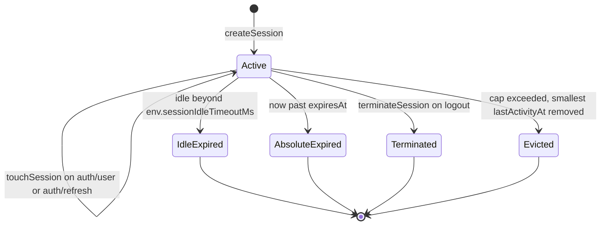

# Session ID vs JWT — Redis session lifecycle and concurrent-session eviction

The BFF's Redis session (`session-manager.ts`) and the underlying Keycloak JWT are two separate
lifecycles. The session tracks its own idle timeout and absolute timeout independently of however
long the JWT itself is valid for, and it additionally enforces a per-user cap on concurrent sessions
(`MAX_CONCURRENT_SESSIONS`) that has nothing to do with token expiry. See
[the auth chain](../invariants/auth-chain.md) for where this session sits in the full
login-to-request sequence.

## Gotchas

- **Session ID vs JWT**: the Redis session tracks timeout and concurrent-session limits independently
  of the JWT lifetime. Killing a session does not invalidate an already-issued JWT, and an expired
  access token does not by itself end the session.
- **Concurrent session eviction**: when a user exceeds `MAX_CONCURRENT_SESSIONS`, `session-manager.ts`
  evicts the **least-recently-active** session — the one with the smallest `lastActivityAt`, which is
  not necessarily the oldest by `createdAt`.
- **The client stores only the session ID, not tokens.** The React Native client never touches raw
  JWTs — the BFF owns all token handling server-side, and only the opaque Redis session ID is
  persisted client-side (in a cookie).
- **Eviction has a documented TOCTOU race under simultaneous logins.** `createSession()` checks the
  session count before adding the new session, then re-checks and trims after adding — this two-step
  pre/post-check exists specifically because the pre-add check alone is racy under concurrent logins
  (feature 009 FR-018). The post-add trim loop breaks out on "no progress" to avoid spinning forever
  against stale set members whose session objects are already gone.
- **The session manager never checks who owns a session.** Nothing in `session-manager.ts` verifies
  that a session ID belongs to the caller; the route carries that check. The refresh route did not
  make it until feature 085, which is why the rule is stated here rather than assumed.

## The session object and its keys

A `Session` (`frontend/mcm-app/src/types/auth.ts`) is five fields: `sessionId` (a `randomUUID()`),
`userId`, `createdAt`, `lastActivityAt`, and `expiresAt` — no token material, no roles, no profile.
`createSession()` sets `lastActivityAt = createdAt = now` and `expiresAt = now +
env.sessionAbsoluteTimeoutMs`.

`cache-service.ts` stores it under two Redis keys:

- `session:<sessionId>` — the JSON session, written with `SET ... EX <ttl>`.
- `user-sessions:<userId>` — a set of that user's session IDs, maintained with `SADD`/`SREM`, refreshed
  with the same TTL. The per-user count (`SCARD`) and the enumeration used by eviction and by
  `terminateAllSessions()` both read this set.

The Redis TTL is **a backstop, not the policy**: `sessionTtlSeconds()` derives it from the session's
remaining absolute lifetime (floored at 1s for an already-expired session), so it can never be shorter
than the configured idle/absolute windows. A fixed shorter TTL here silently caps the real timeout —
the previous hard-coded 600s truncated a 30-min idle / 24-h absolute policy to 10 minutes (feature 009
finding #3). Timeout enforcement itself lives in `readLiveSession()` reading the timestamps, and the
integration tier asserts the TTL exceeds the idle window
(`tests/integration/session-manager.integration.test.ts`).

Note that the set's TTL is *extended* on every write to `user-sessions:<userId>`, including every
`touchSession()`. The set can therefore outlive the individual `session:` keys inside it, which is
exactly the stale-member case the trim loop's no-progress break guards against.

A corrupt/truncated stored value is treated as *no session*: `getSession()` drops the bad key rather
than throwing (feature 009 FR-021), so a malformed Redis value fails closed instead of producing an
unhandled `SyntaxError`.

## Lifecycle

Session lifecycle in `session-manager.ts`. Expiry is detected lazily, not by a background reaper:
there is no sweeper process, and an expired session sits in Redis until its TTL removes it or the next
read deletes it.

The read API has **two entry points with different contracts** (feature 085 US5, FR-012):

- `readLiveSession(sessionId)` is the authority. It loads the session and returns a discriminated
  union `LiveSessionResult`: `{ session }`, `{ expired: 'absolute' | 'idle'; userId }`, or
  `{ expired: 'missing' }`. **Absolute is checked before idle**, so a session that is past its maximum
  lifetime *and* idle is reported as `absolute`, never as inactivity. An expired session is deleted
  here; a missing one is not (there is nothing to delete, and the `missing` variant carries no
  `userId`).
- `getValidSession(sessionId)` is now a thin wrapper over `readLiveSession()` that collapses every
  non-live outcome to `null`. It still exists, but callers that must say *why* a session ended have to
  use `readLiveSession()`. Before feature 085 this collapsing was the whole API, and every caller
  reported an absolute expiry as "idle" — that mislabelling is the bug FR-012 fixes.
- `touchSession(sessionId)` rewrites `lastActivityAt` to now (via `cacheSession()`, so the Redis TTL
  and the set TTL are refreshed too), sliding the idle window. It is a no-op for a session that is not
  found.
- `terminateSession(sessionId, userId)` deletes one session (logout); `terminateAllSessions(userId)`
  deletes every session in the user's set (account deletion, via `account-deletion.ts`).

### Where the idle window actually slides

The idle window slides on **two routes only**, the ones that call `touchSession()`:

- `/bff-api/auth/user` — through `validateSessionTimeout()` in
  `frontend/mcm-app/src/bff-server/session-timeout.ts`, which the client calls at startup and on
  resume.
- `/bff-api/auth/refresh` — `getValidSession()` then `touchSession()` after the ownership check.

That is the whole set; `grep` for `touchSession` finds no other caller. Domain routes authenticate the
access-token JWT alone and never read the session record, so an idle session is caught at the next
`/auth/user` or `/auth/refresh` rather than on the request that follows the idle period. Earlier
comments in `session-manager.ts` and `session-timeout.ts` claimed "every authenticated request";
feature 085 FR-013 corrected them to name the routes that actually call the code. Read the comments as
descriptions of those two routes, not as a per-request guarantee.

`validateSessionTimeout()` maps each outcome to a distinct error and audits the expiry with its true
reason:

| `readLiveSession` result | Thrown error | Audit |
| --- | --- | --- |
| `{ session }` | none — then `touchSession()` | none |
| `{ expired: 'missing' }` | `SESSION_NOT_FOUND`, 401 | none |
| `{ expired: 'absolute' }` | `SESSION_ABSOLUTE_TIMEOUT`, 401 | `session_expired` with `{ userId, reason: 'absolute' }` |
| `{ expired: 'idle' }` | `SESSION_IDLE_TIMEOUT`, 401 | `session_expired` with `{ userId, reason: 'idle' }` |
| `sessionId` is `null` | `UNAUTHORIZED`, 401 | none |

The refresh route is the counter-example: it still calls `getValidSession()`, so it cannot tell the
two expiries apart and answers a single 401 `SESSION_EXPIRED` for both.

## Concurrent-session cap and the TOCTOU race

`createSession()` closes the race in two steps: a pre-add count check (`if (sessionCount >=
MAX_SESSIONS) evictOldestSession(userId)`), then — after `cacheSession()` has added the new session —
a trim loop that re-reads the count and keeps evicting while `count > MAX_SESSIONS`. The loop's
no-progress guard (`if (next >= count) break`) exists because the set can retain members whose
`session:` object is already gone; `evictOldestSession()` returns early when it finds no valid session
to delete, so without the break the loop could spin forever without the count ever falling.

That pre-add check alone is genuinely racy: N simultaneous logins for one user all observe a count
below the cap and all add, leaving the set above `MAX_SESSIONS`. The post-add trim is what makes the
invariant hold (feature 009 FR-018), asserted against real Redis by
`tests/integration/concurrent-session-cap.integration.test.ts`, which fires `max + 5` concurrent
`createSession()` calls and requires the resulting count to be at or below the cap.

Eviction selects the valid session with the **smallest `lastActivityAt`** (sort ascending, take the
first), so it is the least-recently-active session that goes — not necessarily the oldest by
`createdAt`. `MAX_SESSIONS` is bound once at module load from `env.maxConcurrentSessions`
(`MAX_CONCURRENT_SESSIONS`, default 10 in `src/config/env.ts`), so changing the environment variable
after the module is imported has no effect.

Eviction is audited: `evictOldestSession()` emits `logger.audit('session_evicted', { userId,
activeSessions, maxSessions })`, where `activeSessions` is the count of sessions that still resolved
(not the raw `SCARD`). The evicted session ID is deliberately **not** logged in any form — under a key
named `sessionId` the logger redacts it to a constant while still tripping the `mcm-no-token-logging`
SAST rule (which matches the key name), and any other key name would leak it (feature 052 FR-004; the
integration test asserts no created session ID appears in the serialized event). This event was added
because a cap that fires in complete silence is indistinguishable from one that never fires.

## Who the session belongs to

Nothing in `session-manager.ts` verifies that a session ID belongs to the caller — it is a keyed
lookup module. Ownership is checked at the route boundary, and all three session-touching routes now
carry it:

- `auth/user+api.ts` authenticates first (`requireAuth` + `requireMcUser`), then reads the session
  named in the `mcm_session_id` cookie and calls `validateSessionTimeout()` **only** when
  `session.userId === payload.sub`. The ordering is the point: an unauthenticated request carrying
  someone else's `X-Session-Id` must not be able to slide, expire, or terminate that victim's session
  (feature 009 finding #9).
- `auth/logout+api.ts` does the same — it resolves `authUserId` from the token, terminates only when
  the session's `userId` matches, and otherwise clears cookies best-effort without terminating
  anything.
- `auth/refresh+api.ts` gained the check under feature 085 US2 (item #607, FR-006/FR-007). It
  validates the subject of the access token it just minted from the client-supplied refresh
  credential and compares it to `session.userId` **before** touching the session. On a mismatch it
  revokes the refresh token it just obtained, terminates the session (now paired with a foreign
  credential), audits `session_refresh_owner_mismatch` with `{ userId }`, clears the auth cookies,
  and returns 401 `SESSION_OWNER_MISMATCH`. Nothing is extended and no credential is issued.

The reason the refresh check exists is the same as for the other two routes: the refresh credential
is client-supplied, so without the comparison a caller holding someone else's session reference could
keep that session alive indefinitely with their own token. Any new route that calls
`readLiveSession()`, `getValidSession()`, `touchSession()`, or `terminateSession()` has to carry the
ownership check itself — nothing below the route does it.

## The client only ever holds the opaque session ID

`frontend/mcm-app/src/utils/session-storage.ts` documents the model: auth lives entirely in the BFF's
`HttpOnly` cookies. On web nothing is stored client-side — the cookies are the source of truth. On
native, the only persisted value is the opaque session ID (SecureStore key `mcm_session_id`), used
purely as a startup "do I appear to be signed in?" hint for `hasStoredSession()`, because JS cannot
read `HttpOnly` cookies. `hasStoredSession()` is a hint only, never an authorization decision: the
`AuthProvider` in `src/hooks/use-auth.tsx` follows it with a `/bff-api/auth/user` call and stays
unauthenticated if that fails.

The ID reaches the client by two channels on login: the `mcm_session_id` `HttpOnly; SameSite=Strict`
cookie built by `buildAuthCookies()` and the `X-Session-Id` response header, which `use-login.ts`
reads and passes to `storeSession()` (the native callback does the same). Subsequent requests are
authenticated by the access-token cookie; `extractSessionId()` reads the session cookie only. The
client's historical raw-token storage and its `Authorization: Bearer` path were removed — the client
holds no access or refresh token at all. The BFF itself still **accepts** `Authorization: Bearer`, and
checks it before the cookie (`extractToken()` in `bff-server/auth.ts`, used by `requireAuth()`).

## Focused tests

- `unit-tests/session-manager.test.ts` mocks `cache-service` and covers the cap at N-1 (allowed), at
  N (least-recently-active evicted, tie broken by array order), absolute/idle expiry, `touchSession`,
  and Redis errors propagating rather than being swallowed. Its `readLiveSession` block asserts the
  three outcomes separately, including that an absolute expiry that is *also* idle is reported as
  `absolute`. Its `createSession concurrent-cap trim` block drives the post-add trim by returning an
  over-cap count after the add.
- `unit-tests/session-timeout.test.ts` mocks `readLiveSession` to return what it really returns — a
  session, or the reason it ended — and asserts the four error codes plus the `session_expired` audit
  reason. Its header records that before feature 085 it "proved" the absolute branch by mocking
  `getValidSession` to return an already-expired session, something the real function never did, which
  is how an absolute expiry reached members as "idle".
- `tests/integration/session-manager.integration.test.ts` and
  `tests/integration/concurrent-session-cap.integration.test.ts` run against real Redis (db 1) — the
  mocked tier cannot prove that a race has one winner, only that the code agrees with its own model.
- `tests/integration/auth-session-side-effects.integration.test.ts` drives the real route handlers to
  prove an unauthenticated request with a forged session cookie leaves the victim's session intact,
  and `tests/integration/auth-refresh.integration.test.ts` proves the cross-member refresh is refused
  against real Keycloak sessions.

Related: [Docker internal DNS](docker-internal-dns.md),
[Keycloak service accounts](keycloak-service-account.md),
[logging and audit conventions](../invariants/logging-and-audit.md), and
[the BFF project page](../projects/bff.md).
