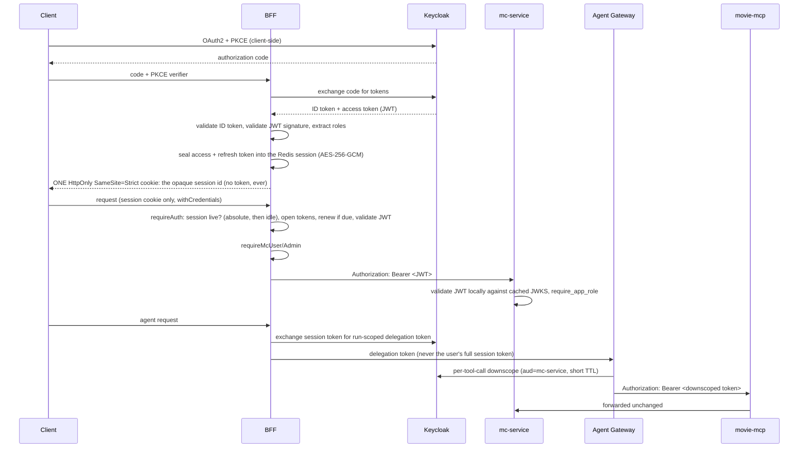

# Authentication and authorization chain

Keycloak is the identity provider for the whole system (realm `grumpyrobot`, roles `mc-user` /
`mc-admin`). The chain has four distinct enforcement points, and each one is deliberately
independent rather than trusting the layer before it blindly.

1. **Client → Keycloak (PKCE).** The [Expo app](../projects/expo-app.md) performs the OAuth2
   authorization-code-with-PKCE exchange directly against Keycloak; the client only ever sees an
   authorization code, never a token.
2. **BFF exchanges the code, owns the session AND the tokens.** The [BFF](../projects/bff.md)
   trades the code for tokens, validates the ID token and the access-token JWT, extracts roles, and
   creates a Redis-backed session. Since feature 085 the access and refresh tokens are **held by the
   server**, sealed beside the session (AES-256-GCM, bound to the session id and its owner). The
   client receives exactly one credential, the opaque `mcm_session_id` cookie (`HttpOnly`,
   `SameSite=Strict`, `Secure` outside development), on web and on Android. Every request goes
   through `requireAuth()`: it enforces the session's absolute, then idle, limit, opens the
   server-held tokens, renews them if they are due, and validates the access token.
3. **mc-service re-validates independently.** [mc-service](../projects/mc-service.md) does not
   trust that the BFF already checked auth — it runs its own `KeycloakAuthLayer` (a tower layer, so a
   new route is protected by default) plus a separate `require_app_role` middleware for the
   `mc-user` OR `mc-admin` check, validating the same JWT locally against a JWKS cached once at
   startup.
4. **Agent Gateway gets a narrower, run-scoped token, not the user's session token.** When a request
   goes to the [Agent Gateway](../projects/agent-gateway.md), the BFF performs its own token
   exchange to mint a run-scoped, audience-narrowed delegation token and hands *that* to the gateway.
   The gateway then re-exchanges per tool call to bind a short-TTL, `aud=mc-service` token to each
   individual MCP call. This means the most model-exposed component in the system (the LLM-driven
   gateway) never holds a long-lived, broad-scope credential.

## Server-held tokens and fail-closed refusals (feature 085)

Source: `specs/085-bff-auth-fail-closed/` (spec, plan, research R1–R11, data model).

- **The session cookie is the only credential. No bearer is honoured, in any environment.** An
  `Authorization: Bearer` header presented to the BFF is not even read: dev and test included, and
  no flag restores it. This was an operator decision of 2026-11-01 (FR-009). The bearer path was
  consulted *before* the cookie, contrary to the ratified client auth model, and was exactly the
  "parallel authentication path created for testing" the constitution prohibits. Test harnesses sign
  in the way members do (code + PKCE, then `POST /bff-api/auth/login`):
  `frontend/mcm-app/tests/integration/helpers/bff-session.ts`.
- **Tokens never leave the server.**
  - `session-tokens:{sid}` holds `{v, accessExpiresAt, refreshExpiresAt, blob}`. The blob is sealed
    with `AGENT_CONFIG_ENC_KEY`, using AAD `{sid}:{userId}:sessionTokens`.
  - The expiry times sit in clear, outside the AAD, so a test can age a session without the key.
    The JWT's own `exp` is still validated on every request.
  - The record lives in its own key so that a touch never overwrites tokens a concurrent renewal
    has just rotated.
  - Logout, eviction, absolute or idle expiry, a rejected renewal and account deletion delete both
    keys.
- **Renewal happens at most once per session at a time.**
  - A request that finds the access token within 30 s of expiry takes `session-renew:{sid}` (NX,
    15 s) and renews. A concurrent request waits for the winner's tokens instead of renewing:
    Keycloak rotates refresh tokens, and a second renewal would end the member's session.
  - A rejected renewal (`400`/`401`) ends the session with `401 REFRESH_FAILED`. An unreachable
    Keycloak (network, a 5 s timeout, `5xx`) keeps the session and answers a retryable `503`.
  - The renewed token's `sub` must equal the session owner (FR-006). By construction it always
    does; it is still checked.
- **Idle expiry is enforced on every authenticated request**, on the same session read that fetches
  the tokens. Absolute expiry is checked first and reported as such (`SESSION_ABSOLUTE_TIMEOUT`,
  audit `session_expired {reason}`).
- **A turn the assistant cannot attribute is refused, never run identity-less** (item #844).
  - A refused run-scoped subject-token mint answers `401 AGENT_IDENTITY_REJECTED` (the client renews
    once, then sends the member to sign in) or `503 AGENT_IDENTITY_UNAVAILABLE` (retryable). Either
    way, the gateway is not called.
  - **Measured:** Keycloak 26.5 answers a revoked subject token with `400 invalid_request "Invalid
    token"`, not the RFC's `invalid_token`.
- **In the gateway, a claim read from the subject token is provenance, never a key to a credential**
  (spec 094). `agui_identity.subject_user_id` decodes `sub` *without* checking the signature; Keycloak
  validates the token only when it is exchanged. So anything that lets that `sub` alone select a
  stored credential skips the validation. That is what the downscoped-token cache did: keyed by
  `(user, audience)`, a hit returned before OPA and the exchange, and a JWT naming a victim's `sub`
  received the victim's cached mc-service token. The key now includes a SHA-256 digest of the
  presented token. Apply the same test to any new per-user cache or lookup in the gateway.
- **Sign-in redirect registration retries until Keycloak confirms it.** `ensureClientRedirectUris`
  records "done" only when nothing was missing or the `PUT` returned `2xx` (item #753).
- **Pre-rollout clients sign in again once.** The retired `mcm_access_token` / `mcm_refresh_token`
  cookies are never read. Every `401` clears them at their original Paths (FR-022).

## Gotchas

- **Docker-internal DNS, not `localhost`, for service-to-service auth calls.** Inside containers the
  BFF reaches Keycloak by its internal service name, not a public hostname or `localhost` — mixing
  this up produces DNS/connection errors, not an auth error, which is confusing to debug.
- **The OIDC discovery document must come from the internal Keycloak origin**, never a public URL
  baked into a client bundle at build time — that URL isn't reachable from inside the container
  network.
- **A session ID is not a JWT lifetime proxy.** Redis session tracking (timeout, concurrent-session
  limit) is deliberately independent of the JWT's own expiry — don't assume killing a session
  invalidates an already-issued JWT, or vice versa.
- **`axum-keycloak-auth` alone does not enforce application roles.** Without an explicit
  `require_app_role` middleware, `KeycloakAuthLayer` only checks JWT signature and audience — a route
  behind just the base layer is authenticated but not authorized.
- **The agent chain's delegation token is intentionally not the user's session token** — it exists
  so a compromised or misbehaving gateway can't act with the user's full session privileges, only a
  narrow, short-lived, audience-bound one.

See [Secrets management](./secrets-management.md) for how the credentials this
chain depends on (Keycloak client secrets, cookie signing/encryption keys) are sourced and rotated,
and `CLAUDE.md`'s Architecture and Non-Obvious Design Decisions sections for the full narrative.
