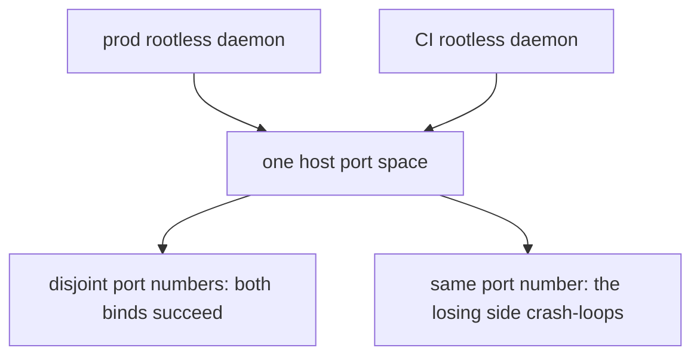

# Published-port reservation convention

Production stacks and the CI runner run as two separate rootless Docker daemons **on the same
homelab host**, publishing into the **same host port space**. A prod service binding `0.0.0.0:<port>`
collides with a CI/dev service binding the same port on `127.0.0.1` or `0.0.0.0` — and the collision
manifests as a crash-loop on the *losing* side, not a clean bind error most engineers would expect.

The convention: **every prod admin/UI published port lives in the reserved range `19000–19099`**
(Keycloak admin `19099`, LangFuse `19030`, Grafana/otel-lgtm `19002`, all `0.0.0.0`, tailnet-only via
firewall rules). CI/dev keeps its own separate, lower port numbers. The range also sits below the
Linux ephemeral port range (`32768+`), so a reserved prod port can never be transiently grabbed by an
outbound client connection. `scripts/check-prod-ci-port-collision.mjs` is the CI gate that enforces
disjointness between the two ranges.

Two rootless daemons publishing into one host port space — the reason a reserved range exists.

Those three ports are the **only** published ports in production: every other service in the seven
`compose.prod.yaml` files is internal-only, reached by Docker DNS on a shared network
(`backend-network`, `edge-network`, `mcm-bff-network`, `agent-audit-network`; the intra-stack
Keycloak↔Postgres `keycloak-network` is compose-managed). The new numbers translate the old ones so a
service keeps its recognizable low digits — `8099 → 19099`, `3030 → 19030`, `3002 → 19002`.

## What the gate checks

- **File split.** Prod = the compose files under `infrastructure-as-code/docker/**` whose basename
  ends `.prod.yaml` (the seven prod composes). CI/dev = everything else the gate discovers —
  `compose.yaml`, `compose.ci.yaml`, `compose.agent-e2e.yaml`, `stacks/*.compose.yaml`. Discovery is
  two globs (`infrastructure-as-code/docker/**/compose*.yaml` plus
  `infrastructure-as-code/docker/stacks/*.compose.yaml`) and classification is by basename only, so a
  compose file whose name does not start with `compose` falls outside the scan:
  `infrastructure-as-code/docker/dev-ollama.compose.yaml` publishes `0.0.0.0:11434` and is discovered
  by neither glob.
- **Only fixed host ports count.** A bare container port (random host port), a `${VAR}` host field and
  an unparseable entry are all skipped, and the comparison is over host **port numbers** rather than
  interfaces: in the three-field `IP:HOST:CONTAINER` form the IP is ignored, because a prod `0.0.0.0`
  bind collides with a CI bind on that port whatever interface the CI bind names; a two-field entry
  whose first field is an IP is read as `IP:CONTAINER` with a random host port, so it is skipped too.
  Numeric ranges (`8000-8001:9000-9001`) are expanded.
- **Exit codes** `0` clean / selftest passed · `1` collision / selftest broken · `2` bad args or an
  unparseable compose file. `--selftest` plants an overlap on `19099` and asserts the parser cases, so
  a gate that quietly stopped detecting cannot report green.
- **Required, not advisory.** The `naming` job in `.forgejo/workflows/guardrails.yml` runs selftest +
  scan as the "Prod↔CI port-collision gate" step on every PR and every push to `main`, and
  `scripts/preflight.mjs` runs the same pair locally.

## Secondary references a port move must also update

The gate only reads the `ports:` key of a compose file, so a port move is not finished when the
compose bind changes: the same port number usually appears again as a **self-referencing URL** that
must be updated in lockstep. Concretely, the two live secondary references today are:

- `KC_HOSTNAME_ADMIN` in the `prod-auth` `environment` block of
  `infrastructure-as-code/komodo/stacks.toml` — the `http://[[TAILNET_HOST]]:19099` admin-console URL,
  which the keycloak compose also requires as `${KC_HOSTNAME_ADMIN:?}` in its `environment:` block.
- `NEXTAUTH_URL` in `infrastructure-as-code/docker/observability/compose.prod.yaml` — LangFuse's own
  login/callback URL, pointing at the tailnet host on `:19030`.

Miss either and the port binds cleanly while the service serves a URL that points at the old port —
a working bind with a broken redirect, which no port-scan gate can see.

The same stack config shows the mirror-image hazard: **a variable that outlives the code that read
it.** `KC_ADMIN_BIND_IP` was only ever the bind *prefix*. Feature 028 dropped it from the keycloak
compose bind, and `infrastructure-as-code/komodo/stacks.toml` stopped passing it to `prod-auth` on
2026-10-12 (item #727). Until then Komodo wrote it into `.env.prod` — the file the keycloak compose
loads with `env_file:` — so it reached the container as a `KC_*` variable that names no Keycloak
option: harmless, but proof that a `.env.prod` key can outlive its reader. The admin **URL** was
always the separate `KC_HOSTNAME_ADMIN`, and that URL var is the live one a port move must keep in
sync.

`TS_ADMIN_IP` is the same shape, and it has now run the same course to completion. It was only ever
the bind *prefix* for the two observability operator UIs; feature 028 made those binds `0.0.0.0`, so
no compose bind had read it since, and `komodo/stacks.toml` stopped passing it to `prod-observability`
on 2026-10-13 (item #727). **No stack or compose file reads `TS_ADMIN_IP` any more**, and the
operator checklist records the Komodo Variable itself as removed (item #727). Because nothing
references the name, a still-seeded leftover could not have failed a deploy — the only cost would
have been dead config.

## Gotchas

- **This rule exists because of a real outage, not preemptively.** A prod Keycloak admin bind on a
  port also used by CI collided with a leftover CI Keycloak stack that held the port for several
  hours, crash-looping prod auth. The fix was moving prod's admin/UI ports into the reserved range,
  not just documenting "don't reuse ports." The bind in question was feature 028's `0.0.0.0:8099`,
  which overlapped the CI app-e2e Keycloak's `127.0.0.1:8099` — the same number the dev compose still
  publishes on loopback. Whenever a CI Keycloak was up, prod Keycloak could not bind on redeploy; on
  2026-07-06 a leftover CI stack held the port for roughly six hours and kept prod auth down for that
  long. The damage was not confined to a dead admin port either: the failed `0.0.0.0:8099` bind rolled
  back `keycloak-service`'s networking, so it came back detached from every network and could not
  resolve its own Postgres (`UnknownHostException`). That is why the reservation is treated as an
  invariant rather than a preference.
- **Moving or adding a prod published port also requires updating that port's self-referencing URL
  var**, because the collision gate only scans the `ports:` compose key, not those secondary
  references. The current pair is listed under
  [Secondary references a port move must also update](#secondary-references-a-port-move-must-also-update):
  Keycloak's admin-hostname var (`KC_HOSTNAME_ADMIN`) and LangFuse's `NEXTAUTH_URL`.
- **A retired variable can linger in a Komodo-supplied `.env.prod`** long after its reader is gone —
  `KC_ADMIN_BIND_IP` is the worked example (compose bind dropped in feature 028, stack config stopped
  passing it 2026-10-12, item #727), and `TS_ADMIN_IP` has since followed it out the same way: the
  stack stopped passing it on 2026-10-13 and no stack or compose file reads it now, so the Komodo
  Variable has been retired. Retire the stack `environment` line and the Komodo Variable together;
  read the effective value from `.env.prod`, not from a historical comment.
- **A tree-wide grep for those retired names finds the gates that guarded them, not live config.**
  `scripts/check-komodo-sync.mjs` still carries `KC_ADMIN_BIND_IP=[[TS_ADMIN_IP]]` as its
  *clean-sample* fixture and assigns `KC_ADMIN_BIND_IP` a fake Tailscale address in its
  planted-literal fixture, and `scripts/check-prod-ci-port-collision.mjs` still parses
  `${TS_ADMIN_IP}:3030:3000` as one of its parser cases. Those are deliberately planted selftest
  inputs, not a stack or compose that reads the names. The remaining hits are historical records — the
  operator checklist, the homelab proposal docs, and a `#PROD` comment in the observability compose
  explaining why the binds no longer use them. So a grep hit is not evidence that a bind prefix is
  back: check whether the hit is a fixture or a comment before concluding the variable is live. The
  same trap applies in reverse — a *live* reference is what matters, and the way to find one is to
  read the stack `environment` blocks and the compose `ports:`/`environment:` keys, not to count grep
  hits.
- **CI now tears down its stacks on every run** specifically so a leftover CI stack can't hold a port
  indefinitely and starve a prod redeploy the way the original incident did. The `app-ci` `app-e2e`
  job's "Tear down CI stacks (always)" step runs under `if: ${{ always() }}` — success, failure and
  cancel alike — and its own comment calls this defense-in-depth now that prod ports sit in the
  reserved range, with the collision gate as the actual guard.
- **Port *numbers* as a design convention are fine to discuss; a real host paired with a real port is
  not** — this wiki (and any gate that scans it) treats a literal hostname/tailnet-address next to a
  port number as a topology leak. Discuss the reserved range abstractly, never alongside the
  production hostname. `scripts/check-topology-scrub.mjs` is the tree-wide gate; it allows sanitized
  placeholders (any host containing `tailnet` or `example`) and flags a real tailnet host.
- **The gate is required in CI** (part of the guardrails the operator checklist runs before/after a
  deploy) — a collision is meant to be caught before it reaches prod, not discovered via an outage.
- **A `0.0.0.0` prod bind is tailnet-only *solely* because of the host firewall's default-deny-inbound
  posture**, and that posture is now load-bearing — do not relax it. The broad bind is deliberate: the
  rootless daemon starts before `tailscaled` at boot, so a `<tailnet-ip>:host:container` publish
  silently fails (the container shows `Up` with an empty Ports column and nothing listening).
- **Don't confuse the range's low end with Expo's dev-server ports.** `19000`/`19001`/`19006` are
  Expo's legacy default dev-server ports; this project's Expo SDK does not use them and the dev
  container is explicitly told not to forward them. Those numbers are *not* prod reservations — only
  the ports a prod compose actually publishes are, and the reserved range as a whole is what keeps
  CI/dev out.

Full incident narrative, the exact three reserved ports, the service/file/port bind table, and the
"Retired variables" record: [prod-reboot-resilience.md §2a](../../docs/runbooks/prod-reboot-resilience.md#2a-tailnet-ip-port-bind-race--bind-0000-us1).
Related pages: [Infrastructure stacks](../projects/infrastructure-stacks.md),
[Keycloak](../projects/keycloak.md),
[prod control tower](../runbooks/prod-control-tower.md),
[server setup](../runbooks/server-setup.md),
[secrets management](secrets-management.md).
