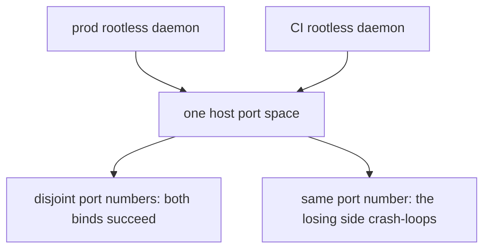

# Published-port reservation convention

Production stacks and the CI runner run as two separate rootless Docker daemons **on the same
homelab host**, publishing into the **same host port space**. A prod service binding `0.0.0.0:<port>`
collides with a CI/dev service binding the same port on `127.0.0.1` or `0.0.0.0` — and the collision
manifests as a crash-loop on the *losing* side, not a clean bind error most engineers would expect.

The convention: **every prod admin/UI published port lives in the reserved range `19000–19099`**
(Keycloak admin `19099`, LangFuse `19030`, Grafana/otel-lgtm `19002`, all `0.0.0.0`, tailnet-only via
firewall rules). CI/dev keeps its own separate, lower port numbers. The range also sits below the
Linux ephemeral port range (`32768+`), so a reserved prod port can never be transiently grabbed by an
outbound client connection. `scripts/check-prod-ci-port-collision.mjs` is the CI gate that enforces
disjointness between the two ranges.

Two rootless daemons publishing into one host port space — the reason a reserved range exists.

Those three ports are the **only** published ports in production: every other service in the seven
`compose.prod.yaml` files is internal-only, reached by Docker DNS on a shared network
(`backend-network`, `edge-network`, `mcm-bff-network`). The new numbers translate the old ones so a
service keeps its recognizable low digits — `8099 → 19099`, `3030 → 19030`, `3002 → 19002`.

## What the gate checks

- **File split.** Prod = the compose files under `infrastructure-as-code/docker/**` whose basename
  ends `.prod.yaml` (the seven prod composes). CI/dev = everything else the gate discovers —
  `compose.yaml`, `compose.ci.yaml`, `compose.agent-e2e.yaml`, `stacks/*.compose.yaml`. Discovery is
  two globs (`infrastructure-as-code/docker/**/compose*.yaml` plus
  `infrastructure-as-code/docker/stacks/*.compose.yaml`) and classification is by basename only, so a
  compose file whose name does not start with `compose` falls outside the scan.
- **Only fixed host ports count.** A bare container port (random host port), a `${VAR}` host field and
  an unparseable entry are all skipped, and the `host_ip` is ignored — the comparison is over host
  **port numbers**, because a prod `0.0.0.0` bind collides with a CI bind on that port whatever
  interface the CI bind names. Numeric ranges (`8000-8001:9000-9001`) are expanded.
- **Exit codes** `0` clean / selftest passed · `1` collision / selftest broken · `2` bad args or an
  unparseable compose file. `--selftest` plants an overlap on `19099` and asserts the parser cases, so
  a gate that quietly stopped detecting cannot report green.
- **Required, not advisory.** The `naming` job in `.forgejo/workflows/guardrails.yml` runs selftest +
  scan as the "Prod↔CI port-collision gate" step on every PR and every push to `main`, and
  `scripts/preflight.mjs` runs the same pair locally.

## Gotchas

- **This rule exists because of a real outage, not preemptively.** A prod Keycloak admin bind on a
  port also used by CI collided with a leftover CI Keycloak stack that held the port for several
  hours, crash-looping prod auth. The fix was moving prod's admin/UI ports into the reserved range,
  not just documenting "don't reuse ports." The bind in question was feature 028's `0.0.0.0:8099`,
  which overlapped the CI app-e2e Keycloak's `127.0.0.1:8099` — the same number the dev compose still
  publishes on loopback. Whenever a CI Keycloak was up, prod Keycloak could not bind on redeploy; on
  2026-07-06 a leftover CI stack held the port for roughly six hours and kept prod auth down for that
  long.
- **Moving or adding a prod published port also requires updating that port's self-referencing URL
  var** — for example Keycloak's admin-hostname var in the stacks config, or an observability tool's
  own callback URL in its compose file — because the collision gate only scans the `ports:` compose
  key, not those secondary references. Missing this step reintroduces a working port bind pointing at
  a stale self-referencing URL. Concretely, the two secondary references are `KC_HOSTNAME_ADMIN` in
  `infrastructure-as-code/komodo/stacks.toml` (a `[[TAILNET_HOST]]:19099`-shaped admin URL) and
  LangFuse's `NEXTAUTH_URL` in the observability prod compose (its own login/callback URL, `:19030`).
- **CI now tears down its stacks on every run** specifically so a leftover CI stack can't hold a port
  indefinitely and starve a prod redeploy the way the original incident did. The `app-ci` `app-e2e`
  job's "Tear down CI stacks (always)" step runs under `if: ${{ always() }}` — success, failure and
  cancel alike — and its own comment calls this defense-in-depth now that prod ports sit in the
  reserved range, with the collision gate as the actual guard.
- **Port *numbers* as a design convention are fine to discuss; a real host paired with a real port is
  not** — this wiki (and any gate that scans it) treats a literal hostname/tailnet-address next to a
  port number as a topology leak. Discuss the reserved range abstractly, never alongside the
  production hostname. `scripts/check-topology-scrub.mjs` is the tree-wide gate; it allows sanitized
  placeholders (any host containing `tailnet` or `example`) and flags a real tailnet host.
- **The gate is required in CI** (part of the guardrails the operator checklist runs before/after a
  deploy) — a collision is meant to be caught before it reaches prod, not discovered via an outage.
- **A `0.0.0.0` prod bind is tailnet-only *solely* because of the host firewall's default-deny-inbound
  posture**, and that posture is now load-bearing — do not relax it. The broad bind is deliberate: the
  rootless daemon starts before `tailscaled` at boot, so a `<tailnet-ip>:host:container` publish
  silently fails (the container shows `Up` with an empty Ports column and nothing listening). The
  retired bind-IP variables are still handed to the `prod-auth` stack config, but no compose bind
  reads them.
- **Don't confuse the range's low end with Expo's dev-server ports.** `19000`/`19001`/`19006` are
  Expo's legacy default dev-server ports; this project's Expo SDK does not use them and the dev
  container is explicitly told not to forward them. Those numbers are *not* prod reservations — only
  the ports a prod compose actually publishes are, and the reserved range as a whole is what keeps
  CI/dev out.

Full incident narrative, the exact three reserved ports, and the pre/post-fix bind table:
[prod-reboot-resilience.md](../../docs/runbooks/prod-reboot-resilience.md). Related pages:
[Infrastructure stacks](../projects/infrastructure-stacks.md), [Keycloak](../projects/keycloak.md),
[prod control tower](../runbooks/prod-control-tower.md).
