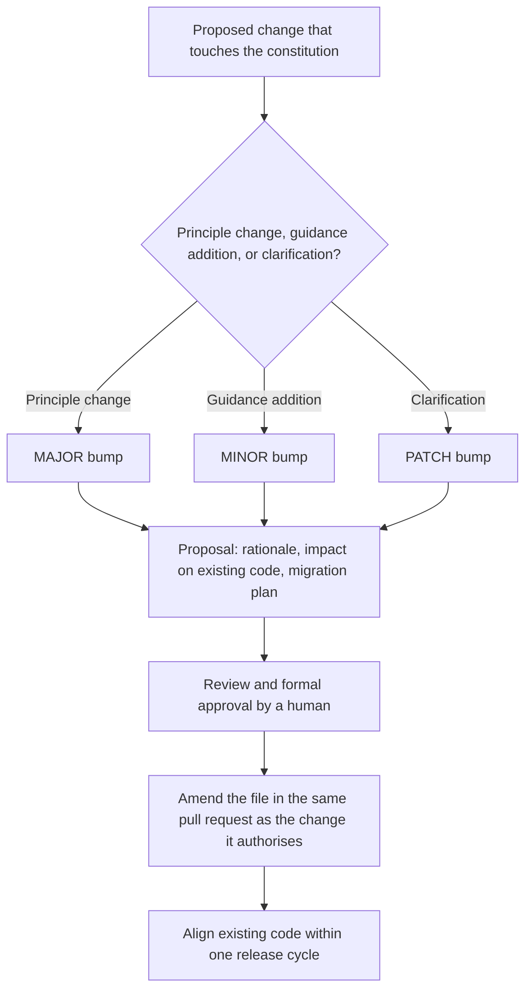

# The governing constitution

`.specify/memory/constitution.md` is the repository's single ratified source of core, supposedly
immutable principles — security, authentication/authorization boundaries, session management, TDD,
AI-assistant behavioral constraints, and per-stack technology baselines — governing Frontend Apps,
Backend Services, and AI Agents alike. It is versioned (semver-style, with a change log at the top
of the file) and has been amended more than twenty times as the system matured, from initial
ratification through incremental clarifications like the client auth model rewrite and the Tamagui
design-system mandate.

The file currently reads **v2.7.0**, ratified 2026-03-08 and last amended 2026-10-20. The changelog
entry marked `[CURRENT]` is the authoritative "latest amendment" signal — check it rather than
inferring the version from any summary, this page included. Amendments follow the file's own
**Governance** section: a proposal documenting rationale, impact and a migration plan; review and
formal approval; a version bump (MAJOR for a principle change, MINOR for a guidance addition, PATCH
for a clarification); and alignment of existing code within one release cycle. The bump level is
informative, not decorative — v2.0.0 superseded the previous client auth model outright, while the
recent MINOR bumps add a principle area or a scoped exception, or move a version-named stack
baseline, without redefining anything.

How a constitution amendment moves from proposal to ratified version.

The two most recent amendments are the purest examples of the MINOR kind. **v2.6.0** advanced the
frontend stack baseline from Expo SDK 56 to Expo SDK 57 (with React Native 0.86 and React 19.2).
**v2.7.0** advanced the document-database baseline to
`mongodb/mongodb-community-server:9.0-ubi9` (MongoDB 9.0 on Red Hat UBI 9) — and had to record
that the image the document had named until then, `8.2.6-ubuntu2204-slim`, was stale: `8.0.8-ubi9`
is what actually ran. Neither redefines a principle, and the same-PR rule governs both: a version
the document names is amended in the change that moves it, with human approval, never silently
afterwards. Feature 081 writes that requirement down as **FR-015** — where the constitution names a
version the feature changes (the platform SDK and native runtime, the document-database image), the
amendment must land in the same pull request as the change it authorises, with human approval.

Amendments are drafted rather than hand-edited. The Spec Kit constitution command
([`.github/agents/speckit.constitution.agent.md`](../../.github/agents/speckit.constitution.agent.md),
and the equivalent skill at
[`.claude/skills/speckit-constitution/SKILL.md`](../../.claude/skills/speckit-constitution/SKILL.md))
loads the existing constitution, applies the same MAJOR/MINOR/PATCH rule (MAJOR for a removal or
redefinition of a principle or governance rule, MINOR for a new section or materially expanded
guidance, PATCH for clarifications), and carries a consistency-propagation checklist that pushes the
change back into the dependent templates —
[`.specify/templates/plan-template.md`](../../.specify/templates/plan-template.md) and its spec and
tasks siblings. A principle amended without those following is a tooling failure, not just a
documentation one.

Compliance is operationalized per feature rather than left to review. Every `plan.md` carries a
**Constitution Check** gate — the wording in
[`.specify/templates/plan-template.md`](../../.specify/templates/plan-template.md) is *"GATE: Must
pass before Phase 0 research. Re-check after Phase 1 design."* — where each principle gets a row with
a status and how it is satisfied. Feature 081's plan is a worked example: the Expo SDK line and the
document-database image line are marked **AMENDMENT REQUIRED**, each naming the story that amends
it, while the Tamagui line is marked PASS because the constitution names that library but no version
of it. That gate is what turns "every spec and plan must comply" into a per-principle artefact a
reviewer can check.

Notable principle areas: AI Assistant Constraints (behavior-descriptive identifiers, no vibe coding,
comments only for non-obvious rationale); Security (classification, PKCE-only auth via the BFF
pattern, IdP boundary for MFA/Conditional Access, deny-by-default authorization, server-side session
storage); and stack-specific standards layered on top for each of the three development surfaces.

Beyond principles, the document carries the monorepo **directory tree** and the **architecture
diagrams** — the C4 container diagrams for the multi-frontend/multi-service layout and the additive
AI-agents layer, plus the three auth-flow sequence diagrams (login, backend resource access, agent
auth). Those diagrams are the canonical picture of BFF token custody and of the RFC 8693 agent token
exchange, which makes the constitution a design reference as well as a rulebook. The document is a
derived summary target, not a copy: read the source for the diagrams, the principle text and the
version history.

## Gotchas

- **A spec or plan may deviate from itself and self-correct; a deviation from the constitution
  requires explicit human approval and documented rationale.** This is the one asymmetry in the
  [spec-driven-development lifecycle](./spec-driven-development.md) — an AI assistant
  encountering an apparent conflict between a task and the constitution must stop and ask, not
  silently pick one.
- **"No Vibe Coding" is a named, load-bearing constraint**: the assistant must consult the current
  `plan.md`/`spec.md` before writing code — deviations require documentation and approval, mirroring
  the constitution's own amendment discipline.
- **The IdP boundary is a hard trust line, not a suggestion.** The constitution requires the
  application to treat a validated JWT as proof the identity provider already evaluated Conditional
  Access and MFA — the application must never re-implement or re-check those, only validate token
  signature/claims. This boundary is the constitutional basis for the enforcement split described in
  [Authentication and authorization chain](../invariants/auth-chain.md).
- **"Behavior-Descriptive Identifiers" bans requirement IDs (FR-###, SC-###, T-###) from code
  identifiers** — they belong in a traceability comment, not a file/function/type name — because a
  reader should understand an artifact's purpose from its name alone. The one explicit exception is
  the traceability comment itself, which records provenance a reader can't derive from the code.
- **Constitution changes are rare and deliberate** — the version history at the top of the file is the
  fastest way to see what changed and why before assuming a principle still reads the way you
  remember it; do not rely on a cached mental model of an old version.
- **An "accepted exception" is bounded and scoped, never a quiet repeal.** v2.5.0 recorded exactly one
  for the mcm-app web client's cold load, whose measured Slow-3G time-to-interactive cannot meet the
  2-second figure on a React-Native-Web + Tamagui stack, and it stands unchanged through v2.7.0 —
  those amendments touch stack guidance only. It is capped by a committed entry-chunk byte
  budget enforced by
  [`scripts/check-web-bundle-budget.mjs`](../../scripts/check-web-bundle-budget.mjs), it covers
  residual framework weight only (the same principle's lazy-loading clause stays in force and is
  CI-enforced), and it applies to that one client's cold load and nothing else — every other page and
  app still carries the 2-second rule. Growth past the budget is a failure, not a further exception;
  raising the budget is a deliberate act.
- **The document carries more than principles — it also carries stack baselines, the directory tree
  and the architecture diagrams**, so a "principle doesn't apply to me" reading is usually wrong: the
  per-stack sections bind language, framework, data-access library, container image, and even naming
  convention. Where a project legitimately cannot comply, the route is an amendment (or a scoped,
  bounded exception like the one above), not a local convention. See the per-surface pages —
  [Expo/React Native universal app](../projects/expo-app.md),
  [mc-service](../projects/mc-service.md), [Agent Gateway](../projects/agent-gateway.md) — and the
  [repository layout](../projects/repository.md) it prescribes.
- **Only a stack element named *with a version* forces an amendment when it moves.** The frontend
  stack section names Tamagui and `@mcm/design-system` as the UI/styling engine but pins no version
  for it, so a Tamagui major is not a constitutional change; the version-named lines — the Expo SDK
  and native runtime, the database and runtime images, the toolchain — are. Read the line before
  assuming an amendment is required, and before assuming it is not.
- **An unversioned line can still carry a behavioural claim, and that claim can be false without the
  line being version-stale.** The same "UI / Design System" line says Tamagui is "wired runtime-only
  by default (the Tamagui babel/metro compiler plugins are optional optimisations)" — which was
  inaccurate from feature 015 onward, because that feature enabled `@tamagui/babel-plugin`. Feature
  081 US10 restored the line's accuracy *by code*, not by amendment: Tamagui 3 removed that Babel
  plugin, and its replacement, `@tamagui/metro-plugin` 3.0.x, was measured to lower some web modules
  to static class names **without emitting their CSS** (lost gaps, widths, radii) while saving no
  bytes — 1,881,353 B with it versus 1,881,066 B without, against the 2,000,000 B budget. So no
  compiler is wired and `frontend/mcm-app/babel.config.js` runs no Tamagui plugin. A constitutional
  line can be wrong about *behaviour* as well as about a version; check the config, not only the
  version numbers.
- **A version the constitution names can itself be stale, so the named line is not proof of what
  runs.** v2.7.0 had to record that the document-database image it had named since before
  (`8.2.6-ubuntu2204-slim`) was never the image the stacks ran — `8.0.8-ubi9` was — before advancing
  the line to `9.0-ubi9`. Compare a version-named line against the compose files and the lockfile
  before treating it as the deployed truth; the changelog entry is where a correction of that kind
  gets recorded.
- **A named library can be aspirational — the amendment history is not a description of the running
  system.** The Backend Services stack section requires `medi-rs` to route commands, queries and
  events from the API layer to the application-layer handler, but `backend/mc-service` ships no
  mediator crate: `router::build()` constructs one handler per operation over the repository traits
  and packs them into `AppState`, so dispatch is a plain method call on that struct. The divergence
  is recorded in [`docs/MCM-Architecture.md`](../../docs/MCM-Architecture.md) as a tracked backlog
  item, not as an amendment — so a stack line can be out of step with the shipped code while the
  version history reads as current. Read the manifest and the router before treating a named library
  as present; see [mc-service](../projects/mc-service.md) for the shipped dispatch shape.

Full text, every principle, and the complete version history:
[`.specify/memory/constitution.md`](../../.specify/memory/constitution.md); the amendment procedure
is the document's [Governance section](../../.specify/memory/constitution.md#governance). For how the
principles are enforced per stack, see
[Testing tiers and what gates a merge](../invariants/testing-tiers.md) and
[Secrets management](../invariants/secrets-management.md).
