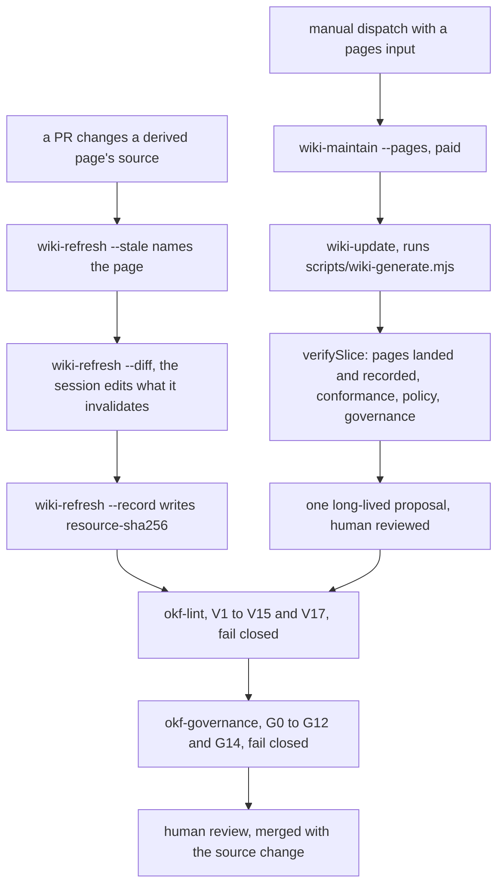

# OpenWiki bundle generation and maintenance

This wiki (feature `043-openwiki-okf`) is kept current, since feature 098 (ADR-0004), by **the coding
session that changes a summary's source, in the same PR**: `node scripts/wiki-refresh.mjs --stale` lists
the derived pages whose recorded source fingerprint (`resource-sha256`) no longer matches, `--diff` shows
the source's change since the page was last recorded, and `--record` writes the new fingerprint after the
session has edited what the diff invalidates. It is offline, keyless and model-free, and it is not an Nx
target. `pnpm nx okf-lint infrastructure-as-code` runs the repository conformance gate
(`scripts/check-openwiki-okf.mjs`) over the bundle, and its rule **V17** fails a PR whose summary is
stale; `pnpm nx okf-governance infrastructure-as-code` runs the second gate
(`scripts/check-openwiki-governance.mjs`, rules G0–G12 and G14, where `G0` is fail-closed: a missing or
unparseable `openwiki/policy.yaml` or `openwiki/protected.yaml` is a violation rather than a skip and
stops the gate before it checks any concept) over the regeneration policy, the protection fingerprints,
the index and the rule (G14) that a derived page cites one human-written file.

The generator remains for one job only: a **manual rebuild of pages an operator names**.
`pnpm nx wiki-maintain infrastructure-as-code --args="--pages runbooks/x.md,projects/y.md"` (command
`node scripts/wiki-maintain.mjs`) is that paid path, dispatched by hand in CI with a required `pages`
input; it refuses an empty, unknown or canonical page before anything is spent, groups the named pages
into one slice per area, and each invocation drives `pnpm nx wiki-update infrastructure-as-code`, whose
command is `node scripts/wiki-generate.mjs` — a launcher that resolves the provider, maps its credential
at the point of use, and spawns `openwiki code --update --print` with a required telemetry opt-out and a
raised Node heap baked into the target's environment; the bare CLI omits both and reliably OOMs on this
repo. The `wiki-plan` target is gone: there is no range to plan, no schedule and no run record. The
operator runbook for all of it is `docs/runbooks/wiki-maintenance.md`; this page is the summary of what
the machinery guarantees and where it is easy to be misled, and the distilled runbook half is
[OpenWiki knowledge-bundle maintenance](../runbooks/wiki-maintenance.md).

Scope and redaction rules for generation are hand-authored in `openwiki/INSTRUCTIONS.md`, which the
tool reads on every run but never rewrites. Two sibling files beside it are in the same position —
`openwiki/policy.yaml` (the per-path regeneration policy) and `openwiki/protected.yaml` (the protection
manifest) — and all three are declared `never-written`, because a process must not be able to rewrite
the file that constrains it.

Routine freshness never touches the generator: the refresh and the gates are free, and the paid rebuild
is a separate, operator-started path whose slice verification re-runs both gate scripts, so a page that
breaks either one is refused before the run can propose it.

## Gotchas

- **Always invoke through the Nx target, never the bare `openwiki` CLI.** See
  [Nx as the task runner](../invariants/nx-task-runner.md) — the target sets
  `OPENWIKI_TELEMETRY_DISABLED=1` (the tool reports usage telemetry to a third-party host by default,
  which the dev container's egress allowlist would block but the Windows host would not) and raises
  `NODE_OPTIONS` heap size to avoid the OOM. `DO_NOT_TRACK=1` is set beside it, and one further
  variable is load-bearing rather than cosmetic: `OPENWIKI_MAX_OUTPUT_TOKENS=16384`. A per-turn output
  cap that is unset or too small truncates a turn *before* it opens a tool call, which is exactly the
  model loop's stop condition — the run then exits 0 having written nothing
  (`scripts/__tests__/wiki-maintain.guard.test.mjs` fails an unset or too-small cap, a model id the
  generator's own resolver does not match, and any id that would land on the old 4096 fallback).
  `scripts/wiki-generate.mjs` refuses to start without that cap, so a direct script invocation is not a
  way around it either. The target's 16384 is a **floor, not the effective cap**: the `fireworks` row in
  `scripts/wiki-provider.mjs` raises it to 65536 — DeepSeek V4.1 Flash reasons *inside* its output
  budget, and a worker writing a whole page in one `write_file` turn ran out at 16384 (item #719) —
  while `scripts/wiki-generate.mjs` never lowers an explicit higher value, and the `anthropic` row has
  no raise because the Anthropic SDK refuses a non-streaming request whose `max_tokens` implies more
  than ten minutes. A run message must travel in `WIKI_RUN_MESSAGE` rather than `nx --args`,
  which strips its quoting and leaves the run unscoped. For the same reason the target runs
  `--update`, never `--init`.
- **The conformance gate is fail-closed with no opt-out.** An absent, empty, or partially-written
  bundle is a violation, not a vacuous pass — there is no skip flag. This mirrors the same
  fail-closed posture other repository gates use (see
  [Secrets management](../invariants/secrets-management.md)) and was a deliberate choice: a
  gate that passes when its subject is missing is exactly the failure mode that let an entire test
  tier rot silently for a month before a different feature caught it.
- **The gate is offline and keyless by design.** Repository-relative `resource` links are resolved
  against the working tree and fail the gate when the target is missing; external links are only
  checked for well-formedness, never fetched — so the always-on guardrails job cannot fail because a
  third-party host happens to be down. `okf-governance` has the identical posture, and both run as
  steps of the same always-on `okf` CI job, each preceded by its own `--selftest` so a rule that
  silently stopped detecting its case turns the build red. That job still installs the workspace
  (`pnpm install --frozen-lockfile`) before either gate: both import the root `yaml` dependency, so
  without it the gate dies on `ERR_MODULE_NOT_FOUND` before checking anything — a job red for its own
  missing dependency rather than for anything about the bundle. The gates' own unit tests are *not*
  run here; the `naming` job's shell-expanded `node --test scripts/__tests__/*.test.mjs` glob picks
  them up, which is why a broken gate test reddens `naming` rather than `okf`.
- **Both gates are required merge contexts; the paid maintenance job deliberately is not.** The
  `okf` job lives in `guardrails.yml`, and branch protection requires the glob `guardrails*`, so a
  gate placed in that file is required **by construction** — no operator step, and no required
  context that never reports. That is why the governance gate was added as steps in the existing job
  rather than as a job of its own: a new job would owe its own failure-digest step for no benefit,
  and the two gates have exactly the same posture. `wiki-maintain` is the opposite and its own
  header says so: it is paid and occasionally slow, it must never gate an unrelated merge, and it
  must not be added to branch protection. So a red board and a stale bundle are independent signals
  — the gates block the merge, the generator never does.
- **A stale summary blocks the PR; it is not a warning.** V17 compares each derived page's
  `resource-sha256` with its source as it sits in the working tree (CRLF normalised to LF), so a
  session's uncommitted refresh and CI's checkout of the commit read the same bytes. It also fails a page
  whose `resource` no longer exists or names a directory, and one still carrying the retired `sources:`
  or `verified:` fields. `wiki-refresh --stale` and V17 call one function (`staleDerivedPages` in
  `scripts/openwiki-fingerprint.mjs`), so they cannot disagree. This replaced V12, a commit-date drift
  warning that never touched the exit code — kept that way so a documentation edit would not wait on a
  paid regeneration — and the bounded drift planner that tried to catch up afterwards; with the refresh
  free and in the same PR, the reason for keeping drift out of the exit code is gone.
- **`docs/proposals/**` is deliberately excluded from the bundle** — see
  [Spec-driven development](./spec-driven-development.md) for why, and where the one
  process concept documenting that lifecycle lives instead.
- **These pages are maintained by hand, in the same PR as their source.** OpenWiki's managed block in
  `AGENTS.md` says not to hand-edit generated pages; this repository corrects that outside the block
  (ADR-0004). Editing a derived page is expected — but as a refresh of a *summary* from its source's
  change, never as the only home of a new fact, which is how a concept starts becoming a drifting copy.
- **The pinned generator's managed block must already be committed.** OpenWiki rewrites its
  `<!-- OPENWIKI:START -->…<!-- OPENWIKI:END -->` block in `AGENTS.md` and `CLAUDE.md` on **every**
  run, and `openwiki/policy.yaml` lets only an `actor: agent` write `AGENTS.md`. If the committed block
  is not byte-identical to what the pinned generator writes, every slice of a rebuild fails verification
  ("AGENTS.md — the run may not write here") and is retried, at full cost. A guard test rebuilds the block from the installed generator's own source and
  compares, so a version bump that changes the text fails offline instead of failing every paid run in
  CI.
- **A durable learning goes to the canonical home of its subject.** Find the concept covering the
  subject, then read its front matter: **carrying a `resource`** means it is a derived summary, and the
  learning belongs in the cited source (runbook, decision record, architecture document), with the
  summary refreshed in the same PR; **no
  `resource`** means it is authoritative — listed under `authoritative:` in `openwiki/protected.yaml` —
  and the learning belongs **in the concept itself**. `openwiki/INSTRUCTIONS.md` §7 is the full rule,
  and `okf-governance` enforces the classification in both directions: a concept that is neither a
  resolving derived summary nor a listed authoritative one fails the gate (G11), and an authoritative
  concept whose effective policy is `regenerate` also fails (G12) — a summary of nothing could only be
  paraphrased, which is exactly what the protected passages exist to prevent. Nothing here changes
  `CLAUDE.md`, which is an index into the bundle and is gated against re-growth.
- **The generator's own account of a run is never trusted.** `wiki-maintain` verifies each slice by the
  pages that actually landed in the working tree, by bundle conformance, by whether policy permitted
  every written path, and — since PR #857 — by running the *governance* gate over the repository root
  too, because a page can be OKF-conformant and still break a governance rule (run 6049 proposed a page
  that had lost its `resource`, which the gate refuses as G11). That last check is skipped, out loud,
  only for a bundle with no `protected.yaml` — a fixture predating governance, never a production run,
  since the real repository always carries the file and the `okf` job fails closed without it. What
  decides is never the generator's exit status, which was measured at exit 0 after twelve minutes of
  paid work that wrote a single `index.md`. Its own exit codes follow from that: `0` means every named page landed (or a dry
  run); `1` is a named page that did not land, or a proposal that could not be published; `2` is bad
  usage — an empty, unknown or canonical page included — a missing credential or a failed preflight, with
  nothing spent. The old `3`, "stopped at the budget with work carried forward", went with the backlog.
- **The generator can silently replace a page's front matter, and the harness puts it back.** openwiki
  0.7.1 "repairs" a page whose model-written YAML does not parse by rebuilding a minimal header —
  `type: "Reference"`, a quoted title and `openwiki_generated: true` — and tells the agent nothing, so
  every repository key it should have carried (`description`, `resource`, `tags`) is gone and the
  governance gate would refuse the page as neither derived nor authoritative (G11). `verifySlice`
  therefore restores those keys (and `resource-sha256`) from `HEAD` on any page carrying that marker. A page that loses its `resource` **without** the marker is
  the model's own edit, and governance still refuses it — which is the case that made slice verification
  run the governance gate at all.
- **Read nothing from the event payload except the dispatch inputs.** The job once read
  `FORGE_OWNER`/`FORGE_REPO` from `github.event.repository.name`; a `schedule` event's payload has no
  `repository` field, and every fire then died in the forge client (runs 6539–6569). `forgeRepository()`
  in `scripts/wiki-maintain.mjs` reads `GITHUB_REPOSITORY` — which the runner sets for every event — and
  refuses a malformed value, and a guard test fails any step that reads `github.event.*` other than the
  dispatch inputs.
- **Nothing here is a monetary bound.** OpenWiki reports no token or cost figure of its own; a rebuild's
  usage is captured by a tap and reported, but nothing enforces a spend ceiling, and the job deadline
  exists to bound occupancy of the shared CI runner. Do not describe it as a cost control.
- **CI installs the generator from a committed lockfile, never resolved fresh — and the dev container
  must name the same version.** The generator is not a workspace dependency and the CI runner has none
  baked in, so the workflow installs it, but from `tools/openwiki-generator/`: a standalone pnpm
  workspace holding exact pins for `openwiki`, `mermaid` and `jsdom` plus its own `pnpm-lock.yaml`,
  installed with `pnpm --dir tools/openwiki-generator install --frozen-lockfile` and put first on
  `PATH` (the verify step fails unless `command -v openwiki` resolves there). A guard test fails any
  run-time resolution in the workflow — a global install, an `npx`, a `pnpm add` — because the previous
  `npm install -g openwiki@0.7.1 mermaid jsdom` pinned only `openwiki` and resolved its whole
  transitive tree at run time; run 4950 died 404-ing on a transitive published two minutes earlier.
  Guard tests pin the rest of that arrangement: a cooldown under three days, a range instead of an
  exact pin, a lockfile that disagrees with the manifest, or a root workspace glob that swallows the
  directory all fail offline. That workspace also sets `minimumReleaseAge: 4320` (three days) and is
  deliberately its own workspace root, so the root's no-cooldown settings do not apply and pnpm rejects
  an entry inside the window both when resolving a lockfile and when installing frozen. Its
  `minimumReleaseAgeExclude` is reserved for **security-floor exceptions** — this code runs with the
  generator's model credential — so every entry must be one exact `name@x.y.z` that an `overrides:`
  floor in the same file requires, which admits that version and nothing else and goes moot once it
  clears the window; the guard fails a name-only or ranged entry, or one with no matching floor. The dev
  container still bakes a *global* install at image-build time (there is no checkout then), so the two
  halves are kept in step by hand and by Renovate's grouped `openwiki generator` rule: a guard test reads the
  `npm install -g openwiki@<v>` command line from the Dockerfile and fails if it names a version other
  than the one in the locked manifest, since otherwise CI and local runs would silently run different
  generators on the output the gates judge. That guard runs in this job after the install and **before
  any paid call**, and a SKIP fails the step — a skipped check reads as a pass, and a mismatched
  managed block would fail every slice of the run that follows.
- **Mermaid diagrams degrade silently without their parser.** From OpenWiki 0.5.0 diagrams are embedded
  by default and every fence is validated after a run; the real `mermaid` parser and `jsdom` are
  optional peer dependencies, and without them a diagram that fails the strict check is rewritten in
  place into a plain `text` fence while the run still exits 0 and every gate still passes. Both are
  installed beside the generator in `.devcontainer/toolchain.Dockerfile`, and both are pinned in CI's
  locked install (`tools/openwiki-generator/package.json`), and guard tests in
  `scripts/__tests__/wiki-maintain.guard.test.mjs` assert that the two environments name the same
  generator version and the same parser set — an environment that is missing the parser, or running a
  different generator, disagrees about what a valid diagram is, and the one that writes the bundle
  wins. The downgrade is not invisible after the fact: the rewritten fence keeps an
  `openwiki: mermaid parse failed` comment naming the parser error, so a diagram that never rendered
  can be found and repaired by hand.
- **Rejected content is fixed in the brief, never allowlisted.** If a page trips the conformance gate,
  the governance gate or a leak scan, the page itself is corrected (and, for a rebuild,
  `openwiki/INSTRUCTIONS.md` too). The gates deliberately have no skip flag and no allowlist, because an allowlisted
  leak stays leaked. Legitimately changing a fingerprinted passage means updating the text **and** its
  fingerprint in the same change: `node scripts/check-openwiki-governance.mjs --fingerprint
  openwiki/<area>/<page>.md "<heading>"`.

Full CLI contract and the conformance gate's rule set: `specs/043-openwiki-okf/contracts/` and
`specs/043-openwiki-okf/data-model.md` (rules V1–V15, the last two added for item #491 after `resource`
verification alone proved insufficient); V17 and G14, and the refresh tool's contract, are in
`specs/098-session-maintained-wiki/contracts/`. Day-to-day invocation notes live in
`docs/runbooks/devcontainer.md`, the operator runbook is `docs/runbooks/wiki-maintenance.md`, and the
corrections note is in `AGENTS.md`'s knowledge-wiki section.
