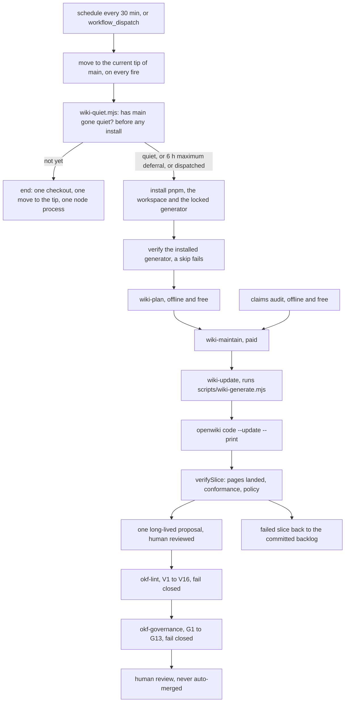

# OpenWiki bundle generation and maintenance

This wiki (feature `043-openwiki-okf`) is generated and refreshed by
`pnpm nx wiki-update infrastructure-as-code`, whose command is `node scripts/wiki-generate.mjs` — a
launcher that resolves the provider, maps its credential at the point of use, and then spawns
`openwiki code --update --print` with a required telemetry opt-out and a raised Node heap size baked
into the Nx target's environment; the bare CLI omits both and reliably OOMs on this repo.
`pnpm nx okf-lint infrastructure-as-code` then runs the repository conformance gate
(`scripts/check-openwiki-okf.mjs`) over the bundle.

Around that pair sit three more targets on the same project. `pnpm nx wiki-plan infrastructure-as-code`
is offline, keyless and free: it decomposes the documentation changes since the last recorded run into
bounded slices — at most 8 pages when refreshing concepts that already exist, at most 3 when creating
new ones, one bundle area each and never a mix of the two kinds — and prints them, so a paid run is
reviewable before it happens. It shows only what was *requested*, though: openwiki forces every page
with a stale or unresolved Claims citation into every run as a full paid regeneration whatever the plan
says, and `node scripts/wiki-maintain.mjs --claims-audit` is the second offline, keyless, model-free
check, naming that set in advance from openwiki's own resolver. `pnpm nx wiki-maintain
infrastructure-as-code` is the paid execution path; at execution, consecutive same-kind slices of
*different* areas are packed into one generator invocation of up to `MAX_PAGES_PER_INVOCATION` (8)
pages, because every invocation pays a fixed planning pass — the slice stays the unit of the backlog
and of carry-forward. `pnpm nx okf-governance infrastructure-as-code` runs the second, newer gate
(`scripts/check-openwiki-governance.mjs`, rules G1–G13, plus a fail-closed `G0` that treats a missing
or unparseable `openwiki/policy.yaml` or `openwiki/protected.yaml` as a violation rather than a skip
and then stops before checking any concept) over the regeneration policy, the protection fingerprints
and the index. The operator runbook for all of it is `docs/runbooks/wiki-maintenance.md`;
this page is the summary of what the machinery guarantees and where it is easy to be misled. The
exhaustive machinery detail — the provider and credential table, the budgets, the exit codes, the four
slice-verification causes and the Claims sidecars — belongs to the runbook, not here; for the
distilled version of that half see [OpenWiki knowledge-bundle maintenance](../runbooks/wiki-maintenance.md).

Scope and redaction rules for generation are hand-authored in `openwiki/INSTRUCTIONS.md`, which the
tool reads on every run but never rewrites. Two sibling files beside it are in the same position —
`openwiki/policy.yaml` (the per-path regeneration policy) and `openwiki/protected.yaml` (the protection
manifest) — and all three are declared `never-written`, because a process must not be able to rewrite
the file that constrains it.

A fire pays nothing until the quiet check says run. The move to the current tip of `main` and the check
itself read only git, so both come before corepack, `pnpm install` and the generator install, and every
later step is gated on the check's decision (`if: steps.quiet.outputs.run == 'true'`, the always-on failure
digest aside). The move comes **first, on every fire, before the check** — a scheduled fire checks out the
commit the schedule was registered at, which stays put while `main` moves on, so the run record read there
would be stale and the check would answer `run=true` on every fire. From there the job enables pnpm,
installs the workspace and then the locked generator, verifies the installed generator against what this
repository expects, plans for free, and only then makes the paid `--execute --propose` call; the record
commit and the outcome report run even when the execute step fails, and every job in the repository owes a
feature-042 failure digest.

The paid path runs from the two free checks through the generator to slice verification and one reviewed
proposal, and the always-on gates sit after it rather than inside it. The planner shows what the run was
asked for; the claims audit shows what openwiki will force in on top of it.

## Gotchas

- **Freshness is decided from git by a scheduled check — the waiting happens outside the job.** On a
  feature branch freshness comes from folding `pnpm nx wiki-update infrastructure-as-code` into the
  existing feature-completion checklist — every feature is expected to refresh the wiki (a no-op
  refresh is valid) and then pass `okf-lint` before being considered complete; see the
  [feature validation checklist](../invariants/feature-validation-checklist.md). On `main` it comes
  from `.forgejo/workflows/wiki-maintain.yml` (feature 044), which is **scheduled every 30 minutes**
  (cron `*/30 * * * *`) plus `workflow_dispatch`, and has **no `push` trigger** — a push is by
  definition not quiet, so a push-triggered check could only ever answer "not yet". A fire does not
  generate on arrival. Its first step records the job deadline (it needs no checkout); then the job
  checks out full history — the marker is a commit and the maximum deferral is the age of the oldest
  commit past it, so a shallow clone can answer neither — then, **on every fire and before the check
  itself**, fetches and moves to the current `origin/main`, and only then runs
  `node scripts/wiki-quiet.mjs`, **before any install**, which decides from git whether `main` has gone
  quiet. The move comes first because a scheduled fire checks out the commit the schedule was registered
  at, which stays put while `main` moves on: read there, the run record is stale, the check answers
  `run=true` on every fire, and each fire installs, finds nothing and pushes another marker commit. A
  guard test pins that order and requires the move to be ungated. Before item #613 the
  debounce was a `sleep 900` *inside* a push-triggered job, which spent a quarter of the 60-minute
  window waiting and left about 37 minutes for generation; the schedule is what comes back later, and
  nothing waits inside the job now, so generation gets about 49 minutes of the same 60.
- **The quiet decision is one small pure-ish script, and every later step depends on it.**
  `scripts/wiki-quiet.mjs` uses node built-ins only, reads the run record's `coveredCommit`, and lists
  `main`'s **first-parent** commits past it — one per merge or direct push, the granularity a push
  trigger used to see. A commit is the job's own, and never counts as activity, if its message carries
  `[skip ci]` (the record marker, and CD's digest promotes) or if its first-parent diff is entirely
  under `openwiki/` (its own proposal landing) — so the workflow cannot trigger itself and a merged
  proposal produces no further run. An **empty** file list is *not* bundle-only: a commit whose diff
  could not be read counts as real work. It prints `run=true|false` on stdout and its reason on stderr;
  every later step in the workflow carries `if: steps.quiet.outputs.run == 'true'` — the always-on
  failure digest, whose whole job is to report a red run, being the deliberate exception — so a "not yet"
  costs one checkout and one node process, about a minute of the shared runner. A quiet check that
  **cannot decide** — a `coveredCommit` no longer in history after a rewrite, or a missing run record —
  exits 1 and reds the run rather than reading as "nothing uncovered", which would end maintenance
  silently and for ever.
- **The rule: newest commit quiet ⇒ run, oldest commit past the ceiling ⇒ run anyway.** Of the
  uncovered commits that are not the job's own: none → end (`nothing uncovered`); the **newest** at
  least 15 minutes old (`DEBOUNCE_SECONDS`) → `main` is quiet, generate now; the **oldest** at least
  six hours old (`MAX_DEFERRAL_SECONDS`) → generate now regardless, so a merge stream that never goes
  quiet cannot starve maintenance exactly when drift is fastest; otherwise → not yet, and the next fire
  looks again. Both thresholds are **at-or-past**, not strictly greater: an age pinned exactly at one of
  them would otherwise defer forever. The age is derived from git commit dates, not from a timer or
  from anything held in run state between fires, and the ceiling is checked before the debounce so the
  maximum deferral always wins. A `workflow_dispatch` run bypasses the quiet period entirely
  (`--dispatched`).
- **A fire never cancels a run, and each event gets its own window.** `cancel-in-progress` is `false`:
  cancelling *was* the old debounce, and under a schedule it would let the next fire kill a generation
  mid-run. A fire that arrives during a generation queues behind it and then finds the record covered.
  The window is chosen per event in the job's first step: `SCHEDULE_MINUTES=60` for a scheduled fire —
  the shared-runner hold — and `DISPATCH_MINUTES=120` for a dispatch, which must equal the job's
  `timeout-minutes`, so raising that 120-minute ceiling cannot lengthen the runs the schedule starts. The
  accepted cost is that a fire is a queued job on the one shared runner — about 48 a day, nearly all
  ending after the checkout and one git query — and that after the last merge a run starts anywhere from
  15 to 45 minutes later rather than exactly 15.
- **Always invoke through the Nx target, never the bare `openwiki` CLI.** See
  [Nx as the task runner](../invariants/nx-task-runner.md) — the target sets
  `OPENWIKI_TELEMETRY_DISABLED=1` (the tool reports usage telemetry to a third-party host by default,
  which the dev container's egress allowlist would block but the Windows host would not) and raises
  `NODE_OPTIONS` heap size to avoid the OOM. `DO_NOT_TRACK=1` is set beside it, and one further
  variable is load-bearing rather than cosmetic: `OPENWIKI_MAX_OUTPUT_TOKENS=16384`. A per-turn output
  cap that is unset or too small truncates a turn *before* it opens a tool call, which is exactly the
  model loop's stop condition — the run then exits 0 having written nothing
  (`scripts/__tests__/wiki-maintain.guard.test.mjs` fails an unset or too-small cap, a model id the
  generator's own resolver does not match, and any id that would land on the old 4096 fallback).
  `scripts/wiki-generate.mjs` refuses to start without that cap, so a direct script invocation is not a
  way around it either. The target's 16384 is a **floor, not the effective cap**: the `fireworks` row in
  `scripts/wiki-provider.mjs` raises it to 65536 — DeepSeek V4.1 Flash reasons *inside* its output
  budget, and a worker writing a whole page in one `write_file` turn ran out at 16384 (item #719) —
  while `scripts/wiki-generate.mjs` never lowers an explicit higher value, and the `anthropic` row has
  no raise because the Anthropic SDK refuses a non-streaming request whose `max_tokens` implies more
  than ten minutes. A run message must travel in `WIKI_RUN_MESSAGE` rather than `nx --args`,
  which strips its quoting and leaves the run unscoped. For the same reason the target runs
  `--update`, never `--init`.
- **The conformance gate is fail-closed with no opt-out.** An absent, empty, or partially-written
  bundle is a violation, not a vacuous pass — there is no skip flag. This mirrors the same
  fail-closed posture other repository gates use (see
  [Secrets management](../invariants/secrets-management.md)) and was a deliberate choice: a
  gate that passes when its subject is missing is exactly the failure mode that let an entire test
  tier rot silently for a month before a different feature caught it.
- **The gate is offline and keyless by design.** Repository-relative `resource` links are resolved
  against the working tree and fail the gate when the target is missing; external links are only
  checked for well-formedness, never fetched — so the always-on guardrails job cannot fail because a
  third-party host happens to be down. `okf-governance` has the identical posture, and both run as
  steps of the same always-on `okf` CI job, each preceded by its own `--selftest` so a rule that
  silently stopped detecting its case turns the build red. That job still installs the workspace
  (`pnpm install --frozen-lockfile`) before either gate: both import the root `yaml` dependency, so
  without it the gate dies on `ERR_MODULE_NOT_FOUND` before checking anything — a job red for its own
  missing dependency rather than for anything about the bundle. The gates' own unit tests are *not*
  run here; the `naming` job's shell-expanded `node --test scripts/__tests__/*.test.mjs` glob picks
  them up, which is why a broken gate test reddens `naming` rather than `okf`.
- **Both gates are required merge contexts; the paid maintenance job deliberately is not.** The
  `okf` job lives in `guardrails.yml`, and branch protection requires the glob `guardrails*`, so a
  gate placed in that file is required **by construction** — no operator step, and no required
  context that never reports. That is why the governance gate was added as steps in the existing job
  rather than as a job of its own: a new job would owe its own failure-digest step for no benefit,
  and the two gates have exactly the same posture. `wiki-maintain` is the opposite and its own
  header says so: it is paid and occasionally slow, it must never gate an unrelated merge, and it
  must not be added to branch protection. So a red board and a stale bundle are independent signals
  — the gates block the merge, the generator never does.
- **Drift is report-only in the gate, but an input to the planner.** If a concept's cited source
  changed after the concept's stamp — the newest of `generated.at`, `verified.at` and `timestamp`
  (`scripts/openwiki-stamp.mjs`) — rule V12 lists it as a warning and never touches the exit code,
  because regenerating a concept is a manual, model-cost step and a blocking drift check would gate
  every unrelated documentation edit on a paid run. Closing the gap is the planner's job: besides the
  paths changed since the run-record marker and the carried-forward backlog, every plan takes up to
  `DRIFT_PAGES_PER_RUN` (2) drifted concepts, **oldest stamp first** and only from the page budget
  left over, and reports the rest without writing it to the backlog — the bound is what stops one
  edit to a widely cited file from enqueuing every concept citing it at once. A drifted page under a
  **directory** `resource` is unplannable, since any commit under it re-flags the page, and a parked
  page is excluded and listed instead. A drift candidate the **open proposal already holds fresh** is
  covered, read from the proposal branch, because the proposal's pages are not on `main` yet and
  `main`'s stamps call them drifted — only *drift* is skipped that way, since freshness compares commit
  dates and a merged branch keeps its earlier date, so work queued by a source change or a failure is
  always planned. Drift is never fanned out from changed paths, so a page whose
  source moved *before* the marker can be planned again without the hand-seeded sweep that used to be
  the only way to clear the V12 list. Two further consequences worth knowing: a concept that cites a
  source but carries no usable stamp is counted and printed rather than silently dropped, because
  drift coverage that shrinks quietly still prints as conformant; and the planner, the verifier's
  stale-page check and V12 all read one comparison (`scripts/openwiki-drift.mjs`), so the three
  cannot disagree.
- **`docs/proposals/**` is deliberately excluded from the bundle** — see
  [Spec-driven development](./spec-driven-development.md) for why, and where the one
  process concept documenting that lifecycle lives instead.
- **This page and its siblings are themselves generated content** — do not hand-edit generated
  concept pages outside an OpenWiki run unless explicitly asked; prefer updating the source
  documentation or code and letting the next `wiki-update` regenerate the affected pages. Hand-editing
  a derived summary is how a concept starts becoming a drifting copy of its source.
- **A page openwiki has covered is byte-certified, and hand-editing it bricks every later run.** Every
  page with an entry in `openwiki/.page-manifest.json` must still hash to the `pageVersion` its
  verified Claims sidecar certifies — conformance rule V16, defined once in
  `scripts/openwiki-claims.mjs` and enforced by openwiki itself before it will start. Measured on
  2026-09-29: four hand-corrected pages on one proposal stopped maintenance until a follow-up
  recovered it. To correct a covered page by hand, **uncover** it in the same commit — drop its
  manifest entry, its sidecar and its front-matter `verified:` event. Where V16 keeps a covered page's
  bytes honest, the governance gate's G13 (item #513, ADR-0003) keeps coverage off the pages it must
  never reach: Claims certify generator-written facts on **derived** pages, while an authoritative page
  is protected by its `protected.yaml` fingerprints instead, so an authoritative page carrying a
  sidecar or a manifest entry, a sidecar with no page, and a page carrying a `verified:` event with no
  sidecar all fail — the first three from `claimsScopeFindings` in the same
  `scripts/openwiki-claims.mjs`. The sidecar's own lifecycle is the runbook's subject, not this page's.
- **The pinned generator's managed block must already be committed.** OpenWiki rewrites its
  `<!-- OPENWIKI:START -->…<!-- OPENWIKI:END -->` block in `AGENTS.md` and `CLAUDE.md` on **every**
  run, and `openwiki/policy.yaml` lets only an `actor: agent` write `AGENTS.md`. If the committed block
  is not byte-identical to what the pinned generator writes, every slice fails verification
  ("AGENTS.md — the run may not write here"), is retried, and returns to the backlog with the marker
  never advancing. A guard test rebuilds the block from the installed generator's own source and
  compares, so a version bump that changes the text fails offline instead of failing every paid run in
  CI.
- **A durable learning goes to the canonical home of its subject.** Find the concept covering the
  subject, then read its front matter: **carrying a `resource`** means it is a derived summary, and the
  learning belongs in the cited source (runbook, decision record, architecture document); **no
  `resource`** means it is authoritative — listed under `authoritative:` in `openwiki/protected.yaml` —
  and the learning belongs **in the concept itself**. `openwiki/INSTRUCTIONS.md` §7 is the full rule,
  and `okf-governance` enforces the classification in both directions: a concept that is neither a
  resolving derived summary nor a listed authoritative one fails the gate (G11), and an authoritative
  concept whose effective policy is `regenerate` also fails (G12) — a summary of nothing could only be
  paraphrased, which is exactly what the protected passages exist to prevent. Nothing here changes
  `CLAUDE.md`, which is an index into the bundle and is gated against re-growth.
- **The generator's own account of a run is never trusted.** `wiki-maintain` verifies each slice by the
  pages that actually landed in the working tree, by bundle conformance and by whether policy permitted
  every written path — never by the generator's exit status, which was measured at exit 0 after twelve
  minutes of paid work that wrote a single `index.md`. Its own exit codes follow from that: `0` means
  planned, every attempted slice verified, nothing to do — or `--execute` stopped before any paid
  generation because the checkout's run record is behind `main`'s; `1` is a slice that failed
  verification, and `2` is bad usage, an unreadable run record, a missing credential or a failed
  preflight. **`3` means the run stopped at its page or wall-clock budget with work carried forward —
  it is not a failure**, on the same reasoning that separates runner starvation from a red build. The
  workflow maps `0` and `3` to the two non-broken outcomes and `1`/`2` to `failed`, so the run's exit
  code is never confused with the generator's. The numbers behind those budgets live as constants in
  `scripts/wiki-maintain.mjs`, not in prose: change one and a guard test fails offline because it
  derives the CI job's timeout from the same constants.
- **The run record is committed state, and the marker commit must not re-trigger the job.**
  `openwiki/.maintenance-state.json` is committed because CI runners are ephemeral and the marker has
  to advance even on a run that produced no proposal; it is **not** the tool's own
  `openwiki/.last-update.json`, which advances only when wiki content changed — which is exactly why
  the free "nothing to document" path used to be unreachable. The step that commits it pushes with a
  `[skip ci]` message, which the quiet check recognises as the job's own work (see above), so the
  workflow cannot trigger itself. A push race with `main` is handled by rebuilding the commit on the
  current tip and merging the record **three ways** through `node scripts/wiki-maintain.mjs
  --merge-record --base … --ours … --theirs …` — never by replaying this run's record over a newer one.
  A field only one side changed takes that side's value; the marker never moves backwards; and two
  *different* proposal pointers are a conflict, so the step fails with nothing committed rather than
  guessing.
- **A queued run starts from the current tip of `main`, not from its own event commit.** Under a
  schedule a queued run is the normal case, and a run that planned from its event commit would repay
  work an earlier run had already done and could not publish — measured on two merges in the same
  second, four pages (~$1.35). So the job fetches and moves to the current `origin/main` **before the
  quiet check, on every fire** (which is also what makes that check read a current run record), plans
  from the record committed there, and records that commit as the base for the three-way record merge.
  `--execute` independently re-checks with `recordBehindRemote` that the checkout's run record is not
  behind the remote's and stops before any paid generation (exit 0, nothing recorded, nothing attempted)
  if it is, so the race is caught even when `main` moves again between the move and the plan. That
  guard only ever stops a run on positive evidence: it fetches the base branch, returns null when the
  fetch fails or the checkout is not an ancestor of the tip, and compares the record file at `HEAD`
  with the record file at the fetched tip.
- **A scheduled fire carries no event payload.** The job used to be push-triggered, so it read
  `FORGE_OWNER`/`FORGE_REPO` from `github.event.repository.name`; a `schedule` event's payload has no
  `repository` field, and after the move every fire planned and then died in the forge client (runs
  6539–6569, every 30 minutes). `forgeRepository()` in `scripts/wiki-maintain.mjs` now reads
  `GITHUB_REPOSITORY` — which the runner sets for every event — and refuses a malformed value, and a
  guard test fails any step that reads `github.event.*` other than dispatch inputs.
- **Neither budget is a monetary bound.** OpenWiki reports no token or cost figure of its own; a run's
  usage is captured by a tap and recorded, but nothing enforces a spend ceiling, and the wall-clock
  budget exists to bound occupancy of the shared CI runner. Do not describe these as cost controls.
- **CI installs the generator from a committed lockfile, never resolved fresh — and the dev container
  must name the same version.** The generator is not a workspace dependency and the CI runner has none
  baked in, so the workflow installs it, but from `tools/openwiki-generator/`: a standalone pnpm
  workspace holding exact pins for `openwiki`, `mermaid` and `jsdom` plus its own `pnpm-lock.yaml`,
  installed with `pnpm --dir tools/openwiki-generator install --frozen-lockfile` and put first on
  `PATH` (the verify step fails unless `command -v openwiki` resolves there). A guard test fails any
  run-time resolution in the workflow — a global install, an `npx`, a `pnpm add` — because the previous
  `npm install -g openwiki@0.7.1 mermaid jsdom` pinned only `openwiki` and resolved its whole
  transitive tree at run time; run 4950 died 404-ing on a transitive published two minutes earlier.
  Guard tests pin the rest of that arrangement: a cooldown under three days, a range instead of an
  exact pin, a lockfile that disagrees with the manifest, or a root workspace glob that swallows the
  directory all fail offline. That workspace also sets `minimumReleaseAge: 4320` (three days) and is
  deliberately its own workspace root, so the root's no-cooldown settings do not apply and pnpm rejects
  an entry inside the window both when resolving a lockfile and when installing frozen. Its
  `minimumReleaseAgeExclude` is reserved for **security-floor exceptions** — this code runs with the
  generator's model credential — so every entry must be one exact `name@x.y.z` that an `overrides:`
  floor in the same file requires, which admits that version and nothing else and goes moot once it
  clears the window; the guard fails a name-only or ranged entry, or one with no matching floor. The dev
  container still bakes a *global* install at image-build time (there is no checkout then), so the two
  halves are kept in step by hand and by Renovate's grouped `openwiki generator` rule: a guard test reads the
  `npm install -g openwiki@<v>` command line from the Dockerfile and fails if it names a version other
  than the one in the locked manifest, since otherwise CI and local runs would silently run different
  generators on the output the gates judge. That guard runs in this job after the install and **before
  any paid call**, and a SKIP fails the step — a skipped check reads as a pass, and a mismatched
  managed block would fail every slice of the run that follows.
- **Mermaid diagrams degrade silently without their parser.** From OpenWiki 0.5.0 diagrams are embedded
  by default and every fence is validated after a run; the real `mermaid` parser and `jsdom` are
  optional peer dependencies, and without them a diagram that fails the strict check is rewritten in
  place into a plain `text` fence while the run still exits 0 and every gate still passes. Both are
  installed beside the generator in `.devcontainer/toolchain.Dockerfile`, and both are pinned in CI's
  locked install (`tools/openwiki-generator/package.json`), and guard tests in
  `scripts/__tests__/wiki-maintain.guard.test.mjs` assert that the two environments name the same
  generator version and the same parser set — an environment that is missing the parser, or running a
  different generator, disagrees about what a valid diagram is, and the one that writes the bundle
  wins. The downgrade is not invisible after the fact: the rewritten fence keeps an
  `openwiki: mermaid parse failed` comment naming the parser error, so a diagram that never rendered
  can be found and repaired by hand.
- **The plan is not the whole bill: openwiki forces pages in on its own.** A page with any stale or
  unresolved Claims citation is a mandatory "reconcile stale or unresolved Claims" job in every run —
  a full paid regeneration, whatever was requested — because openwiki re-resolves every `repo://`
  citation before it starts. The planner cannot see that, so `node scripts/wiki-maintain.mjs
  --claims-audit` exists as the second free check: it loads openwiki's own `RepositoryEvidenceResolver`
  from the install the `openwiki` binary on `PATH` belongs to and lists the pages that will be forced
  (exit 2 when there is no such install). A forced page is labelled *churn citations only: avoidable*
  when every one of its issues is a citation of a file routine commits rewrite — a lockfile, a
  `.env.deploy` digest pin, a line-addressed allowlist entry, or a cited range holding an `@sha256:`
  digest — which is why `openwiki/INSTRUCTIONS.md` §9 tells the generator not to cite those. A page
  that carries one of them is therefore paid for again on the next unrelated commit that rewrites the
  file, which is the whole reason the citation is forbidden rather than merely discouraged.
- **Rejected content is fixed in the brief, never allowlisted.** If a page trips the conformance gate,
  the governance gate or a leak scan, the surface that changes is `openwiki/INSTRUCTIONS.md`, followed
  by a regeneration. The gates deliberately have no skip flag and no allowlist, because an allowlisted
  leak stays leaked. Legitimately changing a fingerprinted passage means updating the text **and** its
  fingerprint in the same change: `node scripts/check-openwiki-governance.mjs --fingerprint
  openwiki/<area>/<page>.md "<heading>"`.

Full CLI contract and the conformance gate's rule set: `specs/043-openwiki-okf/contracts/` and
`specs/043-openwiki-okf/data-model.md` (rules V1–V15, the last two added for item #491 after `resource`
verification alone proved insufficient); V16 followed for item #611 to hold a covered page's bytes to
its verified Claims sidecar, and unlike the rest of the table it is defined in code rather than in
`data-model.md` — once, in `scripts/openwiki-claims.mjs`, shared with `wiki-maintain`'s post-generation
link rewrite. The maintenance machinery's contract is
`specs/044-openwiki-automation-migration/contracts/`. Day-to-day invocation notes live in
`docs/runbooks/devcontainer.md`, the operator runbook is
`docs/runbooks/wiki-maintenance.md`, and the corrections note is in `CLAUDE.md`'s OpenWiki section.
