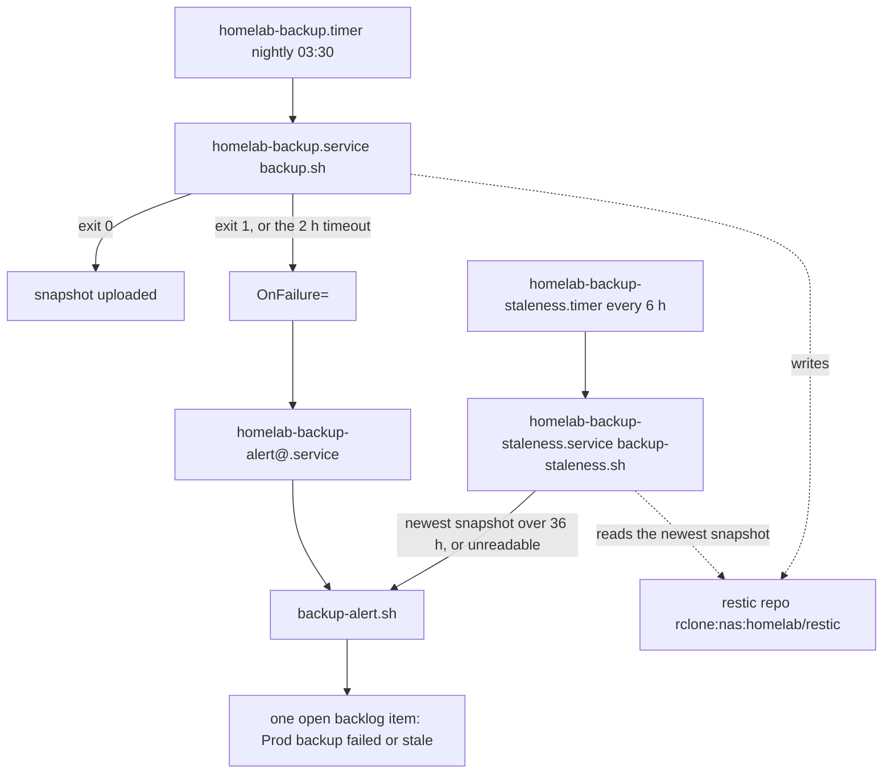

# Prod host backup (restic) and its failure alerting

**Not the same thing as the in-app backups.** This page is the operator's **host-level disaster
recovery**: one restic snapshot of every stateful service on the prod host (Forgejo, Komodo, Keycloak,
agent-db and both Mongo instances) to a remote the operator controls. Feature 073's per-user
**collection backups** are an application feature — each member exports their own collections to
S3-compatible or WebDAV storage *they* own, scheduled by the BFF — and they have their own page,
[Per-user collection backups](../runbooks/backups.md). Neither replaces the other: **a user's own
backup does not protect the host, and the host snapshot cannot be restored per user.** That
disambiguation is the source runbook's own, at
[Phase 14 — Backups, disaster recovery & UPS](../../docs/runbooks/Server-Setup-Runbook.md#phase-14--backups-disaster-recovery--ups),
which is also where the restore procedure lives.

The whole thing is **config-as-code** in [`infrastructure-as-code/backup/`](../../infrastructure-as-code/backup/),
moved into the repository by spec 084 on 2026-10-27 — before that it existed only on the host. Its
[README](../../infrastructure-as-code/backup/README.md) is the canonical file for this subject: the
install/update/verify contract, the file-to-install-path table, and the induced-failure checks.

## What one nightly run does

`backup.sh` runs from the **prod** user's systemd user manager, on a nightly timer, against a restic
repository on an rclone remote (`rclone:nas:homelab/restic`); the repository password comes from
`RESTIC_PASSWORD_FILE` outside the script, and every other credential is read live from a compose env
file or a running container, so **the script holds no secret**.

1. **Staging on disk.** A staging directory is created under `~/backup/` and removed on exit. This is
   not cosmetic — see the staging gotcha below.
2. **Six dumps, each through `run_dump`**: `forge`, `komodo`, `keycloak`, `agent-db`,
   `mc-service-mongo`, `bff-mongo`. Each writes one file into the staging directory, is checked in its
   own format against a per-dump minimum size, and is compared against its size in the last good run.
3. **A manifest that travels inside the snapshot.** `dump-manifest.tsv` records, per dump, the file,
   bytes, minimum, maximum, format, the previous run's bytes and the verdict. A copy of it becomes
   `~/backup/state/last-good.tsv` after a fully good run, and the next run compares against that.
4. **`restic backup`** of the staging directory *plus* the service config directories (`~/forgejo`,
   `~/komodo`, `~/rustfs`, `~/nx-cache` — compose files and `.env`s, enough to stand each service back
   up; the RustFS Nx-cache store's **data** volume is excluded as rebuildable).
5. **`restic forget --prune`** with 7 daily / 4 weekly / 6 monthly retention.
6. **Alerting and exit status** — a shrink alert, a `recovered` note on a fully good run, or exit 1
   with the failed dumps named.

## The two independent alerting paths

Every backup problem lands on **one** backlog item, titled `Prod backup: failed or stale`, labelled
`type/bug` and `priority/p1`. It is opened the first time an event occurs; every later event comments
on it; **only a human closes it.** The two paths that raise it are deliberately independent, and that
independence is the whole point:

*Two independent paths to the same backlog item: the run's own failure (`OnFailure=`, plus a hang
becoming a failure at the 2 h timeout) and a separate 6-hourly check that reads the snapshot age from
the repository itself — so a run that never happened still raises it.*

- **Path 1 — the run reports its own failure.** A failed run exits 1, and
  `OnFailure=homelab-backup-alert@%n.service` on `homelab-backup.service` runs
  `backup-alert.sh failed <unit>`, which attaches the journal tail with credentials redacted. A run
  still going at `TimeoutStartSec=2h` is a failure too, and is reported as `hung` (the script reads the
  unit's `Result=` property to tell the two apart). A whole run measures 8–10 minutes, so 2 h is
  unambiguous. The alert unit itself has no `OnFailure=` — an alert that fails must not recurse.
- **Path 2 — a check that does not depend on the run.** `homelab-backup-staleness.timer` fires every
  6 h (`Persistent=true`) and runs `backup-staleness.sh`, which lists the `homelab` snapshots **from
  the repository** and computes the newest one's age. Past **36 h** it alerts `stale`; if it cannot
  read the age at all (restic error, empty list, unparsable time) it alerts
  `staleness-unreadable` — **"could not tell" is never reported as fresh.** This is what catches a hung
  run, a stopped timer, or an upload that silently did nothing, none of which fires `OnFailure`.
  `MCM_BACKUP_STALE_HOURS` exists for tests only; no unit sets it. Like the alert unit, the staleness
  service has no `OnFailure=`, because it raises its own alert and would otherwise double-report.

## Gotchas

- **Staging must be on disk, and that is measured, not theoretical.** `/tmp` on this host is a **29 G
  tmpfs** (RAM), the forge dump outgrew it, and the original script staged there: backups failed
  **every night from 2026-07-27 to 2026-10-22**, and the failure was found by chance. `--check-staging`
  exists to refuse a tmpfs **before** a run starts — it prints the filesystem and exits non-zero
  without backing anything up, and the nightly run calls the same check and refuses to dump into RAM.
- **One dump's failure must never skip the rest.** Each dump runs through `run_dump`, which never
  fails the script: a failure leaves a `DUMP-FAILED-<name>` marker inside the snapshot, the remaining
  dumps and the upload still run, and the run's exit status reports it so `OnFailure=` fires. The July
  script's forge step was the one step with no fallback, so under `set -e` its failure took every
  database dump and the off-site upload down with it — for three months, with only a `Failed with
  result 'exit-code'` journal line that nothing read.
- **Retention must group by tag, never by path.** `restic forget` is called with `--tag homelab
  --group-by host,tags`, because the staging directory's name is random: restic's default `host,paths`
  grouping put every snapshot in a group of one and **pruned nothing**. The same randomness is why the
  staleness check reads all `homelab` snapshots rather than `--latest`, which is per path group.
- **Whenever a stateful service is added, its dump must be added to `backup.sh` — with a minimum size
  and a format check.** The original script dumped only Forgejo, Komodo and the object-store/nx-cache
  config directories; a reboot then corrupted Forgejo's Postgres, and Forgejo happened to be the only
  stateful service with a real backup. Format checks are per dump (a plain SQL dump must end at
  Postgres's `dump complete` marker, a Mongo/gzip archive must pass `gzip -t`, the forge tar must
  list), and the minimum may legitimately be near zero: `agent-db`'s is **1 byte** because `agent_db`
  has no tables by design (the gateway checkpoints in memory), so "non-empty" alone is the wrong test.
  Each dump also records a `max_bytes`; exceeding it is recorded as `warn-max`, which neither fails the
  run nor raises an alert on its own.
- **A shrink below 50 % of the last good run alerts but still uploads, and an `ack-shrink` covers
  exactly one run.** `~/backup/backup.sh --ack-shrink <dump>` writes a state file that the next run
  consumes and deletes, so an expected shrink (data deliberately deleted, a new exclusion) is
  acknowledged once rather than accepted forever. **The threshold is never raised instead.** Only a
  fully good run rewrites `last-good.tsv` — a failed run must not become the baseline — and a run with
  no previous manifest records `compare=skipped` in the manifest rather than silently skipping.
- **A run that never happens, or an upload that silently did nothing, fires no `OnFailure`.** That is
  exactly why the staleness check is a **separate unit** reading the newest snapshot from the
  repository itself, and why "could not tell" is reported as an alert and never as fresh. A heartbeat
  file written by the run being checked would not be independent; a CI-hosted check would need the
  restic password (which decrypts every backup) in Actions secrets.
- **The alert needs an issues-scoped token file (mode 600) and the forge's local URL in its env
  file.** The token reaches `curl` through a header **file**, never argv, so `ps` and the journal never
  see it; a missing token, a wrong mode, or an unset URL exits **3**, an HTTP failure exits **4**, and
  both say `alert NOT delivered` in the journal rather than being silent. The script also redacts what
  it posts: URI user-info is masked and any line naming a credential is dropped, because a backup
  journal is exactly where a connection string turns up. The forge host is never committed to the
  repository — it lives only in `~/backup/alert.env` as `MCM_FORGE_URL`.
- **The committed `INSTALLED.sha256` is what lets an operator with no checkout prove the host runs
  what the repository says.** The host has no guaranteed checkout, so the committed checksum list is
  the one artefact both sides can compute with coreutils. Regenerate it with
  `node scripts/backup-install-manifest.mjs --write` and check it with `--check`; each line is
  `<sha256>  <path relative to $HOME>` at the path the README's install block puts the file at, so the
  operator's check is `cd ~ && sha256sum -c <checkout>/infrastructure-as-code/backup/INSTALLED.sha256`.
  **A stale list is worse than none**, because the operator's `sha256sum -c` would then pass against
  an old script — which is why a guard fails when the committed file disagrees with the directory, and
  when a new installable file is not listed.

## Installing, verifying and restoring

`infrastructure-as-code/backup/README.md` owns the how, and the two source documents together are the
operating manual: the README's install/update block, its once-only credential setup, its induced-failure
check (a run pointed at a repository that does not exist, then the default restored **on the same
line**), and the `--check-staging` and `--ack-shrink` steps; and the
[Phase 14 Backups section](../../docs/runbooks/Server-Setup-Runbook.md#phase-14--backups-disaster-recovery--ups)
for what a run includes, what is excluded on purpose and how to restore without it, the retention rule,
and the proven Forgejo-Postgres restore procedure. Two summary points worth carrying:

- **The install is a copy, and the copy is the thing that runs.** The repository holds the source of
  truth; the host runs `~/backup/*.sh` and `~/.config/systemd/user/homelab-backup*`, installed from a
  checkout, followed by `daemon-reload`, enabling the staleness timer, and a `sha256sum -c` against
  `INSTALLED.sha256`. Reach for the README whenever a file in that directory changes, and for
  `--check-staging` / `--check` when you want to confirm the host's state without running a backup.
- **A restore is a Phase 14 procedure, not a script here.** The registry and repository archives are
  excluded on purpose because they are rebuildable; after a restore, `cd-deploy` must be re-run once
  before a rollback to an older digest is available.

## The accepted gap

If the whole host, or the **prod user's systemd manager**, is down, both timers stop — so the staleness
check goes down with the backup. That is accepted rather than engineered around, because the same
state also stops the forge, the application and every CI run, so it is loud rather than silent. What
the two paths cover is the case that actually went unseen for three months: **the host is up, and the
backup is broken.**

## Guards

The scripts are behavioural: `scripts/__tests__/backup-script.test.mjs` runs `backup.sh` against a fake
host (docker, restic, curl and `df` are shims; `tar`, `gzip` and `python3` are real) and pins the
measured failure modes — a failing forge dump still runs every other dump and still calls `restic
backup`, each dump's format and minimum verdict, the shrink/ack-shrink behaviour, staging under
`~/backup` with tmpfs refused, `--group-by host,tags` on `forget`, and the absence of any literal
credential. `backup-units.test.mjs` pins the unit wiring (`OnFailure=`, `TimeoutStartSec=2h`, the
timers' `OnCalendar` and `Persistent=true`, and that neither alert unit recurses), `backup-alert.test.mjs`
pins the exact forge API calls and the token never appearing in argv, `backup-staleness.test.mjs` pins
"unreadable is never fresh", and `backup-install-manifest.test.mjs` pins the committed manifest against
the directory. All of them run in `guardrails.yml`'s naming job.

Related: [Homelab server setup](../runbooks/server-setup.md) for the phase that owns this,
[Prod reboot resilience](../runbooks/prod-reboot-resilience.md) for the graceful-shutdown drain unit
that prevents the DB corruption a restore would otherwise be needed for,
[Secrets management](../invariants/secrets-management.md) for the redaction posture the alert follows,
and [CI/CD pipeline](ci-cd-pipeline.md) / [Infrastructure stacks](infrastructure-stacks.md) for what the
excluded, rebuildable pieces are rebuilt by.
