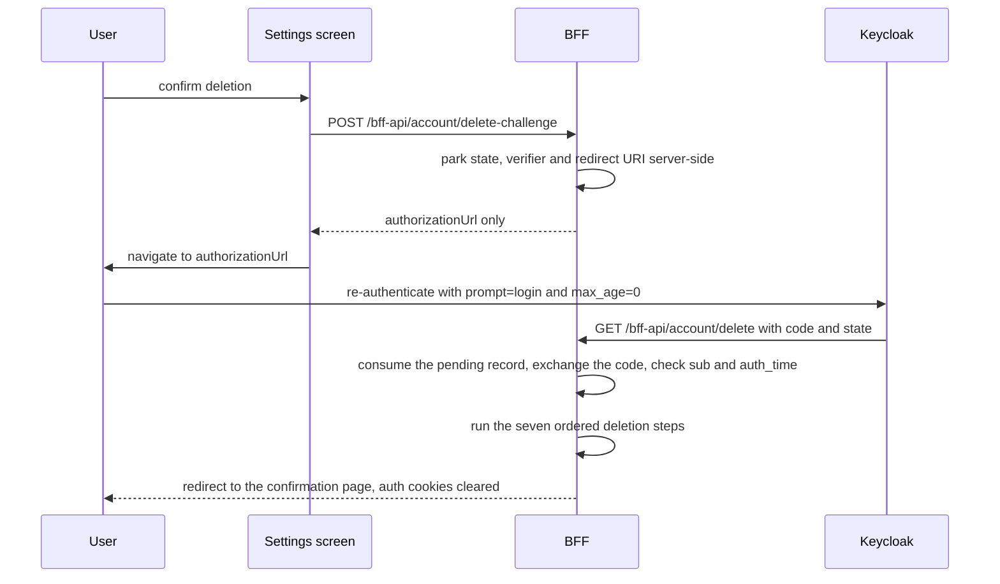
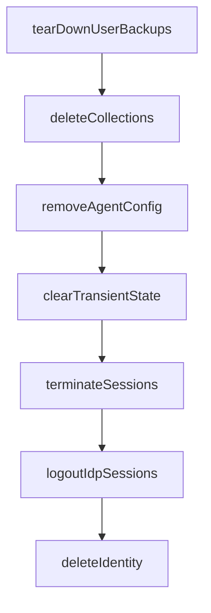

# BFF (Backend-for-Frontend)

The BFF is server-side code that lives *inside* the same Expo Router codebase as the client app (see
[Expo/React Native app](./expo-app.md)) but runs only on the server: business
logic in `frontend/mcm-app/src/bff-server/`, HTTP surface as Expo Router `+api.ts` handlers under
`frontend/mcm-app/src/app/bff-api/`. In production/Docker it is served by `frontend/mcm-app/server.js`
(an Express adapter around `@expo/server`). This split exists so the client never holds a raw
credential — see [Auth chain](../invariants/auth-chain.md), which the BFF is the primary
enforcement point for.

Route groups: `bff-api/auth/*` (login, refresh, logout, registration, email verification),
`bff-api/collections/*` and `.../movies/*` (proxy CRUD to [mc-service](./mc-service.md)),
`bff-api/agent/*` (forwards agent turns to the [Agent Gateway](./agent-gateway.md) over AG-UI,
plus `agent/config` for the user's own provider/TMDB credentials), `bff-api/backups/*`
(destinations, jobs, and the internal scheduling tick), `bff-api/account/*` (the account-deletion
challenge and its step-up callback), `bff-api/admin/settings`. Every proxy
route follows the same shape: `requireAuth()` → `requireMcUser()`/`requireMcAdmin()` RBAC check
→ a per-request `mc-service-client.ts` Axios instance carrying the caller's JWT as
`Authorization: Bearer` → `handleMcApiError()` translates mc-service's RFC 9457 problem+json on
failure. The client never calls mc-service directly.

Agent-requested UI actions are authorized here too, not by the client: `ui-action-authorizer.ts`
holds a default-deny target→role allowlist (`NAVIGABLE_TARGETS` / `PREFILL_TARGETS`), so the
assistant can never drive the UI somewhere the user themselves could not go. A new agent-navigable
screen must be added to that map or it is refused — the allowlist is the single source of truth for
what the agent may drive.

## The BFF's own state: MongoDB and Redis

Unlike a pure proxy, the BFF owns two features' worth of durable state directly, in a MongoDB
instance dedicated to the BFF (separate from mc-service's own database — the BFF never reaches
across a service boundary into a backend service's store):

- **Per-user agent config** (feature 018, `agent-config-service.ts` / `agent-config-store.ts`):
  each user's chosen LLM provider, encrypted API keys/Ollama URL, and TMDB key, so the assistant
  can run with the user's own credentials rather than a shared one. Secrets are AES-256-GCM
  sealed with `AGENT_CONFIG_ENC_KEY`, decrypted only transiently per run, and never returned to
  the client or logged. A user-supplied Ollama URL is validated against an SSRF guard
  (`agent-config-ssrf.ts`) before it is ever saved or probed: by policy it allows private/LAN
  addresses ("bring your own Ollama" is the point), always blocks link-local and cloud-metadata
  addresses, and — since item #542 — narrows loopback to only the ports Ollama itself uses
  (`AGENT_OLLAMA_LOOPBACK_PORTS`, default `11434`), because inside a container loopback is this
  server, not the user's own machine. See
  [SSRF guard: canonicalized IP, not hostname string](../gotchas/agent-config-ssrf-guard.md)
  for the mechanism shared with the backups guard below (do not re-derive it here).
- **Scheduled collection backups** (feature 073, `backup-*.ts`): per-user destinations
  (S3-compatible or WebDAV, credential sealed with a *separate* `BACKUP_CREDENTIAL_ENC_KEY`),
  jobs (what/where/how often/how many to keep), and run history. An unattended scheduled run
  acts as the user via a Keycloak **offline token** they explicitly granted — there is no
  service account and no privileged fallback; if the grant is gone, the run fails rather than
  finding another way in. Destination addresses go through a *different*, inverse-default SSRF
  guard (`backup-destination-url-guard.ts`; private/loopback/link-local denied unless the host is
  on `BACKUP_ALLOWED_DESTINATION_HOSTS`). The two guards keep opposite **policies** by design (an
  Ollama endpoint is expected to be on the LAN, a backup destination is expected to be remote),
  but as of item #542 they no longer differ in **mechanism**: both resolve the hostname, check
  every DNS answer (not just the first), and pin the outbound connection to that vetted address
  set via `createPinnedAgent` (`pinned-agent.ts`, extracted so both guards can share it) — closing
  the TOCTOU window a name-only check would leave, where the resolver could hand back a different
  answer to the HTTP stack than the one just checked. Also owned by
  [the SSRF guard page](../gotchas/agent-config-ssrf-guard.md), which documents both guards
  side by side.

Redis is the BFF's other store, and it is not a cache of convenience: sessions, the concurrent
session cap, every rate-limit counter, the agent cost budget, the parked step-up/consent requests
and the backup leader lock all live there.

Both collections' Mongo instance is a **standalone `mongod`, not a replica set** — there is no
multi-document transaction available anywhere in the BFF's own store. That single fact shapes
the backup job-claim design below and is the first thing to know before extending either
feature. Full operating detail: the [backups runbook](../../docs/runbooks/backups.md) and the
README's "Two standing constraints" section ([`frontend/mcm-app/README.md`](../../frontend/mcm-app/README.md));
both of its constraints — this one, and `server.js` running outside the Metro bundle — are
load-bearing for any future BFF work and are covered below.

## The account-deletion pipeline (feature 076)

Deletion is BFF-side behaviour: a destructive endpoint reachable only after a fresh authentication
at the identity provider, plus an ordered server-side pipeline whose sequence is the feature. What
an operator can and cannot remove afterwards is documented in the backups runbook (the
[per-user collection backups page](../runbooks/backups.md) and its source
[`docs/runbooks/backups.md`](../../docs/runbooks/backups.md)); its account-deletion section is not
restated here.

**Three routes, one pipeline, no shortcut.** `POST /bff-api/account/delete-challenge` begins the
round trip: it destroys nothing, parks a short-lived request server-side (keyed by the
authenticated user, 5-minute TTL), and returns only the authorization URL — or, on native, just a
`state` plus the parameters the device must send. It is rate-limited (5/hour per client IP), and a
user who is the last remaining `mc-admin` is refused with a 409 before anything is parked.
`GET /bff-api/account/delete` is the callback Keycloak redirects the browser to; **every one of its
outcomes is a redirect, never JSON**, because whatever it returns is what the user looks at next —
success lands on the public confirmation page with the auth cookies cleared, and each failure mode
lands back on the account settings page with a distinguishing `?error=` value. `POST` on the same
path is the native completion: a native app cannot be redirected by the BFF, so the device runs the
OIDC flow itself and posts the result, and the answer is JSON. There is no `DELETE` method, no admin
variant, and the user id always comes from the validated session rather than the query — a deletion
is reachable only by completing an authentication at the identity provider.

The deletion round trip: the client only ever receives an authorization URL, and the destructive endpoint is reachable only by returning from the identity provider with a proof the BFF accepts.

**The order is the feature.** `DELETION_STEPS` publishes the normative sequence as data, so a
reordering shows up as a diff on a named list rather than as a quiet edit inside a function body,
and `account-deletion-order.test.ts` asserts against it:

The normative deletion order, published as `DELETION_STEPS`: a step that throws stops the pipeline there — nothing after it is attempted — and the step-up refresh token is revoked in a `finally` on both the success and the failure path.

Four constraints carry that design:

- **The standing backup permission is given up first, and a failure there destroys nothing.**
  `tearDownUserBackups` already guarantees this: it revokes the offline token *at the identity
  provider* before deleting any local record, and throws having deleted nothing if the revocation
  fails. This module's job is to call it first and not swallow the throw. Reversed, a failed
  revocation strands a live, non-expiring token at Keycloak with nothing left in this system
  pointing at it.
- **The agent-config document is deleted only after the teardown.** The standing permission is
  stored *inside* that document as `offlineRefreshEnc`, so removing it first would destroy the only
  record of a token still live at Keycloak — backlog item #544's failure, in a worse form, because
  no user remains to notice.
- **The identity is deleted last, because it is the only irreversible step.** Once the account is
  gone there is no identity left to authenticate as, so nothing that needed the user to exist can
  be retried.
- **The teardown is three independent deletes, because there is no transaction to wrap them in.**
  Destinations, jobs and runs are removed as three separate `deleteMany` calls — the standalone
  `mongod` above offers no multi-document transaction — and they are ordered destinations → jobs →
  runs so that a crash part-way through never leaves a job pointing at a destination that is gone,
  the state that would be hardest to interpret if someone had to finish the job by hand. The same
  constraint is what makes the whole pipeline retry-safe rather than atomic: every step is written
  to be re-runnable, and the ones that are not inherently idempotent (the collection deletes) treat
  a 404 as success.

**A failure throws and attempts nothing after it — never a partial success.** The caller reports
that the account was *not* deleted and the user retries from the teardown. Each step runs through a
wrapper that records the step that failed by its enumerated name, so a failure can be counted and no
message from a downstream system reaches the audit stream. The step-up refresh token is revoked in a
`finally`, so it is given up on the failure path too — and that path is the one that matters: the
account still exists there, and leaving a second live token set for it would be a standing credential
created by the very operation meant to destroy one. The callback also runs to completion if the
client goes away: nothing in the BFF wires an inbound abort signal into a cancellation path, so a
closed tab loses the *response*, not the work — the point of no return is the confirmation, and a
half-finished deletion is a worse state for the user than a finished one.

**The collection-deletion step acts with the step-up token, not the session's.** The step-up access
token was minted seconds ago and cannot be near expiry, whereas the session's may be — a user has
just spent time at a login form and possibly a TOTP prompt, and an expiry in the middle of that loop
is the most expensive place in the system for one. A 404 counts as *success*: a retry after a partial
failure re-issues deletes for collections the first attempt already removed, and treating that as an
error would make the retry fail precisely where it had otherwise worked. Ownership is enforced by
mc-service's DAC layer, so the loop cannot reach another user's collection.

**Nothing in deletion may touch the user's stored artifacts.** The module must not construct a
destination driver, and must not import `backup-destination-driver` or `backup-retention` (or the
driver/store/restore modules) — the artifacts at the user's own destination are their property, at
storage they own and pay for, and the means to delete them exists one call away for retention
pruning, which makes "clean up their backups" a plausible and wrong reading of this feature.
`account-deletion-no-driver.test.ts` pins it as a *static import assertion* rather than a
behavioural test: a behavioural test can only show that a particular path did not touch the storage
on a particular run, while reading the imports shows the capability is absent entirely. A run in
flight when its owner is deleted likewise loses its permission and fails rather than retrying.

## Step-up re-authentication for deletion

The deletion callback is destructive, so it is gated on proof that the person holding the session
just authenticated — not on the session cookie alone. The BFF sends the user back to the identity
provider rather than asking for a password in-app: the constitution forbids the application handling
credentials at all, and the app client has `directAccessGrantsEnabled: false`, so the password grant
is not available without weakening it.

- **`prompt=login` and `max_age=0` are sent together, and `max_age=0` carries the security.**
  Measured against the live realm with a control leg (T001): authorize *without* `max_age` returns a
  code with no prompt, because the SSO session is reused; authorize *with* `max_age=0` serves the
  login form again. Keycloak honours either parameter, so sending both means neither a
  prompt-ignoring client config nor a clock nuance can quietly turn the flow back into a silent SSO
  reuse — a stolen session cookie cannot complete the step-up. The authentication-strength policy is
  not the BFF's decision either: the realm's stock browser flow gates TOTP on
  `conditional-user-configured`, so the second factor is demanded exactly when the user has one
  enrolled. The flow asks for `scope=openid` only — deliberately not `offline_access`, unlike the
  backup-consent round trip: this flow establishes proof of presence, and minting a non-expiring
  token inside the flow whose purpose is to destroy one would be perverse.
- **`amr` is unavailable, so `auth_time` carries the whole requirement.** T001 measured that
  Keycloak does not emit `amr` for this client. `auth_time` is sufficient: it is the moment the user
  actually authenticated, and it advances on a genuine re-authentication.
- **The PKCE verifier is parked server-side on web and minted by the device on native.** On web the
  BFF mints the verifier and parks `state`, verifier and redirect URI in Redis keyed by the
  authenticated user, returning only the authorization URL to the browser — a verifier the browser
  holds is one an attacker holding the authorization code can also use, which is the attack PKCE
  exists to prevent. On native the BFF cannot redirect the app at all, so the device runs the flow
  and `expo-auth-session` mints the verifier there; what the BFF still mints and parks is the
  `state`, which remains the CSRF binding and the single-use marker. A pending record that is *not*
  marked native never reads client-supplied verifier or redirect-URI values, so a web caller cannot
  opt itself onto the weaker binding by sending them.
- **`redirectUri` must be identical on both OAuth legs.** It is passed into the authorize request and
  stored with the pending record rather than recomputed on the callback, because Keycloak rejects the
  code exchange with `invalid_grant` when the two differ. The value is derived from the origin the
  request actually arrived on: the same image serves the dev container on one port and the TLS proxy
  on another, while a build-time base URL is frequently unset and falls back to a port with no BFF on
  it — in which case the callback never arrives and the deletion silently cannot complete. Deriving
  it from the request is safe against a forged `Host`, because Keycloak only honours redirect URIs
  registered on the client and refuses an unregistered one outright.
- **Verification consumes the pending record first, whatever the outcome.** A proof that fails its
  checks must not be retryable against the same request, or an attacker who can reach the callback
  gets unlimited attempts at the state value. Absent `auth_time` is a refusal, never a pass: the
  presence check is separate and comes first, because `if (authTime && isStale(authTime))` reads
  naturally and lets a token with no `auth_time` at all straight through. Two freshness tests then
  apply — the proof must be recent (within the 300-second window that is also the parked record's
  TTL, one constant rather than two so they cannot drift apart) *and* it must postdate the
  authentication the session was established with. The floor for the second test is the session's own
  `auth_time`, not `Date.now()`: both values then come from Keycloak, so the comparison is within one
  clock domain and one granularity. `auth_time` has second granularity, and measured, a floor of
  1790259893 against a step-up `auth_time` of 1790259893 was refused as stale — while the same proof
  had correctly advanced past the original login. Refusals are enumerated (`no_pending`,
  `state_mismatch`, `subject_mismatch`, `missing_auth_time`, `stale_auth`) rather than free text, so
  a refusal can be counted and no message from Keycloak can leak into the audit stream.

## `server.js`: the CommonJS boundary and the scheduling tick

`frontend/mcm-app/server.js` is the shipped entrypoint (the image's command is `node server.js`) and
it runs *outside* the Metro bundle. It is CommonJS: it `require`s `@expo/server/adapter/express`,
hands the built `dist/server` to `createRequestHandler`, serves `dist/client` statically, and stamps
the boot-time security headers described below. It **cannot** `require('./src/bff-server/…')`: those
modules exist only inside the bundle, compiled and `@/`-aliased by Metro.

That boundary is why the BFF's only background-work mechanism is a loopback HTTP call. Feature 073
needed runs with no user present, and before it the BFF had no background work at all
(`grep -rn setInterval src/` returned nothing — every line of BFF code ran because a request
arrived). The timer therefore lives in `server.js` and reaches the work by POSTing to the internal
`/bff-api/backups/tick` route over `127.0.0.1` with a shared secret, rather than by calling a
function. The seam is real rather than a workaround — it keeps the tick equally callable by a cron
sidecar or by an operator, which is what keeps the "move this to a scheduler later" escape hatch
open — but the reason it exists is this constraint.

- **No tick fires under `pnpm start`.** `server.js` does not run under Metro, so in dev the tick
  route is called directly, which is also what makes the E2E deterministic. That is expected, not a
  bug to hunt.
- **No secret means no scheduler, said once at boot.** An unset `BACKUP_TICK_SECRET` disables it and
  announces that in the log; the alternative is silence, and "scheduled backups never ran" with
  nothing explaining why is the single worst way for this feature to fail. The route itself answers
  **404 rather than 401** to a wrong secret, so it never advertises its own existence, and compares
  in constant time.
- **A failing tick is logged and swallowed.** An unhandled rejection here would turn "one backup did
  not run" into "the application is offline". The interval timer is `unref`'d so a clock is never the
  reason a container refuses to shut down, and it starts after `app.listen` so the first tick cannot
  race the port it calls.
- **Do not remove the `__ExpoImportMetaRegistry` seeding** at the top of `server.js`. Metro rewrites
  `import.meta.url` in bundled dependencies to `globalThis.__ExpoImportMetaRegistry.url`; the Metro
  *dev* server populates that registry but the exported `@expo/server` runtime does **not**, so a
  bundled dependency calling `createRequire(import.meta.url)` crashes at request time with
  `TypeError: Cannot read properties of undefined (reading 'url')` and the request hangs. The seeding
  must run before `createRequestHandler` loads the bundle. It looks like dead defensive code, and
  removing it reintroduces a silent production-only hang — the mechanism is owned by
  [Expo Router server export and agent-transport traps](../gotchas/expo-router-and-transport-traps.md).

## Web security headers

`frontend/mcm-app/web-security-headers.js` is a pure plain-CommonJS module for the same reason as the
boundary above: the hand-written adapter must `require()` it at container boot and cannot import the
app's compiled TypeScript. It builds the browser-facing header set once, and `server.js` stamps it
per request.

- **Three static headers reach every response class** — `X-Frame-Options: DENY`,
  `X-Content-Type-Options: nosniff`, `Referrer-Policy: no-referrer` — on static assets, SSR HTML and
  the API surface alike.
- **The web CSP is path-scoped out of the API surface.** The API routes keep their own strict
  `default-src 'none'` CSP emitted by the handlers, and the adapter sets the web CSP only on
  non-`/bff-api` paths. That is the deterministic alternative to relying on the adapter's same-name
  header merge order.
- **The Keycloak origin in `connect-src` is read from env, never hard-coded**, with precedence
  matching the app's own config. A malformed, scheme-less or non-web-scheme value falls back to the
  dev default rather than emitting a broken directive: the WHATWG `URL` parser accepts a scheme-less
  host and yields the opaque origin string `null`, which would otherwise ship
  `connect-src 'self' null`.
- **The one inline script is allow-listed by hash, not by `'unsafe-inline'`.** Expo Router's
  bootstrap script (`globalThis.__EXPO_ROUTER_HYDRATE__=true;`) is hashed into `script-src`; if Expo
  ever changes it, the browser prints the new expected hash in the CSP violation and the constant is
  swapped.
- **One accepted residual is documented, not silenced.** A third-party library runs a
  `new Function("")` eval-availability probe wrapped in try/catch; under this `script-src` the probe
  is blocked, the library degrades gracefully, and the browser logs one benign `eval` violation.
  `'unsafe-eval'` is deliberately not added — permitting real eval app-wide would defeat the
  hardening.
- `X-Powered-By` is disabled (server-technology disclosure), and the `X-BFF-Source` marker stamped on
  every response is what lets the web E2E positively prove the request path is the container rather
  than the Metro dev server, defeating a silent false-green.

The client-side view of the same layer, and the header contract's tests, are on the
[Expo/React Native app](./expo-app.md) page.

## Gotchas

- **No Redis, no login.** Sessions, the concurrent-session cap, every rate-limit counter, the agent
  cost budget and the parked step-up/consent requests all live in Redis, and the login path reads it
  with no typed wrapper around the session operations. If Redis is down, `/bff-api/auth/login`
  returns a bare 500 "Authentication failed" (`UNKNOWN_ERROR`): the session write rejects with an
  untyped connection error, so the handler's outer catch reports a generic failure rather than an
  infra problem. Check Redis first.
- **`.env` inline comments corrupt secrets.** dotenv-style loaders (and the Expo CLI) treat
  everything after `=` as the literal value. `KEY=val # note` yields `val # note`. This has actually
  broken login (`invalid_client` from Keycloak) when a client secret captured its trailing comment.
  Put comments on their own line. See
  [`.env` files — no inline comments on value lines](../gotchas/env-file-inline-comments.md).
- **The internal and public Keycloak origins are not interchangeable, and getting the direction
  wrong fails silently.** `KEYCLOAK_URL` is the *internal, runtime* origin this process dials for
  token exchange, revocation, JWKS and the Admin API; `KEYCLOAK_PUBLIC_URL` is the *browser-facing*
  issuer (defaulting to the internal one), and it is also the `iss` stamped on tokens. Two opposite
  mistakes, each with its own symptom: an authorize URL handed to the user's **browser** built from
  the internal address sends it to a hostname that exists only inside the Docker network, which
  fails DNS and lands on a blank page with no error anywhere — measured that way against the dev
  container, and invisible in the integration tier because there the two origins coincide. And an
  internal call (discovery, token, revoke, admin) made against a public origin that may have been
  frozen into the client bundle at `expo export` time is not reachable from inside the container
  network. Confusing the two produces cryptic OIDC failures that look like a Keycloak
  misconfiguration. Related: [Docker internal DNS](../gotchas/docker-internal-dns.md).
- **`TRUSTED_PROXY` defaults to `false`.** Below a trusted reverse proxy, IP-based rate limiting is
  silently skipped (with a warning) rather than trusting a spoofable client-supplied header. Any
  non-loopback deployment must set `TRUSTED_PROXY=true` explicitly, which then trusts only the
  right-most `X-Forwarded-For` hop.
- **Cookies, not tokens, cross the wire to the client.** The BFF sets three `HttpOnly`,
  `SameSite=Strict` cookies (access token, refresh token — scoped to the refresh path only — and
  session id); client code never sees a raw JWT. The client Axios instance sends no `Authorization`
  header at all and relies on `withCredentials: true`.
- **The shipped image carries only 76 of 1513 production packages — and the build gate enforces it.**
  `pnpm deploy --prod` materializes ~1600 packages because they are genuine `dependencies` of
  `mcm-app`, but they are dependencies of the web bundle, which Metro already compiled into `dist/`
  at build time. `scripts/prune-bff-runtime-modules.mjs` walks the pnpm symlink graph from two
  static roots (`express`, `@expo/server`) plus one dynamic root (`openai`, reachable only by a
  string in the bundle) and deletes everything outside that closure, shrinking
  the image from 1.73 GB to 335 MB (measured 2026-09-07). The 76 packages retained are exactly what
  a traced full-E2E run plus a route-sweep ever touched. **Do not delete the script or remove it from
  the Dockerfile deps stage** — removing it silently re-bloats the image without any failing check.
- **A bare-specifier build failure means a CopilotKit/LangChain upgrade added a lazy provider.**
  The builder stage also runs `prune-bff-runtime-modules.mjs --check-bundle dist/server` to detect
  packages the exported bundle names by string (e.g., `@copilotkit/runtime` reaches its adapters via
  `createRequire(globalThis.__ExpoImportMetaRegistry.url)`) that a closure walk cannot see. If the
  build goes red with *"the exported server bundle reaches for … bare specifier(s)"*, check whether
  the new specifier resolves from `/app/runtime` (add it to `DYNAMIC_ROOTS` in the script) or is
  already unresolvable (record it as `'unresolvable'` in `KNOWN_DYNAMIC_SPECIFIERS`). Do not delete
  the check — its purpose is to turn a future production 500 into a red build here.
- **A silently empty Mongo client-metadata document means Jest, not a driver/server mismatch.**
  `mongodb` driver ≥7.6.0 resolves its OS adapter via a dynamic `import('os')`
  (`lib/runtime_adapters.js`); Jest's CJS runtime can't execute that without
  `--experimental-vm-modules`, so the promise rejects — and the driver deliberately swallows the
  rejection (`squashError`), collapsing the client metadata to `{}`. MongoDB then refuses the
  handshake ("Missing required sub-document 'driver'"), which looks exactly like a driver/server
  incompatibility and is not one: the same driver version connects fine from plain Node against
  the same server. `mongo-client.ts` works around it by passing `runtimeAdapters: { os }` (a
  static `import * as os from 'node:os'`) so the dynamic import branch never runs, keeping tests
  and production on one code path. Do not "fix" this instead by setting
  `NODE_OPTIONS=--experimental-vm-modules` repo-wide — that flips on experimental module handling
  for every integration suite to work around two lines in one file.
- **The Redis leader lock around the backup scheduling tick is an optimisation, not the
  exactly-once guarantee.** `redis-lock.ts` lets only one BFF instance scan for due jobs per
  tick when several are running, but its safety rests on a TTL — a guess at how long a run can
  take — so an overrunning run legitimately loses the lock to another instance while still live.
  The actual exactly-once guarantee is a single-document atomic `findOneAndUpdate` claim on the
  job itself (`backup-job-store.ts`), which carries no timing assumption at all and is what
  survives the BFF's Mongo having no replica set (and therefore no multi-document transactions)
  to tie a claim to a run record. A passing lock test proves nothing about double-firing; only
  the job-store claim does.

## Operating the BFF's own configuration

Two configuration traps belong to this process rather than to any one feature:

- **The container BFF reads `frontend/mcm-app/.env.docker` through Compose `env_file` at container
  *create* time**, so a value change needs a recreate — not an image rebuild — and the same file is
  the *dev/CI* env surface, generated by `scripts/gen-dev-env.mjs` / `scripts/gen-ci-env.mjs` and
  gitignored (see [Dev stack env files and local secret generation](./stacks.md)). Its service URLs
  are Docker-internal by construction, so a host-shell run that falls through to it dies on DNS
  resolution: measured 2026-09-20, with the host-reachable service URLs silent the integration
  suites fell back to those names and died resolving one no process outside the compose network can
  see; in the dev container the same fallthrough measured 2026-08-09 at 84 failed / 31 passed
  without the three overrides and 114/115 with them. The symptom reads as "this box cannot run the
  tier" rather than as three missing `export`s.
- **The two BFF processes share one Mongo, so their keys must agree.** The containerized BFF and the
  Metro dev loop write to the same BFF store, so a destination or credential sealed under one env
  file's `BACKUP_CREDENTIAL_ENC_KEY` is undecryptable under the other's, surfacing much later as an
  authentication failure on a secret that was stored correctly. `BACKUP_TICK_SECRET` must match for
  the same reason: the container's tick is what drives the jobs.

See [Auth chain](../invariants/auth-chain.md) for the full login-to-request-validation
sequence, and [Secrets management](../invariants/secrets-management.md) for how the BFF's own
credentials (client secret, cookie/encryption keys, the two backup/agent-config master keys) are
sourced. Session lifecycle and eviction detail is on
[Session lifecycle and eviction](../gotchas/session-lifecycle-and-eviction.md). Full setup and
env-var reference: [`frontend/mcm-app/README.md`](../../frontend/mcm-app/README.md) and the
[local-dev runbook](../../docs/runbooks/local-dev.md); scheduled-backups operations: the
[backups runbook](../../docs/runbooks/backups.md).
