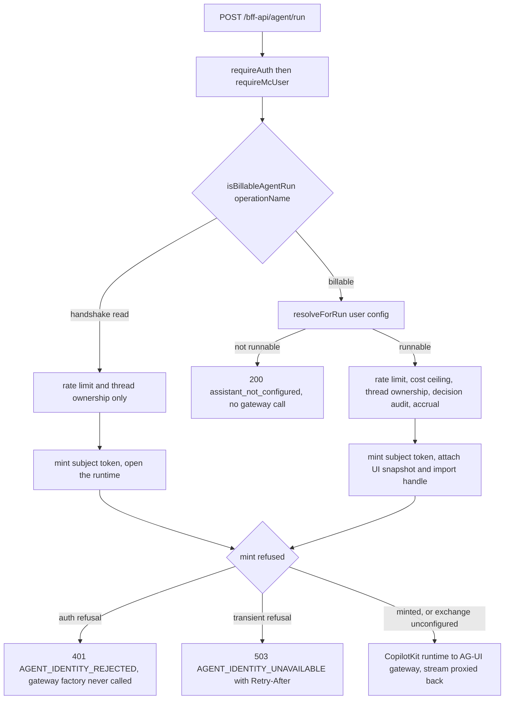
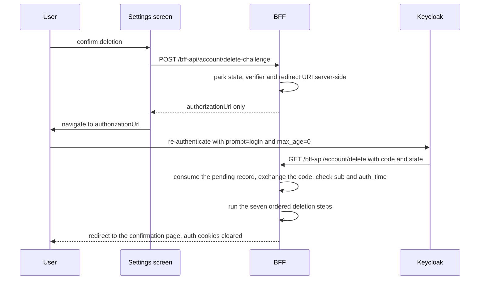
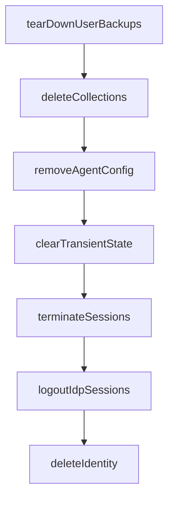
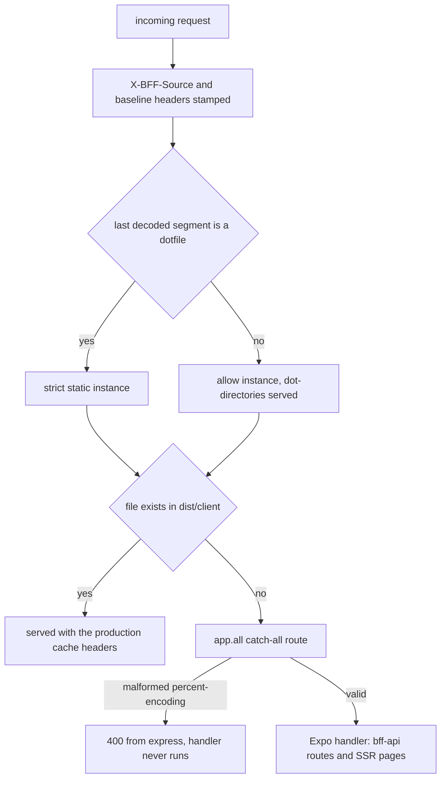

# BFF (Backend-for-Frontend)

The BFF is server-side code that lives *inside* the same Expo Router codebase as the client app (see
[Expo/React Native app](./expo-app.md)) but runs only on the server: business
logic in `frontend/mcm-app/src/bff-server/`, HTTP surface as Expo Router `+api.ts` handlers under
`frontend/mcm-app/src/app/bff-api/`. In production/Docker it is served by `frontend/mcm-app/server.js`
(an Express adapter around `expo-server` — feature 087 replaced the old `@expo/server` package with
this one). This split exists so the client never holds a raw
credential — see [Auth chain](../invariants/auth-chain.md), which the BFF is the primary
enforcement point for.

The app is on **Expo SDK 58** (`expo ~58.0.23`, `expo-router ~58.0.30`, `expo-server ~58.0.6`,
`react-native 0.88.1`, `react 19.3.0`, `express ^5.3.0`, `zod ^4.4.3` — the manifest is
[`frontend/mcm-app/package.json`](../../frontend/mcm-app/package.json)). One consequence lands on this
page: `app.json` sets `web.output` to `"static"` and the `expo-router` plugin entry to
`{ "apiRoutes": true, "asyncRoutes": { "web": false } }`, so pages are rendered to HTML at **build**
time while the 38 API routes — the BFF — still run in the same Node process behind `server.js`. On
SDK 58 the literal `"output": "server"` means *per-request* rendering, which is a different runtime
from the one this app is built and tested on; and SDK 58's plugin with no options turns
`asyncRoutes.web` **on**, which is why that value is written out rather than omitted. A page that
throws while rendering fails `expo export` with `Failed to statically export route: <name>` — that is
the guard, not flakiness. The measured route counts and the full rationale are in the README's
[Web output mode section](../../frontend/mcm-app/README.md#web-output-mode-prerendered-pages-plus-api-routes-sdk-58).

**Six route groups, 38 `+api.ts` handlers — and the inventory is enforced rather than remembered**
(the coverage gate below globs it). `bff-api/auth/*` — `login`, `refresh`, `logout`, `register`,
`resend-verification`, `verify-email`, `user`, the public `registration-status` read, and `init`, the
once-per-app-mount route that reconciles the Keycloak client's redirect-URI list described below.
`bff-api/collections/*` with its nested `.../movies/*` — proxy CRUD to
[mc-service](./mc-service.md), plus `movies/count` and `movies/filter-options`.
`bff-api/agent/*` — `run` and `resume` forward turns to the [Agent Gateway](./agent-gateway.md) over
AG-UI, with `ui-state`, `ui-action`, `import-upload`, `export-download` and the `config/index` +
`config/test` pair around them; the section below is what those handlers do beyond proxying.
`bff-api/backups/*` — destinations (`index`, `[destinationId]`, `test`), jobs (`index`,
`[jobId]/index`, `[jobId]/run`, `[jobId]/runs`, and the three artifact-facing ones `[jobId]/versions`,
`[jobId]/restore`, `[jobId]/download`), the `consent` callback and the internal `tick`.
`bff-api/account/*` — the account-deletion challenge and its step-up callback.
`bff-api/admin/settings` — the global application settings. Every proxy
route follows the same shape: `requireAuth()` → `requireMcUser()`/`requireMcAdmin()` RBAC check
→ a per-request `mc-service-client.ts` Axios instance carrying the member's **server-held** access
token as `Authorization: Bearer` → `handleMcApiError()` translates mc-service's RFC 9457
problem+json on failure (see [mc-service errors are RFC 9457](../gotchas/rfc-9457-problem-details.md)).
The client never calls mc-service directly, and it never holds a token: the whole client-side auth
surface is one opaque `mcm_session_id` cookie (feature 085), with the access and refresh tokens
sealed beside the session server-side.

Two structural gates keep that surface honest rather than conventionally consistent. The
backups routes do not hand-write the four-step prologue at all: `withBackupRoute()` in
`backup-route-support.ts` performs the context, auth, RBAC and error translation once and hands
the handler body an already-authenticated `{ userId, jwt }` — a handler cannot express itself
without them, which is a stronger property than "every handler remembers to". And
`tests/integration/route-coverage-map.ts` plus `route-coverage.integration.test.ts` glob the live
`src/app/bff-api/**/+api.ts` inventory and fail CI for any route file with neither an integration
test nor a written exclusion — the login code-exchange endpoint is the single permitted
exclusion, and the gate asserts that it is the only one.

Agent-requested UI actions are authorized here too, not by the client: `ui-action-authorizer.ts`
holds a default-deny target→role allowlist (`NAVIGABLE_TARGETS` / `PREFILL_TARGETS`), so the
assistant can never drive the UI somewhere the user themselves could not go. A new agent-navigable
screen must be added to that map or it is refused — the allowlist is the single source of truth for
what the agent may drive.

## The server-side spine the six groups share

The groups differ at the top and are identical underneath. `auth.ts` resolves the session cookie into
a `UserProfile` (the bearer story is in the auth section below),
`role-check.ts` turns that into `requireMcUser()` / `requireMcAdmin()` — `mc-admin` implicitly
satisfies `mc-user`, which is why an admin-only screen does not need a second check — and
`security-headers.ts` supplies the strict `default-src 'none'` CSP every handler answers with. Three
more modules are shared, are easy to overlook, and each is the single point of failure for something
you would not think to test:

- **`token-service.ts` is the BFF's own JWT validator rather than a library call, and it fetches
  JWKS from the *internal* origin.** It parses the token, accepts the issuer as either the public or
  the internal Keycloak URL (both name the same instance and the signature check is the real proof),
  reads the audience from `azp` because Keycloak access tokens put the client id there and leave
  `aud` as `["account"]`, requires `exp` and honours `nbf`, then verifies the RSA signature after
  building the PEM from the JWK's `n`/`e` by hand. JWKS is cached for 5 minutes, with a single forced
  refetch when the `kid` is unknown (key rotation) — and the fetch deliberately uses
  `env.keycloakUrl` rather than the build-inlined issuer, because `expo export` freezes the
  browser-facing origin into the bundle and that host does not exist inside a container, while
  signing keys are realm-global so the host used to fetch them is irrelevant. Consumers are
  `login+api.ts`, `user+api.ts`, `auth.ts` and `session-tokens.ts`.
- **`logger.ts` and `audit-sink.ts` are two channels, and only one of them can lose an event.**
  `logger.ts` writes newline-delimited JSON with key-driven redaction (`SENSITIVE_KEYS`, extended with
  the per-user agent-config secret field names and the master key), an `audit: true` + `action` shape
  on the audit channel, warn/error on stderr and `debug` dropped entirely under `NODE_ENV=production`.
  `audit-sink.ts` is the only thing that leaves the process: `audit(action, fields)` *always* calls
  `logger.audit` with the original fields first, and only when `OPENSEARCH_URL` is set also
  fire-and-forgets a redacted document to the append-only OpenSearch sink — never awaited on the
  response path, never throwing, and strictly additive so an unset URL means exactly the previous
  behaviour. The asymmetry is the design: the local log is the record, the sink is best-effort
  telemetry, and a sink outage must not fail a request. `rate-limiter.ts` is the one caller that
  deliberately uses `logger.audit` rather than `audit()` for `refresh_attempted`, because posting
  every attempt to the external sink would change the BFF's outbound load while measuring it.
- **`request-context.ts` is how a log line gets a request id.** An `AsyncLocalStorage` store,
  `withRequestContext(handler)` minting a `randomUUID()` per entry, and `logger` reading it back — so
  every route wrapper enters the context first (`withBackupRoute`, each agent handler, the account and
  admin routes) and a handler that skips it produces log lines with no `requestId` rather than any
  error at all.

## The agent routes: a protocol bridge, and the gates in front of it

`agent/run+api.ts` hosts the CopilotKit **runtime** (`CopilotRuntime` + the AG-UI `HttpAgent` from
`@ag-ui/client` + `ExperimentalEmptyAdapter`), because the `@copilotkit/react-native` client speaks
the CopilotKit runtime protocol while the [gateway](./agent-gateway.md) is AG-UI-native. That bridge
is the framework's standard library adapter, not bespoke per-event translation: no model call and no
orchestration happen in the BFF, and the gateway's event stream passes through unchanged. The
binding must be the AG-UI `HttpAgent` — `LangGraphHttpAgent` speaks the LangGraph Platform REST
protocol and 404s against the AG-UI endpoint. Two details of the handler are easy to "tidy" away and
are not cosmetic: the runtime defaults to `cors: true`, so the route deletes the
`Access-Control-Allow-Origin: *` and `Access-Control-Allow-Credentials` headers it stamps (the web
client is same-origin), and `GET` on the same path is the runtime's `/info` handshake, gated for auth
and RBAC only — it is a handshake read, so neither the cost gate nor the rate limit applies to it.

*The `/run` gate chain: cost-related work is confined to a billable turn, while the rate limit and the
cross-user thread guard apply to every POST — and a refused subject-token mint becomes the route's own
response before the gateway is reached.*

The ordering is the contract, and four rules carry it:

- **Billability is decided by default-deny on the GraphQL `operationName`.** Only `availableAgents`
  (the runtime-info fetch the dock issues on open), `loadAgentState` and `hello` are non-billable
  reads; a missing, spoofed, non-string or unparseable `operationName` is treated as billable, so the
  cost ceiling cannot be dodged by relabelling a run. The ceiling and the per-turn accrual apply only
  to billable turns — gating the handshake would lock a user who is over budget out of even opening
  the dock — while the rate limit and the thread-ownership guard apply to **every** POST.
- **An unconfigured user is short-circuited before anything costs money.** A billable run requires a
  runnable per-user config (enabled + provider credential + TMDB key) resolved *before* any rate-limit
  accrual or gateway call; otherwise the route answers `{ type: 'assistant_not_configured' }` with
  HTTP 200 and no model or TMDB call happens. The decrypted credentials ride the `X-Agent-Config`
  header for that one run — never the body, never persisted, never logged. The store behind it is the
  per-user agent config in "The BFF's own state: MongoDB and Redis" below.
- **The per-run bridges are gated on `billable`, not on "this was a POST".** The pending UI snapshot
  and the single-use import-file handle are consumed only for a billable turn (item #284). Gating them
  on the POST path instead meant a CopilotKit handshake landing between the upload and the `import`
  turn silently *ate* the handle, and the import turn then reached the gateway with nothing and no
  error anywhere. Both bridges share the one condition so they cannot drift apart again; the UI
  snapshot is pushed by `ui-state+api.ts`, which is the **sole** sanitization point (structural-field
  allowlist, no values or PII), and the run reads it back out of the per-user cache.
- **A client-supplied `thread_id` is bound to its owner before any gateway call.** The gateway keys
  its LangGraph checkpoint solely on that id, so without the binding one user could present another's
  thread id and see the checkpointed proposal preview. `enforceAgentThreadOwnership` claims the thread
  for the first user via Redis `SET NX` and throws 403 on a later mismatch; the TTL is the session's
  absolute window, and a Redis outage surfaces as a typed error rather than a silent bypass.

Because Expo Router has no runtime global middleware, these routes enforce auth per handler like every
other BFF route, and `agent-route-auth.integration.test.ts` enumerates every `bff-api/agent/*` route
and asserts 401-without-auth and 403-without-`mc-user` *before* any upstream gateway call — a new agent
route must be added to that list, and the authorized streaming path is exercised separately.

The subject token is the other half of the boundary: on each run **and** each HITL resume the BFF
performs its own RFC 8693 exchange to mint a run-scoped, audience-narrowed delegation token (hard TTL
ceiling 180 s) and hands *that* to the gateway, never the user's session token. It is never logged,
never checkpointed and never returned to the client. A resume always mints a **fresh** token, because a
paused run holds none; that is what makes pause length irrelevant, and if the session has lapsed by
approval time the user re-authenticates at the BFF first.

**A refused mint refuses the turn — it is no longer swallowed** (feature 085, item #844). That is the
single most important thing to know about this path, because the older behaviour was the opposite: the
failure was logged and the run proceeded *without* identity, so the member got an unexplained "No caller
identity is available for this action" from deep inside the assistant, and gate-tier CI failed on
unrelated pull requests. `resolveSubjectToken` in both routes now lets the refusal propagate, and
`mintSubjectToken` classifies it rather than returning a bare `AuthError`:

- **`auth`** — the identity provider rejected the *member's credential*: `invalid_token` /
  `invalid_grant`, or the pair Keycloak 26.5 actually returns for a revoked or malformed subject token,
  `400 invalid_request` with the description `"Invalid token"` (measured against the live realm, not
  taken from the RFC). This becomes `401 AGENT_IDENTITY_REJECTED`, which the client's agent transport
  already answers with one silent renewal and then sign-in. The `invalid_request` status alone is not
  enough to classify it: Keycloak also uses it for configuration faults such as "Requested audience not
  available", which are outages.
- **`transient`** — everything else: unreachable, a 5-second `AbortSignal.timeout`, a 5xx, or a 4xx that
  is not about the member (a misconfigured exchange client answers `403 access_denied`). This becomes
  `503 AGENT_IDENTITY_UNAVAILABLE` with `Retry-After: 5`: the member is not signed out for an outage, and
  the turn does not run identity-less. The client transport mirrors that split: its `/run` wrapper renews
  and retries once on the 401 and passes the 503 straight through without touching the session, because
  an outage is not a reason to renew anyone's credential.

The gateway factory is never reached on either refusal (`agent-identity-refusal.test.ts` asserts exactly
that, per route, with the real error and the real `handleMcApiError`), the refusal is logged as
`agent_identity_refused` with its class and the provider's status and OAuth `error` code only — never a
token, the `error_description` or the body — and the client renders the code into a member-facing bubble
(`assistant-run-failure.ts`, which maps the code to "your session has expired" or "temporarily
unavailable" rather than showing the error). `agent-subject-token.integration.test.ts` measures the
classification against a live Keycloak: a member whose sessions were ended through the Admin API still
holds a signature-valid access token, and the exchange is where Keycloak refuses it, so the test asserts
the `auth` outcome rather than the unit tests' assumption about it. One case is deliberately unchanged:
when token exchange is **not** configured for the environment, no mint is attempted and the turn runs as
before, which is the tool-free-graph case the old best-effort behaviour was there for.

`resume+api.ts` is a distinct approval authorization point, and it is in-session auth — no step-up:
the decision body is validated deny-by-default (a blank `threadId`/`proposalId` or a decision outside
`approved`/`rejected` is a typed 400 and never reaches the gateway), the thread is bound to its owner
before the token mint, and every decision is audited. Note that CopilotKit's `useInterrupt` resumes
through **`/run`**, not `/resume`, forwarding `forwardedProps.command.resume`; the `/run` handler
therefore also extracts and audits that decision, best-effort and never blocking the run.

`ui-action+api.ts` is where the allowlist above is enforced at dispatch, because the CopilotKit stream
is opaque and emission cannot be inspected mid-stream. When `OPA_URL` is set the decision comes from
OPA's `mcm.agent_ui_action.allow` and fails **closed** on any error or non-`true` result; otherwise the
TypeScript authorizer runs. The two are kept from drifting by `opa-rego-parity.test.ts`, which asserts
the Rego sets match the TS maps exactly and fails if an admin-only target is added while the Rego still
applies its flat `mc-user` check. The route answers 204 when allowed and 403 when denied-and-discarded,
and audits every decision with the structural target only.

The import/export pair behind the dock is capability-based rather than id-based: the upload stores the
bytes in the transient store and returns only the filename to the client (the opaque handle stays
server-side), and the download consumes its single-use handle once, answering 404 for expired,
consumed and never-existed alike so it cannot be used to probe. Both are audit-logged by filename and
size only, never contents or tokens.

## The auth surface, and what `init` is for

The client performs the PKCE exchange against Keycloak itself and hands the BFF the code, so the
BFF is the only party that ever holds a token — the full login-to-request-validation sequence is on
[Auth chain](../invariants/auth-chain.md). Six properties of this surface are load-bearing enough
to know before changing a handler:

- **One cookie crosses the wire, and it is not a token.** The client holds only the opaque
  `mcm_session_id` reference, scoped to `Path=/`, `HttpOnly`, `SameSite=Strict`, `Secure` outside
  development, with `Max-Age` equal to the absolute session lifetime. The access and refresh tokens
  the BFF exchanges the authorization code for are sealed beside the session in Redis (AES-256-GCM,
  bound to the session id and its owner) and never leave the server. Two pre-085 cookies
  (`mcm_access_token`, `mcm_refresh_token`) are still *cleared* — each at its own original `Path`,
  the refresh one at `/bff-api/auth/refresh` — because a browser declines a clear whose attributes
  do not match the cookie it is removing, but nothing reads them and a session carrying only them is
  refused rather than migrated.
- **`GET /bff-api/auth/init` is the redirect-URI reconciliation, and it is unauthenticated by
  design.** The client root layout calls it once on app mount, best-effort. It passes
  `ensureClientRedirectUris()` the *complete* list this client needs — the web PKCE callback, the
  verified-email redirect, the native login scheme URI, the backup-consent callback, the
  account-deletion step-up callback and its own native scheme URI — and the write is **additive**
  (`[...existing, ...missing]`). The list is the contract rather than a convenience: a URI left out
  of it is never registered by this path, and on a fresh realm nothing fails at deploy time — the app
  keeps working until someone hits the flow whose URI went missing. One condition extends the call
  rather than replacing it: when `BACKUP_CONSENT_CLIENT_ID` names a client other than the login
  client, the route makes a *second* call registering the consent callback on that client too,
  because a URI registered only on the login client is refused outright once the consent round trip
  runs as the dedicated client. The per-process "already done" mark is keyed on the **client id** and
  set only on a *confirmed* result — nothing missing, or the `PUT` answered 2xx — so a rejected
  registration is warned about (`redirect_uri_registration_failed`, naming the failing step) and
  retried on the next sign-in instead of being latched as done until a restart. Note the origin those
  URIs are built on: `init` uses a *fixed* base (`EXPO_PUBLIC_BFF_BASE_URL`, falling back to
  `http://localhost:8081`), unlike the backup-consent and deletion callbacks, which deliberately
  derive their redirect URI from the origin the request arrived on. The container origins
  (`:8082` dev, `:8443` TLS) are therefore ensured out of band, by
  `infrastructure-as-code/docker/keycloak/scripts/add-container-redirect-uris.mjs`. The mechanism,
  and the test that asserts the pre-existing URIs survive a call, are on [Keycloak](./keycloak.md).
- **A refresh extends only the caller's own session, and ownership now holds by construction.**
  `POST /bff-api/auth/refresh` takes the session from the `mcm_session_id` cookie and the refresh
  token *from that session's sealed record*, so nothing in the request can name another member's
  session or supply a credential. The renewed access token's `sub` is still checked against the
  session's owner (`session-tokens.ts`), and on a mismatch the freshly minted refresh token is
  revoked before the session is deleted — otherwise the record would be left paired with a foreign
  credential — with `session_refresh_owner_mismatch` audited and 401 `SESSION_OWNER_MISMATCH`
  answered. `session-manager.ts` itself never checks ownership; it is a keyed lookup module (the
  detail is on [Session lifecycle and eviction](../gotchas/session-lifecycle-and-eviction.md)).
  Renewal happens at most once per session at a time: a request that finds the access token within
  30 s of expiry takes `session-renew:{sid}` (Redis NX, 15 s) and renews, while a concurrent request
  waits for the winner's tokens instead of renewing — Keycloak rotates refresh tokens, so a second
  renewal would end the member's session. A rejected renewal ends the session (401); an unreachable
  identity provider keeps it (retryable 503).
- **There is no bearer path, in any environment.** `requireAuth()` reads the `mcm_session_id` cookie
  and nothing else: an `Authorization: Bearer` header is not validated, not consulted and not
  honoured in development or test either, and no flag restores it (FR-008/FR-009, operator decision
  2026-11-01). It used to be consulted *ahead of* the cookie, which was the "parallel authentication
  path created for testing" the constitution prohibits; the helper that read it is gone and a unit
  test asserts no such helper exists. Test harnesses sign in the way members do
  (`tests/integration/helpers/bff-session.ts`).
- **Registration is gated by an application-level toggle, not the realm flag.** Users are created
  through the Keycloak Admin API rather than Keycloak's self-service page, so `allowSelfRegistration`
  read server-side *before any user creation* is the effective control; it fails closed on a store
  error, so registration is refused rather than silently allowed. `/register` is rate-limited per
  email **and** per source IP — varying the email must not buy unlimited registrations from one
  source — and `/resend-verification` answers success for an unknown email so the endpoint is not a
  user-enumeration oracle. The whole limit set lives as data in `RATE_LIMITS` in `rate-limiter.ts`:
  `register` 10/email/day, `registerIp` 20/source-IP/day, `login` 5/IP/min, `logout` 10/IP/min
  (forced-termination DoS), `refresh` 2 per 30 s **per session** (not per IP), `resendVerification`
  3/email/hour and `accountDeletion` 5/IP/hour. The session-keyed refresh bucket is the one that
  bites in test and E2E environments: every worker sharing one session shares one bucket built for
  two, so both the attempt and the rejection are audited (`refresh_attempted`,
  `refresh_rate_limited`) rather than failing silently as a login redirect.
- **Logout terminates only the caller's own session.** The session reference comes from the
  `mcm_session_id` cookie — which is the credential now that the client holds no token — and the
  owner is read from that session record, so the only session the handler can end is the one the
  cookie names. An unauthenticated request naming a victim's session some other way (the
  `X-Session-Id` header the original session-side-effect finding named) changes nothing, and with no
  cookie at all the handler clears cookies best-effort and returns 200 without touching state.
  Revoking the server-held refresh
  token at Keycloak, ending the member's SSO sessions through the Admin API
  (`logoutUserSessions`), and deleting the session with its tokens all run only for that resolved
  owner; a rate limit (10/min per IP) guards the endpoint against forced-termination DoS.

`error-handler.ts` (`handleBffError`) is the older Express-shaped error mapper and is now reachable
only from its own unit test; the live route handlers answer with `securityHeaders()` plus either
`handleMcApiError()` or the RFC 9457-shaped `problemResponse()` / `problem()` helpers. It is worth
knowing so a change there is not mistaken for a change to the live error path.

What *is* live and shared is `authErrorHeaders(err)` in `mc-api-error.ts`, which `handleMcApiError()` routes
every `AuthError` through: an error can carry `clearCookies` (one `Set-Cookie` line per entry — joined with
commas the browser would keep only the first, which is how a session that just ended kept its refresh
cookie) and `retryAfterSeconds` (a `Retry-After` on a retryable 503). A refusal that ends a session and a
refusal that says "try again" both therefore travel on the thrown error rather than being reconstructed by
each handler. The other two live helpers — `problem()` in `backup-route-support.ts` and
`problemResponse()` in `account-route-support.ts` — emit the RFC 9457 shape with `securityHeaders()` but do
not read those two fields, so a refusal raised on those paths loses its clearing cookies and its
`Retry-After` unless it goes through `handleMcApiError()`.

## The BFF's own state: MongoDB and Redis

Unlike a pure proxy, the BFF owns two features' worth of durable state directly, in a MongoDB
instance dedicated to the BFF (separate from mc-service's own database — the BFF never reaches
across a service boundary into a backend service's store):

- **Per-user agent config** (feature 018, `agent-config-service.ts` / `agent-config-store.ts`):
  each user's chosen LLM provider, encrypted API keys/Ollama URL, and TMDB key, so the assistant
  can run with the user's own credentials rather than a shared one. Secrets are AES-256-GCM
  sealed with `AGENT_CONFIG_ENC_KEY`, each blob AAD-bound to `${userId}:${field}` so a cross-user or
  cross-field mixup fails the GCM auth check, decrypted only transiently per run, and never returned
  to the client or logged. A user-supplied Ollama URL is validated against an SSRF guard
  (`agent-config-ssrf.ts`) before it is ever saved or probed: by policy it allows private/LAN
  addresses ("bring your own Ollama" is the point), always blocks link-local and cloud-metadata
  addresses, and — since item #542 — narrows loopback to only the ports Ollama itself uses
  (`AGENT_OLLAMA_LOOPBACK_PORTS`, default `11434`), because inside a container loopback is this
  server, not the user's own machine. See
  [SSRF guard: canonicalized IP, not hostname string](../gotchas/agent-config-ssrf-guard.md)
  for the mechanism shared with the backups guard below (do not re-derive it here).
- **A credential is proved by a live probe before it is stored, and the probe is where the secrets
  could leak.** `agent-config-probes.ts` makes one authenticated call per credential
  (`GET /v1/models` for Anthropic, `GET /3/authentication` for TMDB, `GET {baseUrl}/api/tags` for
  Ollama), each bounded by a 5-second `AbortController`, retrying only a transient upstream 5xx
  (three attempts, short linear backoff) because a deterministic 401 and an unreachable host are not
  transient. Three rules there are load-bearing rather than defensive: the raw provider response body
  is **never** forwarded — outcomes are normalised to `'ok' | { reason }` — and neither is a raw
  transport error, which can carry the resolved address or, for TMDB, the key itself in a query
  parameter; redirects are never followed (`redirect: 'manual'`, and the Ollama probe uses
  `http.request`, which follows none at all), because a vetted URL that 30x-bounces the BFF to a
  blocked internal target has defeated the guard; and the Ollama probe **re-runs the resolving guard
  at probe time** and pins the connection to the addresses it returned, since the answer for a name
  can have changed since save time. The route shape follows: `PUT /bff-api/agent/config` is
  validate-on-save in three ordered stages — shape → 400, missing prerequisite for an `enable` → 400,
  live probes → 422 — and only on all-pass does it encrypt and upsert, with a secret omitted from the
  body left untouched rather than cleared. `POST /bff-api/agent/config/test` re-probes the
  already-stored, server-decrypted credentials and returns a per-credential status map with no body,
  no secret entered and no secret returned; it answers 409 when there is nothing on file to test.
  Both derive the owning `userId` from the validated session and never from the request body.
- **Scheduled collection backups** (feature 073, `backup-*.ts`): per-user destinations
  (S3-compatible or WebDAV, credential sealed with a *separate* `BACKUP_CREDENTIAL_ENC_KEY`),
  jobs (what/where/how often/how many to keep), and run history. An unattended scheduled run
  acts as the user via a Keycloak **offline token** they explicitly granted — there is no
  service account and no privileged fallback; if the grant is gone, the run fails rather than
  finding another way in. That consent round trip runs on its own Keycloak client, selected by
  `BACKUP_CONSENT_CLIENT_ID` (falling back to the login client when unset, with a one-time
  `backup_consent_shared_client` warning): revoking a grant issued to the *login* client removes
  that client from the member's SSO session, which kills the session — the agent's subject-token
  exchange is then refused (`TOKEN_EXCHANGE_ERROR`, `subject_token validation failure`), which the
  BFF now classifies as an auth refusal and answers as 401 `AGENT_IDENTITY_REJECTED` instead of the
  old identity-less run, and the next refresh returns `Session not active`. Stored grants are always
  presented as the client they were issued to,
  read from the token's `azp`, so grants made before the switch keep working with no data
  migration. Destination addresses go through a *different*, inverse-default SSRF
  guard (`backup-destination-url-guard.ts`; private/loopback/link-local denied unless the host is
  on `BACKUP_ALLOWED_DESTINATION_HOSTS`). The two guards keep opposite **policies** by design (an
  Ollama endpoint is expected to be on the LAN, a backup destination is expected to be remote),
  but as of item #542 they no longer differ in **mechanism**: both resolve the hostname, check
  every DNS answer (not just the first), and pin the outbound connection to that vetted address
  set via `createPinnedAgent` (`pinned-agent.ts`, extracted so both guards can share it) — closing
  the TOCTOU window a name-only check would leave, where the resolver could hand back a different
  answer to the HTTP stack than the one just checked. Also owned by
  [the SSRF guard page](../gotchas/agent-config-ssrf-guard.md), which documents both guards
  side by side.

Redis is the BFF's other store, and it is not a cache of convenience: sessions and the sealed
session-token records, the concurrent session cap, every rate-limit counter, the agent cost budget,
the parked step-up/consent requests, the single-use agent import/export file bytes
(`transient-file-store.ts`, a deliberately separate module from `cache-service.ts` so the binary
surface and the `import:file:` / `export:file:` namespaces stay isolated) and the backup leader lock
all live there.

Both collections' Mongo instance is a **standalone `mongod`, not a replica set** — there is no
multi-document transaction available anywhere in the BFF's own store. That single fact shapes
the backup job-claim design below and is the first thing to know before extending either
feature. Full operating detail: the [backups runbook](../../docs/runbooks/backups.md) and the
README's "Two standing constraints" section ([`frontend/mcm-app/README.md`](../../frontend/mcm-app/README.md));
both of its constraints — this one, and `server.js` running outside the Metro bundle — are
load-bearing for any future BFF work and are covered below.

### What happens to that state on deletion

Deletion is the one operation that removes both stores' worth of BFF state, and it does so in a
fixed order that is described below. The division of labour is worth stating once: **the Mongo
documents go with the account, and the Redis keys go with the account, but the user's artifacts at
their own destination never do.** Redis entries keyed by the user are cleared explicitly; the agent
thread-owner claims are deliberately *not*, because they are keyed by client-supplied `thread_id`
rather than by user, so they are not enumerable from a user id — they carry the session's absolute
TTL, expire on their own, and hold an opaque user id rather than personal data. The agent-config
document is deleted outright (`remove`, not `clear`, which would keep non-secret settings), and it
must go *after* the backup teardown because the offline-token grant lives inside that same document.

## The backup driver boundary and the hand-written S3 signer

The two destination protocols are behind one interface, `BackupDestinationDriver` in
`backup-destination-driver.ts`: `put`, `get`, `list`, `delete`, `testConnection`, and nothing
S3-shaped — no bucket, no ETag, no multipart, no storage class. That is deliberate containment
rather than tidy abstraction, and it is why a driver never receives a URL. It receives a
`PinnedTransport` that the **factory** built by running the resolving SSRF guard and pinning the
socket to the vetted address set, so there is no path from a destination document to an open socket
that skips the check. `createBackupDriver()` is the only place a destination's `type` is switched on.

- **SigV4 is implemented in-repo, not taken from the AWS SDK** (`backup-request-signer.ts`, ratified
  by the operator on supply-chain grounds: `@aws-sdk/client-s3` would pull roughly fifty transitive
  packages for four operations). It covers SigV4 only — no chunked/streaming payloads and no
  presigning — and it is verified against **two independent external oracles** because a signing
  implementation checked only against its own expectations passes while producing a consistently
  wrong signature: AWS's published test vectors, vendored under
  `src/bff-server/unit-tests/fixtures/aws-sigv4/` with the license alongside, assert the canonical
  request, the string-to-sign and the authorization header at all three intermediate stages; and
  `backup-driver-s3.integration.test.ts` runs the real driver against a real S3-compatible object
  store, proving a server accepts what the algorithm produces. The vectors are GET/POST only, so
  PUT, DELETE and a non-empty payload hash are the integration tier's half of the coverage.
- **The subtle rules are the ones that fail as an opaque signature mismatch.** RFC 3986 encoding
  (which, unlike `encodeURIComponent`, escapes `!*'()`); each path segment encoded with separators
  left alone; the query sorted by *encoded* key then encoded value; and `x-amz-date` /
  `x-amz-content-sha256` added by the signer and therefore *inside* `SignedHeaders` rather than at
  the transport layer afterwards.
- **The driver sends exactly the headers it signed**, because adding one at the transport layer
  produces a request whose signature covers a different header set than the one on the wire. It
  lists with continuation-token paging rather than reading one page — a driver that read only the
  first page would silently under-report past the page limit while retention reported success — and
  it never echoes an upstream S3 error document or a credential into a failure reason.
- **`testConnection` separates three failures that have three different fixes**: unreachable,
  credentials rejected, and authenticated-but-not-permitted. It also performs a write probe and
  removes it, because a read-only key that passes a read-only probe and then fails every backup is
  precisely the outcome the probe exists to prevent.
- **Retention is "list, sort, delete the tail"**, which is only correct because artifact keys end in
  an ISO-8601 timestamp and therefore sort lexicographically in chronological order. A failed or
  `partial` run prunes nothing, and a prune failure never fails the run (it is recorded separately
  in `pruneFailureReason`).
- **The second driver, WebDAV, exists because the S3 path cannot be assumed to generalise, and the
  two structural differences are handled inside the driver so nothing above the interface has to
  know which kind it has.** A WebDAV path is a *tree*, not a flat key space: `PUT` does not create
  parent collections and answers 409, so a put walks the path and `MKCOL`s what is missing — assuming
  S3 semantics gives a driver that fails on the first backup to a fresh server and works ever after,
  the worst possible distribution for that bug. And the `MKCOL` target must carry a **trailing
  slash**: RFC 4918 identifies a collection by a URL ending in `/`, Apache's `mod_dav` answers
  `MKCOL /foo` with a 301 to `/foo/`, and this driver follows no redirects by design — measured when
  the test destination moved from a lenient Go server to `mod_dav`, five driver cases went red on
  `MKCOL failed: HTTP 301`, a bug that would otherwise have surfaced on a user's own NAS. The
  `PROPFIND` parser is written against the protocol's *variation* rather than one server's output
  (`removeNSPrefix` so `D:response` and `response` read identically, `href` accepted absolute or
  path-only and percent-decoded), it drops collections from the listing because `Depth: 1` returns
  the queried collection and its child collections as entries and each would otherwise appear as a
  phantom zero-byte version, and it treats a 404 on the listing as "no versions yet" rather than an
  error so a job's first listing works. `testConnection` mirrors the S3 three-way split plus the
  write probe, with one honest caveat: servers differ on whether a bad password answers 401 or 403,
  so a 403 is reported as authenticated-but-not-permitted and the write probe is what actually
  separates the two.

### Reading back: version listing, restore, and the paging trap

The read side of a backup feature is where a silent truncation hides, so it is split into three
modules with one rule each.

- **The version list comes from the destination, not from run history** (`backup-version-lister.ts`).
  Run history records what this system believes it did; the destination is the user's own storage and
  is authoritative about its own contents — listing from history would hide an object someone removed
  elsewhere and one this system never wrote, both of which the user needs to see precisely because
  they can act on that storage directly. **Usable is not the same as present**: a zero-length or
  unreadable object is listed (it exists and its space is used) but is never offered for restore —
  hiding it would be a lie about the destination, and offering it would send the user to a failure at
  the exact moment they are already in trouble. Deciding usability cannot be done on size alone (a
  valid-looking gzip whose digest does not match is non-zero and parses), but opening every object
  turns a page load into a download of the whole history, so only the newest five are opened and
  verified and older ones are judged on what listing already told us — and an older one is verified
  again before anything is written.
- **A version key is guessable, so it is never a capability.** `keyBelongsToJob()` confines a
  client-supplied key to this job's `<basePath>/<jobId>/` prefix *and* rejects any `..` segment,
  because `startsWith` alone is necessary but not sufficient — a traversal in the remainder could walk
  out of the prefix at the server. Both `download+api.ts` and `restore+api.ts` re-establish ownership
  from the session on every request and answer 404 for a key outside the prefix, with the refusal
  audit-logged as a reason *code* and never the key, which is attacker-supplied input. This is the
  deliberate opposite of the agent dock's import/export handles, which *are* unguessable capabilities
  (see the agent section above) — the two look similar and the reasoning is inverted.
- **Restore is create-only, and the ordering is enforced structurally.** `restoreFromBytes` is the
  only exported entry point in `backup-restore-writer.ts`: it decompresses, verifies and only then
  calls a writer that is not exported, so a second caller cannot later be added that skips the check —
  which is how a verify-then-write invariant usually decays. Nothing there updates or deletes; the
  only write is a create, which is a stronger promise than "we are careful to restore into a new
  collection" because no code path could do otherwise. Writes go through the unchanged
  `createMcServiceClient(jwt)` seam *as the user*, so domain validation, DAC and audit apply exactly
  as if the user had typed every record in — there is deliberately no privileged bulk-import path.
  Restored names are `<name> (backup <timestamp>)`, and the suffix has to be *budgeted for* rather
  than appended: mc-service caps a collection name at 50 characters, found by running it, and an
  ordinary name plus the suffix answers 400 so the restore fails entirely for a collection the user
  named perfectly reasonably. The suffix exists because collection-name uniqueness is enforced
  case-insensitively at the MongoDB index level, so restoring the same version twice collides on the
  second attempt — exactly when a user retries, unsure the first one worked — and the create steps the
  suffix on a 409 up to 20 attempts. The timestamp is minute-resolution so two restores in the same
  minute are the ordinary path, not an edge case. A rejected *movie* is recorded as a per-record
  failure rather than aborting, so one field that no longer passes validation does not cost the user
  the other four hundred; the result is reported `partial`, which is honest — not failed, because most
  of it worked, and not successful, because not all of it did. Only mc-service's RFC 9457 `title` is
  surfaced as a reason.
- **Paging is where a silent truncation would come from, and the snapshot reader refuses to
  truncate.** `backup-snapshot-reader.ts` follows mc-service's opaque compound keyset `nextCursor`
  until it is null, because a reader that takes the first page and stops produces an artifact that
  parses, verifies and matches its own manifest — and has lost data, surfacing at restore. A cursor
  that repeats is an error either way (continuing loops for ever holding the run lock; reading it as
  done truncates silently), so it throws, and a `MAX_PAGES` runaway guard turns a server bug into a
  loud failed run rather than a process quietly spinning. Reads are the user's own, so a collection
  they cannot see is one this cannot back up; a collection that disappeared between listing and read
  is omitted rather than failing the whole run, and omitted *entirely* rather than recorded with zero
  movies, because "zero movies" is indistinguishable from a collection the user emptied on purpose.

**The backup integration suites are only as good as their skip behaviour, so they make it loud.**
They run against real targets from their own compose file, and `tests/integration/helpers/backup-targets.ts`
escalates rather than skipping quietly: with `MCM_REQUIRE_BACKUP_TARGETS=1` set and the targets
absent, the suite fails at a named assertion instead of N connection errors. The rule for reading a
result is therefore *watch the skip count, not the exit code* — a skipped test reads as a pass. The
same helper convention is what the tick, deletion and driver suites all share.

## The account-deletion pipeline (feature 076)

Deletion is BFF-side behaviour: a destructive endpoint reachable only after a fresh authentication
at the identity provider, plus an ordered server-side pipeline whose sequence is the feature. What
an operator can and cannot remove afterwards is documented in the backups runbook (the
[per-user collection backups page](../runbooks/backups.md) and its source
[`docs/runbooks/backups.md`](../../docs/runbooks/backups.md)); its account-deletion section is not
restated here.

**Three routes, one pipeline, no shortcut.** `POST /bff-api/account/delete-challenge` begins the
round trip: it destroys nothing, parks a short-lived request server-side (keyed by the
authenticated user, 5-minute TTL), and returns only the authorization URL — or, on native, just a
`state` plus the parameters the device must send. It is rate-limited (5/hour per client IP), and a
user who is the last remaining `mc-admin` is refused with a 409 before anything is parked.
`GET /bff-api/account/delete` is the callback Keycloak redirects the browser to; **every one of its
outcomes is a redirect, never JSON**, because whatever it returns is what the user looks at next —
success lands on the public confirmation page with the auth cookies cleared, and each failure mode
lands back on the account settings page with a distinguishing `?error=` value. `POST` on the same
path is the native completion: a native app cannot be redirected by the BFF, so the device runs the
OIDC flow itself and posts the result, and the answer is JSON. There is no `DELETE` method, no admin
variant, and the user id always comes from the validated session rather than the query — a deletion
is reachable only by completing an authentication at the identity provider.

The deletion round trip: the client only ever receives an authorization URL, and the destructive endpoint is reachable only by returning from the identity provider with a proof the BFF accepts.

**The order is the feature.** `DELETION_STEPS` publishes the normative sequence as data, so a
reordering shows up as a diff on a named list rather than as a quiet edit inside a function body,
and `account-deletion-order.test.ts` asserts against it:

The normative deletion order, published as `DELETION_STEPS`: a step that throws stops the pipeline there — nothing after it is attempted — and the step-up refresh token is revoked in a `finally` on both the success and the failure path.

Four constraints carry that design:

- **The standing backup permission is given up first, and a failure there destroys nothing.**
  `tearDownUserBackups` already guarantees this: it revokes the offline token *at the identity
  provider* before deleting any local record, and throws having deleted nothing if the revocation
  fails. This module's job is to call it first and not swallow the throw. Reversed, a failed
  revocation strands a live, non-expiring token at Keycloak with nothing left in this system
  pointing at it.
- **The agent-config document is deleted only after the teardown.** The standing permission is
  stored *inside* that document as `offlineRefreshEnc`, so removing it first would destroy the only
  record of a token still live at Keycloak — backlog item #544's failure, in a worse form, because
  no user remains to notice.
- **The identity is deleted last, because it is the only irreversible step.** Once the account is
  gone there is no identity left to authenticate as, so nothing that needed the user to exist can
  be retried.
- **The teardown is three independent deletes, because there is no transaction to wrap them in.**
  Destinations, jobs and runs are removed as three separate `deleteMany` calls — the standalone
  `mongod` above offers no multi-document transaction — and they are ordered destinations → jobs →
  runs so that a crash part-way through never leaves a job pointing at a destination that is gone,
  the state that would be hardest to interpret if someone had to finish the job by hand. The same
  constraint is what makes the whole pipeline retry-safe rather than atomic: every step is written
  to be re-runnable, and the ones that are not inherently idempotent (the collection deletes) treat
  a 404 as success.

**A failure throws and attempts nothing after it — never a partial success.** The caller reports
that the account was *not* deleted and the user retries from the teardown. Each step runs through a
wrapper that records the step that failed by its enumerated name, so a failure can be counted and no
message from a downstream system reaches the audit stream. The step-up refresh token is revoked in a
`finally`, so it is given up on the failure path too — and that path is the one that matters: the
account still exists there, and leaving a second live token set for it would be a standing credential
created by the very operation meant to destroy one. The callback also runs to completion if the
client goes away: nothing in the BFF wires an inbound abort signal into a cancellation path, so a
closed tab loses the *response*, not the work — the point of no return is the confirmation, and a
half-finished deletion is a worse state for the user than a finished one.

**The collection-deletion step acts with the step-up token, not the session's.** The step-up access
token was minted seconds ago and cannot be near expiry, whereas the session's may be — a user has
just spent time at a login form and possibly a TOTP prompt, and an expiry in the middle of that loop
is the most expensive place in the system for one. A 404 counts as *success*: a retry after a partial
failure re-issues deletes for collections the first attempt already removed, and treating that as an
error would make the retry fail precisely where it had otherwise worked. Ownership is enforced by
mc-service's DAC layer, so the loop cannot reach another user's collection.

**Nothing in deletion may touch the user's stored artifacts.** The module must not construct a
destination driver, and must not import `backup-destination-driver` or `backup-retention` (or the
driver/store/restore modules) — the artifacts at the user's own destination are their property, at
storage they own and pay for, and the means to delete them exists one call away for retention
pruning, which makes "clean up their backups" a plausible and wrong reading of this feature.
`account-deletion-no-driver.test.ts` pins it as a *static import assertion* rather than a
behavioural test: a behavioural test can only show that a particular path did not touch the storage
on a particular run, while reading the imports shows the capability is absent entirely. A run in
flight when its owner is deleted likewise loses its permission and fails rather than retrying.

## Step-up re-authentication for deletion

The deletion callback is destructive, so it is gated on proof that the person holding the session
just authenticated — not on the session cookie alone. The BFF sends the user back to the identity
provider rather than asking for a password in-app: the constitution forbids the application handling
credentials at all, and the app client has `directAccessGrantsEnabled: false`, so the password grant
is not available without weakening it.

- **`prompt=login` and `max_age=0` are sent together, and `max_age=0` carries the security.**
  Measured against the live realm with a control leg (T001): authorize *without* `max_age` returns a
  code with no prompt, because the SSO session is reused; authorize *with* `max_age=0` serves the
  login form again. Keycloak honours either parameter, so sending both means neither a
  prompt-ignoring client config nor a clock nuance can quietly turn the flow back into a silent SSO
  reuse — a stolen session cookie cannot complete the step-up. The authentication-strength policy is
  not the BFF's decision either: the realm's stock browser flow gates TOTP on
  `conditional-user-configured`, so the second factor is demanded exactly when the user has one
  enrolled. The flow asks for `scope=openid` only — deliberately not `offline_access`, unlike the
  backup-consent round trip: this flow establishes proof of presence, and minting a non-expiring
  token inside the flow whose purpose is to destroy one would be perverse.
- **`amr` is unavailable, so `auth_time` carries the whole requirement.** T001 measured that
  Keycloak does not emit `amr` for this client. `auth_time` is sufficient: it is the moment the user
  actually authenticated, and it advances on a genuine re-authentication.
- **The PKCE verifier is parked server-side on web and minted by the device on native.** On web the
  BFF mints the verifier and parks `state`, verifier and redirect URI in Redis keyed by the
  authenticated user, returning only the authorization URL to the browser — a verifier the browser
  holds is one an attacker holding the authorization code can also use, which is the attack PKCE
  exists to prevent. On native the BFF cannot redirect the app at all, so the device runs the flow
  and `expo-auth-session` mints the verifier there; what the BFF still mints and parks is the
  `state`, which remains the CSRF binding and the single-use marker. A pending record that is *not*
  marked native never reads client-supplied verifier or redirect-URI values, so a web caller cannot
  opt itself onto the weaker binding by sending them.
- **`redirectUri` must be identical on both OAuth legs.** It is passed into the authorize request and
  stored with the pending record rather than recomputed on the callback, because Keycloak rejects the
  code exchange with `invalid_grant` when the two differ. The value is derived from the origin the
  request actually arrived on: the same image serves the dev container on one port and the TLS proxy
  on another, while a build-time base URL is frequently unset and falls back to a port with no BFF on
  it — in which case the callback never arrives and the deletion silently cannot complete. Deriving
  it from the request is safe against a forged `Host`, because Keycloak only honours redirect URIs
  registered on the client and refuses an unregistered one outright.
- **Verification consumes the pending record first, whatever the outcome.** A proof that fails its
  checks must not be retryable against the same request, or an attacker who can reach the callback
  gets unlimited attempts at the state value. Absent `auth_time` is a refusal, never a pass: the
  presence check is separate and comes first, because `if (authTime && isStale(authTime))` reads
  naturally and lets a token with no `auth_time` at all straight through. Two freshness tests then
  apply — the proof must be recent (within the 300-second window that is also the parked record's
  TTL, one constant rather than two so they cannot drift apart) *and* it must postdate the
  authentication the session was established with. The floor for the second test is the session's own
  `auth_time`, not `Date.now()`: both values then come from Keycloak, so the comparison is within one
  clock domain and one granularity. `auth_time` has second granularity, and measured, a floor of
  1790259893 against a step-up `auth_time` of 1790259893 was refused as stale — while the same proof
  had correctly advanced past the original login. Refusals are enumerated (`no_pending`,
  `state_mismatch`, `subject_mismatch`, `missing_auth_time`, `stale_auth`) rather than free text, so
  a refusal can be counted and no message from Keycloak can leak into the audit stream.

## `server.js`: the CommonJS boundary, the express layer, and the scheduling tick

`frontend/mcm-app/server.js` is the shipped entrypoint (the image's command is `node server.js`) and
it runs *outside* the Metro bundle. It is CommonJS: it `require`s `expo-server/adapter/express`
(feature 087 moved the process off the older `@expo/server` package), hands the built `dist/server`
to `createRequestHandler`, serves `dist/client` statically, and stamps the boot-time security headers
described below. It **cannot** `require('./src/bff-server/…')`: those modules exist only inside the
bundle, compiled and `@/`-aliased by Metro.

That boundary is why the BFF's only background-work mechanism is a loopback HTTP call. Feature 073
needed runs with no user present, and before it the BFF had no background work at all
(`grep -rn setInterval src/` returned nothing — every line of BFF code ran because a request
arrived). The timer therefore lives in `server.js` and reaches the work by POSTing to the internal
`/bff-api/backups/tick` route over `127.0.0.1` with a shared secret, rather than by calling a
function. The seam is real rather than a workaround — it keeps the tick equally callable by a cron
sidecar or by an operator, which is what keeps the "move this to a scheduler later" escape hatch
open — but the reason it exists is this constraint.

- **No tick fires under `pnpm start`.** `server.js` does not run under Metro, so in dev the tick
  route is called directly, which is also what makes the E2E deterministic. That is expected, not a
  bug to hunt.
- **No secret means no scheduler, said once at boot.** An unset `BACKUP_TICK_SECRET` disables it and
  announces that in the log; the alternative is silence, and "scheduled backups never ran" with
  nothing explaining why is the single worst way for this feature to fail. The route itself answers
  **404 rather than 401** to a wrong secret, so it never advertises its own existence, and compares
  in constant time.
- **A failing tick is logged and swallowed.** An unhandled rejection here would turn "one backup did
  not run" into "the application is offline". The interval timer is `unref`'d so a clock is never the
  reason a container refuses to shut down, and it starts after `app.listen` so the first tick cannot
  race the port it calls.
- **Do not remove the `__ExpoImportMetaRegistry` seeding** at the top of `server.js`. Metro rewrites
  `import.meta.url` in bundled dependencies to `globalThis.__ExpoImportMetaRegistry.url`; the Metro
  *dev* server populates that registry but the exported `expo-server` runtime does **not**, so a
  bundled dependency calling `createRequire(import.meta.url)` crashes at request time with
  `TypeError: Cannot read properties of undefined (reading 'url')` and the request hangs. The seeding
  must run before `createRequestHandler` loads the bundle. It looks like dead defensive code, and
  removing it reintroduces a silent production-only hang — the mechanism is owned by
  [Expo Router server export and agent-transport traps](../gotchas/expo-router-and-transport-traps.md).

### The express layer in front of the handler

Everything above is the *hosting* contract; the request pipeline itself is a few express statements,
and three of them are compatibility decisions rather than style (feature 081's express 4 → 5 bump:
path-to-regexp v8, serve-static 2). `tests/unit/bff-server-adapter.test.ts` boots the real `server.js`
in a child process — with only `expo-server/adapter/express` replaced by a `node -r` preload that
echoes what express delivered to the handler — and pins all of them. Each trap's full rationale is on
[Expo Router server export and agent-transport traps](../gotchas/expo-router-and-transport-traps.md);
what matters here is that these lines are load-bearing rather than stylistic:

- **The catch-all is `app.all('/{*splat}', …)`, and both the method and the form matter.** `app.all`
  (not `app.use`) forwards every method — GET/POST/PUT/DELETE/PATCH — and the raw query string,
  bracket syntax included, to the Expo handler, which is what one registration has to do for both the
  `/bff-api/*` surface and the SSR pages. A route decodes its params, so a malformed percent-encoded
  path is answered 400 by express before the Expo handler ever sees it. The wildcard is named and
  braced because path-to-regexp v8 rejects a bare `'*'` at boot, and the braces make it optional so
  `/` itself still matches.
- **Static serving is two `express.static` instances, selected on the last *decoded* path segment.**
  `expo export` writes every dependency-shipped asset under `dist/client/assets/node_modules/.pnpm/…`,
  a dot-directory, and serve-static 2 ignores dot-directories as well as dotfiles — which would 404
  all 45 of those assets silently (the page still renders, in the fallback font). So a request whose
  last segment is a dotfile goes to the default (`ignore`) instance and everything else to an `allow`
  one; decoded, because `/%2Eenv` must count as a dotfile, and an undecodable path falls to the strict
  instance. Assets are served with the production cache headers (`public, max-age=31536000, immutable`
  under `NODE_ENV=production`).
- **`app.set('trust proxy', 1)` is applied only when `TRUSTED_PROXY === 'true'`, and it is what makes
  the origin-derived callbacks work behind the TLS terminator.** The adapter builds each request URL
  from the *socket* (`socket.encrypted`) and the raw `Host` header — it ignores `req.protocol`
  entirely — so without the fix `req.protocol` read `http` behind the production edge and the
  backup-consent and account-deletion routes sent Keycloak an unregistered `http://` redirect_uri
  (`Invalid parameter: redirect_uri`, measured 2026-10-25, item 843). Two halves make the fix: `1`
  trusts exactly the immediate hop, and the catch-all hands the adapter an *absolute* `req.url` built
  from `req.protocol`, which is the only hook that lets the trusted-proxy scheme reach it. Only the
  **scheme** moves: the adapter reads the raw `Host` header, which `trust proxy` does not touch, so
  `X-Forwarded-Host` cannot move the origin. Unset must stay unset — a directly exposed BFF must not
  be talked into `https` by a client-supplied header. Both halves are pinned by
  `tests/unit/bff-server-trust-proxy.test.ts`, which boots the real `server.js` twice through the
  **real** adapter rather than a stub.

That last bullet is the same env var the rate limiter reads as `env.trustProxy`, but the two consumers
are independent: `server.js` sets the express setting, while `rate-limiter.ts` decides from the parsed
env whether a client IP can be derived at all. One flag, two consequences, and each fails in a way
that looks like something else — see the `TRUSTED_PROXY` gotcha below.

*The order inside `server.js`: headers first so every response class carries them, then the two static
instances, then the one catch-all that splits the API surface from the SSR pages.*

### What the tick route does with the call

The route is the whole of the BFF's scheduled work, and its contract is deliberately narrow — no
session, no cookie, one caller. Four properties of it are easy to break by "tidying":

- **The time override is deny-by-default.** `?now=` is rejected with a 400 unless
  `BACKUP_TICK_ALLOW_TIME_OVERRIDE=1`, which is a dev/CI-only flag: with the tick secret alone, "it
  is 03:00" would otherwise be something any caller could assert, making every schedule runnable on
  demand. Without an override the route ticks on the real clock, which is the production path.
- **Due jobs run sequentially, not concurrently.** Each run holds its whole artifact in memory, so
  running every due job at once would turn a busy tick into the memory spike the size ceiling exists
  to prevent, arriving by a different route.
- **`nextRunAt` is computed forward from *now*, and the claim is released in a `finally`.** A job
  whose time passed during downtime runs **once** on recovery rather than once per missed occurrence
  — enumerating them would fire repeatedly and, with keep-last retention, prune away the real history
  the downtime was supposed to preserve. A job left claimed does not run again until the reclaim
  ceiling expires, and one left on its old `nextRunAt` runs again on the very next tick.
- **The due-filter's `$type` check is load-bearing, not defensive noise.** MongoDB's cross-type
  ordering sorts null *before* every string, so a bare `nextRunAt: { $lte: … }` also matches a job
  whose field is null or absent — which is every on-demand-only job, all of which would then read as
  permanently due and run on every tick.

## Web security headers

`frontend/mcm-app/web-security-headers.js` is a pure plain-CommonJS module for the same reason as the
boundary above: the hand-written adapter must `require()` it at container boot and cannot import the
app's compiled TypeScript. It builds the browser-facing header set once, and `server.js` stamps it
per request.

- **Three static headers reach every response class** — `X-Frame-Options: DENY`,
  `X-Content-Type-Options: nosniff`, `Referrer-Policy: no-referrer` — on static assets, SSR HTML and
  the API surface alike.
- **The web CSP is path-scoped out of the API surface.** The API routes keep their own strict
  `default-src 'none'` CSP emitted by the handlers, and the adapter sets the web CSP only on
  non-`/bff-api` paths. That is the deterministic alternative to relying on the adapter's same-name
  header merge order.
- **The Keycloak origin in `connect-src` is read from env, never hard-coded**, with precedence
  matching the app's own config. A malformed, scheme-less or non-web-scheme value falls back to the
  dev default rather than emitting a broken directive: the WHATWG `URL` parser accepts a scheme-less
  host and yields the opaque origin string `null`, which would otherwise ship
  `connect-src 'self' null`.
- **The inline-script allowlist is one list, and the CSP and the build gate both read it.** Expo
  Router's single bootstrap script (`globalThis.__EXPO_ROUTER_HYDRATE__=true;`) is hashed into
  `script-src` by sha256, which is why the policy needs neither `'unsafe-inline'` nor
  `'unsafe-eval'`. The allowlist is exported from this module as `INLINE_SCRIPT_HASHES`, and
  [`scripts/check-web-bundle-budget.mjs`](../../scripts/check-web-bundle-budget.mjs) requires that
  same module through `createRequire` and hashes every inline `<script>` in the exported HTML exactly
  as a browser would, so the policy and the gate cannot disagree about what is permitted. A new
  inline script fails the build offline and prints the `'sha256-…'` value it would need — that value
  is the finding, not permission to add it — and a hash that drifts out of this list is a script the
  browser blocks at runtime. The list is deliberately one element long; adding a second entry is a
  reviewed change, not a way to silence the gate.
- **No `eval` violation is expected, and a new one is a finding rather than a known line.** Feature
  032 had accepted a blocked `new Function("")` eval-availability probe on this surface as a benign
  residual; feature 089 removed the probe instead, so the assistant chunk now holds **one** zod 4
  engine and nothing here probes. The cause was that `@ag-ui/client` and `@ag-ui/proto` declared
  `zod ^3.25.76`, which tied `@ag-ui/core`'s peer to a second zod 4 engine (3.25.76's `zod/v4`
  build) — even though `@ag-ui/client` and `@ag-ui/core` import only `zod/v4` and `@ag-ui/proto`
  imports no zod at all. It is removed in two halves that must stay together: the `@ag-ui/client>zod`
  and `@ag-ui/proto>zod` overrides in [`pnpm-workspace.yaml`](../../pnpm-workspace.yaml) put them on
  the app's own zod 4 range — a value deliberately *outside `@ag-ui/client`'s declared range*, to be
  rechecked on an AG-UI upgrade and kept equal to the app's own range so the two stay one copy — and
  [`src/utils/zod-jitless.web.ts`](../../frontend/mcm-app/src/utils/zod-jitless.web.ts) turns the
  remaining engine's probe off with `config({ jitless: true })` before any schema is built. Import
  order *is* the mechanism, because zod reads the setting when the first object schema is built:
  [`src/components/agent/assistant-panel.tsx`](../../frontend/mcm-app/src/components/agent/assistant-panel.tsx)
  — the deferred assistant chunk's only root — imports it **first**, ahead of every package in the
  chunk. The setting is web-only: the native module is deliberately empty, because there is no CSP on
  native to report a probe and `jitless` has not been measured under Hermes. `script-src` itself is
  unchanged — `'unsafe-eval'` and `'unsafe-inline'` stay deliberately absent, since permitting real
  eval app-wide would defeat the hardening. The arrangement is pinned by
  [`scripts/__tests__/single-zod-engine.guard.test.mjs`](../../scripts/__tests__/single-zod-engine.guard.test.mjs),
  which asserts both that `@ag-ui/client`'s `@ag-ui/core` snapshot carries no zod 3 peer and that the
  panel's first import is the jitless module, and the web/native halves by
  [`src/utils/unit-tests/zod-jitless.test.ts`](../../frontend/mcm-app/src/utils/unit-tests/zod-jitless.test.ts),
  which counts real `Function` constructions with a control proving the counter can see a probe. The
  lock file alone cannot prove the chunk, because one zod 3 copy legitimately remains:
  `@copilotkit/runtime` runs only in the BFF, so its own `@ag-ui/core` on zod 3 never reaches a
  browser.
- `X-Powered-By` is disabled (server-technology disclosure), and the `X-BFF-Source` marker stamped on
  every response — static asset, SSR HTML, `/bff-api/*` route and express's own 400 alike, with the
  value taken from the `BFF_SOURCE` env var (`unknown` when unset) — is what lets the web E2E
  positively prove the request path is the container rather than the Metro dev server, defeating a
  silent false-green. `global-setup.ts` asserts the marker against `E2E_BFF_TARGET` and fails the run
  before seeding if it is missing or wrong, so a Metro server squatting on the port cannot be mistaken
  for the shipped image. The same `app.use` layer is why the headers reach all three response classes
  at all: the router runtime only executes a `src/app/+middleware.ts` when the build enabled the
  alpha `unstable_useServerMiddleware` plugin flag, and this app ships neither that file nor that
  flag — so the express layer is the only global injection point in the process.

The client-side view of the same layer, and the header contract's tests, are on the
[Expo/React Native app](./expo-app.md) page.

## Gotchas

- **A turn that cannot be attributed is refused, not run identity-less.** If the subject-token mint is
  refused, `/run` and `/resume` answer with the refusal (401 `AGENT_IDENTITY_REJECTED` or a retryable
  503 `AGENT_IDENTITY_UNAVAILABLE`) and the gateway factory is never called. This was a *behaviour
  change*, not a refactor: before feature 085 (item #844) the mint failure was swallowed and the turn
  ran without identity, surfacing as an unexplained "No caller identity is available for this action"
  from inside the assistant. Code or documentation older than that still describes the best-effort mint.
  The one deliberate exception is an environment with token exchange unconfigured, where no mint is
  attempted at all.
- **`handleBffError` is not the live error path, and `authErrorHeaders` is the only place a refusal's
  cookies and `Retry-After` are honoured.** `error-handler.ts` is reachable only from its own unit test.
  The live routes use `handleMcApiError()` — which routes every `AuthError` through
  `authErrorHeaders()`, so `clearCookies` becomes one `Set-Cookie` line per entry and
  `retryAfterSeconds` becomes `Retry-After` — or the RFC 9457-shaped `problemResponse()` /
  `problem()`, which do *not* read those two fields. Editing `handleBffError` changes nothing a
  client sees; raising a refusal on a `problem()` path silently drops its clearing cookies.
- **There is no bearer path — the session cookie is the only credential.** Since feature 085 the BFF
  does not read `Authorization` at all, in any environment, and no flag restores it. A test or script
  that presents only a bearer credential gets 401 without the token ever being validated; presenting
  a bearer *alongside* a valid session cookie authenticates as the cookie's owner and the bearer is
  ignored. Test harnesses must sign in the way members do (code + PKCE, then
  `POST /bff-api/auth/login`; see `tests/integration/helpers/bff-session.ts`).
- **No Redis, no login.** Sessions and their sealed token records, the concurrent-session cap, every
  rate-limit counter, the agent cost budget and the parked step-up/consent requests all live in Redis,
  and the login path reads and writes it with no typed wrapper around the session operations. Which
  generic failure you see depends only on where the outage lands: the rate-limit counter (only when
  `TRUSTED_PROXY=true`, since otherwise the IP limit is skipped) produces a bare 500 "Authentication
  failed." (`UNKNOWN_ERROR`), while a failure at session creation produces a 503 `UNKNOWN` with
  "Session creation failed. Please try again." Either way an infrastructure outage reads as an
  unexplained server problem rather than as an infra problem. Check Redis first.
- **`.env` inline comments corrupt secrets.** dotenv-style loaders (and the Expo CLI) treat
  everything after `=` as the literal value. `KEY=val # note` yields `val # note`. This has actually
  broken login (`invalid_client` from Keycloak) when a client secret captured its trailing comment.
  Put comments on their own line. See
  [`.env` files — no inline comments on value lines](../gotchas/env-file-inline-comments.md).
- **The internal and public Keycloak origins are not interchangeable, and getting the direction
  wrong fails silently.** `KEYCLOAK_URL` is the *internal, runtime* origin this process dials for
  token exchange, revocation, JWKS and the Admin API; `KEYCLOAK_PUBLIC_URL` is the *browser-facing*
  issuer (defaulting to the internal one), and it is also the `iss` stamped on tokens. Two opposite
  mistakes, each with its own symptom: an authorize URL handed to the user's **browser** built from
  the internal address sends it to a hostname that exists only inside the Docker network, which
  fails DNS and lands on a blank page with no error anywhere — measured that way against the dev
  container, and invisible in the integration tier because there the two origins coincide. And an
  internal call (discovery, token, revoke, admin) made against a public origin that may have been
  frozen into the client bundle at `expo export` time is not reachable from inside the container
  network. Confusing the two produces cryptic OIDC failures that look like a Keycloak
  misconfiguration. Related: [Docker internal DNS](../gotchas/docker-internal-dns.md).
- **`TRUSTED_PROXY` defaults to `false`, and one flag has two independent consequences.** For the rate
  limiter it is the difference between per-IP limiting and none: below a trusted reverse proxy, IP-based
  limiting is silently skipped (with a warning) rather than trusting a spoofable client-supplied header.
  For `server.js` it gates `app.set('trust proxy', 1)`, which is only half the fix — the adapter takes
  its scheme from the socket and ignores `req.protocol`, so the catch-all must also hand it an absolute
  `req.url`. Without both, the routes that derive a Keycloak `redirect_uri` from
  `new URL(req.url).origin` send an unregistered `http://` value — which Keycloak refuses, so the flow
  fails at the identity provider rather than in this code. Any non-loopback deployment must set
  `TRUSTED_PROXY=true` explicitly. With it set, the rate limiter derives the client IP from the
  right-most `X-Forwarded-For` hop — left entries are client-forgeable — while the express setting
  trusts exactly the immediate hop and never takes the host from `X-Forwarded-Host`.
- **Cookies, not tokens, cross the wire to the client.** The BFF sets exactly one `HttpOnly`,
  `SameSite=Strict` cookie — the opaque `mcm_session_id` — and client code never sees a raw JWT. The
  client Axios instance sends no `Authorization` header at all and relies on `withCredentials: true`.
  Every `401` also clears the two retired pre-085 token cookies, each at its original `Path`.
- **The shipped image carries a runtime closure of ~81 packages out of the ~1600 production ones — and the build gate enforces it.**
  `pnpm deploy --prod` materializes ~1600 packages because they are genuine `dependencies` of
  `mcm-app`, but they are dependencies of the web bundle, which Metro already compiled into `dist/`
  at build time. `scripts/prune-bff-runtime-modules.mjs` walks the pnpm symlink graph from two
  static roots (`express`, `expo-server`) plus one dynamic root (`openai`, reachable only by a
  string in the bundle) and deletes everything outside that closure, shrinking
  the image from 1.73 GB to 335 MB (measured 2026-09-07). The reason the closure is trustworthy is
  that it was *traced*: a preload inside the running container recorded every module resolution and
  file read while the full web E2E suite plus a route sweep drove it, and only 76 packages were ever
  touched — every one of them inside the closure the roots produce. **Do not delete the script or
  remove it from the Dockerfile deps stage** — removing it silently re-bloats the image without any
  failing check.
- **A bare-specifier build failure means a CopilotKit/LangChain upgrade added a lazy provider.**
  The builder stage also runs `prune-bff-runtime-modules.mjs --check-bundle dist/server` to detect
  packages the exported bundle names by string (e.g., `@copilotkit/runtime` reaches its adapters via
  `createRequire(globalThis.__ExpoImportMetaRegistry.url)`) that a closure walk cannot see. If the
  build goes red with *"the exported server bundle reaches for … bare specifier(s)"*, check whether
  the new specifier resolves from `/app/runtime` (add it to `DYNAMIC_ROOTS` in the script) or is
  already unresolvable (record it as `'unresolvable'` in `KNOWN_DYNAMIC_SPECIFIERS`). Do not delete
  the check — its purpose is to turn a future production 500 into a red build here.
- **A silently empty Mongo client-metadata document means Jest, not a driver/server mismatch.**
  `mongodb` driver ≥7.6.0 resolves its OS adapter via a dynamic `import('os')`
  (`lib/runtime_adapters.js`); Jest's CJS runtime can't execute that without
  `--experimental-vm-modules`, so the promise rejects — and the driver deliberately swallows the
  rejection (`squashError`), collapsing the client metadata to `{}`. MongoDB then refuses the
  handshake ("Missing required sub-document 'driver'"), which looks exactly like a driver/server
  incompatibility and is not one: the same driver version connects fine from plain Node against
  the same server. `mongo-client.ts` works around it by passing `runtimeAdapters: { os }` (a
  static `import * as os from 'node:os'`) so the dynamic import branch never runs, keeping tests
  and production on one code path. Do not "fix" this instead by setting
  `NODE_OPTIONS=--experimental-vm-modules` repo-wide — that flips on experimental module handling
  for every integration suite to work around two lines in one file.
- **The Redis leader lock around the backup scheduling tick is an optimisation, not the
  exactly-once guarantee.** `redis-lock.ts` lets only one BFF instance scan for due jobs per
  tick when several are running, but its safety rests on a TTL — a guess at how long a run can
  take — so an overrunning run legitimately loses the lock to another instance while still live.
  The actual exactly-once guarantee is a single-document atomic `findOneAndUpdate` claim on the
  job itself (`backup-job-store.ts`), which carries no timing assumption at all and is what
  survives the BFF's Mongo having no replica set (and therefore no multi-document transactions)
  to tie a claim to a run record. A passing lock test proves nothing about double-firing; only
  the job-store claim does.

## Operating the BFF's own configuration

Two configuration traps belong to this process rather than to any one feature:

- **The container BFF reads `frontend/mcm-app/.env.docker` through Compose `env_file` at container
  *create* time**, so a value change needs a recreate — not an image rebuild — and the same file is
  the *dev/CI* env surface, generated by `scripts/gen-dev-env.mjs` / `scripts/gen-ci-env.mjs` and
  gitignored (see [Dev stack env files and local secret generation](./stacks.md)). Its service URLs
  are Docker-internal by construction, so a host-shell run that falls through to it dies on DNS
  resolution: measured 2026-09-20, with the host-reachable service URLs silent the integration
  suites fell back to those names and died resolving one no process outside the compose network can
  see; in the dev container the same fallthrough measured 2026-08-09 at 84 failed / 31 passed
  without the three overrides and 114/115 with them. The symptom reads as "this box cannot run the
  tier" rather than as three missing `export`s.
- **The two BFF processes share one Mongo, so their keys must agree.** The containerized BFF and the
  Metro dev loop write to the same BFF store, so a destination or credential sealed under one env
  file's `BACKUP_CREDENTIAL_ENC_KEY` is undecryptable under the other's, surfacing much later as an
  authentication failure on a secret that was stored correctly. `BACKUP_TICK_SECRET` must match for
  the same reason: the container's tick is what drives the jobs.

See [Auth chain](../invariants/auth-chain.md) for the full login-to-request-validation
sequence, and [Secrets management](../invariants/secrets-management.md) for how the BFF's own
credentials (client secret, cookie/encryption keys, the two backup/agent-config master keys) are
sourced. Session lifecycle and eviction detail is on
[Session lifecycle and eviction](../gotchas/session-lifecycle-and-eviction.md). Full setup and
env-var reference: [`frontend/mcm-app/README.md`](../../frontend/mcm-app/README.md) and the
[local-dev runbook](../../docs/runbooks/local-dev.md); scheduled-backups operations: the
[backups runbook](../../docs/runbooks/backups.md).
