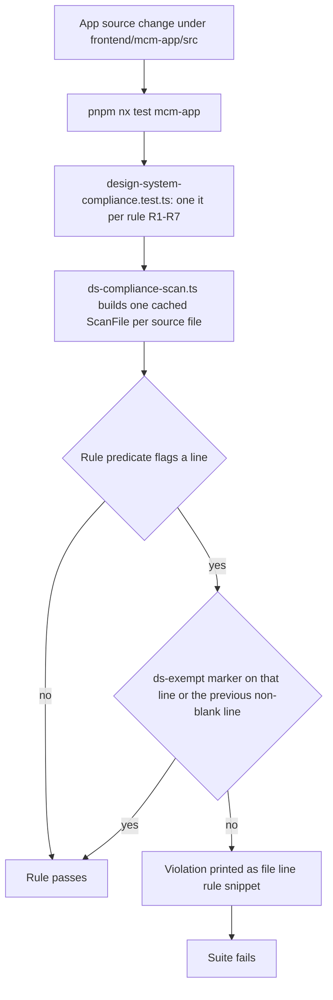

# MCM Cinema design system

`packages/design-system` — the workspace package `@mcm/design-system` — is a Material Design 3 token
set plus a Tamagui component library shared by both the web and native builds of the
[Expo/React Native app](./expo-app.md). It exists so the app's cinematic dark-first look (Cinematic
Blue primary, a restrained orange "marquee light" tertiary accent, Outfit headings over Inter body)
is expressed once, as tokens and components, rather than re-derived per screen.

Consumers import from the package barrel (`import { Button, Card, MovieCard, lightColors, darkColors }
from '@mcm/design-system'`) or from the config subpath (`@mcm/design-system/tamagui.config`); the app
re-exports the shared config from its own `tamagui.config.ts` rather than authoring a second one.
[`packages/DESIGN-SYSTEM.md`](../../packages/DESIGN-SYSTEM.md) is the full token and component
reference (colour roles, spacing, shape, elevation, motion, and every component's props) and
[`packages/design-system/README.md`](../../packages/design-system/README.md) the shorter package
summary. This page is a derived summary of those two plus the app-side enforcement, so it deliberately
does not enumerate component props — go to the source for those.

The package ships tokens (`tokens/`), the two themes (`theme/`), the `createFont` definitions
(`fonts/`), the Tamagui config, and the components grouped as primitives, inputs, surfaces, navigation,
domain and assistant. `package.json` publishes `"."` → `index.ts` and `"./tamagui.config"` →
`tamagui.config.ts`; `expo`, `react` and `react-native` are peer dependencies, so the package is never
the thing that decides the app's framework versions.

## Colour roles are theme-split

Semantic roles (`primary`, `secondary`, `tertiary`, `success`, `error`, the surface/background family,
`outline`, `scrim`, the pre-computed `surface1`–`surface5` tint tones, …) each carry a **distinct light
and dark value**, so one token resolves to a WCAG-AA-passing colour on both the near-white light surface
and the near-black "Cinema" dark surface. The role groups are:

| Role group | Tokens |
|---|---|
| Primary | `primary` `onPrimary` `primaryContainer` `onPrimaryContainer` |
| Secondary | `secondary` `onSecondary` `secondaryContainer` `onSecondaryContainer` |
| Tertiary (sparing orange accent) | `tertiary` `onTertiary` `tertiaryContainer` `onTertiaryContainer` |
| Success (positive / verified) | `success` `onSuccess` `successContainer` `onSuccessContainer` |
| Error | `error` `onError` `errorContainer` `onErrorContainer` |
| Surface / background | `background` `surface` `surface1`–`surface5` `surfaceVariant` `outline` `scrim` … |

Two properties of that mapping are load-bearing and easy to get wrong:

- **The semantic roles exist only in the themes, never also as colour tokens.** Palette tones are
  exposed as tokens (`primaryP40`, `tertiaryP50`, …), but the roles are not: Tamagui 3 resolves a bare
  name on a colour property *token-first* and theme second, so duplicating the light values as tokens
  made `color: 'onBackground'` resolve to the light colour inside the dark theme. Read roles via
  `useTheme()` → `theme.<role>?.val`, and in component code spell token/theme names **without** the
  Tamagui 2 `$` sigil — a leftover `"$primary"` still typechecks and resolves to nothing.
- **`success` is a first-class role, not a green literal.** It was added (feature 017) precisely so
  positive/verified state flows through the theme: positive text uses `theme.success?.val`, a filled
  verified banner uses `successContainer` with `onSuccessContainer`, and no consumer may hardcode a
  green. The role exists in both colour maps and both themes, and the three required AA pairings
  (`success` on `surface`, `onSuccess` on `success`, `onSuccessContainer` on `successContainer`) are
  asserted in `components/success-token.test.tsx` — see
  [the success-token contract](../../specs/017-design-system-consistency/contracts/success-token.md).

## Typography and the weight ceiling

The type scale is the MD3 step set `{11,12,14,16,18,22,24,28,32,36,45,57}`. Outfit carries
display/headline/title and Inter carries body/label, and **both fonts load only the faces
400/500/600/700** — there is no 800 or 900 face. That ceiling is the whole rationale for compliance
rule R6: a `fontWeight` above 700 has no real face, so the renderer synthesizes one, which looks wrong
and differs per platform.

Styled text is expected to declare an explicit family (`Outfit`/`Outfit-*`, `Inter`/`Inter-*`, or the
`heading`/`body` font tokens). The app loads the fonts non-blocking and the Tamagui families fall back
to `system-ui, sans-serif`, so a font-load failure degrades the type rather than hanging the app.

## Themes: dark is the default

`dark` is the recommended default theme, and the reason is product-shaped rather than stylistic: MCM is
a movie-collection app, so a home-theatre-dark UI is the natural home for it. The dark background is
deliberately deeper than MD3's standard dark neutral — `#0F1117` instead of `#1A1C1E` — which evokes a
cinema and makes posters pop, and the orange tertiary accent glows warmly against it.

The app-side mechanism lives outside this package: the preference is device-local, defaults to dark,
and is persisted client-side only (no backend or profile involvement), with a toggle in the app bar.
See [Expo/React Native app](./expo-app.md) for how the app consumes the theme. Flipping the default is
a design decision that needs this rationale revisited, not a config tweak.

## Tamagui 3, runtime-only, pinned exactly

Tamagui is on **v3, pinned to one exact version in both manifests, with no compiler plugin** — and that
is a measured decision, not a leftover:

- **One exact version, never a range.** The design system declares `@tamagui/core`, `@tamagui/stacks`
  and `@tamagui/shorthands`; the app declares `@tamagui/core` and `@tamagui/stacks`. All of them sit at
  the same exact `3.0.18`. `scripts/__tests__/tamagui-version-lockstep.guard.test.mjs` fails if either
  manifest uses a range, if the two manifests disagree, if the lock holds more than one `@tamagui/core`
  or `@tamagui/web`, if the removed v2 `@tamagui/babel-plugin` is named by a manifest or
  `babel.config.js` again, or if any Tamagui update escapes the single Renovate `tamagui` group — a
  range lets a partial lock refresh split the set and leave two style registries behind.
- **No Babel or Metro compiler plugin.** Tamagui 3 removed the Babel plugin the app ran from feature
  015, and its intended replacement, `@tamagui/metro-plugin` 3.0.x, was measured and rejected: it
  lowered some web modules to static class names *without emitting their CSS*, while saving no bytes.
  So Tamagui renders at runtime through `<TamaguiProvider>`, and `babel.config.js` carries only
  `babel-preset-expo` plus the Reanimated worklets plugin. Don't re-add a compiler incidentally while
  fixing something else.
- **The design system's own `Text` carries the defaults.** Tamagui 3 removed config-level
  `defaultProps`, so the body font and the theme's `onBackground` colour now live on
  `components/primitives/Text.tsx`; a bare `@tamagui/core` `Text` would silently fall back to the
  platform font and, on native, black text on the dark theme. `components/text-defaults.test.tsx` pins
  the observable defaults *and* fails if any source file outside that one imports `Text` from
  `@tamagui/core`.

Because the pin is a dependency-level constraint shared by two projects, a bump is a cross-repo change:
the guard, not prose, is the source of truth for what version is allowed.

## The compliance scan (R1–R7)

The app enforces design-system usage with a **static scan run by its Jest suite**, not a runtime check.
The rules live in
[`frontend/mcm-app/tests/unit/design-system-compliance.test.ts`](../../frontend/mcm-app/tests/unit/design-system-compliance.test.ts)
— one `it()` per rule, each asserting zero violations over `frontend/mcm-app/src/**` (excluding the
`bff-server`/`bff-api`/`__mocks__`/`unit-tests` directories and test/spec files) — and it runs as part
of the ordinary `pnpm nx test mcm-app` unit tier. Read that file and
[the compliance-rules contract](../../specs/017-design-system-consistency/contracts/compliance-rules.md)
for the authoritative rule table; in outline, R1 forbids hardcoded colour literals, R2 requires numeric
`fontSize` values to be on the MD3 scale, R3 requires styled text to declare an Outfit/Inter family, R4
forbids bespoke `TouchableOpacity`/`Pressable` buttons, R5 forbids a duplicated private "pill" button
style across agent components, R6 forbids a synthesized weight above 700, and R7 forbids a raw
`<Modal>` where the DS `Dialog` is the canonical surface.

The scan's shape: the read/neutralize/brace-parse pass and the seven rule predicates live in
`tests/unit/ds-compliance-scan.ts` so each file is read once and the predicates can be unit-tested in
isolation; failures print `file:line — rule — snippet` so a migration can be driven file by file.

Two asymmetries matter to anyone changing this area:

- **A design-system change can break the scan in the *app* repo.** The scale set and the 700 weight
  ceiling are constants inside the app's scan engine, so changing this package's type scale or loaded
  font weights turns the app's unit suite red, not this package's.
- **The scan only sees the marker; the catalogue entry is enforced by review.** A deviation is
  sanctioned only when it has *both* a site annotation and an entry in the contract file — the marker
  alone silences the scan.

## Sanctioned deviations

A call site that intentionally departs from a rule needs a `// ds-exempt(R<n>): <reason>` comment on the
flagged line (or the immediately-preceding non-blank line — `ds-exempt(all)` exempts every rule) **and**
an entry in
[`specs/017-design-system-consistency/contracts/sanctioned-deviations.md`](../../specs/017-design-system-consistency/contracts/sanctioned-deviations.md).
That contract file, not tribal knowledge, is the single source of truth for what is an approved
exception versus a real regression; it also carries the R1 colour-utility allowlist and the "intentional
control conventions" (two-tier destructive emphasis, choice-vs-filter chips) that are deliberate
differentiation rather than drift. Adding a deviation means adding a one-line rationale there plus the
marker at the site.

## Tests that pin this package

The package's own suite (`jest.config.js`, `pnpm nx test design-system`) uses the `jest-expo` preset with
`jest/tamagui-cjs-resolver.js` — Tamagui 3 maps two subpaths' `react-native` export condition to ESM-only
`.mjs` files Jest cannot load, while Metro handles them fine, so the resolver redirects exactly those to
the CJS build. `testMatch` covers the **whole** package rather than just `components/**`, so a new test
directory cannot be silently invisible to the runner again.

Beyond the success-token and text-defaults tests, the suite covers interaction/focus-ring state
behaviour, the controls, navigation, the inputs and the domain cards. These tests are the package's
contract with the app: they assert the observable result (resolved theme values, rendered style, AA
contrast) rather than the implementation.

## Gotchas

- **The orange (tertiary) cap is a convention CI will not enforce.** The rule is at most 3–4 orange
  elements per screen, with sanctioned uses being the Grumpy Robot avatar, rating stars, the single
  "Add movie" call-to-action (`PillButton`, a deliberate one-off primitive rather than a `Button`
  variant, plus the `FAB`'s tertiary default), and *attention* highlights such as a media/quality
  mismatch badge. None of R1–R7 counts orange usage, so reaching for orange on a link, a background, or
  a secondary button is a design regression **that nothing will fail you for** — the asymmetry is the
  point, and the sanctioned list lives in the deviations contract.
- **Don't add a Tamagui compiler plugin or move off the exact pin incidentally.** The runtime-only
  wiring and the lockstep guard exist because both alternatives were measured and rejected; treat a
  version bump as its own change.
- **Don't flip the app's default theme or the type scale without revisiting the rationale above** —
  the first is a product decision, the second silently breaks the app's compliance scan.
- **Never import `Text` from `@tamagui/core`** — use the design system's `Text`, which carries the body
  font and `onBackground` colour defaults that Tamagui 3 no longer supplies from config.

## Where to look next

[Expo/React Native app](./expo-app.md) for how the app wires and consumes this package (config
re-export, provider, font loading, theme preference), `packages/DESIGN-SYSTEM.md` for the full
token/component reference, and `frontend/mcm-app/README.md`'s "Design-system compliance & sanctioned
deviations" section for the app-side rule table and deviation catalogue. Test wiring for the app tiers
lives in [Testing tiers](../invariants/testing-tiers.md), and stable selectors for anything you re-skin
are covered by [Playwright testID mapping](../gotchas/playwright-testid-mapping.md).
