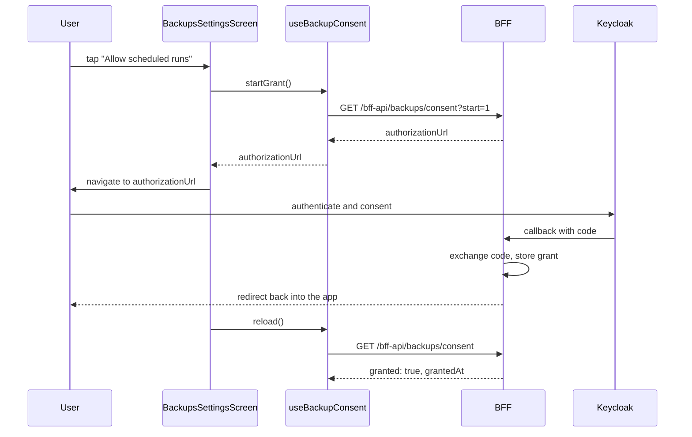

# Expo/React Native universal app

`frontend/mcm-app` is a single Expo Router (Expo SDK 57, React Native 0.86) codebase targeting web
and Android from one source tree. `app.json` sets Metro's web output to `"server"`, not a static
export, because the same process also hosts the [BFF](./bff.md) via file-based
`+api.ts` routes. Client-side code lives in `src/screens/`, `src/components/`, `src/hooks/`,
`src/config/`, `src/utils/`, `src/types/`; routes (both UI screens and API handlers) live under
`src/app/`. Routes stay thin by convention — a route file reports its own screen label (see below)
and renders a screen component, never the other way round. Both this app and the design system are
linted by **ESLint 10 through flat config** (`eslint.config.js` in each project, replacing the
`.eslintrc.*` files feature 081 US5b removed) — see the gotcha below for what the migration did and
did not change.

The [design system](./design-system.md) is Tamagui-based (`@mcm/design-system`), dark-first by default (theme choice is
persisted client-side only — no backend involvement), with a compliance test suite enforcing
design-token usage rules and tracked "sanctioned deviations" (rules R1–R7; the rule table and the
sanctioned-deviation contract are summarized on the [design system page](./design-system.md) rather
than duplicated here). All client-side network calls go
through `src/utils/api-client.ts` (an Axios instance with a 401 silent-refresh-and-retry
interceptor), which never attaches an `Authorization` header — it relies on the browser/RN cookie
jar and `withCredentials: true` to carry the BFF's session cookies (see
[Auth chain](../invariants/auth-chain.md)). Login itself uses OAuth2 + PKCE against Keycloak
directly from the client before handing the resulting code to the BFF.

**`api-client.ts` moved out of `src/bff-server/` (feature 077 / backlog item #566) — do not put it
back.** It used to live under `src/bff-server/`, a name that described what it talks to rather than
where it runs; since it runs in the browser/RN runtime carrying the caller's own cookies, that
misfiling was not cosmetic — it is how a component once imported `backup-run-summary` and shipped
70 KB of `luxon` into the web bundle. `src/bff-server/**` now means server-only without exception,
and `scripts/check-no-server-imports.mjs` enforces that a client module never reaches into it.

Directory-vs-file routing choices under `src/app/` are load-bearing in more than one place (the
`collections/[collectionId]/` collection route and the `settings/` route group both rely on a
directory route so nested/child routes inherit params or a shared layout) — see
[Directory-based collection routing in Expo Router](../gotchas/expo-router-collection-routing.md)
for the canonical rule and rationale; it is not restated here.

## The settings destination

`src/app/(app)/settings/` is a route group with its own `_layout.tsx` that renders a shared
`SettingsNav` sub-navigation (`src/components/settings/settings-nav.tsx`) above whichever area is
routed via an Expo Router `Slot` (not a nested `Stack` — the areas are a tab row with no push/pop
history of their own). `SettingsNav` composes the design system's vertical `NavList` rather than a
horizontal `Tabs` row — that shape was measured on a 320px device and found to put the Admin entry
off-screen behind an unindicated scroll (backlog item #240), and `Tabs` drew active/hover selection
as two visually disagreeing states. Selecting an area calls `router.replace`, not
`router.navigate`/`push`: on this Expo Router version `navigate` pushes a sibling area onto the
stack instead of swapping it, which left two mounted copies of a screen (a strict-mode/testID
collision on web) after a few area switches.

Each area is a thin route (`index.tsx`, `assistant.tsx`, `backups.tsx`, `account.tsx`, `admin.tsx`)
that reports its own `current_screen` label to the BFF/agent gateway via `useReportUiState` and
renders a screen component from `src/screens/settings/`. The area registry
(`SETTINGS_AREAS` in `settings-nav.tsx`) is the single source of truth for the row order and
labels:

- **Profile** (`profile-settings-screen.tsx`) — the landing area, `current_screen: settings`.
- **Movie Assistant** (`assistant-settings-screen.tsx`) — per-user agent provider/API-key config,
  backed by the BFF's own agent-config store (see [BFF](./bff.md)).
- **Backups** (`backups-settings-screen.tsx`) — the client side of feature 073 / backlog item
  #236: configuring per-user backup destinations (create/edit/test/delete), creating/editing backup
  jobs and their schedules, running a job on demand, viewing run history and stored versions,
  restoring a version, and managing the standing consent that lets a scheduled run act unattended.
  It is composed from `src/components/backups/` (`destination-form.tsx`,
  `destination-list.tsx`, `job-form.tsx`, `schedule-editor.tsx`, `run-history.tsx`,
  `version-list.tsx`) and the `src/hooks/use-backup-destinations.ts`, `use-backup-jobs.ts`,
  `use-backup-consent.ts` hooks, all of which call the BFF's `bff-api/backups/*` routes through the
  same cookie-authenticated `api-client.ts` as everything else — no destination secret is ever
  held by the client beyond the moment it is submitted (an edit form always starts with an empty
  secret field; omitting the field on an update preserves the stored secret server-side). Two
  details of the client half are deliberate rather than incidental: the screen's container testID
  (`settings-backups-screen`) and the route's reported `current_screen` (`settings-backups`) are
  unchanged from the feature-062 placeholder that preceded it, because the agent gateway's
  `current_screen` vocabulary is a contract (`test_current_screen_contract.py`) and the E2E tier
  selects on those testIDs; and `ScheduleEditor`/`RunHistory` render times in the **job's** time
  zone, not the device's, so a 03:00 schedule set in London still reads 03:00 in New York.
  Granting the standing consent is a round trip through the identity provider, not a local toggle:
  `useBackupConsent().startGrant()` only asks the BFF for an authorization URL, the caller navigates
  the user there, Keycloak returns them to a BFF-owned callback, and the BFF is what actually
  records the grant — the client only ever polls the resulting status. `revoke()` mirrors this
  asymmetry: if the identity provider refuses the revocation the BFF answers 502 and *keeps* the
  permission, and the hook surfaces an error rather than optimistically clearing it, because
  telling the user "done" here would be a lie. See [BFF](./bff.md) for the server-side
  scheduling/storage half of this feature; the backup procedure itself is not restated here.
- **Account** (`account-settings-screen.tsx`, feature 076) — currently a single destructive
  action, account deletion, driven by `use-account-deletion.ts`. It sits last among the
  non-admin rows by design: an area whose only purpose is an irreversible action does not belong
  beside the ones a user visits routinely. Every user may delete their own account, including an
  admin who is not the last one — there is no `adminOnly` flag on this row. Deletion always
  requires a *fresh* re-authentication at Keycloak (`prompt=login`, `max_age=0`, so an existing SSO
  session cannot be silently reused) before the BFF will act, but the two platforms get there
  differently: on web the BFF builds the authorization request, holds the PKCE verifier
  server-side, and receives the callback itself, so the browser only ever sees a URL to navigate
  to; on native, the BFF cannot redirect a native app, so the device runs the
  `expo-auth-session` flow itself, mints its own PKCE verifier, and posts the resulting code back
  to the BFF to complete. Both paths use a deletion-specific callback/deep link, distinct from the
  login one, and neither mechanism deletes anything client-side — the deletion happens server-side
  only after the BFF validates the returned proof.
- **Admin** (`admin.tsx`) — visible in the nav only for an `mc-admin` user, but that filtering is
  presentation only: the route itself carries its own `ProtectedRoute requiredRole="mc-admin"`
  guard, because a hidden nav entry is not access control.

Adding a settings area is meant to be one registry row in `settings-nav.tsx` plus a route and a
screen — no other area's code should need to change.

The standing-backup-consent grant is a client-initiated, identity-provider-mediated round trip: the client only ever requests a URL and later polls status, never records the grant itself.

## Gotchas

- **`import.meta.url` crashes the exported server bundle in production only.** Metro rewrites
  `import.meta.url` to `globalThis.__ExpoImportMetaRegistry.url`, which the Metro dev server
  populates but the exported `@expo/server` runtime used in Docker does not; `frontend/mcm-app/server.js`
  pre-seeds the registry as the workaround. Full mechanism, the affected agent-transport path, and
  why removing the seeding reintroduces a silent hang: [Expo Router server export and
  agent-transport traps](../gotchas/expo-router-and-transport-traps.md) (not restated here).
- **Tamagui is on v3 with NO compiler plugin — runtime-only, and that was a measured decision, not a
  leftover.** `mcm-app` declares `@tamagui/core` and `@tamagui/stacks`, and `@mcm/design-system` the
  same two plus `@tamagui/shorthands` — all at one **exact** version (`3.0.18`), never a range, and
  `babel.config.js` now
  carries only `babel-preset-expo` plus `react-native-worklets/plugin` — the `@tamagui/babel-plugin`
  that ran here from feature 015 until feature 081 US10 is gone, because Tamagui 3 has no 3.x of it.
  Its intended replacement, `@tamagui/metro-plugin` 3.0.x, was measured and rejected: it lowered some
  web modules to static atomic classNames *without emitting their CSS* (on `/settings` alone, 7 classes
  with no rule — the app bar lost its 24 px gap, the nav its width/gap, a chip its radius), printed
  34,780 `metro/resolve-failed` warnings per export, and saved no bytes at all (entry chunk 1,881,353 B
  with it vs 1,881,066 B without). So `metro.config.js` wires no Tamagui plugin either, and Tamagui
  renders at runtime through `<TamaguiProvider>` exactly as before. Three consequences matter to anyone
  changing this area: the exact pin is enforced by
  `scripts/__tests__/tamagui-version-lockstep.guard.test.mjs`, which also fails if
  `@tamagui/babel-plugin` is named by either manifest or by `babel.config.js` again (a leftover v2
  compiler over v3 sources), and which keeps every Tamagui update in one Renovate `tamagui` group so a
  partial lock refresh cannot split the set; `packages/design-system/jest/tamagui-cjs-resolver.js`
  exists because Tamagui 3 maps two subpaths' `react-native` export condition to ESM-only `.mjs` files
  Jest cannot load (56 suites failed to run on the 3.0.13 bump) — Metro handles `.mjs` fine, so the app
  is unaffected; and in Tamagui 3 any state clause, `hover` included, makes a View attach its own event
  handlers on native, which is why `NavList`/`Tabs` pass their hover clause on web only (a hover clause
  inside an RN `Pressable` swallowed the tap and broke the `settings-nav-assistant` mobile flow). The
  spelling changed with the major too: token and theme names carry no `$` (`fontFamily="body"`), a
  numeric `lineHeight` on a Tamagui component is a **ratio** (write pixels as `"20px"`), and
  `hoverStyle`/`pressStyle`/`focusVisibleStyle` are gone in favour of clauses on the property they
  modify. If you see stale guidance claiming a v1/v2 pin or a compiler plugin, that no longer reflects
  this codebase. Both the [design system page](./design-system.md) and `frontend/mcm-app/README.md`'s
  design-system section have since been rewritten for v3, so the only remaining plugin-era prose is the
  README's web-E2E note ("Metro's dev web bundler OOMs building the app + Tamagui locally") — where any
  prose and the manifests disagree, trust the two `package.json` manifests, `babel.config.js` and
  `scripts/__tests__/tamagui-version-lockstep.guard.test.mjs`.
- **Lint is an ESLint 10 flat config now, and the config file is the whole migration.** ESLint 10
  removed `.eslintrc.*` support and the `--ext` flag, so feature 081 US5b replaced
  `frontend/mcm-app/.eslintrc.json` and `packages/design-system/.eslintrc.json` with
  `eslint.config.js` in each project, and the Nx `lint` targets changed with them: both are now bare
  `eslint src` (mcm-app) / `eslint .` (design-system) run through `nx:run-commands`, with the old
  `--ext .ts,.tsx` gone. Three details are
  load-bearing. First, **`eslint-config-expo`'s flat preset is not its legacy preset re-expressed** —
  it takes `eslint-plugin-react`'s `flat.recommended` (a dozen `react/*` rules move warn → error, plus
  new errors such as `jsx-key` and `no-unescaped-entities`) and `eslint-plugin-import`'s
  `flatConfigs.warnings`, so a reader who assumes the same rules apply is wrong. Second, **four parity
  settings keep the migration from reporting anything new** — `reportUnusedDisableDirectives: 'off'`
  (ESLint 9+ defaults it to `warn`) and the rules `react/no-unescaped-entities`, `import/no-duplicates`
  and `import/no-named-as-default-member`, each of which was absent from the legacy preset; they are
  parity, not new exemptions, and turning them on means fixing what they report (33 findings in
  mcm-app, 0 in design-system), which is its own change. Third, **`@eslint/compat`'s
  `fixupConfigRules` wraps the preset because `eslint-config-expo` 57.0.2 bundles `eslint-plugin-react`
  7.37.5 and `eslint-plugin-import` 2.32.0, whose newest releases peer `eslint <=9` and still call
  context methods ESLint 10 removed** — without it every file fails at load with
  `react/display-name: contextOrFilename.getFilename is not a function`. `@eslint/compat` restores
  those methods on the rule context and changes no rule or severity; drop it once both plugins, as
  `eslint-config-expo` ships them, declare eslint 10 in their peers. The linted file set is
  deliberately unchanged: flat config cannot narrow extensions from the CLI (and lints `*.js`/`*.mjs`/
  `*.cjs` by default), so `*.{js,jsx,mjs,cjs}` are globally ignored in both configs, matching what
  `--ext .ts,.tsx` selected. Both projects declare `eslint ^10.12.0`, `eslint-config-expo ~57.0.2` and
  `@eslint/compat ^2.1.1`; the measured result is mcm-app 0 errors / 43 warnings and design-system
  0/0, the same 43 warnings at the same `file:line:rule` as before the migration. Renovate still owns
  this surface: `eslint-config-expo` is version-locked to the Expo SDK family (upgrades go through
  `expo install` with `expo`/`react-native`, never a raw bump), and TypeScript 7 stays held
  because `@typescript-eslint/parser` still peers `typescript ">=4.8.4 <6.1.0"` — see the
  [Renovate runbook](../runbooks/renovate.md).
- **Project-root dotenv files Expo cannot parse are kept out of Metro's file map — drop the
  blocklist and `pnpm web` 500s on every request.** In development, `@expo/metro-config`'s
  transform-worker rewrites the virtual module `expo/virtual/env.js` into
  `require.context(<projectRoot>, false, /^\.\/\.env/)` so that editing a `.env` file hot-reloads
  the client bundle. That context takes *every* project-root file whose name starts with `.env` and
  whose extension Metro crawls (Expo sets `watcher.additionalExts` to include `env`, `local` and
  `development`), while the very same worker dotenv-parses only six names — `.env`, `.env.local`,
  `.env.development`, `.env.development.local`, `.env.production`, `.env.production.local`. The
  two regexes disagree, so everything else falls through to the ordinary Babel JS transform:
  `.env.e2e.local` ends in `.local`, IS a member of that context, and dies as a `SyntaxError: …
  Missing semicolon` — which is what made `pnpm web` (and therefore Playwright's default Metro
  `webServer` target) return HTTP 500 for every request (item #242, measured 2026-09-07).
  `frontend/mcm-app/metro-env-blocklist.js` computes a `resolver.blockList` entry matching every
  root-level `.env*` outside that six-name set, and `metro.config.js` appends it to the resolver
  config. Two things about it are deliberate. It blocks rather than dropping `'local'` from
  `watcher.additionalExts`, because that would also stop Metro crawling `.env.local`, which Expo
  legitimately reads — these files are read at runtime with `readFileSync` by the Playwright /
  Maestro / Jest harnesses and nothing in the bundle imports them, so Metro has no business seeing
  them. And do not "just reformat" the offending file instead: no dotenv-valid formatting satisfies
  a JavaScript parser (quoting the space-containing values only moved the error onto a `#` comment
  line), and the format is shared with three consumers that quote differently — bash `source`,
  `docker run --env-file`, and the Python `_load_env_file` helpers. The regex must also stay in step
  with Expo's own parseable set if a future SDK widens it.
- **`@segment/analytics-node` is redirected to a no-op shim in `metro.config.js`.** CopilotKit's
  React Native entry statically imports its telemetry client, which imports the server-side
  `@segment/analytics-node`; that transitively pulls `jose`, whose Node build `require`s `crypto`,
  and `node:crypto` does not exist on React Native/Hermes — the Android/iOS bundle fails outright
  with `Unable to resolve module crypto from jose/.../node/cjs/runtime/verify.js`. `metro.config.js`
  overrides the resolver for that one specifier to `metro-shims/segment-analytics-node.js`,
  removing the whole telemetry subtree (`jose` + `node:crypto` + node `http`) from the mobile
  bundle while every other package resolves exactly as before; web and the BFF are unaffected
  because Node has `crypto`. The shim is deliberately **not** an empty module: the telemetry client
  constructs `new Analytics(...)` unconditionally in React Native (its
  `COPILOTKIT_TELEMETRY_DISABLED` gate reads `process.env`, which is empty at runtime on native),
  so an empty module would throw "undefined is not a constructor". The shim keeps the API surface
  and sends nothing.
- **`src/bff-server/**` means server-only without exception, and a keyless gate enforces it.**
  `scripts/check-no-server-imports.mjs` scans `frontend/mcm-app/src` for any non-exempt file that
  imports into `src/bff-server/`, and runs in the `naming` guardrails job as `--selftest` plus the
  real scan. Two details of the detector are load-bearing: it resolves both the `@/` alias and a
  relative walk (a gate that only knew the alias would be bypassed by `../../bff-server/x`, the
  shape a mechanical refactor produces), and it matches over the whole file rather than line by
  line — the violation it was written for, `run-history.tsx`'s, is spread over five lines, and the
  first, line-based version reported the real tree clean of the one import it existed to catch.
  Deliberately not flagged: `src/bff-server/**` importing its own siblings, `src/app/**/*+api.ts`
  (API routes *are* the sanctioned server-side consumer), `import type` (erased at compile time and
  ships nothing — a gate that fires there teaches people to suppress it), and test files. The one
  escape hatch is an `@client-safe: <reason>` marker **in the module itself**, not an allowlist
  inside the gate: an allowlist rots silently and is invisible to anyone reading the module, while
  a marker sits in front of every reviewer of the file it excuses, and adding one is an edit to the
  thing being excused. A bare marker with no reason is not honoured. **No module carries a marker
  today** — item #566 relocated the only candidate (`api-client.ts`) to the Utils-Layer, and an
  audit confirmed every remaining module under `src/bff-server/` is genuinely server-only — and the
  mechanism is kept rather than deleted because its tests document the rule. A marker must be
  paired with an entry in `SERVER_ONLY_EXEMPT` in `scripts/check-web-bundle-budget.mjs`, or one of
  the two gates has an unexplained hole. That second gate is the other half of the story and
  asserts three things: the web entry chunk stays inside a committed byte budget, the deferred
  assistant packages are absent from the *entry* chunk, and server-only code is absent from
  *every* client chunk (not just the entry one — a gate reading only the entry chunk would report
  clean while `src/bff-server/**` shipped inside a deferred chunk).
- **The same process serves the web surface, and its security headers come from a plain-CommonJS
  module `server.js` requires at boot.** `frontend/mcm-app/web-security-headers.js` is deliberately
  not TypeScript: `server.js` lives outside the Metro bundle and cannot import the app's compiled
  TS. It builds a strict, *enforcing* (never report-only) `Content-Security-Policy` for the
  browser-rendered surface whose `script-src` allow-lists Expo Router's single inline hydration
  bootstrap script **by sha256 hash**, so the policy needs neither `'unsafe-inline'` nor
  `'unsafe-eval'`, plus three always-on static baseline headers stamped on every response. The
  browser-facing Keycloak origin that `connect-src` needs (expo-auth-session fetches OIDC
  discovery) is read from env at boot and reduced to a bare `http(s)` origin, falling back to a
  localhost default on anything malformed — a scheme-less or non-web-scheme value does not throw in
  the WHATWG `URL` parser, it yields the opaque origin `null`, which would emit a broken directive.
  The web CSP is **path-scoped out of `/bff-api`** so the API surface keeps exactly one CSP, its own
  strict handler policy, rather than depending on adapter same-name header merge order. One residual
  is deliberate and documented: a third-party library runs a `new Function("")` eval-availability
  probe inside a try/catch, the strict `script-src` blocks it, the library degrades gracefully with
  the app fully functional, and the browser logs one benign `eval` CSP violation — `'unsafe-eval'`
  is *not* added to silence it, because permitting real eval app-wide would defeat the hardening.
  The header values, the current directive set and the per-surface contract belong to the cited
  sources (`frontend/mcm-app/web-security-headers.js`, the contract under
  `../../specs/032-security-header-hardening/contracts/security-headers-contract.md`, and the
  [DAST runbook](../runbooks/dast-scanning.md) for the ZAP gate), not to this page.
  `tests/e2e/web/security-headers.spec.ts` asserts the three response classes this process serves —
  SSR HTML, a static asset, and a JSON API response — and that `X-Powered-By` is absent from all
  three; it opts out of the shared authenticated `storageState` because all three are public.
- **A release APK reaches the dev BFF only because a config plugin allowlists cleartext for it.**
  Android `targetSdk` ≥ 28 blocks `http://` traffic by default and Expo only relaxes that in the
  DEBUG manifest, so the standalone RELEASE APK the mobile E2E suite installs could not reach the
  dev BFF over `adb reverse` — the login POST failed with `ERR_NETWORK` and never left the device
  (Chrome loads the same `http://` URL fine, because Chrome carries its own cleartext policy; the
  app's own network stack does not). `frontend/mcm-app/plugins/with-dev-cleartext.js`, listed in
  `app.json` and run at `expo prebuild` time (because `android/` is gitignored and regenerated),
  writes a network security config permitting cleartext for `localhost`, `127.0.0.1` and the
  emulator host alias `10.0.2.2` **only**, then points `android:networkSecurityConfig` at it. Every
  other host stays cleartext-blocked, so the production HTTPS build is unaffected — prod talks to
  its real HTTPS host, which is not in this allowlist. See the [Android emulator
  runbook](../runbooks/android-emulator.md) for the APK build path this sits in.
- **Web E2E must run against a prebuilt BFF container, and a stale image lies to you.** Web E2E
  always runs against the containerized BFF rather than the Metro dev server, so the suite exercises
  the production-mode `expo export` output the image ships. That container serves a prebuilt bundle —
  if you change source and don't rebuild the image, the E2E suite silently tests old code and reports
  green. Always rebuild after a source change before trusting a web E2E result. See [E2E
  testing](../runbooks/e2e-testing.md) for the three BFF-fronting modes this trap sits in. The
  original reason for containerizing was that Metro's dev web bundler OOM-crashed building the app
  plus Tamagui locally; that measurement predates the removal of the Tamagui compiler plugin, and
  feature 081's re-measurement served the dev web bundle without OOM under either arrangement, so
  treat the OOM as the plugin-era cause rather than a standing property — the container rule itself
  still stands (`frontend/mcm-app/README.md` still states the OOM version of the rationale).
- **`pnpm nx e2e mcm-app` does not work inside the devcontainer.** Chromium cannot be installed there
  (the Playwright CDN and apt are outside the egress allowlist). Run Playwright via the
  `mcr.microsoft.com/playwright` image with `--network host` instead — and keep its version tag
  matched to the `@playwright/test` lockfile version (see [E2E testing](../runbooks/e2e-testing.md)
  for the toolchain-consistency gate that now enforces this).
- **RN 0.86's renderer is Babel-transformed unless Jest is told not to, and the transform, not the
  load, is what cost time.** React Native 0.86's `RendererImplementation` imports `ReactFabric` at
  module scope where 0.85 `require`d it lazily inside `getFabricRenderer()`, so the first render that
  touches `Animated` pulls in the ~725 KB `ReactFabric-dev.js` — a file that is already-compiled
  CommonJS and needs no transform. `frontend/mcm-app/package.json`'s jest `transformIgnorePatterns`
  therefore carries `/node_modules/react-native/Libraries/Renderer/implementations/`. Measured cold
  with `--no-cache --maxWorkers=1` on one test: 1104–1260 ms transformed vs 591–630 ms excluded, back
  at the SDK-56 figure. The per-test 15 s timeout that briefly stood in for this is gone; delete the
  pattern and a loaded CI runner can exceed Jest's default 5 s bound on the first
  `Animated`-touching render per worker.
- **Password-manager autofill is deliberately suppressed almost everywhere.** Use
  `NoAutoFillInput` (`src/components/no-autofill-input.tsx`, used across the collection/movie
  forms, search bar, and assistant config) instead of plain `TextInput` for form fields, except the
  registration page (`register-form.tsx`), which uses a plain `TextInput` on purpose because
  autofill is wanted there.
- **React Native Testing Library 14 made the whole render/event API async — an un-awaited `render`
  fails as `getByTestId is not a function`, not as a warning.** Feature 081 US5c took
  `@testing-library/react-native` from 13.3.3 to `^14.1.0`, whose `render`, `renderHook`, `rerender`,
  `unmount` and every `fireEvent.*` now return a Promise; the upgrade went RED with
  `getByTestId is not a function`, `Cannot read properties of undefined (reading 'current')`,
  `` `render` function has not been called `` and `rerender is not a function` until every call site
  awaited them. The app's own helper is the one place this is easy to get wrong: `render` in
  `src/test-support/render.tsx` wraps RNTL in `<TamaguiProvider>` and re-exports the rest of the API,
  but it is a plain pass-through rather than an async wrapper, so `await render(...)` is required at
  *every* call site — including the many tests that only query a testID immediately afterwards, which
  is exactly where it looks unnecessary. `UNSAFE_getByType` is also gone (Test Renderer renders host
  elements only), so a test that needs the `Modal` or `ScrollView` inside a component queries the host
  type through `container.queryAll((node) => node.type === 'Modal')` /
  `node.type === 'RCTScrollView'` instead. One measured behaviour is worth *not* "fixing": RNTL 14
  honours the responder/`disabled` contract, where v13 delivered the event anyway, so a second
  `fireEvent.press` on a button the first press disabled stops at the button instead of reaching the
  handler. The "second press ignored" assertions still hold — now because the press never arrives,
  which is what their titles actually claim.
- **`test-renderer` is held below 1.3 for as long as the app is on React 19.2.** RNTL 14 renders
  through `test-renderer`, and 1.3.x depends on `react-reconciler` 0.34, which peers `react ^19.3.0`;
  Expo SDK 57 pins React 19.2.3, so `frontend/mcm-app/package.json` declares `test-renderer ~1.2.0`
  and Renovate caps it at `/^1\.[0-2]\./`. The hold sits in a group of its own, and that is
  load-bearing rather than tidiness: a held member gates every member batched alongside it, so leaving
  it in the routine `js patch/minor` group would block unrelated npm bumps behind a version that
  cannot install. Lift it when an Expo SDK move brings React 19.3. See the
  [Renovate runbook](../runbooks/renovate.md) for the hold conventions this follows.
- **Every `data-testid`-based web E2E selector depends on React Native Web's `testID` →
  `data-testid` rewrite matching Playwright's configured `testIdAttribute`.** See [Playwright
  testID mapping](../gotchas/playwright-testid-mapping.md) for the mechanism and why a mismatch
  breaks the whole web E2E suite at once, not just one spec — not restated here.

See [BFF](./bff.md) for the server-side half of this codebase, [Auth chain](../invariants/auth-chain.md)
for the full login-to-request-validation sequence, and
`frontend/mcm-app/README.md` for the design-system compliance rules and the full web-E2E procedure.
