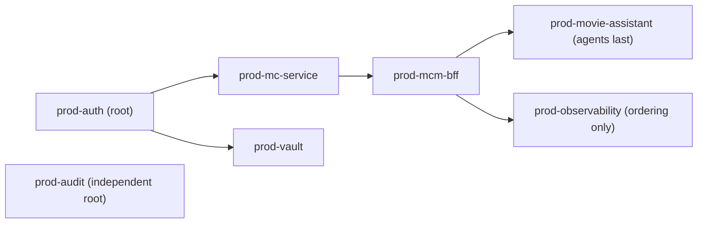

# Infrastructure-as-code stacks (local Compose + production Komodo)

`infrastructure-as-code/` is where every environment's runtime topology is defined as config, not
provisioned by hand. It has two distinct halves that share the same service definitions but serve
different purposes.

## Local/dev Compose stacks

`infrastructure-as-code/docker/stacks/*.compose.yaml` are four independently operable named stacks,
each its own Compose project and each a thin `include:`-only aggregator over that stack's per-service
compose files:

- **`auth`** — Keycloak + its Postgres + Mailpit, plus `vault-service` behind the `vault` profile.
- **`mcm`** — the test infra that starts by default (`mc-service-store-mongo` + its rs-init,
  `mcm-bff-cache-redis`, `mcm-bff-store-mongo`), plus [mc-service](./mc-service.md) behind `app`, the
  [BFF](./bff.md) behind `bff-nonsecure` / `bff-secure`, and the agent layer behind `agents` /
  `agents-metro`.
- **`audit`** — the append-only OpenSearch audit sink, behind the `audit` profile.
- **`observability`** — LangFuse + otel-lgtm + OPA + Unleash, every service behind the `observability`
  profile.

The single root `compose.yaml` aggregator is retired to a pointer (feature 020); there is no longer one
project bundling everything behind profiles. Lifecycle goes through the Nx targets in
`infrastructure-as-code/project.json` — `up-auth`, `up-mcm`, `up-mcm-agents`, `up-audit`,
`up-observability`, `up-all`, and their `down-*` counterparts — which wrap the `docker compose -p
<stack>` invocation and that stack's `.env` file, rather than raw `docker compose` by convention.
`up-all` runs auth then mcm, serially, in that order. `up-auth` applies the shared keycloak compose
plus the `keycloak/compose.dev.yaml` overlay as a second `-f`, which is what imports the `grumpyrobot`
realm on a fresh volume. Each `down-*` target names **every** profile it might have brought up (all
five for `mcm`, `vault` for `auth`), so a teardown actually removes the profile-gated containers — a
`down` target that omits a profile silently leaves those containers running.

The agent layer has two distinct bring-up paths: `up-mcm-agents` (the heavy in-stack `--profile agents`
variant) and `up-agents-prod` (`scripts/agent-stack.mjs`, the light containerized production-node stack
used for local agent E2E).

Almost every dev-stack secret is a fail-fast `${VAR:?…}` interpolation reference, and the
[stacks README](../../infrastructure-as-code/docker/stacks/README.md) enumerates the exceptions
explicitly. Two component files take their credentials from a *service-local* `env_file:` instead of
the per-stack `.env`: the BFF (`bff/compose.yaml` loads `frontend/mcm-app/.env.docker`) and
`web-api-mcp` (`web-api-mcp/compose.yaml` loads `mcp-servers/web-api-mcp/.env.local`). The agent layer
is the third exception: it keeps deliberately optional `${VAR:-}` keys — `AGENT_GATEWAY_CLIENT_SECRET`
(empty ⇒ token exchange skipped, tool calls fail closed) and the `AGENT_GATEWAY_CLIENT_ID` /
model-tuning defaults — so the gateway comes up without token exchange;
`scripts/check-no-inline-secrets.mjs` allowlists `AGENT_GATEWAY_CLIENT_SECRET` by name for exactly
that reason.

The `${VAR:?…}` values live in gitignored per-stack `<stack>.env` files minted from the committed
`<stack>.env.example` templates by `node scripts/gen-dev-secrets.mjs`, and the stack's `include` uses
the long syntax with an `env_file:` pin so that file is the interpolation source for the included
component files (feature 021). The Nx `up-*` targets pass the same file a second way, as
`--env-file`, which is what lets the aggregator itself resolve the pins.

The pin is per include, not blanket. All of `auth`'s two includes, plus `audit`'s and
`observability`'s single include, carry it; `mcm` pins only the two component files that interpolate a
stack-scoped variable (`agent-db` and `agent-gateway`, both for `${AGENT_DB_PASSWORD}`) and includes
the other five bare.

No dev-stack template carries a topology value any more. `REGISTRY_HOST` left `mcm.env.example` and
`observability.env.example` when feature 080 replaced the from-source object-store image with upstream
RustFS — `mcm.compose.yaml` keeps the note because a required `${REGISTRY_HOST:?}` in a profile-gated
service once broke `up` for the whole stack. The generator rule that survives is narrower and still
load-bearing: a template key that is **not** a `<generate:KIND>` placeholder is never filled, so a
deliberately blank entry stays blank and a complete file still reports "up to date" —
`scripts/__tests__/gen-dev-secrets.guard.test.mjs` pins that with a synthetic template. In production
the same name is a Komodo Variable, declared per stack in `stacks.toml`.

The generator is **idempotent and back-filling**, not skip-on-exists: an existing `<stack>.env` keeps
every value it already holds — including ones edited by hand — and gains only keys the template has
since acquired, so a newly added key never requires `--force`, which rotates everything. A
`<generate:KIND>` key present but **empty** is minted in place (an empty secret is a missing secret),
while a blank fixture key is left alone. Deterministic fixtures such as
`LANGFUSE_INIT_PROJECT_PUBLIC_KEY` / `LANGFUSE_INIT_PROJECT_SECRET_KEY` are copied verbatim even under
`--force`, because the gateway and the feature-012 SC-008 verify test authenticate against those exact
values. A run prints key *names* only, never values.

Generation kinds are minted by the script, not the README: `b62-32` / `b62-48` (URL- and shell-safe
base62), `hex-64` (32-byte hex), `complex-16` (upper+lower+digit+special from a URL/shell-safe
charset), `unleash-admin` / `unleash-client`, and `mongo-keyfile` — the base64 replica-set keyfile
content behind `MONGO_MC_KEYFILE`, which the template list documents but the README's kind list omits.
Full template table, rotation and fail-fast behaviour:
[stacks README](../../infrastructure-as-code/docker/stacks/README.md).

Since feature 039 the per-service `profiles:` assignments live **in each included component file**, not
re-declared in the stack aggregator. That removes the include-override merge (`services.<x> conflicts
with imported resource`) that only newer Docker Compose accepted, so the stack parses on any conformant
Compose.

## Production stacks (Komodo ResourceSync)

`infrastructure-as-code/komodo/stacks.toml` holds seven `[[stack]]` blocks that a Komodo ResourceSync
diff-applies: the four core application stacks — `prod-auth`, `prod-mc-service`, `prod-mcm-bff`,
`prod-movie-assistant` — plus three support stacks added when feature 025 landed the production Control
Tower: `prod-audit`, `prod-observability`, `prod-vault`.

Deploy order is declared by `after`, and `deploy = true` + `after = [...]` makes the sync *deploy* as
well as apply, in that dependency order:

The `after` deploy order declared in `stacks.toml` — the core chain, plus the support stacks attached
to it.

The reasons that carry weight: `prod-mc-service` waits on `prod-auth` because mc-service fetches
Keycloak's JWKS; `prod-movie-assistant` comes last because `spreadsheet-mcp` needs `prod-mcm-bff`'s
`mcm-bff-network` and Redis; `prod-vault` hangs off `prod-auth` because it is logically in the auth
tier while living in its own block (its `file_paths` are `run_directory`-relative and the Vault compose
sits under `docker/vault/`); and `prod-observability`'s edge is ordering only, keeping a clean graph
rather than expressing a hard dependency. `prod-audit` is a root — independent, highest value, simplest.
Every production deploy after the one-time Komodo bootstrap is `git push` → signed webhook → reconcile;
[CI/CD pipeline](./ci-cd-pipeline.md) describes what fires that webhook.

## How one production stack is wired

Each `[stack.config]` block names the Komodo Periphery `server`, a `linked_repo` + `branch`, a
`run_directory` and `file_paths` pointing at that component's `compose.prod.yaml`, an
`env_file_path = ".env.prod"` (gitignored) into which Komodo writes the interpolated `environment`, and
an `environment = """…"""` block whose values are masked Variable tokens `[[NAME]]`, resolved at deploy
time. All seven blocks name the same Periphery `server = "Local"`, the same `linked_repo = "mcm-repo"`
and the same `branch = "main"`, so one ResourceSync reconciles the whole production topology on one
host. Nothing host-shaped or secret-shaped is committed: the git host lives in a separately
bootstrapped Komodo `Repo` resource referenced by name, and the production domain, tailnet host and
registry host are Variables. A few non-secret literals do sit inline beside the tokens — the rendered
realm file's absolute path, the backup-consent client id, and the `http://…:19099` admin-URL shape
wrapped around a `[[TAILNET_HOST]]` token — because the scrub rule is about topology and credentials,
not about keeping the block purely symbolic.

A production stack also never creates its own infrastructure. Every named volume a `compose.prod.yaml`
mounts is `external: true` with an explicit `name:`, and so is every `networks:` entry except one,
because the networks and volumes are created by hand on the prod host as part of the one-time setup
([prod control tower](../runbooks/prod-control-tower.md)). Compose never creates an external resource, so
a deploy that references a missing one aborts up front — `external volume "…" not found` — creates
**zero** containers, and leaves the previously deployed containers running and unchanged; recovering means
creating the resource (seeding it, where there is data to keep) and redeploying. That makes the resource
list, like the `environment` list, part of the stack definition's contract with the host.

The newest instance of that contract is a rename. Spec 081 US8b moved both observability databases
from Postgres 16 to 18 and renamed their volumes to `observability-langfuse-postgres-v18-data` and
`observability-unleash-postgres-v18-data`, leaving the pre-18 `…-postgres-data` volumes untouched as
the rollback. Because both are `external: true`, the operator creates them — and restores the Unleash
dump into its own — *before* the merge that deploys the file; a merge that lands first fails on the
missing external volume and recreates nothing rather than bringing LangFuse up on an empty store. The
asymmetry between the two is deliberate: ADR-0002 §4 ratifies losing the LangFuse trace history, not
Unleash's flags. The volume `name:` and the mount path move as one change — postgres 18 keeps its
cluster under `/var/lib/postgresql/18/docker`, so both services mount the **parent**
`/var/lib/postgresql`, and a mount left on the pre-18 `/data` path makes the entrypoint exit 1 even
on an empty volume. `scripts/__tests__/langfuse-postgres-shared-pin.guard.test.mjs` pins all three
facts together: `langfuse-postgres` and `unleash-postgres` reference one identical digest (so a
find-and-replace bump cannot migrate Unleash's store as a side effect), the shared pin sits on the 18
line, and both mount the parent path.

The exception is `prod-auth`'s `keycloak-network`, declared `keycloak-network: {}` in
`keycloak/compose.prod.yaml` and therefore **compose-managed** rather than external — deliberately, since
feature 029. It carries only the intra-stack DB link `keycloak-service` ↔ `keycloak-store-postgres`
(the BFF reaches Keycloak over `backend-network`), and letting Compose own it means the network is created
and *both* services attached to it atomically on every `up`/recreate, so Keycloak can always resolve its
Postgres even when the shared external networks hit the rootless re-attach race that stranded
`keycloak-service` in the 2026-07-06 outage. Compose consequently names it `prod-auth_keycloak-network`,
and the one-time cutover on a host still carrying the pre-029 external net is
`docker network rm keycloak-network` after a `prod-auth` destroy. See
[prod reboot resilience](../runbooks/prod-reboot-resilience.md).

Exposure is the other half of that contract, and it is deliberately tiny: only three host ports are
published anywhere in production, and all three are operator surfaces bound plainly to `0.0.0.0` rather
than to the tailnet IP — `prod-observability` publishes LangFuse web (`19030:3000`) and Grafana inside
`otel-lgtm` (`19002:3000`), and `prod-auth` publishes the Keycloak admin console (`19099:8080`). The
`0.0.0.0` bind is forced rather than chosen: the rootless daemon starts before `tailscaled` at boot, so a
`${TS_ADMIN_IP}:host:container` publish silently fails to bind (rootlesskit never learns the tailnet IP,
the container ends up with no ports and nothing listens), and tailnet-only exposure is preserved instead
by the host firewall's default-deny on non-tailnet inbound. Everything else stays unpublished and is
reached by internal DNS, including `otel-lgtm`'s OTLP `4317`/`4318` and OPA's `8181`. All three published
ports sit in the prod-reserved `19000–19099` range so they cannot collide with the CI runner's own
LangFuse, Grafana or Keycloak on the shared host.

The `environment` block is the stack's **declared input list**, and it is the only place those inputs
are declared:

- **`prod-auth`** (`docker/keycloak`) — `BASE_DOMAIN`, `KC_HOSTNAME_ADMIN`,
  `KC_BOOTSTRAP_ADMIN_PASSWORD`, `KC_DB_PASSWORD`, `PROD_REALM_FILE`. No `additional_env_files`.
- **`prod-mc-service`** (`docker/mc-service`) — `REGISTRY_HOST`, `MONGO_MC_APP_PASSWORD`,
  `MONGO_MC_KEYFILE`; plus `.env.deploy`.
- **`prod-mcm-bff`** (`docker/bff`) — `BASE_DOMAIN`, `REGISTRY_HOST`, `KEYCLOAK_CLIENT_SECRET`,
  `KEYCLOAK_SERVICE_CLIENT_SECRET`, `COOKIE_SECRET`, `AGENT_CONFIG_ENC_KEY`,
  `AGENT_SUBJECT_TOKEN_CLIENT_SECRET`, `OPENSEARCH_PASSWORD`, `MONGO_BFF_APP_PASSWORD`,
  `BACKUP_CONSENT_CLIENT_ID`, `BACKUP_CONSENT_CLIENT_SECRET`, `BACKUP_CREDENTIAL_ENC_KEY`,
  `BACKUP_TICK_SECRET`, `BACKUP_ALLOWED_DESTINATION_HOSTS`; plus `.env.deploy`.
- **`prod-movie-assistant`** (`docker/agents`) — `REGISTRY_HOST`, `AGENT_DB_PASSWORD`,
  `AGENT_GATEWAY_CLIENT_SECRET`, `OPENSEARCH_PASSWORD`, `LANGFUSE_PUBLIC_KEY`, `LANGFUSE_SECRET_KEY`,
  `UNLEASH_API_TOKEN`; plus `.env.deploy`.
- **`prod-audit`** (`docker/opensearch`) — `OPENSEARCH_INITIAL_ADMIN_PASSWORD`,
  `OPENSEARCH_AUDIT_WRITER_PASSWORD`. No `additional_env_files`.
- **`prod-observability`** (`docker/observability`) — thirteen LangFuse/Unleash secret tokens
  (`LANGFUSE_SALT`, `LANGFUSE_ENCRYPTION_KEY`, `LANGFUSE_NEXTAUTH_SECRET`, `LANGFUSE_PG_PASSWORD`,
  `LANGFUSE_CLICKHOUSE_PASSWORD`, `LANGFUSE_REDIS_PASSWORD`, `LANGFUSE_RUSTFS_SECRET_KEY`,
  `LANGFUSE_INIT_PROJECT_PUBLIC_KEY`, `LANGFUSE_INIT_PROJECT_SECRET_KEY`,
  `LANGFUSE_INIT_USER_PASSWORD`, `UNLEASH_PG_PASSWORD`, `UNLEASH_ADMIN_TOKEN`,
  `UNLEASH_CLIENT_TOKEN`), and `TAILNET_HOST`, reused for LangFuse's tailnet `NEXTAUTH_URL`. No
  `additional_env_files`.
- **`prod-vault`** (`docker/vault`) — **no `environment` block at all**: a dormant Vault has no root
  token to inject. Its `[stack.config]` still carries `env_file_path = ".env.prod"` and no
  `additional_env_files`, so it is the fourth stack that receives no committed digest file (the other
  three being `prod-auth`, `prod-audit` and `prod-observability`) — all four are upstream-image stacks
  that nothing in CI builds.

The block that grew most recently is `prod-mcm-bff`'s: feature 073's production enablement (item #843
follow-up, 2026-10-25) added `BACKUP_CREDENTIAL_ENC_KEY`, `BACKUP_TICK_SECRET` and
`BACKUP_ALLOWED_DESTINATION_HOSTS`, and feature 083 added the consent pair `BACKUP_CONSENT_CLIENT_ID` /
`BACKUP_CONSENT_CLIENT_SECRET`. Until the first three landed, none was set, so scheduled backups were
**off in production** — every private destination was refused, no destination secret could be sealed,
and the boot log read `backup scheduler disabled`. Two properties of this group are worth carrying:
the allow-list is an **exact** host match with no port and is a plain Variable rather than a masked one
(it is LAN topology, so it stays out of git like `[[BASE_DOMAIN]]`), and `BACKUP_CREDENTIAL_ENC_KEY`
must never be rotated casually — it orphans every stored destination secret and offline token. This is
also the clearest instance of a rule the gotchas below state in full: the addition was invisible to CI,
because a capability whose keys are *optional* has no `${VAR:?}` for a guard to see. See
[the backups runbook](../../docs/runbooks/backups.md) for the production section and
[the BFF page](./bff.md) for what the switches do at runtime.

Two names left `prod-observability`'s block with feature 080, which swapped the from-source object-store
image for upstream `rustfs/rustfs`: `REGISTRY_HOST` (the stack no longer pulls a
`${REGISTRY_HOST}/jumbleknot/…` ref) and `LANGFUSE_MINIO_ROOT_PASSWORD`, replaced by
`LANGFUSE_RUSTFS_SECRET_KEY`. The Komodo **Variables** for both are deliberately kept until the
rollback window closes, because reverting the merge restores the lines that need them and a revert
cannot recreate a Variable. New Variables must be seeded *before* the sync that first references them:
an unseeded `[[VAR]]` interpolates empty, and the `${VAR:?}` guard in the compose then aborts the
deploy — the intended fail-fast, not a silent default.

Because the list is the contract, an entry can outlive the compose that read it — and both bind-prefix
variables have now run that course to completion. `KC_ADMIN_BIND_IP` was only ever the bind *prefix*;
feature 028 dropped it from the keycloak compose bind and `stacks.toml` stopped passing it to
`prod-auth` on 2026-10-12 (item #727) — until then Komodo wrote it into `.env.prod`, which the keycloak
compose loads with `env_file:`, so it reached the container as a `KC_*` variable naming no Keycloak
option (harmless, but a reminder that removing the consumer does not remove the input). `TS_ADMIN_IP`
followed the same path: feature 028 made the two operator-UI binds `0.0.0.0`, so no compose bind had
read it since, and `stacks.toml` stopped passing it to `prod-observability` on 2026-10-13. No stack or
compose file reads either name any more, so both Komodo Variables can be retired — leaving one seeded
cannot fail a deploy, the only cost is dead config. The admin *URL* was always a separate, live var
(`KC_HOSTNAME_ADMIN`) and is the one a port move must keep in sync. See
[prod reboot resilience](../../docs/runbooks/prod-reboot-resilience.md) for the full retired-variable
record.

Image digests are not in the TOML either. A tracked, host-free `.env.deploy` beside each component's
prod compose carries the bare `<SVC>_DIGEST` value per service and is passed as
`additional_env_files` — last, so the digest interpolates from git while `REGISTRY_HOST` and the
secrets interpolate from `.env.prod`. The compose assembles the pull reference as
`${REGISTRY_HOST}/jumbleknot/<svc>@${<SVC>_DIGEST}`.

Only the three CI-built stacks receive it: `cd-deploy`'s promotion step copies the *same* generated
`VAR=<bare sha256>` block into all three run directories it names
(`infrastructure-as-code/docker/bff`, `mc-service`, `agents`), so every Komodo Stack reads a local
`.env.deploy` rather than a fragile `../` path. `.gitignore` keeps those files tracked with an
`!infrastructure-as-code/docker/**/.env.deploy` carve-out sitting beside the `*.env` / `*.env.*`
ignore rule, because the file holds only digests — no host, no secret.

## Side artifacts and the static gates over every compose file

Not every file under `infrastructure-as-code/` is a stack. Four artifacts exist to serve the stacks
without being one, and every compose file the gates discover is subject to a set of static gates.
Three of those gates (naming, inline-secret, port-collision) discover files by basename glob, and the
scopes differ by exactly one glob. `scripts/check-no-inline-secrets.mjs` and
`scripts/check-prod-ci-port-collision.mjs` both glob
`infrastructure-as-code/docker/**/compose*.yaml` **plus**
`infrastructure-as-code/docker/stacks/*.compose.yaml`; `scripts/check-resource-naming.mjs` globs only
the first of those, so the stack aggregators are outside the naming gate (they declare no
`container_name`, volume `name:` or network of their own, so nothing there is lost). The naming and
secret gates each add the retired root `compose.yaml` by name on top of their globs; the port-collision
gate does not. The consequence that matters is shared by all three: a compose file whose basename does
not *begin* with `compose` falls outside them.
`infrastructure-as-code/docker/dev-ollama.compose.yaml` is neither name-checked, secret-checked nor
port-checked (the CVE enumerator uses its own wider
`infrastructure-as-code/**/*.{yaml,yml}` glob and does see it). Name the file
`compose.<something>.yaml` if it needs that coverage.

**ClickHouse system-log TTL config** — `infrastructure-as-code/clickhouse/config.d/mcm-system-logs.xml`
is bind-mounted read-only into `langfuse-clickhouse` in *both* the dev and the prod observability
compose files, so the two stay in step. It exists because LangFuse's ClickHouse grew its own
diagnostic tables without bound: with the image defaults, `system.trace_log` reached 128 GiB / 6.2
billion rows and `system.text_log` 28 GiB over three weeks, against 84 KiB of actual LangFuse data, and
the background merges of those parts saturated the shared host. The file removes `trace_log` and
`text_log` outright and gives every *other* system-log table a 3-day TTL — only tables that already
exist, because in ClickHouse *declaring* a `<*_log>` section enables that table and listing a disabled
one would add a new writer. `opentelemetry_span_log` is deliberately left at its default: its section
defines a full `<engine>`, and ClickHouse refuses a separate `<ttl>` there and fails to start. The prod
compose additionally caps the service itself — `mem_limit: 4g`, `memswap_limit: 4g` and `cpus: 2`, none
of which the dev file carries — because the 2026-10-02 incident ran this container at ~725% CPU with swap
full and slowed every CI job on the shared host 2–3×: observability may run slow, it may not starve the
host.

**OPA policies** — `infrastructure-as-code/opa/policies/` is bind-mounted read-only into `opa-service`
with `--watch /policies` in both observability compose files, so the policy bundle is part of the stack
definition rather than baked into an image. It holds the `agent_ui_action` and `agent_token_exchange`
policies alongside their `_test.rego` suites, all `import rego.v1` for OPA 1.x compatibility. The two
files diverge on the image and the healthcheck, for the same shell reason: the dev file pins the
distroless `opa` and carries no healthcheck, while prod pins the `-debug` variant — distroless has no
shell, and `-debug` adds busybox so a healthcheck and a Komodo status are possible at all. Prod's check
then invokes the `opa` binary itself (`opa eval --fail … http.send({…}).status_code == 200`, exec form)
rather than `wget`, because that busybox ships no `wget`, `curl` or `nc`: the previous `wget` form failed
every run, so the container read `unhealthy` from ~2026-09-10 (a `FailingStreak` of 130247 by
2026-10-03) while OPA was serving fine — the thing that was wrong was Komodo's view of the policy
server, not the policy server.

**Dev-only Ollama helper** — `infrastructure-as-code/docker/dev-ollama.compose.yaml` is not part of any
stack and not part of the production agent stack: it is a dev-container-only helper brought up by
`scripts/devcontainer-ollama.sh` from the devcontainer's `postStartCommand`. It publishes
`0.0.0.0:11434` (not loopback, which a nested container's bridge gateway would refuse) so the nested
agent gateway reaches it via `host.docker.internal` with zero gateway/compose change.

**Backups** — `infrastructure-as-code/docker/backups/compose.yaml` is the separate file that carries
the backup-destination test services; see the interpolation gotcha below for why it is not an `mcm`
profile. Both destinations are upstream images pulled by digest (`rustfs/rustfs` for S3, `httpd` for
WebDAV) and join the mcm stack's `mcm-bff-network` as an external network, so the mcm stack must be up
first. Two design decisions there are load-bearing rather than cosmetic. First, the WebDAV config and
htpasswd arrive in a **named volume written by a one-shot**, not a bind mount: the dev container's
Docker is a Sandbox microVM that shares only `/workspaces`, so a bind source outside it (a git worktree
under `/home/coder`) does not exist in the VM — the daemon creates an empty directory there and mounts
that, and the container then fails with `is a directory`, a message about file types for a problem about
which filesystem the daemon can see. Second, the credentials reach `curl` through the **container's
environment**, referenced as `$$VAR` and fed to `curl -K -` on stdin, never interpolated into the
entrypoint by Compose, which would put them in the container's argv where `docker inspect` and `ps` can
read them. Both destinations bind `127.0.0.1` only, and the URL guard denies loopback by default (the
inverse of the Ollama guard), which is why `gen-dev-env.mjs` names them in
`BACKUP_ALLOWED_DESTINATION_HOSTS`.

**Static gates.** `scripts/check-resource-naming.mjs` — the `naming` CI job, also exposed as the
`check-naming` Nx target — enforces the `<context>-<role>-<engine>` grammar on every declared volume
name, external network name and `container_name`, requires `container_name == service key`, permits
only the BFF to carry the `mcm-` qualifier, and forbids re-introducing a retired service key as a
network alias so a missed reference fails loudly instead of silently resolving.
`scripts/check-no-inline-secrets.mjs` asserts the structural property that no *discovered* compose file
holds a literal credential: every secret-shaped key, password-bearing URL, and
command/healthcheck/entrypoint auth literal must be a pure `${VAR}` / `${VAR:?msg}` reference, and an
inline `${VAR:-default}` *fails* because it re-leaks plaintext. The secret gate runs in the `naming`
job as `--selftest` then scan, so a detector that quietly stopped flagging cannot report green; the
naming gate has no selftest and is run straight as `--section=all`, and `scripts/preflight.mjs`
reproduces both locally (the secret gate as selftest-then-scan, the naming gate plain). `.gitignore`
backs the template contract: it ignores `*.env` / `*.env.*` and carves out
`!infrastructure-as-code/docker/stacks/*.env.example`, scoped to that directory so other deliberately
ignored `*.env.example` files stay ignored. Separately, `infra-scan` (feature 035) enumerates the
images pulled in `infrastructure-as-code/**` that no other workflow builds and scans each with Trivy.
The exclusion is by *build ownership* — membership of `BUILT_IMAGE_NAMES`, exactly the six images
`cd-deploy` builds — not by registry prefix, so a `jumbleknot/`-namespaced image that `cd-deploy` does
not build is still enumerated rather than excluded by name. Feature 080 deleted the one image that
ever needed the distinction (the from-source object store, built and scanned by its own workflow), so
upstream `rustfs/rustfs` is scanned here like any other third-party image and its name left the list in
the same change — leaving it would exclude an image nothing scans. The sweep also resolves
`${REGISTRY_HOST}` when the variable is set, because this project's own image refs can only be written
that way (`check-topology-scrub.mjs` forbids the real host in a committed file), and it exits 2 rather
than report a partial sweep when an unresolved ref would otherwise go unscanned. The invariant the
partition exists for: every image is scanned by exactly one scanner.
Together these gates are why a compose file added here is not just "a YAML file that runs" — it is
parsed by the naming gate, the secret gate and the CVE enumerator on the way in.

## Gotchas

- **Adding a key to a `<stack>.env.example` delivers it without a rotation — but only because the
  generator back-fills.** `node scripts/gen-dev-secrets.mjs` on an existing `.env` seeds the keys the
  file lacks instead of reporting "up to date" and returning; the older skip-on-exists behaviour was
  the defect item #552: `mcm.env` held none of the four `BACKUP_TEST_*` credentials, `gen-dev-env.mjs`
  had nothing to project, nine integration suites skipped, and a skip reads as a pass. The failure
  mode to remember when a suite silently passes is *a missing key*, not a failing one — and `--force`
  is never the fix, since it rotates every other value the running stacks were started with.
  `scripts/__tests__/gen-dev-secrets.guard.test.mjs` pins the back-fill, the no-rotation property, the
  empty-placeholder case and the no-value-echoed property against a synthetic mini-repo.
- **No cross-project `depends_on` between the local stacks — bring `auth` up before `mcm`'s `app`
  profile manually.** Compose has no cross-project `depends_on`; this was a deliberate removal
  (feature 020), not an oversight. The failure is *not* a crash or a hang: [mc-service](./mc-service.md)
  binds and serves immediately, running OIDC discovery in a background task, so with Keycloak
  unreachable `/health` answers while **every protected request is rejected with 401** — a
  working-looking backend that refuses every login. Pinned by
  `unauthenticated_401_is_returned_even_when_keycloak_is_unreachable` in
  `backend/mc-service/tests/integration/health_test.rs`.
- **A profile is not isolation from interpolation, so a "profile-gated" service can still break the
  whole stack.** Compose interpolates every service in an included file at *parse* time, regardless of
  which profiles are selected: a `${REGISTRY_HOST:?}` in a profile-gated service made `up` for the
  entire `mcm` stack fail, including CI's app-e2e bring-up, which sets no `REGISTRY_HOST` and wants none
  of those services. That is why the backup destinations live in a **separate** compose file brought up
  explicitly rather than as another `mcm` profile.
- **Adding a `${VAR:?…}` to a prod compose silently changes that stack's required inputs, and the only
  place they are declared is `stacks.toml`.** Komodo writes each stack's `environment` block into its
  `env_file_path`, so a variable absent there is absent at `docker compose config` time and the `:?`
  guard fires — only on a real deploy. `scripts/__tests__/komodo-stack-env.guard.test.mjs` makes the
  coupling mechanical: every required variable in a stack's prod compose files must be supplied by that
  stack's `environment` block or its `additional_env_files`. The guard is scoped to the `${VAR:?…}`
  form only (an optional `${VAR}` is allowed to be absent by definition) and strips comments, so a
  documented pattern is not counted as a requirement. Its instrumentation test plants the removal of
  `LANGFUSE_RUSTFS_SECRET_KEY` from `prod-observability` — the live instance of the coupling since
  feature 080, the same shape as the `REGISTRY_HOST` break in feature 069, arrived at from the other
  direction: that variable had to be declared in `stacks.toml` before the deploy that needed it.
- **A stack's `environment` key can outlive the compose line that read it, and the Komodo Variable must
  stay until its last consumer goes.** The guard above only checks one direction (every `${VAR:?}` has a
  supplier); nothing detects a supplied variable nobody reads. `KC_ADMIN_BIND_IP` sat in `prod-auth`'s
  block after the bind stopped using it and was dropped on 2026-10-12; `TS_ADMIN_IP` was still passed to
  `prod-observability` after feature 028 made the operator-UI binds `0.0.0.0`, and was dropped on
  2026-10-13. No stack or compose file reads either name now. Retire the `stacks.toml` line and the
  Komodo Variable together, and read the effective value from `.env.prod` rather than from a historical
  comment. The mirror image is deliberate: `REGISTRY_HOST` and `LANGFUSE_MINIO_ROOT_PASSWORD` are *out*
  of `prod-observability`'s block yet their Variables are kept until feature 080's rollback window
  closes, because a revert restores the lines that need them. See
  [Published-port reservation](../invariants/published-port-reservation.md) for how this interacts with
  the port-move rule.
- **A stack `environment` key that nothing *requires* fails open, and a sync that only rewrites
  `environment` does not recreate the container.** The guard above only asks about `${VAR:?…}`, so the
  whole optional half of a declared input list has no static check at all — and its absence reads as
  "the capability is off", not as a broken deploy. That is how scheduled backups stayed off in
  production until 2026-10-25 while every gate was green: the BFF's env reader treats
  `BACKUP_CREDENTIAL_ENC_KEY` / `BACKUP_TICK_SECRET` / `BACKUP_ALLOWED_DESTINATION_HOSTS` as optional, so
  no `${VAR:?}` existed to fire, and the only symptom was `backup scheduler disabled` in the boot log
  plus "That address is not allowed" when a destination was saved. And a `[[stack]]` edit alone is not
  enough to deliver new values: Komodo writes the block into `.env.prod`, but a sync that changes only
  the environment does not recreate the container, so the running service keeps the values it started
  with until the stack is explicitly **Redeployed**. Check the effective values on the host
  (`printenv`, `docker inspect`) rather than inferring them from the TOML. See
  [the backups runbook](../../docs/runbooks/backups.md).
- **The committed `stacks.toml` never carries a real host, domain, or IP.** The git-provider host lives
  in the bootstrapped Komodo `Repo` resource referenced by name (`linked_repo = "mcm-repo"`); the
  production domain, tailnet admin address, and registry host are Komodo *Variables*, interpolated at
  deploy time — the committed TOML carries only variable references, not values.
  `scripts/check-komodo-sync.mjs` scans `infrastructure-as-code/komodo/**/*.toml` specifically for a
  `*.ts.net` host, a Tailscale CGNAT address, or a hardcoded URL authority that is not a `[[var]]`
  (comments included, since a real host in a comment is still a leak); a tree-wide
  `scripts/check-topology-scrub.mjs` catches a real tailnet host anywhere else in git. See
  [Secrets management](../invariants/secrets-management.md) for the full no-clear-text-secret posture
  this stack config lives under.
- **Image digests are not in `stacks.toml`, and editing one by hand defeats the promotion mechanism.**
  The tracked `.env.deploy` files are written by [the CI/CD pipeline](./ci-cd-pipeline.md)'s
  digest-by-git promotion step; the compose assembles the pull reference from a Komodo-injected
  registry-host variable plus that digest.
- **All four core live production stacks were adopted in place, not created fresh.** They already
  existed as hand-created Komodo Stacks when the first ResourceSync applied, and they already carried
  the canonical names `stacks.toml` declares, so the sync reconciles against already-running containers
  with matching names rather than standing anything up. A rename or restructuring here is a config
  *diff* against a live system, not a from-scratch change; preview the diff before applying. A rename is
  worse than a diff: Komodo sets the Compose project name from the Komodo **Stack** name, overriding the
  compose `name:` field, so `prod-app → prod-mcm-bff` needed a manual down-then-deploy cutover rather
  than an edit. The three feature-025 support stacks (`prod-audit`, `prod-observability`, `prod-vault`)
  are the opposite case — they arrive as **new** `[[stack]]` blocks rather than pre-existing Komodo
  Stacks, so the sync's first apply of each is a *create*, a from-scratch deploy. When adding a block,
  preview the diff first so the operation is a known ADOPT-or-CREATE rather than a surprise. See
  [Phase 15 operator checklist](../runbooks/phase-15-operator-checklist.md) for the manual
  consolidation that got the core stacks to this ResourceSync-managed state, and
  [Prod control tower](../runbooks/prod-control-tower.md) for the support stacks' own bring-up.
- **Every prod admin/UI port lives in the reserved range `19000–19099`, and moving one requires updating
  its own self-referencing URL variable too.** `scripts/check-prod-ci-port-collision.mjs` compares the
  fixed host ports of every `compose.prod.yaml` (classified by basename) against every other compose file
  it discovers and fails on an overlap, because the prod and CI daemons share one host's port space and a
  collision crash-loops the losing side. It compares port *numbers*, ignoring `host_ip`, since a prod
  `0.0.0.0` bind collides with a CI bind on that port whatever interface CI names. The gate scans only
  the compose `ports:` key, not secondary URL references — see
  [Published-port reservation](../invariants/published-port-reservation.md) for the collision this
  convention exists to prevent and the secondary-reference trap.
- **Every long-running prod service must declare `restart: always`.** `restart: unless-stopped` does
  not bring a container back after a reboot on this host (a graceful-shutdown drain unit stops
  containers cleanly, and `unless-stopped` declines to restart an already-stopped container), and a
  missing `restart:` defaults to `no`. `scripts/check-prod-restart-policy.mjs` forbids both on
  `infrastructure-as-code/docker/**/compose.prod.yaml`, exempting only genuine one-shot init/seed
  containers (`*-init`, `*-seed`, `*-rs-init`, `createbucket`), where `always` would restart-loop. That
  exemption is a safety valve for a *genuine* one-shot rather than the shape prod actually uses: the
  one-shot init/seed containers that exist in the prod composes (`langfuse-rustfs-init`,
  `unleash-seed`, `agent-audit-init`) are themselves `restart: always` and idle on `sleep infinity`
  after an idempotent init, so Komodo's stack health never counts an exited container as unhealthy.
  The gate runs selftest-then-scan in the `naming` job of `guardrails.yml` and locally through
  `scripts/preflight.mjs`. Two consequences of its scan glob are worth carrying: a prod compose file
  outside `infrastructure-as-code/docker/**/compose.prod.yaml` is not policed at all, and the
  **host-managed** composes (Forgejo, Komodo itself, cloudflared, the host monitoring stack) live
  outside the repository entirely, so their `always` is host state an operator maintains by hand and a
  host rebuild that forgets it reintroduces the reboot failure for those stacks only. Finally, a
  `restart: always` container ignores a hand `docker stop` across a reboot: deleting a service's block
  from a compose file leaves the running container untouched, so a retired container must be taken out
  of the policy (`docker update --restart no <container>`) or removed before rebooting, or the daemon
  starts it again on boot.
  Background: [Prod reboot resilience](../runbooks/prod-reboot-resilience.md).
- **HashiCorp Vault is deployed as part of the `auth` stack's `vault` profile and as the production
  `prod-vault` stack, but is deliberately dormant in production** — uninitialized and sealed, with no
  root token in env, and a healthcheck override so Komodo reads an intentionally sealed server as
  healthy. See [Secrets management](../invariants/secrets-management.md) for why, and don't treat its
  presence in the stack definitions as evidence it's the active secrets backend.

See [Homelab server setup](../runbooks/server-setup.md) for how the underlying host and its two
segregated rootless Docker daemons were provisioned, [Prod control tower](../runbooks/prod-control-tower.md)
for the three support stacks, [Local dev](../runbooks/local-dev.md) for the local bring-up loop, and
`docs/MCM-Architecture.md`'s "Docker Infrastructure" section for the full per-stack service/profile
table and local bring-up commands.
