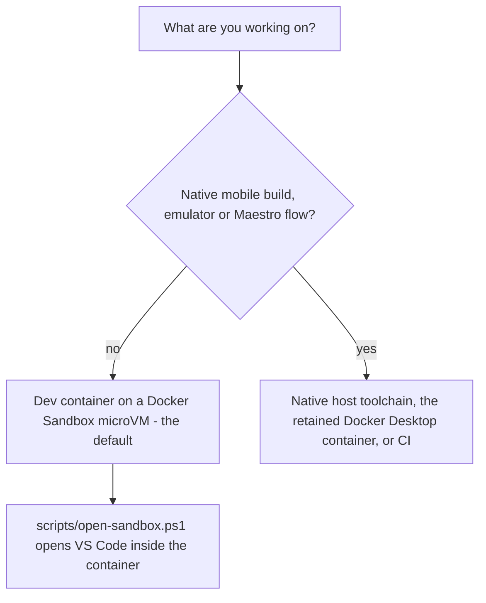

# MovieCollectionManager repository — structure and working conventions

MCM is a multi-user, full-stack movie-collection app built as a polyglot pnpm/Nx monorepo: a
React Native/Expo universal client, a Rust/Axum domain service, a Python LangGraph agent gateway,
three scoped MCP servers, shared infrastructure-as-code, and a fully self-hosted Forgejo CI/CD
pipeline. It is also a working example of spec-driven, AI-assisted development — every feature
flows through a spec → plan → tasks artifact set before any implementation code is written.

**Re-derive the pins from the manifests, never from a README line range.** The README's tech-stack
table sits in a section that shifts as the document is edited, so a line-range citation of it drifts
away from the rows it was meant to name while every fact it stated stays true. The declarations
themselves are the authority:

| Area | Pin | Declared in |
|---|---|---|
| Universal client | Expo SDK 57, React Native 0.86, React 19.2, Tamagui 3.0.18, CopilotKit 1.79 | `frontend/mcm-app/package.json`, `packages/design-system/package.json` |
| Backend | Rust 1.98.0 channel, Axum 0.8, MongoDB / BSON 3 | `rust-toolchain.toml`, `backend/mc-service/Cargo.toml` |
| BFF and dev-container toolchain | Node 24 | `frontend/mcm-app/Dockerfile`, `.devcontainer/toolchain.Dockerfile` |
| Package manager and task runner | pnpm 12.13.0, Nx 23.3.0 | `package.json`, `nx.json` |
| Agent layer | Python 3.14 runtime image, `requires-python >=3.13` | `agents/movie-assistant/Dockerfile`, `agents/movie-assistant/pyproject.toml`, `agents/movie-assistant/uv.lock` |

**Rust 1.98.0** is pinned by `rust-toolchain.toml`, which `rustup` reads automatically for every
`cargo`/`rustc` call inside the repo, so there is no channel to choose. **Node 24** covers both the BFF
container base and the dev-container toolchain image, with **pnpm 12** and **Nx 23** as the package
manager and task runner.

**Node is the one version deliberately *not* single-sourced, and the gate enforces a floor rather than
agreement.** Workflow `node-version:` entries, the app Dockerfile's `FROM node:` and the bare `24` in
the infra-image-scan workflow are allowed to drift apart, and they do — a Node bump legitimately
arrives as two Renovate PRs on two different channels (`ci actions` and `docker base images`). The
gate is what makes that acceptable: it fails only when a pin is below the root manifest's
`engines.node` floor or is not an explicit version, so **there is no single "the Node version" to
quote** — read it per context, and never "fix" the drift into one pin without also collapsing the two
Renovate groups. The accepted-divergence record and the failure behind it (pnpm loading `node:sqlite`
and crashing on Node 20 with `ERR_UNKNOWN_BUILTIN_MODULE`) are in
[docs/runbooks/renovate.md](../../docs/runbooks/renovate.md) and
[docs/runbooks/dev-environment-setup.md](../../docs/runbooks/dev-environment-setup.md).

For the full description, architecture diagram, feature list, and the human-readable tech-stack
table, see the [README](../../README.md) — treat that table as an overview, not as the pin, for the
reason above. For individual deployable-unit pages, see the rest of the
[projects/](index.md) section.

---

## Directory layout

```text
├── frontend/mcm-app/          # Universal Expo app + BFF (src/app, src/bff-server)
├── backend/mc-service/        # Rust movie-collection service (Clean Architecture)
├── agents/movie-assistant/    # LangGraph supervisor + AG-UI gateway
├── mcp-servers/               # movie-mcp, web-api-mcp, spreadsheet-mcp
├── packages/design-system/    # Shared Tamagui component library and tokens
├── api-specs/                 # OpenAPI 3.0.3 contracts (API-first)
├── infrastructure-as-code/    # Docker Compose stacks, Keycloak, Vault, observability, Komodo
├── specs/                     # Spec Kit feature folders (spec/plan/tasks per feature)
├── docs/                      # Architecture, PRDs, runbooks, decisions, templates (human-owned)
├── openwiki/                  # Generated OKF knowledge wiki for coding agents (summaries + gotchas + links)
├── scripts/                   # CI gates and dev utilities
├── security/                  # SAST, DAST, and image-scan configuration
└── .forgejo/workflows/        # CI/CD pipelines
```

The portable dev-environment asset is `.devcontainer/` — the two `devcontainer.json` variants, the
`toolchain.Dockerfile` that builds the pre-provisioned image, the canonical egress allowlist and its
generator, and the `verify/` harness described below. Both variants reference their Dev Containers
*feature* by a **floating tag**, so the real pin is the committed `devcontainer-lock.json` beside each
config: the CLI re-resolves the tag to a digest on **every** build and rewrites the lock file, which is
tracked in git on purpose as the supply-chain control. A rebuild that rewrites it with the same digest
leaves a clean tree; a lock file that shows as **MODIFIED** is the intended signal that upstream moved
the tag — review that diff deliberately, because discarding it discards the only notice you get.

All tasks run through [Nx as the universal task runner](../invariants/nx-task-runner.md) — never
npm/yarn, and never the underlying tools directly (`pnpm nx test mcm-app`, `pnpm nx lint
mc-service`, `pnpm nx run-many --targets=test,lint`).

---

## Toolchain pins, lint, and the dependency majors feature 081 moved

Feature 081 brings every third-party **major** the bot proposes
([spec](../../specs/081-major-dependency-upgrades/spec.md)) to a decided end state — upgraded, or held
with a measured reason and a re-check rule — one stage per pull request, in an order that keeps each
failure attributable to a single change. Only the stages that changed how the repository itself is
wired belong on this page; the order, the holds and their re-check rules live in the feature's own
artifacts.

- **Package manager and task runner.** pnpm 12 (`packageManager: pnpm@12.13.0`) and Nx 23.3.0. The
  Node **floor** in the root manifest stayed at `engines.node >= 22.13` deliberately: pnpm 12 declares
  only `>=18`, and every pin already sits at 22/24, so lowering it would buy nothing.
  `scripts/check-toolchain-consistency.mjs` is what makes that floor binding — it fails on a workflow or
  Dockerfile Node pin below it, on a pnpm version named anywhere other than `packageManager`, and on a
  second `packageManager` field outside the root manifest (corepack resolves that field from the
  *nearest* manifest, so a duplicate silently wins in its directory). The task runner and its plugins
  are pinned **exactly**, and every `@nx/*` equals `nx`, because a ranged `@nx/*` is one lockfile
  refresh away from three Nx versions on one tree — a half-bump that ran **zero** tests on the Playwright
  side and reported no counts at all.
- **ESLint 10 flat config (US5b).** `.eslintrc.json` is gone from both `frontend/mcm-app/` and
  `packages/design-system/`, replaced by `eslint.config.js` in each, and the app's lint target now runs
  `eslint src` with no `--ext`. Three things in those files are load-bearing rather than stylistic: the
  JS extensions are `globalIgnores`d, because flat config lints `*.js`/`*.mjs`/`*.cjs` by default and
  cannot *narrow* extensions from the CLI — so the JS extensions are ignored to preserve the old linted
  set, and widening lint to JS is a separate decision rather than a side effect of the format change;
  `fixupConfigRules` from `@eslint/compat` wraps the Expo preset, because `eslint-config-expo`'s
  bundled `eslint-plugin-react` and `eslint-plugin-import` still peer ESLint ≤ 9 and call context
  methods ESLint 10 removed (without it every file fails to load with `contextOrFilename.getFilename is
  not a function`, and the wrapper is dropped once both plugins declare ESLint 10); and four rules are
  pinned to ESLint 8's resolved behaviour for parity, since the flat preset is not the legacy preset
  re-expressed. `nx.json`'s lint target inputs accept both `.eslintrc*` and `eslint.config*`, so the
  cache keying survived the rename.
- **Tamagui 3 (US10).** The design system's UI styling library moved to **v3**, pinned to **one exact
  version** in both workspace manifests, with no compiler plugin.
  `scripts/__tests__/tamagui-version-lockstep.guard.test.mjs` asserts the exact pin, the single copy in
  the lock, the absence of the removed v2 Babel plugin, and that every `tamagui`/`@tamagui/*` update
  resolves into one Renovate group so the bot cannot propose half the set. The reason is measured: a
  lockfile refresh had already dragged a v3 core in beside the v2 packages through an open `>=`
  devDependency, with no Renovate PR and no review. The README's tech-stack table is where the whole
  stack is listed, but it can lag a stage that has landed; for this set the manifests and the guard are
  authoritative.
- **Object store (feature 080).** The observability stack's object store — the S3 target behind Langfuse
  and the feature-073 backups — is an upstream, digest-pinned `rustfs/rustfs` pull rather than the
  from-source object-store build it replaced. That is why the stack table lists RustFS as upstream and
  digest-pinned: the image is now scanned like every other third-party image instead of by a bespoke
  workflow, and the one-way migration that moved the data onto a new external volume is documented in
  [the prod control-tower runbook](../../docs/runbooks/prod-control-tower.md).

Stages that are **held** rather than upgraded are held with a recorded reason and a re-check rule, never
deferred: jest and `babel-jest` 30 (unblocked by the *next* platform SDK line, not the current one),
`@babel/core` / `@babel/runtime` 8 and `@react-native-async-storage/async-storage` 3 (bundled by the
SDK), and `typescript` 7 (blocked by `typescript-eslint`'s parser peer range). A held major gets its own
Renovate group behind a dashboard approval, so ticking one is a decision rather than a batch release.

---

## Dev environment — the default and the alternative

Whichever path is used, local service bring-up is the same: `pnpm nx up-auth infrastructure-as-code`
first (Keycloak + Postgres), optionally `pnpm nx up-mcm infrastructure-as-code`, then
`cd frontend/mcm-app && pnpm start`. Stack profiles and endpoints:
[docs/runbooks/local-dev.md](../../docs/runbooks/local-dev.md).

The README presents **two supported environments**: the **dev container on a Docker Sandbox
microVM**, which is the **default** — it carries the entire toolchain and is what the project is
developed in day to day — and the **native host toolchain**, which is needed only for the Android
emulator and native mobile builds. A third entry point survives inside the container family, the
**retained Docker Desktop / DinD dev container**, kept for the same emulator reason.

The two container paths each have **their own config file**: `.devcontainer/devcontainer.json` for
Docker Desktop and `.devcontainer/sandbox/devcontainer.json` for the sandbox. They are **duplicates,
not an extension** — the sandbox variant carries its own `containerEnv`, `runArgs` and
`onCreateCommand` — so a change made only to the Docker Desktop file is real, committed, and
**inert** on the path in daily use. Edit both until FR-032 collapses them.



*Which environment a task belongs on: the microVM for everything except native mobile work, which the microVM cannot host at all.*

### Default: dev container on a Docker Sandbox microVM (feature 060)

The AI-assisted development environment runs as a **dev container inside a Docker Sandbox
microVM** (`sbx`), not on Docker Desktop and not in Docker-in-Docker. Siblings (compose stacks,
agent stack) build on the microVM's own engine and share its network namespace
(`docker-outside-of-docker`, `--network=host`). Egress is governed by a deny-by-default policy
enforced **outside the VM** — closing the gap an in-container firewall never could.

Rust and its cargo tooling, Python via `uv`, the Specify CLI, Node 24 / pnpm / Nx, and `gh` are
baked into the prebuilt `mcm-devcontainer` image (pulled from the forge registry by digest, or built
locally via `node scripts/build-devcontainer-image.mjs`), so there is no toolchain to install and
none to keep current by hand.

**Measured advantages over the Docker-in-Docker path:** 0.43× the wall-clock across five stages;
`docker-build` alone went from 1024 s to 293 s.

**One-step entry:**

```powershell
.\scripts\open-sandbox.ps1
```

Runs on **Windows PowerShell 5.1** — the default shell. `pwsh` (PowerShell 7) is **not** required
and is not installed by default on Windows. It checks whether the sandbox is running, starts it if
not, waits for SSH, and opens VS Code directly inside the dev container.

**Headless entry** — run inside the VM, where the engine and the workspace clone live:

```bash
ssh mcm.sbx
devcontainer up --workspace-folder /workspaces/mcm --config .devcontainer/sandbox/devcontainer.json
```

The operating manual is **two runbooks that share one section numbering**, so a `§8b` reference
means the same section in either file:

- **[docs/runbooks/devcontainer-sandbox.md](../../docs/runbooks/devcontainer-sandbox.md)** — the
  day-to-day manual: the credential rule (§0), getting in (§1), lifecycle (§2), egress triage (§3),
  the engine seam (§5), running git and the UID fix (§7d), credential injection, and the collected
  foot-guns.
- **[docs/runbooks/devcontainer-sandbox-lifecycle.md](../../docs/runbooks/devcontainer-sandbox-lifecycle.md)**
  — recreating, resizing, verifying and upgrading: §7b templates and recreate-from-nothing, §7e a
  full disk wearing other symptoms, §7f the `sbx run` false failure, §8 disk (three volumes), §8b
  what a cold recreate needs, §10 the verification harness, and §10b the `sbx` version and upgrade
  ritual. It was split out of the main runbook on 2026-10-10 (item #682) so each source stays small
  enough for the wiki generator; the section numbers are unchanged.

Verification is a script, not a judgement: `.devcontainer/verify/run-harness.sh` enumerates **twelve
scripts by name** across three vantage points (in-container, VM-side, host-side), counts anything
that produces no explicit pass as a failure, and refuses to report the host-side engine-seam check
without `MCM_HOST_CHECK` — a claim asserted only from inside the thing being claimed about is not
proof. It is **not read-only**: the last check, `verify-reproducible-recreate.sh`, removes the dev
container *and its derived image* by design, so a FAIL there means the container is gone right now,
not that some future recreate would fail. Details: lifecycle §10.

`sbx` itself is pinned at **v0.47.0** (`0411f50ee4700fe7bd37e6e7e3aced563e850ca9`), upgraded from
v0.43.0 on 2026-10-08 (`winget upgrade Docker.sbx`, after `sbx daemon stop`). It is load-bearing for
isolation and egress enforcement, so upgrading it is a **security-relevant change**, not a routine
one. The ritual: read the intervening release notes for network-policy, `--network=host`,
port-publishing, idle-stop, secret-injection, and template changes; capture the before-state with
`verify-reboot-survival.sh --capture`; re-run the harness (`run-harness.sh`) plus the host-side
`verify-sandbox-egress.sh --audit-check`; re-run the G5 sibling-egress refusal explicitly; and record
the new version in the runbook. Several behaviours here are version-specific and undocumented.

The v0.44–v0.47 release-note items that touch this environment are narrow and none widens egress:
`sbx rm` prompts in v0.45.0 and declining returns non-zero, so scripts and agent shells need
`--force`; egress got **stricter** across v0.45.0–v0.47.0 (DNS is refused when no rule permits it,
PTR lookups only for already-authorized IPs, policy-evaluation failures fail **closed**, and raw TCP
to a denied hostname is no longer let through by an allow rule for its resolved IP); and `sbx create`
still has **no `--disk` flag** on v0.47.0, so disk sizes remain creation-time environment variables
(lifecycle §8 — currently Docker 150 GB, root 40 GB). The verified 2026-10-08 upgrade ran the
harness to **12/12 PASS** (including `reproducible-recreate`), G5 PASS, `--audit-check` PASS with all
50 canonical destinations live, and the volumes confirmed at 150 GB / 40 GB from the host.

### Alternative: native host toolchain

The native host toolchain is the alternative environment, and it is needed **only** for the Android
emulator and native mobile builds, which the microVM cannot host.

**Prerequisites:** Node.js 24, pnpm (via Corepack), Nx; Rust — pinned to **1.98.0** by
[rust-toolchain.toml](../../rust-toolchain.toml), which `rustup` reads automatically for every
`cargo`/`rustc` call in the repo; Python 3.14 + `uv` (agent layer); Docker Desktop; and Android
Studio + JDK 17 for mobile development only.

**Setup** is `pnpm install` plus one-time-per-machine shared infrastructure: three Docker networks
(`backend-network`, `keycloak-network`, `movie-assistant-mcp-network`), four named volumes (Keycloak
Postgres, mc-service Mongo, BFF Redis, BFF Mongo), and dev secrets via
`node scripts/gen-dev-secrets.mjs`. Full step-by-step host setup:
[docs/runbooks/dev-environment-setup.md](../../docs/runbooks/dev-environment-setup.md).

### Retained: Docker Desktop / Docker-in-Docker

The Docker Desktop path is kept for **one reason only**: the Android emulator, which needs
`/dev/kvm` that the microVM cannot provide (gate R2, resolved negative). Everything else —
web E2E, integration, the agent stack, day-to-day assistant work — belongs on the sandbox.
Its entry point is VS Code → Command Palette → *Dev Containers: Clone Repository in Named Container
Volume* → this repo's URL, using `.devcontainer/devcontainer.json`.
See [docs/runbooks/devcontainer.md](../../docs/runbooks/devcontainer.md) and the wiki page
[Containerized dev environment (devcontainer)](../runbooks/devcontainer.md).

### Expo/Metro limitation — native mobile stays off the sandbox

The dev container covers backend/API development, compose-based test stacks, the **web target**, and
the **Metro bundler** (watchman-backed, hot-reload at native speed). It never runs the **iOS
Simulator** (macOS-only), and whether it can run the **Android emulator** depends on the path:

| Path | Android emulator |
|---|---|
| **Docker Sandbox microVM** (default) | **never** — no nested virtualization, so `/dev/kvm` cannot exist |
| Docker Desktop / DinD (retained) | headless with hardware accel, via the host's `/dev/kvm` |
| CI | and the **recommended** route for agent flows |

How to develop the Expo app from inside the container:

- **Web** — run `pnpm start` in-container and open the forwarded `localhost:8081` in a host browser
  (ports `8081` Metro/web/dev-BFF, `8082` containerized BFF, and `8099` Keycloak are forwarded; the
  legacy Expo `19000/19001/19006` ports are unused by SDK 57).
- **Physical device** — point Expo Go / a dev build at the in-container Metro server over LAN; if LAN
  routing to the container isn't available, use the documented **Expo tunnel fallback**
  (`pnpm start --tunnel`).
- **Emulator / native builds** — `expo run:android`, APK builds, and `pnpm nx e2e:mobile` belong on
  the native host toolchain (or in the retained Docker Desktop container's emulator); mobile agent
  E2E flows run in CI regardless — see
  [docs/runbooks/android-emulator.md](../../docs/runbooks/android-emulator.md).

The **Android emulator is the one documented exception** and the sole reason the Docker Desktop path
is retained: the microVM offers no nested virtualization, so `/dev/kvm` cannot appear there however
the container is configured. It is available headless with hardware acceleration on the retained
Docker Desktop / DinD container via the host's `/dev/kvm`, and in CI — which is the **recommended**
route for agent mobile flows, because local Metro OOM-crashes after roughly one to two `/run` calls.
`scripts/devcontainer-android.sh` refuses legibly and names both remaining routes (CI, or the
retained Docker Desktop container) rather than failing silently or looking like a broken image.

---

## Mandatory pre-work gates

These gates apply before any implementation or assistant session. They are in `CLAUDE.md` (the
index) in priority order because they have each cost a session or produced a hard-to-diagnose
failure. `CLAUDE.md` is an **index, not a document** — `check-openwiki-governance.mjs` fails on prose
beyond the index and its three managed regions — and it pulls in `AGENTS.md`, which carries the
OpenWiki block plus the hand-authored, regeneration-surviving wiki notes.

### 1 — Credential rule: never set `ANTHROPIC_API_KEY`

AI-assisted coding runs on the **Claude MAX SUBSCRIPTION**. The Anthropic API key
(`MCM_ANTHROPIC_API_KEY`) exists only for the movie assistant (agent gateway) and OpenWiki. It is
mapped to `ANTHROPIC_API_KEY` **only at the point of use** in three separate processes
(`agent-stack.mjs`, `wiki-maintain.mjs`, containerized E2E).

**Setting `ANTHROPIC_API_KEY` in any environment — host, Docker Desktop container, or sandbox VM
— silently bills the session pay-per-token while the subscription sits idle, with no UI
indication.** This was measured at ~$15 of unintended spend in a single day on a workstation
where `oauthAccount` was present throughout (2026-08-16). If you have previously set it, remove
it and verify with `echo $env:ANTHROPIC_API_KEY` (host) / `echo $ANTHROPIC_API_KEY` (shell) =
empty, then restart VS Code.

The sandbox VM carries `ANTHROPIC_API_KEY=proxy-managed` as Docker Sandbox's own marker — this
is not a key and not a leftover. Do not confuse it with an injected secret.

### 2 — SDD is not optional

Before writing implementation code under `backend/`, `frontend/`, `agents/`, `mcp-servers/`, or
`infrastructure-as-code/`, a numbered `specs/NNN-*/` **spec → plan → tasks** set must already
exist. Proposals (`docs/proposals/**`) and knowledge/index edits are exempt. See
[Proposal → spec → plan → tasks → implementation lifecycle](../process/spec-driven-development.md).

### 3 — You are probably not the only agent: commit from a worktree

Several Claude sessions can share one dev container, and they share `/workspaces/mcm` — including
its **git index and checked-out branch**. Five concurrent sessions were measured in that one
checkout on 2026-09-18. A `git checkout -b`, `git add -A`, `git stash`, or `git rebase` there is
not a private act; it rewrites what another session is mid-edit on, and the damage lands silently
on the other agent.

```bash
git worktree add -b <branch> /home/coder/worktrees/<slug> origin/main
ln -sfn /workspaces/mcm/node_modules /home/coder/worktrees/<slug>/node_modules
```

Use `/home/coder/worktrees/…`, never `/workspaces/.worktrees/…` (`/workspaces` itself is not
writable). The `node_modules` symlink covers `node --test` and the `scripts/*.mjs` gates but
**not** any `pnpm nx` target, which dies in pnpm's dependency check with
`ERR_PNPM_UNSAFE_MODULES_DIR` — a real `CI=true pnpm install --frozen-lockfile` inside the
worktree is the only fix (~4 min). A worktree does **not** survive a container rebuild, so push
the branch before any risky container operation. Reads — `git fetch`, `git log`, and everything
against the forge API (opening a PR, merging, commenting, `ci-status`) — need no worktree at all.
An nx failure whose message names a path that no longer exists is a **stale cache** answer, not a
real one: re-run with `--skip-nx-cache` before diagnosing it.
Full procedure and the four traps: [docs/runbooks/devcontainer.md](../../docs/runbooks/devcontainer.md).

### 4 — PR head must be a real branch, not an AGit push

A PR's head MUST be a real branch (`git push origin HEAD:<branch>`, then POST via the
`git credential fill` credential). An AGit push (`HEAD:refs/for/main`) yields a
`refs/pull/N/head` head that Forgejo runs **with NO Actions secrets** — every `${{ secrets.* }}`
is empty, and Nx reports `Misconfigured remote cache endpoint`. This cost two sessions a day on
#126. See [docs/runbooks/ci-diagnostics.md](../../docs/runbooks/ci-diagnostics.md).

### The rest of the gate list is owned elsewhere

The four above are the ones detailed here because they gate *starting* work. `CLAUDE.md`'s "Gates
that run before you act" list is longer, and each remaining class is owned by the page that
documents it — this is a pointer, not a restatement:

- **Instrument-before-belief checks** — a tool's "no" is about the tool, not your question, and a
  skipped test reads as a pass: [E2E testing](../runbooks/e2e-testing.md).
- **The E2E gate / model-decision tier split** — `@gate` blocks a merge, `@model-decision` does not,
  and an unclassified agent test fails rather than defaulting into a tier:
  [Testing tiers and what gates a merge](../invariants/testing-tiers.md).
- **Run the tiers your diff touches, not the ones you remember** — `affected` caught findings that
  the remembered tier list did not, and a tier you did not think of is a tier that did not run:
  [Testing tiers and what gates a merge](../invariants/testing-tiers.md).
- **A guard that fails because you changed what it protects is updated at the cause, never
  deleted** — a guard removed for being inconvenient is the regression it was written to catch:
  [Testing tiers and what gates a merge](../invariants/testing-tiers.md).
- **Renovate's silent channels** — the weekly window is Friday (`* 2-4 * * 5`), the nightly cron is
  *not* it, and a channel whose lockfile toolchain is missing has its `execa` rejection suppressed to a
  single dashboard line while producing nothing, every run: [Renovate](../runbooks/renovate.md).
- **A whole CI board going red at once** — suspect the install before the code:
  [CI self-serve diagnostics](../runbooks/ci-diagnostics.md).

---

## Gotchas

### `sbx start` does not exist — use `sbx run`

`sbx start` is not a command. It silently prints the root help, so a procedure built on it
appears to do nothing and reads as a broken sandbox. The correct command to restart a stopped
sandbox is:

```bash
sbx run --name mcm -d
```

`sbx stop --help` states this plainly: *"Stopped sandboxes retain their state and can be
restarted with `sbx run`."*

### `--name` is load-bearing on `sbx run`

`sbx run` **creates a new sandbox** if one does not exist, and the first positional argument
is an **agent**, not a sandbox name. Running `sbx run mcm` tries to run an agent called `mcm`.
Without `--name` you can end up with a second sandbox rather than your existing one.

### The microVM idle-stops ~30 s after the last session — and `sandboxd` does not auto-start

The VM stops roughly **30 seconds after the last session disconnects**. It is hardcoded; there is
no configuration knob. Coming back to a "missing" environment usually means it idle-stopped —
start it and nothing is lost — but **long unattended jobs die** unless a session is held
(`ssh mcm.sbx 'sleep 5400'` in another window, with the work launched via `setsid nohup … &`).

After a workstation reboot, `sandboxd` must be started on demand — `sbx run --name mcm -d`
does this. Reaching for `ssh mcm.sbx` first surfaces a daemon error that reads like a broken
environment rather than a cold host. Everything else survives a real reboot (workspace clone,
images, volumes, containers with a restart policy). Verify with
`.devcontainer/verify/verify-reboot-survival.sh --verify` rather than judging by eye.

### `sbx run`'s failure message names the wrong component — the launcher no longer believes it

`sbx run` can report `500 Internal Server Error: docker daemon failed to start inside the sandbox`
while **dockerd is perfectly healthy**. Restoring this VM's 20 `restart: unless-stopped` containers
took 54–101 s across five measured starts, and sbx's dockerd-readiness budget is a compiled-in
constant below that — there is no flag, variable, settings file, or daemon option to raise it
(checked on v0.39.0 and v0.43.0, and not raised by v0.43.0). sbx aborts, the CLI exits, and the
~30 s idle-stop then kills a VM whose dockerd had been serving the socket the whole time.

`scripts/open-sandbox.ps1` is immune because it treats the **exit code as a claim and SSH
answering as evidence**, waiting up to a 120 s deadline. A bare `sbx run` still shows the false
failure; when starting by hand, use the runbook's ~30 s grace window (`sbx exec mcm sh -c 'docker ps'`)
or just run the launcher. Full mechanism:
[docs/runbooks/devcontainer-sandbox-lifecycle.md §7f](../../docs/runbooks/devcontainer-sandbox-lifecycle.md).

### A template carries neither Docker images NOR the egress policy

`sbx template save` snapshots the VM root filesystem, **not** the Docker data disk. A sandbox
recreated from `mcm-proven:060` comes up in ~4 seconds with zero images — followed by a full
cold rebuild. Budget accordingly: "recreate ≤ 15 min" covers instantiation plus provisioning.

Policy rules are scoped per sandbox. A sandbox created from the template gets the **default**
profile — the forge is unreachable and the first `docker pull` is refused (policy refusals are
instant, ~1 s; network faults time out — use that difference as a diagnostic clue, but note that
an instant failure is not always a policy refusal). The recreate
sequence is: instantiate → apply egress policy (from `gen-egress-policy.mjs`) → provision.

**Two dev-container images will not fit at once.** The toolchain image is ~14 GB and the derived
container another ~13.5 GB, so pulling a new toolchain image while the old pair is still present
exceeds the disk on its own — remove the previous pair as part of re-pinning. The three volumes are
sized at **creation** time by environment variables (`DOCKER_SANDBOXES_DOCKER_SIZE`,
`DOCKER_SANDBOXES_ROOT_SIZE`, and the unused `DOCKER_SANDBOXES_CLONED_WORKSPACE_SIZE`), not by a
flag: `sbx create` still has no `--disk` on v0.47.0, and a resize therefore means recreate. When a
disk fills it does not announce itself — it wears apt signature errors or `exporting layers`
failures, and `df` is the authority while `docker system df` is not. Lifecycle §8 and §7e.

### The workspace foot-gun: `sbx run` mounts the current directory read-write

`sbx run` mounts the **current directory** as the sandbox workspace over virtiofs, read-write,
unless an explicit path is given. Creating a sandbox while sitting in the repo therefore mounts
the repo into the VM and destroys the host-filesystem isolation this environment exists for.
Measured 2026-08-16: a file written inside a recreated sandbox appeared immediately in the
Windows working copy. Always pass an explicit scratch directory.

### The socat relay silently truncates `docker exec` output (D-19)

The `docker-outside-of-docker` feature fronts the VM's socket with a socat relay. socat's
half-close timeout defaults to 0.5 s; `docker exec` half-closes stdin immediately, so socat
tears the relay down mid-response. Fast commands return exit 0 with no output — the seam looks
healthy under any quick probe while real work fails. The fix (already applied in
`.devcontainer/sandbox/devcontainer.json`):

```bash
DOCKER_HOST=unix:///var/run/docker-host.sock
```

If you invoke Docker from a context that does not inherit `containerEnv` (a raw `docker exec`
from the VM into the dev container, a script run before the env is set), pass it explicitly.
`verify-engine-seam.sh` guards this with a deliberately **slow** (2 s) probe, because a fast one
would assert nothing.

### egress triage order is inverted vs the Docker Desktop path

On Docker Desktop the dev container programs its own in-container `ipset`/`iptables` default-deny.
In the sandbox that firewall is **not used** — the enforcement is at the host-side policy outside
the VM, and the in-VM firewall would be VM-wide under `--network=host`. When something is blocked:
**host policy first, in-VM second** — the opposite of the Docker Desktop path. `nc -z <ip> 443`
reports OPEN against a blocked destination because the proxy accepts the TCP connection and refuses
at TLS; always probe with a real request. From the dev container a refusal is `rc=6` (NXDOMAIN) and
`curl` writes `000`, which is curl's placeholder for a request that was never made — read the exit
code, not the status code.

Two reasons, both measured, and the second is the one people miss. The container shares the VM's
network namespace **identically** (`net:[4026532855]` on both sides), so a default-DROP from inside
would hit the sandbox's own policy proxy and every sibling container. And the in-VM layer **was not
running anyway**: `postStartCommand` is a *devcontainer-lifecycle* hook that does not fire on a
Docker-level restart, and the ~30 s idle-stop brings the container back through Docker with
`--restart=always` — so the ruleset vanished on the first idle cycle and no check noticed. Egress
was fully governed the whole time, by the host-side policy.

`postStartCommand` now runs `.devcontainer/assert-egress-governed.sh`, which **verifies rather than
re-implements** the layer: it fails if a non-allowlisted host is reachable **or** if an allowlisted
one is not, because a severed network must not read as a security pass. Its header states the gap it
shares with any postStart hook: **it is a creation/attach-time assertion, not a continuous monitor,
and it does not re-run after a Docker-level restart.** The continuous guarantee is the host-side
policy itself, which survives restarts because it is not in the VM;
`.devcontainer/verify/verify-firewall-allowlist.sh` re-asserts it on demand.

The VM shell's refusal body changed in `sbx` **v0.47.0**: HTTP 403 with `Approval required for
<host>:<port>.` instead of `Blocked by network policy`. Because a check keyed to the old marker no
longer matched, the first harness run after the upgrade reported `example.com is REACHABLE — deny-by-default is NOT enforcing`. That read as a breach and was an instrument fault; both verify
scripts (`.devcontainer/verify/verify-sandbox-egress.sh` and `verify-firewall-allowlist.sh`) now
accept both bodies. The new body also means **a refusal queues a pending approval**
(`sbx policy approval ls`). `sbx policy approval respond … allow` is a second way to widen egress
that **bypasses** the canonical `.devcontainer/egress-allowlist.json` — never use it; add the
destination to the canonical file and apply the generated rule instead, and use `dismiss` to clear
the queue.

### Run git inside the container, not the VM shell — and the UID fix (§7d)

The VM user (`agent`, uid 1000) and the container user (`coder`) were different UIDs. Anything git
wrote from the VM shell was unwritable by the container user — the failure appeared deep in
`.git/objects` and read like corruption rather than permissions.

**Rule: git runs in the container.** For automation from outside, go through
`docker exec -u coder …`, never `ssh <sandbox> 'git …'`.

**✅ FIXED 2026-08-17:** `toolchain.Dockerfile` now creates `coder` at **1000:1000** (moving the
base image's `node` to 1100 first), so both sides share the same uid. The sandbox config also sets
`updateRemoteUserUID: true` **explicitly** rather than leaving it to its implicit `true` default —
the dev-container spec's own renumber-the-remote-user-to-match-the-workspace mechanism — because an
implicit default that silently no-ops is indistinguishable from one that worked; the thin-layer
`Dockerfile` header records that on its own path the mechanism was set and rebuilt and `coder`
stayed 1001. The rule
above still stands for automation scripts — `ssh <sandbox> 'git …'` re-poisons the tree even after
the fix, and `.devcontainer/fix-workspace-ownership.sh` still runs at create and at every start to
repair an already-poisoned tree. See
[docs/runbooks/devcontainer-sandbox.md §7d](../../docs/runbooks/devcontainer-sandbox.md) for the
re-pin procedure and the two rejected alternatives.

### `containerEnv` entries leak into the image — credentials go through `--env-file`

Every entry in `containerEnv` becomes an `ENV` instruction in the generated derived image. This is
not a secret — it is what the devcontainer CLI does by design — but the consequence is a permanent,
image-layer-level leak: **measured on the derived image on 2026-09-19**, all four credential values
were present in `Config.Env` and in **three history layers**, readable by anyone who can read the
image.

For this reason the credentials were removed from `containerEnv`. They are now written by
`.devcontainer/gen-container-secrets-env.sh`, invoked as `initializeCommand` — which the CLI runs
on the VM *before* the container is created — and passed to the container with `docker run
--env-file` via `runArgs`. `docker exec` still inherits them; the image does not. `remoteEnv` is not
an option on this path, because the sandbox is routinely entered by `ssh mcm.sbx` + `docker exec`,
which `remoteEnv` does not reach. The generator sources `~/.mcm-sandbox-env` as a shell and re-emits
the bare `KEY=value` form, because `docker --env-file` does no quote processing and would otherwise
deliver values wrapped in literal apostrophes. Five names are covered
(`MCM_ANTHROPIC_API_KEY`, `MCM_FIREWORKS_API_KEY`, `TMDB_API_KEY`, `MCM_FORGE_TOKEN`,
`MCM_FORGE_ISSUE_TOKEN`). The one residue that does not go away is that the values remain visible in
`docker inspect <container>` — inherent, since `docker exec` must be able to see them.

Two consequences when you change the config: **`devcontainer up` does not recreate the container
when only `runArgs`/`containerEnv` change** — it reattaches to the existing container, reports
success, and keeps running the old image — so pass `--remove-existing-container` and verify against
the container (`docker inspect` its `Created`/`Image`), never against the command's exit code. And
an image built while the credentials were still in `containerEnv` keeps them forever; remove it and
treat those credentials as exposed.

---

## Related concepts

- [CI/CD pipeline (Forgejo Actions)](ci-cd-pipeline.md) — the three workflows that gate every PR
- [Nx as the universal task runner](../invariants/nx-task-runner.md) — why all commands go through Nx
- [RTK (Rust Token Killer) token compression](../invariants/rtk-token-compression.md) — mandatory before any assistant session
- [Testing tiers and what gates a merge](../invariants/testing-tiers.md) — which tiers block a merge
- [Proposal → spec → plan → tasks → implementation lifecycle](../process/spec-driven-development.md) — SDD mechanics
- [Dev container on Docker Sandbox microVM](../runbooks/devcontainer-sandbox.md) — wiki summary of the primary environment's runbook
- [Dev container on Docker Sandbox microVM — lifecycle](../runbooks/devcontainer-sandbox-lifecycle.md) — recreate, disk, verification harness, `sbx` upgrade
- [Containerized dev environment (devcontainer)](../runbooks/devcontainer.md) — wiki summary of the retained Docker Desktop runbook
- [Local dev infrastructure & environment variables](../runbooks/local-dev.md) — the compose stacks and their profiles
- [Developer environment setup (host toolchain)](../runbooks/dev-environment-setup.md) — provisioning the native alternative for the Android emulator
- [Android emulator & APK builds (mobile E2E)](../runbooks/android-emulator.md) — where mobile E2E runs, and why not on the microVM
