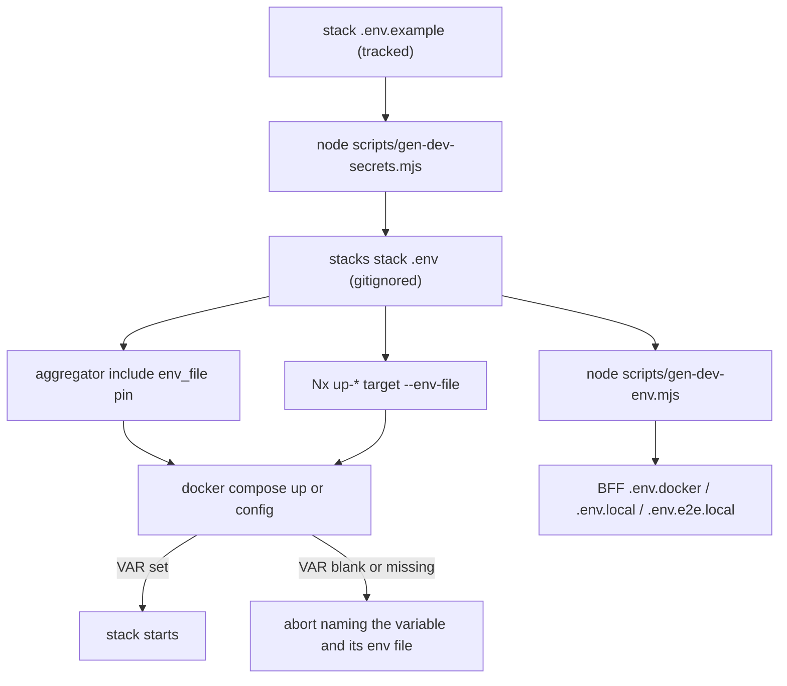

# Dev stack env files and local secret generation

Feature 021 (externalize-compose-secrets) removed every clear-text credential from the tracked Docker
Compose files: most secrets are now fail-fast `${VAR:?…}` interpolation references, and the real
per-machine values live in gitignored per-stack `.env` files generated from committed templates. This
page covers that env-file and dev-credential layer only — for the Compose topology, the four stacks'
profiles and includes, and the production Komodo stacks, see
[Infrastructure-as-code stacks](./infrastructure-stacks.md), which owns the other half of the same
directory. The authoritative file-level reference (full key tables, the complete command set) is
[`infrastructure-as-code/docker/stacks/README.md`](../../infrastructure-as-code/docker/stacks/README.md).

## The two-file contract

| File | Tracked? | Purpose |
|---|---|---|
| `<stack>.env.example` | committed | Placeholder template. `NAME=<generate:KIND>` for a minted value; `NAME=literal` for a deterministic fixture. |
| `<stack>.env` | gitignored | Generated real values, read by Compose. **Never commit.** |

`<stack>` ∈ `auth`, `mcm`, `audit`, `observability` — the four named stacks, matching the four
`.env.example` templates in `infrastructure-as-code/docker/stacks/`. The templates carry the *shape* of
the credential set and nothing else; each one says so in its own header, and the load-bearing
distinction is between a `<generate:KIND>` placeholder (freshly minted every generation) and a literal
(copied verbatim, a fixture the tests and the agent layer authenticate against).

The generated file reaches Compose through **two** mechanisms, and both matter:

- the stack aggregator's `include:` **long syntax with an `env_file:` pin**, which names that stack's
  `.env` as the interpolation source for the specific included component files that need it — `auth`
  pins `keycloak` + `vault`, `mcm` pins `agent-db` + `agent-gateway`, `audit` pins `opensearch`,
  `observability` pins `observability`;
- the **Nx target's `--env-file`** (`up-auth`, `up-mcm`, `up-audit`, `up-observability`, `up-all` and
  their `down-*` counterparts in `infrastructure-as-code/project.json`), which supplies the variables
  for the whole `docker compose` invocation.



How a value travels from the committed template into a running container, and where the chain aborts.

## Commands

```bash
node scripts/gen-dev-secrets.mjs                        # mint every missing <stack>.env (idempotent)
node scripts/gen-dev-secrets.mjs --force                # rotate ALL (overwrite)
node scripts/gen-dev-secrets.mjs --force --stack=auth   # rotate one stack
node scripts/gen-dev-env.mjs                            # project auth.env's realm secrets into the BFF env files
```

`gen-dev-secrets.mjs` exits `0` on success, `1` on a missing/malformed template or unwritable output,
`2` on bad arguments. A second `node scripts/gen-dev-env.mjs` run is a separate step in the same layer:
it projects the realm client secrets out of `stacks/auth.env` into the BFF's gitignored env files
(`frontend/mcm-app/.env.docker`, `.env.local`, `.env.e2e.local`, the web-api-mcp TMDB file, and
`backend/mc-service/.env.local`) so the imported dev realm's client secrets and the BFF's client
secrets agree **by construction** rather than by hand. It verifies the projected credentials against
the *running* realm before writing anything (exit `2` = refusing to write, files left untouched). See
[Keycloak](./keycloak.md) for the realm side and
[Local dev](../../docs/runbooks/local-dev.md) — "A projected credential can be STALE, not merely
absent (item #395)" — for the detect → resolve procedure.

Reach for the generator once per machine before any `up-*`, and again after pulling a change that
adds a variable to a template. Reach for `--force` only when you actually mean to rotate.

## Generation kinds

The kinds exist so the alphabet matches where the value is consumed — a value interpolated into a URL
or a shell command cannot carry characters that break either:

- `b62-32` / `b62-48` — URL- and shell-safe base62; used where the value is embedded in a connection
  URL or a bearer token shape.
- `hex-64` — 32 random bytes rendered as hex; Keycloak client secrets and `LANGFUSE_ENCRYPTION_KEY`.
- `complex-16` — upper + lower + digit + special, drawn from a URL/shell-safe special set
  (`-_.!=+`), so the value survives a `-u user:pass` curl argument, a YAML double-quoted scalar, and
  `sh`; used for passwords that are *not* URL-embedded.
- `unleash-admin` / `unleash-client` — the two Unleash token shapes (a `*:*.` / `default:development.`
  prefix plus a base62 body).
- `mongo-keyfile` — the MongoDB replica-set keyfile **content** as a single-line base64 value,
  materialized to a `0400` in-container file at start-up by `mc-service/mongo-entrypoint.sh` (env-only,
  no host file-secret).

Randomness comes from `node:crypto` with rejection sampling rather than a modulo, so the characters are
unbiased. An unknown kind is a hard error naming the key, not a silently empty value. See the
[stacks README](../../infrastructure-as-code/docker/stacks/README.md) for which key uses which kind.

## Fail-fast: a blank credential aborts, it does not degrade

Every credential in a tracked compose file is a `${VAR:?…}` reference. If the value is unset or blank,
`docker compose up` / `config` aborts naming the missing variable and the file that should hold it,
rather than starting a half-configured stack:

```
required variable KC_BOOTSTRAP_ADMIN_PASSWORD is missing a value: set in stacks/auth.env (run: node scripts/gen-dev-secrets.mjs)
```

The message is deliberately actionable: it names the variable, the per-stack env file, and the command
that mints it. This is also why the blank `REGISTRY_HOST` in two templates is a feature rather than an
omission (see the gotchas).

## Gotchas

- **`node scripts/gen-dev-secrets.mjs` is idempotent but it is NOT a plain skip.** An existing
  `<stack>.env` is *completed*: keys the template has gained since the file was written are seeded, and
  a `<generate:KIND>` key that is present but **empty** (`KEY=`) is minted in place — an empty secret is
  a missing secret. Every existing value is left exactly as it is, including one a developer edited by
  hand, and the existing lines are kept byte-for-byte. The reason it is not a plain skip is that the
  only alternative for delivering one new variable would be `--force`, which rotates every *other*
  value and takes the running stacks down to add one. The failure mode this replaces is the silent-skip
  defect (item #552): the run reported "up to date", the suites that needed the absent keys skipped to
  green, and nothing named why. The run prints the seeded/filled key **names** and then says that
  containers started before it do not hold the new values.
- **A blank *fixture* key is deliberately not touched.** `REGISTRY_HOST` is left empty in the `mcm` and
  `observability` templates on purpose: `scripts/check-topology-scrub.mjs` forbids a real host in a
  committed file, so it is set per machine. The generator has no value to give it and does not treat it
  as a gap — a file whose only "missing" key is a blank fixture still reports up to date. Left blank,
  the compose image refs fail loudly naming the variable instead of silently resolving to an invalid
  reference.
- **The two LangFuse `LANGFUSE_INIT_PROJECT_*` fixture keys are copied verbatim even under `--force`.**
  They are deterministic fixtures, not randomized credentials: the agent gateway and a verify test
  authenticate against those exact values, so randomizing them would break both. The same holds for the
  fixed public halves of the backup-destination fixtures in `mcm.env` (the S3 access key and WebDAV
  username are fixed so the integration suite can name them without reading the file).
- **Password-on-first-init credentials survive a rotation until the volume is recreated.** Postgres,
  OpenSearch and MinIO bake their password into the data volume on first init and ignore later env
  changes. Rotating the `.env` therefore is not enough: the service must be recreated with a fresh
  volume (`docker volume rm <name>` then re-create), or the container keeps the volume's original
  password and auth fails. Redis values, Unleash tokens and app secrets have no such persistence and
  rotate on a plain restart.
- **A container started before a re-run does not hold a newly minted value.** The generator mints into
  the file, not into the running process. The services that consume a newly seeded value must be
  recreated, and then `node scripts/gen-dev-env.mjs` re-run to project the value into the BFF env
  files.
- **The generator prints key NAMES only, never values.** This is enforced, not conventional: the guard
  test asserts that no non-trivial value in the written file appears anywhere in the generator's
  output.

## The boundary that keeps this out of git

`<stack>.env` is gitignored; `<stack>.env.example` is tracked. `.gitignore` ignores `*.env` and
`*.env.*` wholesale and then carves the templates back in with an **explicit, scoped** un-ignore:
`!infrastructure-as-code/docker/stacks/*.env.example`. The scope is the point — a bare `!*.env.example`
would also un-ignore other deliberately-ignored templates such as `frontend/mcm-app/.env.example`
(feature 019). A parallel carve-out tracks `infrastructure-as-code/docker/**/*.env.prod.example`, while
real `.env.prod` values stay ignored.

Two static gates back the boundary up:

- `scripts/check-no-inline-secrets.mjs` asserts the structural property that **no tracked compose file
  holds a literal credential**. Every secret-shaped key, password-bearing connection URL, and
  command/healthcheck/entrypoint auth literal must be a pure `${VAR}` / `${VAR:?message}` reference. An
  inline `${VAR:-default}` **fails** too, because a default re-leaks plaintext — that is the whole point
  of the `:?` form. Non-credential keys that merely match the name pattern (`*_FILE`, `*_USER`,
  `*ACCESS_KEY_ID`, `*_CLIENT_ID`, `*_AUDIENCE`) are explicitly allowlisted. It runs in
  `guardrails.yml`'s `naming` job as selftest-then-scan, and locally via
  `node scripts/check-no-inline-secrets.mjs` (or `--selftest`, or the `check-no-inline-secrets` Nx
  target).
- `scripts/check-topology-scrub.mjs` is the tree-wide gate that keeps a real tailnet host out of any
  committed file — which is what makes the blank `REGISTRY_HOST` necessary rather than sloppy. See
  [CI/CD pipeline](./ci-cd-pipeline.md) for the workflow that runs both, and
  [Secrets management](../invariants/secrets-management.md) for the posture they enforce.

## Focused tests

`scripts/__tests__/gen-dev-secrets.guard.test.mjs` pins the back-fill contract (item #552): an existing
`mcm.env` missing the backup-destination keys gets all of them seeded, no existing value is rotated,
the seeded keys are *named* in the output, an empty placeholder key is minted in place without being
duplicated, a blank fixture key is not treated as missing, and no value is ever printed. The tests copy
the generator into a throwaway mini-repo, so they are offline and keyless and never touch a developer's
real `stacks/*.env`. `scripts/__tests__/gen-dev-env.guard.test.mjs` covers the projection side, and
`scripts/__tests__/doc-env-example-citations.guard.test.mjs` fails when live documentation cites a
`.env*.example` that is not actually tracked — a dangling template pointer reads to a fresh clone as a
broken repository.

Do not reproduce a value from any `.env` file anywhere — not in a doc, not in a command line, not in a
commit message. Compare key names, never values.

See [Local dev](../../docs/runbooks/local-dev.md) for the bring-up loop these files feed, and
[Dev environment setup](../runbooks/dev-environment-setup.md) for the first-time machine setup.
