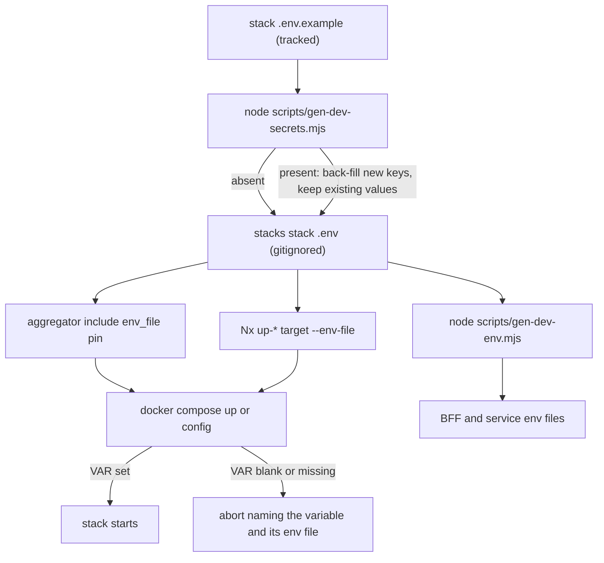

# Dev stack env files and local secret generation

Feature 021 (externalize-compose-secrets) removed every clear-text credential from the tracked Docker
Compose files: most secrets are now fail-fast `${VAR:?…}` interpolation references, and the real
per-machine values live in gitignored per-stack `.env` files generated from committed templates. This
page covers that env-file and dev-credential layer only — for the Compose topology, the four stacks'
profiles and includes, and the production Komodo stacks, see
[Infrastructure-as-code stacks](./infrastructure-stacks.md), which owns the other half of the same
directory. The authoritative reference for the file contract itself is
[`infrastructure-as-code/docker/stacks/README.md`](../../infrastructure-as-code/docker/stacks/README.md);
it deliberately lists **no keys**, because each stack's key set and the generation kind of every
minted key are carried by that stack's `.env.example` template, which is the single source for both.

## Not every secret is a fail-fast reference

The stacks README opens by stating that **not every secret is a fail-fast `${VAR:?…}` reference** —
most are, but three things are deliberately different, and knowing them is what keeps a reader from
hunting for a `${VAR:?…}` that does not exist:

- the BFF (`bff/compose.yaml`) loads `frontend/mcm-app/.env.docker` with `env_file:` — on both its
  `bff-secure` and `bff-nonsecure` services;
- web-api-mcp (`web-api-mcp/compose.yaml`) loads `mcp-servers/web-api-mcp/.env.local` with `env_file:`;
- the agent gateway keeps `AGENT_GATEWAY_CLIENT_SECRET` as an optional `${…:-}`, so it can come up
  without token exchange (tool calls then fail closed). `scripts/check-no-inline-secrets.mjs`
  allowlists it by name.

The first two are service-local files read by the service itself rather than per-stack `.env`
interpolation, and `frontend/mcm-app/.env.docker` is one of the files `gen-dev-env.mjs` projects into
(see below). So the fail-fast contract described on this page governs the `${VAR:?…}` references, not
every credential in the tree.

The gateway's optional key is the one place the value is *not* read from a file at all. `auth.env` does
mint `AGENT_GATEWAY_CLIENT_SECRET` — but for the dev realm import, which resolves the placeholder at
`--import-realm`. The gateway container itself is started with the variable injected into the
environment: `scripts/up-mcm-agents.mjs` (and the runbook's one-liner) fetches that client's secret
from the running Keycloak and passes it through, which is why no committed file holds it and why the
injected value matches the realm by construction.

## Profiles gate services, not stacks

No stack is profile-gated as a whole. `auth` and `mcm` each have services that start with no profile:

| Stack | Starts with no profile | Needs a profile |
|---|---|---|
| `auth` | `keycloak-service`, `keycloak-store-postgres`, `keycloak-mailpit` | Vault (`vault`) |
| `mcm` | the test infra: `mc-service-store-mongo` + its rs-init, `mcm-bff-cache-redis`, `mcm-bff-store-mongo` | mc-service (`app`), the BFF (`bff-secure` / `bff-nonsecure`), the agent layer (`agents`), and the Metro-dev gateway `movie-assistant-gateway-metro` — a separate service (`agents-metro`) |
| `audit` | nothing | every service (`audit`) |
| `observability` | nothing | every service (`observability`) |

The profile assignments live in the component compose files, not in these stack files. This matters to
the env layer because a profile is **not** isolation from interpolation: Compose resolves every service
in an included file at parse time whatever profiles are selected, which is why the feature-073 backup
destinations are a separate compose file rather than a profile (see the gotchas).

## The two-file contract

| File | Tracked? | Purpose |
|---|---|---|
| `<stack>.env.example` | committed | Placeholder template. `NAME=<generate:KIND>` for a minted value; `NAME=literal` for a deterministic fixture. |
| `<stack>.env` | gitignored | Generated real values. Compose reads it via the stack's `include` `env_file:` and the Nx target `--env-file`. **Never commit.** |

`<stack>` ∈ `auth`, `mcm`, `audit`, `observability` — the four named stacks, matching the four
`.env.example` templates in `infrastructure-as-code/docker/stacks/`. Each template carries the complete
key set for its stack, in the order the generator writes it, with a comment naming what consumes each key
or group of keys — and in `observability`, section headers separating the randomized credentials from
the deterministic fixtures. Each template says in its own header that it is committed and that no real
value may go in it. The load-bearing distinction inside a template is between a `<generate:KIND>`
placeholder (freshly minted every generation) and a literal (copied verbatim, a fixture the tests and the
agent layer authenticate against).

The generated file reaches Compose through **two** mechanisms, and both matter:

- the stack aggregator's `include:` **long syntax with an `env_file:` pin**, which names that stack's
  `.env` as the interpolation source for the specific included component files that need it — `auth`
  pins `keycloak` + `vault`, `mcm` pins `agent-db` + `agent-gateway`, `audit` pins `opensearch`,
  `observability` pins `observability`;
- the **Nx target's `--env-file`** (`up-auth`, `up-mcm`, `up-audit`, `up-observability`, `up-all` and
  their `down-*` counterparts in `infrastructure-as-code/project.json`), which supplies the variables
  for the whole `docker compose` invocation.

The `include` pin and the `--env-file` are not redundant: the pin makes a component file's own
`${VAR:?…}` refs resolve when that file is included, while the Nx argument covers the aggregator
invocation as a whole. A template's key set is also not simply "what local dev uses" — `mcm.env` mixes
`AGENT_DB_PASSWORD`, which the included `agent-db`/`agent-gateway` files interpolate in plain local dev,
with the `MONGO_*` app/root passwords and keyfile that only the prod compose files and the scratch
environment that mirrors prod consume, because plain local dev runs MongoDB unauthenticated. One file
per stack, several consumers, one minting command.



How a value travels from the committed template into a running container, and where the chain aborts.
The abort branch applies to the fail-fast `${VAR:?…}` references; the service-local `env_file:` paths
listed above are outside it.

## Commands

```bash
node scripts/gen-dev-secrets.mjs                        # mint every missing <stack>.env (idempotent)
node scripts/gen-dev-secrets.mjs --force                # rotate ALL (overwrite)
node scripts/gen-dev-secrets.mjs --force --stack=auth   # rotate one stack
node scripts/gen-dev-env.mjs                            # project auth.env's realm secrets into the BFF env files
```

`gen-dev-secrets.mjs` exits `0` on success, `1` on a missing/malformed template, an unknown generation
kind, or an unwritable output, and `2` on bad arguments (an unknown `--stack` value or an unknown flag).
`node scripts/gen-dev-env.mjs` is a separate step in the same layer: it projects the realm client
secrets out of `stacks/auth.env` into the BFF's gitignored env files (`frontend/mcm-app/.env.docker`,
`.env.local`, `.env.e2e.local`, and `backend/mc-service/.env.local`) so the imported dev realm's client
secrets and the BFF's client secrets agree **by construction** rather than by hand. The same run also
writes `mcp-servers/web-api-mcp/.env.local`, but that file's `TMDB_API_KEY` comes from the forwarded
host environment rather than from a stack `.env`. It verifies the projected credentials against the
*running* realm before writing anything (exit `2` = refusing to write, files left untouched). That check
talks to `KEYCLOAK_PUBLIC_URL` (default `http://localhost:8099`) and is skipped wholesale when
`MCM_SKIP_REALM_VERIFY` is set — the escape hatch the script prints inside its own refusal, for
deliberately projecting credentials a running realm will reject.

CI never runs this command. `app-e2e` and `dast` provision through `node scripts/gen-dev-secrets.mjs`
followed by `node scripts/gen-ci-env.mjs`, which writes the same `frontend/mcm-app/.env.docker` (plus
`mcp-servers/web-api-mcp/.env.local`) from Forgejo Actions secrets and aborts with exit `2` rather than
writing a fallback literal. There the imported realm and the BFF env file are fed from the *same*
secrets, so the equality holds without a projection step — which is why the local box needs
`gen-dev-env.mjs` and the CI runner does not.

It also names, unconditionally, the one file it deliberately never writes — the agent gateway's own
`.env.local`, which carries the operator's Anthropic credential — and warns, naming the keys, when the
`BACKUP_TEST_*` credentials are absent from `mcm.env`, because an absent fixture makes the
backup-destination integration suites skip and a skip reads as a pass. See
[Keycloak](./keycloak.md) for the realm side and
[Local dev](../../docs/runbooks/local-dev.md) — "A projected credential can be STALE, not merely
absent (item #395)" — for the detect → resolve procedure.

Reach for the generator once per machine before any `up-*`, and again after pulling a change that
adds a variable to a template. Reach for `--force` only when you actually mean to rotate.

## Generation kinds

The kinds exist so the alphabet matches where the value is consumed — a value interpolated into a URL
or a shell command cannot carry characters that break either:

- `b62-32` / `b62-48` — URL- and shell-safe base62 of the named length, so the value can be embedded in
  a connection URL or a token body with no escaping.
- `hex-64` — 32 random bytes rendered as hex: a fixed-width, URL- and shell-safe string for consumers
  that expect that shape.
- `complex-16` — exactly 16 characters carrying at least one upper, one lower, one digit and one
  special, positions shuffled, drawn from a URL/shell-safe special set (`-_.!=+`), so the value survives
  a `-u user:pass` curl argument, a YAML double-quoted scalar, and `sh`. Because the alphabet is
  URL-safe as well, the same kind covers both passwords that never enter a URL and the `MONGO_*`
  passwords the prod compose files embed in a Mongo connection URL.
- `unleash-admin` / `unleash-client` — the two Unleash token shapes: a fixed prefix
  (`*:*.` / `default:development.`) plus a base62 body, so the token parses in the Unleash client that
  consumes it.
- `mongo-keyfile` — the MongoDB replica-set keyfile **content** as a single-line base64 value,
  materialized to a `0400` in-container file at start-up by `mc-service/mongo-entrypoint.sh` (env-only,
  no host file-secret).

Randomness comes from `node:crypto` with rejection sampling rather than a modulo, so the characters are
unbiased. An unknown kind is a hard error naming the key, not a silently empty value — the generator
reports it against the stack and the offending key and exits non-zero rather than writing a blank. Which
key uses which kind is recorded in the template beside the key itself, not in the README — see
`infrastructure-as-code/docker/stacks/<stack>.env.example`. Every kind above is still exercised by the
live templates, so none of them is a vestige: `hex-64` and `b62-48` appear in `auth.env.example`,
`complex-16` in `auth`, `mcm` and `audit`, `b62-32` in `mcm` and `observability`, `mongo-keyfile` only
in `mcm.env.example`, and the two Unleash kinds only in `observability.env.example`. The README's own
kind list is still incomplete: it names `b62-32`, `b62-48`, `hex-64`, `complex-16`, `unleash-admin` and
`unleash-client` but omits `mongo-keyfile`, which `mcm.env.example` uses for `MONGO_MC_KEYFILE`.

## Fail-fast: a blank credential aborts, it does not degrade

A credential in a tracked compose file is an interpolation reference, never a literal: the
`check-no-inline-secrets` gate below accepts only a pure `${VAR}` or `${VAR:?message}`, so an inline
literal and a `${VAR:-default}` both fail. The dev stacks and the component files they include use the
fail-fast `${VAR:?…}` form, so if the value is unset or blank, `docker compose up` / `config` aborts
naming the missing variable and the file that should hold it, rather than starting a half-configured
stack:

```
required variable KC_BOOTSTRAP_ADMIN_PASSWORD is missing a value: set in stacks/auth.env (run: node scripts/gen-dev-secrets.mjs)
```

The message is deliberately actionable: it names the variable, the per-stack env file, and the command
that mints it.

That rule is **not universal**, and the exception is load-bearing rather than an oversight: as above,
`AGENT_GATEWAY_CLIENT_SECRET` in the agent gateway's compose file is an optional
`${AGENT_GATEWAY_CLIENT_SECRET:-}` reference, so the gateway comes up with token exchange skipped and
tool calls fail closed instead of the container refusing to start, and
`scripts/check-no-inline-secrets.mjs` allowlists that key by name so the gate does not flag the
default-carrying form it otherwise rejects. In production the *same* key is mandatory and fail-fast in
`agents/compose.prod.yaml` — the dev default exists only so a local box without a realm-fetched secret
still starts.

Two further shapes are deliberately outside that rule. The optional Control Tower consumer values — the
OpenSearch / LangFuse / Unleash settings the BFF and the agent gateway read in the prod compose files —
are plain `${VAR}` rather than `${VAR:?…}`, so a missing observability value makes that integration a
no-op instead of aborting the app. And a handful of non-credential names that merely look secret-shaped
are allowlisted by the gate (see below). Separately, a service that needs a *file* of settings rather
than interpolation reads it through its own `env_file:` — the BFF reads
`frontend/mcm-app/.env.docker`, web-api-mcp reads `mcp-servers/web-api-mcp/.env.local` — which is a
different mechanism from the per-stack `.env` this page is about.

The one place a `${VAR:-default}` default carrying a **non-empty literal** is allowed inside the
fail-fast tree is a fixed **public half** of a test fixture: `backups/compose.yaml` writes the S3 access
key and the WebDAV username as `"${BACKUP_TEST_S3_ACCESS_KEY:-mcmbackuptest}"` /
`"${BACKUP_TEST_WEBDAV_USER:-mcmbackuptest}"` while their password partners stay
`${…:?set in stacks/mcm.env}`. A default on a non-credential identifier re-leaks nothing, and the gate's
secret-name pattern does not match those keys. Across the compose files that gate scans, the only other
`:-` form on a secret-shaped name is the agent gateway's empty `${AGENT_GATEWAY_CLIENT_SECRET:-}`, which
it tolerates solely through the name allowlist rather than through a general rule.

## Gotchas

- **`node scripts/gen-dev-secrets.mjs` is idempotent but it is NOT a plain skip.** An existing
  `<stack>.env` is *completed*: keys the template has gained since the file was written are seeded, and
  a `<generate:KIND>` key that is present but **empty** (`KEY=`) is minted in place — an empty secret is
  a missing secret. Every existing value is left exactly as it is, including one a developer edited by
  hand, and the existing lines are kept byte-for-byte. The reason it is not a plain skip is that the
  only alternative for delivering one new variable would be `--force`, which rotates every *other*
  value and takes the running stacks down to add one. The failure mode this replaces is the silent-skip
  defect (item #552): the run reported "up to date", the suites that needed the absent keys skipped to
  green, and nothing named why. The run prints the seeded/filled key **names** and then says that
  containers started before it do not hold the new values.

  ```mermaid
  flowchart TD
    Start["stack .env exists and --force was not passed"] --> Loop["walk the template key lines"]
    Loop --> Present{"key already in the file?"}
    Present -->|no| Add["mint or copy the value, append the line"]
    Present -->|"yes, non-empty"| Keep["leave the line byte-for-byte"]
    Present -->|"yes, empty, generate placeholder"| Fill["mint in place, name the key"]
    Present -->|"yes, empty, not a placeholder"| Blank["leave it blank — not a gap the generator can fill"]
    Add --> Report["report seeded and filled key NAMES only, never values"]
    Fill --> Report
    Keep --> Report
    Blank --> Report
  ```

  The per-key decision the back-fill path makes. Only the two minting branches write anything.

- **A key the template leaves blank is not a gap, but nothing in the live templates is blank any
  more.** The generator never fills a template key that is not a `<generate:KIND>` placeholder, so a
  deliberately empty entry stays empty and a file whose only "missing" key is that blank entry still
  reports up to date. `scripts/__tests__/gen-dev-secrets.guard.test.mjs` pins this with a **synthetic**
  template containing `REGISTRY_HOST=` — which is the honest state of the rule: no live dev-stack
  template carries a topology value. `REGISTRY_HOST` left `mcm.env.example` and
  `observability.env.example` when feature 080 replaced the from-source object-store image with
  upstream `rustfs/rustfs`, so the observability stack's object store and the feature-073 backup S3
  destination are now pulled by digest from a public registry and interpolate no host at all. In
  production the same name is a masked Komodo Variable — still declared for `prod-mc-service`,
  `prod-mcm-bff` and `prod-movie-assistant` in `infrastructure-as-code/komodo/stacks.toml`, dropped
  from `prod-observability` by that same feature — and the committed prod templates that carry it
  (`agents/.env.prod.example`, `bff/.env.prod.example`) write it as the `<registry-host:port>`
  placeholder, the only form the topology scrub permits.
- **The two LangFuse `LANGFUSE_INIT_PROJECT_*` fixture keys are copied verbatim even under `--force`.**
  They are deterministic fixtures, not randomized credentials: the agent gateway and a verify test
  authenticate against those exact values, so randomizing them would break both. The same holds for the
  fixed public halves of the backup-destination fixtures in `mcm.env` (the S3 access key and WebDAV
  username are fixed so the integration suite can name them without reading the file).
- **Password-on-first-init credentials survive a rotation until the volume is recreated.** Postgres and
  OpenSearch bake their password into the data volume on first init and ignore later env changes.
  Rotating the `.env` therefore is not enough: the service must be recreated with a fresh volume
  (`docker volume rm <name>` then re-create), or the container keeps the volume's original password and
  auth fails. Redis values, Unleash tokens and app secrets have no such persistence and rotate on a
  plain restart. The trap is sharpest for the Keycloak database password, which is deliberately a
  **single** `auth.env` key that both the Postgres service (`POSTGRES_PASSWORD`) and keycloak-service
  (`KC_DB_PASSWORD`) interpolate: on an existing dev volume the newly minted value is simply wrong, and
  the documented recovery is to set the key back to the volume's original value or wipe the volume and
  let `up-auth` re-import the realm.
- **RustFS is in the *other* group — its keys are not baked into the drive.** Rotating
  `LANGFUSE_RUSTFS_SECRET_KEY` (or the backup `BACKUP_TEST_S3_SECRET_KEY`) is an `.env` change plus
  recreating the RustFS service **and its init container**, which passes the same key pair to `curl` to
  create the bucket; no volume is touched. This is a measured property, not an assumption — starting
  RustFS on a migrated drive with a different key pair was readable by the new pair and not the old.
  The Langfuse side makes the key reach four consumers in one service file (`langfuse-web`'s and
  `langfuse-worker`'s two S3 upload keys, the RustFS server, and the bucket-init one-shot), so all of
  them must be recreated together or the uploaders and the store disagree.
- **A container started before a re-run does not hold a newly minted value.** The generator mints into
  the file, not into the running process. The services that consume a newly seeded value must be
  recreated, and then `node scripts/gen-dev-env.mjs` re-run to project the value into the BFF env
  files.
- **The generator prints key NAMES only, never values.** This is enforced, not conventional: the guard
  test asserts that no non-trivial value in the written file appears anywhere in the generator's
  combined output. The projection side is held to the same rule — the guard there asserts that a
  projected stack value never appears in the run's output either, so the warning about absent
  `BACKUP_TEST_*` keys names the keys and not the values it did manage to read.

## The boundary that keeps this out of git

`<stack>.env` is gitignored; `<stack>.env.example` is tracked. `.gitignore` ignores `*.env` and
`*.env.*` wholesale and then carves the templates back in with an **explicit, scoped** un-ignore:
`!infrastructure-as-code/docker/stacks/*.env.example`. The scope is the point — a bare
`!*.env.example` would also un-ignore other deliberately-ignored templates such as
`frontend/mcm-app/.env.example` (feature 019). A parallel carve-out tracks
`infrastructure-as-code/docker/**/*.env.prod.example`, while real `.env.prod` values stay ignored, and
the agent gateway's `agents/movie-assistant/.env.local.example` is un-ignored **by exact name** —
because nothing generates the `.env.local` beside it, that template is the only route a fresh clone has
to the file's keys.

Two static gates back the boundary up, both run selftest-then-scan in the `naming` job of
`guardrails.yml`:

- `scripts/check-no-inline-secrets.mjs` asserts the structural property that **no tracked compose file
  holds a literal credential**. It parses every `infrastructure-as-code/docker/**/compose*.yaml`, every
  `stacks/*.compose.yaml` aggregator and the retired root `compose.yaml`, and requires every
  secret-shaped key, password-bearing connection URL, and command/healthcheck/entrypoint auth literal
  to be a pure `${VAR}` / `${VAR:?message}` reference. An inline `${VAR:-default}` **fails** too,
  because a default re-leaks plaintext — that is the whole point of the `:?` form. Non-credential keys
  that merely match the name pattern (`*_FILE`, `*_USER`, `*ACCESS_KEY_ID`, `*_CLIENT_ID`,
  `*_AUDIENCE`) are explicitly allowlisted, and so is `AGENT_GATEWAY_CLIENT_SECRET` by name, because it
  is the one secret deliberately injected as an optional `${…:-}`. It runs locally via
  `node scripts/check-no-inline-secrets.mjs` (or `--selftest`, or the `check-no-inline-secrets` Nx
  target), and its own `--selftest` plants a `${VAR:-default}` to prove that form is caught.
- `scripts/check-topology-scrub.mjs` is the tree-wide gate that keeps a real tailnet host out of any
  committed file. It matches `*.ts.net` FQDNs across every tracked text file and allows only
  sanitized placeholders — those whose labels contain the literal word `tailnet` or `example` — so the
  real registry host, being a tailnet host, cannot appear in a committed template and the production
  templates carry the `<registry-host:port>` placeholder instead. It is pattern-based rather
  than literal, because hard-coding the real host would itself re-leak it. See
  [CI/CD pipeline](./ci-cd-pipeline.md) for the workflow that runs both, and
  [Secrets management](../invariants/secrets-management.md) for the posture they enforce.

## Focused tests

`scripts/__tests__/gen-dev-secrets.guard.test.mjs` pins the back-fill contract (item #552): an existing
`mcm.env` missing the backup-destination keys gets all of them seeded, no existing value is rotated,
the seeded keys are *named* in the output, an empty placeholder key is minted in place without being
duplicated, a blank fixture key is not treated as missing, and no value is ever printed. The tests copy
the generator into a throwaway mini-repo and drive it against a **synthetic** template, so they are
offline and keyless and never touch a developer's real `stacks/*.env`.
`scripts/__tests__/gen-dev-env.guard.test.mjs` covers the projection side, including the item #552
counterpart there: an `mcm.env` missing the `BACKUP_TEST_*` keys is named with the back-fill fix rather
than silently projecting nothing. That suite also carries a **coverage gate** rather than a list of
files: it derives every `*/.env.local` path the runbooks in `docs/runbooks/` document and fails unless
the generator either writes it or declares it a reasoned exception in the same file — so adding a
fifth documented env file and forgetting the generator turns the suite red instead of surfacing weeks
later as an unexplained tier-wide skip. Both suites are executed in CI by the `naming` job's
shell-expanded `node --test scripts/__tests__/*.test.mjs` step, so a guard for this layer cannot rot
unrun.
`scripts/__tests__/doc-env-example-citations.guard.test.mjs` fails
when live documentation cites a `.env*.example` that is not actually tracked — a dangling template
pointer reads to a fresh clone as a broken repository. That guard resolves citations with
`git ls-files` rather than `existsSync`, precisely because `.gitignore`'s `*.env.*` rule makes an
untracked template look present on the author's machine; it scans `docs/**` (minus `docs/proposals/**`)
and `**/README.md` (minus `specs/` and `openwiki/`), and carries a small `DELIBERATELY_ABSENT` list for
prose *about* a missing template — an entry there is itself a claim, so the test fails if the cited
file starts resolving.

Do not reproduce a value from any `.env` file anywhere — not in a doc, not in a command line, not in a
commit message. Compare key names, never values.

See [Local dev](../../docs/runbooks/local-dev.md) for the bring-up loop these files feed, and
[Dev environment setup](../runbooks/dev-environment-setup.md) for the first-time machine setup.
