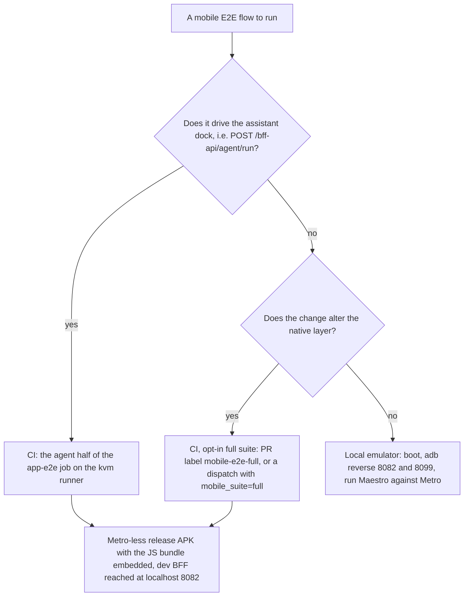
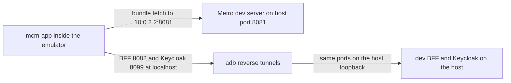

# Android emulator & APK builds (mobile E2E)

Mobile E2E has a hard split by flow type. **Agent flows** (anything driving the assistant dock →
`/bff-api/agent/run`; the `agent-*.yaml` / `assistant-*.yaml` files) must run in CI, in the
**`app-e2e` job of [`.forgejo/workflows/app-ci.yml`](../../.forgejo/workflows/app-ci.yml)** — the job
ported from the GitHub-era `android-e2e.yml`, a filename that no longer exists in this repository.
`app-e2e` builds a **Metro-less, standalone embedded-bundle APK** (`APK_VARIANT=release`,
`APK_ABI=x86_64`), runs it on a KVM emulator on the `kvm` runner label (which executes the job
directly on the ci host — see below), and drives the flows per-file through
`scripts/ci-mobile-agent-flows.sh`. The reason for the split is not the emulator: the local Windows
path runs agent flows against the **Metro dev server**, which OOM-crashes after only one or two agent
`/run` calls (V8 heap dump in Metro's log) and then shows a black screen / `status 0` "RN networking
issue" that reads as an app bug.
**Non-agent flows** (login, CRUD, sort, browse) run fine on the local emulator while iterating on a
JS/UI change — but a change that alters the **native layer** (an Expo / React Native SDK bump, a native
module added or upgraded, `app.json` / `android/` config) alters the binary *every* flow runs on, so
every flow has to be re-proven on the standalone release APK rather than on a debug build against
Metro. That is what the **opt-in full suite** is for, not a local DinD emulator. The retained Docker
Desktop dev container also runs the emulator natively via Linux KVM — see
[Containerized dev environment](./devcontainer.md).

The flow-type decision, and the build decision that follows from it.

CI's APK is standalone: the JS bundle is embedded and `EXPO_PUBLIC_BFF_NATIVE_URL=http://localhost:8082`
plus `EXPO_PUBLIC_KEYCLOAK_NATIVE_URL=http://localhost:8099` are inlined at build time, so the app
talks to the containerized dev BFF and gateway and **never to Metro**. (Being a *release* build, that
APK can only reach those `http://` URLs because a config plugin allowlists cleartext for them — see
the gotcha below.) The emulator steps run on an API-34 `google_apis_playstore` `x86_64` image — the
Play Store image is load-bearing, not cosmetic:
it ships Chrome, whose Custom Tabs service hands Keycloak's `mcm-app://` redirect back to the OS. The
AOSP image has only a WebView shell, which drops that redirect and leaves login unable to complete.
Both emulator steps `adb reverse` 8082 and 8099, install the same `$APK_PATH`, then hand off to their
script; the agent half runs gating → enable-anthropic → the agent flows → disable, followed last and
specially by the non-agent `admin-settings-access` flow.

Three details of that step are load-bearing when editing it:

- **The AVD is deliberately oversized for Chrome.** The action is given 4 GB guest RAM, a 576 MB heap
  and 3 cores because the OAuth Custom Tab renderer crashed mid-load on the default AVD RAM (logcat:
  `CustomTabActivity` "WIN DEATH … app died"), which surfaced as a flaky login rather than as a crash.
- **The action's `script:` block is executed line-by-line in separate shells**, so multi-line
  constructs (a `for` loop with backslash continuations) break there — that is why the whole flow loop
  lives in `scripts/ci-mobile-agent-flows.sh` and the step is a single `bash` invocation.
- **The Maestro CLI is pinned** (`MAESTRO_VERSION=2.10.0`): the vendor installer fetches
  `releases/latest` when that variable is unset, so without the pin the mobile tier silently tracked
  whatever Maestro released that day. Renovate maintains the pin.

- **When the mobile half runs:** every push to `main` and every `workflow_dispatch`; on a
  `pull_request` only when the diff touches the job's `mobile` filter (`frontend/**`, `agents/**`,
  `mcp-servers/**`, `backend/**`, `packages/**`, the workflow itself, or the Maestro/selection scripts
  `scripts/ci-mobile-agent-flows.sh`, `scripts/ci-mobile-full-flows.sh`, `scripts/ci-mobile-lib.sh`,
  `scripts/ci-maestro-debug.sh`, `scripts/mobile-flows.mjs` and `scripts/maestro-run.sh`) or the PR
  carries the `mobile-e2e` **or** `mobile-e2e-full` label. Otherwise the PR still gets the web E2E and
  integration tiers from the same
  job and skips the ~35-minute emulator half. That filter must stay a strict subset of the job's `app`
  filter — a path in `mobile` but not in `app` can never fire, because `mobile` gates only steps
  *inside* `app-e2e` while `app-e2e` itself requires `app == 'true'`; two entries violated exactly that
  until feature 058, which is why a guard test now enforces the subset instead of a comment claiming
  it. Note that `mobile-e2e` alone opens the mobile half but stays agents-only; only `mobile-e2e-full`
  (or `mobile_suite=full`) adds the full suite.
- **The build guards its own bundle.** Before the emulator starts, `app-e2e` asserts that
  `localhost:8082` appears inside `assets/index.android.bundle` of the produced APK. The string is not a
  source literal anywhere, so its presence proves the `EXPO_PUBLIC_*` env was re-inlined in *this*
  build; a stale Metro transform cache on a persistent runner otherwise silently bakes an older URL and
  the failure surfaces much later, at login. `frontend/mcm-app/scripts/build-apk.mjs` attacks the cause
  as well as the symptom: for a `release` variant it deletes Metro's temp caches
  (`metro-cache`, `metro-file-map*`, `metro-symbolicate*`, `haste-map*`) so the current env is
  re-inlined, and the workflow disables the Gradle daemon
  (`GRADLE_OPTS=-Dorg.gradle.daemon=false`), because a reused daemon keeps the env it started with.
- **A missing KVM capability fails the job; it never skips the mobile suite.** The `app-e2e` job's
  **`Verify KVM is available`** step (wrapped by `scripts/ci-log-step.sh` as
  `app-e2e-verify-kvm-available`, and so named in the failure digest) runs before the emulator step: it
  `ls -l`s `/dev/kvm` when present and otherwise exits 1 with an `::error::` naming the host fixes. Cite
  that step by name, not by line number — it has moved within the job before, and a stale range reads as
  a missing check. The rationale is the same one that makes the bundle guard worth having: a silently
  skipped mobile half is indistinguishable from a passing one. **`/dev/kvm` is the host's own device,
  not something handed to a container.** `app-e2e` declares `runs-on: kvm` — the *name* of a host-type
  runner label defined as `kvm:host` — so the job executes **on the ci host**, the way the GitHub-era VM
  did. What must therefore hold is host state: KVM enabled on the host (`kvm_intel`/`kvm_amd` loaded),
  the `ci` user in the `kvm` group, and the runner still registering the `kvm:host` label. On this host
  `/dev/kvm` is **mode 666, measured 2026-10-12 as `crw-rw-rw- root kvm`**; the `::error::` text names
  `660 or 666`, and 660 via a udev rule is the tighter option — the group membership is what keeps the
  job working if it is applied. An earlier version of this page said `/dev/kvm` came from the runner config's
  `container.options: --device /dev/kvm`; that described the pre-`235f2f4c` job-container setup and is
  wrong. The workflow's own comment carries the correction (2026-10-04), and the host is required rather
  than convenient: the job's web-E2E leg reaches the dev BFF at `localhost:8082` while the emulator leg
  reaches the host at `10.0.2.2:8082`, and those two only resolve like one host when the job *is* on the
  host — a rootless job container gets neither that, nor KVM, nor the ci Docker daemon.
- **Being a host job, it provisions its own Docker CLI and then proves it reaches the daemon.** With no
  job container to supply a working Docker, the first step installs the CLI **only if the host has
  none** (`command -v docker`; otherwise the static `docker-27.5.1` tarball into `/usr/local/bin`) and
  then asserts `docker info` actually reaches the `ci` user's rootless daemon at the job's `DOCKER_HOST`
  (`unix:///run/user/<uid>/docker.sock`). A CLI that is present but cannot reach that daemon exits 1
  with an `::error::` naming the daemon and the socket — there is **no fallback** to another socket or
  to a container-provided one. Same principle as the KVM check and the bundle guard: a container stack
  that came up somewhere else, or did not come up at all, must not read as a passing mobile run.

## The opt-in full mobile suite (non-agent flows)

`app-e2e` runs **two** suites from one job, chosen by `MOBILE_SUITE`. `agents` is the default and what
every PR, every `main` push and every ordinary dispatch gets; `full` adds the non-agent flows *after*
the agent half, on a **second emulator**.

- **How to opt in:** label the pull request **`mobile-e2e-full`**, or dispatch `app-ci` with
  `mobile_suite=full` (a `choice` input, options `agents` / `full`, default `agents`). A `main` push is
  always agents-only — nothing about a branch implies the full suite. The label does double duty: it
  opens every mobile gate *and* sets `MOBILE_SUITE`, because a suite that was selected without opening
  the gate would never run and would still read as a green tick. Both arms are pinned by
  `scripts/__tests__/app-ci-mobile-full.guard.test.mjs`, which **evaluates** the trigger expressions
  rather than string-matching them — this forge exposes no jobs/steps endpoint, so a green run cannot
  show which arm fired.
- **Why the non-agent flows belong in CI at all:** a native-layer change alters the binary *every* flow
  runs on, and a local DinD emulator is the slow, flaky way to get that evidence. They run against the
  same standalone (Metro-less) release APK and the same containerized dev BFF + Keycloak the agent half
  used, so the native layer the PR changed is the one that is exercised.
- **A second, phone-sized AVD, for a measured reason.** The agent step boots the
  `android-emulator-runner` action's *default* device — a 320x640 screen — and the agent flows are
  written for it. The non-agent flows were written against a local Pixel 7 (1080x2400), and on the
  320x640 AVD (first full run, app-ci run 5499) **15 of 22 failed for geometry alone**: the profile
  screen's logout button sat below the fold, Gboard covered the registration fields, and the
  card-centre tap in `_navigate-to-collection-helper.yaml` landed on the card's *Edit* button instead
  of opening it. The full-suite step therefore uses `profile: pixel_6` with the same
  `google_apis_playstore` Chrome-bearing image. Re-profiling the agent step's AVD would change every
  default run, so the second boot (~2-3 min) is paid only by the opt-in run.
- **One flow selection, shared with the local suite.** `scripts/mobile-flows.mjs` is the single place
  that decides which flows run where: `node scripts/mobile-flows.mjs ci-full` prints the full-mode list,
  and the local `e2e:mobile` suite (`frontend/mcm-app/scripts/maestro-e2e.mjs`) imports the same
  `localSuiteFlows` — so a new non-agent flow in `tests/e2e/mobile/` is picked up by both and there is
  no second, hand-maintained list to drift. Full mode = the local suite minus the agent flows (the
  agent half owns those, as a curated, ordered, anthropic-provider subset), minus `MANUAL_FLOWS`
  (`session-timeout*`, which need Metro restarted with a non-default env override and so run only via
  the dedicated target), minus `CI_FULL_EXCLUDED`. Every entry in those tables has to state its reason:
  `CI_FULL_EXCLUDED` currently holds one — `admin-settings-access`, which the agent script already runs
  last, after a Chrome SSO reset, as the seeded mc-admin — and the guard test asserts no flow is run by
  *both* halves, because a duplicated agent flow is wasted runner time plus a server-side mutation the
  agent half's ordering does not expect.
- **`CI_FULL_NON_BLOCKING` — reported, never parked.** Flows in that table still run (one attempt, no
  retry) and appear in the results table, but cannot fail the step. Each entry must be tagged
  **ENVIRONMENTAL** or **KNOWN DEFECT** together with the run that measured it, and a listed flow that
  now passes is reported `PASS-REMOVE-NONBLOCKING`, so a stale entry gets deleted rather than hiding the
  next regression. Today: `login-invalid` (ENVIRONMENTAL, run 5502, 2/2 — the flow's own assertions
  hold, but the two `pressKey: back` presses it uses to close the CI image's Chrome Custom Tab leave
  Chrome still on the Keycloak page, so `login-screen` never returns; Chrome back-stack depth, not the
  app) and `movie-sort` (KNOWN DEFECT, run 5502, 2/2, on a 1080x2400 pixel_6 — with the default visible
  columns the sort row holds Title/Year/Type/Owned/Ripped chips and `sort-dir-toggle` sits past the
  right edge of the horizontal ScrollView in `movie-sort-control.tsx`).
- **How each flow runs, and why it differs from the agent half.** The non-agent flows `launchApp` with
  `clearState: false` — they rely on the harness to hand them a logged-out app — so the runner
  force-stops and `pm clear`s the app before *every* attempt (no Metro SharedPref is written; the APK
  embeds its bundle). Chrome is reset once before the batch and again before a retry, since a failed
  attempt can leave Chrome mid-login. Each flow gets **2 attempts** (one bounded retry, the local
  suite's `MAX_RETRIES=1`) rather than the agent half's 3, because these flows drive no model turn and
  the Custom-Tab crash is the only transient left; a non-blocking flow gets one. The batch **does not
  stop at the first failure** — every flow runs, a `flow · result · attempts · seconds` table is printed
  at the end and written to `mobile-diagnostics/full-suite-results.log`, and the step fails if *any*
  blocking flow failed. One ~30-minute run has to answer for all of them, and a fail-fast batch would
  hide every flow after the first red. An **empty selection is an error, not a pass**: the runner exits
  1 rather than report a vacuous green.
- **The results table is a step, not a log line.** `maestro-full-results` is wrapped by
  `scripts/ci-log-step.sh` and listed in the failure digest's `COUNTS_SOURCES`, so the table reaches
  both the failure digest and the green-run counts bundle — this forge exposes no job log, so without
  it a *green* full run could not say which flows ran. It runs under `always()` in full mode and says
  "the full suite never started" when the file is absent, rather than adding a second red for the same
  cause.
- **Fixture values are non-secret and fixed:** `E2E_COLLECTION_NAME=E2E Browse` and
  `E2E_MOVIE_TITLE=Alpha`, taken from the seeded base dataset that the web E2E's global setup seeded
  earlier in the same job. Credentials still travel only through `scripts/maestro-run.sh`'s
  `MAESTRO_`-prefixed process env.

**Cost, measured on app-ci run 5502:** the `maestro-full-flows` step took 1748 s (29 min, 24 flows, two
of them failing through a retry), plus a second emulator boot (~2-3 min) — roughly **+30-35 min** on top
of an agents-only run, on a capacity-1 runner. That cost is why the suite is opt-in only, and why the
guard test fails if the trigger expression ever defaults to `full`.

## CI time budget: the 110-vs-75 job ceiling and the per-step ceilings

`app-e2e`'s `timeout-minutes` is **75 by default and 110 only in full mode** — the full suite's
`maestro-full-flows` step, the results step and the digest all have to fit inside it.

Underneath the job ceiling, `scripts/ci-log-step.sh` enforces a ceiling **per wrapped step**, read from
the generated `scripts/ci-step-ceilings.tsv` (regenerate with
`node scripts/ci-status.mjs durations --job app-e2e --runs 40 --propose`; do not hand-edit it). Each row
states the sample it was derived from, and the rule is `max(observed) × 3`, rounded up to a minute,
floored at 300 s, applied only to a step with at least 10 observed (non-killed) samples — the ×3 is the
largest retry bound any wrapped step has (`ci-mobile-agent-flows.sh` runs each flow under `max=3`,
Playwright is `retries: 1`), so a run where every retry fires still has headroom. Today
`maestro-agent-flows` is the loosest calibrated row at 2580 s (n=27, max 844 s), `web-e2e` is 840 s, and
most steps sit on the 300 s floor. `maestro-full-flows`, `maestro-full-results` and the mobile
failure-path captures (`app-e2e-collect-maestro-debug`, `app-e2e-collect-container-logs`) have **no
calibrated row** — the first two run only on opt-in runs, the last two only when the mobile half fails —
so they are bounded by the job-wide `CI_STEP_TIMEOUT_SECONDS: '2700'` **backstop**, which is exactly why
full mode raises the job ceiling: backstop plus digest still have to fit.

The reason this exists rather than one job-wide number: `always()` does not survive a job kill. When the
runner enforced the 75-minute ceiling, the `Publish failure digest` step never ran, so a **hang** — the
one failure class with no other evidence trail — produced no digest at all (measured on PR #322, task
8317: 75.1 min against that ceiling versus a ~29 min healthy baseline, and `ci-status failure` could
only say the job may have died before the digest step ran). A per-step ceiling turns the hang into a
*step* failure: the job survives, the step is named in `_failed-step`, and the digest reports a TIMEOUT
rather than an assertion failure that never happened. The symmetry to keep in mind when raising any
value: raising one past ~60 min puts a hung step back into job-kill territory and silently restores the
defect. Pinned by `scripts/__tests__/ci-log-step.test.mjs` and
`scripts/__tests__/app-ci-mobile-full.guard.test.mjs`.

## Gotchas

Why the split is per-service: Metro is reached through the QEMU gateway, Keycloak and the BFF only
through `adb reverse`.

- **Agent flows still prefer CI even inside the dev container.** The decision rule is unchanged
  regardless of where the emulator runs; only the *transport* to reach the OOM-prone Metro server
  differs (tunnel vs. `10.0.2.2`). If an agent flow has to be run locally anyway — to debug the *flow*
  rather than the app — point the app at the **containerized dev BFF on 8082** instead of Metro's own
  BFF, so the OOM-prone server is the container and Metro only serves JS; and confirm `:8081` answers
  before each agent-run batch, because a black screen or `status 0` almost always means Metro died
  rather than the app being wrong.
- **`10.0.2.2` works fine for TCP on this machine — the old claim that QEMU networking is broken was
  wrong (corrected 2026-08-23).** An older note wasted a session; it was refuted with a negative control
  (a port with no listener returns `rc=1` while a real port returns `rc=0`), because "nothing answered"
  alone never distinguishes a broken gateway from an empty port. The real split is **by service, not by
  transport**: **Metro must be reached at `10.0.2.2:8081`** — an RN 0.85 debug build resolves its
  dev-server address to the QEMU gateway by default and does not consult `adb reverse tcp:8081` for
  that fetch (proved by reading the app's own sockets). (`frontend/mcm-app/scripts/maestro-e2e.mjs`
  takes the other route: after every `pm clear` it writes the app's `debug_http_host` pref as
  `localhost:8081`, which *does* go through the reverse tunnel — so that path needs
  `adb reverse tcp:8081`, and flows it launches must use `clearState: false`, since a second `pm clear`
  would wipe the pref it just wrote. Either way Metro must be listening on host port 8081.)
  **Keycloak and the BFF still require `adb reverse`**, because `KC_HOSTNAME=http://localhost:8099` pins
  Keycloak's issuer and session cookies to `localhost`; reaching the same server at `10.0.2.2:8099`
  loses them mid-flow with `error="cookie_not_found"`. Re-run `adb reverse tcp:8082 tcp:8082` and
  `adb reverse tcp:8099 tcp:8099` after every emulator restart.
- **A stale port-8081 holder hangs the app on the splash screen with no error at all.** The handshake
  succeeds and no response ever comes — no redbox, no log line. A stale VS Code dev-container forward is
  the common culprit; check the *owner*, not reachability:
  `Get-NetTCPConnection -LocalPort 8081 -State Listen | ForEach-Object { (Get-Process -Id $_.OwningProcess).ProcessName }`.
- **`EXPO_PUBLIC_*` values need `--reset-cache`, and the only trustworthy check is the served bundle.**
  Metro's transform cache does not key on inlined `EXPO_PUBLIC_*` values, so without a reset you keep
  serving the old URLs. Verify by grepping what Metro actually emits rather than assuming:
  `curl -sS "http://localhost:8081/.expo/.virtual-metro-entry.bundle?platform=android&dev=true" -o /tmp/b.js`
  then expect one `localhost:8082` hit and zero `10.0.2.2:8082` hits.
- **If you need the production APK (public BFF/Keycloak hosts baked in), don't rebuild — pull it from
  the generic package registry.** `cd-deploy`'s `prod-apk` job publishes every release APK as
  `mcm-app-android:<expo.version>-<sha7>` with a `sha256` sidecar, fetchable by URL with a
  `read:package` token. The `upload-artifact` copy also exists on the run page, but this forge exposes
  no artifact API, so only a human clicking through the UI can retrieve that one. The shelf is
  **count-based** — the newest five versions, pruned at publish time and roughly 109 MB each — so pin
  anything that must outlive that window as `<version>-keep`. Recipe:
  [Homelab server setup §6.7](./server-setup.md).
- **A release APK can only reach the dev BFF because a config plugin allowlists cleartext for it.**
  Android blocks `http://` at `targetSdk >= 28`, and Expo relaxes that only in the *debug* manifest —
  so the standalone release APK the mobile suite installs would fail the login POST with `ERR_NETWORK`
  and never leave the device. `frontend/mcm-app/plugins/with-dev-cleartext.js` (listed in
  `frontend/mcm-app/app.json`'s `plugins`) writes a network security config at prebuild time that
  permits cleartext for `localhost`, `127.0.0.1` and `10.0.2.2` **only**, and points
  `android:networkSecurityConfig` at it. Every other host stays cleartext-blocked, so the production
  HTTPS build is unaffected. Chrome is unaffected either way — it carries its own cleartext policy, so
  Keycloak at `http://localhost:8099` loads regardless.
- **Before rebuilding the APK, check whether the installed APK is already native-compatible with HEAD.**
  A pure JS/Metro change (including a new pure-JS dependency with no native module) never needs a
  rebuild — diff `frontend/mcm-app/package.json`, `frontend/mcm-app/android/` and
  `frontend/mcm-app/app.json` against the commit the APK was built from; an empty diff means
  download-and-install, skipping a ~20-minute build. But note that **Maestro launches the installed APK
  via `am start` and never rebuilds it**: after any real native change (Expo SDK / RN bump, new native
  module, `expo prebuild`) the old native binary runs against the new JS bundle and **crashes at
  startup**, not at test time. `expo prebuild --clean` alone neither builds nor installs.
- **CI is the recommended APK build path, not the local Windows build.** A Linux CI runner has no
  Windows path-length wall, and both Forgejo builds use `APK_VARIANT=release` (JS embedded) — there is
  no CI debug/Metro-attached APK. In `app-e2e` the disk-free step is required, not cosmetic, and it has
  **two halves**: `docker image prune -af` and, added 2026-10-03, `docker builder prune -f
  --reserved-space 50GB`. `image prune` never touches the build cache, which had reached **375 GB
  (355 GB reclaimable) of a shared 914 GB disk** on the ci daemon; `--reserved-space` keeps the most
  recent 50 GB so warm layers still hit and rebuilds stay fast. Without the reclamation the native build
  exhausts runner disk and dies mid-compile with no clean error. The `|| true` on both lines is
  deliberate — a prune that finds nothing must not fail the step — but it is **not a licence to be
  wrong**: `--reserved-space` was checked against the **docker 27.5.1** CLI the job's host-runner setup
  installs, precisely so a bad flag could not become a silent no-op. Contrast `cd-deploy`'s `prod-apk`
  job, which builds an APK too but has no Docker CLI and no images, so its disk step **only reports**:
  it is named `Report disk space (nothing to reclaim — see item #457)`, says so in words, carries no
  `|| true` (a failing `df` fails the step) and exports its measurement as a commit status under
  `cd-deploy/prod-apk-disk`. `scripts/__tests__/prod-apk-disk-step.guard.test.mjs` pins all of that —
  including that **no** workflow step invokes `sudo`, which no runner here provides.
- **Windows hits a hard `CMAKE_OBJECT_PATH_MAX` (250-char) wall building RN ≥0.85 native modules.** The
  real cause is CMake replicating the full absolute source path under the object directory; this repo's
  path plus the deep pnpm layout (`node_modules/.pnpm/<pkg>@<ver>_<hash>/node_modules/<pkg>/…`)
  overflows the cap (worst measured: 381 chars). `LongPathsEnabled` does NOT fix this — the limit is
  internal to CMake, not Windows. `scripts/build-apk-short-path.ps1` automates the short-root junction +
  `node-linker=hoisted` recipe and **always reverts** it afterwards (hoisted breaks Metro/jest module
  resolution); it is a slow, fragile fallback, and the complete recipe plus its rejected alternatives
  are in the runbook.
- **The dev container can emulate but cannot build the APK.** The SDK and an `android-34`
  `google_apis` `x86_64` system image are baked into the toolchain image, and the privileged DinD
  container exposes the host `/dev/kvm`, so a headless emulator boots with hardware acceleration.
  `scripts/devcontainer-android.sh` is the lifecycle entry point: its default `prepare` subcommand
  grants `/dev/kvm` access and creates the AVD idempotently (it runs from `postStartCommand`, so a
  normal session pays nothing), `boot` starts the AVD headless and `adb reverse`s 8082 and 8099, and on
  a host with no `/dev/kvm` — the Docker Sandbox microVM, where the device cannot appear at all — it
  refuses legibly and names both remaining routes instead of failing as if broken. The
  Gradle wrapper distribution is baked too, but Gradle still resolves the Android/Maven plugin graph
  from the open internet at build time, which the container's default-deny egress firewall blocks —
  pre-seeding that graph is impractical, so a release APK comes from CI or a build container with its
  own egress. Agent flows here still prefer CI.
- **Secrets reach Maestro through the environment, never through argv.** `scripts/maestro-run.sh` is
  the single sanctioned entry point: it reads `.env.e2e.local` (or the job env) and exports each
  credential under a `MAESTRO_`-prefixed twin, which Maestro strips in-flow — so no credential value
  lands on a command line readable via `ps`. Only non-secret values go on argv, e.g. the unique
  `COLLECTION_NAME` the `agent-add-ownership` flow needs per attempt.
- **A failed mobile flow's device evidence is captured inside the emulator script, not by the workflow.**
  `scripts/ci-mobile-agent-flows.sh` runs each flow up to three attempts and, on *every* failed attempt,
  its `capture_mobile_diagnostics` function writes `mobile-diagnostics/<flow>-attempt<n>/` containing
  `logcat-react.log` (`ReactNativeJS` + `ReactNative` + `AndroidRuntime`), the unfiltered
  `logcat-full.log`, and a copy of the newest `~/.maestro/tests/*/` directory as `maestro/` (view
  hierarchy, screenshots, Maestro's own device logcat). That helper now lives in
  **`scripts/ci-mobile-lib.sh`**, sourced (never executed) by both mobile runners — the opt-in full
  suite captures the same way and additionally leaves `mobile-diagnostics/full-suite-results.log` — so
  there is one implementation rather than two that could drift. It must happen there for two reasons: the
  `android-emulator-runner` action terminates the emulator before the job's collect-logs step runs, so
  logcat is unobtainable afterwards, and the uploaded `maestro-debug` artifact is unreachable through
  this forge's API. The failure-time `Collect container logs + health on failure` step folds the
  directory into `container-logs/` as `_mobile-diagnostics` (underscore-prefixed so the digest ranks it
  above ordinary container logs) **before** it copies `container-logs/` to `$HOME/mcm-ci-last-failure`,
  so the device evidence also lands in the durable on-host bundle that survives the `always()` teardown.
  Two properties are load-bearing when editing that function: the `local` assignments must stay on
  separate lines — bash expands every assignment word of one `local` call before any of the locals
  exist, so a combined `local a="$1" b="${a}"` interpolates the *outer* variable, and on run 2049 that
  filed the admin flow's capture under the *previous* flow's directory
  (`mobile-diagnostics/assistant-config-disable-attempt1`), which is the one thing a diagnostic must
  never do — and every capture command is best-effort (`|| true`, plus a plain `return 0` when the
  destination cannot be created), because a diagnostic must never change the run's result. A
  deterministic failure still fails all attempts and exits non-zero via the
  `::error::flow <flow> failed after 3 attempts` line. See
  [CI evidence pipeline](./ci-evidence-pipeline.md) for how the bundle is retrieved.
- **The emulator script also leaves a logcat trail on the runner itself, because the job log is not
  readable back.** An `EXIT` trap in `scripts/ci-mobile-agent-flows.sh` dumps a *filtered* logcat
  (ReactNativeJS output, the OAuth `mcm-app://` redirect handoff, and network/auth keywords) to
  `$HOME/ci-mobile-logcat.txt` and the whole buffer to `$HOME/ci-mobile-logcat-full.txt`. On the
  non-ephemeral `kvm` runner those files are the post-mortem channel for a session that cannot read
  workflow logs or artifacts through this forge's API; the trap re-returns the original exit code and
  never fails the run itself.
- **The uploaded `maestro-debug` artifact carries only *this* run's Maestro output, because the job's
  home directory is persistent.** `app-e2e` runs on the ci host (`runs-on: kvm`), so `~/.maestro/tests`
  is the ci user's home and Maestro prunes it only at ~14 days; the upload step used to take that
  directory whole, so every failure re-shipped every earlier run (measured 2026-10-26: rows per upload
  climbing 6, 9, 12, 15, 18 … 5,819 over 154 uploads, reaching **330,497 rows / 11 GB** — half of all
  Actions artifacts and half of the nightly backup, with 967 entries / 5.8 GB on the host). The fix is
  `scripts/ci-maestro-debug.sh` with two subcommands: `start` runs inside the **`Install Maestro`**
  step, clears the `maestro-debug/` staging directory and touches a `.run-start` mark before any flow
  can write output; `collect` runs just before the upload, under the same `failure()` condition, and
  copies only `~/.maestro/tests/*` entries **newer than the mark** into `maestro-debug/tests/` — which
  is what the upload's `path` reads (`maestro-debug/tests/**`, never `~/.maestro`). A missing mark
  stages nothing rather than falling back to the host history, and every path exits 0, because a
  diagnostic must never change the job's outcome; an unknown subcommand exits 2 instead of being
  treated as one of the two. Pinned by `scripts/__tests__/ci-maestro-debug.test.mjs`, which runs the
  script against a fixture home and asserts the workflow is wired to it.
- **Two emulator-state traps that look like app bugs.**
  - **A second MCM build steals the OAuth redirect.** `frontend/mcm-app/app.json` sets
    `"scheme": "mcm-app"`, so *every* installed build claims `mcm-app://native-auth-callback`
    regardless of bundle id. With a pre-rebrand build still installed alongside the current one, Android
    shows an "Open with" chooser mid-login that Maestro cannot answer and the flow times out. Check with
    `adb shell pm list packages -3`; resolve by uninstalling the stale build. CI never sees this — its
    emulator is fresh.
  - **A live Chrome SSO session breaks the *next* login.** If Keycloak has already authenticated the
    browser, the helper still types credentials into the form and Keycloak rejects the submission with
    `error="already_logged_in"`, redirecting back with **no `code`**. The shared helper
    `reset_chrome_sso` in `scripts/ci-mobile-lib.sh` handles this — `adb shell pm clear
    com.android.chrome`, then re-skip Chrome's first-run experience (which the clear re-establishes, so
    it is repeated on each retry). The agent half calls it before `admin-settings-access`, which logs in
    as a *different* seeded user (the seeded `mc-admin`) than the agent flows; the full suite calls it
    once before its batch and again before any retry, so no SSO session from the agent half's user leaks
    into it.

For the BFF-container modes an agent/non-agent flow runs against once launched, see
[E2E testing](./e2e-testing.md); for how the `app-e2e` job fits the rest of the pipeline, see
[CI/CD pipeline](../projects/ci-cd-pipeline.md). The full session-startup ritual, the exact CI
trigger/watch commands, the flow-by-flow CI list and retry policy, and the complete Windows build-wall
workaround recipe live in the authoritative runbook,
[`docs/runbooks/android-emulator.md`](../../docs/runbooks/android-emulator.md).
