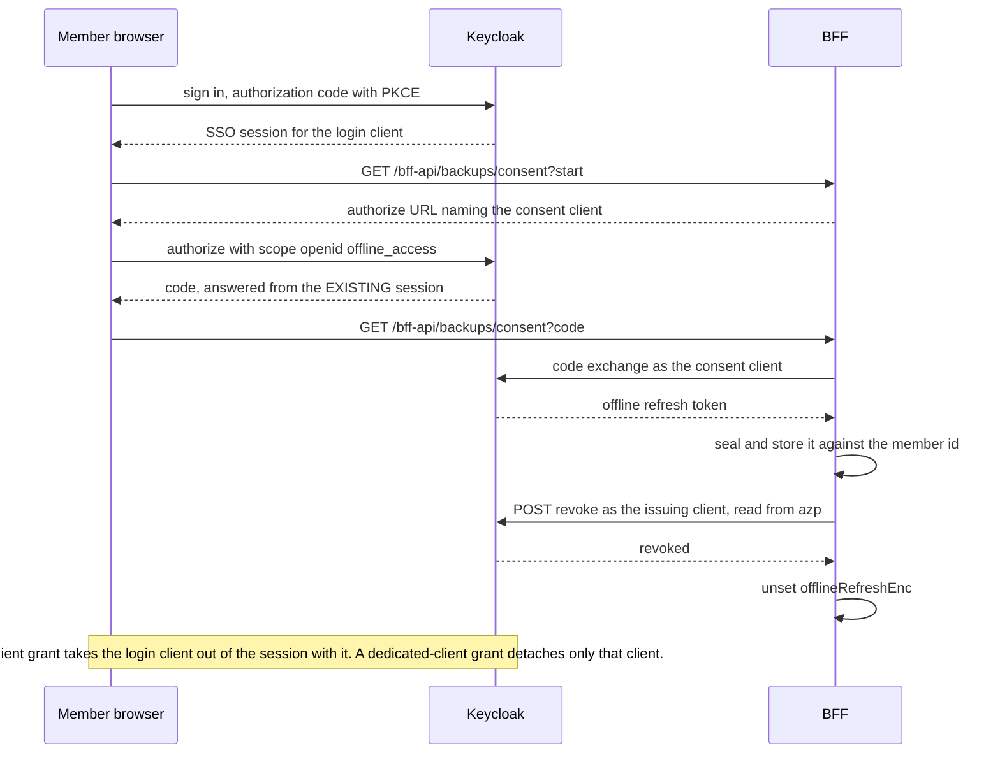

# Per-user collection backups (scheduled & on-demand)

Feature 073 (backlog #236) lets a user schedule or trigger on-demand backups of their movie
collections to storage *they* own — an S3-compatible bucket or a WebDAV server — with
versioning, keep-last-N retention, and restore that only ever creates a **new** collection (there
is no code path that overwrites one). The BFF (see [BFF project overview](../projects/bff.md))
owns destination configuration, the scheduler, the run/restore pipeline, and the audit trail. The
authoritative operating manual, including the full environment-variable table, the triage tables
and the test and leak-scan recipes, is [docs/runbooks/backups.md](../../docs/runbooks/backups.md);
this page distills the load-bearing gotchas an operator needs before touching the system.

## Gotchas

- **The user owns the credentials and the artifacts, not the operator.** Destination secrets (S3
  secret key, WebDAV app password) are sealed at rest and never echoed back, logged, or returned
  in an error — a destination-probe failure can only report *which kind* of failure occurred,
  never the server's actual reply. They are sealed under the feature's **own** AES-256-GCM master
  key, `BACKUP_CREDENTIAL_ENC_KEY`, deliberately separate from `AGENT_CONFIG_ENC_KEY` so the blast
  radius is not widened from "the user's assistant credentials" to "every store the user's whole
  collection can be written to"; the key is read at first use rather than at boot, so a deployment
  with no destinations still starts, and rotating it makes every stored destination secret and
  offline token unreadable, so each user must re-enter their destination and consent again. The
  blobs are additionally bound by AAD to their owner *and* their field — the destination id for a
  destination secret, the user id alone for the offline grant — so a store-layer mixup fails the
  GCM authentication check loudly instead of decrypting one destination's credential into another.
  The corollary an operator must not "fix": **account deletion does not delete the user's stored
  backup artifacts**, even now that feature 076 wires deletion into the app (see Known gaps below).
  They live at storage the user controls; removing them would mean deleting data the system was
  only trusted to copy.
- **A destination address is denied by default, the inverse of the Ollama guard.** Loopback,
  private (including the carrier-grade-NAT range a tailnet uses), link-local and cloud-metadata
  addresses are refused, and an unresolvable name is treated as unsafe rather than as "nothing
  blocked was found", unless the host is named in `BACKUP_ALLOWED_DESTINATION_HOSTS` — which is how
  the primary legitimate destination, a homelab NAS, gets in, by a deliberate operator act. The
  check runs on save, on every probe and on every use, because a name that was safe when the
  destination was saved can resolve somewhere else by the time a scheduled run writes to it; it
  resolves *every* DNS answer rather than the first and pins the outbound connection to the vetted
  set. The mechanism is shared with the Ollama guard —
  see [SSRF guard: canonicalized IP, not hostname string](../gotchas/agent-config-ssrf-guard.md).
- **An unattended scheduled run acts as the user, not as a service account.** There is no service
  account and no privileged fallback. The run mints access from a Keycloak **offline token** the
  user granted through an explicit, separate consent round trip. If that grant is revoked or
  missing, the run **fails** — it does not fall back to any other identity.
- **Consent also needs the realm's `offline_access` role, and its absence does not look like a
  role problem.** Keycloak grants the role through the realm's `default-roles` composite, so a user
  created through the Admin API inherits it; a user created by a realm-JSON import gets it only if
  that import grants the default role. This is how the seeded `e2e-test-user` once ended up unable
  to consent at all, with the failure surfacing as a **blank page after sign-in** rather than an
  error — so "the consent screen does nothing" is a realm-role question before it is a BFF one.
- **The BFF's MongoDB is a standalone `mongod`: no replica set, no multi-document transactions.**
  Exactly-once scheduling therefore rests on a single-document atomic claim (an atomic
  find-and-update against one job document), not a transaction. The companion Redis leader lock is
  an optimization with a TTL guess baked into it — it reduces redundant scanning across BFF
  instances, but it is **not** the correctness guarantee for exactly-once execution.
- **The run-size ceiling (`BACKUP_MAX_MOVIES` / `BACKUP_MAX_UNCOMPRESSED_BYTES`) exists because a
  run holds the entire artifact in memory rather than streaming it.** The run builds the whole
  artifact, checks both ceilings *before anything is written*, and PUTs it as a single object, so a
  failure can never leave a partial object that the user later discovers is unrestorable at the
  moment they need it. The ceilings are what make that trade defensible, and they fail loudly,
  naming both the limit and the measured value so the operator knows what to raise. Two units are
  checked independently because a big library of ordinary records is count-bound while a handful of
  records with long plot text is bytes-bound. Streaming snapshots are a deliberate filed follow-up,
  not an oversight (see Known gaps below).
- **The scheduler tick is `server.js` POSTing to the internal `/bff-api/backups/tick` route over
  loopback with a shared secret**, because `server.js` is CommonJS outside the Metro bundle and
  cannot import `src/bff-server/*` directly. Three consequences worth knowing: **no tick fires under
  `pnpm start` in dev** — expected, not a fault to chase; call the tick route directly. A wrong
  secret answers **404 rather than 401**, deliberately, so the route does not advertise itself, and
  the comparison is constant-time — so "the tick 404s" means the caller and the BFF hold *different*
  secrets. A supplied `?now=` is refused with 400 unless `BACKUP_TICK_ALLOW_TIME_OVERRIDE=1`, which
  is dev and CI only. `leader: false` is a normal 200: another instance took the lock.
- **A silent tick is normal, and the two triage answers do not look like errors.** The tick logs
  nothing when nothing is due — by design, since a line a minute saying "nothing happened" is a log
  nobody reads — so its liveness proof is the first Mongo connect one interval after boot, not a
  per-tick log line. A job that never runs usually has **no `nextRunAt`**: a disabled job
  deliberately carries none, so re-enabling does not fire for an occurrence that passed while it was
  off. A job stuck with `claimedAt` set was claimed by an instance that died and **self-heals after
  the 30-minute reclaim ceiling**. Catch-up is deliberate too: a job whose time passed while the
  system was down is claimed **once** on recovery, with its next occurrence computed forward from
  now — advancing occurrence by occurrence would fire repeatedly and, with keep-last retention,
  prune away the very history the downtime was supposed to preserve.
- **In production the feature is switched on entirely from `infrastructure-as-code/komodo/stacks.toml`,
  never from the Komodo UI**, whose edits the next ResourceSync overwrites. The `prod-mcm-bff`
  `[[stack]]` block carries the three switches — `BACKUP_CREDENTIAL_ENC_KEY` and
  `BACKUP_TICK_SECRET` (both masked Komodo Variables, 32 random bytes) and
  `BACKUP_ALLOWED_DESTINATION_HOSTS` (plain: it is LAN topology, so it stays out of git) — plus
  `BACKUP_CONSENT_CLIENT_ID` and the Variable behind `BACKUP_CONSENT_CLIENT_SECRET`. A Komodo
  Variable **must exist before the sync that first references it**, or Komodo writes the literal
  `[[…]]` placeholder; and a sync that changes only the environment does **not** recreate the
  container, so a **Redeploy** is required. Until 2026-10-25 none of the three switches was set, so
  backups were off in production — the symptoms were "That address is not allowed" on a LAN
  destination and `backup scheduler disabled` at boot (item #843, spec 083 T009). Dev and CI values
  come from `gen-dev-env.mjs` / `gen-ci-env.mjs`, which **seed** the credential key rather than
  syncing it: re-running must not orphan every stored destination secret and offline token. The
  allow-list is an **exact** host match with no port, so adding a NAS means editing the Variable and
  Redeploying.
- **Retention's load-bearing safety property is that a failed or partial run prunes nothing.**
  Pruning on the failure path would turn "today's backup didn't happen" into "and yesterday's is
  gone too." Separately, a prune failure never fails the run — it is recorded on its own
  (`pruneFailureReason`, distinct from the run's `failureReason`) because the backup the user
  asked for still succeeded. Only keys matching `<basePath>/<jobId>/<iso>.json.gz` are ever
  deletion candidates, so a file the user keeps at the same destination is never touched, even
  inside the job's own folder.
- **Revocation ordering on disable/delete is revoke-at-Keycloak-first, forget-locally-second.**
  Reversed, a failed revocation would strand a live, non-expiring offline token with no local
  record left pointing at it to retry the revoke. `tearDownUserBackups` (in
  `backup-offline-token.ts`) enforces this itself: it revokes the offline token first and only
  then deletes the user's destinations, jobs, and run history, in that order, so a crash never
  leaves a job pointing at a destination that no longer exists. What triggers the revoke is
  *any* remaining enabled job carrying a schedule, not the job that was just touched — revoking on
  the first disable would silently break every other schedule the user still has, and the symptom
  would appear days later on an unrelated job.
- **Revoking a backup grant issued to the LOGIN client ends that member's sign-in session**, so
  since feature 083 the consent round trip runs as its own Keycloak client (`mcm-backup-consent`,
  selected by `BACKUP_CONSENT_CLIENT_ID`). The member's browser already holds their SSO cookie, so
  Keycloak answers the consent round trip from the existing session and attaches the offline grant
  to it; revoking that grant removes the login client from the session. The member's access token
  still validates at the BFF, which checks JWTs locally, but Keycloak then refuses what it must
  honour itself — the agent subject-token exchange fails with `invalid_token` (the assistant
  answers *"No caller identity is available for this action"*) and the next refresh fails with
  `Session not active`, signing the member out. Measured on Keycloak 26.8.0. See the section
  below.
- **The audit-sink redaction rule strips any key containing `token` plus an explicit redact
  list — it does not name `secretEnc`, `accessKeyId`, or a destination password.** Those fields
  are kept out of the audit trail by construction (they are simply never placed on the audited
  object), not because the token-matching rule happens to catch them, and this is asserted against
  real secret values in tests rather than assumed. See also
  [Secrets management](../invariants/secrets-management.md) for the broader redaction posture and
  [Auth chain](../invariants/auth-chain.md) for how the offline-token grant fits the rest of the
  BFF's session/token model.
- **A missing backup destination makes the feature's integration suites SKIP, and a skip reads as
  a pass.** The two real destinations live in their own compose file rather than the default stack,
  so the suites are written to skip when `BACKUP_TEST_S3_SECRET_KEY` is unset. Run them with
  `MCM_REQUIRE_BACKUP_TARGETS=1` **alongside** `MCM_REQUIRE_LIVE_STACK=1`: the flag converts the
  skip into a hard failure that names the missing input, and the jest preflight then also probes
  both destinations. Watch the skip count, not just the exit code. The web E2E spec has the same
  problem and its own escalation flag, `E2E_REQUIRE_BACKUP_TARGETS=1`, which the app-e2e Playwright
  invocation sets — and the values it needs (`BACKUP_TICK_SECRET` and the `BACKUP_TEST_*`
  credentials) live in `.env.local`, which Playwright does **not** load, so pass them explicitly:
  supplying only the e2e env file once produced a green run whose backup specs had silently
  skipped. CI does not read them from a file at all. The step that brings the destinations up
  (`app-e2e-bring-up-backup-destinations`) mints the S3/WebDAV credentials per run and exports them
  through `$GITHUB_ENV`, and it **reads `BACKUP_TICK_SECRET` back out of the generated
  `.env.docker`** instead of minting a second value — a second random secret is just as
  valid-looking and would 404 against the BFF holding the first, which is the same failure wearing
  a convincing disguise. Bringing the destinations up and running the tiers are in
  [Local dev infrastructure & environment variables](./local-dev.md) and
  [E2E testing](./e2e-testing.md).

## The consent runs on its own Keycloak client (feature 083)

Giving the standing permission up is a first-class operation — disabling the last schedule,
deleting the job, and account deletion all revoke it. Since the consent round trip happens inside a
browser that already holds the member's SSO cookie, it is also a way to end that member's session
by accident.

The consent request asks for `scope=openid offline_access` and Keycloak, finding a live session,
attaches the offline grant to it. Revoking a grant issued to the **login** client removes that
client from the session, and the session dies with the grant:

- the agent subject-token exchange fails with
  `TOKEN_EXCHANGE_ERROR … error="invalid_token", reason="subject_token validation failure"`, so the
  assistant answers *"No caller identity is available for this action"*;
- the next refresh fails with `Session not active`, so the member is signed out.

This is a production defect, not a test artefact: a member who disables their last schedule,
deletes its job, or has their grant revoked loses assistant identity at once and is signed out at
their next token refresh. It also reads as flake in CI — in every app-e2e run where the BFF logged
`Agent subject-token exchange failed`, the BFF had logged `backup_schedule_consent_revoked`
2 min 10 s – 2 min 45 s earlier, which is one failed attempt's 150 s timeout followed by the retry.
`prompt=login` does not avoid it (Keycloak reuses the session), and neither does deleting only the
offline session through the admin API. Measured on Keycloak 26.8.0; the five variants tried are
tabulated in [spec 083](../../specs/083-backup-consent-session-isolation/spec.md).

A grant issued to a **separate** client detaches only that client, and the session survives. That
is what `BACKUP_CONSENT_CLIENT_ID` selects.

*The consent round trip and its revocation: the grant rides the member's existing SSO session, so which client issued it decides whether revocation detaches one client or kills the session.*

What an operator has to get right:

- **The client must exist in the realm before `BACKUP_CONSENT_CLIENT_ID` is set.** CI imports
  `ci-realm.json` fresh every run, so the client always exists there, and `scripts/gen-ci-env.mjs`
  sets the variable; the CI and dev realms give the dedicated client the login client's secret on
  purpose, so no new CI secret is needed. An existing dev or production realm is imported
  `IGNORE_EXISTING` and therefore does **not** get the client from the realm JSON — create it in the
  running realm first, then set the variable. Setting the variable first breaks consent with "client
  not found". The committed `prod-realm.json` template does define the client, but only for a fresh
  install, and it carries no secret value. The runbook carries the idempotent `kcadm.sh` block that
  creates it, validated 2026-10-24 against Keycloak 26.8.0 on a realm imported without the client.
- **In production the client is created in the admin console, not by that `kcadm.sh` block**
  (measured 2026-10-25, item #843): the bootstrap admin is retired and the named admins have 2FA,
  which a `kcadm.sh` password login cannot satisfy, so the block prints nothing there. The console
  cannot reuse the login client's secret, so this client has its own, copied into the masked Komodo
  Variable `mcm_backup_consent_client_secret`. `stacks.toml` — not the Komodo UI — sets
  `BACKUP_CONSENT_CLIENT_ID` and references that Variable, so create the client and the Variable
  first; a merge to `main` then deploys the BFF with both. See the production gotcha above for the
  Variable-before-sync and Redeploy rules.
- **Unset is the fallback, not a supported configuration.** With `BACKUP_CONSENT_CLIENT_ID` unset
  the consent runs on the login client — the defect above — and the BFF logs
  `backup_consent_shared_client` once. `BACKUP_CONSENT_CLIENT_SECRET` is optional and defaults to
  the login client's secret; the BFF is the only custodian of both, so a second value adds no
  separation.
- **The consent callback must be registered on the consent client too, on every origin the app is
  served from.** The BFF derives the URI from the request the callback arrived on rather than from
  a build-time base URL, and that is a correctness fix rather than a preference: a fixed base URL
  sends the browser to a port with no BFF on it after sign-in, so the callback never arrives, the
  grant is never stored, and the schedule silently never turns on (measured against the dev
  container). `/bff-api/auth/init` makes a second `ensureClientRedirectUris` call when the
  configured consent client differs from the login client, so the first app load after the variable
  is set registers the current one. The login client keeps the URI as well, for a deployment that
  has not configured one.
- **Grants are always used and revoked as the client that issued them**, read from the refresh
  token's `azp`. Grants made before the switch keep working with no migration of stored data — and
  revoking one of them still ends that member's session, that one last time. Re-enabling a schedule
  after the switch moves the member onto the dedicated client. An `azp` that is neither client
  falls back to the login identity, which Keycloak then refuses, so such a grant fails as unusable
  rather than being presented with a secret that does not belong to it.
- **Revoking through the consent route also switches every remaining schedule off**, and only after
  the revocation has succeeded — a schedule left on could only ever produce a failed run, and the
  settings screen would be reporting backups off over a switch still reading On. The jobs
  themselves stay: they still run on demand and still own the versions at the destination.
- **To confirm a revocation really happened, use the token, not the database.** Present it to the
  refresh grant as the client it was issued to: a grant made on `mcm-backup-consent` is refused by
  the login client whether or not it was revoked. The runbook has the `curl` for this.

## Account deletion and backups (feature 076)

An account-deletion route now exists (`GET`/`POST /bff-api/account/delete`, reached only after a
Keycloak step-up re-authentication — there is no `DELETE` method and no admin variant). It runs
`runAccountDeletion` in `account-deletion.ts`, an ordered pipeline of seven steps
(`DELETION_STEPS`): `tearDownUserBackups`, `deleteCollections`, `removeAgentConfig`,
`clearTransientState`, `terminateSessions`, `logoutIdpSessions`, `deleteIdentity`. The order is
itself the feature, pinned by `account-deletion-order.test.ts`:

- **`tearDownUserBackups` runs first**, before collections, agent config, sessions, or the
  identity. It revokes the user's backup offline token at Keycloak, then deletes the user's
  backup destinations, jobs, and runs (in that order) — never the artifacts already written to
  the user's own S3/WebDAV destination.
- **`removeAgentConfig` must come *after* the teardown, not before.** The standing permission is
  stored *inside* the user's agent-config document, as `offlineRefreshEnc`; removing that document
  first would destroy the only local record of a token still live at Keycloak, leaving nothing in
  the system that knows it exists.
- **`deleteIdentity` (`deleteUser` in `keycloak.ts`) runs last**, because it is the only
  irreversible step: once the identity is gone there is nothing left to retry the pipeline as.
- **The pipeline throws on the first failing step and attempts nothing after it.** The caller
  reports the account as *not* deleted — never a partial success — and a retry starts again from
  `tearDownUserBackups`. Because revocation happens before any local delete, a failed revocation
  leaves every local backup record intact and the retry can reach Keycloak again.
- **A run in flight when its owner is deleted loses its permission and fails rather than
  retrying** (spec FR-034), since the offline token backing it is revoked as the very first step.
- **The module never constructs a destination driver.** `account-deletion.ts` deliberately does
  not import `backup-destination-driver` or `backup-retention`, so there is no code path in
  account deletion capable of touching the user's stored artifacts —
  `account-deletion-no-driver.test.ts` pins this by scanning for those imports. An operator asked
  to "remove a deleted user's backups" has nothing to remove on the BFF side; the objects remain
  at the user's own destination, theirs to delete with their own credentials.

## Known gaps

- **Streaming snapshots are not implemented.** The size/count ceiling stands in for streaming
  until that follow-up lands.
- **Failure notification is in-app only.** There is no outbound email channel — the existing
  email service only drives Keycloak account flows, so notifying a user by email would require
  building a new channel.
