# Per-user collection backups (scheduled & on-demand)

Feature 073 (backlog #236) lets a user schedule or trigger on-demand backups of their movie
collections to storage *they* own — an S3-compatible bucket or a WebDAV server — with
versioning, keep-last-N retention, and restore that only ever creates a **new** collection (there
is no code path that overwrites one). The BFF (see [BFF project overview](../projects/bff.md))
owns destination configuration, the scheduler, the run/restore pipeline, and the audit trail. The
authoritative operating manual, including the full environment-variable table and step-by-step
triage/test procedures, is [docs/runbooks/backups.md](../../docs/runbooks/backups.md); this page
distills the load-bearing gotchas an operator needs before touching the system.

## Gotchas

- **The user owns the credentials and the artifacts, not the operator.** Destination secrets (S3
  secret key, WebDAV app password) are sealed at rest and never echoed back, logged, or returned
  in an error — a destination-probe failure can only report *which kind* of failure occurred,
  never the server's actual reply. The corollary an operator must not "fix": **account deletion
  does not delete the user's stored backup artifacts**, even now that feature 076 wires deletion
  into the app (see Known gaps below). They live at storage the user controls; removing them
  would mean deleting data the system was only trusted to copy.
- **A destination address is denied by default, the inverse of the Ollama guard.** Loopback,
  private (including the carrier-grade-NAT range a tailnet uses), link-local and cloud-metadata
  addresses are refused, and an unresolvable name is treated as unsafe rather than as "nothing
  blocked was found", unless the host is named in `BACKUP_ALLOWED_DESTINATION_HOSTS` — which is how
  the primary legitimate destination, a homelab NAS, gets in, by a deliberate operator act. The
  check runs on save, on every probe and on every use, because a name that was safe when the
  destination was saved can resolve somewhere else by the time a scheduled run writes to it; it
  resolves *every* DNS answer rather than the first and pins the outbound connection to the vetted
  set. The mechanism is shared with the Ollama guard —
  see [SSRF guard: canonicalized IP, not hostname string](../gotchas/agent-config-ssrf-guard.md).
- **An unattended scheduled run acts as the user, not as a service account.** There is no service
  account and no privileged fallback. The run mints access from a Keycloak **offline token** the
  user granted through an explicit, separate consent round trip. If that grant is revoked or
  missing, the run **fails** — it does not fall back to any other identity.
- **The BFF's MongoDB is a standalone `mongod`: no replica set, no multi-document transactions.**
  Exactly-once scheduling therefore rests on a single-document atomic claim (an atomic
  find-and-update against one job document), not a transaction. The companion Redis leader lock is
  an optimization with a TTL guess baked into it — it reduces redundant scanning across BFF
  instances, but it is **not** the correctness guarantee for exactly-once execution.
- **The run-size ceiling (`BACKUP_MAX_MOVIES` / `BACKUP_MAX_UNCOMPRESSED_BYTES`) exists because a
  run holds the entire artifact in memory rather than streaming it.** This is a deliberate
  trade-off (a stream that fails partway leaves an unrestorable partial object discovered only
  when the user needs it), not an oversight — streaming snapshots are a filed follow-up (see
  Known gaps below).
- **The scheduler tick is `server.js` POSTing to the internal `/bff-api/backups/tick` route over
  loopback with a shared secret**, because `server.js` is CommonJS outside the Metro bundle and
  cannot import `src/bff-server/*` directly. Consequence: **no tick fires under `pnpm start` in
  dev** — this is expected, not a fault to chase. Call the tick route directly instead.
- **Retention's load-bearing safety property is that a failed or partial run prunes nothing.**
  Pruning on the failure path would turn "today's backup didn't happen" into "and yesterday's is
  gone too." Separately, a prune failure never fails the run — it is recorded on its own
  (`pruneFailureReason`, distinct from the run's `failureReason`) because the backup the user
  asked for still succeeded.
- **Revocation ordering on disable/delete is revoke-at-Keycloak-first, forget-locally-second.**
  Reversed, a failed revocation would strand a live, non-expiring offline token with no local
  record left pointing at it to retry the revoke. `tearDownUserBackups` (in
  `backup-offline-token.ts`) enforces this itself: it revokes the offline token first and only
  then deletes the user's destinations, jobs, and run history, in that order, so a crash never
  leaves a job pointing at a destination that no longer exists. What triggers the revoke is
  *any* remaining enabled job carrying a schedule, not the job that was just touched — revoking on
  the first disable would silently break every other schedule the user still has, and the symptom
  would appear days later on an unrelated job.
- **Revoking a backup grant issued to the LOGIN client ends that member's sign-in session**, so
  since feature 083 the consent round trip runs as its own Keycloak client (`mcm-backup-consent`,
  selected by `BACKUP_CONSENT_CLIENT_ID`). The member's browser already holds their SSO cookie, so
  Keycloak answers the consent round trip from the existing session and attaches the offline grant
  to it; revoking that grant removes the login client from the session. The member's access token
  still validates at the BFF, which checks JWTs locally, but Keycloak then refuses what it must
  honour itself — the agent subject-token exchange fails with `invalid_token` (the assistant
  answers *"No caller identity is available for this action"*) and the next refresh fails with
  `Session not active`, signing the member out. Measured on Keycloak 26.8.0. See the section
  below.
- **The audit-sink redaction rule strips any key containing `token` plus an explicit redact
  list — it does not name `secretEnc`, `accessKeyId`, or a destination password.** Those fields
  are kept out of the audit trail by construction (they are simply never placed on the audited
  object), not because the token-matching rule happens to catch them, and this is asserted against
  real secret values in tests rather than assumed. See also
  [Secrets management](../invariants/secrets-management.md) for the broader redaction posture and
  [Auth chain](../invariants/auth-chain.md) for how the offline-token grant fits the rest of the
  BFF's session/token model.

## The consent runs on its own Keycloak client (feature 083)

Giving the standing permission up is a first-class operation — disabling the last schedule,
deleting the job, and account deletion all revoke it. Since the consent round trip happens inside a
browser that already holds the member's SSO cookie, it is also a way to end that member's session
by accident.

The consent request asks for `scope=openid offline_access` and Keycloak, finding a live session,
attaches the offline grant to it. Revoking a grant issued to the **login** client removes that
client from the session, and the session dies with the grant:

- the agent subject-token exchange fails with
  `TOKEN_EXCHANGE_ERROR … error="invalid_token", reason="subject_token validation failure"`, so the
  assistant answers *"No caller identity is available for this action"*;
- the next refresh fails with `Session not active`, so the member is signed out.

This is a production defect, not a test artefact: a member who disables their last schedule,
deletes its job, or has their grant revoked loses assistant identity at once and is signed out at
their next token refresh. It also reads as flake in CI — in every app-e2e run where the BFF logged
`Agent subject-token exchange failed`, the BFF had logged `backup_schedule_consent_revoked`
2 min 10 s – 2 min 45 s earlier, which is one failed attempt's 150 s timeout followed by the retry.
`prompt=login` does not avoid it (Keycloak reuses the session), and neither does deleting only the
offline session through the admin API. Measured on Keycloak 26.8.0; the five variants tried are
tabulated in [spec 083](../../specs/083-backup-consent-session-isolation/spec.md).

A grant issued to a **separate** client detaches only that client, and the session survives. That
is what `BACKUP_CONSENT_CLIENT_ID` selects.

```mermaid
sequenceDiagram
  participant B as Member browser
  participant K as Keycloak
  participant F as BFF
  B->>K: sign in, authorization code with PKCE
  K-->>B: SSO session for the login client
  B->>F: GET /bff-api/backups/consent?start
  F-->>B: authorize URL naming the consent client
  B->>K: authorize with scope openid offline_access
  K-->>B: code, answered from the EXISTING session
  B->>F: GET /bff-api/backups/consent?code
  F->>K: code exchange as the consent client
  K-->>F: offline refresh token
  F->>F: seal and store it against the member id
  F->>K: POST revoke as the issuing client, read from azp
  K-->>F: revoked
  F->>F: unset offlineRefreshEnc
  Note over B,K: A login-client grant takes the login client out of the session with it. A dedicated-client grant detaches only that client.
```

*The consent round trip and its revocation: the grant rides the member's existing SSO session, so which client issued it decides whether revocation detaches one client or kills the session.*

What an operator has to get right:

- **The client must exist in the realm before `BACKUP_CONSENT_CLIENT_ID` is set.** CI imports
  `ci-realm.json` fresh every run, so the client always exists there, and `scripts/gen-ci-env.mjs`
  sets the variable; the realm gives the dedicated client the login client's secret on purpose, so
  no new CI secret is needed. An existing dev or production realm is imported `IGNORE_EXISTING` and
  therefore does **not** get the client from the realm JSON — create it in the running realm first,
  then set the variable. Setting the variable first breaks consent with "client not found". The
  runbook carries the idempotent `kcadm.sh` block that creates it, validated 2026-10-24 against
  Keycloak 26.8.0 on a realm imported without the client.
- **Unset is the fallback, not a supported configuration.** With `BACKUP_CONSENT_CLIENT_ID` unset
  the consent runs on the login client — the defect above — and the BFF logs
  `backup_consent_shared_client` once. `BACKUP_CONSENT_CLIENT_SECRET` is optional and defaults to
  the login client's secret; the BFF is the only custodian of both, so a second value adds no
  separation.
- **The consent callback must be registered on the consent client too.** `/bff-api/auth/init` makes
  a second `ensureClientRedirectUris` call when the configured consent client differs from the
  login client, so the first app load after the variable is set registers it. The login client
  keeps the URI as well, for a deployment that has not configured one.
- **Grants are always used and revoked as the client that issued them**, read from the refresh
  token's `azp`. Grants made before the switch keep working with no migration of stored data — and
  revoking one of them still ends that member's session, that one last time. Re-enabling a schedule
  after the switch moves the member onto the dedicated client. An `azp` that is neither client
  falls back to the login identity, which Keycloak then refuses, so such a grant fails as unusable
  rather than being presented with a secret that does not belong to it.
- **To confirm a revocation really happened, use the token, not the database.** Present it to the
  refresh grant as the client it was issued to: a grant made on `mcm-backup-consent` is refused by
  the login client whether or not it was revoked. The runbook has the `curl` for this.

## Account deletion and backups (feature 076)

An account-deletion route now exists (`GET`/`POST /bff-api/account/delete`, reached only after a
Keycloak step-up re-authentication — there is no `DELETE` method and no admin variant). It runs
`runAccountDeletion` in `account-deletion.ts`, an ordered pipeline of seven steps
(`DELETION_STEPS`): `tearDownUserBackups`, `deleteCollections`, `removeAgentConfig`,
`clearTransientState`, `terminateSessions`, `logoutIdpSessions`, `deleteIdentity`. The order is
itself the feature, pinned by `account-deletion-order.test.ts`:

- **`tearDownUserBackups` runs first**, before collections, agent config, sessions, or the
  identity. It revokes the user's backup offline token at Keycloak, then deletes the user's
  backup destinations, jobs, and runs (in that order) — never the artifacts already written to
  the user's own S3/WebDAV destination.
- **`deleteIdentity` (`deleteUser` in `keycloak.ts`) runs last**, because it is the only
  irreversible step: once the identity is gone there is nothing left to retry the pipeline as.
- **The pipeline throws on the first failing step and attempts nothing after it.** The caller
  reports the account as *not* deleted — never a partial success — and a retry starts again from
  `tearDownUserBackups`. Because revocation happens before any local delete, a failed revocation
  leaves every local backup record intact and the retry can reach Keycloak again.
- **A run in flight when its owner is deleted loses its permission and fails rather than
  retrying** (spec FR-034), since the offline token backing it is revoked as the very first step.
- **The module never constructs a destination driver.** `account-deletion.ts` deliberately does
  not import `backup-destination-driver` or `backup-retention`, so there is no code path in
  account deletion capable of touching the user's stored artifacts —
  `account-deletion-no-driver.test.ts` pins this by scanning for those imports. An operator asked
  to "remove a deleted user's backups" has nothing to remove on the BFF side; the objects remain
  at the user's own destination, theirs to delete with their own credentials.

## Known gaps

- **Streaming snapshots are not implemented.** The size/count ceiling stands in for streaming
  until that follow-up lands.
- **Failure notification is in-app only.** There is no outbound email channel — the existing
  email service only drives Keycloak account flows, so notifying a user by email would require
  building a new channel.
