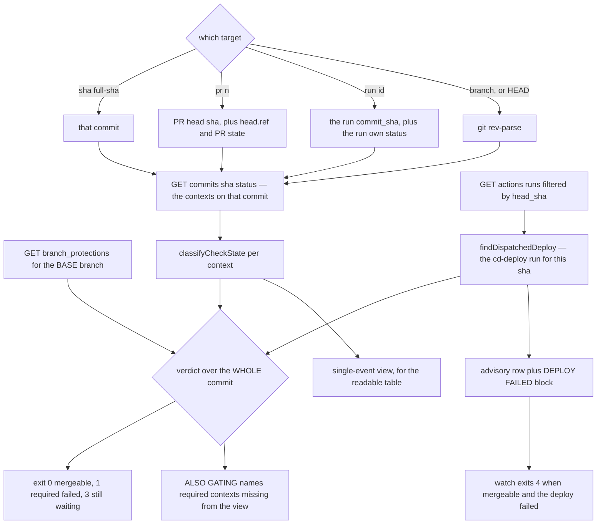
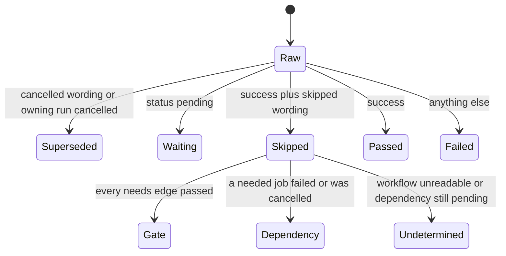

# CI self-serve diagnostics

The forge API in this build (`15.0.3+gitea-1.22.0`, measured) exposes **no log, artifact or per-run-jobs
endpoint**, and no re-run endpoint either. So `scripts/ci-status.mjs` inverts the usual direction: CI
pushes a curated digest into channels the API can already read, and the script reads it back to answer
"is this commit/PR mergeable" and "why did it fail" without a human copy-pasting logs into the session.
Its four entry points are `status`, `watch`, `failure` and `durations`, plus `--selftest`; it resolves the
forge host from the `origin` remote **at runtime**, so no host literal exists to keep in sync.

Two facts decide almost every reading:

- **Exit `0` means mergeable, `1` a required context genuinely failed, `2` bad arguments/auth, `3` still
  waiting when `watch` timed out, `4` (`watch` only) mergeable but the dispatched deploy FAILED.** The `3`
  is load-bearing — it is deliberately *not* a failure, because there is one runner and a saturated queue
  is the normal state of this repository. `4` is no verdict's code, so it cannot be misread as either of
  the other two; see the item 823 bullet below.
- **`watch` answers a different question from its exit code.** It waits for advisory contexts too
  (`app-ci / trigger-cd` is the only place a declined or failed deploy is visible), while the exit code is
  decided by the required set alone.



How a lookup flows: the target resolves to one commit, contexts are classified, and the whole-commit
verdict is rendered separately from the single-event view.



The five states `ci-status` reports, and how two of them are derived rather than read literally — the
skipped branch then splits three ways on the `needs:` graph. The dispatched-deploy row below is not one
of the five: it has no commit status to classify at all, so it is resolved from the runs listing instead
(item 823).

Two things this page is not: it is not the digest/bundle producer (see
[CI evidence pipeline](./ci-evidence-pipeline.md)), and it is not the image scanner itself (see
[Infra-image CVE scanning](./infra-image-scanning.md)). What it owns is the *reading* of a CI board —
which contexts exist, what each state means, and which of them are lying.

## Gotchas

- **A dispatched `cd-deploy` run posts NO commit status — so its outcome is resolved from the RUNS
  (item 823, fixed 2026-10-31).** `trigger-cd` dispatches `cd-deploy.yml`, and the dispatched run
  attaches nothing to the commit. Until item 823 a **failed deploy was invisible to every command here**:
  `failure --sha <sha>` answered `No failed jobs on <sha> — checked every event's contexts`,
  `failure --run <id>` answered `posted NO commit status`, and a session watching for the
  `chore(cd): promote` commit simply timed out. **Case study, 2026-10-21:** cd-deploy run **5745** (the UI
  calls it 5744) on `fa79e611` failed at `scan-push`, and the evidence sat in the bundle
  `5745--build-deploy` the whole time, read by hand. Now, for a sha that has a dispatched cd-deploy run:
  - **`status`** adds the advisory row `cd-deploy / build-deploy (dispatched)  failed  run 5745` plus a
    `🚨 DEPLOY FAILED (advisory)` block — and the verdict line and exit code are exactly what they would
    be without the row, because the deploy runs *after* the merge it would be gating. `required` is
    forced false, so no branch-protection glob can claim it.
  - **`watch`** waits for a running deploy as for any advisory context, and exits **`4`** when the commit
    is mergeable and the deploy failed. `4` is no verdict's code, so a caller can tell "the deploy
    failed" from "keep waiting" (`3`) and "CI failed" (`1`).
  - **`failure --sha` / `--run`** prints the deploy's digest from its bundle, `<runId>--build-deploy` or
    `<runId>--prod-apk`. With neither published it prints
    `deploy run <id> FAILED; no evidence bundle published` and exits 1. It never says "No failed jobs".

  **Two payload shapes silently defeat a resolver written from the GitHub docs.** A dispatched run
  carries **`event: ""`**, with the event in **`trigger_event`**; and it carries its sha as
  **`commit_sha`**. A resolver keyed on `event`/`head_sha` matches nothing and stays silent — the
  GitHub spellings are accepted too, so a payload that fills them still matches. And the bundle is named
  by the run's **`id`**, never by `index_in_repo`, which is the number the UI shows: run 5745 is "5744"
  in the UI, so a name constructed from the UI number 404s for a bundle that exists. The newest run by
  `id` wins, so a re-run decides, and a `cancelled`/`skipped` deploy is not `passed` — it is not a deploy
  either.

  **The deploy runs on main's head AT DISPATCH TIME, which is not always the commit whose CI dispatched
  it.** On 2026-10-21 `trigger-cd` passed on `7cc3c304`, and the deploy ran on `fa79e611`, a marker
  commit pushed in between. `status` on the first therefore says
  `no deploy dispatched for this sha — trigger-cd passed …`; run `status` on the commits after it in
  `git log --first-parent main`. `scripts/__tests__/ci-status.test.mjs` pins all of this against the real
  2026-10-21 payloads (`fixtures/ci-status/dispatched-failed.json` and its `success`/`in-progress`/
  `rerun` siblings), including that a running deploy is outstanding in both the view and the gate while
  still not holding the merge verdict, and that exit 4 is a code no verdict produces; a drift guard
  asserts the two bundle jobs match the cd-deploy jobs that actually run a digest step, and
  `ci-status --selftest` carries the case too so the trap is classified without a forge. The exit codes
  themselves are stated in [the CLI contract](../../specs/084-silent-failure-visibility/contracts/cli-contracts.md).
- **`app-ci / app-image-scan` is REQUIRED, and it moves the deploy gate onto the pull request (spec 084
  US3).** Until spec 084 the six app images (`mc-service`, `mcm-bff`, `agent-gateway`, `movie-mcp`,
  `web-api-mcp`, `spreadsheet-mcp`) were scanned in exactly one place — cd-deploy's `scan-push`, which
  runs **after** the merge. A fixable Critical introduced by a base-image or dependency bump therefore
  passed every PR check and surfaced as a failed **deploy** on `main`, where nothing blocks (cd-deploy
  run 5745 on 2026-10-21 is that shape). `app-image-scan` closes it: a required app-ci job that runs
  `scripts/cd/scan-app-image.sh` — the deploy gate's per-image scan-and-verdict block, extracted so the
  PR and the deploy share **one** Trivy pin, one flag set and one allowlist
  (`security/infra-images/allowlist.yaml`) — over the images `app-e2e` already built. `app-e2e` tags
  each of them `app-scan/<name>:run-<run id>` immediately after the build, so a later run rebuilding
  `:latest` on the persistent daemon cannot change what is scanned. It runs on pushes to `main` too, and
  `trigger-cd` now `needs:` it, so a vulnerability-database change shows as a red on `main` **before** a
  dispatch. The exit codes are split because one code cannot carry two meanings: a scanner that could
  not run is not a finding, and reporting it as one sends the reader to patch a CVE that was never
  assessed.

  ```mermaid
  flowchart TD
    A["app-e2e builds the six images"] --> B["tag app-scan/name:run-id straight after the build"]
    B --> C{"did the changes job succeed"}
    C -->|"no"| FAIL["fail closed — an unknown app diff is not nothing to scan"]
    C -->|"yes"| D{"changes.outputs.app true"}
    D -->|"no"| P["pass in seconds — nothing to scan"]
    D -->|"yes"| E{"all six run tags present"}
    E -->|"no"| M["missing scan tag(s) — fail, naming them"]
    E -->|"yes"| F["scan each image through scan-app-image.sh"]
    F --> G{"scanner completed"}
    G -->|"no"| SCANERR["exit 10 SCANNER ERROR — no verdict"]
    G -->|"yes"| H{"un-allowlisted fixable Critical"}
    H -->|"yes"| BLOCKED["exit 11 BLOCKING FINDING — names the CVE"]
    H -->|"no"| I["pass"]
    I --> T["trigger-cd requires success before any dispatch"]
  ```

  The PR-time scan's outcomes and where each one leads — the tag check is what stops the job passing
  on images it never found, and the `changes` guard is what stops it passing on a diff nobody could
  evaluate.

  | What you see | Meaning | What to do |
  |---|---|---|
  | `no app path changed — images identical to main's` | nothing to scan; passes in seconds | nothing |
  | `missing scan tag(s): …` | `app-e2e` failed or was cancelled before it built and tagged the images | fix `app-e2e`; the job never passes on images it could not find |
  | exit **10**, `✗ SCANNER ERROR for <image>` | Trivy could not complete (vulnerability DB or registry, after its bounded retries) — **nothing was assessed** | re-run the job |
  | exit **11**, `✗ BLOCKING FINDING in <image>` | an un-allowlisted Critical with an upstream fix; the verdict's table above it names the CVE and the package | patch it (base image or dependency), or add a reviewed, justified, **expiring** entry to the allowlist |

  Every image is scanned even after one fails, so one run names every blocking image. The job runs on
  the same `kvm` runner and the same rootless daemon socket as `app-e2e` (that is where the images are),
  it **fails closed** when the `changes` job did not succeed — an unknown app diff must not read as
  "nothing to scan" — and it removes its six run tags at the end with `always()` while leaving the
  `:latest` images in place, so the tags do not accumulate on the persistent daemon. An allowlist entry
  works in both places at once, because the PR and the deploy read the same file — key it to the
  **digest** (`^<image>:<tag>@sha256:<prefix>`) so a rebuild is scanned unsuppressed. **The residual is
  real: a green PR can still meet a red deploy.** The vulnerability database moves between the PR's scan
  and the deploy's (which is why `main` pushes re-scan before `trigger-cd`), and cd-deploy rebuilds the
  images — its `mcm-bff` bakes the public Keycloak host into the web bundle, though the packages and the
  base image are the same, so the CVE surface is too. `scan-push` therefore stays, unchanged in position,
  as the gate on what is actually **pushed**; a fixable Critical in a PR still fails the PR first, which
  is the whole point of the job. `scripts/__tests__/app-image-scan.test.mjs` pins the wiring (both
  callers go through the shared script and neither runs the scanner itself, the two image lists agree,
  exit 10 takes no verdict, `trigger-cd` requires a passed scan, and `ci-status`'s built-in fallback
  lists the new glob).
- **Two of the five reported check states are misreported by the raw API and must be derived, not
  trusted literally.** A skipped job reads `success` with description "Has been skipped" — but the
  payload does not say *why* it was skipped (see item 396 below); a cancelled-by-newer-push run
  reads `failure` on **every** job it touched, even though nothing was actually broken — the tell is
  that unrelated jobs die together on a change that couldn't have affected them all, confirmed by the
  literal "Has been cancelled" description or the owning run's `cancelled` status. Cancellation is
  tested **first** and both wordings are anchored (`^(?:has been )?cancelled$`), so a genuine failure
  whose message merely *contains* the word cannot be silently reclassified as superseded — that would
  hide a real break. Either signal alone suffices, so a UI wording change cannot turn superseded back
  into failed.
- **There is no re-run endpoint — measured 2026-08-31.** All three plausible shapes answer `404`:
  `actions/runs/{id}/rerun`, `actions/tasks/{id}/rerun`, `actions/runs/{id}/rerun-failed-jobs`.
  Nothing can re-run a job in place, and there is no way to re-run *one* failed job at all.
  Re-triggering means producing a **new head sha** — `git commit --amend --no-edit` (same tree, new
  committer timestamp) plus a force-push re-fires the whole `pull_request` run. Budget for the full
  suite, not for the one job that failed; on this runner a re-run costs ~35 minutes of capacity-1
  time, so it is worth spending only when the evidence says the failure is not about your diff.
- **"Every job died together" has a SECOND cause: a broken `pnpm install`.** A supply-chain policy
  rejecting a fresh transitive produces the identical board shape — every job that installs
  dependencies goes red, with no relationship to the diff. Measured 2026-08-28 on PR #263:
  `affected`, `mc-service-checks`, `naming`, `okf`, `agent-gates`, and `sast` all failed on a
  one-line `@ag-ui/client` bump; the cause was `zod@4.5.1` published 1.7 hours earlier. **When the
  whole board goes red: check `status` for `cancelled` FIRST, then open any one failing job's digest
  and look at which STEP failed.** If it is the install step, the other digests will say the same
  thing — reading all six is wasted effort. See [Renovate](renovate.md) for the cooldown/transitive
  interaction.
- **"Does this branch still contribute?" is a two-dot diff question, not three-dot.**
  `git diff main...branch` reports what the branch adds since the merge base — changes `main` already
  has by another route will appear as still-live work. `git diff main branch` shows what the trees
  actually differ by. Measured on PR #262: three-dot said "three version moves remain unique to this
  PR"; two-dot showed merging it would have downgraded crates, and Renovate autoclosed it minutes
  later.
- **`--run N` — FIXED 2026-09-01 (item 226), and worth knowing what it used to do.** `--run N`
  now resolves the run's own commit and fetches its bundle. It previously did **nothing at all**: the
  flag was parsed and read by no code path, so `resolveSha` fell through to `git rev-parse HEAD` and
  the tool answered about your working copy. **The old failure mode is the one to remember, because
  the class recurs.** It answered "No failed jobs on this commit" — a *confident negative*, not an
  error — which reads as "CI is fine" mid-triage. The empty-result message now names the commit it
  examined (`No failed jobs on 99892b0e — checked every event's contexts`) precisely so a wrong
  target is visible in the answer itself. `watch --branch main` still has the original shape — it
  reports on whatever `main` resolves to locally, which can be several merges stale. **Prefer `--pr
  N` or `--sha $(git rev-parse <ref>)`.** An abbreviated sha is refused outright; a short sha
  returns zero runs and reads as "no CI ran".
- **`app-e2e` is SKIPPED on most pull requests — the board hides its true failure rate.** `app-e2e`
  is path-gated on `changes.outputs.app`. A PR touching only `docs/` or `openwiki/`, or only a
  `scripts/` file the `app` filter does not name (it lists specific scripts, not `scripts/**`),
  renders it `skipped → satisfied` and the board goes green **without the E2E suite ever running**.
  Measured 2026-09-02: of eleven recent `app-ci` runs that looked like a clean green streak, only
  three had actually executed `app-e2e`; the rest were path-gated skips. Two readings of the same
  board therefore both look true — "a long history of green CI" and "roughly a quarter of runs that
  run the suite fail" — and a PR that *does* touch an app path then looks like it introduced a
  regression when it merely exercised something the streak never did. **Before concluding a change
  destabilised CI, isolate runs that actually RAN the job.** The API description distinguishes them:
  `success :: Has been skipped` (did NOT run; proves nothing about the suite), `success ::
  Successful in 28m40s` (ran), `failure :: Failing after 12m43s` (ran and failed). **An all-history
  failure percentage is NOT evidence about recent stability** — it spans months including
  known-broken periods and does not isolate the failure class in question. Use the right data, not
  merely more of it. **Membership in the script list follows one rule**, so a skip can be judged
  rather than merely noticed: a script that DEPLOYS or CONFIGURES what the suite exercises belongs in
  the filter; one that only REPORTS on the run (`ci-status`, `ci-failure-digest`, the e2e tallies,
  `ci-log-step`) does not, because it cannot make the app wrong. Item #520 is the measured
  counter-example that produced the rule — `scripts/agent-stack.mjs` changed how the gateway receives
  its credentials, and `app-e2e`, the only job that would have proven the gateway still starts, was
  skipped because nothing in the filter matched `scripts/**`. The same filter now also decides whether
  `app-image-scan` has anything to scan: `scripts/cd/scan-app-image.sh` is in the `app` filter (spec 084
  US3) precisely so that changing the shared scanner re-runs the job that calls it, and a
  filter-gated-out PR makes the scan pass in seconds with `no app path changed` — a legitimate pass, not
  a scan that found nothing.
- **A ⏳ is not a future pass, and the filter — not the spinner — says whether a job will run.**
  `waiting` can still resolve to `skipped` (path-gated) or `superseded` (cancelled by a newer push);
  both are non-runs that a green board then presents as satisfied. Item 568 hit this twice in one
  afternoon in both directions: a second `app-e2e` execution declared "in flight on main's head"
  resolved `skipped` (docs-only merge, correctly gated out), and the merge commit of the fix itself
  plus the commit after it both resolved `superseded` — three candidate runs, three non-runs. Derive
  it from the FILTER and the changed paths (`git diff --name-only origin/main...HEAD`, then read the
  `app:` / `mobile:` filters in `app-ci.yml`), never from the spinner. Worth knowing while reading
  them: `app` lists **named scripts, not `scripts/**`**, and `mobile` is a deliberate strict subset of
  `app` (no `infrastructure-as-code/docker/**`, no lockfile), so a PR can run the whole web half while
  the emulator half never fires.
- **The "superseded" trap is the dangerous direction: it fails loud, announcing a broken build that
  isn't.** The other misreport (skipped) fails safe. Both were measured against real API responses,
  not inferred from documentation.
- **`ci-status.mjs` must stay dependency-free — `trigger-cd` runs it with no `node_modules`.**
  `app-ci / trigger-cd` runs `scripts/cd-dispatch-gate.mjs`, which imports `ci-status.mjs` to reuse
  its check classification. That job checks out the repo and runs node directly — no `pnpm install`
  step, no `setup-node` — so every module reachable from the gate may import node builtins and
  repo-local files, and nothing else. The graph today also reaches `ci-digest-redact.mjs` →
  `secret-scan.mjs` and `ci-failure-digest.mjs` → `lib/argv-contract.mjs`, so an import added in any
  of them is bound by the same rule. Measured
  2026-09-09, on the merge of PR #400: item 396's needs-graph was implemented with
  `import { parse } from 'yaml'` — a devDependency, so every local test passed — and `trigger-cd`
  then died on `main` with `ERR_MODULE_NOT_FOUND`. The reason this matters: `trigger-cd` is
  *advisory*, so the PR merged green, `main` stayed green, no required context moved — and the CD
  dispatch simply did not happen. A real break that blocks nothing and announces itself nowhere is only
  found by someone reading the advisory row on purpose. The fix is to keep the graph dependency-free;
  the `needs:` extraction is hand-rolled for exactly this reason. Two tests hold the line: one walks
  the import graph from `cd-dispatch-gate.mjs` and fails on any bare specifier; one cross-checks the
  hand parser against the real `yaml` package over every workflow in `.forgejo/workflows/`. Reproduce
  the CI condition locally: copy `scripts/*.mjs` somewhere with no `node_modules` anywhere up the
  tree, then `node -e "import('./cd-dispatch-gate.mjs')"`.
- **A skip annotation is NOT safe to read as "path-gated — this diff doesn't apply" (item 396).**
  `ci-status` used to label every skip `(path-gated → satisfied)`. On PR #393 (2026-09-08) that was
  wrong on both counts: the commit touched `agents/**` and `mcp-servers/**`, which are in app-ci's
  `changes` filter; `app-e2e` was skipped because `affected`, which it `needs:`, failed on one E501.
  Fixing the lint let `app-e2e` run, and it caught a real defect (gateway → web-api-mcp returned
  421). Had the label been believed, the conclusion would have been "the agent layer does not trigger
  E2E at all" — false, and the end of the investigation. The tool now prints one of three annotations
  based on the `needs:` edges in `.forgejo/workflows/*.yml`: `(path-gated → satisfied)` when every
  upstream `needs:` passed; `(NOT run — needs: X, which did not pass)` when a declared dependency
  failed or was cancelled; `(skipped — cause not determined: …)` when the workflow cannot be read or
  the dependency has not yet reported. A dependency-skipped required context still counts as satisfied
  for the verdict — the merge is blocked by the failed dependency itself.
- **`cd-dispatch / trigger-cd` is NOT a CI result — it is the deploy gate's own answer, and it is
  the ONLY place a declined deploy is visible.** Before item 230, a run that declined to dispatch
  and a run that deployed looked identical from outside — both were advisory, both silent. A commit
  went undeployed for a day because of this (measured 2026-08-22: PR #217's changes reached `main`
  and were never deployed; the advisory job gave no signal). `scripts/cd-dispatch-gate.mjs` now
  publishes its decision as a `cd-dispatch / trigger-cd` commit status: `superseded — <sha> is the
  tip …` and `nothing deployable changed since the last deploy` are `success` (correct non-deploys);
  a guardrails failure, an unfinished run, or no guardrails at all are `failure` and also red the
  job. **Read this status before concluding a deploy was lost.**
  **The semantics are "the tip decides", not "tolerate cancelled".** The gate compares against the
  *effective* tip — the newest commit on `main` that will actually run a workflow — and that
  deliberately skips `[skip ci]` commits, because cd-deploy's own promotion commit is pushed with the
  marker and would otherwise make the commit that legitimately owns the deploy look superseded. The
  dispatch itself sends `{"ref":"main"}`, so cd-deploy builds whatever the tip is, not the sha whose
  CI was just verified: dispatching from a superseded commit would deploy a tree nothing checked.
  Order is also load-bearing — the tip question is answered *before* guardrails are read, since a
  superseded commit's guardrails legitimately report `failure`, and reading them first is exactly the
  wrong answer item #230 was filed for. `decide()` is a pure function so this can be tested without a
  runner; `scripts/__tests__/cd-dispatch-gate.test.mjs` pins it against the incident's own payloads,
  and `scripts/__tests__/app-ci-trigger-cd.guard.test.mjs` pins the workflow wiring (checkout with
  `fetch-depth: 0` before the gate, dispatch conditional on the gate's `dispatch` output). **Since spec
  084 US3 `trigger-cd` also `needs: app-image-scan`** and requires its result to be exactly `success`,
  so a red scan on `main` blocks the dispatch as well as the merge — while a scan that legitimately had
  nothing to do posts `success` too, which is why that job is `always()` rather than skipped.
- **The required-check list is fetched live from branch protection, never hand-maintained.** It
  previously drifted (a hardcoded array missed a check added by a later feature) and let the tool
  report "mergeable" for a PR the forge then rejected outright — measured 2026-07-26: `VERDICT
  mergeable` and exit 0 for PR #103 while `POST /pulls/103/merge` answered **405 "Not all required
  status checks successful"**. Over-reporting mergeable is the dangerous direction here, because a
  wrapper that chains a status check into an actual merge call will attempt a merge that cannot
  succeed. Three consequences: a fetch failure **degrades rather than aborts** (a verdict from a
  possibly-stale built-in list beats no verdict) but the header always says so; the globs come from
  the rule covering the target's **base** branch, since a PR is gated by its base, not its head; and
  the parser returns **null, never an empty array**, when no rule covers the branch — an empty
  required set would mark every context optional and render *everything* mergeable, the same
  over-reporting bug in a louder disguise. **The built-in fallback list has since grown a seventh
  glob**, `app-ci / app-image-scan*` (spec 084 US3) — and the fallback is a *subset* of the live
  protection by design, so it may lag but must never over-claim; a guard test asserts exactly that.
- **A context string carries an event suffix, and getting the event wrong goes wrong in both
  directions.** Ignoring the event over-reports failure (a green push run blocks a PR that was fine).
  Selecting *one* event over-reports **success** — the dangerous direction: a required job that
  failed on `push` while its `pull_request` twin was path-gated to a 2 s skip produced `VERDICT
  mergeable` and exit 0, then `POST /pulls/{n}/merge` answered **405**. Four occurrences: PRs #276,
  #302, #263, and two dependency PRs. **Since item 281 the two concerns are separated**: the
  *verdict* is whole-commit (evaluates every context the globs match, exactly as branch protection
  does); the *view* is one event. When a required context is gated but absent from the view, the
  tool calls it out explicitly in an `ALSO GATING` block — that block is what makes a "green PR"
  405. `--event push` is no longer needed as a merge workaround; use `--selftest` to pin the
  over-reporting direction in tests.
- **Query shape is a correctness rule here, not a performance tweak.** Filtering by the full commit
  SHA is server-side honored and returns a small payload; several other filter parameters are
  silently ignored by the API and fall back to a payload roughly 800x larger — using the wrong query
  doesn't just make a lookup slower, it can make it impractically slow. Measured 2026-07-18:
  `?head_sha=<full-sha>` 15 KB / 0.48 s, `?page=N&limit=M` 82 KB / 1.2 s, and `?limit=N` alone,
  `?status=`, `?event=`, `?branch=` each 12.4 MB / 94 s. The *timings* were taken while the homelab's
  tailnet transmit was throttled to ~135 KB/s by a tun segmentation-offload bug (fixed 2026-07-25),
  so the latency gap has largely closed — the **payload** difference is the durable reason, since
  12.4 MB still has to be transferred, parsed and held. An abbreviated sha is **rejected**: `head_sha`
  is exact-match, so a short sha returns zero runs and reads as "no CI ran".
- **A missing route and an empty result are different facts, and both render as "nothing there".**
  Measured on this build: `/actions/runs/{id}/jobs` answers with a **non-JSON body**, so a naive
  `| jq` dies on a parse error rather than a 404; `/actions/workflows/<file>/runs` is a real **404**;
  `?limit=N` **alone is silently ignored** and returns every run (measured: 3614 runs / 371 KB) while
  it is honoured alongside `page`; `?workflow_id=<file>` **works** server-side (the value is the
  workflow file name); `?trigger_event=schedule` is **silently ignored** and returns the unfiltered
  set; and querying a **padded** sha — one abbreviated in `git log --oneline` and then typed out to 40
  characters — returns `[]` and `{"state":"","statuses":[]}`, indistinguishable from a commit with no
  checks. A filter that does nothing reads as "matched everything"; an empty array reads as "no CI
  ran". Treat "not found in the page" as **unknown**, never as a pass, and filter `trigger_event`
  client-side.
- **A queued run's `started` is the EPOCH, so any time filter hides it (measured 2026-09-26).** The
  fifth measured quirk of `GET /actions/runs`, and the one that bites hardest, because the obvious
  narrowing filter is exactly the wrong one: a run with `status: waiting` reports
  `started: "1970-01-01T00:00:00Z"` — not `null` — so
  `select(.started > "2026-09-25T23:20")` drops every queued run: three runs had
  been created for a push and all three were invisible, which reads exactly like "the push triggered
  nothing". Filter on `status` or `id`, and read `started` only once you know the run has begun; a
  *sort* by `Date.parse(started)` is safe (a queued run sorts oldest), a *filter* on it is not.
- **A scheduled run reports `event: push` — the trigger is in a DIFFERENT field (item 418).**
  `GET /actions/runs` returns **two** event fields per run, and they disagree on every cron run:

  | field | value on a weekly cron run | what it actually is |
  |---|---|---|
  | `trigger_event` | `schedule` | what fired the run |
  | `event` | `push` | the class of the **synthesized payload** |

  Measured 2026-09-12 across **all 68** scheduled runs since 2026-07-31: `trigger_event` is `schedule`
  for every one, `event` is `push` for every one. There is no counter-example, and the `ScheduleID`
  (non-zero only on a cron run) agrees with `trigger_event` throughout — it **is** present in the
  listing, not only on the run-detail endpoint.

  **`github.event_name` inside the job follows `trigger_event`.** A step gated
  `if: github.event_name == 'schedule'` DOES run on the weekly cron. Item 418 read `event`, saw
  `push`, and concluded the repository's only allowlist-expiry check had never once executed; the step
  had in fact been running weekly since the Friday after it was added, and had gone red for three
  consecutive weeks. Nothing was broken. **Do not "fix" a `== 'schedule'` gate from the `event` field.**

  `ci-status.mjs` filters `--event` on `event`, not `trigger_event`, and that is **correct for its
  purpose**: the commit-status context suffix (`… (push)`) is derived from the same `event` field, so a
  cron run's statuses really do land in the `push` view. The two fields answer different questions —
  `event` is "which context bucket", `trigger_event` is "what fired it". To list scheduled runs,
  filter on `ScheduleID !== 0` or `trigger_event === 'schedule'`:

  ```js
  const runs = (await api(`/repos/${owner}/${repo}/actions/runs?page=1&limit=50`)).workflow_runs;
  runs.filter((r) => r.ScheduleID).map((r) => [r.id, r.created, r.workflow_id, r.trigger_event]);
  ```

- **Exit code `3` (still waiting when `watch` timed out) is deliberately distinct from exit `1` (a
  required context failed).** There is a single CI runner in this homelab, so a saturated queue is
  expected and must never be conflated with an actual build failure. An advisory context still
  running at the timeout does **not** change the exit code either: `exit 0 ⟺ mergeable` is
  load-bearing for a `ci-status … && merge` wrapper, so the verdict's own code stands and the
  unfinished advisory row is named instead of silently dropped. Exit `4` is the one addition to this
  table that is `watch`-only, and it exists for the same reason: a mergeable commit whose dispatched
  deploy failed must not be reported as `0` (which reads as "prod got it") nor as `3` (which reads as
  "keep waiting").
- **A pipe throws the exit code away — including exit 3, exit 1 and exit 4.** `ci-status … watch |
  tail -30` reports **`tail`'s** status, so all three arrive as `0`. Measured 2026-09-06: a watch that
  printed `still waiting after 5100s … (exit 3)` in its own output was recorded by the session as
  `WATCH_EXIT=0`. Redirect and read the file instead: `node scripts/ci-status.mjs watch --pr 372
  --timeout 5100 > /tmp/watch.log 2>&1; echo "EXIT=$?"`. `set -o pipefail` also works, but is not on
  by default. The general form of this trap — that `cmd | tail` reports `tail`'s status for any tool —
  is enumerated in [E2E testing](./e2e-testing.md) § instrument traps.
- **Exit `3` twice running is usually SERIALIZATION, not a dead runner.** A merge commit fires
  `app-e2e` on `main`, and with capacity 1 that run takes the runner ahead of every open PR. Measured
  2026-09-06: PR #370's `app-e2e` waited on `main`'s post-merge run from PR #369, then PR #372's
  waited on `main`'s from PR #370. Distinguish the two: a `running` row for your own branch means
  wait; recent rows for *other* branches with nothing for yours means starvation. Use
  `GET /actions/tasks?limit=14` and read `status` not `conclusion` — `conclusion` is `null` even for
  successful tasks in this listing.
- **A ⏳ that will not resolve looks exactly like one that will — and the honest answer is usually
  "wait longer" (measured 2026-09-18).** Both are the absence of a commit status rendered as a state,
  and `actions/tasks` does NOT disambiguate them: a run queued but not yet dispatched has no task row
  at all. PRs #479 and #482 sat ⏳ on `app-e2e` and `infra-image-scan` through two watches (3000 s and
  3300 s), each ending in the correct message — *"still waiting … runner starvation, not failure"*.
  `actions/tasks` showed no row for either job, and that absence was read as "path-gated out, never
  scheduled, waiting is futile." **It was wrong.** The statuses resolved on their own at 11:08:59Z and
  11:18:52Z, roughly seven minutes after the check that declared them dead. Two lessons, in order of
  how much they cost:

  - **Absence in a 50-row shared-queue window is not evidence.** `actions/tasks?limit=50` is capped
    and repo-wide; a busy period pushes your job out of it, and a queued-but-undispatched job was
    never in it. Use the listing to confirm what IS running, never to prove what is not.
  - **A path-gated job does eventually SAY so.** It posts `skipped` (API `success`, description
    `"Has been skipped"`) once evaluated. If a context is genuinely gated out, you get that word; you
    do not get a permanent ⏳. So ⏳ means *not yet evaluated*, whatever the paths say.

  The reliable check is the commit's own status history (carries timestamps and is not a capped window):

  ```bash
  node --input-type=module -e "
  const r=await fetch(process.env.FORGE+'/api/v1/repos/'+process.env.OWNER+'/'+process.env.REPO+'/commits/'+process.env.SHA+'/statuses?limit=50',
    {headers:{Authorization:'token '+process.env.MCM_FORGE_TOKEN}});
  for(const s of await r.json()) console.log(s.context.padEnd(38), String(s.status).padEnd(8), s.created_at);
  "
  ```

  A context whose newest entry is `pending` is still coming. Compare its timestamp with the others: an
  hour behind a green board on this capacity-1 runner is normal serialization, not a dead job.

- **A bundle is named after the JOB, which is not always the tail of the context (item 563).**
  Bundles are versioned `<runId>--<jobName>`, and two shapes of context reach a commit here, nesting
  **differently**: a real Actions check renders as `<workflow> / <job>` **with spaces**, so the job is
  the **tail** (`guardrails / naming` → `naming`); a narrow status a job posts about **itself** by curl
  (`infra-image-scan/weekly`, from items 418/485) carries **no ` / `**, so the tail is a *label*
  (`weekly`, `expiry`) and the bundle-owning job is the **head**. Deriving it with
  `context.split('/').pop()` is right for one shape and wrong for the other, and the wrong answer is
  not a blank — it is a confident sentence: `failure --run 3946` asked for `3946--weekly` and reported
  *"no bundle exists … the job may have died before the digest step ran"*, while the bundle sat there
  as `3946--infra-image-scan`, on the one run that was telling you `main` was failing a required gate.
  The separator-less form is deliberate — branch protection requires `infra-image-scan /
  infra-image-scan*`, and a context with no ` / ` cannot match it, which is the only reason posting
  them is safe. **List the package registry before believing a bundle is absent.**
- **"No digest" and "no digest under my filter" are different claims.** A job that dies *before* the
  digest step runs — runner crash, malformed workflow YAML, a fault in the digest step itself —
  publishes nothing, and `failure` says so rather than reporting "no failure"; that class is a known,
  accepted gap, deliberately not covered by widening host access. Before believing it, drop `--job` and
  look again: measured 2026-08-30 on PR #289, `failure --pr 289 --job "infra-image-scan /
  infra-image-scan"` (the value copied out of this tool's own status table) reported *"1 job(s) failed,
  but no digest was published for them"*, while the digest was on the PR the whole time naming all five
  blocking findings — the marker carries the **bare** job name, the filter compared it against the
  `workflow / job` context form, and an unmatched filter rendered as absence. Both halves are fixed
  (`--job` accepts either form, and a filter that excludes every digest now names what IS available),
  but the habit is the durable protection: **absence reported under a filter is a claim about the
  filter until you have checked without it.** The bundle's own `meta.digestOutcome` is the second
  opinion — it distinguishes "never ran" from "ran, and you did not find it".
- **Do NOT open a PR with an AGit push (`HEAD:refs/for/main`) — a PR's head must be a real branch.**
  AGit creates a PR with no backing branch — its `head.ref` is `refs/pull/<n>/head` — and Forgejo
  treats a non-branch head as untrusted: the run executes **without Actions secrets**, so every
  `${{ secrets.* }}` arrives as the empty string. The failure never mentions secrets.
  `NX_SELF_HOSTED_REMOTE_CACHE_ACCESS_TOKEN` is empty, the cache server rejects the request, and nx
  reports `Misconfigured remote cache endpoint: Requests should respond with text/plain on 401s` —
  which reads as a cache or credential fault. Measured on **2026-08-01** (PR #126), that cost two
  sessions most of a day: the cache server, the token, the object-store bucket, and the nx wrapper
  were each investigated and found healthy, because they *were* healthy, and jobs that never touch the
  nx cache passed, so the failure looked selective and content-specific. The tell is measuring the
  secret's **length inside the job** — `0`, sha256 `e3b0c44298fc` (the empty string) — versus `64` on a
  branch-backed PR; the same commits reopened from a real branch (PR #129) passed first try.
  `scripts/ci-status.mjs` prints a **DETACHED HEAD** warning for this shape because it is invisible in
  the web UI, and deliberately stays silent once the PR is closed or merged — a deleted head branch
  makes `head.ref` revert to the same ref, so the warning would otherwise call a green, correctly-run
  PR untrustworthy (measured on PR #125, opened from a real branch, flagged only after tidy-up).
  Always use `git push origin HEAD:<branch>`.
- **`POST /pulls` needs the write-capable `git credential fill` credential — `MCM_FORGE_TOKEN` cannot
  create a PR.** Measured 2026-08-01: four consecutive `201 Created` (#125, #127, #128, #129) with the
  credential-helper credential, with a full markdown body and an editable PR afterwards. The read
  token answers `403 token does not have at least one of required scope(s): [write:repository]` — a
  scope fact, not expiry, and the same token 200s elsewhere in the same second. That credential split
  recurs: the write credential 403s on `issues/{n}/comments` and 401s on the package registry, so it
  can read neither a digest nor a bundle, while `MCM_FORGE_TOKEN` is the one to use for packages;
  `workflow_dispatch` also needs the write credential. In the dev container VS Code's credential-helper
  proxy forwards the credential over an IPC socket, so `git credential fill` works non-interactively;
  in a bare session with no VS Code attached it returns nothing, and the fallback is to push the branch
  and open the PR in the web UI — **never** AGit.
- **`GET /pulls/{n}` reports `head.sha` as the branch's current tip, not the commit that was
  merged.** After a PR is merged, further pushes to the same branch update `head.sha`, so
  `merged: true` can co-exist with a `head.sha` that is newer than `main` — the PR page reads as
  though it shipped those commits, but `main` does not contain them. Measured 2026-08-01 on PR #119:
  `head.sha` was created **47 minutes after** the merge, because two further commits had been pushed to
  the same branch afterwards. Use `git merge-base --is-ancestor <sha> origin/main` to verify, not the
  API `merged` flag.
- **A PR's `head.sha` is a claim about the BRANCH, never about the merge — only the merge commit's own
  parents are evidence.** The worse shape has no tell at all, because the API is self-consistent and
  wrong: measured 2026-09-19 on PR #498, `state`/`merged` were `closed`/`true`, `head.sha` was
  `a58e4802` (the second commit, pushed *before* the merge), `merge_commit_sha` was `9b394ba4`, and that
  merge commit's parents were `ebbaab71` and `270174d9` — the **first** commit. The forge merged a stale
  snapshot of the branch while reporting a head it had not merged, so one of two commits silently did
  not ship and `git merge-base --is-ancestor a58e4802 origin/main` answered **no**. Run **both** checks
  after any merge you did not watch land:
  `git merge-base --is-ancestor <your-sha> origin/main` **and**
  `git log -1 --format='parents: %P' "$(git rev-parse origin/main)"` — your commit must appear in that
  parent list. Then confirm the **content**, not just the graph
  (`git show origin/main:<path> | grep <what you changed>`); a `0` from that grep is what turned this
  from "the PR merged" into "half of it did". A stranded commit is not lost: rebase it onto the new
  `main` and open a fresh PR — do not reuse the merged branch, since that compounds with the trap above.
- **A scheduled run posts NO commit status — `failure --run <id>` used to exit 0 and say "no failed
  jobs" for a truly failed run (item 485, fixed 2026-09-19).** A `schedule`-triggered run posts **no
  `<workflow> / <job>` commit status at all**. Its red is visible only in the runs listing, the job log
  and the evidence bundle. Nothing attached to the commit says `main` is failing. Previously `failure
  --run <id>` read contexts, found none, and answered `No failed jobs on <sha> — checked every event's
  contexts` with exit 0 — not wrong about what it read, and the opposite of the truth. **Fixed:** the
  run's own `status` field is now carried through from the `--run` lookup; the same command now answers
  with `⚠ Run <id> is FAILED (status=failure conclusion=<unset>) but posted NO commit status` and exits
  1. Note: `conclusion` is `undefined` on every run measured in this forge — a reader that consults
  only `conclusion` sees nothing, and `ci-status` reads both. A red scheduled sweep is now also visible
  on the commit: `infra-image-scan.yml` posts an `infra-image-scan/weekly` status after each sweep.
- **Verifying a branch without opening a PR: `workflow_dispatch` works, but posts no commit
  status.** Feature branches trigger almost nothing on `push:` (guardrails and app-ci scope their
  push trigger to `main`). Both workflows expose `workflow_dispatch`, so a branch can be fully
  verified without a PR — dispatch with the `git credential fill` credential, not `MCM_FORGE_TOKEN`
  (read-only, 403s). Two traps: (1) a dispatched run posts **no commit status**, so
  `ci-status status --sha` keeps saying *waiting* no matter the outcome — read `/actions/tasks`
  instead; (2) **`run_number` in `/actions/tasks` is NOT the bundle ID** — the bundle name comes
  from `GITHUB_RUN_ID` (repository-wide counter), not `run_number` (per-workflow counter). Fetching
  `<run_number>--<job>` returns 404, which looks like "no bundle published". List package versions
  (`GET /api/v1/packages/{owner}?type=generic&limit=10`) and take the newest for the job.
- **Zero checks on a new commit? Read the commit MESSAGE before anything else.** The forge scans
  the **entire** commit message for a CI-skip marker and skips every workflow when it finds one:
  `[skip ci]`, `[ci skip]`, `[no ci]`, `[skip actions]`, `[actions skip]`. It applies to `push`,
  `pull_request`, and `pull_request_sync` alike, and it reads the whole message — so a marker
  quoted in a body paragraph, inside a bullet, or in a code fence silently disables CI for that
  commit. Measured 2026-08-31 on PR #322: a commit whose body *described* cd-deploy's `[skip ci]`
  promotion commit produced zero runs on both the push and the pull request. The tell that separates
  this from a dead runner: `/actions/tasks?limit=40` still shows recent tasks for *other* branches
  (a dead runner starves everything; a skip marker starves exactly one commit). Fix: reword the
  message with `git commit --amend`, then force-push. Quote the marker as `` `skip`-`ci` `` or name
  it in prose when a commit needs to discuss one — never disable the feature.
- **A merged branch is cleaned up by the branch reaper, not by the merge — the repo default never
  covered an API merge, and "always pass the flag" did not hold (item #879).** The mechanism is
  [`.forgejo/workflows/branch-reaper.yml`](../../.forgejo/workflows/branch-reaper.yml), running
  `scripts/reap-merged-branches.mjs --apply`: on every push to `main`, daily at 02:30 UTC — ahead of
  Renovate's nightly 03:00 and its Friday window, so a stale `renovate/*` branch is gone *before*
  Renovate decides whether to reuse it — and on `workflow_dispatch`, so the first run can be proven
  rather than waited for. It deletes a branch only when its tip is an ancestor of `origin/main`, it
  heads no open PR, it is not exempt (`main`, `openwiki-maintenance`), and its tip is older than a 6 h
  grace period; every branch it keeps is printed with the reason it was kept, so the decision is
  auditable rather than merely applied. The open-PR listing **fails closed** (a short read against its
  own `x-total-count`, or any page error, deletes nothing), ancestry that cannot be answered keeps the
  branch, and each delete is leased to the sha that was classified
  (`git push --force-with-lease=<ref>:<sha>`) so a commit pushed meanwhile is never destroyed. That
  lease is why the delete goes through git at all: the forge's `DELETE /branches` endpoint has no such
  precondition. The checkout takes `fetch-depth: 0`, which is load-bearing rather than tidy — a shallow
  clone cannot answer `git merge-base --is-ancestor`, so every branch would read "ancestry
  unanswerable" and nothing would ever be reaped. The job is handed the job's own token, deliberately
  **not** `CD_PUSH_TOKEN`: a deletion job has no business holding a PAT that can push protected `main`.
  Unlike the comment-only jobs this one **goes red on failure**, because a reaper that silently stopped
  reaping is exactly the absence it exists to end. **Still pass `delete_branch_after_merge: true` on an
  API merge** — it removes the branch at once, where the reaper may take until its next run — but treat
  that as a convenience, never as the guarantee. Why the reaper exists is the measurement worth keeping:
  `default_delete_branch_after_merge: true` (enabled 2026-08-29, item #290) is the default for the **web
  UI merge button only**, so an API merge omitting the flag leaves the head branch behind
  (`--data '{"Do":"merge","delete_branch_after_merge":true}'` deletes it; `--data '{"Do":"merge"}'`
  leaves it behind even with the repo default ON). Measured the same evening: PRs #287 and #293 passed
  the flag and their branches were gone; PR #291 omitted it and
  `290-renovate-runbook-dispatch-and-stale-branches` survived the merge and had to be deleted by hand.
  That rule then failed in the field: by 2026-10-30, **33** fully merged branches with no open PR had
  accumulated on `origin`, back to 2026-09-26, and the four `renovate/lock-file-maintenance*` heads left
  by the API merges of PRs #832–#835 produced four empty, red PRs (#874–#877) in that day's window — each
  head already an ancestor of `main`, so each PR was empty and all four went red on `sast` against a
  week-old allowlist. To see what the reaper would do, run `node scripts/reap-merged-branches.mjs`: a bare
  invocation is a dry run and deletes nothing (`--apply` is required) — and a near-miss spelling such as
  `--dry-run` or `--force` is **rejected** rather than silently read as either mode. This is not
  housekeeping: a surviving `renovate/*` branch makes Renovate reuse the stale commit instead of
  regenerating, which is how an empty PR gets opened ([Renovate](./renovate.md), item #290) — and
  `renovate/lock-file-maintenance` in particular is hard-exempt from Renovate's own pruning, so nothing
  else will ever clean it up.
  **Two branches not to delete, and the reaper enforces both:** an open PR's head (deleting it is
  hand-closing by another route, with the same consequence — for a `lockFileMaintenance` branch it marks
  the channel rejected) and an automation-owned branch such as `openwiki-maintenance`, whose workflow
  re-creates it each scheduled run, so a lingering ref there is its normal working state rather than
  debris. `scripts/__tests__/reap-merged-branches.test.mjs` pins each keep-reason with a mutation test,
  so deleting any one check turns the suite red.
- **`durations` — per-step timing exists now, but three traps prevent a naive reading from being
  useful.** `ci-log-step.sh` writes one row per wrapped step into `_step-durations.tsv` (step ·
  seconds · exit · ceiling) on **every** run — success or failure — so a distribution can be built
  from normal completions, not just from failures. The digest uploads it as `step-durations.tsv`, a
  **separate file** in the bundle version (not inside `bundle.json.gz`), so reading 25 runs for a
  calibration costs a few KB rather than 25 full bundle downloads. `ci-status.mjs durations
  [--job] [--runs]` aggregates the distribution and names the runs it drew from. The three traps:
  (1) **Killed steps are CENSORED, not observed, and are excluded from every percentile** — a step
  killed at its ceiling lasted exactly the ceiling; folding it in makes each ceiling a function of
  the previous one, ratcheting tighter on every kill. (2) **The sample only fills forward from the
  first run after item 338** — bundles published before that have no durations file and are skipped
  silently; `runs sampled` in the output is the honest count. (3) **Item 338 shipped: the single
  2700 s job-wide value is replaced by `scripts/ci-step-ceilings.tsv`** — one ceiling per step,
  generated (never hand-edited) by `durations --propose`, with the rule `max(observed) x 3` rounded
  up to a minute and floored at 300 s. `CI_STEP_TIMEOUT_SECONDS` survives as the backstop for
  uncalibrated steps (n < 10 or failure-path-only); a table miss never falls through to unbounded.
  The `app-image-scan` steps (spec 084 US3) are all on that backstop today — listed by name in the
  table's `ON THE BACKSTOP` block with no observations yet — and the job carries its own
  `CI_STEP_TIMEOUT_SECONDS: '900'` bound below its 30-minute job ceiling, so a hung scan fails its step
  and the digest still runs.
  See
  [the evidence-pipeline runbook's ceiling section](../../docs/runbooks/ci-evidence-pipeline.md#recalibrating-the-table)
  for the full arithmetic and guard details.
- **Container-executor step logs are read in-job, before teardown — they do not need host
  persistence.** The wrong mental model ("`$HOME/mcm-ci-step-logs/` disappears when the container
  dies → containerized jobs are undiagnosable") is tempting and false. `Publish failure digest` is
  a step *in the same container*, so it reads the logs before teardown and pushes the evidence
  over the forge API. The absence of leftover files on the host is evidence about leftovers,
  not about diagnosability.
- **Per-STEP instrumentation is the real requirement — per-job coverage was never enough.**
  Before feature 051, 85 of 136 `run:` steps produced no capture. The old coverage gate passed
  if *any one step* was wrapped; `guardrails / naming` had 2 wrapped steps, neither a gate, so a
  naming failure published logs from two unrelated steps. `check-ci-digest-coverage.mjs` now
  requires every `run:` step to be wrapped or carry a justified `# ci-log-step-exempt:` marker.
  Every new CI job forces a choice: instrument it, or write down why it does not need
  instrumentation.
- **Per-COMMAND coverage is the follow-on trap — a substring test is not a parse (item 177 variant 4).**
  "Every `run:` step must be wrapped" was checked by testing whether `ci-log-step.sh` appeared
  anywhere in the block — so a multi-line block passed if the wrapper appeared at the bottom, and
  every command above it ran unwrapped: no log, no `_failed-step` marker, digest names nothing.
  Measured 2026-08-29 on three live steps: `cd-deploy / prod-apk` (`exit 1` on the BASE_DOMAIN
  guard), `devcontainer-image / build-publish` (`: "${REGISTRY:?…}"`), `wiki-maintain / maintain`
  (`exit 2` on a malformed dispatch input). Fix: wrap the whole multi-command block with the heredoc
  idiom so every command runs inside the wrapper. The gate checks PRESENCE, not REACHABILITY — it
  reads YAML and shell as text and cannot verify the wrapper can actually execute where it is placed.
  When a job dies in seconds with no digest content, suspect wrapper preconditions first.
- **The step-log directory is scoped by run AND job — a run-scoped directory causes sibling-job contamination (item 180).**
  `app-e2e` and `dast` run as two jobs of one run on the same self-hosted runner (shared `$HOME`).
  A run-scoped directory gave them one `_failed-step` file and one pool of step logs; whichever
  failed first wrote the marker, and the other published it as its own. Measured on run **#1683**:
  `app-e2e` digest reported `dast-install-latest-docker`, a step in the `dast` job. The fix is
  `$HOME/mcm-ci-step-logs/<run-id>/<job>/`. There is deliberately no run-scoped fallback — one
  would keep reading the sibling's marker on exactly the overlapping runs the scoping is for.
  Writer (`ci-log-step.sh`) and reader (`stepLogDir` in `ci-failure-digest.mjs`) derive the path
  independently and must move together.
- **On a red `app-e2e`, read the `Run health` row FIRST (item 173).** Roughly one run in seven
  *collapses*: every agent/dock spec fails at once, `flaky=0`, and the gateway receives about a
  quarter of its usual turns because the client stops sending them. `scripts/e2e-turn-tally.sh`
  labels this, and its verdict is now a digest field. `verdict=collapsed` means the failures say
  nothing about your diff — the one case where the re-run reflex is correct. `indeterminate` is
  normal on a pull request (gate tier only, feature 056). A collapsed run always fails, so a run
  that produced no digest was not a collapse.
- **Gate verdicts must not depend on line endings.** Two gates violated this in opposite
  directions at the same time. `check-ci-digest-coverage.mjs` was failing CLOSED on Windows
  checkouts (reporting exempt jobs as uncovered) because `\r` broke the exemption-marker regex
  while `\s*` in the job-header pattern swallowed it silently. `check-openwiki-okf.mjs` was
  failing OPEN (timestamp comparison silently skipped) because `.split('\n')` left `\r` on
  values, making `Date.parse` return `NaN`. **A false green is the worse failure; it merges.**
  Fix: split on `/\r?\n/`, normalize at the point of reading, not per-pattern.
- **The two tokens are deliberately different, and the write side degrades rather than fails when
  its token is empty.** `MCM_FORGE_TOKEN` is the READ side (`read:repository` + `read:issue` +
  `read:package`); `CI_DIGEST_TOKEN` is the WRITE side (`write:issue` + `write:package` +
  `read:repository`), stored as an Actions secret. It is deliberately **not** `CD_PUSH_TOKEN` — that
  is a whitelisted-user PAT able to push protected `main`, and spreading it across ~20 jobs to publish
  diagnostics would be a real privilege expansion — and not the run-provisioned `GITHUB_TOKEN` either,
  which cannot write issues or packages. Missing scopes fail loudly naming the scope: a bare 401/403
  is indistinguishable from an expired credential and cost this design a full revision cycle.
  `CI_DIGEST_TOKEN` is an Actions secret, so it is blank exactly when a run is most confusing (e.g. an
  AGit-headed push where every `${{ secrets.* }}` arrives empty — the run of 2026-08-01 collected its
  evidence, could not publish it, printed it to a job log the API cannot serve, and exited 0: zero
  comments, no error, no signal). The digest now falls back: if the run-provisioned token is present it
  posts a commit status `ci-digest/<job>` carrying the failing step name and a truncated excerpt
  (`published`, **`degraded: true`**); if both are absent, `failed:no-credential`. The fallback is
  recorded as `published` rather than `failed` on purpose — `failed` means the evidence did *not* reach
  a channel, and the reader's question is "did the diagnosis get to me?" — so both facts are carried
  instead of collapsed. It publishes no bundle and no PR comment, since the run token has neither
  scope, and truncation never splits a `<redacted-…>` placeholder.
  **Residual:** T034 proved the run token *can* write statuses (a temporary probe on guardrails run
  #1627 left a real status behind) but did NOT prove it is populated on a secretless run — that
  requires an AGit-headed push, which is forbidden. If a secretless run still publishes nothing,
  check this first.
- **A green `app-e2e` publishes a counts-only bundle — a green job of any OTHER kind publishes nothing,
  and the in-job gates are how CI judges its own counts.** `shouldPublish` is three-way: a cancelled run
  publishes nothing, `failure` publishes the full digest, and an **explicit `success`** publishes
  `counts` — a small bundle carrying only the `[e2e-gate]` counts (gate tier and model tier), the
  `[e2e-contention]` tally, the turn-tally verdict, the opt-in full mobile suite's per-flow table, and
  the `web-e2e` `[global-setup]`/`[playwright]` lines, with no PR comment. The source list is
  self-limiting by construction to steps only `app-e2e` produces, so every other green job finds
  nothing and says `digest-outcome=not-needed`. It needs the
  purpose-scoped `CI_DIGEST_TOKEN`, because the run-provisioned token can only write a commit status —
  on that path the counts still reach the job log, narrowed rather than lost. `failed=` / `skipped=` /
  `passed=` are therefore readable from outside on a green `app-e2e`, but only if you go and read the
  bundle.
  Two gates stay in the job rather than depending on someone remembering to look: `app-ci` runs
  `node scripts/e2e-failure-set.mjs gate <web-e2e.log>` right after the web E2E, failing on
  `skipped > 0`, `did not run > 0`, or a log with no summary at all, and a second gate
  (`scripts/e2e-contention-tally.sh --gate`) fails on `refresh_429 > 0` or `session_evicted > 0`.
  **Neither gate may carry `continue-on-error`** — with it restored the step still runs and still prints
  its failure, so the log looks identical while the job passes regardless, which is exactly the state the
  gate was added to end. `flaky` is readable only from the counts bundle, where item 568's
  identities name each flaky test; from a green tick alone, still do not claim "no flakes".
- **`maestro debug output — not present` in a bundle does NOT mean the capture did not happen — it
  may mean the packer dropped a directory (item 241).** The packer originally read
  `~/mcm-ci-last-failure` with a flat `readdirSync` filtered to `*.log`, `_ps.txt` and
  `*.health.json`, so a **directory** matched nothing and was silently dropped. Feature 062's device
  diagnostics land in `container-logs/_mobile-diagnostics/<flow>-attempt<n>/` — exactly such a
  directory. Measured on run **2049**: the runner held the whole Maestro tree; the retrieved bundle
  held 69 files and none came from it; diagnosing the failure needed out-of-band SSH to the CI host —
  the out-of-band step the bundle exists to remove. Fixed: the walk is now recursive (depth 6, 400
  entries). Nested files are admitted by format (`.log .txt .json .ya?ml .md .xml .html`); the flat
  rules are unchanged so a `*.health.json` is not collected twice. Screenshots travel as base64
  manifest entries (3 files / 1 MB each / 2 MB total, `❌`-marked captures first) and `--full`
  decodes them to real PNGs. Step output, `_ps.txt` and device evidence are allocated first from a
  **priority reserve of half the 5 MB cap** (now fair-shared within the reserve, not first-come-
  first-served — the original reserve had the same starvation defect max-min fairness was introduced
  to fix for the pool below it). Bulk device dumps are ranked *below* ordinary container logs by
  **size (>512 KB) as well as by name** — the original demotion was by exact basename (`logcat-full.log`),
  and Maestro 2.10 writes its own bulk logcat as `logs/device-logcat.txt`, which never matched and was
  therefore ranked as priority evidence (measured on run **3434**, 2026-09-15). Every absence is stated
  in the digest itself, not only in `meta`: cap-dropped sources, files over per-file ceilings,
  unsupported formats, and reader-side entries past the 500-entry ceiling. The device-capture line is
  now **three-way**: carried / captured on the runner but not folded into `container-logs` / genuinely
  not present.
- **A bundle's `logs/mc-service.log` is ordered by completion, not by start — read literally it
  manufactures races that never happened (item 568).** mc-service logs its domain event in the same
  emit as the response, at the END of the handler, so a slow request's line appears *after*
  everything that ran during it. Two emitters produce that ordering: `logging_middleware`
  (`backend/mc-service/src/api/middleware/logging.rs`) awaits `next.run(request)` first and only then
  emits the `request completed` event carrying `status` and a numeric `duration_ms`, and each handler
  logs its own domain event (`collection_created`, `collection_deleted`, …) after its command/query
  has returned and just before the response goes out.
  Recover real ordering by subtracting each line's `duration_ms` from its own timestamp to get a
  start time, then sort on that — never trust file order for timing. A fully-reasoned cross-worker
  race hypothesis, built from four adjacent raw lines, nearly triggered a per-worker test-fixture
  redesign; subtracting durations showed the "later" write had actually started earlier, so there was
  no concurrency to isolate at all. Extract the window as a table instead of reading raw lines — the
  token payload drowns the fields that matter:

  ```bash
  # start time = timestamp - duration_ms. Print both, and sort by the START when ordering matters.
  python3 - <<'EOF' < /tmp/mcm-ci-status/<runId>--<job>/logs/mc-service.log
  import sys, json
  for line in sys.stdin:
      i = line.find('{')
      if i < 0: continue
      try: o = json.loads(line[i:])
      except Exception: continue
      f, sp = o.get('fields', {}), o.get('span', {})
      print(o['timestamp'], f"dur={f.get('duration_ms')}", f.get('status'),
            sp.get('method'), sp.get('path') or sp.get('name'), f.get('message'))
  EOF
  ```

  **Two fields settle "who did this" without inference, and one scoping rule ends most cross-worker
  theories outright.** `authorized_party` separates the *actors* even when every E2E worker acts as
  the same subject: `movie-collection-manager` is the browser/BFF session (a test or its teardown),
  `agent-gateway` with `mc-service` in the audience is the agent's downscoped write token.
  `preferred_username` names the *worker* (`e2e_w3_…` is worker 3), which is what distinguishes a
  test's own teardown from another worker's. But check the scoping first: every collection endpoint
  derives `owner_id` from `token.subject` (`api/collections/{list,get,delete,create,update}.rs`), so
  mc-service scopes collections by `owner_id = token.subject` — a foreign worker cannot list, read or
  delete your collection at all, and two lines carrying different `subject` values cannot be acting
  on the same collection regardless of how their timestamps or sequential-looking ObjectIds line up.
  Sequential ObjectIds prove nothing either: ids differing by one only mean concurrent creations in
  the same second, which is consistent with any number of independent writers.
- **A green job that is not `app-e2e` emits nothing — use a commit status recorder when the output must survive (item 457 AC4).** Every other job's green publication finds nothing and uploads nothing. Measured verbatim in `cd-deploy` run 3430: `digest-outcome=not-needed`. The `prod-apk` disk measurement was only ever readable because the job had failed — a step that succeeds at doing nothing leaves no trace. The pattern that closes it (items 418, 268, 485, 457): have the step export its measurement to `$GITHUB_OUTPUT`, then add a recorder that `curl`s it as a commit status. Five properties are load-bearing: **`always()`** so a *failed* run still leaves the record; **`continue-on-error`** so a curl failure cannot be a second gate; **`state` always `success`** with the finding in the description; values carried through **raw**, `<unset>` included; and the **context name must match no required glob** (verify against the live branch-protection list, not by reasoning about separators — `guardrails*` has no ` / ` separator and gates everything). `scripts/__tests__/prod-apk-disk-step.guard.test.mjs` pins the check against the measured glob list.

## Where the procedures live

This page is the distilled map plus the traps. The full exit-code table, the exact endpoints and
payload measurements, the required-check fetch/fallback logic, the `app-image-scan` table with its
allowlist and residual, the token-provisioning recipe with its
read/write split and the degraded fallback, the PR-opening recipe, the branch-deletion rules and their
reaper backstop, and the evidence-bundle hardening details are in
[the source runbook](../../docs/runbooks/ci-diagnostics.md). Its
[PR-opening section](../../docs/runbooks/ci-diagnostics.md#opening-a-pull-request) is the canonical
statement of the AGit rule and of the `POST /pulls` credential split, and the item 823 exit codes and
the `scan-app-image.sh` exit meanings are contracted in
[spec 084's CLI contract](../../specs/084-silent-failure-visibility/contracts/cli-contracts.md).

Related: [CI evidence pipeline](./ci-evidence-pipeline.md) (the producing half — digest, bundle,
durations, ceilings), [Infra-image CVE scanning](./infra-image-scanning.md) (the sweep over the
third-party images, and the shared scanner this page's `app-image-scan` job runs),
[E2E testing](./e2e-testing.md), [Renovate](./renovate.md),
[SAST scanning](./sast-scanning.md), [Testing tiers](../invariants/testing-tiers.md), and
[the CI/CD pipeline](../projects/ci-cd-pipeline.md).
