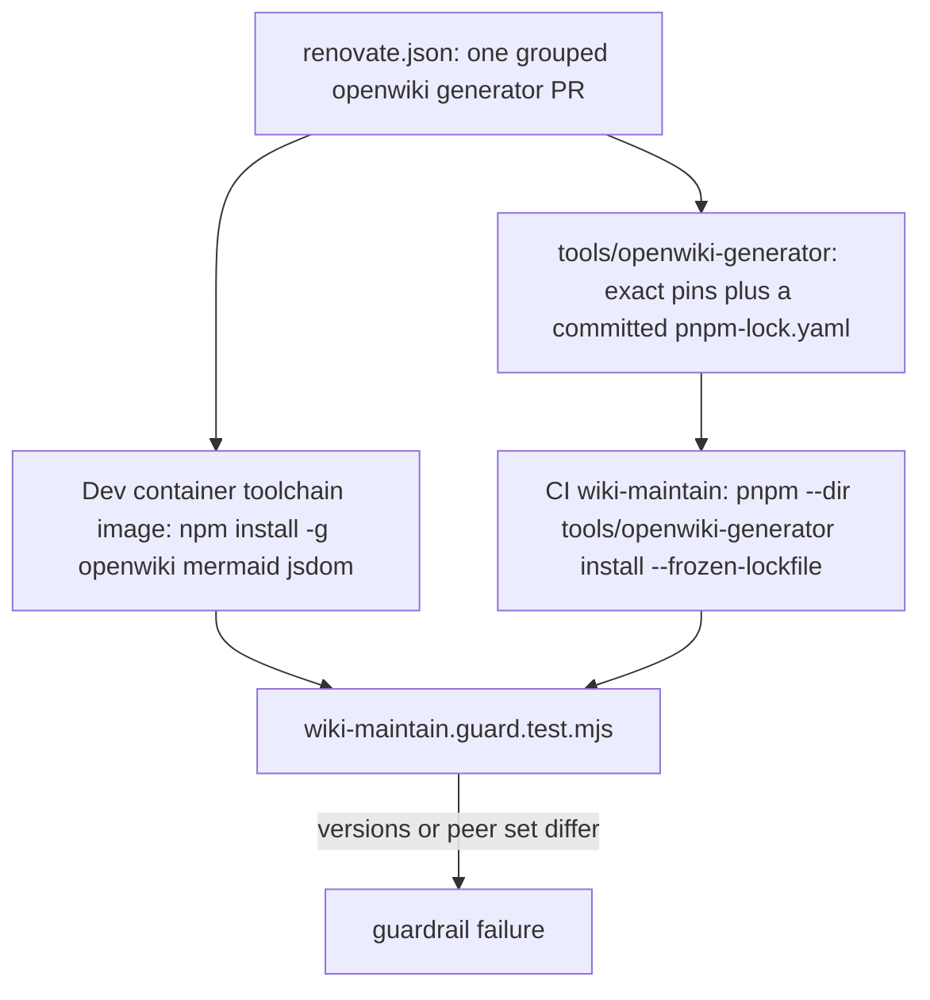

# Developer environment setup (host toolchain)

Covers provisioning a **host** machine with the toolchain MovieCollectionManager's AI-assisted
workflow expects: Node.js (LTS, floor `>=22.13` set by root `package.json` `engines.node`), pnpm
(via Corepack — the exact version pinned by root `package.json` `packageManager`, currently
`pnpm@12.13.0`), Nx (workspace, via `pnpm nx`), Rust (stable), Python 3.13 + `uv`, Docker Desktop
24+, OpenJDK 17, and the Android SDK (Platform 36 as the `compileSdk` the pinned React Native's
Gradle version catalog sets, with Build Tools and an Emulator API 34 system image) for mobile
builds. Everything here is pre-provisioned in the
[containerized dev environment](./devcontainer.md) already — the toolchain image bakes Node from
a `node:24-bookworm` base, resolves pnpm from `packageManager` via Corepack, and installs Android
SDK platform/emulator packages for its `ANDROID_API=34` build arg — this runbook exists
for the case where the containerized path isn't used, or before bringing up
[local dev infrastructure](./local-dev.md).

The `engines.node` floor is the repo's single Node requirement, and it is **enforced**, not
documented: `scripts/check-toolchain-consistency.mjs` reads every `node-version:` in the workflows
and every `FROM node:<v>` in the pinned Dockerfiles and fails the build for any pin below it. The
floor was set from pnpm 11's own `engines` (`>=22.13`); pnpm 12 declares only `>=18`, and the floor
was deliberately **not** lowered — raise it whenever `packageManager` moves to a manager with a
higher floor, or the gate keeps passing pins that manager refuses to run on.

> **Don't hardcode exact patch versions here.** Node and pnpm patch pins drift independently across
> contexts in this repo (CI workflows pin Node `24.19.0` while `frontend/mcm-app/Dockerfile` pins
> `24.22.1`) and are enforced for internal agreement by
> `scripts/check-toolchain-consistency.mjs`, not by this page. Point at the source of truth
> (`engines.node`, `packageManager`, `.devcontainer/toolchain.Dockerfile`) rather than repeating a
> number that will go stale.

## Gotchas

- **Install the pnpm version Corepack resolves from `packageManager`; never `corepack prepare
  pnpm@latest`.** The field is declared exactly once, in the **root** manifest — a workspace
  manifest that declares its own `packageManager` silently wins for anything run inside that
  directory and is maintained by Renovate on its own track, so the consistency gate fails a
  non-root declaration *including one whose value agrees*. Inside the repo, `corepack enable` plus
  `pnpm --version` must print the `packageManager` version.
- **Pin OpenWiki to the exact version the devcontainer toolchain image installs.** A version skew
  between the host and container workspaces can produce structurally different wiki bundles for the
  same repository state — check `.devcontainer/toolchain.Dockerfile` for the pinned version before
  installing globally (currently `openwiki@0.7.1`, with `mermaid` and `jsdom` beside it).
- **Do not copy the host-install snippet from `docs/runbooks/dev-environment-setup.md` §6a.** That
  snippet still names `openwiki@0.5.2`, two minor versions behind what the container image and CI
  install (`0.7.1`) — running it reproduces exactly the host/container skew the parity guard below
  exists to prevent. The authoritative pin is `.devcontainer/toolchain.Dockerfile`.
- **Never invoke the bare `openwiki` CLI on this repo — always go through the Nx target.** The bare
  CLI omits the telemetry opt-out and the raised Node heap size, and reliably OOMs; see
  [OpenWiki bundle generation and maintenance](../process/wiki-maintenance.md) and
  [Nx as the task runner](../invariants/nx-task-runner.md).
- **Never run `openwiki --init` on this repo.** `--update` creates the bundle when none exists,
  which avoids triggering the interactive onboarding wizard and the out-of-repo `.openwiki/.env`
  file it would otherwise write.
- **Windows requires the "Desktop development with C++" Visual Studio Build Tools workload** before
  `cargo build` succeeds — native crates link against it, and skipping it produces a build failure
  disconnected from the missing-toolchain root cause.
- **RTK (Rust Token Killer) is mandatory for AI-assisted sessions**, not optional tooling — it
  compresses terminal output before it reaches the assistant's context (~89% token savings measured);
  skipping it materially degrades agent session quality on this repo's verbose toolchains.
- **Regenerate any wiki bundle before committing it** by running the wiki-update Nx target and
  gating with `pnpm nx okf-lint infrastructure-as-code` — an ungated regeneration can drift from the
  conformance rules silently.
- **Install `mermaid` and `jsdom` as peer dependencies alongside `openwiki` — omitting them silently
  degrades diagram fences to plain text.** From OpenWiki 0.5.x, `mermaid` and `jsdom` are optional
  peer dependencies; without them the generator falls back to a weaker built-in fence check and
  rewrites any Mermaid diagram it cannot verify into a plain `text` fence. The run still exits 0 and
  every gate still passes — the only symptom is a diagram quietly downgraded to preformatted text,
  with no error, no warning, and no diff context to flag it. Install all three packages together at
  the same version the devcontainer toolchain image pins (see
  `docs/runbooks/dev-environment-setup.md` §6a for the invocation and the Node ≥ 22.22
  floor that OpenWiki also requires — above this repo's own `>=22.13` floor).

## How the generator's version is held in step

The dev container bakes a global `openwiki` + `mermaid` + `jsdom` into its toolchain image with
`npm install -g openwiki@0.7.1 mermaid jsdom` (there is no repository checkout at image-build time);
a CI runner has no such copy, so the wiki-maintain job installs the same three **exact** pins from
the **committed lockfile** in `tools/openwiki-generator/`
(`pnpm --dir tools/openwiki-generator install --frozen-lockfile`). The two halves must name the same
version and the same peer set: `scripts/__tests__/wiki-maintain.guard.test.mjs` extracts the
container's *real* install command line — skipping comment lines, because the Dockerfile also names
the install in prose and a whole-file regex happily matches the comment — and fails if the versions
or the `mermaid`/`jsdom` set diverge, which is why Renovate moves both halves in one grouped
`openwiki generator` PR. A host install that ignores the container's pin therefore diverges from
both the container and CI.

Where the generator's two pin sites come from, and the guard that keeps them in agreement.

`tools/openwiki-generator/` is deliberately its **own pnpm workspace root**, outside the root
workspace globs (`frontend/*`, `packages/*`): inside the root workspace pnpm would apply the root's
settings — which set no cooldown — and the root lockfile, so nothing below would take effect. That
absence is itself deliberate: the root `pnpm-workspace.yaml` records that a pnpm-level
`minimumReleaseAge` there BREAKS cold `pnpm install --frozen-lockfile` in the BFF/agent Docker builds
and CI, because on an empty store pnpm fetches registry metadata and rejects any pinned dependency
published younger than the threshold while a frozen install cannot re-resolve to an older version.
The generator's `pnpm-workspace.yaml` can therefore carry the cooldown only because it is a separate
root; it sets `minimumReleaseAge: 4320` (three days, matching `renovate.json`'s catch-all) and pnpm
applies it **twice**: at *resolve* time, so a lockfile regeneration — Renovate's or a human's —
cannot pick a transitive younger than the window, and at *install* time, so a frozen install fails
`ERR_PNPM_MINIMUM_RELEASE_AGE_VIOLATION` rather than install a locked entry inside it. The gap this
closes is real and measured: run 4950 died 404-ing on an `openai` release two minutes old, because
the old step pinned only `openwiki` and resolved its whole transitive tree at run time.

Exclusions from the cooldown are **security-floor exceptions only**, never impatience — the
generator runs with a model credential. The guard requires each `minimumReleaseAgeExclude` entry to
be one exact `name@x.y.z` (never a bare name or a range) that an `overrides:` floor in the same file
requires at or above that version, so it admits nothing else; the root's `overrides:` map does not
reach this directory, so a floor the generator's tree needs is repeated here by hand. **No exclusion
is in force today**: the last one, `@azure/identity@4.14.1`, was removed once it cleared the window.
The two floors the file keeps are `body-parser` `>=2.4.0` (GHSA-27r3-jxmh-p828) and
`@azure/identity` `>=4.14.1` (GHSA-xcx6-jx8p-x3h5). The same guard also fails a root workspace glob
that would swallow `tools/openwiki-generator`, and the generator manifest may not declare a
`packageManager` of its own — it is run as `pnpm --dir` from the root.

The manifest and the lockfile are checked against each other offline, so a manifest edited without
regenerating `pnpm-lock.yaml` fails a guardrail job rather than surfacing only on the paid runner:
`tools/openwiki-generator/package.json` must declare exactly `jsdom`, `mermaid` and `openwiki`, each
as an exact `x.y.z` version (no ranges), and the lockfile importer's specifier and resolution for
each must equal the manifest. The workspace also allows exactly one install script,
`better-sqlite3`, because openwiki's LangGraph checkpointer loads its native binding at run time and
its install script already ran under the old `npm install -g`; every other package's build script
stays denied.

Because the tree is locked, CI must never resolve the generator at run time: the guard rejects a
`npm install -g`, an `npx ... openwiki`, a `pnpm add`/`pnpm dlx`, or an `npm install ... openwiki`
anywhere in the workflow's command lines, requires the locked binary to be placed first on
`$GITHUB_PATH`, and requires the installed-generator checks to read
`tools/openwiki-generator/node_modules/openwiki` via `OPENWIKI_ROOT` — with a `command -v openwiki`
check so a global that happens to be on the runner's PATH cannot stand in for it. The same verify
step treats a skipped check as a failure, because the pinned-version assertions skip wherever the
pinned generator is absent (every other guardrail job) and a skip reads as a pass.

Full pinned-version table, per-tool install commands, and the Claude Code plugin list:
`docs/runbooks/dev-environment-setup.md`.
