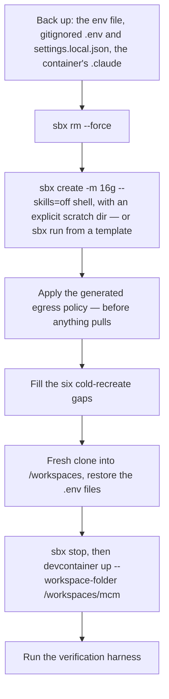
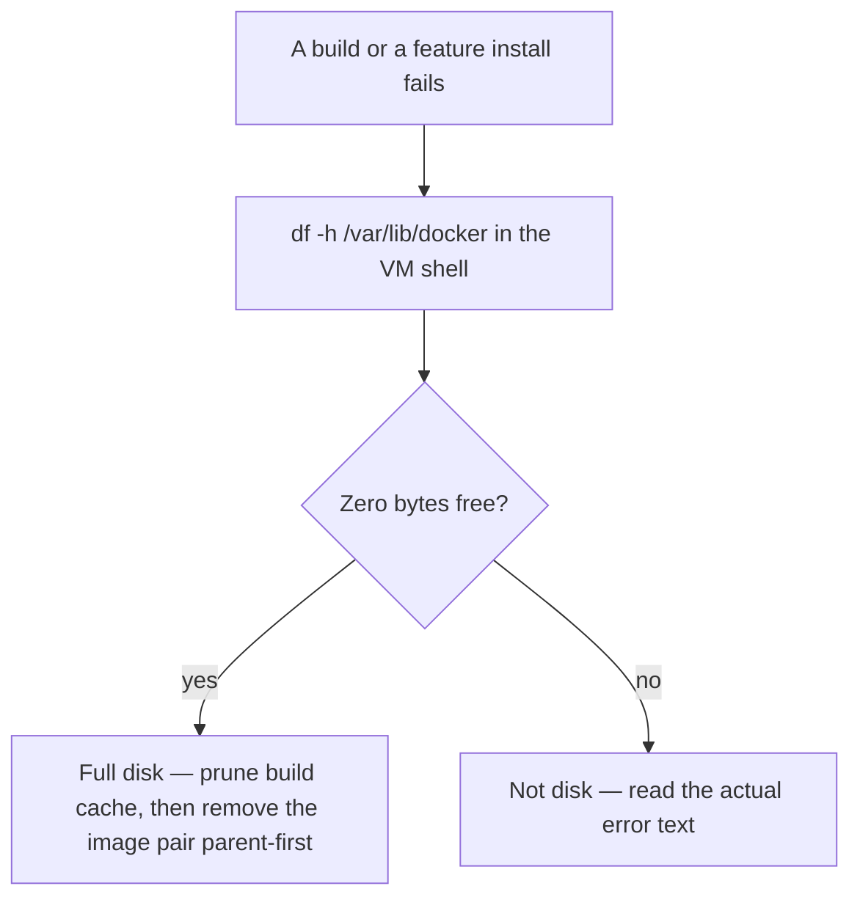
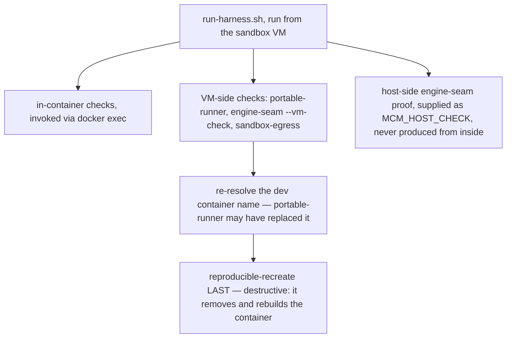

# Dev container on Docker Sandbox microVM — lifecycle (recreate, disk, harness, sbx upgrades)

This is the **lifecycle companion** to the primary-environment runbook. The day-to-day operating
manual — the credential rule, getting in, layering, egress, the engine seam, networking, ports, git
and credential injection — is [Dev container on Docker Sandbox microVM (primary environment)](./devcontainer-sandbox.md).
Everything below is about recreating, resizing, verifying and upgrading the sandbox.

The source was **split into two files on 2026-10-10 (item #682)**:
[`docs/runbooks/devcontainer-sandbox.md`](../../docs/runbooks/devcontainer-sandbox.md) and
[`docs/runbooks/devcontainer-sandbox-lifecycle.md`](../../docs/runbooks/devcontainer-sandbox-lifecycle.md).
**Section numbers are shared between them**, so a `§8b` reference means the same section in either
file — and any section reference on this page names which file it comes from.

The credential rule still applies here: never set `ANTHROPIC_API_KEY` in this environment (see
[secrets management](../invariants/secrets-management.md) and `§0` of the operating manual).

## The recreate sequence, in one picture



*The full recreate order: save, destroy, create, policy, gaps, provision, verify. Instantiate → apply policy → provision is the load-bearing part — provisioning before the policy is applied is refused instantly, and the backup comes first because `sbx rm` is total.*

## Templates and recreate-from-nothing (§7b)

`sbx template save` snapshots the VM root filesystem into a reusable template, and a sandbox can then
be created from it on any machine. The recreate is **fast but COLD**: the template carries neither the
egress policy nor the Docker images.

- **🔴 Always pass the workspace explicitly.** `sbx run` mounts the **current directory** as the
  sandbox workspace, **read-write over virtiofs**, unless a scratch directory is given. Creating a
  sandbox while sitting in the repository mounts the repository into the VM and destroys the
  host-filesystem isolation this environment exists for — measured 2026-08-16, when a file written
  inside the recreated sandbox appeared immediately in the Windows working copy. The dev container is
  separately isolated from the VM's mounts, but anything run in the **VM shell** can reach a Windows
  mount. The full mechanism is source §7b.
- **A template does not carry the egress policy.** Policy rules are scoped **per sandbox**, so a
  sandbox created from a template gets the *default* profile, not this environment's deny-all plus
  allowlist, and the first `docker pull` is refused. The sequence is therefore **instantiate → apply
  policy → provision**, never instantiate → provision. The rules come from the generator
  ([`scripts/gen-egress-policy.mjs`](../../scripts/gen-egress-policy.mjs), `--format sbx-policy`), one
  `allow network <domain>` line each — never hand-written, never copied.
- **The generator's `--forge-host` must be the bare host.** Read from `~/.mcm-sandbox-env` it carries
  single quotes, and `sbx policy allow` rejects `'host'` as an invalid pattern — one rule fails, so
  **count the applied rules rather than trusting the loop**. A partially applied policy still looks
  like a policy.
- **A template does not contain the Docker images.** `sbx template save` snapshots the VM root
  filesystem, **not** the Docker data disk: a sandbox recreated from a template came up in **4 seconds**
  with **zero images** (measured). Instantiation is quick; the real time is the cold rebuild and
  re-pull that follows — it is *not* the 293 s warm build figure, so treat the "recreate ≤ 15 min"
  budget as covering instantiation **plus** provisioning, never instantiation alone.
- **`sbx template save` stops the sandbox** and holds a lock that blocks other `sbx` commands for its
  full duration (~17 min, ~16.8 GB). Do not run it when you need the environment, and do not conclude
  it failed because `sbx template ls` shows nothing — check whether the sandbox went to `stopped`.
- **The full recreate has a fixed order**, and it is the order above plus the §8b steps: back up
  (§8b) → `sbx rm <name> --force` → `sbx create --name <name> -m 16g --skills=off shell <scratch-dir>`
  → apply the egress policy (§7b) **before** anything pulls → the six §8b gaps → a fresh clone into
  `/workspaces/<name>` → restore the `.env` files → `sbx stop` → `devcontainer up`. `--skills=off` is
  deliberate: the current `sbx` default is `readonly`, which mounts the host skills store into a new
  sandbox unless you opt out.

## Disk and volumes (§8, §7e)

A sandbox has **three independently sized volumes**, each sized by an environment variable read at
**creation** time — which is why resizing means recreate. Confirm which volume is binding before
turning a knob; raising the wrong one changes nothing. The source §8 table lists the devices, their
mount points, what each holds and its variable; the current values are recorded there with their date.
**Identify the Docker volume by its mount point (`/var/lib/docker`), never by device name** — the
shell kit moved it from `vdd` to **`vdf`** (source §10b), and the numbering is not stable across
images.



*`df` is the authority on the Docker volume; the failure messages that indicate a full disk never mention disk.*

- **A full disk never says "disk".** It wore other symptoms three times on 2026-08-17: a feature
  install reporting `exit code: 100` (reads as an apt or feature-config fault), apt reporting
  `is not signed` / `At least one invalid signature was encountered` (reads as GPG or MITM-proxy
  corruption — apt wrote a truncated `InRelease`), and a build dying in `exporting layers` (reads as
  needing more room). **`df` is the authority; `docker system df` is not** — it counts shared layers
  optimistically and reported gigabytes reclaimable while `df` said zero free. Three prunes freed
  "space" that never appeared.
- **Remove the derived image after its parent.** What finally freed space was deleting the derived
  `vsc-mcm`-style image *after* its parent toolchain image was gone; until then the layers were shared
  and deleting either freed almost nothing. **Two dev-container images will not fit at once** — the
  toolchain image is ~14 GB and the derived container another ~13.5 GB — so pulling a new toolchain
  image while the old pair is present exceeds the disk on its own. Removing the previous pair is part
  of re-pinning, not an emergency measure.
- **Build cache can mask a broken environment.** The apt failures above had been present for a while;
  builds "succeeded" by reusing a cached feature-install layer that never ran apt. Pruning the cache
  *revealed* the failure rather than causing it — the same lesson as a skipped test reading as a pass.
- **Never `docker image prune -a`.** It evicts the **3.5 GB** Playwright image the web-E2E recipe
  needs, which must then be re-pulled. `docker builder prune` is the safe lever — it never touches
  images — and `docker image prune` is dangling-only. The distinction inside `builder prune` matters
  too: `-f` alone drops only **unused** cache, while `-af` drops all of it.
- **`/var/lib/docker` is not visible from inside the dev container** (`No such file or directory`),
  and `df /` there reports the Docker volume because the container's overlay upper dir lives on it.
  Establish the topology from the **VM shell**, and **verify a resize from the host**, never with `df`
  inside: on ≤ v0.39.0 a recreate that reuses a deleted sandbox's name can inherit its old volumes, so
  `df` reports the old size as if the resize took. Check the `.img` file sizes instead — and read the
  stamped spec with a **case-sensitive** JSON parser, because it carries both `HTTP_PROXY` and
  `http_proxy`, which PowerShell's `ConvertFrom-Json` rejects.
- **Set the size variables at User scope, not `$env:`.** They are
  `DOCKER_SANDBOXES_DOCKER_SIZE` and `DOCKER_SANDBOXES_ROOT_SIZE` (plus a cloned-workspace size used
  only in `--clone` mode). A User-scope variable reaches neither the current shell nor an
  already-running daemon, so a recreate needs the value exported in the environment the daemon
  inherits — the 2026-10-08 resize sidestepped the question by giving both, then verifying from the
  host. This is load-bearing after an upgrade: **v0.42.0 drops the default Docker volume from 50 GB
  to 10 GB**, so a future recreate that forgets the variable silently gets a far smaller disk than
  the one before it. v0.51.0 also accepts `sandboxOptions.rootSize` / `dockerSize` in an environment
  file; not adopted, the variables still work.
- **Sparse is real only until written.** A fresh volume occupies a small fraction of its declared size
  on the host, but blocks are **never released back** — a deleted 50 GiB volume was still holding
  53.6 GB of real bytes. Treat a declared size as a future host cost, not a free option.

### Relocating the data root off `C:`

There is no supported setting for this. A junction on the `sandboxes` **subfolder** works; junctioning
the parent folder breaks the `sbx` binary that also lives there.

- **🔴 The move breaks SSH until the ACLs are fixed — and that breaks the one-step launcher.** Files
  under the user profile are owner-only; the same files on another volume inherit that volume's ACL,
  which grants `Authenticated Users`. Windows OpenSSH refuses a config it considers world-readable, so
  `ssh <name>.sbx` — and therefore `scripts/open-sandbox.ps1`, which uses the Windows ssh client —
  fails with `Bad permissions. Try removing permissions for user: NT AUTHORITY\Authenticated Users`.
  Restrict the **directory** and let the files inherit: do **not** pass `(OI)(CI)` with `/T`, because
  those flags are meaningless on a file, and `/inheritance:r` then strips the inherited ACEs and adds
  nothing, leaving a file with **no ACEs at all** that not even its owner can read (measured).
- **⚠️ `ssh <name>.sbx` does not work from Git Bash, and the error blames DNS.** `sbx setup ssh`
  writes an `Include` with a **Windows-style absolute path**, which MSYS OpenSSH does not recognise as
  absolute — it resolves it relative to `~/.ssh/`, matches nothing, and silently continues to DNS:
  `Could not resolve hostname <name>.sbx`. That reads as a network or sandbox fault; it is a config
  path that never loaded. Windows OpenSSH (the client VS Code uses) handles the same file correctly,
  so the launcher is unaffected. Diagnose with `ssh -v … 2>&1 | grep -i include` before touching the
  sandbox. (v0.51.0's release notes claim this is fixed; not re-tested.)
- **Re-verify the junction after every `sbx` upgrade** — an MSI could recreate the folder. It survived
  the v0.38.0 → v0.39.0 upgrade, which is evidence, not a guarantee.
- **`sbx rm` on older versions does not reclaim everything** — on ≤ v0.39.0 it left **7.7 GB** of
  containerd template cache behind. That content is reusable, so do not read the leftover as a failed
  delete. v0.42.0 fixes both this and the volume-name-reuse inheritance above.

## A cold recreate needs six things the template does not carry (§8b)

Beyond the egress policy, a sandbox created from scratch is missing setup that nothing in the
provisioning path supplies. The first three were hit on 2026-08-27 and again on 2026-11-03, the
fourth and fifth on 2026-11-03, the sixth on 2026-11-04; **each of the first five stops the recreate
dead, and the sixth stops the first commit.**

1. **The `devcontainer` CLI is not installed** — and the recreate sequence calls `devcontainer up`.
2. **`/etc/docker/daemon.json` has no `insecure-registries`.** The forge registry is plain **HTTP**
   (port 3000), so every pull fails with `http: server gave HTTP response to HTTPS client`. On the
   v0.51.0 shell kit **`/etc/docker` does not exist at all** and `tee` will not create it — `mkdir`
   it first.
3. **`/etc/init.d/docker restart` does not work here.** It exits on
   `ulimit: error setting limit (Invalid argument)`, leaves the new config unapplied, and `docker info`
   keeps answering, so it reads as success. There is no systemd (PID 1 is `tini`). Restart the
   **sandbox** instead (`sbx stop <name>`; the next `sbx exec` brings `dockerd` up with the new
   config).
4. **The toolchain pin may no longer exist.** `MCM_DEVCONTAINER_IMAGE` in the restored
   `~/.mcm-sandbox-env` is whatever was pinned at the last re-pin, and registry retention
   ([`infrastructure-as-code/forgejo/registry-retention.yaml`](../../infrastructure-as-code/forgejo/registry-retention.yaml))
   deletes `mcm-devcontainer` versions beyond the **newest 4 / 21 days**. The old VM never notices — it
   holds the image locally — so the first sign is a recreate failing on `not found`. Check before
   `devcontainer up`: `docker pull "$MCM_DEVCONTAINER_IMAGE"` (after
   `set -a; . ~/.mcm-sandbox-env; set +a`), and **re-pin to the newest tag if it fails** (the re-pin
   procedure is in the operating manual, [§7d](./devcontainer-sandbox.md)). A `docker login` does not
   help — it is not auth.
5. **The VM has no dynamic-linker cache, so VS Code refuses to connect.** The v0.51.0 shell kit is a
   minimal hardened image shipped without `/etc/ld.so.cache`. VS Code's Remote-SSH server check
   locates `libstdc++` through `ldconfig -p`, which reads only that cache, so it fails with *"the
   remote host does not meet the prerequisites for running VS Code Server"* — and its log line,
   *"find libstdc++.so or ldconfig for GNU environments"*, reads as a missing library. Both are
   present (`/sbin/ldconfig`, `libstdc++.so.6` from GCC 14). Generate the cache once; it lives on the
   VM root volume and survives `sbx stop` (verified):
   `sudo /sbin/ldconfig && /sbin/ldconfig -p | grep libstdc`. `devcontainer up` and the harness are
   unaffected — only the VS Code attach path needs it, which is why a 12/12 harness did not catch it.
6. **No git identity, so the first commit in the container fails** with `Author identity unknown`.
   `open-sandbox.ps1` attaches through Remote-SSH to the **VM**, so VS Code copies the VM's
   `~/.gitconfig` into the container — and the VM's has never carried `user.name` or `user.email`.
   Whatever identity the old container had was set in its own home, which a recreate discards. Set it
   on the VM, where every future container inherits it, and in the running container, whose copy was
   already made. No harness check commits, so a 12/12 harness and a read-only git check both miss this.

> ⚠️ **An instant failure is not always a policy refusal.** §7b says a ~1 s failure means the egress
> policy refused the connection, because a network fault times out while a policy refusal is instant.
> True, but incomplete: the HTTP/HTTPS registry mismatch above fails in **0.034 s** and has nothing to
> do with policy. Instant means *rejected before leaving the host*, which has at least two causes —
> read the error text before acting on the timing.

Also expect a CLI `devcontainer up` to install **no personal layer** (the harness's `personal-layer`
check fails with `RTK not found`, and the RTK hook needs its own handling) — see `§8` in the source
runbook. The sandbox engine has its **own** volumes, so the personal layer does not come across from
the Docker Desktop environment: the `mcm-claude` volume is empty on a fresh sandbox and nothing
populates it automatically, so it must be installed once per container creation
(`--dotfiles-repository <url>`, and `ensure-rtk-hook.sh` afterwards if the dotfiles script does not
wire the hook). RTK being present is not the same as RTK being active — the hook entry is what
routes commands through it. That check is a **hard failure**, not a warning: RTK is
constitution-mandated for AI-assisted sessions and is installed out-of-repo, so an environment that
lost it looks completely healthy while violating a MUST. `MCM_ALLOW_NO_RTK=1` downgrades it to a
notice — an explicit opt-out that has to be typed.

### What a recreate destroys, and what to save first

`/workspaces/<name>` is **a plain directory on the VM root volume, not a mount** — the host workspace
directory is empty, so `sbx rm` destroys the working tree. Pushed commits are safe; the local
credential/configuration files are not, and the sandbox env file is the one that hurts, because it
carries the dev-container image pin the rebuild needs alongside the forge host and the credentials.
The source §8b lists exactly what to back up, and two omissions there cost real data:

- The backup must include the gitignored **`settings.local.json`** (the per-project Claude Code
  permission allowlist), not just `.env` files — added after the 2026-11-03 recreate, whose backup
  matched only `.env` files and lost it with the old sandbox.
- The **container's** `~/.claude` (memory, `.claude.json`) lives on its own Docker volume, which
  `sbx rm` takes too, so it needs its own `docker exec`-side archive and `sbx cp` to the host. Restore
  it **without clobbering** the fresh personal layer — `cp -an` the extracted `.claude/` over
  `~/.claude/`, then put its `projects/` and `.claude.json` back explicitly, because the fresh layer's
  `settings.json` carries the RTK hook.

> 🔴 **Validate the archive; do not trust the exit code.** `tar -T -` fed an empty list writes a valid
> **45-byte archive with zero entries**, and `sbx cp` copies it with no error — a backup that exists,
> is named correctly, and contains nothing. This happened on 2026-08-27 when a `sed` in the pipeline
> failed under PowerShell quoting. Always `tar tzf <archive> | wc -l` and compare against the file
> count you expected.

## The false "docker daemon failed to start", and why the fix is ours (§7f)

`sbx run` can report `docker daemon failed to start inside the sandbox` while dockerd is healthy: the
daemon restores every `restart: unless-stopped` container on startup (20 of them here, 54–101 s
measured), the readiness budget is shorter, sbx gives up, the CLI exits, and the ~30 s idle-stop then
kills a VM that had been serving the socket the whole time. (The message names the wrong component,
and it is the single most misleading string this environment produces — it reads as a corrupt VM or a
full disk and is neither.)

There is **no knob** for the budget — no flag, no environment variable, no settings file, no daemon
option — and patching the binary breaks the Authenticode signature on the component that enforces this
environment's isolation and egress. So the fix lives on our side:
[`scripts/open-sandbox.ps1`](../../scripts/open-sandbox.ps1) treats the **exit code as a claim and SSH
answering as evidence**, waiting up to **120 s** on a deadline rather than a loop count (each probe
costs a connect timeout plus a sleep, so a loop count is not a number of seconds), and still throws
with the original exit code and output when a genuinely broken sandbox never answers. Failure
detection is not weakened — only the false negative is removed. **An upgrade does not fix it** — a
later version did not raise the deadline. A bare `sbx run` / `sbx exec` still shows the false failure;
only the launcher is immune, and when starting by hand the window between the CLI's error and the
idle-stop is a live, healthy sandbox: a command issued into it within ~30 s attaches and, being a
session, defers the auto-stop for as long as it runs. Full mechanism, the proof command and the §7f
grace window: source §7f.

## Memory — the OOM killer takes a bystander, not the cause (§7g)

The VM has **16 GiB and no swap**, shared by the dev container, dockerd and every stack. Measured
2026-11-01: one `pnpm nx test mcm-app` spawned **~19 Jest workers** (Jest's default is cores − 1),
the dev container reached **12.3 GiB**, and the kernel's global OOM killer took **Keycloak's JVM** —
the largest single process in the VM. Keycloak restart-looped with exit 137 while the test run
that caused it finished normally. **It reads as a Keycloak or disk fault**; disk was at 81 %.

```bash
sbx exec mcm sh -c 'free -h; dmesg | grep -iE "killed process|oom-kill" | tail -5'
sbx exec mcm sh -c 'docker stats --no-stream --format "{{.Name}} {{.MemUsage}}"'
```

**Two bounds, both pinned by `scripts/__tests__/dev-memory-bounds.guard.test.mjs`** (feature 086):

| Bound | Value | Why |
| --- | --- | --- |
| Jest `maxWorkers`, every config | ≤ 4 (literal integer) | ~0.9 GB per worker at peak; 4 ran mcm-app's 162 suites in 24 s |
| Jest `workerIdleMemoryLimit` | 1.5 GB | replaces a worker that keeps growing, between files |
| Dev container `--memory` / `--memory-swap` | 10 GiB / equal | an exhaustion inside the container is resolved **inside** it |

Budget of the 15.7 GiB VM: dev container 10, dockerd ~1, auth + mcm stacks ~2, ~2.7 headroom.
`dev-ollama` is a sibling **outside** the limit, and a loaded 7B model eats most of that headroom.

The limit applies when the container is **created**. To apply it to a running one without a
rebuild: `docker update --memory 10g --memory-swap 10g <dev-container>`. After a recreate, check it:
`docker inspect -f '{{.HostConfig.Memory}}' <dev-container>` must print `10737418240`, not `0`.

Several sessions testing at once can still exceed 10 GiB. That is the intended failure: a Jest
worker inside the dev container is killed, and the stacks are not.

Two properties of the cap are load-bearing. It is a **literal integer**, not a percentage — the
constraint is memory, and memory per worker does not scale with core count, so `25%` would be 5
workers here and grow on a larger machine with the same RAM. And a CLI `-- --maxWorkers=N` still
overrides the config, so the cap is a default rather than a ceiling on a deliberate run. The guard
enforces both halves over every **git-tracked** Jest config (discovered from `git ls-files`, not a
fixed list, so a new Jest project without a cap fails by name) and over the `devcontainer.json` text
for `--memory`/`--memory-swap`; it reads config values from source rather than executing them, and
asserts that discovery found the known configs, so an empty discovery cannot pass vacuously.

## Verification harness, and the instruments beside it (§10)

```bash
bash .devcontainer/verify/run-harness.sh
```

Twelve verify scripts across **three vantage points** — nine run in-container through `docker exec`,
four VM-side (one of them `verify-engine-seam.sh` in its `--vm-check` mode), and one on Windows. The
host-side check **cannot be faked from inside** (a claim asserted only from within the thing being
claimed about is not proof), so the harness refuses to invent that result and requires
`MCM_HOST_CHECK=pass|fail`; without it the run reports eleven and fails. The expected set is
**enumerated by name** in [`run-harness.sh`](../../.devcontainer/verify/run-harness.sh), because a glob
silently shrinks and a skipped check reads as a pass — a check that did not report is counted as a
failure, never as "not applicable".

**Run it from the VM shell, with `~/.mcm-sandbox-env` sourced — not from inside the dev container.**
Measured 2026-11-03: run inside the container the tally was **9/12**, because the VM-side checks
`portable-runner` and `reproducible-recreate` have no `devcontainer` CLI there. That is an instrument
fault, not a regression.



*Three vantage points in one run, and the two ordering constraints that make the aggregate honest: the destructive check comes last, and the host-side result must be handed in.*

**Ordering is load-bearing twice over.** Beyond the destructive check running last, the harness
**re-resolves the dev container's name immediately before it**: `verify-portable-runner.sh` itself
runs `devcontainer up` and can *replace* the container, so a name captured at the top of the run can
be stale by the time the destructive check starts.

Two counting rules follow from the same principle — a check that did not report must not be
indistinguishable from one that passed. The tally is by **script**, not by invocation:
`verify-engine-seam.sh` is one script run in three modes, and its single slot is green only if **all
three** pass, because a two-of-three engine seam is not a seam. And once any mode of a script fails,
that script **stays** failed for the rest of the run.

**The two runners swap roles on this path.** `verify-portable-runner.sh` exists for SC-006, "the same
committed config runs unmodified under a second conformant runner", and every one of its assertions is
**CLI-side** — it never drives the VS Code extension. On Docker Desktop the extension was the daily
driver and the CLI was the alternate; in the sandbox the **CLI builds daily** and the extension becomes
the unasserted alternate, so this check now covers the primary build path rather than the spare one.

> 🔴 **Running the harness DESTROYS and rebuilds the dev container.** The last check,
> [`verify-reproducible-recreate.sh`](../../.devcontainer/verify/verify-reproducible-recreate.sh),
> removes the container **and its derived image** by design. A `reproducible-recreate` FAIL therefore
> means **the dev container is gone right now**, not that some hypothetical future recreate would
> fail. Check `docker ps` for it before diagnosing anything else; the service stacks survive, so the
> sandbox still looks healthy. The script sources the VM-local image pin and proves the base image is
> present-or-pullable **before** it destroys anything, failing with the dev container still standing
> otherwise — that ordering was added after a 2026-09-19 teardown-then-failed-rebuild left the
> environment with no container at all, and every later check reported `No such container`.
>
> It also takes the **config path as a parameter** and picks its engine proof from it: a config under
> `.devcontainer/sandbox/` gets `verify-engine-seam.sh`, anything else gets
> `verify-engine-isolation.sh`. The two configs' premises are *inverted* (one mounts the engine socket
> on purpose, the other asserts none is mounted), so running the wrong proof reports a topology
> mismatch as a failure. A `--full` variant additionally removes the source volume for a true
> from-scratch recreate and stops after the build, since an empty source volume cannot be verified.

> ⚠️ **`verify-engine-seam.sh --host-check` PASSES VACUOUSLY when Docker Desktop is stopped.** Its
> assertions are all of the form *"the Windows engine does not list X"*, and it does not distinguish
> **"the engine answered and X was absent"** from **"the engine could not be reached at all"**. With
> Docker Desktop shut down every `docker` call fails, so all the assertions pass and it prints a clean
> host-side PASS. Confirm the engine was actually reachable (`docker version` must print a server
> version, not a connect error) before treating the host-side proof as re-verified. Nothing is
> *disproven* by the vacuous run — but it cannot catch a regression that only appears while Docker
> Desktop is up.

> ⚠️ **`firewall-allowlist` has a known first-run failure that passes on a re-run.** Both dated
> verification tables in source §10b record it red on the first harness run after a recreate and green
> afterwards, with no code change — so a first red there is a reason to re-run before treating it as a
> regression. It is also the check that will not sit still: its expectation is **derived from the
> canonical list** rather than carried inline, so adding a destination the live ruleset lacks shows up
> as drift rather than passing quietly.
>
> The general hazard behind it is worth remembering on its own: the dev container returns after a VM
> restart through `restart: always`, which does **not** re-run `postStartCommand` — so a sandbox that
> has only ever been restarted, never `devcontainer up`-ed, can be running without the setup that hook
> supplies. That is why the manual's rule is that the host policy, not an in-container hook, is the
> continuous guarantee.

`verify-firewall-allowlist.sh` carries the **G5 sibling-egress refusal** — the security claim this
whole environment rests on, probed from a **real sibling container**, because inferring it from the
policy's stated scope proves nothing. It is RED by design on the Docker Desktop path, which is what
makes the GREEN here mean something
([`verify-firewall-allowlist.sh`](../../.devcontainer/verify/verify-firewall-allowlist.sh)). Two
further details matter on this path:

- **Its in-VM drift assertion does not apply here, by design (D-18).** The check reads the
  `allowed-domains` ipset, which exists only on the Docker Desktop path; the sandbox container runs
  `--network=host` and enforces egress in the host policy instead, so the script branches on
  `MCM_DEVCONTAINER_PLATFORM=sandbox` and reports the ipset check as not applicable rather than
  failing a working container. **The authoritative list-vs-policy drift check on this path is
  host-side**: `verify-sandbox-egress.sh --audit-check`, which the harness does not fold in and
  cannot fake.
- **A refusal now has two possible bodies** (the pre-v0.47.0 `Blocked by network policy` and the
  v0.47.0 approval-queue form), so a marker-only check can read a working refusal as a breach. Both
  the sibling probe and the default-deny probe accept either.

The host-side proof is only worth reading when it was run properly: Docker Desktop **up**, the
in-container half run first with the probe retained (`KEEP_PROBE=1`) so it exists on the other side of
the boundary, and `MCM_SANDBOX_CONTAINER` set so the real dev container's absence is asserted too —
without that variable the script says so and asserts nothing about it. Do **not** set
`MCM_EXPECT_NO_STACKS=1` here: the retained Docker Desktop path legitimately leaves exited stack
containers on the Windows engine. The exact commands are in source §10.

**The reboot-survival instrument is separate from the harness and is used by the upgrade ritual.**
[`verify-reboot-survival.sh`](../../.devcontainer/verify/verify-reboot-survival.sh) has three modes —
`--capture` records an inventory *before* an event, `--verify` diffs the live environment against it,
`--show` prints it. Two design points carry it: a **missing manifest is a FAILURE, not a skip** (a
survival claim with no recorded before is unfalsifiable), and the manifest is written to the VM *and*
copied off it, because a sandbox that comes back empty must still be able to prove it was not always
empty. It compares existence *and* running state separately, because after a stop/start cycle every
container still existed while the four agent containers were `exited` — an existence-only check would
report PASS on an environment where nothing is serving.

## The `sbx` version, and the ritual before upgrading it (§10b)

**An `sbx` upgrade is a security-relevant change, not a routine one.** `sbx` is a fast-moving, pre-1.0
tool that this environment depends on for **isolation and egress enforcement**, and several behaviours
here are version-specific and undocumented. Record the version whenever you report a problem.

**Currently pinned at `v0.51.0`, upgraded from v0.47.0 on 2026-11-03** (`sbx daemon stop`, then
`winget upgrade --id Docker.sbx --version 0.51.0`). Most of the source was originally measured against
v0.38.0; the dated measurements for each pin are recorded in source §10b. The items that touch this
environment:

- **🔴 The `shell` agent is now a published kit (v0.51.0)** — a Docker Hardened Images **Debian 13**
  image with a Docker engine sbx starts — replacing the `docker/sandbox-templates:shell` image, which
  is **no longer refreshed**. A sandbox created on an older version keeps its old image until it is
  recreated, so it takes a recreate to move off it. The `sbx create` command line is unchanged
  (`… shell <dir>`). The new image is why **the block-device names moved**: the Docker volume is
  `vdf`, not `vdd`, and `/etc/docker` does not exist.
- **CLI output redesigned (v0.48.0)**: state marks and a CREATED column in `sbx ls`, and changed
  `--json` shapes (`sbx ls` is now a bare array). `open-sandbox.ps1` reads `sbx ls --format json` for
  that reason. `--detached` is rejected (we use `-d`); a piped `y` no longer confirms a prompt.
- **CA certificates (v0.49.2)**: the response to the eMudhra CA compromise. Upgrading the CLI does not
  fix an existing sandbox's trust store; recreating it does.
- **Network (v0.49.1–v0.51.0)**: an explicit CIDR deny beats a domain allow; a burst of outbound
  connections no longer crashes the daemon when the host network stalls; policy commands reject an
  empty `--sandbox` instead of applying globally.
- **Memory (v0.51.0)**: `-m` may now go up to the host's total, with a warning above 75 %. Not a
  reason to raise it here: the 2026-11-01 OOM happened with the host at 1.8 GB free.
- **Sizes (v0.51.0)**: environment files accept `sandboxOptions.rootSize` / `dockerSize`, an
  alternative to §8's variables. Not adopted; the variables still work.
- **Git Bash SSH (v0.51.0)**: the release notes say Windows SSH configuration now works with Git
  Bash's OpenSSH too, which would retire §8's "Could not resolve hostname" trap. Not re-tested.
- Still **no `--disk` flag** (checked on v0.51.0); sizes remain §8's variables.

**Verification for v0.51.0 + the shell-kit recreate, 2026-11-03:** the harness run from the **VM
shell** was **12/12 PASS**, `reproducible-recreate` included (the same run from inside the dev
container reported 9/12, an instrument fault — see §10); the G5 sibling-egress refusal **PASS**; the
host-side `verify-sandbox-egress.sh --audit-check` **PASS**, so v0.48.0's `sbx policy` output changes
did not break it; and `verify-engine-seam.sh --host-check` was **NOT RUN**, because Docker Desktop was
stopped, which makes it pass vacuously.

Before upgrading:

1. **Read the release notes for the intervening versions**, specifically for changes to: network
   policy semantics, `--network=host` behaviour, port publishing, the idle-stop timeout, secret
   injection, and template semantics. Each is load-bearing here.
2. **Capture the before-state** with `bash .devcontainer/verify/verify-reboot-survival.sh --capture`.
3. **Upgrade**, then re-run the harness plus the host-side egress audit check.
4. **Re-run G5 explicitly.** A green harness that skipped it proves nothing about the property that
   matters most.
5. **Note the new version** in the source runbook.

**Behaviours a future release could change silently — check each after an upgrade rather than assuming
it held:** there is no `--disk` flag (sizes remain §8's creation-time environment variables); the
idle-stop and the dockerd-readiness budget are hardcoded with no knob; `sbx start` does not exist; and
templates exclude the Docker image store while `sbx run` still defaults the workspace to the current
directory. Later releases have also **tightened** egress (DNS resolution refused without a permitting
rule, PTR lookups only for already-authorized IPs, policy evaluation failing **closed**, raw TCP to a
denied hostname no longer let through by an allow rule for its resolved IP) — none of which widened it,
but all of which can change what a probe sees. Two further changes already landed and are worth
re-checking because scripts depend on them: **`sbx rm` prompts** and a non-interactive prompt answers
*No*, so `--force` is required in any script or agent shell; and **`sbx create`/`sbx run` now take
`--skills=off|readonly|readwrite`, defaulting to `readonly`**, which mounts the host skills store into
new sandboxes unless you opt out. An upgrade has also been observed to leave the relocated data-root
junction, the size variables and both `.img` volumes intact, and to preserve a sandbox's local egress
policy through a UUID migration — treat that as evidence, not a guarantee, and re-verify.

## Where to go next

- Operating manual — credential rule, getting in, egress, the engine seam, networking, ports, git:
  [Dev container on Docker Sandbox microVM (primary environment)](./devcontainer-sandbox.md).
- The retained Docker Desktop / DinD path (Android emulator only):
  [Containerized dev environment](./devcontainer.md).
- The credential rule that still applies here — never set `ANTHROPIC_API_KEY` in this environment:
  [Secrets management](../invariants/secrets-management.md).
- Why the shared `127.0.0.1` port space collides:
  [Published-port reservation](../invariants/published-port-reservation.md).
- Full procedures, measurements and dates: [`docs/runbooks/devcontainer-sandbox-lifecycle.md`](../../docs/runbooks/devcontainer-sandbox-lifecycle.md).
