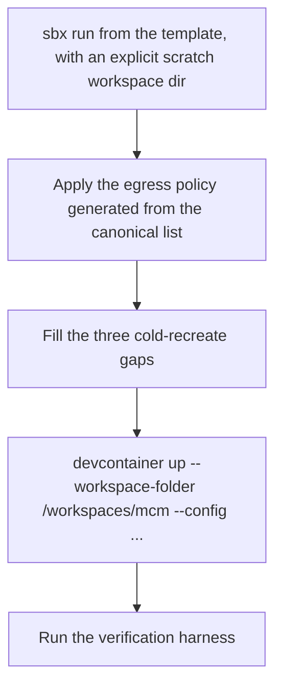
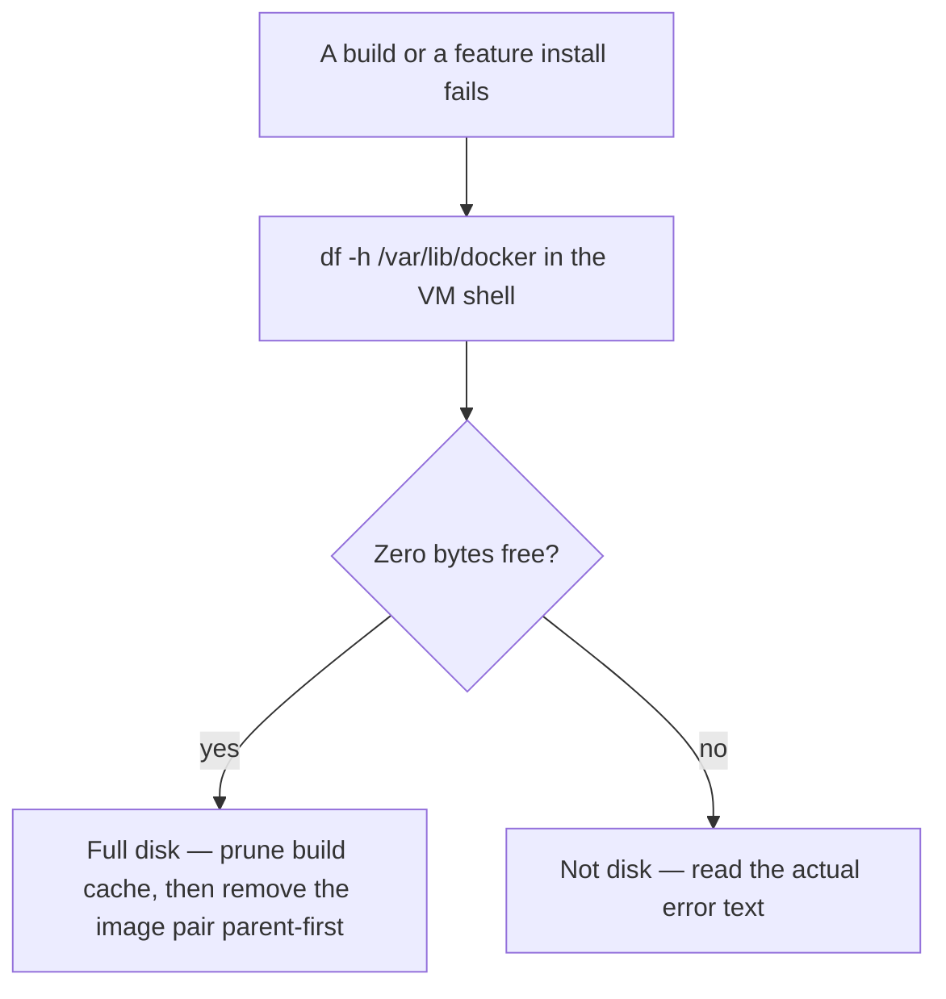

# Dev container on Docker Sandbox microVM — lifecycle (recreate, disk, harness, sbx upgrades)

This is the **lifecycle companion** to the primary-environment runbook. The day-to-day operating
manual — the credential rule, getting in, layering, egress, the engine seam, networking, ports, git
and credential injection — is [Dev container on Docker Sandbox microVM (primary environment)](./devcontainer-sandbox.md).
Everything below is about recreating, resizing, verifying and upgrading the sandbox.

The source was **split into two files on 2026-10-10 (item #682)**:
[`docs/runbooks/devcontainer-sandbox.md`](../../docs/runbooks/devcontainer-sandbox.md) and
[`docs/runbooks/devcontainer-sandbox-lifecycle.md`](../../docs/runbooks/devcontainer-sandbox-lifecycle.md).
**Section numbers are shared between them**, so a `§8b` reference means the same section in either
file — and any section reference on this page names which file it comes from.

The credential rule still applies here: never set `ANTHROPIC_API_KEY` in this environment (see
[secrets management](../invariants/secrets-management.md) and `§0` of the operating manual).

## The recreate sequence, in one picture



*Instantiate, apply policy, provision, verify — the order is load-bearing; provisioning before the policy is applied is refused instantly.*

## Templates and recreate-from-nothing (§7b)

`sbx template save` snapshots the VM root filesystem into a reusable template, and a sandbox can then
be created from it on any machine. The recreate is **fast but COLD**: the template carries neither the
egress policy nor the Docker images.

- **🔴 Always pass the workspace explicitly.** `sbx run` mounts the **current directory** as the
  sandbox workspace, **read-write over virtiofs**, unless a scratch directory is given. Creating a
  sandbox while sitting in the repository mounts the repository into the VM and destroys the
  host-filesystem isolation this environment exists for — measured 2026-08-16, when a file written
  inside the recreated sandbox appeared immediately in the Windows working copy. The dev container is
  separately isolated from the VM's mounts, but anything run in the **VM shell** can reach a Windows
  mount. The full mechanism is source §7b.
- **A template does not carry the egress policy.** Policy rules are scoped **per sandbox**, so a
  sandbox created from a template gets the *default* profile, not this environment's deny-all plus
  allowlist, and the first `docker pull` is refused. The sequence is therefore **instantiate → apply
  policy → provision**, never instantiate → provision. The rules come from the generator
  ([`scripts/gen-egress-policy.mjs`](../../scripts/gen-egress-policy.mjs), `--format sbx-policy`), one
  `allow network <domain>` line each — never hand-written, never copied.
- **A template does not contain the Docker images.** `sbx template save` snapshots the VM root
  filesystem, **not** the Docker data disk: a sandbox recreated from a template came up in seconds
  with **zero images** (measured). Instantiation is quick; the real time is the cold rebuild and
  re-pull that follows, and it is not the warm build figure.
- **`sbx template save` stops the sandbox** and holds a lock that blocks other `sbx` commands for its
  full duration (~17 min, ~16.8 GB). Do not run it when you need the environment, and do not conclude
  it failed because `sbx template ls` shows nothing — check whether the sandbox went to `stopped`.

## Disk and volumes (§8, §7e)

A sandbox has **three independently sized volumes**, each sized by an environment variable read at
**creation** time — which is why resizing means recreate. Confirm which volume is binding before
turning a knob; raising the wrong one changes nothing. The source §8 table lists the devices, their
mount points, what each holds and its variable; the current values are recorded there with their date.



*`df` is the authority on the Docker volume; the failure messages that indicate a full disk never mention disk.*

- **A full disk never says "disk".** It wore other symptoms three times on 2026-08-17: a feature
  install reporting `exit code: 100` (reads as an apt or feature-config fault), apt reporting
  `is not signed` / `At least one invalid signature was encountered` (reads as GPG or MITM-proxy
  corruption — apt wrote a truncated `InRelease`), and a build dying in `exporting layers` (reads as
  needing more room). **`df` is the authority; `docker system df` is not** — it counts shared layers
  optimistically and reported gigabytes reclaimable while `df` said zero free. Three prunes freed
  "space" that never appeared.
- **Remove the derived image after its parent.** What finally freed space was deleting the derived
  `vsc-mcm`-style image *after* its parent toolchain image was gone; until then the layers were shared
  and deleting either freed almost nothing. **Two dev-container images will not fit at once** — the
  toolchain image is ~14 GB and the derived container another ~13.5 GB — so pulling a new toolchain
  image while the old pair is present exceeds the disk on its own. Removing the previous pair is part
  of re-pinning, not an emergency measure.
- **Build cache can mask a broken environment.** The apt failures above had been present for a while;
  builds "succeeded" by reusing a cached feature-install layer that never ran apt. Pruning the cache
  *revealed* the failure rather than causing it — the same lesson as a skipped test reading as a pass.
- **Never `docker image prune -a`.** It evicts the Playwright image the web-E2E recipe needs, which
  must then be re-pulled. `docker builder prune` is the safe lever; `docker image prune` is
  dangling-only.
- **`/var/lib/docker` is not visible from inside the dev container** (`No such file or directory`),
  and `df /` there reports the Docker volume because the container's overlay upper dir lives on it.
  Establish the topology from the **VM shell**, and **verify a resize from the host**, never with `df`
  inside: on older `sbx` versions a recreate that reuses a deleted sandbox's name can inherit its old
  volumes, so `df` reports the old size as if the resize took. Check the `.img` file sizes instead.
- **Set the size variables at User scope, not `$env:`.** A User-scope variable reaches neither the
  current shell nor an already-running daemon, so a recreate needs the value exported in the
  environment the daemon inherits. This is load-bearing after an upgrade: **v0.42.0 drops the default
  Docker volume from 50 GB to 10 GB**, so a future recreate that forgets the variable silently gets a
  far smaller disk than the one before it.
- **Sparse is real only until written.** A fresh volume occupies a small fraction of its declared size
  on the host, but blocks are **never released back** — a deleted 50 GiB volume was still holding
  53.6 GB of real bytes. Treat a declared size as a future host cost, not a free option.

### Relocating the data root off `C:`

There is no supported setting for this. A junction on the `sandboxes` **subfolder** works; junctioning
the parent folder breaks the `sbx` binary that also lives there.

- **🔴 The move breaks SSH until the ACLs are fixed — and that breaks the one-step launcher.** Files
  under the user profile are owner-only; the same files on another volume inherit that volume's ACL,
  which grants `Authenticated Users`. Windows OpenSSH refuses a config it considers world-readable, so
  `ssh <name>.sbx` — and therefore `scripts/open-sandbox.ps1`, which uses the Windows ssh client —
  fails with `Bad permissions. Try removing permissions for user: NT AUTHORITY\Authenticated Users`.
  Restrict the **directory** and let the files inherit: do **not** pass `(OI)(CI)` with `/T`, because
  those flags are meaningless on a file, and `/inheritance:r` then strips the inherited ACEs and adds
  nothing, leaving a file with **no ACEs at all** that not even its owner can read (measured).
- **⚠️ `ssh <name>.sbx` does not work from Git Bash, and the error blames DNS.** `sbx setup ssh`
  writes an `Include` with a **Windows-style absolute path**, which MSYS OpenSSH does not recognise as
  absolute — it resolves it relative to `~/.ssh/`, matches nothing, and silently continues to DNS:
  `Could not resolve hostname <name>.sbx`. That reads as a network or sandbox fault; it is a config
  path that never loaded. Windows OpenSSH (the client VS Code uses) handles the same file correctly,
  so the launcher is unaffected. Diagnose with `ssh -v … 2>&1 | grep -i include` before touching the
  sandbox.
- **Re-verify the junction after every `sbx` upgrade** — an MSI could recreate the folder. It survived
  the v0.38.0 → v0.39.0 upgrade, which is evidence, not a guarantee.
- **`sbx rm` on older versions does not reclaim everything** — it left 7.7 GB of containerd template
  cache behind. That content is reusable, so do not read the leftover as a failed delete.

## A cold recreate needs three things the template does not carry (§8b)

Beyond the egress policy, a sandbox created from scratch is missing setup that nothing in the
provisioning path supplies. All three were hit on 2026-08-27; each stops the recreate dead.

1. **The `devcontainer` CLI is not installed** — and the recreate sequence calls `devcontainer up`.
2. **`/etc/docker/daemon.json` has no `insecure-registries`.** The forge registry is plain **HTTP**
   (port 3000), so every pull fails with `http: server gave HTTP response to HTTPS client`.
3. **`/etc/init.d/docker restart` does not work here.** It exits on
   `ulimit: error setting limit (Invalid argument)`, leaves the new config unapplied, and `docker info`
   keeps answering, so it reads as success. There is no systemd (PID 1 is `tini`). Restart the
   **sandbox** instead, which brings `dockerd` up with the new config on the next `sbx exec`.

> ⚠️ **An instant failure is not always a policy refusal.** §7b says a ~1 s failure means the egress
> policy refused the connection, because a network fault times out while a policy refusal is instant.
> True, but incomplete: the HTTP/HTTPS registry mismatch above fails in **0.034 s** and has nothing to
> do with policy. Instant means *rejected before leaving the host*, which has at least two causes —
> read the error text before acting on the timing.

Also expect a CLI `devcontainer up` to install **no personal layer** (the harness's `personal-layer`
check fails with `RTK not found`, and the RTK hook needs its own handling) — see `§8` in the source
runbook.

### What a recreate destroys, and what to save first

`/workspaces/<name>` is **a plain directory on the VM root volume, not a mount** — the host workspace
directory is empty, so `sbx rm` destroys the working tree. Pushed commits are safe; the local
credential/configuration files are not, and the sandbox env file is the one that hurts, because it
carries the dev-container image pin the rebuild needs alongside the forge host and the credentials.
The source §8b lists exactly what to back up.

> 🔴 **Validate the archive; do not trust the exit code.** `tar -T -` fed an empty list writes a valid
> **45-byte archive with zero entries**, and `sbx cp` copies it with no error — a backup that exists,
> is named correctly, and contains nothing. This happened on 2026-08-27 when a `sed` in the pipeline
> failed under PowerShell quoting. Always `tar tzf <archive> | wc -l` and compare against the file
> count you expected.

## The false "docker daemon failed to start", and why the fix is ours (§7f)

`sbx run` can report `docker daemon failed to start inside the sandbox` while dockerd is healthy: the
daemon restores every `restart: unless-stopped` container on startup (20 of them here, 54–101 s
measured), the readiness budget is shorter, sbx gives up, the CLI exits, and the ~30 s idle-stop then
kills a VM that had been serving the socket the whole time.

There is **no knob** for the budget — no flag, no environment variable, no settings file, no daemon
option — and patching the binary breaks the Authenticode signature on the component that enforces this
environment's isolation and egress. So the fix lives on our side:
[`scripts/open-sandbox.ps1`](../../scripts/open-sandbox.ps1) treats the **exit code as a claim and SSH
answering as evidence**, waiting on a deadline rather than a loop count, and still throws with the
original exit code and output when a genuinely broken sandbox never answers. **An upgrade does not fix
it** — a later version did not raise the deadline. A bare `sbx run` / `sbx exec` still shows the false
failure; only the launcher is immune. Full mechanism, the proof command and the §7f grace window:
source §7f.

## Verification harness (§10)

```bash
bash .devcontainer/verify/run-harness.sh
```

Twelve verify scripts across **three vantage points** — in-container, VM-side, and host-side. The
host-side checks **cannot be faked from inside** (a claim asserted only from within the thing being
claimed about is not proof), so the harness refuses to invent that result and requires
`MCM_HOST_CHECK=pass|fail`; without it the run reports eleven and fails. The expected set is
**enumerated by name** in [`run-harness.sh`](../../.devcontainer/verify/run-harness.sh), because a glob
silently shrinks and a skipped check reads as a pass — a check that did not report is counted as a
failure, never as "not applicable".

> 🔴 **Running the harness DESTROYS and rebuilds the dev container.** The last check,
> [`verify-reproducible-recreate.sh`](../../.devcontainer/verify/verify-reproducible-recreate.sh),
> removes the container **and its derived image** by design. A `reproducible-recreate` FAIL therefore
> means **the dev container is gone right now**, not that some hypothetical future recreate would
> fail. Check `docker ps` for it before diagnosing anything else; the service stacks survive, so the
> sandbox still looks healthy. The script sources the VM-local image pin and proves the base image is
> present-or-pullable **before** it destroys anything, failing with the dev container still standing
> otherwise — that ordering was added after a 2026-09-19 teardown-then-failed-rebuild left the
> environment with no container at all, and every later check reported `No such container`.

> ⚠️ **`verify-engine-seam.sh --host-check` PASSES VACUOUSLY when Docker Desktop is stopped.** Its
> assertions are all of the form *"the Windows engine does not list X"*, and it does not distinguish
> **"the engine answered and X was absent"** from **"the engine could not be reached at all"**. With
> Docker Desktop shut down every `docker` call fails, so all the assertions pass and it prints a clean
> host-side PASS. Confirm the engine was actually reachable (`docker version` must print a server
> version, not a connect error) before treating the host-side proof as re-verified. Nothing is
> *disproven* by the vacuous run — but it cannot catch a regression that only appears while Docker
> Desktop is up.

`verify-firewall-allowlist.sh` carries the **G5 sibling-egress refusal** — the security claim this
whole environment rests on, probed from a **real sibling container**, because inferring it from the
policy's stated scope proves nothing. It is RED by design on the Docker Desktop path, which is what
makes the GREEN here mean something
([`verify-firewall-allowlist.sh`](../../.devcontainer/verify/verify-firewall-allowlist.sh)).

The host-side proof is only worth reading when it was run properly: Docker Desktop **up**, the
in-container half run first with the probe retained so it exists on the other side of the boundary,
and the sandbox container's name supplied so the real dev container's absence is asserted too. The
exact commands are in source §10.

## The `sbx` version, and the ritual before upgrading it (§10b)

**An `sbx` upgrade is a security-relevant change, not a routine one.** `sbx` is a fast-moving, pre-1.0
tool that this environment depends on for **isolation and egress enforcement**, and several behaviours
here are version-specific and undocumented. Record the version whenever you report a problem; the
currently pinned version and the dated measurements for it are recorded in source §10b.

Before upgrading:

1. **Read the release notes for the intervening versions**, specifically for changes to: network
   policy semantics, `--network=host` behaviour, port publishing, the idle-stop timeout, secret
   injection, and template semantics. Each is load-bearing here.
2. **Capture the before-state** with `bash .devcontainer/verify/verify-reboot-survival.sh --capture`.
3. **Upgrade**, then re-run the harness plus the host-side egress audit check.
4. **Re-run G5 explicitly.** A green harness that skipped it proves nothing about the property that
   matters most.
5. **Note the new version** in the source runbook.

**Behaviours a future release could change silently — check each after an upgrade rather than assuming
it held:** there is no `--disk` flag (sizes remain §8's creation-time environment variables); the
idle-stop and the dockerd-readiness budget are hardcoded with no knob; `sbx start` does not exist; and
templates exclude the Docker image store while `sbx run` still defaults the workspace to the current
directory. Later releases have also **tightened** egress (DNS resolution refused without a permitting
rule, policy evaluation failing **closed**, raw TCP to a denied hostname no longer let through by an
allow rule for its resolved IP) — none of which widened it, but all of which can change what a probe
sees. An upgrade has also been observed to leave the relocated data-root junction, the size variables
and both `.img` volumes intact, and to preserve a sandbox's local egress policy through a UUID
migration — treat that as evidence, not a guarantee, and re-verify.

## Where to go next

- Operating manual — credential rule, getting in, egress, the engine seam, networking, ports, git:
  [Dev container on Docker Sandbox microVM (primary environment)](./devcontainer-sandbox.md).
- The retained Docker Desktop / DinD path (Android emulator only):
  [Containerized dev environment](./devcontainer.md).
- Why the shared `127.0.0.1` port space collides:
  [Published-port reservation](../invariants/published-port-reservation.md).
- Full procedures, measurements and dates: [`docs/runbooks/devcontainer-sandbox-lifecycle.md`](../../docs/runbooks/devcontainer-sandbox-lifecycle.md).
