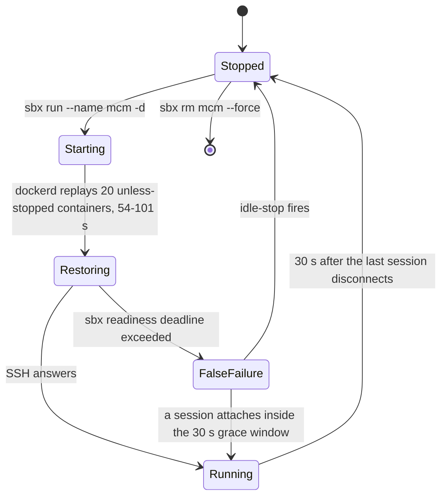

# Dev container on Docker Sandbox microVM (primary environment)

Since feature 060, the primary AI-assisted development environment is a **dev container running inside a Docker Sandbox microVM**, not Docker Desktop and not Docker-in-Docker. It measured **0.43×** the wall-clock of the [Docker Desktop / DinD path](./devcontainer.md) across five stages (`docker-build` alone went 1024 s → 293 s).

The [Docker Desktop path](./devcontainer.md) is retained for one reason only: the **Android emulator**, which needs `/dev/kvm` that the microVM cannot provide (feature 060, gate R2, resolved negative). Everything else — web E2E, integration, the agent stack, day-to-day assistant work — runs here. Why mobile E2E does not: [Android emulator](./android-emulator.md).

**Current pin: `sbx` v0.51.0** (upgraded from v0.47.0 on 2026-11-03, which recreated the sandbox onto the new shell kit). Several behaviours on this page are version-specific and undocumented upstream, so **record the version whenever you report a problem**, and re-check the version-sensitive items after an upgrade rather than assuming they held. An upgrade is a **security-relevant change**, not a routine one — `sbx` is load-bearing for this environment's isolation and egress enforcement, so the ritual (read the intervening release notes for network-policy, `--network=host`, port-publishing, idle-stop, secret-injection and template changes; capture before-state with `verify-reboot-survival.sh --capture`; re-run the harness; re-run G5 explicitly) is required. The release-by-release notes and the dated verification tables for each pin live in the [lifecycle companion](./devcontainer-sandbox-lifecycle.md) — lifecycle §10b.

The source is two files since 2026-10-10 (item #682): the operating manual, [`docs/runbooks/devcontainer-sandbox.md`](../../docs/runbooks/devcontainer-sandbox.md) — credential rule, getting in, layering, egress, the engine seam, networking, ports, git, credential injection — and its lifecycle companion, [`docs/runbooks/devcontainer-sandbox-lifecycle.md`](../../docs/runbooks/devcontainer-sandbox-lifecycle.md) — templates and recreate, disk and volumes, memory, the verification harness, the `sbx` version. **Section numbers are shared between them**, so a `§8b` reference means the same section in either file; to keep that unambiguous, references below are written **`manual §N`** for the operating manual and **`lifecycle §N`** for the companion.



*The sandbox lifecycle: the healthy-but-declared-failed start, the grace window that saves it, and the idle-stop that ends every session.*

## Credential rule — read first

AI-assisted coding runs on the **Claude Max subscription**. `MCM_ANTHROPIC_API_KEY` exists only for the movie assistant (E2E) and OpenWiki. **Never set `ANTHROPIC_API_KEY` in any environment.** Claude Code silently prefers it over a subscription login, with no warning and nothing in the UI showing which is in use. **Measured 2026-08-16: ~$15 of unintended spend in one day** on a workstation where the subscription was present the whole time.

The key is mapped to `ANTHROPIC_API_KEY` **only at the point of use**: agent gateway (`agent-stack.mjs`), OpenWiki maintenance (`wiki-maintain.mjs`), and the containerized E2E recipe. Each is a separate process running no interactive assistant. CI injects `ANTHROPIC_API_KEY` from repository secrets into jobs that also run no assistant.

> The VM itself has `ANTHROPIC_API_KEY=proxy-managed` — that 13-character value is Docker Sandbox's own marker (manual §9), not a leftover.

Channels, per-user stores and the gates that enforce the no-clear-text rule: [Secrets management posture](../invariants/secrets-management.md). Which provider is used where, and why that is environment-scoped: [Model provider scoping](../invariants/model-provider-scoping.md).

## Gotchas

- **`sbx start` DOES NOT EXIST.** The invocation silently prints the root help and appears to do nothing. To start a stopped sandbox: **`sbx run --name mcm -d`**. `sbx stop --help` states this; `sbx start` does not.

- **`--name` is load-bearing on `sbx run`.** Without it, `sbx run mcm` tries to run an agent called `mcm`; omitting `--name` can create a second sandbox instead of restarting the existing one.

- **The VM idle-stops ~30 seconds after the last session disconnects — this is normal, not a fault.** It is hardcoded; there is no configuration knob. Coming back to a "missing" environment usually means it idle-stopped; start it and nothing is lost. Long unattended jobs die unless a session is held open (`ssh mcm.sbx 'sleep 5400'` in another window; launch work with `setsid nohup … &`). The dev container carries `--restart=always` and returns by itself; the agent stack does not (see the agent-stack gotcha below).

- **🔴 `sbx run` reports "docker daemon failed to start inside the sandbox" while dockerd is perfectly healthy — measured five times on both v0.39.0 and v0.43.0.** dockerd restores every `unless-stopped` container on startup (20 of them in this VM), which took 54–101 s; sbx's hardcoded readiness budget is shorter — under ~54 s, with no flag, no `DOCKER_SANDBOXES_*` variable, no settings file and no daemon option to raise it. The CLI exits, which trips the 30 s idle-stop and kills a VM whose dockerd had been serving the socket the whole time. The message names the wrong component. **`scripts/open-sandbox.ps1` is immune**: it treats the exit code as a claim and SSH answering as evidence, waiting up to 120 s. If you started by hand and hit the error, there is a ~30 s grace window while the sandbox is live: `sbx exec mcm sh -c 'docker ps'` issued within that window attaches to the running VM and defers the auto-stop. **v0.43.0 did not raise the deadline** — upgrading is not the fix; the launcher is. Full mechanism and proof command: lifecycle §7f.

  **Prove it before believing the message — read dockerd's own log, not the CLI's summary.** The daemon's log at `…\sandboxd\daemon.log` carries the error record, and that record's `msg` contains dockerd's output: in all five recorded occurrences dockerd reached `Daemon has completed initialization` and `API listen on /var/run/docker.sock` *after* sbx had already declared the failure — on the 14:51 occurrence **1.7 s** after it began serving the socket. `completed_init=True` means the deadline is the fault, not the daemon. Lifecycle §7f has the snippet that reads it.

  **Patching `sbx.exe` is not a fix either**: it breaks Docker Inc's Authenticode signature on the component that enforces this environment's isolation and egress, and every MSI upgrade reverts it. **Fewer restored containers still means a faster start** (~24 s with 11, ~123 s with 20) and `unless-stopped` keeps a manually stopped container down across daemon restarts — so trimming is now a **speed** choice, not a correctness one; bring the stacks back with the documented `nx up-*` targets.

  ```mermaid
  flowchart TD
    A["sbx run --name mcm -d"] --> B["dockerd replays the unless-stopped containers, 54-101 s"]
    B --> C{"sbx readiness deadline, under 54 s, elapses first?"}
    C -->|no| D["sandbox is up and the command returns"]
    C -->|yes| E["CLI exits non-zero: docker daemon failed to start"]
    E --> F{"does a session attach inside the ~30 s grace window?"}
    F -->|yes| G["auto-stop deferred, the VM stays up"]
    F -->|no| H["idle-stop kills a VM whose dockerd was healthy"]
  ```

  *Why the failure message names the wrong component: the deadline, not dockerd, decides the exit code — and the exit code is what starts the countdown that kills the VM.*

- **A `sbx run` that succeeds does not return.** Without `-d` it attaches the interactive `shell` agent and blocks forever with no TTY, so `sbx run --name mcm | tail` never prints — that is a held session, not a hang, and it is the cheapest way to pin the sandbox up while working through `sbx exec`. Use `sbx run --name mcm -d` when you want the command to come back.

- **`sandboxd` does not auto-start at boot.** After a workstation reboot, `sbx run --name mcm -d` starts it on demand. Reaching for `ssh mcm.sbx` first can surface a daemon error that reads like a broken environment rather than a cold host — start with `sbx run`. (`ssh mcm.sbx` does trigger a start by itself, but it does not *wait* for readiness, which is what makes VS Code race the boot.)

- **`init-firewall.sh` is NOT run here.** On the Docker Desktop path the dev container programs its own `ipset`/`iptables` default-deny. On the sandbox path, egress is governed by the **host-side policy** — not the in-VM firewall — for two measured reasons (D-18): `--network=host` makes the container share the VM's network namespace *identically* (`net:[4026532855]` on both sides), so a default-DROP from inside would be **VM-wide**, hitting the sandbox's own policy proxy and every sibling container; and it was never running anyway, because `postStartCommand` is a devcontainer-lifecycle hook that does not fire on a Docker-level restart, while the idle-stop restores containers through Docker. `postStartCommand` runs **`assert-egress-governed.sh`** instead, which verifies rather than re-implements: it fails if a blocked host is reachable **or** if an allowlisted one is not, so a severed network cannot read as a security pass. ⚠️ That guard inherits the same restart blindness — it is a creation/attach-time assertion, not a continuous monitor; the continuous guarantee is the host policy itself, and `verify-firewall-allowlist.sh` re-asserts it on demand. Triage order when something is blocked: **host policy first**, in-VM second. That is the opposite of the Docker Desktop path.

- **`nc -z <ip> 443` reports OPEN against a blocked destination.** The sandbox proxy accepts the TCP connection and refuses at TLS. A connect-only probe will say egress is wide open when it is not. Always probe with a real request.

- **Refusals look different from each vantage point:**

  | From | Blocked destination looks like |
  |---|---|
  | dev container | `rc=6` — NXDOMAIN (DNS-layer refusal); `curl` also writes `000` |
  | sibling container | `rc=6` — NXDOMAIN (DNS-layer refusal) |
  | raw IP from a sibling | `rc=35` — TLS terminated mid-handshake |
  | VM shell, ≤ v0.43.0 | HTTP **403** with `Blocked by network policy` |
  | VM shell, v0.47.0 and later (including the v0.51.0 pin) | HTTP **403** with `Approval required for <host>:<port>.` / `Review and respond with: sbx policy approval ls` |

- **🔴 The v0.47.0 refusal body read as a breach, and the new body queues an approval.** The first harness run after the upgrade reported `example.com is REACHABLE — deny-by-default is NOT enforcing`: the proxy still answered 403, but the check's marker no longer matched, so it took the 403 for the origin's. Both verify scripts now accept both bodies (2026-10-08). The new body also means a refusal creates a **pending approval** (`sbx policy approval ls` lists every refused host with `no matching allow rule (default deny)`). Nothing is let through until a person answers, so default-deny holds — but **`sbx policy approval respond … allow` is a second way to widen egress that bypasses `egress-allowlist.json`. Never use it**: add the destination to the canonical file and apply the generated rule (manual §4), or the next recreate silently loses it. Use `dismiss` to clear the queue.

- **`000` is not a signature — it is curl's placeholder for a request that was never made.** The dev-container row above read "no route — `curl` writes `000`" until 2026-08-27 (item #253), which says route layer and hands you the one field that cannot distinguish the layers. It cost a triage pass: `curl -w '%{http_code}'` against a non-allowlisted host prints `000` and the resolver error goes to *stderr*, so a probe capturing only stdout reports a route-level block for what is actually NXDOMAIN. **Read the exit code, not the status code.** Measured: `getent hosts registry.npmjs.org` (allowlisted) resolves; `getent hosts example.com` (not allowlisted) gives no answer and `curl` exits rc=6. Node surfaces the same refusal as `getaddrinfo ENOTFOUND <host>` — the signature `platform.claude.com` and `mcp.expo.dev` were each first diagnosed from.

- **The allowlist resolves per FQDN, never per apex domain — including MCP endpoints.** A sibling name on an already-allowed domain is a separate entry and is refused without one: `api.expo.dev` answers 200 from the dev container while `mcp.expo.dev` NXDOMAINs. The same front-door-vs-blob-host trap that applies to registries (see manual §4) applies to every second hostname a service uses, MCP endpoints included. Both `mcp.expo.dev` and `mcp.context7.com` were absent from the allowlist and are now added (item #253); apply the running-sandbox procedure from manual §4 if the environment predates the fix.

- **A missing destination does not merely fail a command — it silently retires a merge-gating tier to CI-only.** The tier still *appears* to run (a skip reads as a pass, a fail-closed scanner reports `NOT RUN`), which is why a missing host is triaged as a **blocked gate**, not an inconvenience. The entries whose absence has actually done that: `semgrep.dev` (`guardrails / sast`), `api.osv.dev` (pip-audit, item #394), `registry.ollama.ai` **plus** its pinned R2 blob host (the golden tier, the agent half of `E2E_TIER=gate`, and `nx up-agents-prod`), and `api.themoviedb.org` (the `web-api-mcp` certification lookup). A degraded environment and a real defect are otherwise indistinguishable — feature 068 misdiagnosed two of its three real defects as "environmental" on exactly this ambiguity.

- **A committed destination does NOT reach a RUNNING sandbox.** The host-side policy is scoped **per sandbox** (`--sandbox <name>`) and holds whatever was applied when that sandbox was created, so a new entry in `.devcontainer/egress-allowlist.json` leaves the destination blocked with the commit sitting in git looking like the fix. Apply it as an operator on the Windows host (`sbx policy allow network <domain> --sandbox mcm`, then `sbx policy ls mcm` — the name is **positional** there), and confirm from inside the container with a real request, never `nc -z`. The generator is the only source of the rules: `node scripts/gen-egress-policy.mjs --format sbx-policy`. The same rule reaches a template-created sandbox only if you apply the policy **before** anything pulls — instantiate → apply policy → provision, never instantiate → provision, because such a sandbox gets the **default** profile rather than this environment's deny-all plus allowlist, and the first `docker pull` is refused. A policy refusal is **instant** (< 1 s) while a network fault times out — but an HTTP/HTTPS mismatch fails in 0.034 s too, so read the error text before acting on the timing.

- **The socat relay truncates output — exit 0 with no stdout (D-19).** The dev container reaches the VM engine through `docker-outside-of-docker`, fronted by a socat relay (`/var/run/docker.sock`). socat's half-close timeout defaults to 0.5 s; `docker exec` half-closes stdin immediately, so socat tears the relay down mid-response. Fast commands work, so the seam looks healthy under quick probes; only real work fails. Fix already applied in `.devcontainer/sandbox/devcontainer.json`: `"DOCKER_HOST": "unix:///var/run/docker-host.sock"`. If you invoke Docker from a context that does not inherit `containerEnv`, pass it explicitly: `docker exec -e DOCKER_HOST=unix:///var/run/docker-host.sock …`.

- **A `-v` mount SOURCE is resolved by the daemon, on the VM — not in this container (measured 2026-09-07, item #382).** The `docker` CLI does not open the source path; it sends the mount spec to the engine, which resolves it against **its own** filesystem. Only `/workspaces/mcm` is genuinely shared between the dev container and the VM daemon — write a file here and it appears inside a container. The VM has its own `/tmp` and `/home/coder`, so a path under either is a different directory that merely looks right.

  **A missing source is not an error — the daemon CREATES it as an empty directory.** This is why both failure modes below point away from the actual cause:

  | what you mount | what the container actually gets | how it fails |
  |---|---|---|
  | a session scratch dir under `/tmp/…` | an empty directory the daemon just created | `MODULE_NOT_FOUND … requireStack: [ 'internal/preload' ]` — reads as a broken script |
  | `-v /var/run/docker-host.sock:/var/run/docker.sock` | an empty directory where a socket belongs | `Cannot connect to the Docker daemon` — reads as an image that was never built |
  | `-v /var/run/docker.sock:/var/run/docker.sock` | the real socket | works |

  The socket line is the counter-intuitive one: this container's own `DOCKER_HOST` is `docker-host.sock`, so that is the name you reach for — but as a mount **source** it is resolved VM-side, where the engine's socket is plain `/var/run/docker.sock`. Mount the wrong one and `ls -la /var/run` on the VM afterwards shows a freshly created `docker-host.sock` **directory** sitting next to the real socket; those stubs persist and make the next attempt fail the same way.

  **Probe before you debug the payload:**
  ```bash
  docker run --rm -v "$SRC":/x:ro alpine:3 stat -c '%F %n' /x   # "directory" not "socket" => wrong source
  docker run --rm -v "$SRC":/x:ro alpine:3 ls -la /x            # empty => the daemon invented this path
  ```

  **Stage anything a container must read under `/workspaces`**, not in a session scratch directory — and delete it (or add to `.git/info/exclude`) when done, since it lands in the build context of any `docker build .` from the repo root.

- **`host.docker.internal` is unreachable from the dev container** — Docker's implicit entry resolves to `fe80::1` (link-local IPv6). Under `--network=host`, a sibling's published port *is* localhost. Use `localhost` instead. The gateway and MCP containers still need `--add-host host.docker.internal:host-gateway` (`172.18.0.1`); that flag is load-bearing — keep it.

- **The agent stack does NOT come back after restart.** `movie-assistant-gateway` and the 3 MCP servers are started with `restart=no` deliberately — a restart policy would resurrect the gateway from its pre-rebuild image (the "silently runs old code" trap). Restart explicitly: `MODEL_PROVIDER=anthropic pnpm nx up-agents-prod infrastructure-as-code`. Verify with `verify-reboot-survival.sh --verify`, not by eye.

- **The sandbox has three independently sized volumes, all resizable — but only at creation time.** Corrected 2026-08-27: the previous claim ("49 GB Docker disk, cannot be enlarged") was wrong. Sizes come from `DOCKER_SANDBOXES_DOCKER_SIZE` (the Docker volume at `/var/lib/docker` — every image, layer, and the dev container's own writable layer, which is the `/` the container reports), `DOCKER_SANDBOXES_ROOT_SIZE` (the VM root, which holds `/workspaces/<name>`), and a clone-mode variable this environment does not use. Current values: **Docker 150 GB, root 40 GB**. Set them at **User scope** in PowerShell — a User-scope variable reaches neither the current shell nor an already-running daemon, so the value must be given to both before creating a sandbox.

  The four traps that make a resize silently wrong: identify the Docker volume by its **mount point** (`/var/lib/docker`), never by device name — the v0.51.0 shell kit moved it from `vdd` to `vdf`; **v0.42.0 drops the default Docker volume from 50 GB to 10 GB**, so a recreate that forgets the variable silently gets a far smaller disk; verify from the **host**, not with `df` inside, because on ≤ v0.39.0 a recreate that reuses a deleted sandbox's name can inherit the old volumes; and **sparse is real only until written** — blocks are never released back, so a declared size is a future host cost. There is still **no `--disk` flag** (checked on v0.51.0). Table, knobs and the measured resize: lifecycle §8.

- **Relocating the data root off `C:` breaks SSH until ACLs are fixed.** There is no supported setting for moving the sandbox data root — a junction on `%LOCALAPPDATA%\DockerSandboxes\sandboxes` works (junctioning the *parent* folder breaks the `sbx` binary that lives there), but files on another volume inherit that volume's ACL (grants `Authenticated Users`). Windows OpenSSH refuses a config it considers world-readable, so `ssh mcm.sbx` and `open-sandbox.ps1` fail with `Bad permissions… NT AUTHORITY\Authenticated Users`. Fix with `icacls` on the directory (not the files directly — using `(OI)(CI)` with `/T` on files strips ACEs entirely, leaving files no one can read): `icacls $ssh /inheritance:r /grant:r "$($env:USERNAME):(OI)(CI)F" "SYSTEM:(OI)(CI)F" "Administrators:(OI)(CI)F"` then `icacls "$ssh\*" /reset`. Re-verify the junction after every `sbx` upgrade — an MSI could recreate the folder.

- **`ssh mcm.sbx` does not work from Git Bash — and the error blames DNS.** `sbx setup ssh` writes an `Include` with a Windows-style absolute path; MSYS OpenSSH resolves it relative to `~/.ssh/`, matches nothing, and continues silently to DNS: `Could not resolve hostname mcm.sbx: Name or service not known`. Use `C:\Windows\System32\OpenSSH\ssh.exe` (which VS Code also uses) or `sbx exec mcm` from Git Bash. Diagnose with `ssh -v … 2>&1 | grep -i include` before touching the sandbox. (v0.51.0's release notes claim Windows SSH configuration now works with Git Bash's OpenSSH too, which would retire this trap — **not re-tested**.)

- **Git Bash mangles a `/workspaces/...` argument passed to `sbx.exe`.** It becomes `C:/Program Files/Git/workspaces/...` and the command exits **127** — which reads as "not found" rather than as a path rewrite. Wrap it (`sbx exec mcm sh -c 'bash /workspaces/mcm/…'`) or set `MSYS_NO_PATHCONV=1`.

- **Template recreate destroys host-filesystem isolation unless the workspace is specified explicitly (critical, measured 2026-08-16).** `sbx run` mounts the **current directory** as the sandbox workspace read-write over virtiofs unless told otherwise. Creating a sandbox while sitting in the repo mounts the repo into the VM — a file written inside immediately appeared in the Windows working copy. Always pass a dedicated scratch directory: `sbx run -t … --name <new> -d shell C:\path\to\scratch\dir`.

- **A template carries neither the egress policy nor the Docker images.** Policy rules are scoped per sandbox, so a sandbox created from a template gets the default profile (see the egress bullet above for the ordering that fixes it). And `sbx template save` snapshots the VM root filesystem, **not** the Docker data disk: a sandbox recreated from a template comes up in seconds with zero images, so the recreate is fast but cold — the real time is the cold rebuild and re-pull that follows. `sbx template save` also **stops the sandbox** and holds a lock for its full duration (~17 min, ~16.8 GB), blocking other `sbx` commands; do not conclude it failed because `sbx template ls` shows nothing — check whether the sandbox went to `stopped`. Full sequence: lifecycle §7b.

- **`sbx rm` prompts, and a non-interactive prompt answers *No*** (v0.45.0+), so any script or agent shell needs `--force`. Same class as `sbx secret rm` below.

- **`anthropicKey()` in `agent-stack.mjs` honours `ANTHROPIC_API_KEY` first.** In this VM that variable holds `proxy-managed` (the sandbox's marker), so a naive run injects a non-credential and fails with a 401 that reads as a bad key rather than a precedence problem. Use `env -u ANTHROPIC_API_KEY` so `.env.local` wins.

- **Front door ≠ blob/CDN host — allowlisting the API host is not enough.** A service's API host and its download host are different names; allowlisting the first yields a fetch that authenticates and then dies. Allowlist both. Confirmed traps:

  | Service | Front door | Blob/CDN host |
  |---|---|---|
  | Docker Hub | `registry-1.docker.io` | `production.cloudfront.docker.com` |
  | GHCR | `ghcr.io` | `pkg-containers.githubusercontent.com` |
  | Quay | `quay.io` | `cdn0N.quay.io` |
  | MCR | `mcr.microsoft.com` | `*.data.mcr.microsoft.com` |
  | GitHub releases | `github.com` | `release-assets.githubusercontent.com` |
  | Ollama models | `registry.ollama.ai` | a Cloudflare R2 bucket whose subdomain is the vendor's account id |

  `objects.githubusercontent.com` was correct when written and silently stopped covering GitHub release downloads when GitHub migrated — a previously-valid entry can go stale without anything changing on our side. The Ollama blob host is pinned rather than wildcarded on purpose: `*.r2.cloudflarestorage.com` would open every R2 bucket of every account, and a layer failure after a clean manifest means a **changed account id**, not a stale entry. **When a fetch fails with a DNS error, follow the redirect chain before adding the host named in the error:** `curl -sSL -o /dev/null -w '%{url_effective}\n' <url>`

- **Port publishing to LAN devices works natively — no `netsh portproxy` shim needed.** `sbx ports mcm --publish 0.0.0.0:8081:8081` binds the port on the Windows host non-loopback. Omitting the `HOST_IP` prefix (`--publish 8081:8081`) restricts to loopback only. Windows Firewall is still the remaining variable — all three profiles are enabled by default, so an inbound allow rule is required for LAN reach; `pnpm start --tunnel` (Expo tunnel) needs no inbound rule. **`sbx ports` lists nothing when the sandbox is stopped** — that is not the same as "ports were removed". Check `sbx ls` first; published ports are restored on restart.

- **The sandbox, VS Code dev-container forwarding, and Docker Desktop all share the same `127.0.0.1` port space on Windows — measured 2026-08-23.** There is no separation: a port the sandbox has forwarded is a port the host cannot bind, and vice versa. This is the same class of fault as [the prod/CI published-port collision](../invariants/published-port-reservation.md), one layer down. It surfaces in two disguises: (1) a loud bind error (`"bind: Only one usage of each socket address"`) when bringing up the host's auth stack while the dev container is open — the natural reflex of `docker compose up -d` will **recreate** (not just start) the existing container and destroy it; use `docker start <name>` or `up -d --no-recreate` instead. (2) **The dangerous one:** VS Code keeps the host port bound for the lifetime of the window **even when the service inside the sandbox has stopped**. A client completes the TCP handshake and then waits forever with no error. An Android emulator sat on its splash screen indefinitely because the app's dev-server connection was `ESTAB` to a dead VS Code forward. Diagnose by ownership, not reachability: `Get-NetTCPConnection -LocalPort <port> -State Listen | ForEach-Object { "{0} <- PID {1} ({2})" -f $_.LocalAddress, $_.OwningProcess, (Get-Process -Id $_.OwningProcess).ProcessName }`. `Code` = VS Code forward (close the window or "Stop Forwarding Port"); `com.docker.backend` = Docker Desktop published port; `ssh` = manual tunnel. A reachability check is not an ownership check — with two Keycloaks, one in the sandbox and one on the host, `localhost:8099` answers either way and the host's credentials are rejected by the sandbox's instance, which reads exactly like "my password broke".

- **🔴 v0.51.0 replaces the shell agent with a published kit — `docker.io/sbx/shell`, a Docker Hardened Images Debian 13 image** — and that is a recreate, not an upgrade. The old `docker/sandbox-templates:shell` image is **no longer refreshed**, so a sandbox created on an earlier version keeps running it until it is recreated; the 2026-11-03 recreate is what moved this environment off it. The `sbx create` command line is unchanged (`… shell <dir>`). The new image is also why the VM's **block-device names moved** (Docker volume `vdd` → `vdf`), why **`/etc/docker` does not exist** on a fresh sandbox, and why the VM ships **without `/etc/ld.so.cache`** — VS Code's Remote-SSH server check reads `libstdc++` through `ldconfig -p`, so it refuses the connection with *"the remote host does not meet the prerequisites for running VS Code Server"* until `sudo /sbin/ldconfig` is run once (the cache lives on the VM root volume and survives `sbx stop`). `devcontainer up` and the harness are unaffected, which is why a 12/12 harness did not catch it. Also from v0.48.0: `sbx ls` output was redesigned, `--json` shapes changed (`sbx ls` is now a bare array — which is why `open-sandbox.ps1` reads `--format json`), and a piped `y` no longer confirms a prompt. Lifecycle §10b.

- **The rest of the v0.49–v0.51 release notes that touch this environment.** An explicit CIDR deny now beats a domain allow; a burst of outbound connections no longer crashes the daemon when the host network stalls; policy commands reject an empty `--sandbox` instead of applying globally. v0.49.2 replaced CA certificates in response to the eMudhra compromise — upgrading the CLI does not fix an existing sandbox's trust store, recreating it does. v0.45.0–v0.47.0 **tightened** egress (DNS resolution refused when no rule permits it, PTR lookups only for already-authorized IPs, policy evaluation failures fail **closed**, raw TCP to a denied hostname no longer let through by an allow rule for its resolved IP) — all narrow, none widens. v0.43.0 added `--skills=off|readonly|readwrite` (default `readonly`, which mounts the host skills store into new sandboxes unless you opt out) and made `sbx policy ls` take the sandbox **positionally** (`sbx policy ls mcm`), while `sbx policy allow network --sandbox mcm` still uses the flag. Most of this page was originally measured on v0.38.0; where a behaviour was re-checked on a later version it says so.

- **A cold recreate needs setup the provisioning path does not supply — and the toolchain pin check comes FIRST.** Six gaps were measured across the 2026-08-27 and 2026-11-03 recreates (lifecycle §8b); five stop the recreate dead and the sixth stops the first commit. The one that fails before anything else can run is the **pin**: `MCM_DEVCONTAINER_IMAGE` in the restored `~/.mcm-sandbox-env` is whatever was pinned at the last re-pin, and registry retention ([`infrastructure-as-code/forgejo/registry-retention.yaml`](../../infrastructure-as-code/forgejo/registry-retention.yaml)) deletes `mcm-devcontainer` versions beyond the newest **4** or **21 days**. The old VM never notices — it holds the image locally — so the first sign is a cold `devcontainer up` failing with `… mcm-devcontainer@sha256:…: not found`, and `docker login` does not help because it is not auth. **Re-pin before every recreate.** The others, in the order they bite: the `devcontainer` CLI is not installed; `/etc/docker/daemon.json` has no `insecure-registries`, so every pull from the plain-HTTP forge registry fails with `http: server gave HTTP response to HTTPS client` (and on the v0.51.0 shell kit `/etc/docker` does not exist at all, so `tee` will not create it); `/etc/init.d/docker restart` exits on `ulimit: error setting limit` and leaves the config unapplied while `docker info` keeps answering, so restart the **sandbox** instead (there is no systemd — PID 1 is `tini`); the VM ships without a dynamic-linker cache, so VS Code refuses to attach until `ldconfig` runs once (see the shell-kit gotcha above); and there is **no git identity**, so the first commit fails with `Author identity unknown` — `open-sandbox.ps1` attaches through Remote-SSH to the VM, so VS Code copies the VM's identity-less `~/.gitconfig` into the container.

  ⚠️ An instant failure is not always a policy refusal. Lifecycle §7b says a ~1 s failure is the egress-policy tell because "a network fault times out". True, but the HTTPS/HTTP registry mismatch above fails in 0.034 s and has nothing to do with policy. Read the error text before acting on the timing.

- **A CLI `devcontainer up` installs no personal layer, and the RTK hook needs help.** `sbx rm` takes the `~/.claude` volume with it, so the harness's `personal-layer` check fails with `RTK not found`; VS Code applies `dotfiles.repository` on its own, the CLI needs `--dotfiles-repository <url>`. The hook is a separate trap: `postCreateCommand` runs `ensure-rtk-hook.sh` **before** the dotfiles pass, when RTK does not exist yet, and a dotfiles `install.sh` calling plain `rtk init -g` prompts, gets *No* non-interactively, and exits 0 — the log said `RTK active` with no hook in `settings.json`. A dotfiles script must use `rtk init -g --auto-patch` and check the hook landed; otherwise run `bash .devcontainer/ensure-rtk-hook.sh` in the container afterwards. Expect to log in to Claude Code and `gh` again.

- **`--config` in `devcontainer up` resolves against your CWD, NOT against `--workspace-folder`.** The VM shell lands in `/home/agent/workspace`, so a relative path in every `devcontainer up` snippet fails there with a message that reads like the file is missing rather than like the path is wrong:

  ```text
  Error: Dev container config (/home/agent/workspace/.devcontainer/sandbox/devcontainer.json) not found.
  ```

  Always pass `--config` absolutely: `--config /workspaces/mcm/.devcontainer/sandbox/devcontainer.json`. Or `cd /workspaces/mcm` first. The gate commands that use absolute paths (such as the `grep -c` check) are unaffected; it is the `devcontainer up` step itself that breaks.

- **Editing `.devcontainer/devcontainer.json` alone changes nothing on this path.** `.devcontainer/sandbox/devcontainer.json` is a *duplicate*, not an extension (feature 060, until FR-032 collapses them), with its own `containerEnv` and its own `onCreateCommand`. The sandbox is the path in daily use, so a change made only to the Docker Desktop file is real, committed, and inert — and the recreate that "didn't work" sends you looking at the wrong thing. Edit both.

- **`~/.claude.json` was NEVER on the `mcm-claude` volume — SC-007 held by accident, not by design (item #257, measured 2026-08-27).** The `mcm-claude` volume mounts the `~/.claude` **directory**; but Claude Code's global config is `~/.claude.json`, a sibling in `$HOME` on the ephemeral overlay. A recreate therefore dropped `oauthAccount`, `userID`, `machineID`, and every project's session history, while `~/.claude/.credentials.json` (the actual OAuth tokens) survived. That asymmetry is why "0 re-login on recreate" appeared true: the credential survived and the identity beside it did not.

  **Fix (item #257):** `CLAUDE_CONFIG_DIR=/home/coder/.claude` in `containerEnv` relocates the config root, so Claude Code resolves `.claude.json` inside the volume rather than in `$HOME`. Every other path (settings, plugins, projects, sessions, backups, credentials) already lived there and resolves unchanged — only the one orphaned file moves onto the volume. `persist-claude-config.sh` in `onCreateCommand` seeds an existing config on the first run after the change, so no identity is lost during the migration.

  ⚠️ **A symlink from `~/.claude.json` into the volume does NOT work.** Claude Code replaces the file rather than editing it in place (hence the rolling `backups/`), so a write-then-rename replaces the symlink itself with a regular overlay file — silently restoring the bug. The `CLAUDE_CONFIG_DIR` env var cannot decay this way.

- **🔴 Credentials must not be listed in `containerEnv` — it is not "environment for the container", it is an `ENV` instruction in the generated `Dockerfile-with-features`.** Measured 2026-09-19: with the four credentials listed, the derived image carried all of them in `Config.Env` and literal values in **3 history layers** — a **permanent** leak that survives every recreate and that `docker image inspect` / `docker history` hands to anyone who can read the image. It also made `devcontainer up` echo all four in clear text on the `docker run` line at every rebuild, which is how it was found. (The pushed base image was verified clean: zero credentials in `Config.Env`, zero history layers — the leak was confined to the locally built derived image and never published.) `remoteEnv` is not the fix: this sandbox is routinely entered by `ssh mcm.sbx` + `docker exec`, which `remoteEnv` does not reach. The four are now passed by **`docker run --env-file`** (`runArgs`), written by an `initializeCommand` that runs on the VM *before* create — `--env-file` fails outright on a missing file, does no quote processing (`Q1='quoted'` arrives as `Q1=['quoted']`), and `~/.mcm-sandbox-env`'s shell form must never be handed to docker directly. `docker inspect <container>` still shows them: if `docker exec` must see a variable, the container's own config has to carry it — what changes is that the exposure dies with the container instead of living in an image. An image built while they were still in `containerEnv` keeps them forever; remove it and treat the credentials as exposed.

  ⚠️ **Audit the generated file by name, not by count.** The four were the set measured on 2026-09-19; `MCM_FIREWORKS_API_KEY` was added to the same generator on 2026-09-27 for the OpenWiki provider trial, under the identical `MCM_`-prefix-and-map-at-point-of-use rule. An unprovisioned name is reported and skipped, never fatal.

  ⚠️ **A newline guard written as `*"$(printf '\n')"*` matches EVERYTHING.** Command substitution strips trailing newlines, so it evaluates to the empty string and the pattern degrades to `*""*`. Measured here: it rejected all four valid credentials and produced an empty env file. Use bash's `*$'\n'*`.

- **`devcontainer up` does NOT recreate the container when only `runArgs` / `containerEnv` change.** Measured 2026-09-19: after moving the credentials to `--env-file`, a plain `devcontainer up` reattached to the existing container in ~13 log lines and the environment kept running the **old image with the credentials still baked in** — reporting success while nothing changed. Force it (`--remove-existing-container`) and verify against the container's `Created`/`Image`, never against the command's exit code.

- **`sbx secret` injection has measured reach — and it does not reach everything.** `sbx secret set anthropic --sandbox mcm` stores the credential **outside** the sandbox; a proxy substitutes it in flight, so the key never exists inside. It reaches the **VM shell**; it reaches the **dev container** only with `https_proxy` plus the proxy CA (it shares the VM netns); it does **not** reach **bridge siblings** (the gateway, the MCP servers), which cannot route to the proxy's ULA address. The gateway therefore keeps receiving the real key by injection from gitignored `agents/movie-assistant/.env.local`. Moving the dev container onto proxy-managed credentials is a recorded follow-up (D-20) rather than applied: `https_proxy` routes *every* HTTPS client through the proxy, including the forge, registry pulls, pnpm, cargo, uv and the Playwright fetch.

- **★★★ You are probably not the only agent in here — use a worktree, not `/workspaces/mcm`, for any branch work (measured 2026-09-18).** Five concurrent sessions shared `/workspaces/mcm` on that date. They share the filesystem, the Docker daemon, the pnpm store, and — the part that bites — **the git index and the checked-out branch**. `git checkout -b`, `git add`, `git stash`, and `git rebase` in `/workspaces/mcm` are not private acts: they change what every other session is looking at, mid-edit. The failure is silent and lands on the *other* agent.

  ```bash
  git fetch -q origin main
  git worktree add -b <branch> /home/coder/worktrees/<slug> origin/main
  ln -sfn /workspaces/mcm/node_modules /home/coder/worktrees/<slug>/node_modules
  ```

  Things that are not obvious, each of which cost a session:

  - **`/home/coder/…`, never `/workspaces/.worktrees/…`.** `/workspaces` itself is not writable — only `/workspaces/mcm` is — so the latter fails on creating the leading directory with a bare `Permission denied` that reads like a git problem.
  - **The `node_modules` symlink is a starting point, not the answer (measured 2026-09-19, items #499/#500).** It is enough for `node --test` and the `scripts/*.mjs` gates — `preflight` reported 24 of 27 green — but **every `pnpm nx <target>` dies in pnpm's pre-run dependency check** with `ERR_PNPM_UNSAFE_MODULES_DIR … its resolved target is not a strict subdirectory of the project root`, which reads like a path or permissions bug in the target. `npm_config_verify_deps_before_run=false` does not suppress the check, and `cp -al` cannot hardlink because `/workspaces` and `/home/coder` are **different devices**. The only fix is a real install inside the worktree:

    ```bash
    cd /home/coder/worktrees/<slug>
    rm -f node_modules                        # the symlink, if you made one
    CI=true pnpm install --frozen-lockfile    # ~4 min; CI=true answers the purge prompt
    ```

    This does not churn the other session's tree — it writes only inside the worktree. (The earlier "symlink; do not `pnpm install`" advice on this page was retracted, item #589.) Decide from the diff: if what you changed is reachable only through an nx target, budget the four minutes rather than shipping that tier unproven.
  - **nx and pnpm will hand you a STALE failure.** If an nx failure's message names a path that no longer exists, re-run it with `--skip-nx-cache` before diagnosing — same family as the superseded-run trap in [ci-diagnostics](./ci-diagnostics.md).
  - **The `node_modules` symlink used to be committable and `git add -A` committed it.** `.gitignore` carried `node_modules/` and a trailing slash matches only a directory — so the symlink was not ignored, `git diff --stat` does not list untracked files, and CI received a symlink where pnpm needs a directory. Every install-bearing job died with `ENOTDIR: not a directory, mkdir '.../node_modules'` — six required contexts on PR #488 — which reads like a broken toolchain. **Fixed:** the pattern is now `node_modules` (no trailing slash). If you add any other symlink-into-the-main-checkout, check `git status --porcelain` rather than `git diff` before committing.
  - **A fresh worktree lacks gitignored artefacts** some gates read rather than generate. `security/infra-images/reports/findings.json` is one: without it `check-infra-image-findings.mjs --check-expiring` throws instead of passing. Copy it from the main checkout if you need that gate.
  - **A worktree does NOT survive a dev-container rebuild.** `/home/coder/worktrees/` is on the container's own filesystem, so a rebuild takes the directory while `git worktree list` — read from `/workspaces/mcm/.git` on the mounted volume — still lists it, now marked `prunable`. Measured 2026-09-19, when a sandbox upgrade rebuilt the container mid-session. **Push the branch before any risky container operation**; afterwards `git worktree prune` in `/workspaces/mcm` clears the stale record.

  Clean up when the branch merges: `git worktree remove /home/coder/worktrees/<slug> && git worktree prune`. Reads (`git fetch`, `git log`, `ci-status`, forge API calls) need no worktree.

- **`pnpm` is not in the VM shell — only inside the dev container.** VM-level scripts that call `pnpm` directly fail with `rc=127`. Use `docker exec … bash -lc` to run them inside the container.

- **`sbx secret rm` and interactive `sbx` prompts default to *No* non-interactively.** Pass `-f` to skip the confirmation. `rtk init -g` also answers "no" silently and prints a manual step — that is why `ensure-rtk-hook.sh` exists.

- **Run git inside the dev container, not the VM shell — uid mismatch was the cause, and is now fixed.** Prior to 2026-08-17 the VM user (`agent`) was uid 1000 and the container user (`coder`) was uid 1001; anything git wrote from the VM landed owned by uid 1000, which the container saw as `node` (not `coder`), making object writes fail silently on 111 of 256 `.git/objects` subdirs. **FIXED (2026-08-17):** `toolchain.Dockerfile` now creates `coder` at 1000:1000, moving the base image's `node` to 1100. Both sides are now 1000:1000 and git works from either. To automate from outside the container, prefer `docker exec -u coder …` — this remains the safe, portable form. `fix-workspace-ownership.sh` still runs at create/start to repair any already-poisoned tree.

- **Applying an image change is a re-pin, not a local build — and the pin has three silent failure modes.** Pushing a `toolchain.Dockerfile` change *is* the trigger: the `devcontainer-image` workflow builds and publishes automatically, so check for a `build-publish` run before building anything by hand. **The digest comes from the registry, never from the build's run summary or the packages API.** The run-summary route is dead on this forge — no log endpoint, no summary endpoint, and `/actions/runs/{id}/jobs` is `404` (item #268) — and the packages API's newest row for a build is the **provenance attestation** (`unknown/unknown` in the OCI index) rather than the image, so pinning it fails at pull time (measured 2026-08-31: the packages list led with one digest while the tag actually resolved to another). Ask `manifests/<tag>` with an index `Accept` header; that is authoritative anyway, because it is what `docker pull` resolves. **`set -a` is load-bearing**: `~/.mcm-sandbox-env` has no `export` keyword, and the config reads the pin as `${localEnv:MCM_DEVCONTAINER_IMAGE:mcm-devcontainer}` from **the shell running `devcontainer up`**, so sourcing it without `set -a` sets the variable without exporting it and the build falls back to the literal default — a stale local image, with no error. **An all-`CACHED` build is the tell** that the re-pin did not take; a genuine one must rebuild the layers above the new base, and `devcontainer up` echoes the `--build-arg BASE_IMAGE=…@sha256:<digest>` line that settles it. The full sequence, including the resolve-from-the-container-first ordering, is manual §7d.

  ⚠️ **`devcontainer up` prints its full `docker run` invocation, including every `-e` secret in clear text** — `MCM_ANTHROPIC_API_KEY`, `TMDB_API_KEY`, `MCM_FORGE_TOKEN`, `MCM_FORGE_ISSUE_TOKEN`. Treat that output as credential material: do not paste it into an issue, a chat, or a transcript, and rotate all four if you already have.

- **A full disk does not announce itself — it wears other symptoms.** The Docker volume has filled three times, and not once did the error name disk: `exit code: 100` on a feature install (looks like an apt fault), `is not signed` / `At least one invalid signature was encountered` (looks like GPG or MITM-proxy corruption of `deb.debian.org`), and a build dying in `exporting layers` (looks like an export problem). `docker system df` is unreliable — it counts shared layers optimistically and reported gigabytes "reclaimable" while `df -h /var/lib/docker` said 0 bytes free. Believe `df`. The working prune order, the image-pair eviction rule, and the warning that build cache can **mask** a broken environment are lifecycle §7e; the one-line version is `docker builder prune -af` first, then the old toolchain image, then the derived image. **Never `docker image prune -a`** — it evicts the Playwright image, which must then be re-pulled.

- **🔴 Memory: the OOM killer takes a bystander, not the cause (measured 2026-11-01).** The VM has 16 GiB and no swap, shared by the dev container, dockerd and every stack. One `pnpm nx test mcm-app` spawned **~19 Jest workers** (Jest's default is cores − 1), the dev container reached 12.3 GiB, and the kernel's global OOM killer took **Keycloak's JVM** — the largest single process in the VM — which then restart-looped with exit 137 while the test run that caused it finished normally. It reads as a Keycloak fault, or as a full disk (disk was at 81 %). Confirm before diagnosing either: `sbx exec mcm sh -c 'free -h; dmesg | grep -iE "killed process|oom-kill" | tail -5'`. The dev container is now capped at **10 GiB** (with Jest `maxWorkers` ≤ 4) so that an exhaustion inside it resolves inside it — a killed Jest worker, not Keycloak — and the limit applies at container **creation**, so check `docker inspect -f '{{.HostConfig.Memory}}'` prints `10737418240` rather than `0` after a recreate. Rest of the measurement and both bounds: lifecycle §7g.

- **Running the verification harness DESTROYS and rebuilds the dev container.** Its last check, `verify-reproducible-recreate.sh`, removes the container *and its derived image* by design, so a `reproducible-recreate` FAIL means **the dev container is gone right now**. Check `docker ps` for it before diagnosing anything else; the service stacks survive, so the sandbox still looks healthy. The harness enumerates its **twelve** expected scripts by name (a glob silently shrinks; a skip reads as a pass), spans three vantage points, and refuses to invent the host-side result — without `MCM_HOST_CHECK=pass` it reports eleven and fails. Its host-side check cannot be faked from inside, but it can pass **vacuously**: `verify-engine-seam.sh --host-check` asserts "the Windows engine does not list X", and with Docker Desktop stopped every `docker` call fails, so all four assertions pass. Confirm `docker version` answers before treating SC-002 as re-verified. Full detail: lifecycle §10.

  ⚠️ **Run it from the VM shell, with `~/.mcm-sandbox-env` sourced — not from inside the dev container.** Measured 2026-11-03: run inside the container the tally was **9/12**, because the VM-side checks `portable-runner` and `reproducible-recreate` have no `devcontainer` CLI there. From the VM shell it was **12/12 PASS**, `reproducible-recreate` included. The 9/12 is an instrument fault, not a regression.

## One-step launch

```powershell
.\scripts\open-sandbox.ps1
```

Checks whether the sandbox is running, starts it if not, waits for SSH (up to 120 s, deadline-based), and opens VS Code directly inside the dev container. It treats `sbx run`'s exit code as a claim and SSH answering as evidence — so the "docker daemon failed to start" false-failure (see lifecycle §7f) does not abort the launch. The URI it generates is computed dynamically — a pasted URI silently opens the wrong target if the workspace path or config file moves. Once opened, the entry appears in **File → Open Recent** (`Ctrl+R`), but only while the sandbox is running; against a stopped VM the Recent entry fails in a way that reads as a broken environment.

One instrument trap if you edit it: every external call goes through a single helper because on Windows PowerShell 5.1 a *stderr* line from a native exe becomes a terminating error under `$ErrorActionPreference = 'Stop'` even when the exe exits 0 — and both `sbx run` and `ssh` write routine progress to stderr. Measured 2026-08-17 on 5.1.26100.9168. The original regression test missed it because it ran against an already-running sandbox, so the failing branch never executed.

## Where to go next

- Operating manual — credential rule, getting in, layering, egress, the engine seam, networking, ports, git, credential injection: [`docs/runbooks/devcontainer-sandbox.md`](../../docs/runbooks/devcontainer-sandbox.md).
- Lifecycle companion — templates and recreate (lifecycle §7b), a full disk wearing other symptoms (lifecycle §7e), the false daemon failure in full (lifecycle §7f), memory and the OOM bystander (lifecycle §7g), disk and the three volumes (lifecycle §8), the cold-recreate gaps ([lifecycle §8b](../../docs/runbooks/devcontainer-sandbox-lifecycle.md#8b--a-cold-recreate-needs-six-things-the-template-does-not-carry)), the verification harness (lifecycle §10) and the `sbx` version and upgrade ritual (lifecycle §10b): [Dev container on Docker Sandbox microVM — lifecycle](./devcontainer-sandbox-lifecycle.md) and [`docs/runbooks/devcontainer-sandbox-lifecycle.md`](../../docs/runbooks/devcontainer-sandbox-lifecycle.md).
- The retained Docker Desktop / DinD path, and the emulator exception: [Containerized dev environment](./devcontainer.md).
- Why mobile E2E does not run here: [Android emulator](./android-emulator.md).
- The port-collision class this shares, one layer down: [Published-port reservation](../invariants/published-port-reservation.md).
