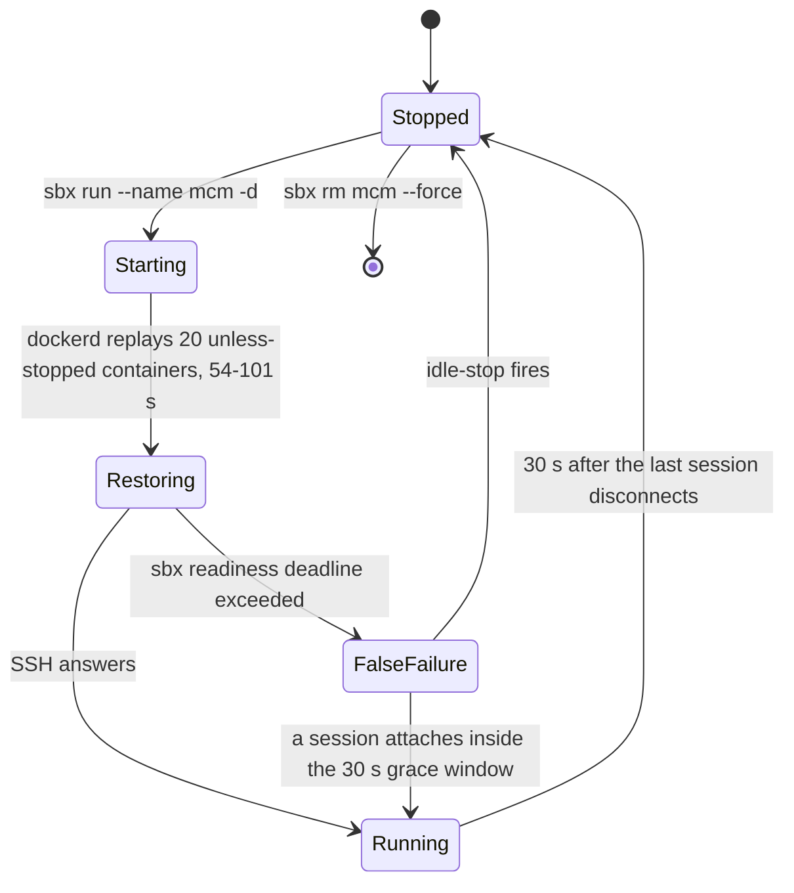

# Dev container on Docker Sandbox microVM (primary environment)

Since feature 060, the primary AI-assisted development environment is a **dev container running inside a Docker Sandbox microVM**, not Docker Desktop and not Docker-in-Docker. It measured **0.43×** the wall-clock of the [Docker Desktop / DinD path](./devcontainer.md) across five stages (`docker-build` alone went 1024 s → 293 s).

The [Docker Desktop path](./devcontainer.md) is retained for one reason only: the **Android emulator**, which needs `/dev/kvm` that the microVM cannot provide (feature 060, gate R2, resolved negative). Everything else — web E2E, integration, the agent stack, day-to-day assistant work — runs here. Why mobile E2E does not: [Android emulator](./android-emulator.md).

The source is two files since 2026-10-10 (item #682): the operating manual, [`docs/runbooks/devcontainer-sandbox.md`](../../docs/runbooks/devcontainer-sandbox.md) — credential rule, getting in, layering, egress, the engine seam, networking, ports, git, credential injection — and its lifecycle companion, [`docs/runbooks/devcontainer-sandbox-lifecycle.md`](../../docs/runbooks/devcontainer-sandbox-lifecycle.md) — templates, recreate, disk, the `sbx` version and the verification harness. **Section numbers are shared between them**, so a `§8b` reference means the same section in either file.



*The sandbox lifecycle: the healthy-but-declared-failed start, the grace window that saves it, and the idle-stop that ends every session.*

## Credential rule — read first

AI-assisted coding runs on the **Claude Max subscription**. `MCM_ANTHROPIC_API_KEY` exists only for the movie assistant (E2E) and OpenWiki. **Never set `ANTHROPIC_API_KEY` in any environment.** Claude Code silently prefers it over a subscription login, with no warning and nothing in the UI showing which is in use. **Measured 2026-08-16: ~$15 of unintended spend in one day** on a workstation where the subscription was present the whole time.

The key is mapped to `ANTHROPIC_API_KEY` **only at the point of use**: agent gateway (`agent-stack.mjs`), OpenWiki maintenance (`wiki-maintain.mjs`), and the containerized E2E recipe. Each is a separate process running no interactive assistant. CI injects `ANTHROPIC_API_KEY` from repository secrets into jobs that also run no assistant.

> The VM itself has `ANTHROPIC_API_KEY=proxy-managed` — that 13-character value is Docker Sandbox's own marker (§9), not a leftover.

Channels, per-user stores and the gates that enforce the no-clear-text rule: [Secrets management posture](../invariants/secrets-management.md).

## Gotchas

- **`sbx start` DOES NOT EXIST.** The invocation silently prints the root help and appears to do nothing. To start a stopped sandbox: **`sbx run --name mcm -d`**. `sbx stop --help` states this; `sbx start` does not.

- **`--name` is load-bearing on `sbx run`.** Without it, `sbx run mcm` tries to run an agent called `mcm`; omitting `--name` can create a second sandbox instead of restarting the existing one.

- **The VM idle-stops ~30 seconds after the last session disconnects — this is normal, not a fault.** Coming back to a "missing" environment usually means it idle-stopped; start it and nothing is lost. Long unattended jobs die unless a session is held open (`ssh mcm.sbx 'sleep 5400'` in another window; launch work with `setsid nohup … &`). The dev container carries `--restart=always` and returns by itself; the agent stack does not (see the agent-stack gotcha below).

- **🔴 `sbx run` reports "docker daemon failed to start inside the sandbox" while dockerd is perfectly healthy — measured five times on both v0.39.0 and v0.43.0.** dockerd restores every `unless-stopped` container on startup (20 of them in this VM), which took 54–101 s; sbx's hardcoded readiness budget is shorter — under ~54 s, with no flag, no `DOCKER_SANDBOXES_*` variable, no settings file and no daemon option to raise it. The CLI exits, which trips the 30 s idle-stop and kills a VM whose dockerd had been serving the socket the whole time. The message names the wrong component. **`scripts/open-sandbox.ps1` is immune**: it treats the exit code as a claim and SSH answering as evidence, waiting up to 120 s. If you started by hand and hit the error, there is a ~30 s grace window while the sandbox is live: `sbx exec mcm sh -c 'docker ps'` issued within that window attaches to the running VM and defers the auto-stop. **v0.43.0 did not raise the deadline** — upgrading is not the fix; the launcher is. Full mechanism and proof command: §7f.

- **`sandboxd` does not auto-start at boot.** After a workstation reboot, `sbx run --name mcm -d` starts it on demand. Reaching for `ssh mcm.sbx` first can surface a daemon error that reads like a broken environment rather than a cold host — start with `sbx run`. (`ssh mcm.sbx` does trigger a start by itself, but it does not *wait* for readiness, which is what makes VS Code race the boot.)

- **`init-firewall.sh` is NOT run here.** On the Docker Desktop path the dev container programs its own `ipset`/`iptables` default-deny. On the sandbox path, egress is governed by the **host-side policy** — not the in-VM firewall. `postStartCommand` runs `assert-egress-governed.sh` instead, which verifies rather than re-implements: it fails if a blocked host is reachable **or** if an allowlisted one is not, so a severed network cannot read as a security pass. Triage order when something is blocked: **host policy first**, in-VM second. That is the opposite of the Docker Desktop path.

- **`nc -z <ip> 443` reports OPEN against a blocked destination.** The sandbox proxy accepts the TCP connection and refuses at TLS. A connect-only probe will say egress is wide open when it is not. Always probe with a real request.

- **Refusals look different from each vantage point:**

  | From | Blocked destination looks like |
  |---|---|
  | dev container | `rc=6` — NXDOMAIN (DNS-layer refusal); `curl` also writes `000` |
  | sibling container | `rc=6` — NXDOMAIN (DNS-layer refusal) |
  | raw IP from a sibling | `rc=35` — TLS terminated mid-handshake |
  | VM shell, ≤ v0.43.0 | HTTP **403** with `Blocked by network policy` |
  | VM shell, v0.47.0 | HTTP **403** with `Approval required for <host>:<port>.` / `Review and respond with: sbx policy approval ls` |

- **🔴 The v0.47.0 refusal body read as a breach, and the new body queues an approval.** The first harness run after the upgrade reported `example.com is REACHABLE — deny-by-default is NOT enforcing`: the proxy still answered 403, but the check's marker no longer matched, so it took the 403 for the origin's. Both verify scripts now accept both bodies (2026-10-08). The new body also means a refusal creates a **pending approval** (`sbx policy approval ls` lists every refused host with `no matching allow rule (default deny)`). Nothing is let through until a person answers, so default-deny holds — but **`sbx policy approval respond … allow` is a second way to widen egress that bypasses `egress-allowlist.json`. Never use it**: add the destination to the canonical file and apply the generated rule (§4), or the next recreate silently loses it. Use `dismiss` to clear the queue.

- **`000` is not a signature — it is curl's placeholder for a request that was never made.** The dev-container row above read "no route — `curl` writes `000`" until 2026-08-27 (item #253), which says route layer and hands you the one field that cannot distinguish the layers. It cost a triage pass: `curl -w '%{http_code}'` against a non-allowlisted host prints `000` and the resolver error goes to *stderr*, so a probe capturing only stdout reports a route-level block for what is actually NXDOMAIN. **Read the exit code, not the status code.** Measured: `getent hosts registry.npmjs.org` (allowlisted) resolves; `getent hosts example.com` (not allowlisted) gives no answer and `curl` exits rc=6. Node surfaces the same refusal as `getaddrinfo ENOTFOUND <host>` — the signature `platform.claude.com` and `mcp.expo.dev` were each first diagnosed from.

- **The allowlist resolves per FQDN, never per apex domain — including MCP endpoints.** A sibling name on an already-allowed domain is a separate entry and is refused without one: `api.expo.dev` answers 200 from the dev container while `mcp.expo.dev` NXDOMAINs. The same front-door-vs-blob-host trap that applies to registries (see source §4) applies to every second hostname a service uses, MCP endpoints included. Both `mcp.expo.dev` and `mcp.context7.com` were absent from the allowlist and are now added (item #253); apply the running-sandbox procedure from source §4 if the environment predates the fix.

- **A missing destination does not merely fail a command — it silently retires a merge-gating tier to CI-only.** The tier still *appears* to run (a skip reads as a pass, a fail-closed scanner reports `NOT RUN`), which is why a missing host is triaged as a **blocked gate**, not an inconvenience. The entries whose absence has actually done that: `semgrep.dev` (`guardrails / sast`), `api.osv.dev` (pip-audit, item #394), `registry.ollama.ai` **plus** its pinned R2 blob host (the golden tier, the agent half of `E2E_TIER=gate`, and `nx up-agents-prod`), and `api.themoviedb.org` (the `web-api-mcp` certification lookup). A degraded environment and a real defect are otherwise indistinguishable — feature 068 misdiagnosed two of its three real defects as "environmental" on exactly this ambiguity.

- **The socat relay truncates output — exit 0 with no stdout (D-19).** The dev container reaches the VM engine through `docker-outside-of-docker`, fronted by a socat relay (`/var/run/docker.sock`). socat's half-close timeout defaults to 0.5 s; `docker exec` half-closes stdin immediately, so socat tears the relay down mid-response. Fast commands work, so the seam looks healthy under quick probes; only real work fails. Fix already applied in `.devcontainer/sandbox/devcontainer.json`: `"DOCKER_HOST": "unix:///var/run/docker-host.sock"`. If you invoke Docker from a context that does not inherit `containerEnv`, pass it explicitly: `docker exec -e DOCKER_HOST=unix:///var/run/docker-host.sock …`.

- **A `-v` mount SOURCE is resolved by the daemon, on the VM — not in this container (measured 2026-09-07, item #382).** The `docker` CLI does not open the source path; it sends the mount spec to the engine, which resolves it against **its own** filesystem. Only `/workspaces/mcm` is genuinely shared between the dev container and the VM daemon — write a file here and it appears inside a container. The VM has its own `/tmp` and `/home/coder`, so a path under either is a different directory that merely looks right.

  **A missing source is not an error — the daemon CREATES it as an empty directory.** This is why both failure modes below point away from the actual cause:

  | what you mount | what the container actually gets | how it fails |
  |---|---|---|
  | a session scratch dir under `/tmp/…` | an empty directory the daemon just created | `MODULE_NOT_FOUND … requireStack: [ 'internal/preload' ]` — reads as a broken script |
  | `-v /var/run/docker-host.sock:/var/run/docker.sock` | an empty directory where a socket belongs | `Cannot connect to the Docker daemon` — reads as an image that was never built |
  | `-v /var/run/docker.sock:/var/run/docker.sock` | the real socket | works |

  The socket line is the counter-intuitive one: this container's own `DOCKER_HOST` is `docker-host.sock`, so that is the name you reach for — but as a mount **source** it is resolved VM-side, where the engine's socket is plain `/var/run/docker.sock`. Mount the wrong one and `ls -la /var/run` on the VM afterwards shows a freshly created `docker-host.sock` **directory** sitting next to the real socket; those stubs persist and make the next attempt fail the same way.

  **Probe before you debug the payload:**
  ```bash
  docker run --rm -v "$SRC":/x:ro alpine:3 stat -c '%F %n' /x   # "directory" not "socket" => wrong source
  docker run --rm -v "$SRC":/x:ro alpine:3 ls -la /x            # empty => the daemon invented this path
  ```

  **Stage anything a container must read under `/workspaces`**, not in a session scratch directory — and delete it (or add to `.git/info/exclude`) when done, since it lands in the build context of any `docker build .` from the repo root.

- **`host.docker.internal` is unreachable from the dev container** — Docker's implicit entry resolves to `fe80::1` (link-local IPv6). Under `--network=host`, a sibling's published port *is* localhost. Use `localhost` instead. The gateway and MCP containers still need `--add-host host.docker.internal:host-gateway` (`172.18.0.1`); that flag is load-bearing — keep it.

- **The agent stack does NOT come back after restart.** `movie-assistant-gateway` and the 3 MCP servers are started with `restart=no` deliberately — a restart policy would resurrect the gateway from its pre-rebuild image (the "silently runs old code" trap). Restart explicitly: `MODEL_PROVIDER=anthropic pnpm nx up-agents-prod infrastructure-as-code`. Verify with `verify-reboot-survival.sh --verify`, not by eye.

- **The sandbox has three independently sized volumes — all resizable, but only at creation time.** Corrected 2026-08-27: the previous claim ("49 GB Docker disk, cannot be enlarged") was wrong. Sizes are set by environment variables that `sbx` reads when creating a new sandbox:

  | Device | Default | Mounted at | Holds | Knob |
  |---|---:|---|---|---|
  | `vdd` | 50 GiB | `/var/lib/docker` | every Docker image/layer and the dev container's own writable layer — this is the `/` the dev container reports | `DOCKER_SANDBOXES_DOCKER_SIZE` |
  | `vdb` | 20 GiB | `/` (VM root) | `/workspaces/<name>` — the working tree | `DOCKER_SANDBOXES_ROOT_SIZE` |
  | — | 50 GiB | cloned workspace | only in `--clone` mode; unused here | `DOCKER_SANDBOXES_CLONED_WORKSPACE_SIZE` |

  Current values: **Docker 150 GB, root 40 GB** (Docker raised from 100 GB on 2026-10-08, when it stood at 91 % full). Set at **User scope** in PowerShell before creating a new sandbox — `$env:` is session-only and will not survive a new shell:

  ```powershell
  [Environment]::SetEnvironmentVariable('DOCKER_SANDBOXES_DOCKER_SIZE','150GB','User')
  [Environment]::SetEnvironmentVariable('DOCKER_SANDBOXES_ROOT_SIZE','40GB','User')
  ```

  ⚠️ **v0.42.0 drops the default Docker volume from 50 GB to 10 GB.** Any future recreate that forgets to set the variable silently gets a far smaller disk. Set it at User scope so it survives upgrades.

  ⚠️ **`/var/lib/docker` is not visible from inside the dev container.** `df /` in the container reports `vdd` (the Docker volume) because the container's overlay upper dir lives on it. Use the VM shell to see both: `sbx exec <name> sh -c 'lsblk | grep ^vd; df -h /var/lib/docker /'`.

  ⚠️ **Verify the resize from the host, not `df` inside.** On <= v0.39.0, recreating a sandbox with the same name can inherit the old sandbox's volumes; `df` will report the old size as if the resize took. Check the `.img` file sizes instead:

  ```powershell
  Get-ChildItem "$env:LOCALAPPDATA\DockerSandboxes\sandboxes\state\sandboxd" -Recurse -Filter *.img |
    ForEach-Object { "{0,8:N1} GB  {1}" -f ($_.Length/1GB), $_.Name }
  ```

  ⚠️ **Sparse is real only until written.** A fresh 100 GB volume occupies 438 MB on the host, but blocks are **never released back** — the previous 50 GiB volume had reached 100 % once and was still holding 53.6 GB of real bytes at deletion. Treat a declared size as a future host cost.

  ⚠️ **Two dev-container images will not fit simultaneously.** The toolchain image is ~14 GB and the derived container another ~13.5 GB. Remove the previous pair before pulling a new toolchain image. Reclaim space without a resize: `docker builder prune -f` (safe, never touches images). **Never `docker image prune -a`** — it evicts the 3.5 GB Playwright image which must then be re-pulled. The `mcm-bff` production image is now **335 MB** (down from 1.73 GB after item #249 — `scripts/prune-bff-runtime-modules.mjs` keeps only the 81-package runtime closure); it is no longer a meaningful disk consumer.

- **Relocating the data root off `C:` breaks SSH until ACLs are fixed.** There is no supported setting for moving the sandbox data root — a junction on `%LOCALAPPDATA%\DockerSandboxes\sandboxes` works, but files on another volume inherit that volume's ACL (grants `Authenticated Users`). Windows OpenSSH refuses a config it considers world-readable, so `ssh mcm.sbx` and `open-sandbox.ps1` fail with `Bad permissions… NT AUTHORITY\Authenticated Users`. Fix with `icacls` on the directory (not the files directly — using `(OI)(CI)` with `/T` on files strips ACEs entirely, leaving files no one can read): `icacls $ssh /inheritance:r /grant:r "$($env:USERNAME):(OI)(CI)F" "SYSTEM:(OI)(CI)F" "Administrators:(OI)(CI)F"` then `icacls "$ssh\*" /reset`. Re-verify the junction after every `sbx` upgrade — an MSI could recreate the folder.

- **`ssh mcm.sbx` does not work from Git Bash — and the error blames DNS.** `sbx setup ssh` writes an `Include` with a Windows-style absolute path; MSYS OpenSSH resolves it relative to `~/.ssh/`, matches nothing, and continues silently to DNS: `Could not resolve hostname mcm.sbx: Name or service not known`. Use `C:\Windows\System32\OpenSSH\ssh.exe` (which VS Code also uses) or `sbx exec mcm` from Git Bash. Diagnose with `ssh -v … 2>&1 | grep -i include` before touching the sandbox.

- **Template recreate destroys host-filesystem isolation unless the workspace is specified explicitly (critical, measured 2026-08-16).** `sbx run` mounts the **current directory** as the sandbox workspace read-write over virtiofs unless told otherwise. Creating a sandbox while sitting in the repo mounts the repo into the VM — a file written inside immediately appeared in the Windows working copy. Always pass a dedicated scratch directory: `sbx run -t … --name <new> -d shell C:\path\to\scratch\dir`.

- **A template does NOT carry the egress policy.** A sandbox created from a template gets the default (allow-all) profile. Apply the policy before anything pulls: run `node scripts/gen-egress-policy.mjs --format sbx-policy` and apply each emitted rule with `sbx policy allow network <domain> --sandbox <new>`. A policy refusal is **instant** (< 1 s); a network fault times out. Speed is the diagnostic clue — with one caveat below.

- **A template does NOT contain Docker images.** `sbx template save` snapshots the VM root filesystem, not the Docker data disk. A sandbox recreated from a template comes up in seconds with zero images — the real time is the cold rebuild and re-pull that follows.

- **`sbx template save` stops the sandbox and holds a lock for its full duration (~17 min, ~16.8 GB).** Other `sbx` commands block while the save runs. Do not run it when you need the environment, and do not conclude it failed because `sbx template ls` shows nothing — check whether the sandbox went to `stopped`.

- **`sbx rm` prompts, and a non-interactive prompt answers *No*** (v0.45.0+), so any script or agent shell needs `--force`. Same class as `sbx secret rm` below.

- **`anthropicKey()` in `agent-stack.mjs` honours `ANTHROPIC_API_KEY` first.** In this VM that variable holds `proxy-managed` (the sandbox's marker), so a naive run injects a non-credential and fails with a 401 that reads as a bad key rather than a precedence problem. Use `env -u ANTHROPIC_API_KEY` so `.env.local` wins.

- **Front door ≠ blob/CDN host — allowlisting the API host is not enough.** A service's API host and its download host are different names; allowlisting the first yields a fetch that authenticates and then dies. Allowlist both. Confirmed traps:

  | Service | Front door | Blob/CDN host |
  |---|---|---|
  | Docker Hub | `registry-1.docker.io` | `production.cloudfront.docker.com` |
  | GHCR | `ghcr.io` | `pkg-containers.githubusercontent.com` |
  | Quay | `quay.io` | `cdn0N.quay.io` |
  | MCR | `mcr.microsoft.com` | `*.data.mcr.microsoft.com` |
  | GitHub releases | `github.com` | `release-assets.githubusercontent.com` |
  | Ollama models | `registry.ollama.ai` | a Cloudflare R2 bucket whose subdomain is the vendor's account id |

  `objects.githubusercontent.com` was correct when written and silently stopped covering GitHub release downloads when GitHub migrated — a previously-valid entry can go stale without anything changing on our side. The Ollama blob host is pinned rather than wildcarded on purpose: `*.r2.cloudflarestorage.com` would open every R2 bucket of every account, and a layer failure after a clean manifest means a **changed account id**, not a stale entry. **When a fetch fails with a DNS error, follow the redirect chain before adding the host named in the error:** `curl -sSL -o /dev/null -w '%{url_effective}\n' <url>`

- **Port publishing to LAN devices works natively — no `netsh portproxy` shim needed.** `sbx ports mcm --publish 0.0.0.0:8081:8081` binds the port on the Windows host non-loopback. Omitting the `HOST_IP` prefix (`--publish 8081:8081`) restricts to loopback only. Windows Firewall is still the remaining variable — all three profiles are enabled by default, so an inbound allow rule is required for LAN reach; `pnpm start --tunnel` (Expo tunnel) needs no inbound rule. **`sbx ports` lists nothing when the sandbox is stopped** — that is not the same as "ports were removed". Check `sbx ls` first; published ports are restored on restart.

- **The sandbox, VS Code dev-container forwarding, and Docker Desktop all share the same `127.0.0.1` port space on Windows — measured 2026-08-23.** There is no separation: a port the sandbox has forwarded is a port the host cannot bind, and vice versa. This is the same class of fault as [the prod/CI published-port collision](../invariants/published-port-reservation.md), one layer down. It surfaces in two disguises: (1) a loud bind error (`"bind: Only one usage of each socket address"`) when bringing up the host's auth stack while the dev container is open — the natural reflex of `docker compose up -d` will **recreate** (not just start) the existing container and destroy it; use `docker start <name>` or `up -d --no-recreate` instead. (2) **The dangerous one:** VS Code keeps the host port bound for the lifetime of the window **even when the service inside the sandbox has stopped**. A client completes the TCP handshake and then waits forever with no error. An Android emulator sat on its splash screen indefinitely because the app's dev-server connection was `ESTAB` to a dead VS Code forward. Diagnose by ownership, not reachability: `Get-NetTCPConnection -LocalPort <port> -State Listen | ForEach-Object { "{0} <- PID {1} ({2})" -f $_.LocalAddress, $_.OwningProcess, (Get-Process -Id $_.OwningProcess).ProcessName }`. `Code` = VS Code forward (close the window or "Stop Forwarding Port"); `com.docker.backend` = Docker Desktop published port; `ssh` = manual tunnel. A reachability check is not an ownership check — with two Keycloaks, one in the sandbox and one on the host, `localhost:8099` answers either way and the host's credentials are rejected by the sandbox's instance, which reads exactly like "my password broke".

- **`sbx` is pinned at v0.47.0, upgraded from v0.43.0 on 2026-10-08 — an upgrade is a security-relevant change, not a routine one.** It is load-bearing for isolation and egress enforcement. Before upgrading: read release notes for changes to network policy semantics, `--network=host` behaviour, port publishing, idle-stop timeout, secret injection, and template semantics; capture before-state with `verify-reboot-survival.sh --capture`; re-run the full harness; re-run G5 explicitly (sibling-egress refusal is the core security claim). Record the new version in the source runbook. **v0.45.0–v0.47.0 tightened egress** — DNS resolution refused when no rule permits it, PTR lookups only for already-authorized IPs, policy evaluation failures fail **closed**, and raw TCP to a denied hostname no longer let through by an allow rule for its resolved IP. All narrow; none widens. v0.43.0 also added `--skills=off|readonly|readwrite` (default `readonly`, which mounts the host skills store into new sandboxes unless you opt out) and made `sbx policy ls` take the sandbox **positionally** (`sbx policy ls mcm`), while `sbx policy allow network --sandbox mcm` still uses the flag. Most of this page was originally measured on v0.38.0; where a behaviour was re-checked on a later version it says so.

- **A cold recreate (new sandbox from scratch) needs three things the provisioning path does not supply.** All three were hit 2026-08-27; each stops the recreate dead:

  1. **The `devcontainer` CLI is not installed.** Install it first: `sudo npm install -g @devcontainers/cli`.
  2. **`/etc/docker/daemon.json` has no `insecure-registries`.** The forge registry is plain HTTP on `:3000`, so every pull fails with `http: server gave HTTP response to HTTPS client`. Write the file: `printf '{\n  "insecure-registries": ["%s:3000"]\n}\n' "$FORGE_REGISTRY_HOST" | sudo tee /etc/docker/daemon.json`.
  3. **`/etc/init.d/docker restart` does not work in the sandbox** — it exits on `ulimit: error setting limit (Invalid argument)`, leaves the new config unapplied, and `docker info` keeps answering so it reads as success. There is no systemd (PID 1 is `tini`). Restart the **sandbox** (`sbx stop <name>`), which brings `dockerd` up with the new config on the next `sbx exec`.

  ⚠️ An instant failure is not always a policy refusal. §7b says a ~1 s failure is the egress-policy tell because "a network fault times out". True, but the HTTPS/HTTP mismatch above fails in 0.034 s and has nothing to do with policy. Read the error text before acting on the timing.

- **A CLI `devcontainer up` installs no personal layer, and the RTK hook needs help.** `sbx rm` takes the `~/.claude` volume with it, so the harness's `personal-layer` check fails with `RTK not found`; VS Code applies `dotfiles.repository` on its own, the CLI needs `--dotfiles-repository <url>`. The hook is a separate trap: `postCreateCommand` runs `ensure-rtk-hook.sh` **before** the dotfiles pass, when RTK does not exist yet, and a dotfiles `install.sh` calling plain `rtk init -g` prompts, gets *No* non-interactively, and exits 0 — the log said `RTK active` with no hook in `settings.json`. A dotfiles script must use `rtk init -g --auto-patch` and check the hook landed; otherwise run `bash .devcontainer/ensure-rtk-hook.sh` in the container afterwards. Expect to log in to Claude Code and `gh` again.

- **`--config` in `devcontainer up` resolves against your CWD, NOT against `--workspace-folder`.** The VM shell lands in `/home/agent/workspace`, so a relative path in every `devcontainer up` snippet fails there with a message that reads like the file is missing rather than like the path is wrong:

  ```text
  Error: Dev container config (/home/agent/workspace/.devcontainer/sandbox/devcontainer.json) not found.
  ```

  Always pass `--config` absolutely: `--config /workspaces/mcm/.devcontainer/sandbox/devcontainer.json`. Or `cd /workspaces/mcm` first. The gate commands that use absolute paths (such as the `grep -c` check) are unaffected; it is the `devcontainer up` step itself that breaks.

- **`~/.claude.json` was NEVER on the `mcm-claude` volume — SC-007 held by accident, not by design (item #257, measured 2026-08-27).** The `mcm-claude` volume mounts the `~/.claude` **directory**; but Claude Code's global config is `~/.claude.json`, a sibling in `$HOME` on the ephemeral overlay. A recreate therefore dropped `oauthAccount`, `userID`, `machineID`, and every project's session history, while `~/.claude/.credentials.json` (the actual OAuth tokens) survived. That asymmetry is why "0 re-login on recreate" appeared true: the credential survived and the identity beside it did not.

  **Fix (item #257):** `CLAUDE_CONFIG_DIR=/home/coder/.claude` in `containerEnv` relocates the config root, so Claude Code resolves `.claude.json` inside the volume rather than in `$HOME`. Every other path (settings, plugins, projects, sessions, backups, credentials) already lived there and resolves unchanged — only the one orphaned file moves onto the volume. `persist-claude-config.sh` in `onCreateCommand` seeds an existing config on the first run after the change, so no identity is lost during the migration.

  ⚠️ **A symlink from `~/.claude.json` into the volume does NOT work.** Claude Code replaces the file rather than editing it in place (hence the rolling `backups/`), so a write-then-rename replaces the symlink itself with a regular overlay file — silently restoring the bug. The `CLAUDE_CONFIG_DIR` env var cannot decay this way.

- **🔴 Credentials must not be listed in `containerEnv` — it is not "environment for the container", it is an `ENV` instruction in the generated `Dockerfile-with-features`.** Measured 2026-09-19: with the four credentials listed, the derived image carried all of them in `Config.Env` and literal values in **3 history layers** — a **permanent** leak that survives every recreate and that `docker image inspect` / `docker history` hands to anyone who can read the image. It also made `devcontainer up` echo all four in clear text on the `docker run` line at every rebuild, which is how it was found. (The pushed base image was verified clean: zero credentials in `Config.Env`, zero history layers — the leak was confined to the locally built derived image and never published.) `remoteEnv` is not the fix: this sandbox is routinely entered by `ssh mcm.sbx` + `docker exec`, which `remoteEnv` does not reach. The four are now passed by **`docker run --env-file`** (`runArgs`), written by an `initializeCommand` that runs on the VM *before* create — `--env-file` fails outright on a missing file, does no quote processing (`Q1='quoted'` arrives as `Q1=['quoted']`), and `~/.mcm-sandbox-env`'s shell form must never be handed to docker directly. `docker inspect <container>` still shows them: if `docker exec` must see a variable, the container's own config has to carry it — what changes is that the exposure dies with the container instead of living in an image. An image built while they were still in `containerEnv` keeps them forever; remove it and treat the credentials as exposed.

  ⚠️ **`devcontainer up` does NOT recreate the container when only `runArgs` / `containerEnv` change.** Measured 2026-09-19: after moving the credentials to `--env-file`, a plain `devcontainer up` reattached to the existing container in ~13 log lines and the environment kept running the **old image with the credentials still baked in** — reporting success while nothing changed. Force it (`--remove-existing-container`) and verify against the container's `Created`/`Image`, never against the command's exit code.

- **★★★ You are probably not the only agent in here — use a worktree, not `/workspaces/mcm`, for any branch work (measured 2026-09-18).** Five concurrent sessions shared `/workspaces/mcm` on that date. They share the filesystem, the Docker daemon, the pnpm store, and — the part that bites — **the git index and the checked-out branch**. `git checkout -b`, `git add`, `git stash`, and `git rebase` in `/workspaces/mcm` are not private acts: they change what every other session is looking at, mid-edit. The failure is silent and lands on the *other* agent.

  ```bash
  git fetch -q origin main
  git worktree add -b <branch> /home/coder/worktrees/<slug> origin/main
  ln -sfn /workspaces/mcm/node_modules /home/coder/worktrees/<slug>/node_modules
  ```

  Things that are not obvious, each of which cost a session:

  - **`/home/coder/…`, never `/workspaces/.worktrees/…`.** `/workspaces` itself is not writable — only `/workspaces/mcm` is — so the latter fails on creating the leading directory with a bare `Permission denied` that reads like a git problem.
  - **The `node_modules` symlink is a starting point, not the answer (measured 2026-09-19, items #499/#500).** It is enough for `node --test` and the `scripts/*.mjs` gates — `preflight` reported 24 of 27 green — but **every `pnpm nx <target>` dies in pnpm's pre-run dependency check** with `ERR_PNPM_UNSAFE_MODULES_DIR … its resolved target is not a strict subdirectory of the project root`, which reads like a path or permissions bug in the target. `npm_config_verify_deps_before_run=false` does not suppress the check, and `cp -al` cannot hardlink because `/workspaces` and `/home/coder` are **different devices**. The only fix is a real install inside the worktree:

    ```bash
    cd /home/coder/worktrees/<slug>
    rm -f node_modules                        # the symlink, if you made one
    CI=true pnpm install --frozen-lockfile    # ~4 min; CI=true answers the purge prompt
    ```

    This does not churn the other session's tree — it writes only inside the worktree. (The earlier "symlink; do not `pnpm install`" advice on this page was retracted, item #589.) Decide from the diff: if what you changed is reachable only through an nx target, budget the four minutes rather than shipping that tier unproven.
  - **nx and pnpm will hand you a STALE failure.** If an nx failure's message names a path that no longer exists, re-run it with `--skip-nx-cache` before diagnosing — same family as the superseded-run trap in [ci-diagnostics](./ci-diagnostics.md).
  - **The `node_modules` symlink used to be committable and `git add -A` committed it.** `.gitignore` carried `node_modules/` and a trailing slash matches only a directory — so the symlink was not ignored, `git diff --stat` does not list untracked files, and CI received a symlink where pnpm needs a directory. Every install-bearing job died with `ENOTDIR: not a directory, mkdir '.../node_modules'` — six required contexts on PR #488 — which reads like a broken toolchain. **Fixed:** the pattern is now `node_modules` (no trailing slash). If you add any other symlink-into-the-main-checkout, check `git status --porcelain` rather than `git diff` before committing.
  - **A fresh worktree lacks gitignored artefacts** some gates read rather than generate. `security/infra-images/reports/findings.json` is one: without it `check-infra-image-findings.mjs --check-expiring` throws instead of passing. Copy it from the main checkout if you need that gate.
  - **A worktree does NOT survive a dev-container rebuild.** `/home/coder/worktrees/` is on the container's own filesystem, so a rebuild takes the directory while `git worktree list` — read from `/workspaces/mcm/.git` on the mounted volume — still lists it, now marked `prunable`. Measured 2026-09-19, when a sandbox upgrade rebuilt the container mid-session. **Push the branch before any risky container operation**; afterwards `git worktree prune` in `/workspaces/mcm` clears the stale record.

  Clean up when the branch merges: `git worktree remove /home/coder/worktrees/<slug> && git worktree prune`. Reads (`git fetch`, `git log`, `ci-status`, forge API calls) need no worktree.

- **`pnpm` is not in the VM shell — only inside the dev container.** VM-level scripts that call `pnpm` directly fail with `rc=127`. Use `docker exec … bash -lc` to run them inside the container.

- **`sbx secret rm` and interactive `sbx` prompts default to *No* non-interactively.** Pass `-f` to skip the confirmation. `rtk init -g` also answers "no" silently and prints a manual step — that is why `ensure-rtk-hook.sh` exists.

- **Run git inside the dev container, not the VM shell — uid mismatch was the cause, and is now fixed.** Prior to 2026-08-17 the VM user (`agent`) was uid 1000 and the container user (`coder`) was uid 1001; anything git wrote from the VM landed owned by uid 1000, which the container saw as `node` (not `coder`), making object writes fail silently on 111 of 256 `.git/objects` subdirs. **FIXED (2026-08-17):** `toolchain.Dockerfile` now creates `coder` at 1000:1000, moving the base image's `node` to 1100. Both sides are now 1000:1000 and git works from either. To automate from outside the container, prefer `docker exec -u coder …` — this remains the safe, portable form. `fix-workspace-ownership.sh` still runs at create/start to repair any already-poisoned tree.

  **Applying it is a re-pin, not a local build.** Pushing a `toolchain.Dockerfile` change *is* the trigger — the `devcontainer-image` workflow builds and publishes automatically, so check for a `build-publish` run before building anything by hand.

  **The procedure, in full — and it runs in the VM shell, not the container.** A container cannot rebuild itself; `devcontainer up` must run from `ssh mcm.sbx`, and it destroys the container you may be working in. Everything below is one VM-shell session, because step 3's `set -a` only holds there.

  > This is the **image-change** variant, which is why steps 0-3 exist. For the far more common `devcontainer.json`-only change, use §2's *Recreating the DEV CONTAINER* — same step 4, no re-pin. Step 3's `set -a` is required either way.

  > 🔴 **The digest does NOT come from the run summary — that route is dead on this forge.** This block said "from the build's run summary" until 2026-08-31, and item #268 is the measurement that it cannot work: there is no log endpoint, no summary endpoint, and `/actions/runs/{id}/jobs` is `404`. The workflow really does write the pinned ref to `$GITHUB_STEP_SUMMARY`, and nothing on this build can read it back. Ask the **registry** instead — that is authoritative anyway, because it is what `docker pull` resolves.

  ```bash
  # 0. RESOLVE the digest from the registry. Run this from INSIDE the dev container (it is what has
  #    MCM_FORGE_TOKEN) and do it FIRST — step 4 destroys that container, so resolving afterwards
  #    means resolving from a shell that cannot. `$SHA` is the full 40-hex commit the run built.
  ACCEPT='application/vnd.oci.image.index.v1+json, application/vnd.docker.distribution.manifest.list.v2+json'
  curl -sS -o /dev/null -w '%header{docker-content-digest}\n' \
    -u "$OWNER:$MCM_FORGE_TOKEN" -H "Accept: $ACCEPT" \
    "$FORGE/v2/$OWNER/mcm-devcontainer/manifests/$SHA"
  ```

  > ⚠️ **Do NOT take the digest from the packages API** (`/api/v1/packages/$OWNER?type=container&…`). Its newest row for a build is the **provenance attestation** — the `unknown/unknown` entry in the OCI index — not the image, and pinning it fails at pull time. Measured 2026-08-31 on the `6a27312c` build: the packages list led with `sha256:78de8866…` (attestation) while the tag actually resolved to `sha256:7a0192db…` (the index). The `manifests/<tag>` request above returns the index under **every** `Accept` header, which is why it is the one to trust.
  >
  > ✅ **Verify the image carries the change before pulling 13 GB**, by walking index → amd64 manifest → config blob and reading the build history — the same technique [ci-diagnostics](./ci-diagnostics.md) uses to prove what is in a published image:
  >
  > ```bash
  > jq -r '.history[].created_by' cfg.json | grep -aoE 'default-toolchain [^ ]+|cargo-audit@[0-9.]+'
  > ```

  ```bash
  NEW=<the 64-hex digest resolved above>                        # NOT the tag — pin by digest

  # 1a. Build the ref FROM THE PIN YOU ALREADY HAVE. Do not assemble it from $FORGE_REGISTRY_HOST:
  #     that variable lives in ~/.mcm-sandbox-env, which nothing has sourced yet at this point in the
  #     sequence, so a fresh VM shell has it EMPTY and `docker pull` fails with the misleading
  #     `invalid reference format` (measured 2026-08-31). Deriving it cannot get the host or the
  #     namespace wrong.
  OLD=$(grep -m1 '^MCM_DEVCONTAINER_IMAGE=' ~/.mcm-sandbox-env | cut -d= -f2- | tr -d "\"'")
  case "$OLD" in
    *@sha256:*) REF="${OLD%@*}@sha256:$NEW"; echo "new ref: $REF" ;;
    *) echo "STOP — the current pin is not digest-pinned ($OLD); do not guess the ref" ;;
  esac

  # 1b. pull, and CONFIRM the image carries the change BEFORE it becomes your environment.
  #     Check the tools THIS refresh was for, not a fixed list — `pwsh --version` proves only that
  #     you pulled some image.
  docker pull "$REF"
  docker run --rm --entrypoint bash "$REF" -lc 'id -u coder; rustc --version; uv --version'

  # 2. edit the pin. MCM_DEVCONTAINER_IMAGE lives in ~/.mcm-sandbox-env (NOT ~/.bashrc). The file is
  #    KEY='value' — quoted, and with NO `export` keyword. Substitute only the digest.
  cp ~/.mcm-sandbox-env ~/.mcm-sandbox-env.bak
  sed -i "/^MCM_DEVCONTAINER_IMAGE=/s|@sha256:[0-9a-f]\{64\}|@sha256:$NEW|" ~/.mcm-sandbox-env
  grep MCM_DEVCONTAINER_IMAGE ~/.mcm-sandbox-env

  # 3. source it, and GATE on the result rather than eyeballing it
  set -a; . ~/.mcm-sandbox-env; set +a
  case "$MCM_DEVCONTAINER_IMAGE" in
    *"$NEW") echo "PIN OK — safe to rebuild" ;;
    *)       echo "PIN NOT APPLIED — stop; devcontainer up would build the OLD image" ;;
  esac

  # 4. only on PIN OK. (For the UID fix specifically, chown the tree to 1000 first.)
  devcontainer up --workspace-folder /workspaces/mcm \
    --config /workspaces/mcm/.devcontainer/sandbox/devcontainer.json --remove-existing-container
  ```

  🔴 **Two ways this silently re-creates the OLD container, both measured 2026-08-22.**

  **`set -a` is load-bearing.** `~/.mcm-sandbox-env` has no `export` keyword, and `.devcontainer/sandbox/devcontainer.json` reads the pin as `${localEnv:MCM_DEVCONTAINER_IMAGE:mcm-devcontainer}` from **the shell running `devcontainer up`**. Source it without `set -a` and the variable is set but not exported, so `localEnv` misses it and the build **falls back to the literal default `mcm-devcontainer`** — a stale local image, with no error.

  **An all-`CACHED` build is the tell.** A re-pin that did not take produces a build where every layer reports `CACHED` and a container that starts perfectly, having changed nothing. Read the one line that settles it — `devcontainer up` echoes it:

  ```text
  docker buildx build … --build-arg BASE_IMAGE=<registry>/<ns>/mcm-devcontainer@sha256:<digest>
  ```

  If that digest is the old one, stop; nothing after it matters. A genuine re-pin is **not** all-CACHED, because the layers above the new base must rebuild.

  ⚠️ **`devcontainer up` prints its full `docker run` invocation, including every `-e` secret in clear text** — `MCM_ANTHROPIC_API_KEY`, `TMDB_API_KEY`, `MCM_FORGE_TOKEN`, `MCM_FORGE_ISSUE_TOKEN`. Treat that output as credential material: do not paste it into an issue, a chat, or a transcript, and rotate all four if you already have.

- **A full disk does not announce itself — it wears other symptoms.** The Docker volume has filled three times, and not once did the error name disk: `exit code: 100` on a feature install (looks like an apt fault), `is not signed` / `At least one invalid signature was encountered` (looks like GPG or MITM-proxy corruption of `deb.debian.org`), and a build dying in `exporting layers` (looks like an export problem). `docker system df` is unreliable — it reported gigabytes "reclaimable" while `df -h /var/lib/docker` said 0 bytes free, because it counts shared layers optimistically. Believe `df`. Prune order that works: `docker builder prune -af` first (`-f` alone drops only unused cache; `-af` reclaimed 17.8 GB), then remove the old toolchain image, then the derived image (which now owns its layers). Warning: build cache can mask a broken environment — apt failures may be hidden by a cached feature-install layer that never ran apt, so pruning the cache reveals failures rather than causing them.

- **Running the verification harness DESTROYS and rebuilds the dev container.** Its last check, `verify-reproducible-recreate.sh`, removes the container *and its derived image* by design, so a `reproducible-recreate` FAIL means **the dev container is gone right now**. Check `docker ps` for it before diagnosing anything else; the service stacks survive, so the sandbox still looks healthy. The harness enumerates its **twelve** expected scripts by name (a glob silently shrinks; a skip reads as a pass), spans three vantage points, and refuses to invent the host-side result — without `MCM_HOST_CHECK=pass` it reports eleven and fails. Its host-side check cannot be faked from inside, but it can pass **vacuously**: `verify-engine-seam.sh --host-check` asserts "the Windows engine does not list X", and with Docker Desktop stopped every `docker` call fails, so all four assertions pass. Confirm `docker version` answers before treating SC-002 as re-verified.

## One-step launch

```powershell
.\scripts\open-sandbox.ps1
```

Checks whether the sandbox is running, starts it if not, waits for SSH (up to 120 s, deadline-based), and opens VS Code directly inside the dev container. It treats `sbx run`'s exit code as a claim and SSH answering as evidence — so the "docker daemon failed to start" false-failure (see §7f in the source) does not abort the launch. The URI it generates is computed dynamically — a pasted URI silently opens the wrong target if the workspace path or config file moves. Once opened, the entry appears in **File → Open Recent** (`Ctrl+R`), but only while the sandbox is running; against a stopped VM the Recent entry fails in a way that reads as a broken environment.

Full lifecycle, egress allowlist management, the engine seam, restart/reboot survival, credential injection and the collected foot-guns: [`docs/runbooks/devcontainer-sandbox.md`](../../docs/runbooks/devcontainer-sandbox.md). Recreating, resizing, verifying and upgrading the sandbox: [`docs/runbooks/devcontainer-sandbox-lifecycle.md`](../../docs/runbooks/devcontainer-sandbox-lifecycle.md).
