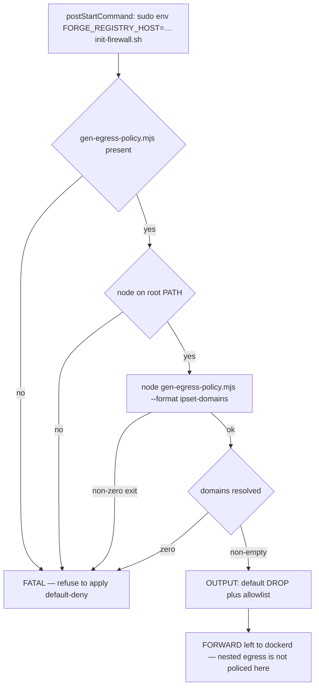

# Containerized dev environment (devcontainer — Docker Desktop / DinD path)

> **This is the RETAINED path, not the primary one.** The primary AI-assisted development
> environment is the [Docker Sandbox microVM](./devcontainer-sandbox.md), which measured **0.43×**
> the wall-clock of this path across five build stages. This Docker Desktop / Docker-in-Docker path
> is kept for one reason: the **Android emulator**, which needs `/dev/kvm` that the microVM cannot
> provide. Everything else — web E2E, integration, the agent stack, day-to-day assistant work —
> belongs on the sandbox.

## What it is

The committed [`.devcontainer/`](../../.devcontainer/) directory gives the AI coding assistant a
throwaway Linux container to run inside, so a compromised dependency or errant agent command has a
blast radius bounded by the container rather than the host's files, credentials, or SSH keys.

The toolchain image (`.devcontainer/toolchain.Dockerfile`) bakes in Node 24 + pnpm, Rust, Python/uv,
the Android SDK and an x86_64 system image, `pwsh`, the Claude Code CLI and OpenWiki, so nothing
re-downloads once the egress firewall is up. `.devcontainer/Dockerfile` is a **thin**
`FROM ${BASE_IMAGE}` whose only job is to let `devcontainer.json` parametrize the base through
`build.args` — top-level `image` is not substitution-eligible, which is exactly what allows the
heavy image to be prebuilt and pulled per open. The pinned ref arrives from the host as
`MCM_DEVCONTAINER_IMAGE`, so the forge host literal never enters git. The local-fallback tag is
**colon-free** because `${localEnv:VAR:default}` truncates its default at the first colon — an
env *value* containing a colon (the digest pin) passes through intact.

**That thin layer must stay thin, and the reason is measured.** Every real setup step belongs in
`toolchain.Dockerfile`, because a layer added on top of the prebuilt image that changes file
*metadata* — a UID renumber is the tempting one — copies every touched file **up** into the new
layer. Measured 2026-08-17: a "thin" renumber layer duplicated the entire ~13 GB image and the build
died in `exporting layers` with `no space left on device` on the Android system image. The same
disk exhaustion is the likeliest cause of an unrelated-looking `docker-outside-of-docker` feature
install failing with exit 100, which reads as an apt fault and is not one. `updateRemoteUserUID:
true` was also tried and does not engage on this path, and a chown-based repair is a see-saw (chown
to the container user and the VM user fails, and vice versa — measured in one run as "container git
write: OK / VM git write: FAILED").

**Where the renumber actually lives.** `toolchain.Dockerfile` creates `coder` at **1000:1000** and
moves the base image's `node` aside to **1100** first, so the container user matches the uid that
owns the workspace on the sandbox side. At that point in the build the image is nearly empty, so the
copy-up cost is zero — which is the whole argument for doing it there and nowhere else. The
ownership *repair* helper `.devcontainer/fix-workspace-ownership.sh` (which fixes only mismatched
entries, rather than `chown -R`-ing a large tree on every start) is wired into the **sandbox**
config's hooks; this path's ownership repair is the inline `chown` list in its own
`onCreateCommand`.

**Egress is default-deny with an allowlist.** `init-firewall.sh` programs the container's own
`OUTPUT` chain (plus the nested dockerd's image pulls) and deliberately leaves `FORWARD` to
dockerd, so nested-container networking is not broken. Since feature 060 the destination list is
**not inlined** in that script: it lives in
[`.devcontainer/egress-allowlist.json`](../../.devcontainer/egress-allowlist.json) — the single
canonical list — and is read through `scripts/gen-egress-policy.mjs --format ipset-domains`, the
same generator that emits the sandbox's host-side policy. Adding a destination means editing that
file and its recorded `reason`; two hand-maintained lists would turn a blocked fetch into the union
of two allowlists and diagnosis into guesswork. The generator never writes a file — both forms are
piped by their consumer — so no generated artifact can go stale in git and silently disagree with
its source.

**That file governs the list, it does not merely store it.** Each destination carries a `domain`, a
`group` (one of `agent`, `source`, `registry`, `packages`, `app`), a non-empty `reason` and a
`cdnRotating` flag; `node scripts/gen-egress-policy.mjs --check` validates the whole file and fails
naming the offending entry, rejecting a bare IP, an empty reason, an unknown group, a duplicate, a
dotless hostname, a topology-sensitive suffix (`.ts.net`, `.internal`, `.local`, …) and a forge host
pasted in while `FORGE_REGISTRY_HOST` is set. Emitting validates first, so a malformed list is
refused rather than piped into an enforcement layer, and the emission order is deterministic (group
order, then alphabetical, with the forge host appended last so its presence never reorders the rest),
which is what lets a regenerated form diff empty.

**Telemetry is turned off by configuration, never by allowlisting — and that inversion is written
into the file as an invariant.** Its `$mustNeverAppearHere` section names the forge/tailnet host, any
credential, the OpenWiki analytics host and every Claude Code / Anthropic telemetry endpoint
(`statsig.*` and similar). The `wiki-update` Nx target setting `OPENWIKI_TELEMETRY_DISABLED=1` is the
enforcement point, since the Windows host has no egress firewall as a backstop; the `containerEnv`
entry is defence in depth for an ad-hoc bare `openwiki` call inside the container. So a telemetry
host that is *blocked* is a working configuration, not a symptom of a missing allowlist entry.

**`$consideredAndExcluded` records the hosts that were deliberately left out**, each with the reason
it is unnecessary rather than forbidden: Claude Code's self-update host (an update path this image
deliberately does not have — updates arrive by rebuilding), the package/toolchain install hosts
(`archive.ubuntu.com`, `security.ubuntu.com`, `static.rust-lang.org`), the hosted Nx cache, and
third-party aggregators whose primary sources are already listed. It exists so the next person
diagnosing a Claude Code failure can tell an intentional absence from a missing rule; the stated bar
for adding an entry is a symptom that requires it.

The script treats an unusable allowlist as a reason to **apply nothing at all** rather than to apply
default-deny with an empty list. Every precondition failure is fatal, because the alternative —
`DROP` with zero allowlisted destinations — is a total egress blackout that presents as a network
fault rather than as a bug in the script:



*Why the firewall either applies a real allowlist or applies nothing: every precondition failure is fatal, so a crashed generator cannot silently become an egress blackout.*

One deliberate widening lever exists and is **off by default**: `FIREWALL_ALLOW_CDN_RANGES=1`
additionally allowlists the published AWS-CloudFront and Cloudflare CIDR ranges, for the case where
a CDN round-robins to an address the per-domain A-record snapshot missed. It opens egress to both
providers' whole edge networks, which is why the tight per-domain list is the default and a
re-apply is the first remedy for a stalled pull.

The lifecycle hooks are worth knowing when something is missing rather than broken:
`onCreateCommand` repairs volume ownership and seeds Claude Code's config, `postCreateCommand` runs
`pnpm install`, and `postStartCommand` re-applies the firewall (ipset is not persisted), brings up
the nested `dev-ollama`, and prepares the Android emulator. `FORGE_REGISTRY_HOST` is forwarded
**through** `sudo env …` because sudo resets the environment — a plain `sudo bash init-firewall.sh`
would silently skip the forge allowlist.

Behaviour-named verification scripts live under [`.devcontainer/verify/`](../../.devcontainer/verify/);
each asserts one success criterion and fails rather than self-healing. The aggregate runner
`.devcontainer/verify/run-harness.sh` **enumerates the twelve expected scripts by name** rather than
globbing, so a renamed or lost script fails the run instead of silently shrinking the checked set,
and anything without an explicit pass counts as a failure. Its scripts span three vantage points —
in-container, VM-side, and one Windows-side check that must be supplied via `MCM_HOST_CHECK` because
a claim asserted from inside the thing being claimed about is not proof. The firewall check is
itself an example of the single-source rule: `verify-firewall-allowlist.sh` used to carry its own
inline copy of the destinations it checked, which cannot detect drift between the canonical list and
the live ruleset; it now resolves each canonical domain through the same generator and asserts
membership in the live ipset, so a `cdnRotating` entry whose A-records moved surfaces as the
documented re-apply reflex rather than as a missing rule. Its per-group reachability probes are
derived from the canonical file too, so a new group cannot be silently left unprobed.

The generator has its own check, `verify-egress-allowlist-contract.sh`, which is the reason the
two-layer arrangement cannot quietly fork: eight assertions cover one emitted line per destination in
both formats, byte-identical output across runs, `--forge-host` appending exactly one entry to each
form, omission of `--forge-host` being clean (exit 0, no literal, no stderr), `--check` accepting the
committed file, and `--check` rejecting each of a bare IP, an empty reason and an unknown group. Its
expected destination count is read from the canonical file rather than hardcoded — a hardcoded
expectation is precisely the drift-blind failure the single-source rule exists to prevent. The
script runs in any mode (Windows host, container or sandbox VM), since it only shells out to `node`
and reads committed files.

## Gotchas

- **The isolation is two different strengths — don't conflate them.** Host-filesystem/credential/SSH
  isolation is strong (no host profile, SSH keys, credential store, or Docker socket is mounted).
  Container-engine isolation is only moderate: in-container Docker-in-Docker requires `privileged`,
  and a privileged-container escape can reach the shared host engine. Accepted deliberately.
- **Docker Desktop Enhanced Container Isolation (ECI) must stay OFF.** ECI is incompatible with the
  `docker-in-docker` feature and fails with a `mount: /sys/kernel/security: permission denied` error.
- **Two VS Code client-side conveniences break a privileged DinD container and only surface in VS
  Code, not the headless CLI.** The Wayland-socket mount must be disabled via a user setting
  (`dev.containers.mountWaylandSocket: false`); the Docker credential-helper injection is already
  fixed in committed config (`containerEnv.DOCKER_CONFIG`) — don't remove that fix.
- **A host env var forwarded via `${localEnv}` (`MCM_ANTHROPIC_API_KEY`, `MCM_DEVCONTAINER_IMAGE`,
  `FORGE_REGISTRY_HOST`, `TMDB_API_KEY`, `MCM_FORGE_TOKEN`, `MCM_FORGE_ISSUE_TOKEN`) is read from
  the VS Code process's own environment at launch time.** Setting it after VS Code is already running
  does nothing — VS Code must be relaunched with the value already present, then the container
  recreated. `setx` alone is not enough; fully quit VS Code and relaunch from a shell where the
  value is already visible.
  - **`MCM_DEVCONTAINER_IMAGE` is REQUIRED under VS Code — the `${localEnv:VAR:default}` default is
    NOT applied.** With the var unset, VS Code passes `--build-arg BASE_IMAGE=` (empty) and the build
    fails with `base name (${BASE_IMAGE}) should not be blank`. The headless `@devcontainers/cli`
    does apply the default; VS Code does not.
  - **`FORGE_REGISTRY_HOST`** must be set so `init-firewall.sh` can allowlist the forge registry
    host (never write that host literal into a document — refer to it abstractly). Unset → the
    container still comes up, but forge git push/pull and image pulls are blocked. It can be
    re-applied without a rebuild: `sudo env FORGE_REGISTRY_HOST=<host> bash .devcontainer/init-firewall.sh`.
  - **`MCM_FORGE_ISSUE_TOKEN`** unset: backlog reads still work via `MCM_FORGE_TOKEN`; writes are
    refused naming the missing variable. See [The agent-driven backlog](./backlog.md).
- **NEVER set `ANTHROPIC_API_KEY` directly — use `MCM_ANTHROPIC_API_KEY`.** Claude Code silently
  prefers `ANTHROPIC_API_KEY` over an existing subscription login with no warning and nothing in the
  UI showing which is in use. **Measured 2026-08-16: ~$15 of unintended API spend in a single day**
  on a workstation where the subscription was present the whole time. The key is carried as
  `MCM_ANTHROPIC_API_KEY` and mapped to `ANTHROPIC_API_KEY` only at the point of use — agent gateway,
  OpenWiki maintenance, containerized E2E recipe — each a separate process running no interactive
  assistant. CI injects `ANTHROPIC_API_KEY` from repository secrets into jobs that also run no
  assistant. **Never `-e NAME=$VALUE`:** the bare `-e NAME` form is not a style choice, because
  `-e NAME=value` puts the value on a command line that every user and every other agent session on
  the host can read with `ps` (measured here — a live key, the TMDB key and a service client secret
  had to be rotated). If you already have `ANTHROPIC_API_KEY` set on the host, move it:
  ```powershell
  [Environment]::SetEnvironmentVariable('MCM_ANTHROPIC_API_KEY', [Environment]::GetEnvironmentVariable('ANTHROPIC_API_KEY','User'), 'User')
  [Environment]::SetEnvironmentVariable('ANTHROPIC_API_KEY', $null, 'User')
  ```
  Then fully quit VS Code and every terminal before relaunching.
- **The same `MCM_`-prefix rule now covers the OpenWiki generator's Fireworks key.** `MCM_FIREWORKS_API_KEY`
  is mapped to `FIREWORKS_API_KEY` only inside the generator's own process (the launcher strips every
  other provider's key from that child), mirroring the Anthropic rule; `api.fireworks.ai` is in the
  canonical allowlist for model traffic only, and the `fireworks.ai` website FQDN is deliberately not
  covered. **This key is not in this path's `containerEnv`** — it travels only on the sandbox path,
  where `.devcontainer/gen-container-secrets-env.sh` emits it into the `--env-file` from
  `~/.mcm-sandbox-env` alongside the four older credentials.
- **Credentials must not be listed in `containerEnv` — that is not "environment for the container",
  it is an ENV instruction in the generated Dockerfile-with-features.** Measured 2026-09-19 on the
  derived image: the credential values were present in `Config.Env` and in **3 history layers**, a
  permanent leak that survives every recreate and is handed out by `docker image inspect` /
  `docker history`. The sandbox config therefore passes them with `docker run --env-file` from
  `.devcontainer/gen-container-secrets-env.sh` (`remoteEnv` is not an option — `ssh` + `docker exec`
  sessions never see it). **The retained Docker Desktop config still carries them in `containerEnv`**,
  so treat the derived image here as credential-bearing and never push it to a shared registry.
  Generator mechanics and the quoting trap (`--env-file` does no quote processing): that script's
  header.
- **`api.themoviedb.org` is allowlisted for the shell (OUTPUT chain) but NOT needed for the app — the
  two chains behave differently, and conflating them is the trap.** The entry exists so that
  `nx test:integration web-api-mcp` (pytest, in the shell) can reach TMDB. **Nested containers never
  needed it**: RUNTIME TMDB paths (BFF validate-on-save probe, web-api-mcp curator enrichment) run
  nested and travel the `FORWARD` chain, which `init-firewall.sh` leaves to dockerd. Measured
  2026-07-16 with TMDB absent: a nested container reached a non-allowlisted domain (`example.com` →
  200) and the nested BFF reached TMDB (`401` = connected, key rejected). If a runtime path times
  out, the ruleset is stale — **re-apply `init-firewall.sh` to re-resolve the CDN IPs; do not widen
  the allowlist.** Measured 2026-08-14 after the entry: `curl https://api.themoviedb.org/3/` from the
  shell returns `401` (connected) while `example.com` still times out, so default-deny is intact.
  *(On the sandbox path this distinction no longer holds — its host-side policy governs siblings
  too, so the same entry is required for both. See
  [devcontainer-sandbox.md](./devcontainer-sandbox.md).)*
- **`crates.io` IS allowlisted now — `cargo` resolves online here, and `--offline` is a tool, not a
  requirement.** `crates.io`, `index.crates.io`, and `static.crates.io` are in the canonical
  allowlist (group `packages`). A `cargo` fetch that stalls on a crate download is most likely a
  stale ipset on the CDN-rotating blob host — re-run `init-firewall.sh` before suspecting cargo.
  **The corollary is the useful half: a *failing* `--offline` resolve is still a real signal.** It
  means the change pulls a package absent from `Cargo.lock`, which CI will also reject. Inspect what
  is being added (`cargo tree -e features -i <crate> --manifest-path backend/mc-service/Cargo.toml`)
  and confirm with `git diff Cargo.lock` — a dev-dependency edge against an existing package is
  expected; a new `[[package]]` block deserves a decision. See
  [cargo fmt formats the WHOLE crate](../gotchas/rust-formatting-scope.md).
- **`getaddrinfo ENOTFOUND keycloak-service` running the integration tier here is a missing env
  variable, not a capability gap.** `tests/integration/setup/env.ts` loads `.env.docker`, whose URLs
  are Docker-internal by construction. Nothing overrides them for a host-shell run. The fix is three
  `export`s before `pnpm nx test:integration mcm-app`: `KEYCLOAK_URL=http://localhost:8099`,
  `MONGO_URL=mongodb://localhost:27018`, `REDIS_TEST_URL=redis://localhost:6379/1`. Measured
  2026-08-09: 84 failed / 31 passed without them; 114/115 with them.
- **A published app port that goes unreachable from the shell is a STALE ruleset, not a missing
  allowlist entry.** `init-firewall.sh` accepts loopback *and* egress over the container's own docker
  bridges (`docker0` + `br-*`, RFC1918 only, so no internet egress is opened), which is what lets
  `curl localhost:8082/8099` reach the nested stacks through docker-proxy. Both rules are required;
  the bridge allow is scoped by interface name so it covers bridges created after the script ran.
  Re-apply the script — never broaden the internet allowlist to "fix" stack access.
- **Local Ollama runs inside the dev container itself** via the `dev-ollama` nested container
  (`scripts/devcontainer-ollama.sh`, run at `postStartCommand`), publishing `0.0.0.0:11434` so
  nested containers reach it through the bridge gateway; the agent gateway already targets
  `host.docker.internal:11434` (its compose default plus an `extra_hosts: host-gateway` mapping)
  and reaches it with no gateway change, image rebuild, or firewall change. The image is pinned by
  tag **and digest** — `ollama/ollama:0.40.6@sha256:265409e1…`, bumped deliberately — in
  `infrastructure-as-code/docker/dev-ollama.compose.yaml`, which also declares `restart:
  unless-stopped` and an `ollama list` healthcheck; the script pulls `qwen2.5` once into the
  `dev-ollama-models` named volume (backgrounded — a first-run ~4.7 GB download must never block
  container readiness), overridable via `DEVCONTAINER_OLLAMA_MODEL`, and the balanced `qwen2.5:32b`
  tier is a by-hand pull only (`docker exec dev-ollama ollama pull qwen2.5:32b`) because CPU
  inference makes it slow. The script is best-effort and idempotent **by design**: it exits 0 when the
  nested dockerd is not ready or the API has not answered, so a failed Ollama start can never block
  container start — agent flows just fall back to Anthropic. Re-measured 2026-08-09: reachable from
  inside the gateway container. **Verify with the liveness probe before trusting this note** — it has
  flipped once:
  `docker exec movie-assistant-gateway python -c "import urllib.request,json; print([m['name'] for m in json.load(urllib.request.urlopen('http://host.docker.internal:11434/api/tags'))['models']])"`.
  See [Model-provider scoping](../invariants/model-provider-scoping.md).
  - **That pin is maintained, not decorative — and it used to be invisible.** `dev-ollama.compose.yaml`
    matches no manager's default file pattern, because the docker-compose manager requires the
    *basename* to begin with `compose`/`docker-compose`; the pin sat un-bumped for months with
    `docker:pinDigests` already enabled. The pattern in `renovate.json` is now a strict superset of the
    default, so the file is seen, and `scripts/__tests__/infra-image-scan.test.mjs` fails any
    third-party infra image reference in `infrastructure-as-code/` that carries no `@sha256:` digest —
    a stale pin here is therefore a real finding rather than a silent one. Bump the tag and digest
    together and deliberately; see [Renovate dependency bot](./renovate.md).
- **A blocked Ollama destination is a blocked merge gate, not an inconvenience.** The canonical
  allowlist carries both `registry.ollama.ai` (the manifest host compiled into the ollama binary) and
  the pinned Cloudflare R2 blob host every model layer is actually served from (item #394). With
  either absent, `ollama pull` dies at DNS and `ollama list` stays empty — which retires the golden
  tier (`nx test:golden movie-assistant`), the agent half of the E2E gate and `nx up-agents-prod`'s
  model precheck to CI-only, and makes a real defect indistinguishable from an absent model. The blob
  host is pinned by exact FQDN rather than `*.r2.cloudflarestorage.com`: the subdomain is Ollama's R2
  account id, constant across pulls, and the wildcard would open every account's bucket. So a layer
  failure *after* a clean manifest means the account id changed, not a stale ipset — read the new
  name out of the error and add it; do not widen.
- **A Docker CDN blob timeout on `docker compose up` is usually firewall/CDN-IP drift, not a real
  outage** — re-run `init-firewall.sh` to re-resolve the allowlisted CDN IPs and retry, rather than
  disabling the firewall.
- **`pnpm nx e2e mcm-app` cannot run in here — chromium cannot be installed.** The Playwright browser
  CDN and the Debian apt mirrors are deliberately outside the allowlist, so `playwright install`
  times out and the baked-in chromium lacks system libs. Run Playwright in the official image with
  `--network host` instead, pinned to the repo's `@playwright/test` version. **Two traps, both
  measured:**
  - **`--user "$(id -u):$(id -g)"` is not optional.** The image runs as root and `/workspaces/mcm` is
    bind-mounted, so every artifact Playwright writes (`test-results/`,
    `playwright-report/`, `setup/.auth/user.json`) lands in the working tree owned by root. The
    *next* run — containerized or not — then dies with `EACCES … test-results/.last-run.json`, and
    `coder` cannot even delete the directory. Measured 2026-08-03; `sudo chown -R coder:coder
    /workspaces/mcm` is the repair, and `onCreateCommand` self-heals the known paths on recreate.
  - **From a worktree the `-v` mount goes QUIET rather than erroring.** Only `/workspaces/mcm` is
    bind-mounted from the Docker host, so mounting `/home/coder/worktrees/<slug>` **succeeds** and
    yields a near-empty directory — Docker auto-creates the path. Measured 2026-09-21: 2 entries
    where the worktree has 31, surfacing as `stat node_modules/.bin/playwright: no such file or
    directory` or as a run that collects zero tests. Stage the worktree into a named volume; do NOT
    copy it into `/workspaces/mcm`, which is the checkout another session is working in.
  The image tag is coupled to the lockfile and enforced in CI — see
  [e2e-testing.md](./e2e-testing.md).
- **The Android emulator runs natively in the dev container** (baked-in SDK + `android-34`
  `google_apis` `x86_64` system image, host `/dev/kvm` passthrough through the privileged container),
  which is the sole reason this path is retained. The SDK sits **late** in the toolchain image, so a
  container rebuilt on an older base image comes up with every other tool green and no Android at
  all — `devcontainer-android.sh` no-ops cleanly by design, so the rebuild looks successful and the
  only symptom is a skip line. Diagnose with
  `bash .devcontainer/verify/verify-toolchain-present.sh`, then repin `MCM_DEVCONTAINER_IMAGE` and
  rebuild. `/dev/kvm` is host-provided, so its absence is a capability note, not a broken image. Boot
  ritual and mobile-agent caveats: [Android emulator & APK builds](./android-emulator.md).
- **`~/.claude.json` was NEVER on the `mcm-claude` volume — SC-007 held by accident, not by design
  (item #257, measured 2026-08-27).** The volume mounts the `~/.claude` **directory**, but Claude
  Code's global config is `~/.claude.json`, a sibling in `$HOME` on the ephemeral overlay. A
  container recreate therefore dropped `oauthAccount`, `userID`, `machineID`, and session history,
  while `~/.claude/.credentials.json` (the actual OAuth tokens) survived. **Fix:**
  `CLAUDE_CONFIG_DIR=/home/coder/.claude` in `containerEnv` relocates the config root so `.claude.json`
  resolves inside the volume; `persist-claude-config.sh` in `onCreateCommand` seeds an existing
  config on the first run after the change. ⚠️ A symlink does NOT work — Claude Code replaces the
  file rather than editing in place (write-then-rename swaps the symlink for an overlay file,
  silently restoring the bug). The two `devcontainer.json` files are duplicates, not one shared
  config, so the fix has to be carried in both.
- **"Docker won't start after a rebuild" is almost always a stale container holding the DinD lock,
  not corruption.** DinD's data-root lives on a persistent named volume keyed by workspace hash, so a
  rebuilt container reuses the same volume; if a *previous* dev-container instance is still running,
  its `containerd` holds an `flock` on `meta.db` and the new daemon blocks forever with a boltdb
  timeout. `pgrep containerd` finding nothing while the lock is held is the tell — the holder is in
  another container. **Diagnose first** (flock probe distinguishes "locked" from "corrupt"), then fix
  on the host: `docker ps`, `docker rm -f` every container that is NOT this one, then restart the
  daemon. **Do NOT delete `meta.db` and do NOT `docker volume rm` / `docker system prune --volumes`**
  — `meta.db` deletion destroys every image in the DinD engine, and `/workspaces` is itself a named
  volume, so a prune takes your working tree with it. Full commands:
  [the source runbook](../../docs/runbooks/devcontainer.md).
- **Editing a file under `node_modules/` writes into the pnpm STORE — every copy changes, and
  `pnpm install` will not undo it (measured 2026-09-07, item #242).** The store is content-addressed
  and `node_modules` entries are hardlinks into it, so files with identical content share one inode
  even across different package versions. Two consequences: a per-file backup-then-patch loop
  corrupts its own backups ("restore each file from its own backup" reinstates the corruption), and
  the store entry disagrees with its own content hash, which an ordinary `pnpm install` does not
  re-verify. **Safe procedure:** `stat -c '%h %i'` the file first, record the clean `md5sum` before
  the first write, patch one path and expect duplicates to follow, then restore and verify with both
  the md5 and `pnpm store status`.
- **★★★ You are probably not the only agent in here — use a worktree, not `/workspaces/mcm`, for any
  branch work (measured 2026-09-18).** Multiple Claude sessions share this one container and one
  checkout. `git checkout -b`, `git add`, `git stash`, and `git rebase` in `/workspaces/mcm` are not
  private acts: they change what every other session is looking at, mid-edit. The failure is silent
  and lands on the *other* agent.

  ```bash
  git fetch -q origin main
  git worktree add -b <branch> /home/coder/worktrees/<slug> origin/main
  ln -sfn /workspaces/mcm/node_modules /home/coder/worktrees/<slug>/node_modules
  ```

  **The `node_modules` symlink is NOT enough for `pnpm nx <target>`, and the failure does not say so
  (measured 2026-09-19, items #499/#500).** `preflight` can report 24/27 green while
  `nx lint|typecheck|test mcm-app` all die in pnpm's pre-run dependency check with
  `ERR_PNPM_UNSAFE_MODULES_DIR … its resolved target is not a strict subdirectory of the project
  root`. That reads like a path or permissions bug in the target; it is not — pnpm decides the tree
  is foreign and wants to purge and reinstall it. Two plausible workarounds both fail
  (`npm_config_verify_deps_before_run=false` does not suppress the check; `cp -al` cannot hardlink
  because `/workspaces` and `/home/coder` are different devices). The only fix is a real install in
  the worktree:

  ```bash
  cd /home/coder/worktrees/<slug>
  rm -f node_modules                              # the symlink, if you made one
  CI=true pnpm install --frozen-lockfile          # ~4 min; CI=true answers the purge prompt
  ```

  Use the symlink as the default for sessions that only run `node --test` or `scripts/*.mjs` gates;
  budget the four minutes when what you changed is only reachable through an nx target.

  **nx and pnpm will hand you a STALE failure.** If an nx failure's message does not match the state
  on disk, re-run it with `--skip-nx-cache` before diagnosing it — same family as the
  superseded-run trap in [ci-diagnostics.md](./ci-diagnostics.md).

  **A worktree does not survive a dev-container rebuild.** `/home/coder/worktrees/` is on the
  container's own filesystem, so a rebuild takes the directory with it while `git worktree list` —
  read from `/workspaces/mcm/.git` on the mounted volume — still lists it, now marked `prunable`.
  Push the branch before any risky container operation; afterwards `git worktree prune` in
  `/workspaces/mcm` clears the stale record.

  **The `node_modules` symlink used to be committable — `git add -A` committed it, and CI died.**
  `.gitignore` carried `node_modules/` with a trailing slash, which matches only a directory, not a
  symlink. Every install-bearing job then failed with `ENOTDIR: not a directory, mkdir
  '.../node_modules'` — six required contexts on one PR — which reads like a broken toolchain rather
  than a stray file. **Fixed:** the pattern is now `node_modules` (no trailing slash). If you add any
  other symlink-into-the-main-checkout, check `git status --porcelain` rather than `git diff` before
  committing.

  Read-only operations (`git fetch`, `git log`, `ci-status`, forge API calls) need no worktree.
  Clean up: `git worktree remove /home/coder/worktrees/<slug> && git worktree prune`.

Full prerequisite checklist, the Windows-host boot sequence, and the complete security-posture
narrative: [the source runbook](../../docs/runbooks/devcontainer.md).
