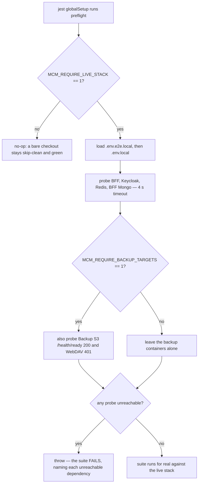

# E2E testing (BFF container modes & flakiness diagnosis)

The same app + BFF code runs in three modes that differ only in which server fronts the BFF and the
cookie/TLS posture: **local dev** (Metro's `@expo/server`, HTTP, non-Secure cookies — the default for
iterative work), **dev container** (`mcm-bff-service-nonsecure`, HTTP, non-Secure — the standard
final local E2E run), and **prod container** (`mcm-bff-service-secure` + TLS proxy, HTTPS, Secure
cookies — reserved for a future CI/CD job, not a routine local step). See
[Testing tiers](../invariants/testing-tiers.md) for how this E2E tier fits alongside unit,
integration, and golden tests, and how CI enforces the integration tier ahead of the E2E legs.

| Mode | BFF served by | Port | Cookies | When to use |
|---|---|---|---|---|
| **Local dev** *(default)* | Metro (`@expo/server` dev) | `:8081` HTTP | non-Secure | iterative development + unit/integration/iterative E2E |
| **Dev container** | Docker `mcm-bff-service-nonsecure` (`NODE_ENV=development`) | `:8082` HTTP | non-Secure | **local final E2E** (after dev is green); deterministic ~54 s baseline |
| **Prod container** | Docker `mcm-bff-service-secure` + `mcm-bff-tls-proxy` (`NODE_ENV=production`) | `:8443` **HTTPS** | **Secure** | future CI/CD only — not a routine local step |

The `X-BFF-Source` header is asserted in `global-setup.ts` to fail-fast on a Metro false-green when
the dev-container mode is expected. Full container-mode commands, the complete flakiness-diagnosis
protocol, and the integration-tier CI enforcement detail: `docs/runbooks/e2e-testing.md`.

## Integration tier CI gate (feature 041, extended by 048/059/073)

`app-ci`'s `app-e2e` job runs `test:integration` for **six** projects — agent (`movie-assistant`),
the three MCP servers (`movie-mcp`, `spreadsheet-mcp`, `web-api-mcp`, added by feature 048/059),
`mc-service`, and `mcm-app` — before the web/APK/emulator legs, so a failure costs a few minutes
instead of burning 25+ min of emulator time. Every step sets `MCM_REQUIRE_LIVE_STACK=1`, which
escalates a SKIP to a FAILURE: in CI a down dependency is a broken harness, not a pass.
`web-api-mcp` reaches live TMDB using the job's own `TMDB_API_KEY` (no per-user key is involved),
and `mc-service`'s Rust suite runs inside a `rust:1-bookworm` container via
`scripts/mc-service-integration-guard.mjs`, which fails a zero-executed/all-`#[ignore]` run.

Before feature 041 no project's integration tier ran anywhere in CI. It had rotted silently for a
month — the first green run surfaced a month-old contract regression and a credential leak.

What this changes for you:

- **Run the touched suite before pushing** — a red integration test blocks the merge.
- **Skips are failures in CI.** Legitimately-optional skips are allowlisted per suite: agent
  `_LEGITIMATE_SKIPS` in `agents/movie-assistant/tests/integration/conftest.py`; mcm-app via the
  jest `globalSetup` preflight (`frontend/mcm-app/tests/integration/setup/preflight.global.js`),
  which probes BFF/Keycloak/Redis/Mongo and throws. Add to those deliberately — never to turn a
  red run green.
- **The feature-073 backup destinations are their own escalation.** The BFF integration step sets
  `MCM_REQUIRE_BACKUP_TARGETS=1` alongside `MCM_REQUIRE_LIVE_STACK=1` (the destinations are brought
  up by a dedicated `app-e2e-bring-up-backup-destinations` step from
  `infrastructure-as-code/docker/backups/compose.yaml`), and the web E2E gate forwards
  `E2E_REQUIRE_BACKUP_TARGETS=1` into the Playwright container. `backups.spec.ts` skips when
  `BACKUP_TEST_S3_SECRET_KEY` is unset — right for a developer without the containers, wrong in CI
  where they *are* up — so each flag converts that skip into a failure. The S3 and WebDAV
  credentials are minted per run and exported via `$GITHUB_ENV`; `BACKUP_TICK_SECRET` is read back
  from the generated `.env.docker` rather than minted again, because a second random value would
  404 against the BFF holding the first.
- **Agent/MCP images rebuild every run** (`scripts/agent-stack.mjs` builds by default; `--no-build`
  is refused under CI), so `agents/**` and `mcp-servers/**` changes are genuinely under test.

See [BFF integration test harness](#bff-integration-test-harness-mcm-app) below for the mcm-app
integration tier specifics.

## BFF integration test harness (mcm-app)

BFF integration tests (`frontend/mcm-app/tests/integration/*.integration.test.ts`) run against real
Keycloak + Redis + mc-service (no mocking) via `frontend/mcm-app/jest.integration.config.js` (not
the package.json `jest` block). Run: `pnpm nx test:integration mcm-app`. Key facts so they are not
rediscovered:

- **`testEnvironment: node`, `maxWorkers: 1` (serial)** — tests share Redis db 1 and the live BFF;
  parallel `flushdb`/teardown would corrupt another file's data mid-test.
- **Real tokens via ROPC:** `helpers/keycloak-test-client.ts` acquires tokens via the test-only
  `mcm-bff-test` ROPC client. Call **`ensureRopcAudienceMapper()` in `beforeAll`** for any test that
  hits `validateJwt` or mc-service — without the audience mapper, ROPC tokens (`azp=mcm-bff-test`)
  are rejected as "Invalid token audience". The ROPC grant must never be enabled on the production
  client.
- **Route coverage gate:** `tests/integration/route-coverage.integration.test.ts` +
  `route-coverage-map.ts` fail if any `+api.ts` route lacks a test or a justified exclusion —
  login is the only map-level exclusion.
- **Preflight guard:** `setup/preflight.global.js` (wired as jest `globalSetup`) probes BFF,
  Keycloak, Redis, and BFF Mongo and throws when `MCM_REQUIRE_LIVE_STACK=1` and any is unreachable.
  Locally the flag is unset and the guard is a no-op. Under `MCM_REQUIRE_BACKUP_TARGETS=1` it
  additionally probes the two real backup destinations in their own compose file — Backup S3
  (RustFS) at `${BACKUP_TEST_S3_ENDPOINT}/health/ready` expecting `200`, and Backup WebDAV at
  `${BACKUP_TEST_WEBDAV_ENDPOINT}` expecting `401`. The WebDAV container is distroless and cannot
  self-probe, so this preflight is the **only** place its liveness is asserted; an unauthenticated
  `401` is the proof, because it means the server parsed its config, is listening, and has auth
  configured — which a bare TCP connect would not establish. The probes are dependency-free
  (`node:http` / `node:net`, 4 s timeout) and the flag is separate from
  `MCM_REQUIRE_LIVE_STACK` so the other thirty suites do not start requiring two containers they
  never touch.



The jest preflight's decision path: the escalation flags decide whether a missing dependency is a skip or a failure.

## Running the agent specs

`pnpm nx e2e mcm-app` runs the general web suite and skips every `agent-*.spec.ts` — all gate on
`E2E_AGENT_PRODUCTION=1`. The run still reports green, which is the trap. To run agent specs:

```
node scripts/agent-stack.mjs   # deploy gateway + MCP servers (builds images by default)
node scripts/agent-e2e.mjs     # every agent spec, isolated per file
node scripts/agent-e2e.mjs assistant-add  # one spec by basename
```

`agent-e2e.mjs` sets `E2E_AGENT_PRODUCTION=1` and `E2E_BFF_TARGET=dev-container`, recreates the dev
BFF with the agent-e2e rate-limit override first, and runs each spec file in isolation (a fresh
`nx e2e` invocation = fresh login/session). Its header justifies that with "the full parallel suite
shares one test user across workers, which exhausts the per-user rate limit and crosses the
access-token lifetime" — the shared-identity half of that premise is stale: since feature 054 US4
each worker mints its own Keycloak identity (see the teardown gotcha below), and `dev-realm`'s token
lifespan now matches `ci-realm` at 5400 s. Isolation is still how these specs are run, so treat the
per-file invocation as the contract and the recorded rationale as history. Set
`E2E_REQUIRE_AGENT_STACK=1` on any pre-PR or CI run to convert a missing stack into a hard failure
instead of a skip.

## Two tiers: what blocks a merge (feature 056)

Agent tests carry `@gate` or `@model-decision`. The rule — and what the gate stops proving — is in
[Testing tiers](../invariants/testing-tiers.md). Operationally:

- **`@gate`** — blocking; this is what a PR pays for.
- **`@model-decision`** — non-blocking; it runs in the **same job** as a second selection on every
  push to `main` and on `workflow_dispatch`, never on `pull_request`, and its step carries
  `continue-on-error: true` so model drift cannot fail the job.
- The selection is `E2E_TIER=gate` / `E2E_TIER=model`, applied by `grepInvert`/`grep` **inside**
  `frontend/mcm-app/playwright.config.ts`. Unset `E2E_TIER` runs everything (local default).
- An **unclassified** agent test fails the gate rather than defaulting into a tier
  (`scripts/__tests__/agent-test-classification.test.mjs`). That guard pins the *partition* — union
  complete, intersection empty, both sides non-empty — not the counts, so the numbers move as specs
  are added or retired. At the split (2026-08-12) they were 155 `@gate` / 22 `@model-decision` of
  177, and the workflow comment records the identical-code run pair (#1684 `failed=0 flaky=0
  passed=177`, #1685 `failed=1 flaky=7 passed=166`) that forced the split.

The price is stated rather than hidden: a green gate no longer proves the assistant makes the right
decision, only that the machinery around the decision works. Nothing leaves the gate without a tier
that runs it — a tier nobody runs is quarantine wearing a schedule.

## Cycle time

The mobile half (APK build + Maestro emulator flows) runs **after** the web E2E, so a failing web
suite aborts the job before it. Red runs take ~15–19 min (web E2E only); green runs take ~30–35 min
(web + APK + emulator). Fixing the suite roughly doubles the wall clock — do not read job duration
as a performance signal without checking the outcome.

For mobile-specific tunneling and APK-rebuild decisions, see
[Android emulator & APK builds](./android-emulator.md).

---

## Gotchas

- **Diagnose flaky-vs-broken with the dev-container run, not Metro.** Metro has JIT/long-session
  variance that produces convincing "environment" red herrings; the dev-container run is
  deterministic (~54s for the current suite). If that run is slower or fails, treat it as a real
  regression — do not reach for "flaky" first. A real historical case: a strict-validation 400 was
  repeatedly misattributed to machine/Metro degradation because the handler didn't log 4xx errors.
- **A client→BFF response can be silently lost through the exported server's pipe stack**, most often
  over the emulator's tunnel. This is usually benign for login (the session lands anyway) but can
  make a server-authorized action look client-denied for other flows — diagnose by comparing the
  BFF's own audit log against the client-visible outcome, not by re-running.
- **Bounded E2E retry is at most one retry per test, never more** — masking flakiness with additional
  retries risks hiding a real defect; a genuine regression must still fail both attempts.
- **Agent E2E flows must never assert on a specific TMDB-ranked title.** Live TMDB popularity rankings
  drift, so a hardcoded title can silently leave the candidate list entirely — assert by list
  *position*, never by name.
- **A CI agent-flow failure ships full per-service container logs and health-check JSON as the
  `agent-e2e-container-logs` artifact before teardown** — the containers are gone by the time you'd
  try to `docker logs` them post-hoc, so that artifact (not a live re-run) is the required first
  diagnostic step.
- **The prod-container (HTTPS) mode is not a routine local step** — it's kept only as a proven
  reference path for a future CI/CD job; don't reach for it in day-to-day validation.
- **`agent-e2e.mjs` does NOT work inside the dev container.** It shells out to `nx e2e`, which
  launches Playwright on the host — chromium cannot be installed inside the dev container (CDN and apt
  mirrors are outside the egress allowlist), so `globalSetup` dies on
  `browserType.launch: Executable doesn't exist`. Run agent specs through the Playwright image instead
  (full recipe in `docs/runbooks/devcontainer.md`). `agent-stack.mjs` itself works fine inside the
  container and is still the correct bring-up path.
- **`agent-stack.mjs` needs a reachable `KEYCLOAK_SERVICE_CLIENT_SECRET` — from the env *or* from
  the generated env file.** It fetches the gateway's confidential client secret live from Keycloak
  admin through `kc_admin.admin_token()`; `kc_admin.cfg()` reads the process env first and then
  `frontend/mcm-app/.env.local` (then `.env.e2e.local`), so after `node scripts/gen-dev-env.mjs`
  nothing needs exporting. A `service-account admin token failed (401)` means that file is absent or
  stale against the realm — re-run `gen-dev-env.mjs` rather than exporting by hand, and unset any
  exported copy, which wins over the file. Setting `AGENT_GATEWAY_CLIENT_SECRET` skips the lookup
  entirely (the escape hatch for a container where the admin URL is unreachable).
- **Rebuild the BFF image when CLIENT code changes.** The Expo web bundle is baked into the BFF
  image, so any change under `frontend/mcm-app/src/` is invisible to a containerized E2E run until
  `pnpm nx run mcm-app:build` + a container recreate. This is the same stale-image rule the
  validation checklist states for services — it applies to the client too, which is easy to miss
  because "the client" does not feel like a deployed container (measured 2026-08-03: a new Cancel
  button was unit-tested and present in the gateway payload, yet the E2E failed `element(s) not found`
  because the container served the previous bundle).
- **Always run the integration tier with `MCM_REQUIRE_LIVE_STACK=1` and ALL MCP servers up.** A
  missing server makes dependent tests SKIP — it does not fail the suite. Measured 2026-08-03: running
  with web-api-mcp down yielded `89 passed, 17 skipped`, which reported as a pass but contained a
  real regression in `test_gateway_add_e2e.py`. With all three servers up the same suite is
  `95 passed, 11 skipped`. **The skip COUNT is the signal**: if it moves, something stopped being
  tested. `MCM_REQUIRE_LIVE_STACK=1` converts any non-allowlisted skip into a failure naming the
  missing dependency.
- **After driving an agent control, assert on what the assistant *said* — not on client-local
  state.** The Add button's `disabled` state is set by `setActioned(true)` in the tap handler,
  BEFORE the agent has replied at all — it cannot distinguish any two agent responses. "No approval
  request appeared" is also true of a *failed* search; the absence of a write proves nothing when
  the wrong behaviour also writes nothing. Measured 2026-08-09: `agent-search` cancel was green for
  two days while the feature was broken. Test: would this assertion still pass if the assistant said
  the opposite? If yes, it is not coverage.
- **Scope the reply assertion to ONE new reply — not the whole transcript panel.** A panel-wide
  `not.toContainText(/couldn't find/i)` fails *forever* because the transcript already contains that
  phrase from earlier turns. Count replies before and after the action, wait for `count + 1`, then
  read only the last one. On mobile (Maestro), scope to signatures the bug *alone* produces — a bare
  `.*couldn't find.*` matches legitimate transcript text in both the passing and failing worlds.
- **The Playwright image tag MUST follow the lockfile's `@playwright/test` version — they are not
  independent.** The tag selects the browser build baked into the image; a lockfile bump that moves
  `@playwright/test` without moving the tag makes the browser launch fail outright —
  `browserType.launch: Executable doesn't exist at /ms-playwright/chromium_headless_shell-…` — ZERO
  tests run and the e2e gate reports `no Playwright summary found` rather than a count. The tag lives
  in three places that do NOT carry equal weight:

  | Where | Count | What it is |
  |---|---|---|
  | `.forgejo/workflows/app-ci.yml` | 2 | **authoritative** — the tag CI actually runs the suite in |
  | `docs/runbooks/devcontainer.md` | 3 | the operator's local `docker run` recipe |
  | `docs/runbooks/e2e-testing.md` | 1 | the `docker ps` cleanup filter |

  Updating only `devcontainer.md` fixes a local run and leaves CI broken — the workflow is the copy
  that matters for a merge. The two halves (pin bump + lockfile bump) MUST land in the same change:
  bumping the pin ahead of the lockfile bump on `main` breaks `main` the same way in reverse. Measured
  on PR #199: lockfile moved 1.60.0 → 1.62.1, the workflow tag stayed at `v1.60.0-noble`, and
  `app-e2e` burned a full ~35-minute cycle before failing. **The coupling is now enforced by
  `scripts/check-toolchain-consistency.mjs`** (feature 061): it reads the version `pnpm-lock.yaml`
  resolves and compares it against every occurrence of the tag in `app-ci.yml`, failing the `naming`
  guardrails job in ~0.4 s — before `app-e2e` starts. A partial bump (only one of the two occurrences
  moved) fails exactly like moving neither. Renovate now proposes both halves in one PR (the
  `playwright pin` group in `renovate.json`). Run it before you push:
  ```bash
  node scripts/check-toolchain-consistency.mjs
  ```
  **DIAGNOSTIC — `failed=0 flaky=0 passed=0` means check the image pin FIRST.** A drifted tag does
  not present as a test failure — it presents as the *absence* of results, and the e2e result gate's
  `no Playwright summary found` is the only signal. Run the gate above before opening a single
  container log. Current pin: **v1.63.0-noble**.
- **Killing the shell does NOT kill a containerised `docker run`.** The container detaches from the
  CLI process, so cancelling the command leaves Playwright still running — consuming the same stack
  (and the same canonical test user for worker 0) as any subsequent run. Measured 2026-08-09: an
  abandoned full-suite run was still at test 24/174 fifteen minutes after being "stopped". Always
  confirm and kill: `docker ps --filter ancestor=mcr.microsoft.com/playwright:v1.63.0-noble`.
- **Include the assistant's *decline* copy in the negatives.** The same routing bug can surface as
  "I couldn't find…" on one model and "I can only help with your movie collections." on another. A
  test that knows only one symptom misses the same defect on a different provider.
- **`docker run` forwards ONLY what `-e` names — an omission is a silent skip behind a green required
  gate.** Every gate the web E2E suite applies is driven by an env var, and a variable set in the
  job's `env:` block but not named in the `docker run -e` list is invisible inside the Playwright
  container. Two were live for the lifetime of the job (feature 051, item #158): `E2E_AGENT_PRODUCTION`
  (every `agent-*.spec.ts` skipped) and `KEYCLOAK_SERVICE_CLIENT_SECRET` (`admin-settings-access` +
  `admin-registration` skipped). `scripts/__tests__/app-e2e-env.guard.test.mjs` now asserts the list,
  and the workflow enumerates the deliberately-omitted remainder against every `process.env` read
  under `tests/e2e/` — do not add to either speculatively, because each one changes what the gate
  actually tests. Secrets use the bare pass-through form `-e NAME`, never `-e NAME=$NAME`, which
  would expand the value into argv and into `ps` output.
- **Teardown deletes only what the test declared with `ownCollection()` — and per-worker identities
  now make cross-worker deletion structurally impossible.** `playwright.config.ts` sets
  `fullyParallel: false` and up to 10 workers (half the cores). That serialises tests *within a
  file* and runs different *files in parallel*. `cleanupNonFixtureCollections` used to delete every
  non-fixture collection the user owned from 21 spec files' `afterEach`; the median collection
  lifetime was 1.3 s while agent flows need them for a minute or more. The rule now: teardown
  deletes only what the test declared with `ownCollection()` (see
  `tests/e2e/web/setup/e2e-cleanup.ts`), matched exactly or on an `"<owned> "` prefix — never as a
  loose substring, which could reach another worker's similarly-named collection. **When you add a
  spec that creates a collection, declare it** — the guard
  (`scripts/__tests__/e2e-collection-ownership.guard.test.mjs`) fails the build if you POST
  `/bff-api/collections` without calling `ownCollection`. Since feature 054 US4 each worker mints
  its own Keycloak identity (`setup/global-setup.ts` → `setup/auth-files.ts` writes one
  `user-<parallelIndex>.json` per worker, plus a `worker-identities.json` manifest so global
  teardown can delete exactly the throwaway users it minted — worker 0 reuses the canonical
  `E2E_TEST_USER` and is never deleted) and mc-service scopes collections by
  `owner_id = token.subject`, so the name-scoping is now belt-and-braces rather than the only
  barrier. Per-worker sessions also give each worker its own refresh bucket, which is what removed
  the 32-of-66 rejected-refresh contention. Other shared user state to account for: per-user agent
  config, the default collection (FR-009 redirect), and the `MUTATION` fixture emptied by
  `movies.spec.ts`.
- **"Green" told you nothing until the result gate existed.** Playwright exits 0 with tests
  skipped, the forge API exposes no job logs, and the digest publishes only on failure — so on a
  green run the counts were unreadable. Feature 040 validated green with 33 specs skipped. `app-ci`
  now runs `node scripts/e2e-failure-set.mjs gate` after the web E2E: fails on `skipped > 0`,
  `did not run > 0`, or a log with no summary. **`flaky` is still NOT observable on a green run**
  — do not claim "no flakes" from a green tick. **`N did not run` is not a skip**: the `lifecycle`
  project (`bff-prod-lifecycle` + `admin-registration`, 3 tests) never runs while the main project
  has any failure — they reported "3 did not run" for months without anyone noticing.
- **A local run is only evidence if you check the instrument.** Three measured failure modes: (1)
  a stale realm can still hand out 300 s access tokens — feature 052 raised `accessTokenLifespan` to
  5400 s for `ci-realm` only, and feature 054 (item #168) extended the same 5400 s to `dev-realm`
  (only `prod-realm.json` keeps 300 s). A Keycloak that has not re-imported the realm keeps serving
  the old lifespan, and a local run past ~5 min then re-enters refresh contention; read BFF
  contention counters alongside the result before attributing failures to the application. (2) A
  container can be "Up" and dead
  — `movie-assistant-gateway` once showed `Up 37 hours` while not answering `/health`; zero
  gateway requests for a turn means check liveness first:
  `docker exec mcm-bff-service-nonsecure wget -qO- http://movie-assistant-gateway:8000/health`.
  (3) A local subset pass is not evidence about a change to a shared hook — a fix that passed
  6/6 unit tests and 5/5 E2E produced 28 and 26 failures in the full CI suite because it exercised
  three spec files in isolation while the regression only appears under full concurrency.
- **A RED `app-e2e` is fast because it gives up early.** The mobile half (APK build + Maestro)
  runs after the web E2E; a failing web suite aborts the job before it. Measured: red runs take
  15–19 min (web E2E only), green runs take 30–35 min (web + APK + emulator). Fixing the suite
  roughly doubles the job's wall clock. Do not read job duration as a performance signal without
  checking the outcome.
- **Agent tests are split into two tiers by `E2E_TIER` — unclassified tests fail the gate.** `@gate` tests (blocking — what a PR pays for) and `@model-decision` tests (non-blocking, same job, `main` + dispatch only, `continue-on-error: true`) are separate slices. `E2E_TIER=gate pnpm exec playwright test` / `E2E_TIER=model pnpm exec playwright test`; without the flag everything runs (local default). At the split (2026-08-12) the tiers were 155 / 22 of 177, but the guard asserts the PARTITION, not those counts. An agent test with no classification fails the gate rather than defaulting into a tier — enforced by `scripts/__tests__/agent-test-classification.test.mjs`.
- **`--grep-invert` is accepted by Playwright 1.60 but does nothing.** `--grep CORS` lists 1 test; `--grep-invert CORS` lists the whole suite (all 177 at the time of measurement). The tier split must be applied via `E2E_TIER` → `grep`/`grepInvert` in `playwright.config.ts`, not as a CLI flag. A CLI-based split would appear to run only the selected tier while silently running the whole suite.
- **`node --test <file> --test-name-pattern "x"` silently runs everything.** Node stops parsing its own flags at the script path; anything after the path becomes the script's `argv` and is ignored. `--test-name-pattern` never applied. Nothing warns; the filter simply does not exist. The safe form is flags-before-path: `node --test --test-name-pattern "x" tests/foo.test.js`. Always verify a filter by checking that the reported test COUNT actually dropped — a filter that changes nothing was not applied.
- **An argument a tool does not recognise and does not REJECT leaves the default action running — FIXED, items #497/#500.** Measured 2026-09-19: `node scripts/agent-stack.mjs --help` began building `movie-mcp:latest` within a second during a session whose entire purpose was tearing things down. It was caught only because the call happened to carry a timeout. The same class was live in three other scripts: `renovate-health.mjs --dryrun` posted a public comment to item #311; `check-lockfile-refresh.mjs --dryrun` posted a public comment; `prune-bff-runtime-modules.mjs --dry_run` deleted files for real. All four now route argv through one shared rejecting parser, `scripts/lib/argv-contract.mjs`:

  | script | the default that used to fire on a typo | now |
  |---|---|---|
  | `agent-stack.mjs` | built + deployed the stack | rejects (PR #497) |
  | `renovate-health.mjs` | posted a public comment to item #311 | rejects |
  | `check-lockfile-refresh.mjs` | posted a public comment — the file `renovate-health` was copied from, missed by the manual audit | rejects |
  | `prune-bff-runtime-modules.mjs` | deleted files | **inverted**: dry-run is the default, `--apply` deletes |

  Two durable lessons: **the copy and the original carry the same defect** — `check-lockfile-refresh.mjs` was the ancestor `renovate-health.mjs` was copied from; fixing only the one item #500 named would have left the ancestor posting on a typo. And **an inversion beats a guard where the act is irreversible**: a guard is only as good as its coverage of inputs someone will actually type; after the inversion even an unanticipated input or a future caller that bypasses the parser can only fail safe. `scripts/__tests__/argv-mutating-default.guard.test.mjs` re-runs the audit mechanically and fails on any argv-dispatching script that can mutate and carries no recorded verdict. All four mutating defaults are now guarded.

  **`ci-failure-digest.mjs` was deferred out of that change on a premise that turned out to be false — item #504, now fixed.** The deferral read FR-009 ("this step must NEVER change a job's outcome", always exit 0) as "this script always exits 0, whatever you type", which would have contradicted a rejection that exits 2. But **FR-009 governs only the DIGEST path** — the one that runs when no argument is given — and argument-driven paths were always free to fail. Two facts settled it and are now assertions rather than recollections: all 22 workflow call sites invoke the digest **bare**, and all 22 carry `continue-on-error: true`. So an argv rejection is unreachable from CI twice over; the only caller who can trigger one is a human or agent at a terminal — exactly the audience that must not have `--seltest` publish a digest. The rejection there is **soft** (`dieOnArgvError` with `hard: false` — sets `exitCode` and returns) rather than the hard `process.exit(2)` the other three use: `process.exit()` discards writes still queued on a pipe, and this is the file that documents that trap for its own stdout; a hard exit would have contradicted its own lesson. Same root as `--grep-invert`, opposite direction: **confirm the tool did what you asked by a signal other than its exit code.**
- **A pipe discards the exit code — `cmd | tail` reports `tail`'s status, which is almost always 0.** Measured 2026-09-06, twice in one session: `pnpm nx affected … | tail -40` printed `EXIT=0` while nx's own output said `Failed tasks: mcm-app:typecheck`, and `ci-status … watch | tail -30` printed `WATCH_EXIT=0` for a watch whose text said `still waiting after 5100s … (exit 3)`. Both times the true answer was printed directly over the false one, so reading the output caught it — unlike `--test-name-pattern`, which leaves no contrary evidence. The danger is when the status drives control flow: `cmd | tail && <next step>`, an `until` guard, or any wrapper keying off `$?`. Use `cmd > /tmp/out.log 2>&1; echo "EXIT=$?"` or `set -o pipefail`. Applies to `nx`, `jest`, `cargo`, `pytest` — all lose their status the same way. `grep` is worse than `tail`: it exits `1` when it matches nothing, so a filtered check can invent a failure as readily as hide one. The `ci-status watch` instance and the `ci-status status && merge` control-flow failure are documented in [CI diagnostics](./ci-diagnostics.md).
- **A container reporting `running` at 100% CPU on one core is wedged, not slow.** 100% CPU means a spin; a blocked await sits near 0%. `movie-assistant-gateway` has been caught in a livelock (`drain_audit_tasks` refilling its own loop) where `docker inspect` said `running`, logs were 40 minutes stale, and `/health` timed out — five specs "reproduced" against a dead stack, not a defect. The gateway now carries a healthcheck so `docker ps` says `unhealthy` instead of `Up`. It is NOT auto-restarted (a wedged gateway must stay visible). Stack dump in one command: `docker kill -s USR1 movie-assistant-gateway && docker logs --tail 100 movie-assistant-gateway`. Zero gateway requests for a turn means check liveness first: `docker exec mcm-bff-service-nonsecure wget -qO- http://movie-assistant-gateway:8000/health`.
- **A datastore volume that survives between runs fails the NEXT run, not the current one.** The `kvm` runner is persistent; `app-ci.yml`'s "Reset stateful CI data" step removes data volumes so each run starts clean — but `mcm-bff-cache-redis-data` was missing from that step. PR #362's `app-e2e` ran Redis 8.10.1 and wrote an RDB v15 dump into it; the next `app-e2e` on Redis 8.6.2 (the `main` merge of PR #361, run 2735) died at bring-up with `# Can't handle RDB format version 15 … dependency failed to start: container mcm-bff-cache-redis is unhealthy`. Nothing in either failing commit touched Redis — the failing run was poisoned by the previous run's container. **Two diagnostic rules:** (1) "unhealthy at bring-up" with the container `Restarting (1)` is the signature — read the datastore's own log (the bundle's `mcm-bff-cache-redis.log`) before blaming the change; (2) a redis version moving in EITHER direction between consecutive runs trips this — an older-version PR after a newer-version PR is the common case on a Renovate day. Fixed 2026-09-05 by adding the volume to both reset steps; `scripts/__tests__/app-ci-stateful-reset.guard.test.mjs` now asserts every volume the setup step creates is also removed by the reset step.
- **A leak is bounded for Playwright but UNBOUNDED for the mobile tier** — the ownership guard does not catch specs that create collections via non-POST routes (e.g. backup restore). `backups.spec.ts` demonstrates the safe pattern: a spec cleans up what it caused to exist, by whatever route, by name in `afterEach`. On PR #527 the restore E2E left collections named `… (backup 2026-09-20 18:04)` and `Mutated e2e-…` in the shared account; `agent-disambiguation` then found several plausible matches and asked a disambiguation question instead of rendering a card — failing three Maestro attempts (~35 min each) in a suite and tier that looked completely unrelated to the diff. `e2e-collection-ownership.guard.test.mjs` matches `request.post('/bff-api/collections'` and passes a spec that creates via restore, import, or seed. Do not reason from "the next run will sweep it" unless nothing runs between here and the next run — in the CI job the model tier and the whole mobile tier do.
- **Local refresh contention is now a *stale realm* problem, not a lifespan problem.** `dev-realm`
  matches `ci-realm` at `accessTokenLifespan: 5400` (feature 054, item #168); only
  `prod-realm.json` keeps `300`. A running Keycloak keeps the OLD value until the realm is
  re-imported, so an un-reimported realm still expires tokens five minutes in and a local run past
  ~5 min re-enters refresh contention. The `globalTeardown` fails the run if
  `refresh_rate_limited > 0`, with a message naming the token lifespan and the file to check. In the
  dev container that guard does NOT fire — the Playwright image has no Docker CLI to read the BFF
  container, and it deliberately reports "could not measure" rather than "zero". Run the tally
  manually after a containerized local run: `bash scripts/e2e-contention-tally.sh` (tally only, never
  fails) or `bash scripts/e2e-contention-tally.sh --gate` (exit 1 on any contention; this is the form
  `app-ci` invokes).
- **TMDB drift disambiguation lesson — assert by position, never by hardcoded name.** Assert by `disambig-option-1` slot index (testID), not by title string. `agent-disambiguation.yaml` previously matched the button by label text, which caused failures when "Avatar: The Way of Water" left the offered set entirely on 2026-07-20. Do NOT make every hardcoded title dynamic: `assistant-disambiguate.{spec.ts,yaml}` hardcodes the same film on purpose (load-bearing for substring regression — the user types the full title so drift is irrelevant, and the bug-1 regression needs a pair where one title is a substring of the other). That hardcoding must stay.
- **BFF integration test harness key facts: `testEnvironment: node`, `maxWorkers: 1` (serial — parallel `flushdb` would corrupt data), ROPC client `mcm-bff-test` requires `ensureRopcAudienceMapper()` in `beforeAll` or ROPC tokens are rejected as invalid audience; `route-coverage-map.ts` fails if any `+api.ts` route lacks a test or justified exclusion.**

For mobile-specific tunneling and APK-rebuild decisions, see
[Android emulator & APK builds](./android-emulator.md). Full container-mode
commands, the complete flakiness-diagnosis protocol, and the integration-tier CI enforcement detail:
`docs/runbooks/e2e-testing.md`.
