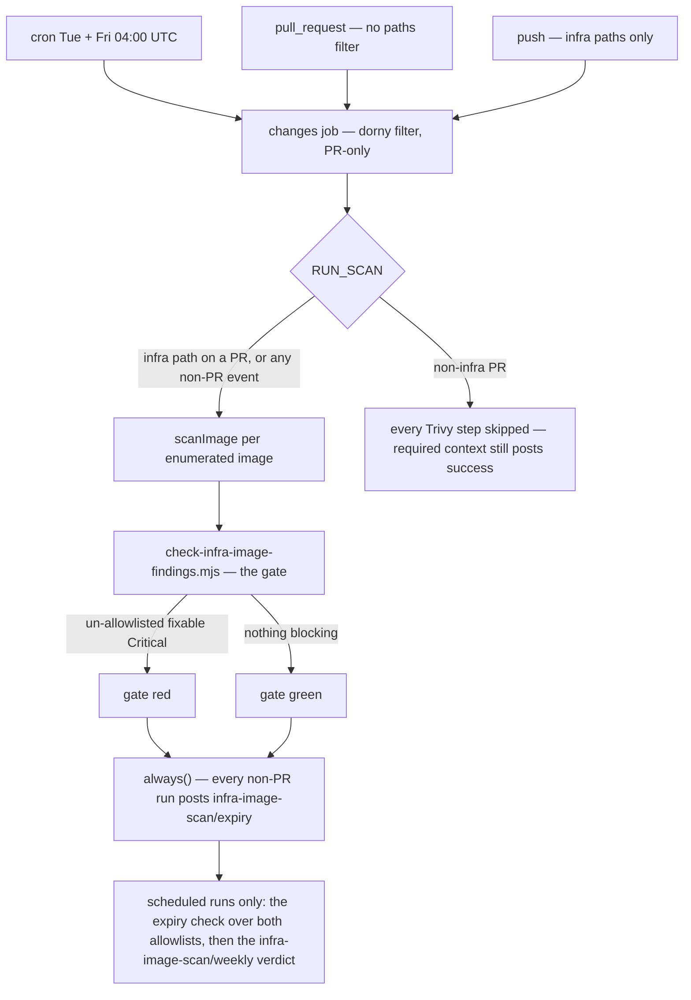

# Infra-image CVE scanning

Trivy scans every third-party image the project pulls but does not build — everything under
`infrastructure-as-code/**` except images scanned by their own builder, and except a ref that is still
`${..}`-interpolated once the one host variable this scan can resolve has been substituted (see the
registry-host gotcha below). It is deliberately disjoint from
[SAST/SCA scanning](./sast-scanning.md), which covers first-party source and first-party dependency
graphs, and from [DAST scanning](./dast-scanning.md), which exercises the running app over HTTP.
Renovate keeps base images current; this scan catches a freshly published CVE against an
already-pinned image, which currency alone cannot.

**Cadence: twice weekly — Tuesday and Friday, 04:00 UTC — and the scheduled sweep is never
path-gated.** A new advisory can land against an image nobody changed, so the on-change PR/push check
exists only for fast feedback, not as the source of truth. The Friday run is ordered three hours ahead
of the Renovate window on purpose (see [Renovate](./renovate.md)), and that ordering is pinned rather
than commented: `renovate-workflow.guard.test.mjs` asserts the latest sweep cron fires **strictly
earlier** than the earliest window cron, with at least a two-hour gap, and that both are UTC-fixed
5-field expressions (item #487). The guard picks the window cron **structurally rather than by name**:
it keeps only the `renovate.yml` crons that fire exactly one hour-of-week slot, so the nightly
`0 3 * * *` — seven slots, the schedule-exempt security channel — drops out and the single-slot Friday
window cron is what the sweep is ordered against. Adding another single-slot cron to `renovate.yml`
therefore changes what the ordering is asserted against, and a sweep cron that lands later than it
fails the build. The same test also fails if the workflow stops recording *why* its
cron sits where it does — the file must still carry the `item #487` reference — because an
unexplained time is the one a later reader tidies. The Tuesday run (item #642) means an advisory published early in the
week is visible with three days in hand instead of surfacing at the moment the window's PRs already
exist and inherit a red nobody had seen — GHSA-vcvr-r3jv-pc5j, on the unchanged `langfuse:4` pins,
was published 2026-09-22 and first surfaced at 04:00 on 2026-10-02. Tuesday 04:00 is hour-of-week 52,
far ahead of the window, so the ordering guard still compares against Friday 04:00.

**The object store is a pulled image again, and feature 080 is why.** From feature 069 until feature
080 the S3 object store was built from source and scanned by its own builder; feature 080 replaced it
with an upstream, digest-pinned `rustfs/rustfs` Docker Hub pull, so **RustFS is scanned here like every
other server image**, in every compose file that pins it. The from-source build, its workflow, its
promoter, its Renovate rule and its four allowlist entries were deleted in the same change, and
`scripts/__tests__/no-minio-references.guard.test.mjs` now fails on any *live* reference to the retired
machinery — the runbook keeps its case study inside an explicit `<!-- history:begin -->` block, which is
the only place such prose is allowed to survive. See "What feature 080 changed" below for the
transferable lessons; nothing in that section describes a mechanism that still runs.

## How a run flows



Trigger-to-verdict flow. The `changes` job only ever *gates* the Trivy steps; the required
`infra-image-scan / infra-image-scan` context is posted by the job either way. The two observability
contexts at the foot are posted by `always()`-guarded steps — which is why they still run in the week
the gate is red — and neither can gate anything.

## Entrypoints

| entrypoint | what it does |
|---|---|
| `node scripts/infra-image-scan.mjs` | enumerate → Trivy each image → write `security/infra-images/reports/{findings.json,summary.txt,trivy-*.json}`. `--list` enumerates only (needs no Trivy, works anywhere); `--emit-allowlist` also writes `allowlist.proposed.yaml`; `--image <ref>` scans exactly one image instead of enumerating the tree (this is how a builder scans its own artifact). |
| `node scripts/check-infra-image-findings.mjs` | the gate: exit 1 on any `blocking` finding not suppressed by a live allowlist entry; `--check-expiring` is the report-only hygiene tier; `--selftest` proves fail/suppress/expiry without Trivy. |
| `pnpm nx infra-scan infrastructure-as-code` | the Nx target wrapping the orchestrator, alongside the `sast`/`dast` targets. |
| `security/infra-images/severity-map.yaml` | Trivy severity → normalized scale. An unmapped native value is a hard error in the orchestrator (no silent default); `UNKNOWN` maps conservatively to `Low` so it can never block. |

Exit codes are deliberate: `0` ok, `1` scan/gate-relevant failure (fail-closed), `2` bad args or
config error — including the unresolved-`REGISTRY_HOST` refusal below.

Reports land in the gitignored `security/infra-images/reports/`, and CI uploads that directory as the
`infra-image-scan-report` artifact with a 14-day retention — a diagnostic, not a record (spec 084
FR-019c). The upload is `always()`-guarded inside the scan path, so a red sweep still leaves its
findings readable.

## Gotchas

- **Not path-gated on the authoritative run.** A twice-weekly full sweep is the scan of record
  precisely because a new advisory can land against an image nobody changed — an on-change check on
  infrastructure edits exists only for fast feedback, not as the source of truth.
- **The `changes` job's PR-only `if:` is load-bearing — removing it silently kills the sweep.** The
  `dorny/paths-filter` step is gated on `github.event_name == 'pull_request'` because dorny derives its
  diff base from the PR event and, on any other event, falls back to the repository's default branch —
  which this forge does not put in the payload, so the action hard-errors. That used to kill `changes`
  on the cron, and since `infra-image-scan` is `needs: [changes]` the required job was skipped: the
  full sweep — the whole point of the un-path-gated safety net — never ran. Skipped, the filter
  output is empty and `RUN_SCAN`'s `github.event_name != 'pull_request'` clause forces the sweep, which
  is exactly the intended behaviour. A `push` is unaffected by dorny's diff base but is filtered out
  here anyway and loses nothing, for the same reason.
- **Scanner partition rule: by coverage, not by namespace.** An image is scanned by whoever *builds*
  it; everything else belongs here. `cd-deploy` owns its six app images (see
  [CI/CD pipeline](../projects/ci-cd-pipeline.md)); nothing else builds an image any more, so
  `BUILT_IMAGE_NAMES` is exactly those six and every pulled third-party image — RustFS included — is
  enumerated here. The exclusion rule used to be `if (ref.includes('jumbleknot/')) continue` — matching
  "anything named like ours" rather than "anything already scanned by a builder". Feature 069 broke that
  coincidence by adding a `jumbleknot/*` image built outside cd-deploy; under the old rule it was
  excluded here and absent from cd-deploy's set — published and examined by neither gate, zero findings,
  no error. The rule is now membership of `BUILT_IMAGE_NAMES`, and the guard asserts the list is exactly
  cd-deploy's six. Any future image built outside cd-deploy must be added to `BUILT_IMAGE_NAMES` or
  explicitly enumerated here — the invariant is exactly one scanner per image, not zero and not two.
  Completeness is asserted against a **hypothetical** fixture in
  `scripts/__tests__/infra-image-scan.test.mjs` (`jumbleknot/future-widget`), not against the live
  tree: the earlier fixture named a real image, and when that image's classification changed the test
  failed for a reason that had nothing to do with the property it asserts.
- **The registry host is interpolated in compose, and the scanner must resolve it or refuse to run.**
  `check-topology-scrub` forbids the real forge host in a committed file, so an image this project
  publishes to its own registry can only be referenced as `${REGISTRY_HOST}/…`. With `REGISTRY_HOST`
  set the ref is concretely pullable and is enumerated; without it the ref is skipped, and on a real
  scan that is a **hard failure** (`exit 2`), not a quiet reduction in coverage — a sweep that silently
  covers less than the tree and still passes is worse than one that fails loudly. The variable is
  matched by regex, not as a literal, so the guarded compose form (`${REGISTRY_HOST:?…}`, which contains
  spaces) resolves too. **The workflow stopped supplying `REGISTRY_HOST` in feature 080**, because its
  only consumer — feature 069's from-source object-store ref — is gone and every remaining
  `${REGISTRY_HOST}` ref in the tree is a cd-deploy image excluded for two other reasons (a second
  `${…}` and membership of `BUILT_IMAGE_NAMES`). Those are deliberately *not* reported as unresolved:
  a warning that cries wolf is one nobody reads. If a future compose ref genuinely needs the host,
  the scan exits 2 naming the ref rather than silently shrinking what it covers.
- **Only a fixable Critical blocks the gate.** An unfixable Critical (no upstream patched version yet)
  is a report-only warning, since a version bump can't clear it and it must not wedge the gate
  indefinitely. `normalizeTrivy()` marks `blocking = Critical AND a fix exists upstream` — the same bar
  as the `cd-deploy` built-image gate — and the gate trusts the report's `blocking` flag rather than
  re-deriving it.
- **A finding and a scanner fault are two different exit codes on two commands.** `scripts/infra-image-scan.mjs`
  invokes Trivy with `--format json` and **no** `--exit-code`, so a non-zero scan exit can only mean
  the scanner could not run; `scripts/check-infra-image-findings.mjs` then carries the verdict from the
  normalized report. This split is what `cd-deploy` runs per image before the push, and it is why
  accepted findings on the deploy path live in `security/infra-images/allowlist.yaml` rather than in a
  `.trivyignore` nobody reviews. Pinned by
  `scripts/__tests__/cd-scan-push-gate.guard.test.mjs`, which asserts the gate runs before
  `docker push` and inside the per-image loop.
- **A Trivy vulnerability-DB blip is bounded-retried, and the retry must not soften the gate.**
  Trivy fetches its DB over the network on every run and this scanner is fail-closed, so an upstream
  blip reds the required context — and recovery costs a full CI cycle, because `/rerun` and
  `/rerun-failed-jobs` are both 404 on this forge. `scanImage()` therefore runs through the shared
  `scripts/lib/scanner-retry.mjs` (three attempts, 2s/4s backoff, extracted from `sast-scan.mjs` rather
  than copied). Two properties are deliberate: **fail-closed survives** (exhausting the attempts still
  throws) and **the classification is narrow** (only a measured transport signature retries; Trivy
  absent, an image that cannot be found, or unparseable output fail on the first attempt). **The
  classifier is handed STDERR only** — Trivy writes the report to stdout, so classifying stdout would
  let a CVE's own title decide whether a scan is retried; writing the control tests caught the
  inherited signature list matching the advisory title *"…does not limit Service Unavailable
  responses"*, and the HTTP-status signatures now require the status code. The captured stderr in the
  failure message is the **tail** (`readTail`, last 2000 chars), never the head: Trivy opens with
  `INFO` lines, and a head-truncated sample ended mid-URL, exactly where the HTTP status would have
  been. No DB cache and no extra mirror were adopted: Trivy's default `--db-repository` is already a
  fallback list, and cross-run caching is not available on this forge.
- **Keyless and fail-closed**, matching the posture in
  [Secrets management](../invariants/secrets-management.md) and
  [SAST/SCA scanning](./sast-scanning.md) — a Trivy/pull/parse failure fails the job
  rather than producing a clean-looking report. "Keyless" means no credential reaches the scan: Trivy
  is invoked with no registry auth and no `${{ secrets }}` is handed to it. The workflow's only secret
  reference is `CI_DIGEST_TOKEN`, consumed by the feature-042 failure-digest step, which never touches
  the scan. Keyless is also *why* an image's own builder scans it rather than routing it here: our
  built images live in a private registry, so a scan with no credential cannot pull them (measured:
  `unable to find the specified image`). A builder already holds the image locally and is already
  authenticated, so it needs no new credential and gates the publish instead of auditing after it.
- **The allowlist is baseline, not permanent.** Suppression is gate-only; findings stay visible in the
  report, and a suppressed entry must be deleted once the underlying image is actually bumped — leaving
  a stale entry hides a regression rather than tracking a real accepted risk. Every entry needs
  `image`/`id`/`justification`/`addedBy`; a blank field or invalid regex is a gate error, and a past
  `expiry` stops suppressing. The policy is stated in `security/infra-images/allowlist.yaml` itself.
- **Key a suppression to a VERSION — or, where the version cannot carry it, to the DIGEST — so an
  upgrade can discharge it.** `image` is matched as an **unanchored** regex against the full scanned
  reference, and that one property decides whether a suppression can ever end. A version-anchored key
  survives a digest being appended and stops matching the next version: `hashicorp/vault:1\.18`
  matched `1.18@sha256:…` and stopped matching `1.21`, which is how PR #289's bump surfaced the
  Criticals that key was written for — a dischargeable key doing its job, loudly. A bare repository name
  (no tag) instead matches every tag that image will ever have — it suppresses the advisory it was
  written for *and every future one in the same image*, silently and permanently. That is not an
  accepted risk with a review date, it is a permanent hole.
  Where the reference is a floating major, or the advisory survives a version move, the **digest** is
  the dischargeable half: the OpenSearch entry is keyed to `opensearchproject/opensearch:3@sha256:bcc17975…`
  rather than to `opensearch:3`, so an upstream rebuild — not a tag move — ends it, and it was
  re-keyed from the 2.x digest to the 3.x one when the OpenSearch 3 major did **not** clear the
  advisory. The Unleash entry names both (`^unleashorg/unleash-server:8\.2\.1@sha256:c6eaaede7242`),
  so any image change re-blocks — and it has already been re-keyed once, 8.2.0 → 8.2.1 in the
  2026-10-30 Renovate window (PR #878), after the new digest was re-measured and still carried
  proxy-addr 2.0.7 with the boolean `trust proxy` that keeps the CVE unreachable.
  `scripts/__tests__/infra-image-scan.test.mjs` asserts both directions for every formerly-floating
  repository: the key still matches today's pin **and** stops matching a later version derived by
  incrementing the pin's last number (a hand-written "next version" literal silently stopped meaning
  "later" when a bump moved past it). A tag carrying no number cannot be bumped this way; the helper
  fails loudly and asks for a declared exception rather than passing vacuously.
- **Re-keying an allowlist entry is required whenever a pinned tag changes, not optional tidy-up.**
  An entry keyed to the old tag matches nothing after the bump, the finding it covered becomes
  un-allowlisted, and the gate blocks — while reporting the entry only as an `UNMATCHED ENTRIES` line,
  which reads like housekeeping rather than like the cause. Check that line before assuming a new CVE
  appeared. Unmatched detection is also **scoped to the images the run actually scanned**
  (`generatedForImages`, item #423), because two jobs consult this one allowlist — the full sweep and
  the single-image `cd-deploy` scan-push loop, whose findings both carry the same literal scanner
  label — and each used to report the other's live entries as stale. The field is required, not
  defaulted: a producer that stops writing it fails the gate rather than silently restoring the old
  behaviour.
- **A version-keyed entry cannot be re-keyed on `main` and in the bump PR at once.** A version-keyed
  entry names one version, but during a bump two are live: `main` still references the old tag, the
  Renovate branch references the new one. Whichever single version the key names, the other side blocks.
  The two obvious escapes are both wrong: landing the re-key inside the Renovate branch does not survive
  (Renovate force-pushes and clobbers it); widening the key to a wildcard re-creates the permanent hole.
  What works is an **enumeration spanning the transition**, narrowed on merge — e.g.
  `'grafana/otel-lgtm:0\.32\.[01]'` covers both versions, is still discharged by an upgrade to
  `0.33.0`, and the test asserts that property. Write the narrowing into the justification; an
  enumeration left to grow one version at a time becomes the wildcard by instalments. Do this only when
  the bump is **not** the remediation — where the new version actually clears the advisory, delete the
  entry when the bump lands.
- **A hold can outlive its entries — once a clean tag ships, the GATE is the hold.** `hashicorp/vault`
  was held below 1.19 by a renovate.json `allowedVersions` ceiling from 2026-08-30 until 2026-10-20,
  precisely because the `vault:1\.18` entries could not match `1.21` and that bump added two new pgx
  Criticals. Feature 081 US8c re-measured `vault:2.2.0@sha256:e0acd3c6…` at **zero** Criticals of any
  kind, moved both refs to `2.2`, **deleted** the three seed entries rather than re-keying them (a
  re-keyed entry would match nothing and fail the expiry check), and lifted the ceiling. There is
  therefore no vault entry in the allowlist today, which is what makes `infra-image-scan` itself the
  hold: it now blocks any fixable Critical in a proposed vault tag. What replaced the ceiling is a
  major-approval gate — a vault MAJOR needs a dashboard tick (raft storage on a dormant prod stack),
  while patch and minor stay automatic and scan-gated.
- **A discharged hold is replaced, not deleted — and for mongo the re-own wrapper is what made the move
  safe.** `mongodb/mongodb-community-server` was hard-held below 9 by a renovate.json
  `allowedVersions: <9` ceiling added 2026-10-23 (item #819), because mongod 9.0.4 refused to start on
  this host's kernel (SERVER-121912) and 9.0 runs mongod as uid 1000 where 8.0.8 used 998, so it could
  not open an 8.0 volume. Spec 081 US8a (PR #817) discharged both premises in one change: the host moved
  to a 7.0.0 patch that 9.0.4's Ubuntu exemption admits (SERVER-131779), every mongo ref moved to the
  digest-pinned `9.0-ubi9`, each MongoDB service that mounts `/data/db` now starts as root only to re-own
  the volume and drops to the image's `mongod` user with `setpriv` before mongod runs, and the ceiling
  was lifted. What is asserted is the **successor**, not the absence — no `allowedVersions` on patch,
  minor or major, `dependencyDashboardApproval` true on a major and undefined on a patch — because a
  `<9` left behind would block the version actually deployed and make Renovate propose a downgrade, and
  because a hold deliberately discharged and one someone deleted look identical from the absence of a
  ceiling. `scripts/__tests__/mongo-data-owner.guard.test.mjs` is the second lock: it asserts both
  halves of the wrapper (start as root to re-own, drop before mongod) on the dev AND prod compose files,
  runs the wrapper against stubs so the assertion is about what it does rather than how it is spelled,
  and requires at least one matching service per file so a rename cannot make every assertion pass
  vacuously.
- **What the allowlist actually holds today, and how to read the cohorts.** Fourteen entries in four
  cohorts. Two are the un-expiring **baseline** — the same Go-stdlib Critical, `CVE-2025-68121`, on
  `postgres:18\.6-alpine3\.23` and `postgres:18-alpine` (the shipped binary carrying it is
  `usr/local/bin/gosu`) — kept because no reachable tag clears it, with the measurement recorded per
  entry rather than assumed. A third seed entry for the same CVE, on
  `mongodb/mongodb-community-server:8\.0\.8-ubi9`, is **discharged rather than re-keyed** (feature 081
  US8a, T057): every mongo ref moved to `9.0-ubi9`, which scans at zero blocking findings on that
  advisory, and a re-keyed entry would have matched nothing. The later `CVE-2026-114406` cohort is a
  different entry — operator-approved on the 8.0.8 pin on 2026-10-23 and re-keyed to `9.0-ubi9` with
  PR #817 — and lives below with the rest of that cohort. With the ceiling gone, a mongodb MAJOR now
  rides the same successor gate as vault's — a dashboard tick — while patch and minor stay automatic
  and scan-gated.
  Four are **time-boxed to `2026-11-20`** and are what remains of the 2026-10-23 operator-approved
  `CVE-2026-114406` (ca-certificates) cohort on `langfuse/langfuse:4\.68\.0`,
  `langfuse/langfuse-worker:4\.68\.0` and `mongodb/mongodb-community-server:9\.0-ubi9`, plus
  `@sentry/nextjs` `CVE-2026-114139` on `langfuse/langfuse:4\.68\.0`. All four flag EXPIRING from
  `2026-11-06`, which is the re-check date. The cohort's fifth entry, on `grafana/otel-lgtm:0\.37\.0`,
  is **discharged rather than re-keyed**: the 2026-10-30 Renovate window moved otel-lgtm to
  `0.38.1@sha256:0df9bc14…730af7`, a clean rebuild on which the advisory is reported neither blocking
  nor allowlisted (PR #878), so a re-keyed entry would have matched nothing and failed the expiry
  check.
  Two more are time-boxed to `2026-12-01`:
  `opensearchproject/opensearch:3@sha256:bcc17975…` (CVE-2026-75595, netty) and
  `^unleashorg/unleash-server:8\.2\.1@sha256:c6eaaede7242` (CVE-2026-90711, proxy-addr). Both were
  re-measured, not re-dated, when renewed, and both are deliberately keyed so that a rebuild or an
  upgrade discharges them; the Unleash key was itself re-keyed 8.2.0 → 8.2.1 in the same 2026-10-30
  change, after the new digest was re-measured.
  The newest six are the **`CVE-2026-111497` brotli cohort** (operator-approved
  2026-10-29), also time-boxed to `2026-11-20`, and they are the file's only entries keyed to the
  **digest alone** with no version in the key: `^caddy:2\.11\.7-alpine@sha256:d8542f48d34a`,
  `^curlimages/curl:8\.23\.0@sha256:11e64e28c5f5`, `^httpd:2\.4@sha256:454942557d44`,
  `^postgres:18-alpine@sha256:77f585114c32`, `^postgres:18\.6-alpine3\.23@sha256:697c180dbf24` and
  `^rustfs/rustfs:1\.0\.3@sha256:9ca9559533b5`. That keying is the point: Renovate proposes from the
  registry, not from this file, so it still offers every rebuild, the new digest is scanned
  **unsuppressed**, and the PR itself proves whether the rebuild carries the fixed brotli rather than
  inheriting the acceptance — while the old entry stops matching. Reachability was not measured here;
  the entry is time-boxed instead. The RustFS entry is that design mid-flight: the tree now pins
  `rustfs/rustfs:1.0.4@sha256:ed9210d6…`, so the `1.0.3` digest key matches none of the images a run
  actually scans — and because unmatched detection is scoped to the scanned set (item #423), it is
  therefore **silent** rather than reported. The `EXPIRING`/`EXPIRED` tiers are not scoped, so the
  `2026-11-06` window is what will surface it: a digest-keyed entry whose digest has moved is
  invisible until its own expiry window opens, which is the price of keying to content rather than to
  a version. Five of the six keys still match a reference the sweep actually scans; delete each as its
  digest bump lands rather than renewing it without re-scanning. A comment block above an
  absent entry is the file's history, not a live suppression — several cohorts (Keycloak 26.7.4, `langfuse:4`, the
  otel-lgtm amqp091-go trio, the `next` pair) were deleted once a scan showed the fix had landed, and
  their prose was kept.
- **The 2026-10-23 cohort is the file's normal shape: advisories landing on images nobody changed.**
  `CVE-2026-114406` (base-image `ca-certificates`), the `next` GHSAs and `CVE-2026-114139`
  (`@sentry/nextjs`) were published against images already running in prod, and turned
  `infra-image-scan` red for every compose / `renovate.json` PR (#836, #837) — the same
  unchanged-pin shape as the 2026-08-29 Keycloak case. Nothing upstream cleared the survivors at the
  time: `langfuse`/`langfuse-worker` 4.68.0 still ship the pre-fix `ca-certificates`, and on the
  newest `9.0-ubi9` build (9.0.4-ubi9-20261023T064549Z, index `sha256:2cb58a8d…`) the same advisory
  is the image's **only** blocking finding, so no newer 9.0 UBI9 build clears it — while Keycloak
  cleared the *same* CVE by a same-version digest refresh (PR #838), which is what this cohort is
  expected to follow. Every survivor is **version-keyed to the pin the run actually scans**, so a bump
  re-blocks and forces a fresh scan rather than inheriting the suppression, and each justification
  states that the entry is deleted once a clean rebuild ships — a time-box to force a re-check, not an
  accepted risk without one. Three of the original seven have already been through such a bump, and
  each time the entry was **re-keyed** in the same change — same CVE, same expiry — rather than
  deleted, because the new pin still shipped the pre-fix CA bundle: the window moved otel-lgtm
  `0.36.0` → `0.37.0` (PR #836, 2026-10-24); spec 081 US8a moved the mongo store `8.0.8-ubi9` →
  `9.0-ubi9` (PR #817), which also deleted the 8.0.8 entry it replaced so it could not fail as
  UNMATCHED; and spec 081 US8 PR 8d moved web and worker `4.56.0` → `4.68.0` (item #839, 2026-10-25),
  re-keying the `CVE-2026-114406` and `CVE-2026-114139` entries after a **verify-RED** run on the new
  digests confirmed both still block. The cohort has now produced both endings, and the difference is
  measured rather than assumed: that same change **deleted** the two `next` GHSAs instead — a
  discharge, not a re-key: 4.68.0 ships next 16.4.2 and neither advisory appears on either image at
  any severity, so a re-keyed entry would have matched nothing and failed `--check-expiring`
  (item #303) — and the 2026-10-30 window **discharged** the otel-lgtm entry the same way, because
  `0.38.1@sha256:0df9bc14…730af7` is a clean rebuild that reports the CVE neither blocking nor
  allowlisted (PR #878). Re-keying is what keeps the discharge property live for the entries that
  remain: the next bump (a newer 9.0 UBI9 build, a Langfuse release past 4.68.0) stops matching and
  re-blocks, which is the whole point of keying on the version rather than on the repository.
- **The floating-tag exception set is EMPTY — that is correct, not a regression.** The date-tagged
  object-store images left the tree with feature 069, and their from-source successor left with feature
  080, so nothing is referenced by a tag the classifier cannot order. The old rule ("a floating count
  of 0 is a FAILURE") still guards against widening `isFloatingTag` to hide exceptions, but it no longer
  works by asserting a magic count: the guard asserts **set equality** between the refs the classifier
  calls floating in `infrastructure-as-code/**` and the declared exceptions read out of renovate.json's
  docker-datasource `regex:^RELEASE` rules, with the count derived from that same declaration so the
  two cannot disagree. Tests `(fd1)`–`(fd4)` assert the classifier's behaviour directly and do not
  depend on the count at all — a count of 0 with an empty declared list is passing; a count of 0 where
  the declared list is non-empty is the failure. The declared set is read from **docker-datasource**
  rules specifically, because that list means "image references whose tag the classifier cannot order";
  feature 069 briefly added a `github-releases` date-versioning rule describing the *source* release we
  compiled, which was deliberately excluded here and was deleted with feature 080.
- **A green `infra-image-scan` tick usually proves nothing — check the duration.** The required context
  posts `success` on every PR, including ones where Trivy never ran. That is deliberate (a job-level
  `if:` skip posts no status at all, and the required pattern then blocks the PR forever) — but it means
  the green tick answers "did this PR touch an infra path", not "are these images clean". The tell is
  the **job duration**, and it must be read from the **commit status description** — the
  `Successful in …` string the forge writes for the `infra-image-scan / infra-image-scan` context: a
  real sweep reads `Successful in 2m30s`–`3m`; a skipped run reads `Successful in 2s`–`14s`. **Do NOT
  compute this from `/actions/runs` as `stopped - started`.** Those timestamps are workflow-level and
  include inter-job queueing, which on this capacity-1 runner dwarfs the signal — a "> 60 s ⇒ real
  sweep" rule built on it calls a skipped run a real one, a false green in the very check written to
  detect false greens. Measured: two advisories landed in Trivy's DB one day and blocked 11 findings on
  images `main` already carried, yet nine consecutive `infra-image-scan` runs reported `success`, every
  one with a 2–14 s job duration. A PR's green tick can therefore be a stale green, and it stays
  "mergeable" after the images it pins go dirty. To force a real sweep, touch an infra path — editing
  `security/infra-images/allowlist.yaml` is itself enough.
- **A red scheduled sweep is visible on the commit — as a status that cannot gate (item #485).** A
  `schedule`-triggered run posts **no** `infra-image-scan / infra-image-scan` status, so a red `main`
  used to be silent until an unrelated Renovate PR ran the same sweep and became unmergeable.
  `scripts/publish-sweep-verdict.mjs` now posts `infra-image-scan/weekly` with a **real**
  `success`/`failure`, and it reads the **gate's** outcome, not just the job's: gate failure means
  blocking CVEs, scan failure means the sweep could not run (explicitly *not* a clean report), and a
  job failure outside both is reported as such; a `cancelled` run publishes nothing. It cannot gate
  anything — branch protection requires the glob `infra-image-scan / infra-image-scan*`, this context
  has no ` / ` separator, and protection is evaluated on PR heads.
- **Did the twice-weekly allowlist-expiry step run? Read its status, not its absence (item #418).** The
  expiry check over both allowlists is the only thing that ever reports an expired, expiring or
  unmatched suppression, and it runs on the **scheduled runs only**
  (`always() && github.event_name == 'schedule'`) — it must never run on a PR, or a dated entry would
  block every pull request a fortnight later. The `always()` is load-bearing (item #484): a bare `if:`
  meant a red CVE gate skipped the expiry warning in the very week it mattered most, because a failed
  step skips every later non-`always()` step. Since item #418 the job publishes the measurement
  directly, as the `infra-image-scan/expiry` status:

  ```bash
  API=…/api/v1/repos/<owner>/<repo>
  curl -sS -H "Authorization: token $MCM_FORGE_TOKEN" "$API/commits/<sha>/statuses?page=1&limit=100" \
    | jq -r '.[] | select(.context == "infra-image-scan/expiry") | .description'
  # event_name=schedule gate=success expiry_step=success   <- the cron ran both checks, and they passed
  # event_name=schedule gate=<x>     expiry_step=failure   <- it ran and a check failed: read the log
  # event_name=schedule gate=failure expiry_step=skipped   <- an earlier step failed (item #484)
  # event_name=push     gate=success expiry_step=skipped   <- a push-triggered sweep; correctly skipped
  # event_name=<unset>  expiry_step=<unset>                <- the runner returned no value: a real fault
  ```

  The step runs both allowlist checkers in sequence — the SAST one and
  `check-infra-image-findings.mjs --check-expiring` — and that mode is **report-only**: it does not
  evaluate blocking findings, so the step can never fail for a reason the gate above is already
  responsible for, and it cannot turn a red gate green.

  Every field is a **raw measurement** interpolated from the run context, never a restatement of what
  the `if:` is believed to do; `<unset>` is a real answer, distinct from returning the wrong one. The
  status is always `success` and never gates anything — it is a record, and a red status on `main`'s
  tip is not something an observability step has standing to raise. It is posted on every
  non-`pull_request` run; if the POST itself fails, the status is simply **absent**, which is its own
  tell. **`expiry_step=failure` covers two causes the status cannot separate**: an entry needs action
  (expiring within 14 days, already expired, or matching nothing), or the checker itself crashed —
  item #562, where from 2026-09-12 until 2026-10-02 both checkers threw on the absent report they
  announce as legitimate, and because the step runs `cmd1 && cmd2` under `bash -e` the infra-image half
  never ran at all. Look for a `GateError` stack trace in the step log before treating it as an
  allowlist problem.

  > The `event_name` value here is also the standing answer to a forge trap that has cost a session
  > once already: `/actions/runs` reports `event: push` for a cron run, and only `trigger_event` says
  > `schedule`. See [CI self-serve diagnostics](./ci-diagnostics.md) § "A scheduled run reports
  > `event: push`".
- **The PR-triggered context is required; the scheduled sweep is not a merge gate.** Branch protection
  requires `infra-image-scan / infra-image-scan` on `main` through a glob that also matches the
  push-event context, which is why an infra CVE with no bearing on a diff can make an unrelated PR
  unmergeable. The scheduled sweep posts no such context and is a safety net only; its verdict is the
  separate `infra-image-scan/weekly` status above. Configuring branch protection is an operator step in
  the forge UI (repo → Settings → Branches) — the agent cannot change it.
- **Trivy is not on every developer machine, so the scored scan is CI-authoritative** — don't treat a
  local enumeration (`--list`, which needs no Trivy and works anywhere) as equivalent to a real scan
  result. The Linux dev container is not one of the machines without Trivy: the binary is absent from
  `PATH` but Trivy runs from its own image, and a full local sweep of every pulled image is a
  documented recipe in `docs/runbooks/infra-image-scanning.md` (which also records the two silent
  blockers — the install script downloading nothing, and the default DB mirror not resolving — and the
  ghcr mirrors and `--severity CRITICAL --ignore-unfixed` invocation that route round both).
- **Triaging an advisory you cannot scan: scan first, and read the build definition only as a
  fallback.** "Trivy is absent from the dev container" is wrong — what is absent is the binary on
  `PATH`, and it runs from its own image; an inference is owed only when a *pull* genuinely fails (a
  private registry, a deleted tag, no disk headroom), not when a binary is missing. A sibling release
  tag is usually pullable and should simply be scanned. When an inference really is the only option,
  read the version from the **build definition of the release** (for Keycloak, the root `pom.xml` at
  the release tag on GitHub — Maven Central is not on the egress allowlist, but `raw.githubusercontent.com`
  is reachable), and **record in the justification that this is an inference, not a scan**. Prefer the
  direction that fails safe: a key covering a ref that turns out clean suppresses nothing extra; a key
  that omits an affected ref blocks the board.
- **The scanner itself is version-pinned, and Renovate is what keeps it from rotting.** `infra-image-scan.yml`
  (like `cd-deploy.yml`) installs Trivy from a **version-tagged** `contrib/install.sh` and passes the same
  tag as the script's positional argument — one `TRIVY_VERSION` assignment interpolated into both sites,
  so a bump cannot move one and strand the other. The floating form this replaced (script from `main`,
  no tag) had no digest underneath either, and it cost real comparability: during item #297 the local
  sweep ran `aquasec/trivy:0.74.0` while CI ran an unknown version, so two scans of byte-identical
  images could not be reconciled. A `customManagers` entry (`depNameTemplate: aquasecurity/trivy`,
  datasource `github-releases`) covers both workflow files, and `renovate-workflow.guard.test.mjs`
  asserts the *resolved* state rather than the presence of a version string: both files pinned, the
  script ref equal to the installed tag, the two files agreeing on one version (a disagreement means one
  gate can block what the other passes, with neither result explaining the other), and the manager's
  `matchStrings` actually capturing a `currentValue` in each file — a manager whose regex misses is
  indistinguishable from no manager at all.
- **Is the advisory still the severity you triaged it at?** The gate blocks on fixable **Critical**
  only, so an advisory re-rated Critical→High stops blocking without anything upstream changing — and
  in the gate's output that is indistinguishable from remediation. Read the installed package version
  before writing "remediated".

## What feature 080 changed — and the lessons that transfer

Feature 080 (item #560) replaced the from-source object-store image with upstream `rustfs/rustfs`,
digest-pinned in every compose file that pins it, and deleted the build, its workflow, its promoter,
its Renovate rule and its four allowlist entries. The full case study lives in
`docs/runbooks/infra-image-scanning.md` § "The from-source object store … — retired by feature 080";
what matters here is that four of its lessons are about the *shape*, not about that image.

- **Publishing is not promoting.** A rebuilt, published image is not a deployed one: PR #559 bumped the
  builder base image as a security bump, the workflow rebuilt and published, and every compose ref
  still pinned the pre-#559 digest three weeks later (item #577). Anything a build scans is a claim
  about the image *as built* until a promotion repoints the pins. `cd-deploy` keeps the two acts
  distinct for its own images: `scripts/cd/scan-push.sh` scans and gates the push, and
  `scripts/cd/promote-digest.sh` writes the resulting digests into the tracked `.env.deploy` files as a
  separate step. On a registry that drops a manifest once nothing tags it, a build must also be pushed
  under an immutable per-run tag or a rebuild orphans the digest the compose refs pin — `cd-deploy`
  pushes each image as `${REGISTRY}/${NS}/<repo>:${GITHUB_SHA}`, and the promoter repoints the refs by
  digest. Without that, updating a pin would be a weekly breakage rather than a deliberate act.
- **A count of things to repoint comes from the tree, never from a note.** The promoter's spec note
  recorded "all four refs repointed", correct when written; a later feature added two more and the note
  went stale with nothing noticing. A live tree scan that treats an empty result as a hard failure is
  the only shape that cannot silently match nothing — a promoter that repoints zero refs is
  indistinguishable from one that worked.
- **Choosing a tool to avoid a decision removes your control of the decision.** Resolving a published
  digest via `docker buildx imagetools inspect` failed over plain HTTP while `docker push` succeeded in
  the same job, because `imagetools` is a **client-side** operation that talks to the registry itself
  and ignores the daemon's `insecure-registries` configuration. The lesson generalises past that tool:
  ask the registry directly for the manifest **list**, and take the scheme from an explicit setting or
  the forge origin and **fail rather than defaulting**, because assuming https is exactly what broke
  the run that chose the tool.
- **A rule is not an update channel — extraction is.** A Renovate `packageRule` can resolve, and its
  guard can pass, while nothing extracts the dependency it describes: the rule is only a claim about
  what would happen if the dep were ever seen. Read the Dependency Dashboard's *Detected Dependencies*,
  which is Renovate telling you what it actually extracted. See [Renovate](./renovate.md) for the
  measured case (item #560) and for the visibility guard in
  `scripts/__tests__/infra-image-scan.test.mjs` that asserts it — a guard should assert visibility, not
  configuration.
- **The property is asserted twice, once generally and once for the image that replaced the build.**
  `scripts/__tests__/infra-image-scan.test.mjs`'s `(412)` test covers every compose file carrying an
  `image:`; `scripts/__tests__/renovate-workflow.guard.test.mjs`'s `(080b)` test adds the RustFS-specific
  case, deriving the file set from `git ls-files` rather than a hand-written list and requiring every
  file that pins `rustfs/rustfs` to match a `docker-compose` `managerFilePattern` *and* not be excluded
  by `ignorePaths`. A file added later in a directory nothing matches therefore fails the build instead
  of silently joining the set nothing proposes updates for. `docs/runbooks/renovate.md` records that
  this assertion was mutation-tested by narrowing the pattern, because a visibility check nobody has
  watched fail is the same as no check.

## Guards

| guard | what it pins |
|---|---|
| `scripts/__tests__/infra-image-scan.test.mjs` | pure enumeration + normalization: the partition/completeness case against a **hypothetical** fixture, `BUILT_IMAGE_NAMES` being exactly cd-deploy's six, `${REGISTRY_HOST}` resolution and its loud unresolved-ref report, `isFloatingTag` `(fd1)`–`(fd4)`, set equality of floating refs against renovate's declared exceptions, the two-directional allowlist-key assertion, the digest-pin count and Renovate's compose-file visibility, and the RustFS ref being enumerated digest-pinned. Runs without Trivy, so it is Windows-friendly. |
| `scripts/__tests__/infra-image-scan-retry.guard.test.mjs` | the retry: the exact measured stderr classifies transient, each measured string does so on its own, and the **control** cases — a real finding, a missing image, unparseable output — are never retried. |
| `scripts/__tests__/cd-scan-push-gate.guard.test.mjs` | the deploy path: no bare `trivy --exit-code`, the shared pipeline is used, the gate runs before `docker push` and inside the per-image loop, and a fixable Critical still blocks while an unfixable one does not. |
| `scripts/__tests__/allowlist-expiry-wiring.guard.test.mjs` | the weekly `--check-expiring` step exists exactly once, stays schedule-guarded, and the `infra-image-scan/expiry` and `/weekly` contexts cannot match the required branch-protection glob. |
| `scripts/__tests__/renovate-workflow.guard.test.mjs` | the cron ordering (item #487): the latest sweep cron fires strictly before the earliest Renovate window cron, with at least a two-hour gap, both are UTC-fixed 5-field expressions, and the workflow still states why the cron is where it is — so a later "tidy the crons together" cannot silently undo it. The window cron is selected structurally (exactly one hour-of-week slot), not by naming the nightly, so adding another single-slot `renovate.yml` cron moves what the ordering is asserted against rather than passing vacuously. Also the Trivy pin (item #303): both `infra-image-scan.yml` and `cd-deploy.yml` install from a version-tagged script with the same tag, agree on the version, and are actually captured by the `aquasecurity/trivy` customManager. Also Renovate visibility for the object store (item #560, test `(080b)`): every git-tracked compose file pinning `rustfs/rustfs` matches a `docker-compose` `managerFilePattern` and is not excluded by `ignorePaths`, with the file set derived from `git ls-files` rather than listed by hand. Also the discharged datastore holds, asserted as their **successors** rather than as absent ceilings (spec 081): no `allowedVersions` on any track for vault, opensearch, langfuse, the observability postgres or mongodb, a `dependencyDashboardApproval` gate on every major, an automatic patch stream, and — as the control — that neither hold has widened onto caddy or otel-lgtm. |
| `scripts/__tests__/publish-sweep-verdict.test.mjs` | the weekly verdict mapping as a pure function: gate-red, scan-could-not-run, job-failed-elsewhere, green, and the cancelled run that publishes nothing. |
| `scripts/__tests__/no-minio-references.guard.test.mjs` | that no live file names the retired object store, with a closed list of reasoned exemptions and history blocks that may — a stale exemption fails, exactly as a stale allowlist entry does. |
| `scripts/__tests__/mongo-data-owner.guard.test.mjs` | the MongoDB re-own wrapper that made the 8.0.8 → 9.0 move safe (spec 081 US8a): every service in the dev *and* prod compose files that mounts `/data/db` starts as `0:0` only to `chown` the volume and then drops to the image's `mongod` user with `setpriv`, with the wrapper executed against stubs so the assertion is about what it does rather than how it is spelled — and a per-file floor on the number of matching services so a rename cannot make every assertion pass vacuously. |
| `node scripts/check-infra-image-findings.mjs --selftest` | the gate's whole decision table without Trivy, and CI runs it **before** the real scan so a broken gate is not mistaken for a clean sweep. |

A guard is not decoration here: each one above exists because its absence was paid for — a silent
coverage hole, a retry that would have masked a finding, a gate that ran after the push, a cron that
could be tidied back into a race with the window, a rename that missed one runbook line.

Full scanner-vs-scanner coverage table, the allowlist entry shape and seeding steps, the local Trivy
recipe, and the remediation ownership: `docs/runbooks/infra-image-scanning.md`.
