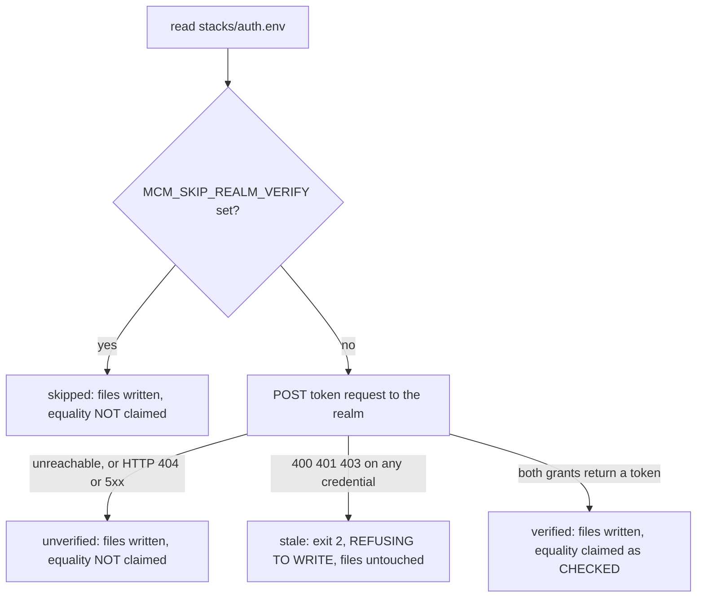

# Local dev infrastructure & environment variables

All dev/test infrastructure is split into four **independently operable named Compose stacks** —
`auth`, `mcm`, `audit`, `observability` — under `infrastructure-as-code/docker/stacks/`. Each is
its own Compose project defined by a thin `include:`-only aggregator that pulls in only that stack's
per-service files; the single root `compose.yaml` aggregator is retired to a pointer. Stacks share
pre-created `external: true` networks for cross-stack traffic. Lifecycle goes through Nx targets
(`up-auth` / `up-mcm` / `up-audit` / `up-observability` / `up-all` / `up-mcm-agents`, and the
`down-*` counterparts) rather than bare `docker compose` invocations — see
[Nx as the task runner](../invariants/nx-task-runner.md),
[Infrastructure stacks](../projects/infrastructure-stacks.md) and
[Published-port reservation](../invariants/published-port-reservation.md).

Every credential in every stack is externalized — no clear-text secret lives in a tracked Compose
file — but **not every secret is a fail-fast `${VAR:?…}` reference**. Most are; the exceptions are
the BFF (`bff/compose.yaml`), which loads `frontend/mcm-app/.env.docker` with `env_file:`;
web-api-mcp (`web-api-mcp/compose.yaml`), which loads `mcp-servers/web-api-mcp/.env.local` the same
way; and the agent gateway, which keeps `AGENT_GATEWAY_CLIENT_SECRET` as an optional `${…:-}` so it
can come up without token exchange — a name `scripts/check-no-inline-secrets.mjs` allowlists by
name. Two one-time generator scripts mint the
per-machine stack credentials and project the dev realm's client secrets into the local env files
before any stack is first brought up. The full stack/profile tables, the env-var reference and the
realm-reseed recovery procedure live in `docs/runbooks/local-dev.md`; this page is the distilled
summary. Provision the host toolchain first ([dev environment setup](./dev-environment-setup.md)),
or use the pre-provisioned [containerized dev environment](./devcontainer.md).

## Profiles gate services, not stacks

No stack is profile-gated as a whole. `auth` and `mcm` each start services with no profile at all,
and the profile assignments live in the component compose files rather than in the stack files:

| Stack | Starts with no profile | Needs a profile |
|---|---|---|
| `auth` | `keycloak-service`, `keycloak-store-postgres`, `keycloak-mailpit` | Vault (`vault`) |
| `mcm` | the test infra: `mc-service-store-mongo` + its rs-init, `mcm-bff-cache-redis`, `mcm-bff-store-mongo` | mc-service (`app`), the BFF (`bff-secure` / `bff-nonsecure`), the agent layer (`agents`), and the separate Metro-dev gateway `movie-assistant-gateway-metro` (`agents-metro` only) |
| `audit` | nothing | every service (`audit`) |
| `observability` | nothing | every service (`observability`) |

So `pnpm nx up-auth infrastructure-as-code` really does start Keycloak with no profile, while the
`mcm` stack's *unprofiled* bring-up is its stores only — the `up-mcm` target adds `--profile app`
for you, and `bff-*` and `agents` stay opt-in.

## One-time bootstrap (per machine)

1. Pre-create the external networks and persistent volumes (`docker network create …`, `docker
   volume create …` for the mc-service Mongo store, the Keycloak Postgres store, the two BFF stores,
   the agent Postgres store and the audit OpenSearch volumes).
2. `node scripts/gen-dev-secrets.mjs` — mints one gitignored `infrastructure-as-code/docker/stacks/<stack>.env`
   per stack from the committed `<stack>.env.example` templates. Idempotent; `--force` rotates and
   `--stack=<name>` scopes. An existing `<stack>.env` is **completed, never skipped**: keys the template
   has gained since are seeded **into** it, so one new variable never forces a rotation of every other
   value. A `<generate:KIND>` key that exists but is **empty** (`KEY=`) is likewise minted in place — it
   holds no value, so filling it rotates nothing, whereas counting it as "present" was the silent skip of
   item #552 (the run says up to date, the suite that needs the value skips to green, and nothing names
   why). A blank *fixture* key is left alone — the generator has no value to give a key that is not a
   `<generate:KIND>` placeholder. No live dev-stack template carries such a blank key any more: the
   `REGISTRY_HOST=` that used to sit in `mcm.env.example` and `observability.env.example` left with
   feature 080, when the object-store image became a public digest pull, so the rule survives only as a
   synthetic template in the guard test. Each run
   names the keys it added or filled — **key names only, never values** — and warns that containers
   started before the run do not hold the new values, so they must be recreated and `gen-dev-env.mjs`
   re-run. Deterministic fixtures (`LANGFUSE_INIT_PROJECT_PUBLIC_KEY` / `..._SECRET_KEY`, the
   `BACKUP_TEST_*` public halves) are copied verbatim even under `--force`. Exit codes: `0` success · `1`
   missing/malformed template, unknown generation kind, or unwritable output · `2` bad args.
3. `node scripts/gen-dev-env.mjs` — projects the realm's client secrets out of `stacks/auth.env`
   into the BFF env files, so **realm-secret == BFF-secret by construction** and a login works on
   first boot with no manual import. It **does not import the realm**; `up-auth` does that (step 4).
   The projection is verified against the running realm before anything is written (below), so the
   first run on a fresh box legitimately ends `NOT verified` and is followed by a re-run once `auth`
   is up.
4. `pnpm nx up-auth infrastructure-as-code` (Keycloak — the only command that seeds the realm), then
   `pnpm nx up-mcm infrastructure-as-code`, then re-run `node scripts/gen-dev-env.mjs` to turn the
   projection's ending into `VERIFIED against the realm`.

`<stack>.env` is gitignored; `<stack>.env.example` is tracked — `.gitignore` ignores `*.env` and
`*.env.*` and then carves out `!infrastructure-as-code/docker/stacks/*.env.example`, scoped to that
directory so other deliberately ignored templates stay ignored. A CI gate
(`scripts/check-no-inline-secrets.mjs`, run in the `naming` job of the guardrails workflow, once with
`--selftest` and once as the real scan) fails the build if a literal credential is re-inlined into a
tracked Compose file; the selftest proves the detector flags a planted literal, and a
`${VAR:-default}` inline default fails just like a raw literal. Non-credentials that match the
detector's secret-shaped key pattern are allowlisted by name rather than by value — `*_FILE` (a path
to a Docker secret, not the secret), `*_USER`, `*ACCESS_KEY_ID` (the public half of an S3 pair),
`*_CLIENT_ID`, `*_AUDIENCE` and `AGENT_GATEWAY_CLIENT_SECRET`. Run it locally with
`node scripts/check-no-inline-secrets.mjs` (`--selftest` optional).

## What each generator writes, and how it fails

`gen-dev-env.mjs` writes five gitignored env files on every run: `frontend/mcm-app/.env.docker`
(fully regenerated), `frontend/mcm-app/.env.local` (**surgically** synced — only the client-secret
lines are rewritten, every other developer key survives), `frontend/mcm-app/.env.e2e.local`, the
web-api-mcp `TMDB_API_KEY` file, and `backend/mc-service/.env.local`. Two of them are **created**
when absent (the frontend `.env.local` and the mc-service one); `.env.e2e.local` is deliberately
**not** created, and `agents/movie-assistant/.env.local` is deliberately never written. Both
omissions are named in the run's output.

Two classes of line are handled differently, and the difference is the whole point of the
generator:

- **Synced** — realm-derived credentials that must match the seeded realm on every run
  (`KEYCLOAK_*`, the `E2E_*` quartet, the backup test credentials projected from `stacks/mcm.env`).
  A re-run rewrites them, so a hand-edited value is corrected rather than preserved. The
  `BACKUP_TEST_*` projection is loud when it has nothing to project (item #552): the four key names
  that are absent or empty in `stacks/mcm.env` are printed, along with the command that back-fills
  them without rotating anything (`node scripts/gen-dev-secrets.mjs --stack=mcm`), because the old
  silent filter projected nothing, said nothing, and nine backup-destination suites skipped to green.
- **Seeded once** — developer knobs and host-reachable URLs (`MC_DB_URL`, `MC_SERVICE_PORT`,
  `RUST_LOG`, `MONGO_URL`, `BFF_BASE_URL`, the backup encryption/tick keys, the destination
  allow-list). Absent keys are appended; keys already present are left exactly as the developer set
  them, so a tuned `RUST_LOG` or a redirected Mongo survives a re-run. Measured 2026-09-20: with
  `.env.local` silent on the host-reachable service URLs, the integration suites fell back to
  `.env.docker`'s Docker-internal names and died on DNS resolution — a name no process outside the
  compose network can resolve.

Exit codes: `0` success · `1` `stacks/auth.env` missing or a required key absent (run
`gen-dev-secrets` first) · `2` the running realm refuses a projected credential — nothing written.
The success line never contains the equality claim unless the realm check actually passed, and it
carries no secret values on any path.

## Gotchas

- **A credential-driven skip is a missing *or stale* file, not an unrunnable box.** Before
  concluding an environment cannot run the integration suite, name the missing input and run
  `node scripts/gen-dev-env.mjs`. The two failure modes — absent vs. stale — are diagnosed
  separately below; the right first move for either is the generator, and never copying a value out
  of a source file to "unblock" a run.
- **`mc-service:test` going red on a byte-identical Rust tree means `backend/mc-service/.env.local`
  is absent or short a variable (item #227).** `gen-dev-env.mjs` writes that file on every run: the
  `KEYCLOAK_*` / `E2E_*` lines are re-synced from `stacks/auth.env`, while `MC_DB_URL`,
  `MC_SERVICE_PORT` and `RUST_LOG` are seeded once and left alone. Without it the Rust integration
  tier panics with `Missing("MC_DB_URL")` — **16 of 41 cases fail on configuration, not code**, and
  nothing distinguished that from a real failure. Four `E2E_*` variables (for the authenticated
  `http_authz_test::*` cases that mint a real ROPC token) were the second half of the same defect
  and had been wrongly attributed to "needing a replica-set MongoDB". After the fix: **41 passed /
  0 failed**. A file that exists but lacks `MC_DB_URL` fails exactly like no file at all, which is
  why the generator keys on the variable, not the path.
- **The generator names the one `.env.local` it deliberately does NOT create
  (`agents/movie-assistant/`),** which carries the operator's own Anthropic credential — a generator
  step that quietly does nothing reads identically to one nobody thought of.
- **An absent `frontend/mcm-app/.env.e2e.local` is not auto-created, and the generator says so
  loudly.** Its sync set is only the credential half, so a created file would be half-written; the
  web E2E also needs the hand-maintained fixture keys. Absence means the web E2E logs in as nobody.
- **Bring `auth` up before the `mcm` `app` profile — but the failure is 401s, not a hang.** There is
  no cross-project `depends_on` (Compose has none), so the ordering is manual. mc-service does *not*
  wait for Keycloak: OIDC discovery and the JWKS fetch run in a background task, and the service
  binds and serves immediately. If discovery fails, `/health` still answers and **every protected
  request is rejected with 401**, so the symptom is a working-looking backend that refuses every
  login.
- **A password-on-first-init credential (Postgres / OpenSearch) is baked into its data volume on
  first boot and ignores later env changes.** Rotating one for real requires regenerating the `.env`
  (`--force`) *and* recreating the service against a fresh volume — otherwise the container keeps the
  volume's original password and auth fails, with nothing pointing at the cause. Redis / Unleash-token
  / app-secret values have no such persistence and rotate on a plain restart, and **RustFS is in that
  second group rather than the first** (feature 080): it does not bake its key pair into the drive, so
  rotating `LANGFUSE_RUSTFS_SECRET_KEY` or `BACKUP_TEST_S3_SECRET_KEY` is an `.env` change plus
  recreating the RustFS service **and its bucket-init one-shot** (which passes the same pair to `curl`)
  — no volume is touched. That is a measured property, not an assumption: starting RustFS on a migrated
  drive with a different pair was readable by the new pair and not the old.
- **`docker compose down --volumes` only wipes transient volumes.** Every persistent data volume is
  declared `external: true` with an explicit name in its own service compose file (so the stack's
  `include:` merge does not prefix it with the project name) and therefore survives. Wiping real data
  means removing the external volumes by hand after `down`.
- **Each stack is its own Compose project, so `down` on one no longer tears down the others.** The
  old single-project footgun is gone; treat each stack's lifecycle target as independent.
- **`--profile` flags must precede `up`/`down`** with Docker Compose v2 — a flag placed after the
  subcommand is silently ignored.
- **A profile is not isolation from interpolation.** Compose interpolates every service in an
  included file at *parse* time, regardless of which profiles are selected, so a `${REGISTRY_HOST:?}`
  inside a profile-gated service aborted `up` for the **whole** mcm stack. That is why the backup
  destinations live in a separate `infrastructure-as-code/docker/backups/compose.yaml` brought up
  explicitly, and it is why the stack file carries the incident in a comment rather than re-declaring
  a profile. `REGISTRY_HOST` no longer appears in any dev-stack template — feature 080 replaced the
  from-source object-store image with upstream `rustfs/rustfs` pulled by digest, so neither the
  observability object store nor the backup S3 destination interpolates a host at all; in production
  the same name is a per-stack Komodo variable, and `check-topology-scrub.mjs` forbids a real forge or
  tailnet host in a committed file. The *rule* that a deliberately blank fixture key is not a gap the
  generator can fill is still pinned, but only against a synthetic template.
- **The two BFF processes share one Mongo, so their keys must agree.** `BACKUP_CREDENTIAL_ENC_KEY`
  and `BACKUP_TICK_SECRET` are reused from `.env.docker` first and `.env.local` second, because the
  containerized BFF and the Metro dev loop write to the same BFF Mongo — a destination or credential
  sealed under one file's key is undecryptable under the other, surfacing much later as an
  authentication failure on a secret that was stored correctly. The two AES-256-GCM keys
  (`AGENT_CONFIG_ENC_KEY`, reused from `.env.docker` alone, and `BACKUP_CREDENTIAL_ENC_KEY`) are
  reused only when the prior value base64-decodes to exactly **32 bytes**; a legacy hex key — 64
  chars that decode to 48 bytes — is re-minted rather than reused, since the reuse path would
  silently preserve the bug it represents.
- **The `--profile agents` gateway (heavy, Postgres-checkpointer variant) needs its Keycloak client
  secret fetched live from a running Keycloak** — there is no committed source for it. Without it the
  gateway starts but every tool call fails closed (chat works; add/query/organize don't).
  `pnpm nx up-mcm-agents infrastructure-as-code` wraps this fetch-and-inject step; it is distinct from
  `scripts/agent-stack.mjs`, the light E2E variant that runs the agent stack with an in-memory
  checkpointer.

## The realm check: a missing file is not the only way a credential goes wrong

`gen-dev-env.mjs` asks the realm for a token with each projected credential —
`client_credentials` for `mcm-bff-service`, ROPC for `mcm-bff-test` — **before it writes anything**,
and reports one of four outcomes. Read the outcome, not the fact that it ran:

How `gen-dev-env.mjs` decides to write, refuse, or decline to claim the realm equality.

| Ending | Meaning | Files | Exit |
|---|---|---|---|
| `VERIFIED against the realm at …` | both grants returned a token; the equality is **checked**, not asserted | written | 0 |
| `NOT verified: … ECONNREFUSED` (or HTTP 404/5xx) | the realm is not up or not seeded — nothing is claimed either way | written | 0 |
| `NOT verified (MCM_SKIP_REALM_VERIFY is set)` | you turned the check off; unset it | written | 0 |
| `REFUSING TO WRITE: the realm … rejects credential(s)` | the refused credential is named, and so are the ones that passed | **untouched** | **2** |

**The ordering is the fix, not a detail.** Measured on the operator's box 2026-09-09: `auth.env`'s
`E2E_ROPC_CLIENT_SECRET` was the **stale** side, while a hand-corrected `.env.e2e.local` held the
value the realm actually accepts (`mcm-bff-service` passed in the same run — the drift was one
client, not all of them). A generator that wrote first and checked afterwards would have destroyed
the only working credential on the machine before announcing the problem. Nothing is written unless
every checkable credential authenticates.

**Resolve — measure the drift before choosing the remedy.** `stacks/auth.env` is the source of truth
(it is what seeds the realm), so the fix belongs at the **realm**, never by copying the realm's
secret back into an env file: that repairs the suite in front of you and leaves `realm-secret ==
BFF-secret` broken for every other client. But *how much* of the realm to fix depends on how much
actually drifted, and that is easy to over-read. **Measured 2026-09-09 on this repository: five of
six client secrets matched `auth.env` and only `mcm-bff-test` had been regenerated** — "the realm was
seeded from a different `auth.env`" was the wrong reading, and a full re-seed would have destroyed the
whole Keycloak database to correct one field.

`docs/runbooks/local-dev.md` holds the copy-paste client-audit snippet (one ✓/✗ per client, printing
no secret values) and the per-case procedure:

- **A few clients drifted** → PUT those clients' `secret` to `auth.env`'s value through the admin API,
  re-run the audit (expect all ✓), then immediately re-run `node scripts/gen-dev-env.mjs` — the moment
  the realm secret changes, a hand-patched `.env.e2e.local` becomes the stale side.
- **Most or all drifted** → the realm really was seeded from a different `auth.env`; re-seed it by
  force-removing the Keycloak containers, recreating `keycloak-store-postgres-data`, re-running both
  generators, `pnpm nx up-auth infrastructure-as-code`, and re-running `gen-dev-env.mjs` until it ends
  `VERIFIED against the realm`.

`MCM_SKIP_REALM_VERIFY=1` bypasses the check and projects anyway, knowing the files will carry
credentials the realm refuses. It is the escape hatch for an unusual realm, **not a fix** — and the
run says so in its own output rather than quietly reverting to the old unconditional claim.

## The missing-file case (feature 048)

**Symptom.** An integration suite reports skips — or, under `MCM_REQUIRE_LIVE_STACK=1`, a wall of
errors — whose reason mentions credentials: `missing credential(s): KEYCLOAK_SERVICE_CLIENT_SECRET`,
or the older wording `ROPC / service-account creds not set — needs the live stack`. When the file
that carries the credential is simply absent, the run of `gen-dev-env.mjs` **creates** it and reports
`CREATED .env.local (was absent)`; if it instead errors with exit 1, `stacks/auth.env` was never
minted, so run `gen-dev-secrets.mjs` first. On 2026-08-07 this cost a session: 38 errors on a healthy
stack, the conclusion *"this leg cannot be run in this dev container; CI is where it gets proven"*,
and one `node scripts/gen-dev-env.mjs` later **51 passed, 0 failed** for the agent suite.

**The general rule this is an instance of.** Before concluding *"this cannot run in this
environment"*, identify the specific missing input and check whether a generator, a `.env` file or a
documented command supplies it — and if a credential skip does not name the variable, the file it is
read from, and the command that fixes it, that message is itself the bug. Never print a secret's
value to check it; compare **key names** only.

**Which absences are still legitimate.** `--profile observability` (LangFuse, Vault, otel-lgtm,
Unleash), `--profile audit` (OpenSearch) and OPA are not brought up by `app-e2e` either; those skips
are expected and allow-listed. A healthy local run of the agent integration suite is **51 passed,
11 skipped, 0 failed**. Confirm the stale-credential case separately with
`MCM_REQUIRE_LIVE_STACK=1 pnpm nx test:integration movie-mcp` — a credential skip still reads as a
pass without that flag, which is how it stayed invisible for as long as it did.

The generator's coverage is pinned by `scripts/__tests__/gen-dev-env.guard.test.mjs`: it derives the
set of documented `.env.local` files from the runbooks and fails if one is neither generated nor a
declared exception, so a documented file that nothing writes shows up here rather than three weeks
later in someone's `nx affected`. The same guard pins the two loudness rules — a deliberately skipped
file must be named in the generator's output, and an `mcm.env` missing `BACKUP_TEST_*` keys must be
reported with the back-fill command while printing no value. `scripts/__tests__/gen-dev-secrets.guard.test.mjs`
pins the item #552 completion rule from the other side: an existing `mcm.env` missing the four
`BACKUP_TEST_*` keys gets all four seeded while prior values stay byte-for-byte, an empty
`<generate:KIND>` key is filled **in place** (one occurrence, not a duplicate), a template-blank
fixture key (its synthetic `REGISTRY_HOST=`, standing in for a per-machine value) is not treated as
missing, and no fixture or minted value is ever printed.
Both guards run the real script inside a throwaway mini-repo, so they are offline and keyless.

See [testing tiers](../invariants/testing-tiers.md) for how these local suites relate to the gating
tiers, [Keycloak](../projects/keycloak.md) for the realm and its clients, and
[mc-service](../projects/mc-service.md) for what the Rust integration tier needs. Full stack/profile
tables, the env-var reference, the generator scripts' exact behaviour and the realm-reseed recovery
procedure: `docs/runbooks/local-dev.md`.
