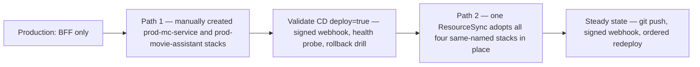

# Phase 15 operator checklist (bring the full app live)

A one-time operator checklist — Komodo, Keycloak-admin and prod-shell actions an agent cannot drive —
that took production from BFF-only to the full app: `prod-mc-service` and `prod-movie-assistant` deployed
as two new Komodo stacks, the agent chain's token exchange proven end to end, the CD `deploy=true` webhook
leg validated with a rollback drill, and the eventual consolidation from manually created stacks into one
config-as-code Komodo ResourceSync.

**Phase 15 is complete, and this is a historical working log, not a live checklist.** Its `[ ]` items
and "Remaining" notes describe the state at the time of writing; for current state read the
[server-setup runbook](./server-setup.md), the [CI/CD pipeline page](../projects/ci-cd-pipeline.md),
[prod reboot resilience](./prod-reboot-resilience.md) and [prod control tower](./prod-control-tower.md).
Reach for the owner document only for the history of *why* the production topology looks the way it
does — not for a procedure to run today.

It sits in this wiki because it is a live operator record relocated out of `docs/proposals/`, not
pre-specification ideation: the proposal tree is excluded from the bundle precisely so superseded ideas
do not dilute retrieval, and the runbook was moved out of it to keep that exclusion clean. See the
[proposal → spec → plan → tasks → implementation lifecycle](../process/spec-driven-development.md).

The historical arc the checklist records: two sequential paths, not an either/or choice.

## What the procedure achieved

- **The two missing production stacks were stood up manually and then adopted.** `prod-mc-service`
  (the movie store plus its replica-set Mongo, on a private network only that service reaches) and
  `prod-movie-assistant` (the gateway, its checkpointer Postgres and the three scoped MCP servers) were
  created as manual Komodo Stacks mirroring the then-live BFF, proving the app with the smallest blast
  radius. The `prod-app → prod-mcm-bff` rename was later done by hand so that all four stacks already
  carried the canonical names `stacks.toml` declares — which is why the first ResourceSync *adopts* them
  in place rather than creating anything from scratch.
- **The agent chain was proven end to end.** With the BFF's subject-token client secret and the
  gateway's own client secret in place, a full flow — subject token → RFC 8693 token exchange →
  `movie-mcp` → `mc-service` — searched the user's collection and added a movie, replacing the
  TMDB-only fallback that had hidden the broken exchange. Where each hop sits is in the
  [auth chain](../invariants/auth-chain.md).
- **The one unexercised CD leg is now exercised.** A `deploy=true` dispatch walked promote → signed
  Komodo webhook → post-deploy health probe → rollback drill. The probe expects the *realm-qualified*
  OIDC issuer (a bare auth host never matches a healthy realm) plus a 200 from the app; rollback has no
  endpoint to call, so it git-reverts the digest promotion commit and re-fires the webhook to redeploy
  the prior digest. At the time the dispatch had to go through the API, because the Forgejo UI does not
  list a workflow that is not yet on the default branch. Full mechanism:
  [CI/CD pipeline](../projects/ci-cd-pipeline.md).
- **Config-as-code consolidation replaced per-stack webhooks.** One ResourceSync webhook now reconciles
  and redeploys every affected stack in `after` order — `prod-auth` → `prod-mc-service` →
  `prod-mcm-bff` → `prod-movie-assistant` (agents last, because `spreadsheet-mcp` needs the BFF's
  network and Redis) — and this is the deploy model every production change uses today. Because the sync
  adopts live stacks, its first apply redeployed all four in order and was treated as a maintenance
  window. See [infrastructure-as-code stacks](../projects/infrastructure-stacks.md).
- **The same file later absorbed the support stacks without changing the model.** Three feature-025
  blocks now hang off the core chain: `prod-audit` as an independent root (`after = []`), `prod-vault`
  after `prod-auth` because it is logically in the auth tier while living in its own block, and
  `prod-observability` after `prod-mcm-bff` as graph ordering rather than a hard dependency. Every
  `[[stack]]` block carries `deploy = true`, so one push still reconciles and redeploys all of them.
- **Token hygiene and branch protection were finished here**: the registry push/pull token split, the
  `main` required status checks, the 022 branch merge, and the final smoke against the merged `main`.
  The two required checks named at the time (`guardrails` + `app-ci`) were the starting pair, not the
  final list — the current set is a wider glob list (`guardrails*`, four `app-ci / …` globs and
  `infra-image-scan / infra-image-scan*`), read live from branch protection rather than hand-maintained,
  because the hand-maintained mirror drifted once and reported `VERDICT mergeable` while the merge API
  answered 405. The per-token inventory and rotation procedure live in the
  [server-setup runbook](./server-setup.md).

## Superseded detail

Where this log states that the prod-mc-service (and BFF) Mongo is unauthenticated with no credential,
that is no longer true: feature 026 has since enabled SCRAM on both stores, and
`infrastructure-as-code/komodo/stacks.toml` now supplies `MONGO_MC_APP_PASSWORD` plus
`MONGO_MC_KEYFILE` (the replica-set keyfile) to `prod-mc-service` and `MONGO_BFF_APP_PASSWORD` to
`prod-mcm-bff`. The auth shape is not symmetric and the asymmetry is the point: the movie store is a
single-member replica set, so its keyfile **implies** `--auth` and it needs both the keyfile and a
least-privilege app user, while the BFF store is standalone and needs SCRAM credentials only — never a
keyfile, because a standalone `mongod` has no replica-set members to authenticate. Only those three
values reach a running service; the two `*_ROOT_PASSWORD` variables are setup-only. The checklist's
secret map (`prod-mc-service: none`) and its "no credential" step A note are therefore historical, and
its healthcheck description is too — under `--auth` the old `rs.status()`/`rs.initiate()` probe fails,
so liveness is now a credential-less `ping`. The current cutover and recovery procedures are in
[production data-tier authentication](./prod-data-tier-auth.md). The vars the checklist seeds in the
Komodo UI are the mechanism later ratified as the standard for every core stack: masked Komodo Variables
interpolated into each stack's gitignored `.env.prod` — see
[ADR-0001](../decisions/adr-0001-prod-secrets-management.md).

## Gotchas

- **A Keycloak client secret is regenerated on every realm import unless pinned in the realm JSON.**
  The Komodo Variable feeding a confidential client's secret must be copied from the post-import
  Keycloak console, not assumed to match whatever value was set before import — a mismatch fails the
  token exchange with an auth error that looks like a missing-configuration problem, not a wrong-secret
  problem, which is why it recurred at two separate points in this chain (the BFF's subject-token
  exchange and the gateway's own re-exchange) rather than being caught once. See the
  [auth chain](../invariants/auth-chain.md) for where each of these exchanges sits.
- **A single manually-attached webhook only redeploys the stack it's attached to.** Because one CD run
  promotes new image digests to all built-image stacks at once, a webhook scoped to only one stack
  leaves the others running stale images with silent drift between the promoted digest and the running
  container — the fix that closes this gap is consolidating onto one ResourceSync webhook that
  redeploys every affected stack in dependency order, not adding more per-stack webhooks.
- **Renaming a live stack in place must preserve its external volumes and networks.** Komodo overrides a
  compose file's `name:` with the Komodo Stack name, so the `prod-app → prod-mcm-bff` rename could not be
  done by editing compose — it took a down-old / up-new cutover, which removed only the old containers,
  never the `external: true` volumes/networks backing them, specifically so already-stored per-user data
  survived the rename. Deleting those resources instead of the containers would have been a data-loss
  mistake.
- **The stack's Environment block is the source of truth for its env — `.env.prod` on the host is
  generated and must never be hand-edited.** Komodo writes the interpolated environment (the `[[NAME]]`
  variables resolved) into that gitignored file on every deploy, so a manual edit on the box is silently
  overwritten by the next reconcile; change the Komodo Stack Environment, or the `[[stack]]` block's
  `environment` once config-as-code owns it, and let the deploy write the file. See
  [Secrets management](../invariants/secrets-management.md).
- **Editing `stacks.toml` is gated in two directions, and both gates encode a real deploy failure.**
  `scripts/check-komodo-sync.mjs` (in the `guardrails` naming job) fails on any infra-topology literal in
  `komodo/*.toml` — a `*.ts.net` host, a Tailscale CGNAT IP, or a hardcoded URL authority — so a host,
  domain or webhook must stay a `[[NAME]]` Variable; it scans comments too. In the other direction
  `scripts/__tests__/komodo-stack-env.guard.test.mjs` requires every `${VAR:?…}` a prod compose declares
  to appear in that stack's `environment` block, because that block is the only declaration of the
  stack's required inputs and a variable missing from it is missing at `docker compose config` time —
  the break is invisible in CI and only fires on a real Komodo deploy. Adding a fail-fast variable to a
  prod compose is therefore a change to `stacks.toml` as well.
- **A validated web login bug does not imply the mobile login is fine, or vice versa** — this checklist
  hit one login defect that only manifested on web (a build-time environment variable that never made
  it into the browser bundle) alongside a second, independent defect in the realm's redirect-URI
  configuration; treat a working mobile flow as no evidence about web, and fix both root causes
  separately.
- **A short-lived elevated-privilege token used for one-time validation must be revoked immediately
  after use** — this checklist explicitly calls out revoking such a token as its own checklist item, not
  an implied cleanup step.

Full step-by-step Komodo actions, exact stack configuration values, the two independent login-bug root
causes, and the final deploy-order/secrets-map reference:
[`docs/runbooks/Phase-15-Operator-Checklist.md`](../../docs/runbooks/Phase-15-Operator-Checklist.md).
