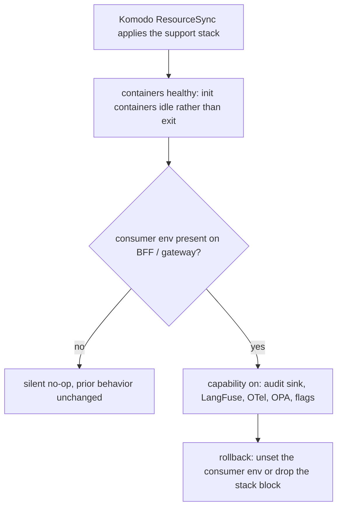
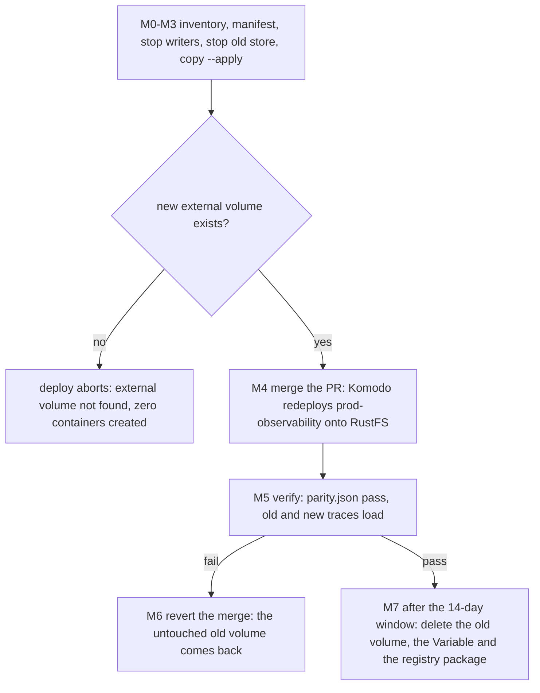
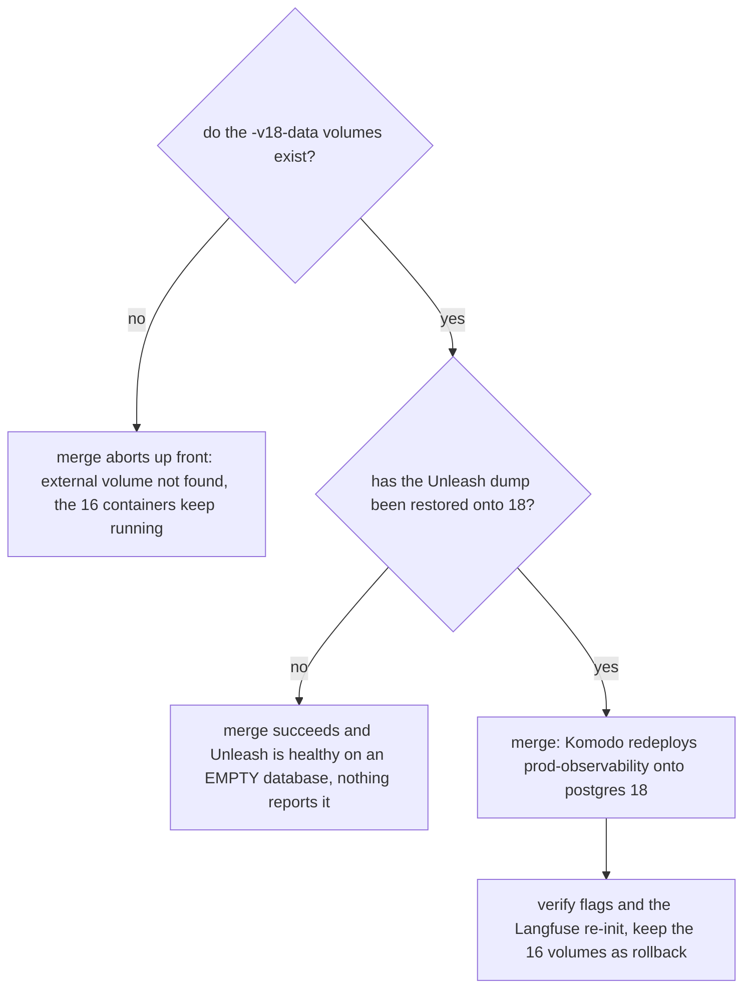
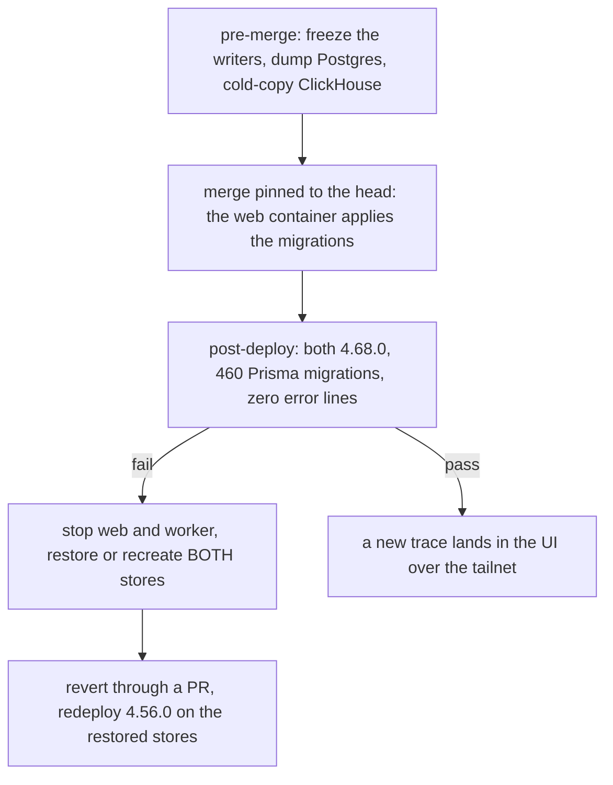

# Prod control tower (observability / audit / dormant Vault)

Three production stacks — `prod-audit` (OpenSearch audit sink, the MVP), `prod-observability` (LangFuse +
Grafana/otel-lgtm + OPA + Unleash), and `prod-vault` (deliberately dormant) — deploy the same way as the
rest of prod: merge to `main`, Komodo ResourceSync picks it up. The BFF and agent gateway consume each
capability through environment variables only, so deploying a support stack never itself changes app
behavior; a capability only turns on when its consumer env is present. This is the production landing
of the secrets posture documented in [Secrets management](../invariants/secrets-management.md)
(Vault here is the fail-open, dormant reader described there) and it shares the
[published-port reservation convention](../invariants/published-port-reservation.md) for its two
tailnet-reachable operator UIs.

On top of that steady state sit **five one-time stateful cutovers**, each operator-run, each with the
merge to `main` *being* the deploy, and each with a measured trap that a green CI cannot see: the RustFS
object-store swap (feature 080), Langfuse 4 + ClickHouse 25 on recreated volumes (feature 072),
OpenSearch 2 → 3 with the audit history preserved (feature 071), the observability Postgres 16 → 18 move
(spec 081 US8b), and the Langfuse 4.56.0 → 4.68.0 schema-carrying minor (spec 081 US8 PR 8d, item 839),
whose merge *is* its migration. The last two of the five have now run in production — US8b on 2026-10-20
and the Langfuse minor on 2026-10-25. Three of the five — RustFS, OpenSearch 3 and Postgres 18 — put the
new state on a **new external volume** and leave the old one untouched as the rollback; the Langfuse 4
cutover recreated its volumes in place and deliberately discarded the traces, and the Langfuse 4.68 minor
migrates in place, where a pre-merge backup is what separates a rollback from a loss. The policy they all
answer to is
[ADR-0002](../decisions/adr-0002-stateful-major-upgrades.md) (and the §4a amendment), not this page.

## How the three stacks are wired

| Stack | Compose | Komodo block |
|---|---|---|
| `prod-audit` | `infrastructure-as-code/docker/opensearch/compose.prod.yaml` (+ the reused `init-audit-user.sh`) | independent root, `after = []` |
| `prod-observability` | `infrastructure-as-code/docker/observability/compose.prod.yaml` | `after = ["prod-mcm-bff"]` — ordering only, not a hard dependency |
| `prod-vault` | `infrastructure-as-code/docker/vault/compose.prod.yaml` | `after = ["prod-auth"]` — logically in the auth tier |
| consumers | `bff/compose.prod.yaml`, `agents/compose.prod.yaml` | extended `environment` on `prod-mcm-bff` / `prod-movie-assistant` |

The support composes are **fail-fast** — every credential is `${VAR:?}` — while the consumer composes use
plain `${VAR}`, never `${VAR:?}`. An unseeded Komodo Variable therefore aborts a *support* deploy
(intended) but can never abort the app. Fifteen new masked Variables are needed (13 observability + 2
audit; the dormant Vault needs none), plus `TAILNET_HOST`, already seeded for `prod-auth` and reused for
LangFuse's tailnet `NEXTAUTH_URL`. The LangFuse bootstrap keys are the *same* values the gateway consumes.
The object store's Variable is `LANGFUSE_RUSTFS_SECRET_KEY`; the retired `LANGFUSE_MINIO_ROOT_PASSWORD` is
kept out of the compose but retained in Komodo until the cutover's rollback window closes, because a revert
restores the line that needs it and a revert cannot recreate a Komodo Variable.

Wiring is least-privilege rather than symmetric: the BFF consumes the audit sink and OPA only, while the
gateway is the primary emitter (audit + LangFuse + OTel + OPA + Unleash). The LangFuse and Unleash secrets
reach `prod-movie-assistant` and never `prod-mcm-bff`; `UNLEASH_API_TOKEN` is the *client* token, not the
admin one. The audit sink sits on its own external `agent-audit-network`, which only
`agent-audit-opensearch`, its init container, and the gateway/BFF consumers join — keycloak and mc-service
cannot reach it. Adding that network to `APPROVED_NETWORKS` and the `vault` volume prefix to `VOLUME_RE`
was the whole guardrail delta for the feature (`scripts/check-resource-naming.mjs`); feature 071 later
added the narrow `-snapshots` volume form alongside them.

## Additive no-op and rollback

Deploying a support stack does not by itself change app behavior. Each capability is gated in the
*consumer's* source: `audit_sink` on `OPENSEARCH_URL`, `observability` on `LANGFUSE_*` + `OTEL_*`, `opa`
on `OPA_URL`, `flags` on `UNLEASH_URL`. Unset means a silent no-op and prior behavior unchanged — which
is what makes rollback cheap.



*Why a deployed support stack is inert until its consumer env appears — and why rollback needs no app redeploy.*

**Rollback** = remove the consumer env (back to no-op) and/or delete the support `[[stack]]` block
(ResourceSync removes it). No app redeploy is needed to disable a capability, and each stack is
independently up/down-able.

## Gotchas

- **A one-shot init container that exits 0 reads as "unhealthy" to the deploy orchestrator.** Komodo
  counts *any* exited container as unhealthy, so every init container in this stack set provisions then
  idles (`… && exec sleep infinity`) behind a trivial passing healthcheck. Where a downstream service needs
  the init's result, gate on a completion marker rather than on "the container exited":
  `langfuse-rustfs-init` creates the `langfuse` bucket, touches `/tmp/ready`, its healthcheck tests for that
  marker, and `langfuse-worker` depends on `service_healthy` (a never-exiting container can never satisfy
  `service_completed_successfully`). `scripts/__tests__/object-store-service.guard.test.mjs` asserts that
  prod stay-alive shape and that dev, where nothing depends on a marker, stays a real one-shot.
- **Non-root image runtimes and bind-mount ownership are the dominant class of prod-only failures here**
  — memlock rlimits, root-owned bind mounts under a non-root image user, and double-loaded entrypoint
  config all passed local `compose config` validation and only broke on the real prod host. The object
  store is the same shape: RustFS runs as the image's own uid (`10001`) with no compose `user:` key, a
  fresh named volume inherits the image's `/data` with that ownership, and any other uid fails at
  startup. Diagnose from container logs on the prod host itself, not from the compose file;
  see the table below.
- **A new external volume must exist before the merge, in every cutover that introduces one.** These
  volumes are `external: true`, so compose never creates them; a deploy that references a missing one
  aborts *up front* with `external volume "…" not found`, creates zero containers, and leaves the
  previously deployed containers running and unchanged. That is the safe failure — recover by creating the
  volume (and seeding it, where there is data to keep) and redeploying.
- **The two tailnet-reachable operator UIs (LangFuse, Grafana) use the prod-reserved port range**,
  binding broadly but staying tailnet-only via the host firewall — see
  [Published-port reservation](../invariants/published-port-reservation.md) for the collision this
  convention exists to prevent; do not put these ports back on their old defaults. The broad `0.0.0.0`
  bind (rather than a tailnet-IP prefix) is itself a boot-race fix, not a style choice — see
  [prod-reboot-resilience](./prod-reboot-resilience.md).
- **Vault is intentionally left uninitialized and sealed in production.** A health-check override makes
  that state read as healthy; do not run the Vault init/unseal sequence as part of this rollout — it is
  out of scope until the ADR-0001 revisit trigger fires (see
  [Secrets management](../invariants/secrets-management.md) for why Komodo Variables, not Vault, are the
  production secrets backbone).
- **The audit sink is append-only, and its writer account is verified to be.** Re-run the provisioning
  check after any upgrade: it asserts `write 201` *and* `read 403` / `search 403` / `delete 403` against a
  document that demonstrably exists (a missing doc would answer 404 either way, so a "not 200" check would
  pass vacuously on a wrongly-permissive role).
- **A capacity check was done before enabling observability**, because the LangFuse/ClickHouse stack is
  the heaviest addition on the shared host — re-run a capacity check before any future footprint
  increase rather than assuming headroom persists.
- **`restart: always` on every long-running prod service is a self-enforcing property, not a default.**
  A host reboot once proved `restart: unless-stopped` does not bring containers back here, so
  `scripts/check-prod-restart-policy.mjs` scans every `compose.prod.yaml` and fails on a missing policy,
  on `unless-stopped`, or on `no`/`on-failure` for anything that is not a genuine one-shot
  (name matching `-init`/`-seed`/`-rs-init` or `createbucket`). Add a prod service without a policy and
  the gate goes red, not the reboot.

## Prod-only failure class (none catchable by `docker compose config`)

Every one of these passed local validation and only surfaced on the prod host — they are container-runtime
realities: non-root images, root-owned mounts, one-shot exits, orchestrator health, image entrypoints.

| Symptom (prod `docker logs`) | Cause | Fix |
|---|---|---|
| OpenSearch: `error setting rlimit type 8: operation not permitted` | the prod daemon's memlock rlimit is finite, so `ulimits.memlock: -1` for `bootstrap.memory_lock` cannot be set | drop `bootstrap.memory_lock` + the memlock ulimit — memory-lock is a nicety for a 1 GB audit sink |
| `agent-audit-init` Exited(1): `mkdir: … Permission denied` | the image runs as uid 1000; the bind mount makes `/opt/audit` root-owned | run the one-shot init as `user: "0:0"` |
| Komodo marks the stack **unhealthy** although services work | Komodo counts any exited container as unhealthy; the one-shot inits (`agent-audit-init`, `langfuse-rustfs-init`, `unleash-seed`) exit 0 | init provisions then idles, with a trivial passing healthcheck |
| Vault: `open /vault/data/vault.db: permission denied` | the image runs Vault as non-root uid 100, and `/vault/data` is not in the image → the volume lands root-owned | mount raft at `/vault/file` (a vault-owned image dir); an empty volume inherits `vault:vault` |
| Vault: `Failed to lock memory: cannot allocate memory` | finite memlock rlimit again; `mlockall` fails even with `IPC_LOCK` | `disable_mlock = true` in `vault.hcl` (also the recommended raft/BoltDB setting) |
| Vault: `bind: address already in use` on :8200, crash-looping | the vault entrypoint already appends `-config=/vault/config`; passing the file explicitly loads the listener twice | `command: ["server"]` only |

**The vault config that finally works needs all of `/vault/file` + `disable_mlock=true` +
`cap_add: IPC_LOCK` + `command: ["server"]` together.** The mount path, `disable_mlock` and the cap each
answer a measured failure above; the `command: ["server"]` alone answers the double-loaded listener. The
cap was originally load-bearing for a second reason too — without it the entrypoint took a fallback path
that double-started vault — and the shipped image has since moved to `hashicorp/vault:2.2` (spec 081 US8c),
whose changelog drops the build-time `cap_ipc_lock` so it no longer double-starts without the cap. The cap
is kept anyway: it is harmless, and the line matters again if the image is ever rolled back to 1.x. Both
files carry that rationale in place: the mount path and `disable_mlock` in
`infrastructure-as-code/docker/vault/config/vault.hcl`, the cap and the `command` in
`infrastructure-as-code/docker/vault/compose.prod.yaml`. When iterating a container that crash-loops in
prod but not locally, reproduce locally with the prod constraints
(`--cap-add IPC_LOCK --ulimit memlock=65536 …`) to iterate in seconds instead of 40-minute deploy cycles.

Two smaller prod-only details worth knowing:

- **The audit-init container needs an image with bash *and* curl.** `init-audit-user.sh` is
  `#!/usr/bin/env bash`, so the bash-less `curlimages/curl` cannot run it; `agent-audit-init` reuses the
  OpenSearch image. The script also self-locates `../stacks/audit.env` and `cd`s into that directory
  *before* the `[ -f ]` guard, so under `set -euo pipefail` a missing dir aborts everything — hence the
  init entrypoint's `mkdir -p /opt/audit/stacks` first, after which no `audit.env` is found and the script
  falls back to the injected env vars.
- **The BFF audit path needs `OPENSEARCH_INSECURE_TLS=true`.** OpenSearch serves a self-signed cert; the
  BFF sink POSTs over https via `node:https` with `rejectUnauthorized:false` **only** when that flag is
  truthy, so without it no audit doc lands from the BFF side. The gateway's sink uses `httpx verify=False`
  and needs no flag.
- **OPA uses the `-debug` image variant, but not for its `wget`.** Distroless `openpolicyagent/opa` has no
  shell at all, so `-debug` is still required; its busybox, however, ships **no** `wget`/`curl`/`nc`, and
  the previous `wget` healthcheck failed on every run — measured as "unhealthy" with a five-figure
  failing streak while OPA served fine. The healthcheck now drives the request through the `opa` binary
  itself (`http.send`), which works without a shell.
- **ClickHouse is bounded twice over.** `mem_limit: 4g` (plus `memswap_limit: 4g` and a `cpus` ceiling)
  bounds the server's own memory accounting and stops observability starving the shared host — on
  2026-10-02 this container sat at ~725% CPU with swap full and slowed every CI job 2–3x. Separately, the
  mounted `mcm-system-logs.xml` disables `trace_log`/`text_log` and gives the other system-log tables a
  3-day TTL: with image defaults they grew to 128 GiB / 28 GiB of diagnostics against 84 KiB of actual
  Langfuse data, and background merges of the resulting parts ran the host at ~725% CPU and ~32% iowait.
  Only tables that *exist* on the server may be listed — declaring a `<*_log>` section enables that table.
  One table is deliberately left alone: `opentelemetry_span_log`'s default section defines a full
  `<engine>`, and ClickHouse **refuses to start** if a separate `<ttl>` is added there
  (`If 'engine' is specified for system table, TTL parameters should be specified directly inside
  'engine'`) — measured on the 25.12 image before the file shipped.

Full failure-symptom table and the reproduction recipe:
[the runbook](../../docs/runbooks/prod-control-tower.md).

## Object-store cutover to RustFS (feature 080, item #560)

The Langfuse event/media store was a from-source MinIO image built by this repository until feature 080
replaced every instance with upstream `rustfs/rustfs`, digest-pinned and pulled rather than built. Every
shipped instance — the dev and prod observability composes and the backups compose — pins the **same
1.0.3 line on one shared index digest**; the digest itself lives in the compose files and moves only
through Renovate, and `scripts/__tests__/object-store-service.guard.test.mjs` is what holds the shape
(the contract it enforces is `specs/080-minio-to-rustfs/contracts/object-store-service.md`, S1–S9). The
prod instance runs as the image's own uid (`10001`) with **no** compose `user:` key — a fresh named
volume inherits the image's `/data` with that ownership, and any other uid fails at startup — and the
bucket-init one-shot `langfuse-rustfs-init` reuses that *same* pinned image. All instances pin the
same digest and Renovate moves them together, so a split that would run the server and its init on
different images cannot arise from a hand edit. The production data is moved **in place**: the old drive is
**copied** to a new external volume that RustFS reads, and the original is never written, so rollback is a
revert onto it. The old store is deleted only after the rollback window closes.

### Merging the PR IS the deploy — so the copy must exist BEFORE the merge

Komodo deploys `prod-observability` from `main` on every push, and the new compose mounts the EXTERNAL
volume `observability-langfuse-rustfs-data`, which nothing but the migration tool's `copy --apply` creates.



*The cutover order, and why the copy is a precondition of the merge rather than a step after it.*

**If the merge lands first, the deploy fails instead of starting on an empty store.** Measured 2026-10-11
in the dev container against the shipped `compose.prod.yaml` (Docker Compose 5.6.0, with every OTHER
external volume present so the RustFS one was the only gap), with and without pulling: compose aborts with
`external volume "observability-langfuse-rustfs-data" not found`, creates **zero** containers, and does
**not** create the volume. A scratch project then showed that a failed `up` of this kind leaves the
previously deployed containers **running and unchanged** — so an early merge leaves Langfuse on the old
store, still serving. Recover by doing M1–M3 and redeploying.

### The tool runs ON the host, from a checkout, through a wrapper

The prod host has no `node`. `scripts/object-store-migration.sh` runs the tool in a digest-pinned node
container with the host's rootless socket mounted, and the Docker CLI copied out of a digest-pinned image —
nothing is installed. It copies the evidence directory in before the run and back out after it, so the
relative `--out`/`--manifest` paths land on the host. Credentials go in by **name** from your shell, never
on a command line:

```sh
cd <a checkout of this repository at the PR's commit>
export MIGRATION_DIR=$HOME/080-cutover          # evidence (inventory/manifest/copy/parity .json) lands here

# M0.4 — advance go/no-go (read-only; the store may be running — the record says sourceInUse)
scripts/object-store-migration.sh inventory --volume observability-langfuse-minio-data --out inventory-advance.json

# M1 — quiesce writers (by container name: this host's stacks are Komodo-managed, so a hand-run
#      `docker compose` fails with "no configuration file provided")
docker stop langfuse-web langfuse-worker

# M2 — manifest from the RUNNING old store, with ITS credentials
read -rs S3_SECRET_KEY && export S3_SECRET_KEY S3_ACCESS_KEY=minio      # value of LANGFUSE_MINIO_ROOT_PASSWORD
scripts/object-store-migration.sh manifest --endpoint http://langfuse-minio:9000 --network backend-network --out manifest.json

# M3 — stop the old store, inventory the STOPPED drive, copy
docker stop langfuse-minio-init langfuse-minio
scripts/object-store-migration.sh inventory --volume observability-langfuse-minio-data --out inventory.json
scripts/object-store-migration.sh copy --from observability-langfuse-minio-data \
     --to observability-langfuse-rustfs-data --out copy.json --apply

# M4 — merge the PR; watch app-ci → trigger-cd → cd-deploy deploy=true complete

# M5 — verify against the NEW store, with ITS credentials
read -rs S3_SECRET_KEY && export S3_SECRET_KEY S3_ACCESS_KEY=langfuse   # value of LANGFUSE_RUSTFS_SECRET_KEY
scripts/object-store-migration.sh verify --endpoint http://langfuse-rustfs:9000 --network backend-network \
     --manifest manifest.json --out parity.json
```

`--image` defaults to the RustFS pin read out of `compose.prod.yaml`; the tool also reads the runtime uid
from that image rather than writing it as a literal, and asserts the copied entries are owned by it.

**Every step refuses rather than guesses.** `copy` without `--apply` is refused (there is no dry-run
spelling — `inventory` is how you look), and the wrapper refuses it before any container exists, as it does
`rehearse` (a dev-container activity). The tool additionally refuses an existing target volume, a source
still mounted by a running container, a volume that does not exist (it is never created by looking at it),
and an `inventory` whose search instrument failed its self-test — because a BusyBox `grep` in its default
locale misses every marker inside a binary `xl.meta`, so a zero proves nothing until the search has been
shown to find a planted marker. A drive is `migratable` only if its format is `xl-single` with exactly one
set and one drive, and there are zero SSE and zero tiered objects.

`copy.json` must show `targetPreexisted: false`, `entriesNotOwnedByRuntimeUid: 0` and equal source digests
before and after — a source that changed during the copy is no longer a valid rollback target and the tool
says so instead of continuing. `verify` then compares the running new store against the pre-migration
manifest and exits non-zero on any discrepancy.

### Rollback and cleanup

**Rollback (M6)** — only if M5 or later checking fails: `git revert` the merge via a PR as usual (it
restores the old compose and the `stacks.toml` lines); Komodo redeploys the old store on the untouched
`observability-langfuse-minio-data` with `LANGFUSE_MINIO_ROOT_PASSWORD`. Writes accepted by RustFS since
the merge are lost (one-way format; accepted). Leave the new volume for diagnosis.

**Cleanup (M7)**, after the 14-day rollback window: delete `observability-langfuse-minio-data`, the Komodo
Variable `LANGFUSE_MINIO_ROOT_PASSWORD` and the old registry package (rollback pulls it until then), then a
cleanup PR removes the migration tool. A guard test (`scripts/__tests__/no-minio-references.guard.test.mjs`)
scans every tracked file's path and content for the old store's name with a closed exemption list, so a
missed runbook line cannot survive the cutover — the exemptions naming the migration tool are themselves
temporary and are removed with it.

### Traps this procedure is built around, all of them hit for real

1. **`docker run -v <name>:/data` CREATES the volume when it does not exist**, and reports an empty drive
   that reads as a measurement of production. The tool checks the volume exists before mounting it. There
   is also an unrelated `minio_minio-data` volume on the host — the Nx-cache store's, not Langfuse's.
2. **A top-level `stat` is not ownership.** A drive can report the right owner at `/data` while entries
   below it do not. The tool counts every entry not owned by the image's uid, and requires 0.
3. **A search that finds nothing proves nothing until it is shown to find something.** BusyBox `grep` in
   its default locale misses every marker inside a binary `xl.meta`; the first production go/no-go reported
   "0 SSE" through exactly that blind spot. The tool's `inventory` runs with `LC_ALL=C` and self-tests its
   search on a planted marker first.
4. **`restart: always` is held by an explicit `docker stop`** — *unless the daemon restarts*. Keep the
   window short and re-check the old store is still stopped before `copy`.
5. **Stop by container name, not via compose.** The prod stacks are Komodo-managed: Komodo clones the repo
   and runs compose from its own stack directory with env injected from Komodo Variables, so a hand-run
   `docker compose` from `$HOME` fails with "no configuration file provided" and unresolved `${LANGFUSE_*}`
   interpolation errors.

## Langfuse 4 + ClickHouse 25 cutover (feature 072)

Langfuse 4 requires ClickHouse 25, and the pair was only verified on **empty volumes**. Nothing
measured says an in-place ClickHouse 24→25 jump works, so the cutover **recreates the Postgres,
ClickHouse-data, and ClickHouse-logs volumes**, discarding production Langfuse trace history. Per
[ADR-0002 §4](../decisions/adr-0002-stateful-major-upgrades.md) that trade is ratified — at that
cutover, and only at that cutover.

**The volume work must come BEFORE the merge.** Komodo reconciles `prod-observability` from `main`.
Merge first and it deploys Langfuse 4 straight onto the existing 3.x Postgres schema and a 24.3
ClickHouse data directory — exactly the in-place upgrade this sequence exists to avoid.

Steps 1–5 constitute a planned Langfuse outage. It is contained: no non-Langfuse service in this
stack `depends_on` langfuse, so otel-lgtm, OPA and Unleash keep running, and the agent gateway's
tracing is fire-and-forget (turns are unaffected; traces for the window are lost).

Four things that will catch you out, all hit for real:

1. **`docker compose` cannot be hand-run on this host** — Komodo runs compose from its own stack
   directory with Variables injected. Use container names (`langfuse-web`, `langfuse-postgres`, etc.).
2. **`docker compose down -v` would not remove these volumes anyway.** They are `external: true`;
   compose never removes an external volume. They must be removed *and re-created* by hand — Komodo's
   deploy fails with a missing-external-volume error if they are absent.
3. **`restart: always` is held by an explicit `docker stop`** — *unless the daemon restarts*. Keep
   the window short, and re-check the containers are still stopped just before triggering the redeploy.
4. **`docker stop` does not release a volume.** A stopped container still holds its mounts, so
   `docker volume rm` fails with `volume is in use` until the container is **removed**. Measured on
   the 2026-09-13 cutover: `langfuse-postgres` and `langfuse-clickhouse` must be `docker rm`'d after
   stopping, before attempting to remove their volumes.

**The object-store volume is deliberately NOT recreated by this cutover.** It holds blobs, not schema, so
it is irrelevant to whether Langfuse 4's migrations run; its own cutover is the separate feature-080
procedure above. `langfuse-redis` has no volume at all — its queue state clears on restart by itself.

**Rollback:** revert the merge and redeploy. The volumes stay as they are — rollback does not restore
the old traces, which were discarded by design. Langfuse 3 re-initialises the empty volumes and comes up
clean.

**After it is live:** confirm `--check-expiring` on the next scheduled `infra-image-scan` reports no
UNMATCHED entry (the `langfuse/langfuse:3` suppressions are deleted by the merge, so the gate
re-blocks if the advisory ever returns).

**Since the cutover, the ClickHouse pin has moved further — and that is not the same free lunch.** Both
observability composes now pull `clickhouse/clickhouse-server:26.6`, two majors past the `24.3` this
cutover started from, arriving through a routine Renovate image update *after* the cutover and over live
production traces. §4's "recreate the volumes" ratification applied at this cutover only; it does not
make later majors data-free, and the observability stack is not started by the end-to-end CI job, so a
green CI says nothing about a ClickHouse major. Stateful datastore majors (ClickHouse, Postgres, Redis,
Mongo) now require an explicit dependency-dashboard tick — the `dependencyDashboardApproval` rule those
images gained after the 25.12→26.6 bump merged on a green CI; see
[ADR-0002](../decisions/adr-0002-stateful-major-upgrades.md) for the rule,
[the Renovate runbook](./renovate.md) for what ticking it means, and
[the runbook section](../../docs/runbooks/prod-control-tower.md) for the literal cutover script.

## OpenSearch 2 → 3 for the audit sink, PRESERVING the history (feature 071)

Unlike the Langfuse cutover, this upgrade **keeps its data**.
[ADR-0002 §4a](../decisions/adr-0002-stateful-major-upgrades.md) reversed the original §4 "recreate
volumes" decision once the audit store proved non-empty — **5,276 documents, 326.9 kb** in
`mcm-agent-audit`. History moves across by snapshot and restore; the acceptance check is an **exact
document count**, not a health check.

> **A zero from a filtered query means "no match", not "no data".** The count was nearly missed because
> `_cat/indices/mcm-agent-audit-*` returned empty — the pattern needs no trailing wildcard; the real index
> name is `mcm-agent-audit`. That empty result was one step from justifying the destruction of a security
> audit trail. Preserved verbatim from ADR-0002 §4a because the error shape recurs.

### Two deploys — the order is not negotiable

`path.repo` is a **static** OpenSearch setting: a node cannot register a filesystem snapshot
repository unless it was *started* with that path configured. The live 2.x node had none, so:

```
DEPLOY A   still on 2.x   add the snapshot volume + path.repo → restart → register repo → SNAPSHOT
DEPLOY B   the upgrade    3.x on a NEW EMPTY data volume       → restore  → verify exact count
```

One deploy cannot work: it would mean snapshotting before the repository exists, or replacing the data
volume before the snapshot is taken.

### Why this is safe

The 2.x data volume is **never touched**. 3.x starts on a new one, so at every moment there are two
independent copies (the original volume and the snapshot). Rollback is non-lossy. Deleting the old
volume is a separate, deliberate act afterwards — it is **not** part of this procedure.

### Load-bearing gotchas

- **Create the snapshot volume BEFORE deploying, and chown it to the node's uid.** It is
  `external: true`, so compose never creates it — a missing external volume aborts the deploy. A fresh
  volume mounted at `/mnt/snapshots` (a path the image does NOT contain) is root-owned; OpenSearch does
  not run as root and snapshots fail with a permissions error that does not name the volume. Derive the
  uid from the running container (`docker exec agent-audit-opensearch id -u`), never assume it. The
  repository deliberately does not live inside the data volume — the upgrade replaces that volume, which
  would destroy the snapshot at the exact moment it is the only copy — so the naming gate grew a narrow
  `-snapshots` form (`VOLUME_SNAPSHOTS_RE` in `scripts/check-resource-naming.mjs`) instead of the volume
  being misnamed as `-data`.
- **Re-measure the document count at A5 — 5,276 was a reading, not a constant.** The audit sink is live
  during Deploy A. Write down the A5 count; that number is what the B5 check must reproduce exactly.
- **Stop at A8 and confirm `state: SUCCESS` before starting Deploy B.** There is no recovery path if the
  snapshot is absent when the old volume is replaced.
- **The new 3.x cluster must re-register the repository.** Repository registrations are cluster state,
  and Deploy B starts a new cluster on a new data volume. The snapshot *volume* is unchanged, but the
  cluster does not know about it — register `mcm-audit-repo` again before restoring.
- **Stop the init container before restoring.** `agent-audit-init` runs `init-audit-user.sh` on startup,
  which POSTs a verification doc, and the writer role carries `create_index` — so on an empty volume the
  stack re-creates the index before you can restore into it. Hit for real on the 2026-09-13 cutover,
  where the restore failed with `cannot restore index [mcm-agent-audit] because an open index with same
  name already exists in the cluster`. Nothing was lost (the index held exactly one init-verify doc, and
  the real data was in the snapshot *and* on the untouched 2.x volume), but it is avoidable. The
  recovery, if it happens anyway: confirm `docs.count` is ~1, then delete and restore — if the count is
  anything else, stop, because something else is writing.
- **Snapshot only `mcm-agent-audit`, with `include_global_state: false`.** Restoring system indices such
  as `.opendistro_security` across a major is a conflict risk with no upside (the init script
  re-provisions the audit writer account on every start).
- **Re-run the least-privilege provisioning check (B6) after restore.** Feature 071 widened the check to
  assert `read 403` and `delete 403` in addition to `write 201` — the old check was incomplete and would
  have passed vacuously on a broken privilege set.
- **The init script no longer prints the credentials it provisions.** It used to echo both passwords in
  full; once `agent-audit-init` began running it in production that output went to container stdout, so
  both live credentials sat in `docker logs agent-audit-init`, in Komodo's log view, and in anything
  shipping those logs — a direct violation of the never-log list in
  [logging and audit](../invariants/logging-and-audit.md). Found 2026-09-13 while reading the init logs to
  verify the upgrade. It now prints *where* the credentials live, never what they are.

### Rollback

Revert the Deploy B change so the compose points at the **2.x digest and the ORIGINAL data volume**,
then redeploy. The 5,276 documents are exactly where they were; nothing was removed from that volume.
The snapshot also still exists, so there are two ways back.

### Afterwards

Only once the restore is verified and has been running for a while: delete `agent-audit-opensearch-data`
(the 2.x volume) and, optionally, the snapshot. **Neither deletion is part of this procedure** — leaving
a stale ~327 kb volume behind is far cheaper than an unrecoverable audit trail.

Full shell script (Deploy A and Deploy B), the `OS()` helper alias, and all verification commands:
[the runbook's OpenSearch upgrade section](../../docs/runbooks/prod-control-tower.md).

## Observability Postgres 16 → 18, preserving Unleash (spec 081 US8b — done in production)

The fourth cutover is a Postgres major for the two *observability* databases. `langfuse-postgres` and
`unleash-postgres` reference one identical pinned image, so they move together — the shared pin is the
whole reason this is one cutover and not two, and it is enforced rather than remembered:
`scripts/__tests__/langfuse-postgres-shared-pin.guard.test.mjs` asserts, against both the dev and the
prod compose, one identical digest for both services, on the 18 line, mounting `/var/lib/postgresql` and
never the pre-18 `/var/lib/postgresql/data`, on a volume that is **not** the one holding the 16 data and
carries the `-v18` marker. A split (one database moved, the other left behind) or an unreviewed move to
19 — another migration of a store ADR-0002 does not cover — fails the gate instead of arriving as a diff.

**Postgres 18 will not start on a 16 data directory.** Measured 2026-10-20 on a copy of a real 16 Unleash
volume: it exits 1 with the old volume mounted at `/var/lib/postgresql` and again with it mounted at the
pre-18 `/var/lib/postgresql/data`, and it also exits 1 on an **empty** volume mounted at `/data` (leaving
an anonymous volume behind). With `restart: always` that is a crash loop for both databases the moment the
merge deploys. So the compose mounts the **parent** `/var/lib/postgresql` (postgres 18 keeps its cluster
under `/var/lib/postgresql/18/docker`) on **new** external volumes
`observability-{langfuse,unleash}-postgres-v18-data`, and the 16 volumes stay untouched as the rollback —
the same `-v3-data` shape feature 071 used for OpenSearch.

### Merging the PR IS the deploy — so the timing of the volumes is the whole risk

Komodo reconciles `prod-observability` from `main`; there is no second deploy to sequence against. The
three possible merge timings are not equally safe:



*The three merge timings for the Postgres 18 cutover — only the last one is safe, and it is the one that ran
on 2026-10-20.*

- **Merge before the volumes exist: safe.** The deploy fails up front with
  `external volume "…-v18-data" not found` and the 16 containers keep running, unchanged. Recover by
  creating the volumes, seeding Unleash and redeploying.
- **Merge after creating the volumes but before the dump/restore: the outcome to avoid.** Unleash comes up
  **healthy on an empty database**. `unleash-seed` recreates only its three default-off flags — every
  other flag, toggle, strategy and API token is gone — and nothing reports it. This is why the seed step
  is a precondition of the merge, not a follow-up.

### The data decision: Unleash preserved, Langfuse's Postgres discarded

- **Unleash flag state is preserved** by `pg_dumpall` from the 16 instance and a restore onto 18 in a
  throwaway container *before* the merge. The restore's stderr is expected to be exactly two lines —
  `role "unleash" already exists` and `database "unleash" already exists` — and the acceptance is a
  **table-count diff**, not a health check: `features`, `feature_strategies`, `api_tokens`,
  `feature_environments` where enabled, and `migrations`, taken before and after, which must print
  `COUNTS-EQUAL` — and, after the deploy, `LIVE-COUNTS-EQUAL` against the same 16 baseline.
- **Langfuse's Postgres is deliberately discarded** (ADR-0002 §4 covers the Langfuse trace store) and
  re-initialised by `LANGFUSE_INIT_*`, which recreates the `mcm` org, the `movie-assistant` project and
  its keys, so the gateway's tracing keeps working. Anything created by hand in the Langfuse UI — extra
  users, prompts, extra API keys — is lost. A `pg_dumpall` of the 16 Langfuse instance is still taken
  first, as the rollback copy.
- **ClickHouse and RustFS are not touched** by this cutover. The two Postgres containers are recreated on
  18; the three writers stopped for the dump window (`unleash-service`, `langfuse-web`, `langfuse-worker`)
  are started again by the deploy. Unleash SDK clients in the gateway and BFF serve their last-fetched
  flags while `unleash-service` is down.

### Traps

- **Wait on `pg_isready` over TCP, not over the socket.** A socket-only check can pass against the
  entrypoint's temporary init server, before the real cluster is listening — so the pre-seed wait is
  `pg_isready -h 127.0.0.1 …`, and the 18 data directory reads `/var/lib/postgresql/18/docker`.
- **Pull the 18 image before the window, and use container names.** Same Komodo rule as every other
  cutover here: a hand-run `docker compose` cannot work against a Komodo-managed stack.
- **The window can be abandoned losslessly until the merge.** The 16 databases keep running throughout —
  only the three writers are stopped — so restarting them returns the stack to 16 exactly as it was. That
  is what makes the pre-seed step safe to attempt early rather than under time pressure.
- **This is an operator-run prod data change, like the MongoDB SCRAM cutover in
  [prod-data-tier-auth](./prod-data-tier-auth.md)** — the difference is that here the *old volumes*, not a
  backup, are the rollback.

### Rollback

Revert the merge and redeploy: the compose goes back to `postgres:16-alpine` on the ORIGINAL
`observability-{langfuse,unleash}-postgres-data` volumes, which hold the state exactly as it was when the
writers were stopped. **Non-lossy for Unleash** — but flag changes made on 18 after the cutover are not
carried back, and the `pg_dumpall` of the 16 instance is a second way back. `main` is protected, so the
revert is itself a pull request (`git revert -m 1 <merge-sha>`) that has to merge before the redeploy.
Afterwards (and **not** part of the procedure): delete the two 16 volumes and the working directory.

### Done in production 2026-10-20 — and the three faults the first version of the steps hit

**This cutover is no longer a rehearsal: it ran in production on 2026-10-20** (PR #809, `44817a42`).
Unleash's counts came out identical at all three readings — 16 → seeded 18 → live 18 (`api_tokens 2 ·
env_enabled 0 · feature_strategies 1 · features 3 · migrations 397`) — both databases came up on 18.6 on
the `-v18-data` volumes, and Langfuse was fresh and healthy on its re-initialised database. The step list
itself was built on the dev-container rehearsal earlier the same day: 16 up, state created through the
Unleash admin API, `pg_dumpall` of both instances, the `-v18-data` volumes created and Unleash pre-seeded,
then the full Langfuse chain up on 18 with every container healthy — Unleash's admin state identical to
the 16 snapshot, the same client API token returning the same flags, and the rollback to the untouched 16
volume verified.

**The real run hit three faults in the first version of those steps. The commands in
[the runbook](../../docs/runbooks/prod-control-tower.md) are the corrected ones, and these are why they
are shaped that way:**

- **The dump check.** `pg_dumpall` ends with the marker line, then `--`, then a blank line, so `tail -2`
  never shows the marker. Grep for it instead.
- **The password never reached the container.** A `read -rs` inside a pasted block consumes the NEXT pasted
  line as its input, so the variable came out empty — and even when it was set (length 32), the bare
  `-e POSTGRES_PASSWORD` form passed nothing through this host's `docker` CLI, so the 18 entrypoint exited
  with `Database is uninitialized and superuser password is not specified`. The value is now read from the
  RUNNING 16 container with `printenv` (nothing typed) and passed explicitly.
- **The wait loop spun forever** on a container that had already exited (`cannot exec in a stopped
  container`, once every 2 s). The loop is now bounded, detects the exit and prints the logs, and the
  `docker rm` sits in a later block so a failed start leaves its logs readable.

**Dev environments follow the same rule**: a developer's local 16 volume is simply not mounted any more, so
the 18 stack starts empty and `unleash-seed` recreates the three default-off flags — anyone with local flag
state they care about does the dump → pre-seed steps too. The shared pin also left its hard
`allowedVersions: "<17"` hold: a Postgres major now rides the stateful-datastore
`dependencyDashboardApproval` tick like every other database image here (see
[the Renovate runbook](./renovate.md) for what ticking it means, and
[ADR-0002](../decisions/adr-0002-stateful-major-upgrades.md) for the policy behind it).

## Langfuse 4.56.0 → 4.68.0, the schema-carrying minor (spec 081 US8 PR 8d, item 839) — done in production

The fifth cutover is a **minor**, which is exactly what makes it easy to wave through — and it is
stateful anyway. A Langfuse minor can still migrate both stores: 4.57–4.68 add 11 Postgres (Prisma)
migrations and ClickHouse migrations 52–53 (audit-log staging and relay, among others). The web
container applies them on its first start, so **the merge is the migration**. Per
[ADR-0002 §4](../decisions/adr-0002-stateful-major-upgrades.md) the trace store need not survive, but a
backup taken first turns a rollback into a restore instead of a loss.

**A digest revert ALONE does not roll back.** Measured 2026-10-25: 4.56.0 started on a store that 4.68.0
had migrated crash-loops with `error: no migration found for version 53` (ClickHouse). The older image
cannot run on the newer schema, so a rollback restores both stores (or recreates them empty) BEFORE the
reverted digest starts.

Two more traps: `wget localhost:3000` inside `langfuse-web` exits 4 because the server binds to the
container hostname, so the health checks use `$HOSTNAME`. And neither web nor worker has a compose
healthcheck, so `docker ps` shows `Up`, never `healthy`.



*Why the backup is a precondition of the merge, and why the revert is the LAST step of a rollback rather
than the first.*

The literal step blocks — B0–B3 before the merge, the P1 post-deploy checks, and the four-step
restore-then-revert rollback — live in
[the runbook's Langfuse minor section](../../docs/runbooks/prod-control-tower.md); what matters here is
the shape. Both images move **together** to one version (all four refs across the dev and prod
observability composes), and because the infra-image allowlist entries are keyed to the version they
suppress, the bump takes them out of scope — so the same PR **re-keys** the entries at the cause rather
than re-dating them, and the gate blocks until it does (see
[infra-image scanning](./infra-image-scanning.md) for what a re-key means and why a re-date is not it).
Here that re-key was mixed: the two `next` advisories the new version discharged were **deleted**, while
the three that still block on the 4.68.0 digests (the base-image CA bundle on web and worker, and the
bundled `@sentry/nextjs` on web) were re-keyed `4\.56\.0` → `4\.68\.0` with their expiry unchanged, and
`renovate.json` needed no edit at all because the `langfuse` group and the major-approval rule match by
name with no version in them.
The pre-merge backup is a `pg_dumpall` of `langfuse-postgres` plus a cold `tar` of the stopped
ClickHouse data volume; the acceptance reading afterwards is `_prisma_migrations` at 460, ClickHouse
migration 53 applied, zero error lines in either container and a new trace readable. Note which Postgres
store is in play: this cutover lands **after** the US8b move above, so the volume being dumped and
restored is the `-v18-data` one that cutover created. The upgrade path was rehearsed on the dev stack
from 4.56.0 upward on the same volumes — the stack was first brought up on 4.56.0 and an agent turn traced,
then web and worker alone were moved to 4.68.0 on those same volumes, which is how the migration path and
not merely a fresh start got measured.

### Done in production 2026-10-25

The production run followed that shape and closed PR 8d (PR #852 merged pinned to `ef2f199f` as
`89bd8acd`; the Komodo sync deployed `prod-observability` with no promote commit, because this change
builds no image). The operator backup ran ~01:04 UTC: ClickHouse 319M and Postgres `15 MB|449` before,
`pg_dumpall` marker found (0.9 MB), ClickHouse cold copy `tar exit=0` / `CH-HEALTHY` / `GZIP-OK` (138 MB),
`WEB-OK` on 4.56.0. After the deploy both containers ran 4.68.0 `Up` with health
`{"status":"OK","version":"4.68.0"}` and `{"status":"ok"}`, `_prisma_migrations` read 460, ClickHouse
migrations `52/u create_audit_logs` and `53/u add_skill_observation_references` were applied, web and
worker logged zero error lines, and a trace landed (the worker's `ClickhouseWriter`). The backup is kept
on the host at `~/839-langfuse-468`; the task list records the run, this page records the shape — read
the runbook for the commands.

## Capacity

The pre-observability capacity check (2026-07-03) measured ~48 GiB RAM available on the prod host, actual
container RSS of ~2.2 GiB, and a projected ~8 GiB for observability plus the audit sink — comfortably
inside headroom, so the decision was **always-on, no opt-in fallback**, with ClickHouse's `mem_limit: 4g`
retained. Re-run the check (`free -h` + `docker stats --no-stream`) before any future footprint
increase rather than assuming the headroom persists.

Full stack/compose/file table, the Komodo Variable seeding list, the deploy order and per-phase
verification per phase, and the complete prod-only failure-symptom table:
[`docs/runbooks/prod-control-tower.md`](../../docs/runbooks/prod-control-tower.md). The related prod
runbooks are [prod-data-tier-auth](./prod-data-tier-auth.md),
[prod-reboot-resilience](./prod-reboot-resilience.md) and
[server-setup](./server-setup.md); the image gates these stacks answer to are
[infra-image scanning](./infra-image-scanning.md) and [Renovate](./renovate.md), the US8b cutover's
rehearsal record and completion note are in
[the spec-081 research](../../specs/081-major-dependency-upgrades/research.md) and
[its task list](../../specs/081-major-dependency-upgrades/tasks.md) — which is also where the
Langfuse 4.68 minor's scan, allowlist re-key, dev rehearsal and production run are recorded — and the
stack-level view of the same seven Komodo stacks is in
[Infrastructure stacks](../projects/infrastructure-stacks.md).
