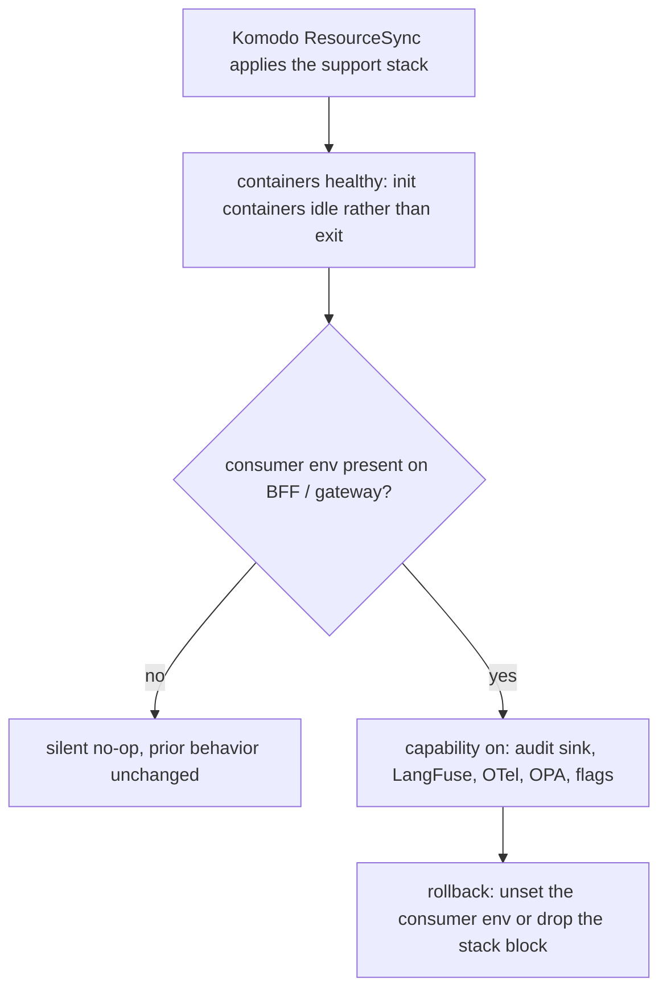

# Prod control tower (observability / audit / dormant Vault)

Three production stacks — `prod-audit` (OpenSearch audit sink, the MVP), `prod-observability` (LangFuse +
Grafana/otel-lgtm + OPA + Unleash), and `prod-vault` (deliberately dormant) — deploy the same way as the
rest of prod: merge to `main`, Komodo ResourceSync picks it up. The BFF and agent gateway consume each
capability through environment variables only, so deploying a support stack never itself changes app
behavior; a capability only turns on when its consumer env is present. This is the production landing
of the secrets posture documented in [Secrets management](../invariants/secrets-management.md)
(Vault here is the fail-open, dormant reader described there) and it shares the
[published-port reservation convention](../invariants/published-port-reservation.md) for its two
tailnet-reachable operator UIs.

## How the three stacks are wired

| Stack | Compose | Komodo block |
|---|---|---|
| `prod-audit` | `infrastructure-as-code/docker/opensearch/compose.prod.yaml` (+ the reused `init-audit-user.sh`) | independent root, `after = []` |
| `prod-observability` | `infrastructure-as-code/docker/observability/compose.prod.yaml` | `after = ["prod-mcm-bff"]` — ordering only, not a hard dependency |
| `prod-vault` | `infrastructure-as-code/docker/vault/compose.prod.yaml` | `after = ["prod-auth"]` — logically in the auth tier |
| consumers | `bff/compose.prod.yaml`, `agents/compose.prod.yaml` | extended `environment` on `prod-mcm-bff` / `prod-movie-assistant` |

The support composes are **fail-fast** — every credential is `${VAR:?}` — while the consumer composes use
plain `${VAR}`, never `${VAR:?}`. An unseeded Komodo Variable therefore aborts a *support* deploy
(intended) but can never abort the app. Fifteen new masked Variables are needed (13 observability + 2
audit; the dormant Vault needs none), plus `TAILNET_HOST`, already seeded for `prod-auth` and reused for
LangFuse's tailnet `NEXTAUTH_URL`. The LangFuse bootstrap keys are the *same* values the gateway consumes.

Wiring is least-privilege rather than symmetric: the BFF consumes the audit sink and OPA only, while the
gateway is the primary emitter (audit + LangFuse + OTel + OPA + Unleash). The LangFuse and Unleash secrets
reach `prod-movie-assistant` and never `prod-mcm-bff`; `UNLEASH_API_TOKEN` is the *client* token, not the
admin one. The audit sink sits on its own external `agent-audit-network`, which only
`agent-audit-opensearch`, its init container, and the gateway/BFF consumers join — keycloak and mc-service
cannot reach it. Adding that network and the `vault` volume prefix was the whole guardrail delta
(`APPROVED_NETWORKS` / `VOLUME_RE` in `scripts/check-resource-naming.mjs`).

## Additive no-op and rollback

Deploying a support stack does not by itself change app behavior. Each capability is gated in the
*consumer's* source: `audit_sink` on `OPENSEARCH_URL`, `observability` on `LANGFUSE_*` + `OTEL_*`, `opa`
on `OPA_URL`, `flags` on `UNLEASH_URL`. Unset means a silent no-op and prior behavior unchanged — which
is what makes rollback cheap.



*Why a deployed support stack is inert until its consumer env appears — and why rollback needs no app redeploy.*

**Rollback** = remove the consumer env (back to no-op) and/or delete the support `[[stack]]` block
(ResourceSync removes it). No app redeploy is needed to disable a capability, and each stack is
independently up/down-able.

## Gotchas

- **A one-shot init container that exits 0 reads as "unhealthy" to the deploy orchestrator.** Komodo
  counts *any* exited container as unhealthy, so every init container in this stack set provisions then
  idles (`… && exec sleep infinity`) behind a trivial passing healthcheck. Where a downstream service needs
  the init's result, gate on a completion marker rather than on "the container exited":
  `langfuse-minio-init` touches `/tmp/ready` after creating the bucket, its healthcheck tests for that
  marker, and `langfuse-worker` depends on `service_healthy` (a never-exiting container can never satisfy
  `service_completed_successfully`).
- **Non-root image runtimes and bind-mount ownership are the dominant class of prod-only failures here**
  — memlock rlimits, root-owned bind mounts under a non-root image user, and double-loaded entrypoint
  config all passed local `compose config` validation and only broke on the real prod host. Diagnose from
  container logs on the prod host itself, not from the compose file; see the table below.
- **The two tailnet-reachable operator UIs (LangFuse, Grafana) use the prod-reserved port range**,
  binding broadly but staying tailnet-only via the host firewall — see
  [Published-port reservation](../invariants/published-port-reservation.md) for the collision this
  convention exists to prevent; do not put these ports back on their old defaults.
- **Vault is intentionally left uninitialized and sealed in production.** A health-check override makes
  that state read as healthy; do not run the Vault init/unseal sequence as part of this rollout — it is
  out of scope until the ADR's revisit trigger fires.
- **The audit sink is append-only, and its writer account is verified to be.** Re-run the provisioning
  check after any upgrade: it asserts `write 201` *and* `read 403` / `search 403` / `delete 403` against a
  document that demonstrably exists (a missing doc would answer 404 either way, so a "not 200" check would
  pass vacuously on a wrongly-permissive role).
- **A capacity check was done before enabling observability**, because the LangFuse/ClickHouse stack is
  the heaviest addition on the shared host — re-run a capacity check before any future footprint
  increase rather than assuming headroom persists.

## Prod-only failure class (none catchable by `docker compose config`)

Every one of these passed local validation and only surfaced on the prod host — they are container-runtime
realities: non-root images, root-owned mounts, one-shot exits, orchestrator health, image entrypoints.

| Symptom (prod `docker logs`) | Cause | Fix |
|---|---|---|
| OpenSearch: `error setting rlimit type 8: operation not permitted` | the prod daemon's memlock rlimit is finite, so `ulimits.memlock: -1` for `bootstrap.memory_lock` cannot be set | drop `bootstrap.memory_lock` + the memlock ulimit — memory-lock is a nicety for a 1 GB audit sink |
| `agent-audit-init` Exited(1): `mkdir: … Permission denied` | the image runs as uid 1000; the bind mount makes `/opt/audit` root-owned | run the one-shot init as `user: "0:0"` |
| Komodo marks the stack **unhealthy** although services work | Komodo counts any exited container as unhealthy; the one-shot inits exit 0 | init provisions then idles, with a trivial passing healthcheck |
| Vault: `open /vault/data/vault.db: permission denied` | the image runs Vault as non-root uid 100, and `/vault/data` is not in the image → the volume lands root-owned | mount raft at `/vault/file` (a vault-owned image dir); an empty volume inherits `vault:vault` |
| Vault: `Failed to lock memory: cannot allocate memory` | finite memlock rlimit again; `mlockall` fails even with `IPC_LOCK` | `disable_mlock = true` in `vault.hcl` (also the recommended raft/BoltDB setting) |
| Vault: `bind: address already in use` on :8200, crash-looping | the vault entrypoint already appends `-config=/vault/config`; passing the file explicitly loads the listener twice | `command: ["server"]` only |

**The vault config that finally works needs all of `/vault/file` + `disable_mlock=true` +
`cap_add: IPC_LOCK` + `command: ["server"]` together** — the cap is not optional even with mlock disabled,
because without it the entrypoint takes a fallback path that double-starts vault. When iterating a
container that crash-loops in prod but not locally, reproduce locally with the prod constraints
(`--cap-add IPC_LOCK --ulimit memlock=65536 …`) to iterate in seconds instead of 40-minute deploy cycles.

Two smaller prod-only details worth knowing:

- **The audit-init container needs an image with bash *and* curl.** `init-audit-user.sh` is
  `#!/usr/bin/env bash`, so the bash-less `curlimages/curl` cannot run it; `agent-audit-init` reuses the
  OpenSearch image. The script also self-locates `../stacks/audit.env` and `cd`s into that directory
  *before* the `[ -f ]` guard, so under `set -euo pipefail` a missing dir aborts everything — hence the
  init entrypoint's `mkdir -p /opt/audit/stacks` first, after which no `audit.env` is found and the script
  falls back to the injected env vars.
- **The BFF audit path needs `OPENSEARCH_INSECURE_TLS=true`.** OpenSearch serves a self-signed cert; the
  BFF sink POSTs over https via `node:https` with `rejectUnauthorized:false` **only** when that flag is
  truthy, so without it no audit doc lands from the BFF side. The gateway's sink uses `httpx verify=False`
  and needs no flag.
- **OPA uses the `-debug` image variant, but not for its `wget`.** Distroless `openpolicyagent/opa` has no
  shell at all, so `-debug` is still required; its busybox, however, ships **no** `wget`/`curl`/`nc`, and
  the previous `wget` healthcheck failed on every run — measured as "unhealthy" with a five-figure
  failing streak while OPA served fine. The healthcheck now drives the request through the `opa` binary
  itself (`http.send`), which works without a shell.
- **ClickHouse is bounded twice over.** `mem_limit: 4g` (plus `memswap_limit: 4g` and a `cpus` ceiling)
  bounds the server's own memory accounting and stops observability starving the shared host — on
  2026-10-02 this container sat at ~725% CPU with swap full and slowed every CI job 2–3x. Separately, the
  mounted `mcm-system-logs.xml` disables `trace_log`/`text_log` and gives the other system-log tables a
  3-day TTL: with image defaults they grew to 128 GiB / 28 GiB of diagnostics against 84 KiB of actual
  Langfuse data, and background merges of the resulting parts ran the host at ~725% CPU and ~32% iowait.
  Only tables that *exist* on the server may be listed — declaring a `<*_log>` section enables that table.

Full failure-symptom table and the reproduction recipe: `docs/runbooks/prod-control-tower.md`.

## MinIO data-volume migration (uid 1000, feature 070)

The `langfuse-minio` image was built as root until feature 070. Migrating to non-root requires a one-time
`chown -R 1000:1000` on the data volume, done **in the deploy window with the service stopped** — not
ahead of time. Full procedure, including the dev variant and the volume-name traps:
[the runbook's MinIO migration section](../../docs/runbooks/prod-control-tower.md).

Three gotchas, all measured for real:

- **An early chown does NOT stay valid.** Root bypasses DAC checks, so the running root image keeps
  working on a `1000:1000` volume — but every object it writes afterwards is created **root-owned
  again**. Measured: `find /data ! -user 1000` went from `0` straight back to `2` after a single new
  object. So the chown must be the last thing before the non-root image starts, with nothing root-owned
  running in between. It is cheap and fast; it is not durable while root is writing.
- **Stop by container name, not via compose.** The prod stacks are Komodo-managed: Komodo clones the
  repo and runs compose from its own stack directory with env injected from Komodo Variables, so a
  hand-run `docker compose` from `$HOME` fails with "no configuration file provided" and unresolved
  `${LANGFUSE_*}` interpolation errors. Use `docker stop langfuse-minio` — the `container_name` is
  set explicitly and makes this equivalent without either problem.
- **The real gate is the digest-pin update, not the PR merge.** Both compose files pin `langfuse-minio`
  by digest. Merging the non-root image PR publishes a new digest but changes nothing live until the
  pins are updated in a separate commit. Do not perform the chown and then redeploy the old pinned
  image — the root process immediately resumes and undoes the migration. The sequence is only durable
  when the final step (`docker redeploy prod-observability` via Komodo) starts the non-root image.

Verify with `find /data ! -user 1000 | wc -l` — must print `0`. Do not use `stat /data`; the
top-level directory can show `1000:1000` while children are still root-owned. Two further traps: a
`docker run -v <name>:/data` **creates** the volume when it does not exist, and a fresh volume is `0:0`,
which reads as a successful measurement of the wrong thing — ownership alone cannot tell a just-created
volume from the production one, but ownership *plus contents* can. The real name is the
compose-prefixed `observability-langfuse-minio-data`; there is also an unprefixed `minio_minio-data` on
the prod host belonging to a different/older project, so confirm which stack owns a `minio*` volume
before touching it.

### Fresh volumes — the migration is not owed

The migration above is for a volume carrying **root-era data**. A volume created empty — by the
`docker volume create` prerequisite or by `compose up` on a host that has never run the stack —
needs no chown and no operator step at all.

That is true because the **image** carries `/data` owned by `1000:1000`, and Docker seeds a fresh
empty named volume from the image directory it is mounted over, ownership included. It was **not**
true of the image published as `sha256:629bcee8…`, which has no `/data`: a from-empty bring-up on
that image creates a `0:0` volume and MinIO fails with the *same* `unable to rename … file access
denied` as an unmigrated volume — so the error points at a migration that was never owed. Fixed
2026-09-13; needs the new digest pinned in both compose files to take effect.

**If you see that error on a volume you just created**, do not chown it and do not conclude the
migration was missed — check the image first:

```sh
docker run --rm --entrypoint sh <the pinned image> -c 'stat -c "%u:%g" /data'   # must be 1000:1000
```

After the deploy, `langfuse-minio` healthy is necessary but not sufficient: a stack that starts proves
the permissions, a trace written *after* the deploy proves the write path.

## Langfuse 4 + ClickHouse 25 cutover (feature 072)

Langfuse 4 requires ClickHouse 25, and the pair was only verified on **empty volumes**. Nothing
measured says an in-place ClickHouse 24→25 jump works, so the cutover **recreates the Postgres,
ClickHouse-data, and ClickHouse-logs volumes**, discarding production Langfuse trace history. Per
[ADR-0002 §4](../decisions/adr-0002-stateful-major-upgrades.md) that trade is ratified — at that
cutover, and only at that cutover.

**The volume work must come BEFORE the merge.** Komodo reconciles `prod-observability` from `main`.
Merge first and it deploys Langfuse 4 straight onto the existing 3.x Postgres schema and a 24.3
ClickHouse data directory — exactly the in-place upgrade this sequence exists to avoid.

Steps 1–5 constitute a planned Langfuse outage. It is contained: no non-Langfuse service in this
stack `depends_on` langfuse, so otel-lgtm, OPA and Unleash keep running, and the agent gateway's
tracing is fire-and-forget (turns are unaffected; traces for the window are lost).

Four things that will catch you out, all hit for real:

1. **`docker compose` cannot be hand-run on this host** — Komodo runs compose from its own stack
   directory with Variables injected. Use container names (`langfuse-web`, `langfuse-postgres`, etc.).
2. **`docker compose down -v` would not remove these volumes anyway.** They are `external: true`;
   compose never removes an external volume. They must be removed *and re-created* by hand — Komodo's
   deploy fails with a missing-external-volume error if they are absent.
3. **`restart: always` is held by an explicit `docker stop`** — *unless the daemon restarts*. Keep
   the window short, and re-check the containers are still stopped just before triggering the redeploy.
4. **`docker stop` does not release a volume.** A stopped container still holds its mounts, so
   `docker volume rm` fails with `volume is in use` until the container is **removed**. Measured on
   the 2026-09-13 cutover: `langfuse-postgres` and `langfuse-clickhouse` must be `docker rm`'d after
   stopping, before attempting to remove their volumes.

**The MinIO volume is deliberately NOT recreated.** It holds blobs, not schema, and it was already
`chown`'d to uid 1000 by the migration above. A freshly-created MinIO volume failed to initialise in
dev even when correctly `chown`'d (`Unable to initialize backend: file access denied`), so recreating
it risks the stack not coming back for no benefit; orphaned blobs are harmless. `langfuse-redis` has
no volume at all — its queue state clears on restart by itself.

**Rollback:** revert the merge and redeploy. The volumes stay as they are — rollback does not restore
the old traces, which were discarded by design. Langfuse 3 re-initialises the empty volumes and comes up
clean.

**After it is live:** confirm `--check-expiring` on the next scheduled `infra-image-scan` reports no
UNMATCHED entry (the `langfuse/langfuse:3` suppressions are deleted by the merge, so the gate
re-blocks if the advisory ever returns).

**Since the cutover, the ClickHouse pin has moved further — and that is not the same free lunch.** Both
observability composes now pull a ClickHouse release two majors past the `24.3` this cutover started
from, arriving through a routine Renovate image update *after* the cutover and over live production
traces. §4's "recreate the volumes" ratification applied at this cutover only; it does not make later
majors data-free, and the observability stack is not started by the end-to-end CI job, so a green CI
says nothing about a ClickHouse major. Stateful datastore majors (ClickHouse, Postgres, Redis, Mongo)
now require an explicit dependency-dashboard tick; see
[ADR-0002](../decisions/adr-0002-stateful-major-upgrades.md) for the rule and
[the runbook section](../../docs/runbooks/prod-control-tower.md) for the literal cutover script.

## OpenSearch 2 → 3 for the audit sink, PRESERVING the history (feature 071)

Unlike the Langfuse cutover, this upgrade **keeps its data**.
[ADR-0002 §4a](../decisions/adr-0002-stateful-major-upgrades.md) reversed the original §4 "recreate
volumes" decision once the audit store proved non-empty — **5,276 documents, 326.9 kb** in
`mcm-agent-audit`. History moves across by snapshot and restore; the acceptance check is an **exact
document count**, not a health check.

> **A zero from a filtered query means "no match", not "no data".** The count was nearly missed because
> `_cat/indices/mcm-agent-audit-*` returned empty — the pattern needs no trailing wildcard; the real index
> name is `mcm-agent-audit`. That empty result was one step from justifying the destruction of a security
> audit trail. Preserved verbatim from ADR-0002 §4a because the error shape recurs.

### Two deploys — the order is not negotiable

`path.repo` is a **static** OpenSearch setting: a node cannot register a filesystem snapshot
repository unless it was *started* with that path configured. The live 2.x node had none, so:

```
DEPLOY A   still on 2.x   add the snapshot volume + path.repo → restart → register repo → SNAPSHOT
DEPLOY B   the upgrade    3.x on a NEW EMPTY data volume       → restore  → verify exact count
```

One deploy cannot work: it would mean snapshotting before the repository exists, or replacing the data
volume before the snapshot is taken.

### Why this is safe

The 2.x data volume is **never touched**. 3.x starts on a new one, so at every moment there are two
independent copies (the original volume and the snapshot). Rollback is non-lossy. Deleting the old
volume is a separate, deliberate act afterwards — it is **not** part of this procedure.

### Load-bearing gotchas

- **Create the snapshot volume BEFORE deploying, and chown it to the node's uid.** It is
  `external: true`, so compose never creates it — a missing external volume aborts the deploy. A fresh
  volume mounted at `/mnt/snapshots` (a path the image does NOT contain) is root-owned; OpenSearch does
  not run as root and snapshots fail with a permissions error that does not name the volume. Derive the
  uid from the running container (`docker exec agent-audit-opensearch id -u`), never assume it.
- **Re-measure the document count at A5 — 5,276 was a reading, not a constant.** The audit sink is live
  during Deploy A. Write down the A5 count; that number is what the B5 check must reproduce exactly.
- **Stop at A8 and confirm `state: SUCCESS` before starting Deploy B.** There is no recovery path if the
  snapshot is absent when the old volume is replaced.
- **The new 3.x cluster must re-register the repository.** Repository registrations are cluster state,
  and Deploy B starts a new cluster on a new data volume. The snapshot *volume* is unchanged, but the
  cluster does not know about it — register `mcm-audit-repo` again before restoring.
- **Stop the init container before restoring.** `agent-audit-init` runs `init-audit-user.sh` on startup,
  which POSTs a verification doc, and the writer role carries `create_index` — so on an empty volume the
  stack re-creates the index before you can restore into it. Hit for real on the 2026-09-13 cutover,
  where the restore failed with `cannot restore index [mcm-agent-audit] because an open index with same
  name already exists in the cluster`. Nothing was lost (the index held exactly one init-verify doc, and
  the real data was in the snapshot *and* on the untouched 2.x volume), but it is avoidable. The
  recovery, if it happens anyway: confirm `docs.count` is ~1, then delete and restore — if the count is
  anything else, stop, because something else is writing.
- **Snapshot only `mcm-agent-audit`, with `include_global_state: false`.** Restoring system indices such
  as `.opendistro_security` across a major is a conflict risk with no upside (the init script
  re-provisions the audit writer account on every start).
- **Re-run the least-privilege provisioning check (B6) after restore.** Feature 071 widened the check to
  assert `read 403` and `delete 403` in addition to `write 201` — the old check was incomplete and would
  have passed vacuously on a broken privilege set.

### Rollback

Revert the Deploy B change so the compose points at the **2.x digest and the ORIGINAL data volume**,
then redeploy. The 5,276 documents are exactly where they were; nothing was removed from that volume.
The snapshot also still exists, so there are two ways back.

### Afterwards

Only once the restore is verified and has been running for a while: delete `agent-audit-opensearch-data`
(the 2.x volume) and, optionally, the snapshot. **Neither deletion is part of this procedure** — leaving
a stale ~327 kb volume behind is far cheaper than an unrecoverable audit trail.

Full shell script (Deploy A and Deploy B), the `OS()` helper alias, and all verification commands:
[the runbook's OpenSearch upgrade section](../../docs/runbooks/prod-control-tower.md).

## Capacity

The pre-observability capacity check measured ~48 GiB RAM available on the prod host, actual container
RSS of ~2.2 GiB, and a projected ~8 GiB for observability plus the audit sink — comfortably inside
headroom, so the decision was **always-on, no opt-in fallback**, with ClickHouse's `mem_limit: 4g`
retained. Re-run the check (`free -h` + `docker stats --no-stream`) before any future footprint
increase rather than assuming the headroom persists.

Full stack/compose/file table, the Komodo Variable seeding list, the deploy order and per-phase
verification per phase, and the complete prod-only failure-symptom table:
[`docs/runbooks/prod-control-tower.md`](../../docs/runbooks/prod-control-tower.md). The related prod
runbooks are [prod-data-tier-auth](./prod-data-tier-auth.md),
[prod-reboot-resilience](./prod-reboot-resilience.md) and
[server-setup](./server-setup.md); the stack-level view of the same seven Komodo stacks is in
[Infrastructure stacks](../projects/infrastructure-stacks.md).
