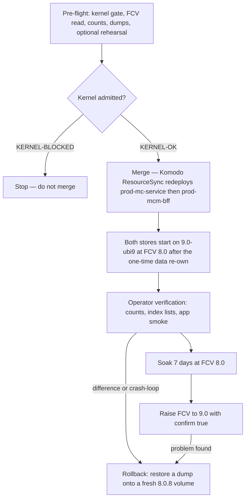

# Production data-tier authentication (MongoDB SCRAM) and the 8.0.8 → 9.0 in-place upgrade

One runbook covers two operator procedures on the same two production MongoDB stores:

1. **Feature 026 — turn SCRAM authentication on** without data loss, during a scheduled, bounded
   maintenance window. Brief service unavailability is an accepted tradeoff; zero-downtime rolling
   cutover is explicitly not required.
2. **Feature 081 US8a — move both stores from `8.0.8-ubi9` to `9.0-ubi9` (9.0.4) in place**, on their
   existing volumes, with the movie data preserved.

Both are deployed the same way as everything else in prod: **merging to `main` triggers a Komodo
ResourceSync**, not a manual `docker` command against the host. The source runbook,
[`docs/runbooks/prod-data-tier-auth.md`](../../docs/runbooks/prod-data-tier-auth.md), is authoritative
for the exact commands, the `Expected` output of every block, the baseline/verification counts and the
rollback drills; this page explains what each procedure achieves and when to reach for it.

## The auth-shape split is the spine

The two stores are deliberately different, and conflating them is the most common way to add an
unnecessary step or a misconfigured mount:

| Store | Container | Shape | Auth mechanism |
|---|---|---|---|
| Movie store | `mc-service-store-mongo` | single-member replica set `rs0` | replica-set keyfile, which **implies** `--auth`, plus SCRAM users |
| BFF store | `mcm-bff-store-mongo` | standalone | SCRAM users only — **never** a keyfile |

A keyfile authenticates *replica-set members* to each other; a standalone mongod has no members to
authenticate, so the BFF store needs credentials and nothing else. The movie store is a replica set
only because the atomic cascade-delete uses a multi-document transaction. Both stores are pinned by
image digest in their compose files rather than by a floating tag.

## Gotchas (authentication)

- **Pre-create the app/root users while the store is still unauthenticated, before merging the
  auth-enabled compose.** `createUser` works against an unauthenticated `mongod` and the users persist
  on the data volume; doing this first means the redeploy that flips auth on reconnects immediately
  with users that already exist, with no unhealthy window and no localhost-exception timing to get
  right. The alternative (localhost-exception cutover after auth is already on) is the fallback path,
  not the recommended one.
- **Seed the Komodo Variables for both stores before merging.** The compose uses fail-fast `${VAR:?}`
  interpolation, so a missing secret aborts the deploy outright rather than starting unauthenticated —
  consistent with the posture in [Secrets management](../invariants/secrets-management.md). Only the
  app passwords and the keyfile are wired into the running services (`MONGO_MC_APP_PASSWORD`,
  `MONGO_MC_KEYFILE` for `prod-mc-service`; `MONGO_BFF_APP_PASSWORD` for `prod-mcm-bff`); the two
  `*_ROOT_PASSWORD` values are setup-only, used to create users during the cutover, and must not be
  placed in a running service's environment. The user matrix is `mc_root`/`mc_service_app` on the movie
  store and `bff_root`/`bff_app` on the BFF store, with `readWrite` scoped to `mc_db` / `bff_db`
  respectively and `authSource=admin` throughout.
- **The keyfile only applies to the movie store.** The BFF store is standalone and needs SCRAM
  credentials only, never a keyfile — conflating the two setups is a common source of an unnecessary
  extra step or a misconfigured mount.
- **A verified pre-window backup is the rollback plan, not a full scratch-environment rehearsal.**
  Auth flags never mutate data, so reverting the compose change alone restores the unauthenticated
  state; a volume-level restore from backup is only needed if a genuinely separate problem is detected.
- **The keyfile permission check is defense-in-depth, not incidental.** `mongod` refuses to start with a
  too-open keyfile; the entrypoint re-materializes it at the correct restrictive permission on every
  clean start, so a manually widened keyfile self-heals on the next redeploy rather than needing manual
  repair.
- **A fresh-volume bootstrap (disaster recovery / new host) is a different procedure from the
  populated-volume cutover** — the replica set must be initiated after auth is already enabled, using an
  authenticated connection, not before. The steady-state healthcheck stays credential-less (a `ping`,
  which runs without authentication even under `--auth`), and does not re-initiate anything.

### How the keyfile is materialized

Feature 022 removed host file-secrets: every production secret arrives as an environment variable
(Komodo Variable → `.env.prod`), never as a committed or bind-mounted file. But `mongod --keyFile`
requires a real file, owned by the mongod runtime user, mode `0400` — mongod refuses a group- or
world-readable keyfile, or one it does not own. So
[`mongo-entrypoint.sh`](../../infrastructure-as-code/docker/mc-service/mongo-entrypoint.sh) writes
`$MONGO_MC_KEYFILE` to an in-container path, sets `0400`, and `exec`s mongod: because mongod is exec'd
in the *same* user context that wrote the file, the owner matches by construction — no chown, no uid
guesswork. The script `rm -f`s the file before rewriting it, because on a plain container *restart* the
prior run's read-only `0400` file persists and a non-root redirect cannot reopen it (EACCES), which
used to crash-loop the container ([prod reboot resilience](./prod-reboot-resilience.md)). Dev stacks
stay unauthenticated; the auth flags exist only in the prod compose files and the scratch/rehearsal
environment.

## The 8.0.8 → 9.0 in-place upgrade (feature 081 US8a, T059)

Both stores move from `8.0.8-ubi9` to `9.0-ubi9` (9.0.4) **in place**, on their existing volumes,
preserving data. The procedure was rehearsed end to end on a copy of the dev volumes in the prod auth
shape (single-member replica set + keyfile + SCRAM, standalone SCRAM), with counts and index lists
identical at every step including a rollback onto a fresh 8.0.8 volume; every block in the runbook's §6
was then run verbatim against a prod-shaped stack and printed the stated `Expected` output. See
[ADR-0002](../decisions/adr-0002-stateful-major-upgrades.md) for the stateful-major discipline this
follows — premise first, an explicit data decision, rollback by tested restore.

The upgrade lifecycle: the kernel gate blocks the merge, the deploy never raises the FCV, and rollback is always a restore.

### Gotchas (the upgrade)

- **Merging the PR *is* the deploy, and it lands 45–90 minutes later.** `app-ci` on `main` → its
  `trigger-cd` job → `cd-deploy` (deploy=true) → the signed Komodo webhook → the changed stacks
  redeploy in `after` order: **`prod-mc-service`, then `prod-mcm-bff`**. Main's CI runs first, which is
  the delay. The deploy order lives in
  [`stacks.toml`](../../infrastructure-as-code/komodo/stacks.toml).
- **The post-deploy health probe does NOT notice a broken Mongo.** It polls only the Keycloak OIDC
  issuer and the public app host for a 200 (`scripts/cd/health-probe.sh`, invoked by
  [`.forgejo/workflows/cd-deploy.yml`](../../.forgejo/workflows/cd-deploy.yml)), so a store that failed
  to come up passes it. Verification is the operator's job, right after the deploy: containers and the
  re-own log line, version and FCV, per-collection counts compared against the pre-flight files,
  index lists compared after restarting `mc-service` and `mcm-bff-service` so their index passes run
  against 9.0, and a real app pass (sign in, page through movies, search, open the backup settings —
  the last one is what triggers the BFF's lazy index pass).
- **The FCV is not raised by the deploy.** The store starts on the 8.0 data at FCV `"8.0"`, and the
  raise to `"9.0"` happens only after a **7-day soak**, with `confirm: true` — without it the command
  refuses (measured), and it is idempotent, so re-running is safe. On the replica set the raise
  implicitly reconfigures `rs.conf()` to carry the `term` field. The soak is the point: while the FCV is
  8.0 the store has not written anything 9.0-only, and nothing is gained by raising early.
- **There is no image-revert rollback.** MongoDB supports a binary downgrade from 9.0 only to the
  *latest* 8.0 patch — never to 8.0.8 — and the volume has been re-owned to uid 1000, so 8.0.8 cannot
  open it at all. Rollback is **a dump restored onto a fresh 8.0.8 volume**, rehearsed both ways: the
  pre-flight archive, and a dump taken from 9.0 *at FCV 9.0*, which restores into 8.0.8 with identical
  counts and indexes. The procedure stops the two stacks, keeps the 9.0 volume under a `-9.0-keep` name,
  recreates an empty volume under the original name, restores with a throwaway 8.0.8 container, and only
  then merges a revert PR.
- **Do NOT pre-chown the prod volumes before the merge.** 8.0.8 (uid 998) would then fail the same way
  9.0 does on a foreign-owned volume — and because the deploy lands roughly an hour after the merge
  there is no safe moment for an out-of-band chown. The re-own belongs in the container start path.
- **`docker stop` of the old BFF store is a SIGKILL, and that is survivable.** Both images start mongod
  under a Python entrypoint (PID 1) that does not forward SIGTERM, so `docker stop` waits out its
  timeout and kills mongod (measured on 8.0.8 and 9.0). The movie store's prod entrypoint `exec`s
  mongod and stops cleanly. 9.0 recovered the SIGKILLed 8.0.8 BFF volume from its journal with
  identical counts (rehearsed). The pre-flight dumps are the insurance.

### HARD PRECONDITION — the host kernel

**mongod 9.0.4 refuses to start on Linux 6.19.0 through 7.0.13** (SERVER-121912, reported as
`MongoDB cannot start: Linux kernel versions 6.19.0 through 7.0.13 have a known incompatibility with
this version of MongoDB`) — there is **no startup parameter to override it**. It crash-loops instead.
The CI and prod daemons share **one** physical host, so both see the same kernel, and the pre-flight
block gates on it: **`KERNEL-BLOCKED` means stop and do not merge.**

On Ubuntu the check is not `uname -r`. Ubuntu reports every kernel in a series as `X.Y.0-NN`, so
9.0.4's Ubuntu exemption (SERVER-131779) applies when `uname -v` contains `Ubuntu`, and then mongod
takes the upstream version from the **last field of `/proc/version_signature`**. `7.0.0-27-generic`
(upstream 7.0.6) is therefore refused — that is what failed PR #817's first `app-e2e` — while
`7.0.0-38-generic` (upstream 7.0.14) starts. The prod host has run `7.0.0-38-generic` since
2026-10-24. `uname -r` alone would have printed `KERNEL-BLOCKED` on a kernel mongod accepts. Also
worth knowing: any 8.0.x below 8.0.35 carries the un-exempted form of the same guard.

### The uid re-own, and why the container starts as root

**`9.0-ubi9` runs mongod as uid 1000; `8.0.8-ubi9` ran it as uid 998.** Every volume written by 8.0.8
is therefore foreign-owned to 9.0, and 9.0 dies before touching data with
`Unable to read the storage engine metadata file ... storage.bson` (`FileNotOpen`) — measured
2026-10-20 on a copy of the dev volumes. The image's own entrypoint does not help: started as root it
does **not** drop privileges, so mongod would then run as root.

So both prod Mongo services declare `user: "0:0"` and a `sh -c` wrapper that starts as root **only to
re-own `/data/db` once** — skipping the chown when nothing is foreign-owned, and pruning
`/data/db/.mongodb` (mongosh's client log dir, since `HOME` is `/data/db` and an exec'd mongosh writes
it as root) so the re-own does not fire on every healthcheck — and then drops to the image's `mongod`
user with `setpriv` before the keyfile entrypoint or mongod runs. **mongod itself never runs as root.**
The wrapper is identical across all four dev and prod compose files and is executed against stubs by
[`mongo-data-owner.guard.test.mjs`](../../scripts/__tests__/mongo-data-owner.guard.test.mjs), which
asserts both halves — re-own as root, drop before exec — plus a per-file floor on matching services so a
rename cannot make the assertions pass vacuously. See also
[mc-service](../projects/mc-service.md) and the note in [local dev](./local-dev.md) for the same trap
on a bare `docker run`.

### What the pre-flight establishes

Read-only, same day as the merge: the kernel gate; that the shell talks to the **prod** rootless
daemon and both stores plus both services are up; that the root credentials work and that **each store's
FCV reads `"8.0"`** (not `"8.0"` → stop, set it on 8.0.8 first, re-read); per-collection counts and
index lists written to an evidence directory; full `mongodump` archives with users included, gzip-tested
and grepped for dump errors; and a pull of the 9.0 image with an in-image check that it reports 9.0.4,
uid 1000 and `setpriv`. An optional but recommended rehearsal then restores those archives into
throwaway 8.0.8 containers with no network and their own volumes, stops them cleanly, re-owns and starts
9.0 on the same volumes — exactly what the deploy does — and diffs counts and indexes. The counts
recorded before and after are the T059 evidence attached to the PR. The design reasoning behind the
upgrade path, the FCV steps, the driver support for server 9.0 and the digest re-resolution is in
[`specs/081-major-dependency-upgrades/research.md`](../../specs/081-major-dependency-upgrades/research.md)
R8.

One known upstream issue is recorded rather than chased: SERVER-89953 says `listIndexes` may report
`collation: {locale: "simple"}` on simple-collation indexes at FCV 9.0. It did **not** appear in the
rehearsal on 9.0.4, and this codebase never reads `listIndexes` (mc-service re-issues named
`createIndexes`, a no-op for an identical spec) — so if it appears, it is a reporting difference on
those index lines only, and worth recording, not a data change.

## Where the detail lives

Full prerequisite steps, the Komodo Variable list, exact baseline and verification commands, the
localhost-exception fallback procedure, the `--transitionToAuth` zero-downtime alternative, the keyfile
negative test, the fresh-volume bootstrap appendix, and §6's pre-flight / deploy / verify / FCV-raise /
rollback blocks with their `Expected` output:
[`docs/runbooks/prod-data-tier-auth.md`](../../docs/runbooks/prod-data-tier-auth.md) — the upgrade half
is [§6](../../docs/runbooks/prod-data-tier-auth.md#6-mongodb-808--90-upgrade-data-preserved-feature-081-us8a-t059).
The acceptance oracles are `specs/026-prod-data-auth-vault/quickstart.md` (Scenarios 1–5) and the
contract `specs/026-prod-data-auth-vault/contracts/mongo-auth-contract.md`; the upgrade's premise,
rehearsal table and measurements are in `specs/081-major-dependency-upgrades/research.md` R8.
