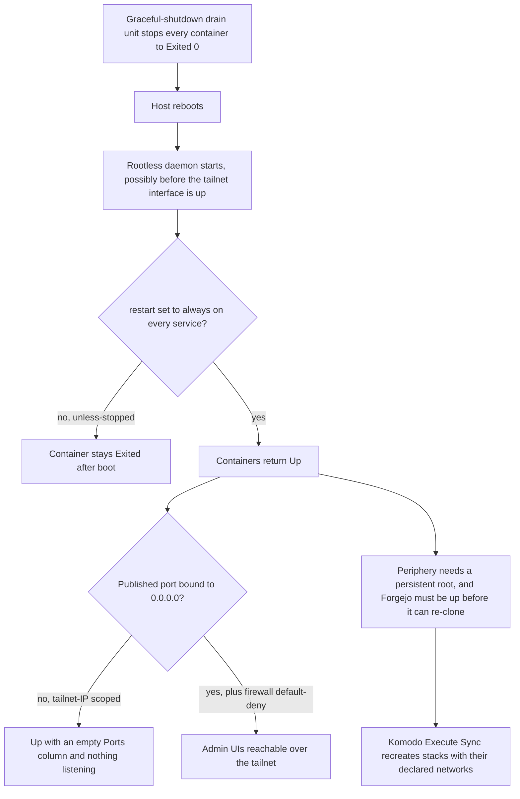

# Prod reboot resilience

Records the recovery posture for the rootless-Docker production homelab after a host reboot: host-side
remediations applied outside the repo, repo/deploy-side fixes committed to compose files (so they
survive every Komodo ResourceSync deploy), one operator redeploy step, and a validation-reboot
checklist. It exists because a kernel-upgrade reboot exposed several defects at once, and a later
validation reboot exposed further defects the first round had missed — a two-round history, not a
single fix.

The source runbook, [`docs/runbooks/prod-reboot-resilience.md`](../../docs/runbooks/prod-reboot-resilience.md),
is authoritative for the host-remediation table, the full tailnet-throughput diagnostic narrative, the
port-migration history and the row-by-row validation checklist. This page explains the mechanisms and
the shape of the two rounds; reach for the runbook to run a procedure.

## The chain a reboot has to survive

Every defect in this history is a link in one chain, and each round of fixes closed a link the previous
round had assumed was already sound.

The chain a reboot must survive: each decision point is a distinct failure mode fixed in round 1 or round 2.

The drain unit is the reason the chain starts where it does. On shutdown it deliberately stops every
container cleanly (so no state is half-written), which means boot does not begin from "containers were
running" — it begins from "every container is `Exited (0)`". Anything that only returns containers the
daemon considers *running* therefore cannot recover this host.

## Round 1 — feature 028 (bind address, keyfile, first restart policy)

Three repo/deploy-side fixes, all committed so a ResourceSync deploy reproduces them:

- **Published admin/UI ports moved to a broad `0.0.0.0` bind.** The rootless daemon starts before
  `tailscaled`, so a `<tailnet-ip>:host:container` publish silently fails to bind; the container reports
  `Up` with an empty Ports column and nothing listening. Only a `0.0.0.0` bind or a full rootless-daemon
  restart *after* the tailnet interface exists recovers it — a plain container restart does not. Tailnet-only
  exposure is preserved by the host firewall's default-deny-inbound posture, which is now load-bearing:
  the three published ports are Keycloak admin, LangFuse web and Grafana/otel-lgtm, all in the
  [prod-reserved range](../invariants/published-port-reservation.md) (see the runbook's §2a, and the
  `#PROD` port comments in
  [`keycloak/compose.prod.yaml`](../../infrastructure-as-code/docker/keycloak/compose.prod.yaml) and
  [`observability/compose.prod.yaml`](../../infrastructure-as-code/docker/observability/compose.prod.yaml)).
- **The Mongo replica-set keyfile entrypoint became idempotent.** `mongo-entrypoint.sh` writes the keyfile
  at mode `0400`; on a plain container *restart* the prior run's read-only file persists, and because
  `mongod` runs non-root the entrypoint's redirect cannot reopen it for write, so the container
  crash-loops. The fix removes the file before rewriting it on every start
  ([`mongo-entrypoint.sh`](../../infrastructure-as-code/docker/mc-service/mongo-entrypoint.sh)).
- **A restart-policy assumption** — that `unless-stopped` meant "every prod container returns
  automatically after a reboot". That assumption was wrong, and round 2 is where it was disproved.

Round 1 also left one operator step: a Komodo `prod-auth` redeploy, because on reboot `keycloak-service`
came back missing a shared network attachment and the app could not resolve Keycloak. The durable fix is
the redeploy — the compose already declares the network set, so a recreate restores it — never a manual
`docker network connect`, which is a one-off the next reboot can lose.

## The supersession between the rounds — feature 029 (port reservation)

Round 1's own port choice was itself superseded, and that is load-bearing rather than narrative detail.
Feature 028 first bound Keycloak admin at `0.0.0.0:8099`; prod and the CI runner are **two rootless
daemons on one host publishing into the same host port space**, and `0.0.0.0:8099` collided with the CI
app-e2e Keycloak's loopback bind on the same number. Whenever a CI Keycloak was up, prod Keycloak could
not bind on redeploy → crash-loop → prod auth down; a leftover CI stack held the port for hours on
2026-07-06. The fix moved the three prod admin/UI publishes into the **prod-reserved range `19000–19099`**,
disjoint from every CI/dev port. The range, its mapping and the invariant behind it are documented once,
in [Published-port reservation](../invariants/published-port-reservation.md) — treat the current
reserved-range assignment as authoritative, not the original bind fix.

Two consequences of that move are easy to miss, and both are the runbook's §2a:

- **The gate only reads a compose file's `ports:` key, so a port move is not finished when the bind
  changes.** The same number usually reappears as a *self-referencing URL* that must move in lockstep —
  today Keycloak's `KC_HOSTNAME_ADMIN` and LangFuse's `NEXTAUTH_URL`. A missed one leaves a working bind
  serving a URL for the old port: a broken redirect no port scan can see.
- **A bookmark on the old admin port is stale** — the admin console was on the pre-029 port until feature
  029 and now lives on the reserved one.

Feature 029 also made the intra-stack Keycloak↔Postgres network **compose-managed** instead of external,
so compose creates and attaches it atomically on every `up`. That closed a worse version of the round-1
network symptom: a failed port bind rolled back Keycloak's networking entirely, leaving it unable to
resolve its own database (`UnknownHostException`).

### The bind-prefix variables both rounds retired

The two variables that used to scope those publishes are gone, and the reason generalizes:

- **`KC_ADMIN_BIND_IP` was only ever the bind *prefix*.** Feature 028 dropped it from the keycloak compose
  bind, but Komodo kept passing it to the `prod-auth` stack until 2026-10-12 (item #727), so it reached the
  container through the compose `env_file:` as a `KC_*` variable that names no Keycloak option — harmless,
  but dead config. The admin **URL** was always the separate `KC_HOSTNAME_ADMIN`.
- **`TS_ADMIN_IP` followed the same course to completion.** It was only the prefix of the two
  observability operator-UI binds; feature 028 made those binds `0.0.0.0`, and the stack config stopped
  passing the variable on 2026-10-13 (item #727). No stack or compose file reads it now, so the Komodo
  Variable can be retired.

Retire the stack `environment` line and the Komodo Variable together. Nothing detects a supplied variable
nobody reads, and because nothing references the name, leaving it seeded cannot fail a deploy — the only
cost is dead config. The invariant page carries the worked example under
[Published-port reservation](../invariants/published-port-reservation.md); the runbook's own record is its
"Retired variables" paragraph in §2a.

## Round 2 — feature 030 (restart policy and periphery storage location)

A validation reboot on 2026-07-08 came back **not** clean: the data tier was up, but the whole app tier,
Komodo periphery and Forgejo were down, and Komodo could not redeploy anything. Two independent root
causes, both gaps round 1 missed.

### `unless-stopped` cannot survive this host's shutdown → `restart: always`

The two remediations defeated each other. The drain unit stops every container to `Exited (0)`, and
`unless-stopped` deliberately declines to restart a container that was already *stopped* when the daemon
starts. So the drain marked containers stopped, and the policy then refused to bring them back on boot.
Proven on Docker 29.6.0: a `docker stop` plus a user-daemon restart leaves an `unless-stopped` container
`Exited`, while an otherwise-identical `restart: always` container comes back `Up`. Every service in every
prod compose now declares `restart: always` (27 services across the seven `compose.prod.yaml` files), and
every host-managed compose — Forgejo, Komodo itself, cloudflared and the monitoring stack — was set to
`always` as host state. The one-shot init containers idle on `sleep infinity` after an idempotent init so
they too stay eligible. Do not reintroduce `unless-stopped` on a prod or host-managed service expecting a
reboot to bring it back.

The immediate fix on the host was an interim `docker update --restart always` over the running
containers, which only survives until each container is next *recreated*. What makes the policy durable
across redeploys and rebuilds is the committed compose value plus the host-compose edits — the interim
update is a stopgap, not the fix.

The drain unit was retained but **reworked to stop containers in parallel**. Sequentially it ran
`docker stop -t 30 $(docker ps -q)`; with roughly 40 containers that exceeded `TimeoutStopSec=120` and
was SIGKILL'd mid-drain, stopping a non-deterministic subset. Parallel stopping lets the graceful drain
finish inside its timeout — its only remaining job, since `restart: always` now guarantees the return.

### Komodo periphery's root was on an ephemeral tmpfs

Periphery's `root_directory` was the stock default `/etc/komodo`. Under rootless Docker, `/etc` is
copy-up'd to a **per-daemon tmpfs** (RootlessKit `--copy-up=/etc`), so everything periphery writes under
it is wiped on every reboot — including the cloned repo checkout that every stack's relative bind-mounts
resolve against. After the reboot the checkout was gone, and Docker auto-created each missing bind-mount
*source file* as a directory, so the Mongo and Vault containers failed with `not a directory … mount a
directory onto a file` (exit **127**). This is structural, not a race: it recurs every reboot. The fix
is host state — point `PERIPHERY_ROOT_DIRECTORY` at a path on persistent disk and recreate periphery —
and the
[server-setup runbook](./server-setup.md) Phase 9 now bootstraps that value so a rebuild cannot
reintroduce `/etc/komodo` (see
[`Server-Setup-Runbook.md`](../../docs/runbooks/Server-Setup-Runbook.md#L794-L797)).

## The rest of the host-side posture

The compose fixes are only part of what the host has to survive, and the remainder is host state that
no gate can see. The graceful-shutdown drain unit is the one this page leans on throughout; alongside it
the host carries an orderly-shutdown trigger for sustained power loss (UPS + Network UPS Tools, so a
brownout no longer becomes the hard kill that exposed these defects in the first place), scheduled
backups covering **all** data volumes rather than a subset, and the device-keyed segmentation-offload
unit described next. The source runbook's host-remediation table is the authoritative record with the
per-control verification command for each.

## The tailnet throughput fix the host must re-apply

This one is host state for the same reason as the drain unit: a reboot resets it. Tailscale's default
segmentation offload (TSO/GSO/GRO) on its own tun device collapsed **outbound** tailnet throughput to
~150 KB/s for every peer — image pulls from the forge registry, Forgejo API reads, CI-monitor calls —
while the same box in the same second received at ~15.86 MB/s. Disabling offload on the device took one
identical fetch from ~117 KB/s to **84.5 MB/s** (~600×).

The signature is what makes it hard to see, and it is the reason to measure both directions: small
packets were unaffected (sub-millisecond ICMP, 0% loss, healthy TCP ACKs), every counter read clean (no
socket-buffer errors, no NIC errors, CPU idle, MTU correct, a direct tailnet path), and at ~1 ms RTT no
plausible network condition can cap TCP at that number. When no network condition can produce the
measurement, stop looking at the network.

The fix has to be bound to **device creation**, not applied once, because a `tailscaled` restart recreates
the tun and resets the flags exactly as a reboot does. The host unit therefore declares
`BindsTo=`/`WantedBy=sys-subsystem-net-devices-tailscale0.device` and re-runs
`ethtool -K tailscale0 tso off gso off gro off` whenever the interface appears; verify with
`ethtool -k tailscale0`, which must read the three offloads `off`. Residual risk: Tailscale deliberately
enables TSO/GSO on its tun, so the unit and `tailscaled` race to set the same flags — if throughput
collapses again, read `ethtool -k tailscale0` first, and an `on` result means the race was lost.

Two measurement traps manufactured false conclusions during the diagnosis:

- **PowerShell `Invoke-WebRequest` is roughly 40× slower than `curl.exe`** (1.57 MB/s vs 68.6 MB/s on the
  same fetch), which produced a convincing but entirely wrong root cause. Benchmark with `curl.exe`.
- **A shell session into the host over the tailnet is Tailscale SSH, not OpenSSH.** It terminates inside
  `tailscaled` and never traverses the tun, so its download path sits near 10 KB/s regardless and did
  **not** improve with this fix. Use HTTP as the throughput probe, never that session type.

The runbook's §1a holds the full diagnostic narrative, the unit's exact contents and the verification
command; this page only records why the control exists and why it must re-apply itself.

## Recovery order when a reboot lands dirty

If a reboot does land dirty, nothing self-heals until Komodo can act again, and Komodo needs two things
that the same reboot stopped:

1. **Start Komodo periphery.** It is itself a rootless container and therefore a drain victim; with no
   agent, Komodo Core shows no stacks and can redeploy nothing — including itself.
2. **Start Forgejo.** Komodo clones the repository from it on every sync, so the git source must be
   reachable before a sync can succeed.
3. **Run Komodo's Execute Sync.** It re-clones into the persistent periphery root and recreates every
   stack with its declared networks.

With `restart: always` this ordering should never be needed — it is the manual escape hatch, not the
intended path.

## Gotchas

- **A tailnet-IP-scoped published port silently fails to bind if the container engine starts before the
  tailnet interface is up** — the container shows running with an empty ports column, and only a rebind
  or a full daemon restart (after the tailnet interface is up) recovers it, not a plain container restart.
  The fix was moving affected published ports to a broad bind behind the host firewall's default-deny
  posture, landing them in the
  [published-port reservation range](../invariants/published-port-reservation.md) to avoid colliding with
  the CI runner sharing the same host.
  - **This is the second time the same physical ports moved** — round 1's own bind was superseded after
    those ports collided with the CI runner's use of the same host's port space; treat the current
    reserved-range assignment as authoritative, not the original bind fix.
  - **A port move is not done when the bind changes.** The collision gate only reads the `ports:` key, so
    the self-referencing URL vars (Keycloak's admin hostname, LangFuse's login URL) must be moved in the
    same change or the service serves the old port while binding the new one.
- **`restart: unless-stopped` does not bring a container back after a reboot on this stack.** The
  graceful-shutdown drain stops every container cleanly on shutdown, and `unless-stopped` deliberately
  declines to restart a container that was already stopped when the daemon starts — the two remediations
  defeat each other. Every prod and host-managed compose service is `restart: always`; do not reintroduce
  `unless-stopped` on a prod service expecting a reboot to bring it back.
- **An interim `docker update --restart always` is not a fix.** It rewrites the restart policy of the
  containers that exist right now and is lost the moment one is recreated — by a Komodo redeploy, a
  compose `up`, or a host rebuild. Only the value in the compose file (or the host-managed compose file)
  survives, which is exactly why the policy is enforced as config-as-code.
- **A crash-looping non-root Mongo keyfile entrypoint is a permissions bug, not a data bug** — a plain
  container restart (not recreate) can leave a prior run's read-only keyfile in place, and the non-root
  `mongod` process cannot overwrite it. The entrypoint fix removes the file before rewriting it on every
  start, making the operation idempotent. The regression test for this must run as a non-root uid, since
  running it as root masks the bug entirely — the idempotency test drives the real script and plants a
  pre-existing `0400` keyfile
  ([`mongo-entrypoint.test.sh`](../../infrastructure-as-code/docker/mc-service/mongo-entrypoint.test.sh)).
- **A durable network re-attach after reboot is a Komodo redeploy, not a manual `docker network connect`.**
  A manual reconnect is a one-off that the next reboot can lose; only a redeploy recreates the container
  with its full declared network set from the compose file. The intra-stack Keycloak→Postgres link no
  longer depends on that at all, because it is compose-managed and attached atomically on every `up`.
- **Komodo's own periphery agent can be a recovery dependency, not just a deployed workload.** If
  periphery is stopped on shutdown, Komodo Core loses its agent on reboot and cannot redeploy anything —
  including itself — until periphery, and the git source it depends on, are manually started first (see
  the recovery order above). Persistent storage for periphery's own working directory matters for the
  same reason: an ephemeral filesystem under it silently loses the git checkout that every stack's
  relative bind-mounts resolve against, on every reboot.
- **A host-level throughput bug can look exactly like a network outage and isn't.** A segmentation-offload
  default on the tailnet interface capped one direction of tailnet transfer while leaving small-packet
  latency, loss, and every conventional network diagnostic looking clean — the tell was that no plausible
  network condition could explain the observed throughput number. The fix must be bound to interface
  recreation (a systemd unit keyed to the device), not just applied once, since both a reboot and a
  tailnet daemon restart reset it.
  - **The tooling can manufacture the wrong root cause.** A PowerShell HTTP client measured roughly 40×
    slower than `curl.exe` on the same fetch, and a tailnet SSH session terminates inside the tailnet
    daemon without ever touching the tun, so it can never be a throughput probe. Re-measure with the
    right tool before believing a network diagnosis — see
    [the throughput fix above](#the-tailnet-throughput-fix-the-host-must-re-apply).
- **A variable can outlive its reader.** The two bind-prefix variables were retired only after the
  consuming binds and the stack `environment` lines went away — the first had kept reaching the Keycloak
  container as a meaningless `KC_*` option through the compose `env_file:`. Retire the stack line and the
  Komodo Variable together, and read the effective value from the deploy env file rather than from a
  historical comment.
- **A validation reboot is part of the change, not a follow-up.** Both rounds required one after merging
  and syncing, and the point is that nothing is started by hand after boot; any failing row is a defect to
  fix before closing the round. The checklist is in the source runbook's validation section.
- **The restart-policy gate only sees in-repo prod composes.** Host-managed composes live outside the
  repository (Forgejo, Komodo, cloudflared, the monitoring stack), so no gate can fail on their restart
  policy — their `always` is host state an operator must maintain by hand, and a rebuild that forgets it
  reintroduces the round-2 failure for those stacks only.

## Enforcement — the two required gates

Round 1 and round 2 each left a self-enforcing gate, so config-as-code cannot silently drift back to the
failure:

- **`scripts/check-prod-ci-port-collision.mjs`** keeps prod's published host ports disjoint from every
  CI/dev-published port. It splits the tree by filename — prod is every compose file whose basename ends
  `.prod.yaml`, CI/dev is every other tracked compose file — and compares host **port numbers** while
  ignoring the bind interface, because a prod `0.0.0.0` bind collides with a CI bind on the same number
  whatever interface the CI side names; it skips entries with no deterministic fixed host port (bare
  container port, `${VAR}` host field) and expands numeric ranges. Exit `0` clean / `1` collision / `2`
  unparseable, and `--selftest` plants an overlap so a gate that stopped detecting cannot report green
  ([`check-prod-ci-port-collision.mjs`](../../scripts/check-prod-ci-port-collision.mjs)).
- **`scripts/check-prod-restart-policy.mjs`** makes `restart: always` a required property of every prod
  service. Long-running services must declare `always`; `unless-stopped` is forbidden (the round-2
  regression) and a missing `restart:` is forbidden because it defaults to `no`. `no` / `on-failure` are
  allowed only for genuine one-shot containers whose names match the init/seed/`rs-init`/`createbucket`
  pattern, since `always` would restart-loop them
  ([`check-prod-restart-policy.mjs`](../../scripts/check-prod-restart-policy.mjs)).

Both run selftest-then-scan in the `naming` job of
[`guardrails.yml`](../../.forgejo/workflows/guardrails.yml#L121-L128) on every PR and every push to
`main`, and locally through [`scripts/preflight.mjs`](../../scripts/preflight.mjs#L31-L44).

Related pages: [Published-port reservation](../invariants/published-port-reservation.md),
[prod control tower](./prod-control-tower.md), [prod data-tier auth](./prod-data-tier-auth.md),
[homelab server setup](./server-setup.md), [phase 15 operator checklist](./phase-15-operator-checklist.md).
