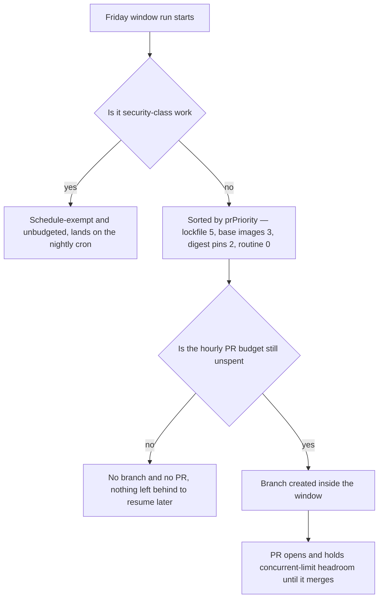

# Renovate dependency bot

Renovate opens dependency-update PRs on a defined schedule and budget. The grouping, version locks,
and cooldown rationale lives in [renovate.json](../../renovate.json) (heavily commented). This page
covers the operating side: the schedule, forcing and verifying a run, reading the dashboard, and the
failure modes that produce absence instead of an error — see `docs/runbooks/renovate.md` for the full
procedures, measured evidence, and code citations behind every claim below.

## Channels, one budget

| channel | trigger | cadence / rank |
| --- | --- | --- |
| **security** — `vulnerabilityAlerts` + OSV | nightly cron `0 3 * * *` | schedule-exempt, unbudgeted |
| **lockfile refresh** — `lockFileMaintenance` (pnpm, cargo-deps, python-deps) | the window run | Friday, `prPriority: 5` |
| **docker base images** | the window run | Friday, `prPriority: 3` |
| **docker digest pins** — `pinDigest` + `digest` updates | the window run | Friday, `prPriority: 2` |
| **routine** — every other grouped package rule | the window run | Friday only, `prPriority` 0 (default) |

Nothing auto-merges — every group carries `automerge: false`. A tick or a dispatch gets you a PR,
never a merge.

How one update is decided inside the Friday window: security-class work bypasses the window
entirely, everything else is sorted by `prPriority` and then gated by the hourly budget *before* a
branch exists.

## Scheduling and budget gotchas

- **The nightly cron is NOT the Friday window.** `.forgejo/workflows/renovate.yml` runs `0 3 * * *`
  (nightly, outside `renovate.json`'s permitted window — schedule-exempt security work only) and
  `0 7 * * 5` (Friday 07:00 UTC, inside the `* 2-4 * * 5` window that covers both the EDT and EST
  offsets). Outside the window Renovate returns `not-scheduled` before branch creation, so "it will
  sort itself out tonight" is false for routine work — force it instead (see below).
- **The CVE sweep's Friday run fires three hours BEFORE the window, on purpose (item #487).**
  `infra-image-scan.yml`'s sweep fires at `0 4 * * 5`; the Renovate window opens at `0 7 * * 5`. If
  the two ran together, `main`'s CVE posture would be unknown until after the very PRs the sweep is
  meant to gate already existed — measured on 2026-09-18, where PR #478 (node/rust/keycloak digest
  pins) was unmergeable from creation on an unrelated otel-lgtm CVE. The sweep is now **twice-weekly**
  — `0 4 * * 2` was added (item #642) so an advisory published mid-week is triaged before Friday —
  and the ordering assertion compares the *latest* sweep cron against the *earliest* window cron, so
  both sweep slots stay strictly ahead. Both crons are UTC so the 3h Friday gap is fixed; DST cannot
  narrow it. **Do not "tidy the crons together"** — a guard test asserts the ordering and a gap of at
  least two hours, sized for queue depth rather than for the sweep's own ~3 minutes.
- **Friday is a ladder on one runner, and that is what the gap is really sized for.** In UTC: 04:00
  the twice-weekly CVE sweep (`infra-image-scan.yml`, Friday plus Tuesday), 06:00
  `devcontainer-image` (a heavy build with a 60-minute timeout), 07:00 the Renovate window, 10:00
  `lockfile-refresh-check`, 11:00 `renovate-health`. A second image build used to sit at 05:00 —
  `minio-image.yml`, for the from-source MinIO build — but feature 080 retired that build for the
  upstream `rustfs/rustfs` object store and deleted the workflow, so 05:00 is now free. The
  capacity-1 runner may also already be inside a ~35-minute `app-e2e`, which is why the ordering
  rule budgets hours rather than minutes.
- **The budget binds before the schedule.** `prHourlyLimit: 5` and `prConcurrentLimit: 6` in
  `renovate.json` (raised from `prHourlyLimit` 4 / `prConcurrentLimit` 5 on 2026-10-02, when the
  in-window budget grew to a fifth slot); the guard test requires `prConcurrentLimit` to stay above
  `prHourlyLimit` or it becomes the binding constraint instead. Measured 2026-08-28: a window run
  created exactly 4 PRs — the hourly limit at
  the time, precisely — and deferred everything else a week. `handleConcurrentLimits()` checks the
  hourly limit for every key and blocks **branch** creation too, not just PR creation, and open PRs
  also eat `prConcurrentLimit` headroom — leaving four green Renovate PRs unmerged caps the next
  window at one new PR. **Merging promptly is a throughput lever.**
- **"Did the lockfile refresh fire unaided?" has a scheduled answer (item #218).**
  `lockfile-refresh-check.yml` runs Friday 10:00 UTC, after the window, and comments its verdict on
  the item — comment-only, always exit 0, and it no-ops once that item closes, so nothing has to be
  cleaned up afterwards. The load-bearing distinction is *unaided* versus *forced*, and the tell is
  **when** the PR was created: Renovate returns `not-scheduled` before branch creation, so a lock-file
  PR created outside the permitted window cannot have come from the schedule. Reading the dashboard
  tick directly does not work — Renovate rewrites that issue on every run, so by the time the check
  runs the tick that mattered is already gone.
- **Why `docker base images` carries `prPriority: 3` (item #486), and why the ranking must not be
  inverted.** With one in-window run a week, `prHourlyLimit` *is* the weekly throughput, and the three
  `lockFileMaintenance` channels at `prPriority: 5` already claim three of the slots every week by
  construction. Before #486, `docker base images` — the channel carrying the same base-image security
  bumps the CVE sweep blocks merges over — sorted with every other routine channel and had not
  received a slot since PR #289, a roughly six-week wait while the sweep kept gating on those images.
  It now ranks at `prPriority: 3`: ahead of every routine channel, deliberately behind
  `lockFileMaintenance`'s 5. That ordering is not an accident to be tidied — lockfile refresh is first
  precisely because it is the channel that clears a CVE finding the manifest range already permits,
  and raising docker above it would trade one starvation for another. **Any later `packageRules` entry
  that takes a `groupName` away from `docker base images` must set an explicit `prPriority`** —
  Renovate merges rules in order and a later rule overrides only the keys it sets, so an unreset rule
  silently inherits 3 and competes for the slot this exists to secure. Today that is `python toolchain`
  and `langfuse` (explicit 0) and `docker digest pins` (explicit 2, see below). A guard test fails if a
  new claiming rule appears without one. This does not remove rate-limiting entirely: if
  `docker base images` itself carries more than a window's worth, tick its `unlimit-branch=` checkbox
  rather than waiting for a deterministic slot.
- **The fifth slot, and `docker digest pins` at 2 (amended 2026-10-02).** At four slots the allocation
  was 3 lockfile + 1 `docker base images`, which left `docker digest pins` no slot at all — the
  2026-10-02 dashboard listed it under Rate-Limited while it carried the caddy rebuild for its
  curl/c-ares Highs. `prHourlyLimit` is now 5 (`prConcurrentLimit` 6, kept above it) and
  `docker digest pins` carries `prPriority: 2` — still below `docker base images` (3) and
  `lockFileMaintenance` (5), so the ranking above is unchanged; the extra slot goes to a digest
  refresh, i.e. an upstream rebuild of a version already running, the lowest-risk security fix there
  is, ahead of every routine channel. The cost is one more PR's CI per week on the capacity-1 runner.
  Note what changed about the *reset* role: this rule is no longer a reset-to-0 — it carries its own
  explicit number, which is what still stops the last rule in the file (docker datasource,
  `pinDigest`/`digest`, no `groupName` and no `prPriority`) from carrying `docker base images`' 3
  through.

## Forcing a run, and verifying what it actually did

Dispatching is `POST .../actions/workflows/renovate.yml/dispatches` with `inputs.dryRun`. Tick
everything wanted on the dashboard first, then dispatch once — ticks and the dispatch compose, and one
dispatch is one runner slot.

- **`dryRun` defaults to `true` and must be set explicitly.** The default is correct (an accidental
  live run is the worse failure) but it means a forced dry run looks exactly like a forced live run —
  nothing moves, no error. Run 5963 (2026-08-14) was mis-recorded as "the schedule beat a dashboard tick"
  when it had simply been a dry run.
- **A dispatch now publishes its resolved mode as a `renovate/mode` commit status before Renovate
  runs — but the empirical check remains mandatory (item #268).** Every introspective route is dead on
  this Forgejo build: the step name renders the raw uninterpolated `${{ … }}` expression, `/actions/runs/{id}/jobs`
  404s, and there is no log endpoint. The status is built only from proven parts (env-var resolution in
  `run:` blocks plus the statuses endpoint) and reads `"LIVE"` or `"DRY RUN (creates nothing)"`. Read
  it, then still apply the empirical check — `git ls-remote origin 'refs/heads/renovate/*'` before and
  after, plus whether dashboard ticks reverted from `- [x]` to `- [ ]`. Heads moved *and* ticks consumed
  ⇒ it ran live. Note the `dryRun: "false"` string form: it resolves live only because Forgejo coerces
  it against the input's declared `type: boolean` — under plain GitHub expression semantics a non-empty
  string is truthy and would select a dry run. That is a property of this forge build, not a guarantee,
  which is exactly why the empirical check stays mandatory rather than advisory. The status step is
  `always()`-guarded, so a dispatch whose toolchain setup dies still records its mode — an unrecorded
  dispatch mode is the same absence item #268 exists to end.
- **A dispatch returns HTTP 204 immediately but only queues — apply the empirical check only after the
  run starts.** A queued run is invisible in `/actions/tasks` (that endpoint lists jobs, and a job row
  does not exist until the job starts); use `/actions/runs?event=workflow_dispatch` to confirm the run
  exists, then poll until `status` leaves `waiting`. Measured 2026-08-29: a dispatch was written up as
  "did nothing" because `/actions/tasks` showed nothing new, when the run had simply been queued ~24
  minutes behind a long `app-e2e` job.

## Renovate PRs and branches — what not to do

- **Never hand-close a Renovate PR** — it marks the update rejected and Renovate stops proposing it
  until a dashboard tick revives it. If queued CI is in the way, cancel the runs instead; leave the PR
  for Renovate's own autoclose.
  **Measured exception, narrow: closing a `lockFileMaintenance` PR does NOT mark the channel rejected**
  (item #290, verified against renovate@44.52.0's dist) — `recreateClosed` is `true` for that class
  (`workers/repository/updates/generate.js`), so `check-existing.js` never looks for a closed PR. Act on
  this exception only deliberately; it does not generalize to any other channel.
- **Never hand-push to a Renovate branch.** Renovate detects the modification and can stop managing the
  branch. Use a `rebase-branch=` tick plus a dispatch instead.
- **After landing a `main`-side fix for a gate, tick `rebase-branch=` on every open Renovate PR that
  failed that gate, then dispatch once.** `rebaseWhen: "conflicted"` means a fix landed on `main` never
  reaches a Renovate branch that does not conflict, so the PR keeps failing on something `main` already
  resolved. Measured 2026-10-09: #696 (a Python-only lock refresh) failed `sast` on an advisory `main`
  had allowlisted three days earlier, because its base was five days old. Compare
  `git merge-base origin/main origin/renovate/<branch>` against the fix's commit. The setting stays:
  rebasing every branch on every `main` merge would cost a ~35-minute `app-e2e` cycle per branch on the
  one runner.
- **A surviving `renovate/*` branch is not evidence of pending work — check ancestry before ticking.**
  `renovate.json` sets `rebaseWhen: "conflicted"`, which skips the `isBranchBehindBase` guard entirely;
  an already-merged branch is not conflicted either, so Renovate reuses it and opens a PR from the stale
  commit verbatim — and a reused branch also bypasses the branch budget, which is gated on
  `!branchExists`. Verify with `git merge-base --is-ancestor origin/renovate/<branch> main`, **not**
  `git diff --stat main...branch`, which prints nothing for an already-merged branch and reads as "no
  changes" rather than "already in main". `default_delete_branch_after_merge` (enabled 2026-08-29,
  item #290) removes most stale branches now, but only for merges through the UI button — an API-driven
  merge that omits `delete_branch_after_merge: true` can still leave one behind.
- **`renovate/lock-file-maintenance` is hard-exempt from Renovate's own pruning, by exact name** —
  `finalize/prune.js` filters it out before `cleanUpBranches` ever sees it, so
  `default_delete_branch_after_merge` is the only thing that removes it (the one stale copy predating
  that setting had to be deleted by hand). The comparison is exact-name, so the **suffixed** group
  branches this repository actually produces — `renovate/lock-file-maintenance-cargo-deps`,
  `renovate/lock-file-maintenance-python-deps` — are **not** exempt; they are prunable by autoclose like
  any other branch.
- **Merging past a pending `renovate/stability-days` check needs all three conditions, and defaults to
  HOLD (item #298).** Branch protection treats the check as advisory, so the forge permits merging past
  it — this rule says when that is acceptable: (1) the wait *cannot* satisfy it (the pending state is
  structural — something resets the clock faster than it can run down — not temporal, where waiting
  works); (2) the posture has been measured first with the gate's own criteria and recorded on the PR
  (images: the `--severity CRITICAL --ignore-unfixed` recipe in
  [infra-image-scanning](infra-image-scanning.md); packages: the SAST/audit gates on the PR); and (3)
  the update has security value now — it clears a live finding or unblocks a red gate on `main`.
  Impatience does not qualify. Use a **two-dot** diff (`git diff main branch`, not `git diff
  main...branch`) to see what a PR would still change — the three-dot form is against the merge base and
  lists changes `main` already has by another route.
- **Autoclose needs every dependency in a group satisfied — a hand-carry that is one version short does
  not close the PR, it silently shrinks or rebases it instead.** `finalize/prune.js` only ever considers
  a branch for the `- autoclosed` path once every upgrade in it is satisfied on `main`; a single
  unsatisfied member keeps the branch alive. Measured on PR #557 (2026-09-26): a hand-carry landed six
  of seven images at the exact digests proposed but left `ollama/ollama` one patch short with no
  recorded rationale, so the next dispatch **rebased** #557 into a fresh one-line PR instead of closing
  it. Verify a predicted autoclose with `git merge-tree --write-tree main <branch>` — a residual conflict
  names exactly the lines that still disagree — never by trusting a commit message's claim about its own
  content.
- **Clearing a conflicted Renovate PR does not have to wait for Friday.** `updateNotScheduled` (default
  `true`) gates **branch creation** only; `update/branch/index.js` bails on it solely there. An
  out-of-window run still *updates* a branch that already carries an open PR, and with `rebaseWhen:
  "conflicted"` a conflicted branch regenerates from scratch on that same out-of-window run. A
  `rebase-branch=` tick is still the deterministic route (it leaves a consumed-tick trace to read), but
  the window is not the obstacle it looks like.

## Dashboard checkbox reference (item #29)

Renovate rewrites the dashboard body on a schedule. Never edit its prose, retitle it, relabel it, or
close it — ticking a checkbox is the one sanctioned interaction.

| section | checkbox | what ticking does |
| --- | --- | --- |
| Pending Approval | `approve-branch=` | **required** — `dependencyDashboardApproval` groups are never proposed otherwise |
| Awaiting Schedule | `unschedule-branch=` | creates it on the next run, ignoring the Friday window |
| Rate-Limited | `unlimit-branch=` | creates it despite the PR budget |
| Pending Status Checks | `approvePr-branch=` | opens the PR now, skipping the `minimumReleaseAge` cooldown |
| Open | `rebase-branch=` | rebases/regenerates that branch on the next run — not schedule-gated |
| Other Branches | `other-branch=` | forces a PR for a branch that has none |
| Repository Problems | — | **read this** — Renovate reporting its own errors; the toolchain-missing warning appears here |

**Re-read the dashboard immediately before ticking — section and checkbox names change between runs.**
The same update has moved from `unlimit-branch=` under Rate-Limited to `unschedule-branch=` under
Awaiting Schedule to `other-branch=` under Other Branches across three runs in one day. A tick is a
one-character edit: read the body first, assert the target checkbox appears exactly once and is
untenanted, and assert the resulting body differs by exactly the number of characters intended.

**A database MAJOR waits in Pending Approval, and ticking it is the migration decision.** Majors of
`postgres`, `mongodb/mongodb-community-server`, `redis`, `clickhouse/clickhouse-server`,
`opensearchproject/opensearch` and `langfuse/*` all carry `dependencyDashboardApproval`; the clickhouse
25.12 → 26.6 and redis 7 → 8 majors for the production Langfuse stack merged on a green CI on
2026-10-09 (PR #698), and `app-e2e` never starts the observability stack — so green said nothing about
either, and the four database images have required a tick on a MAJOR ever since. Before ticking, name
the stack the image runs in and how its data survives the move; the within-major patch stream stays
automatic, so only the major is gated. The observability postgres is held below 17 outright because one
pin backs both Langfuse and Unleash, so it never reaches this list — see
[ADR-0002](../decisions/adr-0002-stateful-major-upgrades.md).

**Which credential does what (measured 2026-10-09).** Ticking edits item #29, which needs the
issue-scoped token (`MCM_FORGE_ISSUE_TOKEN`). The `git credential fill` token answers `token does not
have at least one of required scope(s): [read:issue]`, and through `jq .body` that reads as a `null`
dashboard rather than a refusal. That second token is the one that dispatches `renovate.yml` and merges
PRs. One session, two tokens: pick by endpoint.

## Pinned toolchains (item #307)

A floating reference means no version, no classification, no reproducibility; a pin with nothing
maintaining it just trades a floating reference for a rotting one. Every pin below is exact, the same
at every site, and tracked by something that will move it.

| tool | the pin lives in | how Renovate sees it | grouped? |
| --- | --- | --- | --- |
| **Rust** | `rust-toolchain.toml` (`channel`) + devcontainer `--default-toolchain` arg | built-in `rust-toolchain` manager + a customManager for the devcontainer half (same depName/datasource) | yes — `rust toolchain` |
| **semgrep** | `scripts/sast-scan.mjs` (`SEMGREP_PIN`) | customManager, `pypi` | no |
| **cargo-audit** | `guardrails.yml` (`--version`) and the toolchain image | customManager, `crate` | no |
| **python** (interpreter minor) | `agents/movie-assistant/.python-version` — docker `allowedVersions` ceiling is derived from it | 1 pin + 8 image refs share depName/datasource with pyenv; `requires-python` floors and 4 lockfiles ride other paths | yes — `python toolchain` (item #366) |
| **uv** | one version string repeated at every site (3 install-script URLs + 5 `setup-uv` inputs + 4 image tags) | customManager (`github-releases`) for script/action shapes; built-in docker manager for image tags | yes — `uv pin` |

**The Renovate run pins its own runtime, and that pin is not about `engines`.** The runner's
`ubuntu-latest` container ships Node 22; renovate 44.14.12 raised `engines.node` to `^24.11.0` *inside*
the pinned major, so from 2026-08-09 every run logged `npm warn EBADENGINE` and then `ERROR:
Unsupported node environment detected` and exited 1 — this was the only workflow in the repository with
no `setup-node`, which is exactly why it inherited a runtime nobody had chosen. `renovate.yml` now pins
24.19.0, the version every other job already ran, and that step must stay **before** `corepack enable`,
because corepack is provisioned from whichever Node is on PATH at the time. A guard test asserts both
the pin and the ordering, and `check-toolchain-consistency.mjs` validates the version against
`engines.node`. A Node bump can still arrive as two PRs (workflow `node-version` entries ride
`ci actions`, a Dockerfile `FROM node` rides `docker base images`) — accepted while the gate
floor-checks.

**Rust: the devcontainer needs an image rebuild after any toolchain bump.** `cargo`, `rustc`, and
`nx test mc-service` fail in the dev container immediately after a bump lands, because rustup keys
toolchains **by name** — the image installs one named `stable-…`, and a file naming an exact version
asks for a different toolchain, even though the underlying compiler bytes are identical — and
`static.rust-lang.org` is not on the dev container's egress allowlist, so the resulting fetch cannot
succeed. The fix ships automatically: the same Renovate `rust toolchain` PR moves `rust-toolchain.toml`
**and** `.devcontainer/toolchain.Dockerfile` together (that is what the grouping rule is for), and
`devcontainer-image.yml` is path-triggered on the Dockerfile, so merging the PR rebuilds the image with
a matching toolchain name. **The only manual step is pulling the rebuilt image.** CI is unaffected — it
installs rustup fresh with `--default-toolchain none` on a runner with open egress.

**Python: the `python toolchain` rule's POSITION in `packageRules` is load-bearing.** It must sit
**after** `docker base images` and **before** `docker digest pins`. Measured across local dry-run
lookups: placed after `docker digest pins`, all eight digest refreshes silently migrate onto
`renovate/python-toolchain`, sharing a branch and upgrade key with the eight minor updates — the
`#308/#350` silent-drop shape, which left the python base-image digest never refreshing. The
`requires-python` floors (`>=3.13`) are deliberately excluded from the group: they are compatibility
ranges the code already supports, not deployment pins, and joining them would turn a range into a
decision. A guard test asserts both the ordering and the exclusion.

**uv: one version string, one source of truth, deliberately not a shared file.** The string is
repeated at every site (install-script URL path, five `setup-uv` inputs each marked with a
`# uv-version` comment so the manager's matchString claims only that key, and four image tags), held
together by one customManager plus the `uv pin` packageRule, and asserted equal across every site by
`renovate-workflow.guard.test.mjs`. It is not a shared file because `astral-sh/setup-uv`'s `version:`
input is an Actions expression and cannot read a repository file — a file would leave the five action
sites unpinned, reproducing the exact drift the pin exists to prevent.

## Version holds, permit-lists and approval gates

A hold is expressed as `allowedVersions`, **never** `enabled: false`, because the digest refresh of the
tag we already run is the security patch stream for that image: disabling the dep would strand it, while
a ceiling blocks only the version move and leaves the dep in its group. What a hold cannot express —
"not never, but not by accident" — is `dependencyDashboardApproval` instead.

| dep | hold | why |
| --- | --- | --- |
| `hashicorp/vault` | `<1.19` | 1.21 un-suppresses three allowlisted Criticals (the allowlist regex is keyed to `vault:1\.18`) and adds two new pgx ones, measured on PR #289 |
| `postgres` in the observability files only | `<17` | one digest backs both Langfuse and Unleash, so a major migrates Unleash as a side effect — scoped by `matchFileNames` so keycloak/agent-db (already on 18) keep their own major stream |
| `python` | `<3.15`, derived from `agents/movie-assistant/.python-version` | the interpreter minor is a toolchain decision, not a base-image sweep; the guard derives the ceiling from the pin for **both** managers and fails when they disagree, so raise them together |
| `openpolicyagent/opa` | permit-list `/^\d+\.\d+\.\d+(-debug)?$/` | OPA publishes thousands of tags including `-dev`, `-rootless` and `-static`; a denylist goes stale the moment upstream invents a fourth, so the list of what IS allowed is closed |
| `opensearchproject/opensearch`, `langfuse/langfuse`, `langfuse/langfuse-worker` | major only, `dependencyDashboardApproval` | the ceilings were lifted (features 071/072) once the gate cleared, and what replaced them is a tick — see [ADR-0002](../decisions/adr-0002-stateful-major-upgrades.md) |
| `actions/upload-artifact` | `<4` | this forge's runner refuses v4+ before it uploads anything (`GHESNotSupportedError`), measured on both runner labels — the fourth measurement of the same fact |
| `java-jdk` (from `actions/setup-java`) | `/^17\./` | an Android toolchain decision: the JDK must match the Expo SDK's Gradle/AGP template, and SDK 57's plugin still builds with `jvmToolchain(17)` |
| `@copilotkit/*` (minor + major) and 0.x Cargo minors | `dependencyDashboardApproval` | a breaking upgrade cannot be made green by config, so without approval it arrives red every week and crowds out routine work; **patch stays routine** so a security patch is never gated behind a human tick |

**The `java-jdk` ceiling is a regex on purpose, and that is the one hold shape worth copying.** This dep
uses `semver-partial` versioning, and Renovate tries the dep's own versioning before npm semver:
`semver-partial` *coerces* `<18` to `18.0` and matches only `18.0.x` — so the intuitive
`allowedVersions: "<18"` admitted exactly JDK 18.0 and blocked 17, and the 2026-10-17 dashboard proposed
`java-jdk 17 -> 18` straight through the hold. A regex is evaluated before any versioning, so `/^17\./`
means what it says. The guard models `semver-partial`'s own matcher and asserts both halves: 17.x
patches still flow, and 18.0.2/21/25 are refused.

**Both CI-action holds must stay AFTER the `ci actions` group rule**, because the last matching rule
wins: placed earlier, the group rule pulls the dep back out and the ceiling stops applying. The guard
asserts the ordering, that neither hold strands the dep out of its group, and — as the control — that
neither ceiling leaks onto `actions/checkout`, `setup-node`, `astral-sh/setup-uv` or `node` on the
`node-version` datasource.

**Tamagui is the lockstep-pin case the broad npm rules would otherwise split.** Every `tamagui` /
`@tamagui/*` specifier in both workspace manifests is an exact version and both manifests agree, with
one `tamagui` group on all three tracks and `rangeStrategy: pin`. Measured 2026-10-16: an open
`@tamagui/font-inter >=2.0.0` range let a lock regeneration pull `@tamagui/core@3.0.13` into the lock
beside 2.7.7 with no PR and no review — which is why the rule carries no `matchUpdateTypes` and must be
ordered after `js patch/minor` and `js majors`.

## Silent failure modes

None of these produce a red build or a searchable error. They produce absence, and absence reads as
"nothing to do."

- **A channel whose toolchain is missing dies silently.** Renovate shells out via `execa` to
  regenerate a lockfile; if the binary is not on PATH, `execa` rejects and Renovate suppresses it to one
  `WARN: execa promise rejection suppressed` line under Repository Problems — no PR, ever. Measured
  2026-08-28 (item #218): the `pep621` channel created nothing for weeks until `uv` was added to
  `renovate.yml`'s toolchain steps. Rule out "nothing to refresh" by running the tool by hand
  (`uv lock --upgrade --dry-run`, `cargo update --dry-run`) before believing a channel is idle.
- **The health digest used to read "Healthy" from the wrong signal, twice (items #485, #563, now
  folded together).** It originally read only the advisory `renovate/stability-days` column, which
  missed both red **required** PRs (2026-09-04) and a red main CVE sweep (2026-09-18: the digest posted
  Healthy while `main` had been failing the weekly sweep for five hours and PR #478 was unmergeable on
  exactly that failure). It now also checks branch protection for any open Renovate PR blocked by a
  required context, and the CVE posture of `main`. A second defect (#563) then surfaced: it read only
  the newest **scheduled** sweep run, so a fix that merged and passed on `main` between crons still read
  as red for up to six days. It now reads the newest run of that workflow on `main` by schedule **or**
  push, names which event it read, and uses `prettyref` (not `head_branch`, which is `null` on every run
  this build returns) as the branch discriminator so a red push run on a Renovate branch is never
  offered as `main`'s posture.
- **The release-age cooldown does not cover transitives dragged in by a lockfile regen.**
  `minimumReleaseAge: 3 days` gates the package Renovate proposes, not what pnpm 11 independently
  verifies at install. Measured on PR #263: a compliant dependency bump resolved a transitive published
  1.7 hours earlier and reddened six required contexts at `pnpm install`, none about the actual change.
  **Handling: wait** — the transitive ages past the cutoff and a re-run passes. **Decided (item #271):
  this friction is accepted, not mitigated** — it is infrequent, fails loudly and safely, and is a
  two-minute diagnosis with this runbook. **The same cutoff also DELAYS a fix, silently**, which is the
  direction that has no error: measured 2026-10-09, a refresh forced ~24h after a fix landed resolved
  the release *before* it and left the vulnerable version in place, while the same refresh re-forced at
  13:41Z picked the fix up. So check the fix's publish time (`npm view <pkg> time`) before forcing a
  refresh, and **confirm the resolution in the regenerated lockfile** — a refresh that merely ran is not
  proof it resolved the fix.
- **A group rule governs UPDATES, not lockfile re-resolution — so lockstep packages are pinned
  EXACTLY.** `lockFileMaintenance` re-resolves every manifest **range** and no `groupName` applies to
  it, so a ranged member of a lockstep pair moves alone on a refresh and the group rule never sees it.
  Measured 2026-10-09: PR #695 moved `@playwright/test` (declared `^1.59.1`) to 1.64.0 while the app-ci
  image stayed on `v1.63.0-noble`, and `app-e2e` ran **zero tests** — the `#199` shape, from the one
  channel the `playwright pin` rule cannot govern; an earlier refresh had already left three Nx versions
  on one tree with nothing checking it. `nx`, every `@nx/*` and `@playwright/test` are now pinned
  exactly in every manifest and every `@nx/*` must equal `nx`, with `check-toolchain-consistency.mjs`
  (in `guardrails / naming`) failing on a range or a disagreeing plugin — so loosening a pin back to `^`
  is caught at review rather than on the next refresh.
- **Extraction is not grouping.** A `customManagers` entry makes Renovate *see* a second copy of a
  version; it does not make both copies move in one PR. Paid for three times: nx, the Playwright image
  tag, and the pnpm/Dockerfile pins — each needed its own `packageRule` matching both managers, ordered
  after the broad rules. The guard test asserts the *resolved* group for each pair, since a rule that
  merely mentions the package passes a weaker check. The newest instance is the OpenWiki generator's own
  tree (item #704): a customManager extracts the `openwiki` pin from `.devcontainer/toolchain.Dockerfile`
  while the npm manager reads `tools/openwiki-generator/package.json`, so one `openwiki generator` rule
  has to join them on every version track — with a control asserting that `mermaid`/`jsdom` named
  elsewhere are not swallowed, that the manifest is not hidden by an `ignorePaths` glob, and that the
  Dockerfile matchString hits exactly once.
- **A pinDigest colliding with a version update on the same branch is DROPPED, silently (item #308,
  widened by #350).** `branchify.js` de-duplicates upgrades per branch on
  `${packageFile}:${depName}:${currentValue}`; a second update for that key with a different `newValue`
  is dropped outright, at INFO, with no dashboard trace. Every docker update shared one branch, so a
  version bump and a digest pin of the same image collided and the pin lost. Fixed with a separate
  `docker digest pins` packageRule scoped to `pinDigest` — then widened to `["pinDigest", "digest"]`
  once a routine `digest` **refresh** was found colliding the same way (a refresh always shares its key
  with any version update of the same image, so it needs the same separate namespace as the initial
  pin).
- **A release with no `releaseTimestamp` is pending FOR EVER under any cooldown, and a mixed group
  drops it silently.** `minimumReleaseAgeBehaviour` defaults to `timestamp-required`; the docker
  datasource supplies a real timestamp only for Docker Hub, so every ghcr.io/quay.io tag and every
  `pinDigest` is permanently pending under a cooldown. When a group mixes a non-pending half with a
  pending one, Renovate ships the ready half and silently strands the rest every run. **Fixed for `uv
  pin` via `minimumReleaseAge: null`** on the rule that groups both halves; **fixed for ghcr.io/quay.io
  generally via `minimumReleaseAgeBehaviour: "timestamp-optional"`** (items #349/#350). **Docker Hub
  deliberately keeps `timestamp-required`**, since its timestamps are real and widening the rule there
  would silently disable the cooldown for the one registry it actually works on.
- **Docker Hub's anonymous tag API 403s from page 11, and one 403 discards every timestamp for that
  image.** Renovate's default `dockerMaxPages` (20) reaches page 11 on any image with enough tags on a
  cold cache, gets a 403, and the entire timestamped result is discarded in favor of the (timestamp-less)
  registry tag list — permanent "Pending Status Checks" that reads exactly like a cooldown that never
  elapses. **Fixed by capping `RENOVATE_DOCKER_MAX_PAGES: '10'`** on the Run Renovate step (`dockerMaxPages`
  is `globalOnly`, so it cannot live in `renovate.json`; a guard test asserts ≤ 10). **Reproduction trap:**
  Renovate keeps a 30-minute package cache — a local re-check right after a failed fetch can serve the
  stale failure from cache and hide the fix; point `RENOVATE_CACHE_DIR` at a fresh directory for any
  re-measurement.
- **A DIGEST-class update ages against the wrong timestamp entirely (item #412).** `pinDigest` and
  `digest` updates are aged against `newestMatchingVersionTimestamp` — the timestamp of the newest
  release matching the *current* value from the **version** lookup — not the tag's own
  `tag_last_pushed`. Images with tags far outside the newest-1000-tag window `dockerMaxPages` allows, or
  tags that are not versioned releases at all, never get a timestamp from that lookup and so never get
  their digest refreshed. Diagnose by reading the resolved `minimumReleaseAgeBehaviour` in a debug run's
  logged object, not by counting `no releaseTimestamp to age against` lines — that line fires under
  both `timestamp-required` and `timestamp-optional` and says only that a timestamp was absent, not that
  anything stalled.
- **A manager that matches no FILES is indistinguishable from one with no work (item #412).**
  `docker:pinDigests` sat in `extends` while a family of compose files went un-pinned for a year, because
  the docker-compose manager's basename regex requires the file to start with `compose` or
  `docker-compose` — this repository's `<thing>.compose.yaml` files never matched. Diagnosable by
  grepping a debug run for a known image reference from that file: zero hits means the file was never
  seen, which is a different question from "why no update." Fixed by adding a top-level `docker-compose`
  key, not by renaming the files (a rename just moves the trap).
- **A packageRule can target packages that NOTHING EXTRACTS (item #560).** A rule can resolve cleanly
  and its guard test can pass against a synthetic dependency while the rule proves nothing, because no
  customManager exists to feed it real data — the minio `MINIO_TAG`/`MC_TAG` case sat unbumped for a
  year with a green guard the whole time, because the guard asserted the rule's resolution, not whether
  Renovate had ever extracted the dependency. The fix is to read the Dependency Dashboard's *Detected
  Dependencies* counts, not the config, and a guard needs to assert visibility, not configuration. That
  case ended with feature 080, which retired the from-source build for the upstream `rustfs/rustfs`
  object store — a digest-pinned Docker Hub pull in three compose files — and the guard now asserts that
  every file pinning it is **extracted**, not merely that a rule names it.
- **`cmd1 && cmd2` under `bash -e` hides the second command's failure-to-run (item #562).** A step body
  of two gate commands reports one outcome; if the first throws, `bash -e` never runs the second, and
  that looks identical to "both ran and found nothing." This hid an entire expiry-check tier for two
  weeks. Reproduce a CI step exactly (`bash -e -c 'cmd1 && cmd2'`), not each command in isolation, and
  test against a clean checkout — gitignored local state can mask the defect that only a fresh checkout
  exposes.

## The config validator — a different failure class than the guard test

`renovate-config-validator` catches unknown or renamed keys — the class no guard test can, because
nothing has fired yet to enumerate. It only catches that class with **both** `--strict` and
`--no-global`: without `--no-global` the file validates as a *global self-hosted* config (the wrong
shape entirely), and without `--strict` a needed migration is a warning, exit 0, on precisely the class
the check exists to catch. It runs in two places on the same `renovate@44` major the live run uses: a
required, unconditional job in `guardrails.yml` on every `renovate.json` edit, and a pre-run step in
`renovate.yml` that catches a key deprecated by a minor bump between Friday windows when nothing in the
repo changed. Both invocations pin the **major** (`renovate@44`), like the live run, and a guard test
asserts all three `renovate@` invocations agree on the major, so the validator can never certify a
config against a grammar the run does not use. The validator job also pins the **same Node** as the run
(a guard test asserts the two `node-version` pins are equal), because renovate@44 raised `engines.node`
inside the pinned major and a validator on a different runtime would be certifying a config against a
runtime the run does not have. **Exact-patch pinning was tried once and reverted**
(item #631): both invocations were pinned to `renovate@44.131.0` from 2026-10-02 to 2026-10-10 because
renovate 44.131.1–44.132.1 depended on a `@yarnpkg/core` published with a Yarn-only `patch:` spec that
npm cannot install (`EUNSUPPORTEDPROTOCOL`) — under `npx` that failure exits 1 printing nothing but the
path to npm's log. Every release from 44.132.2 on is back on `@yarnpkg/core` 4.9.1, so the pin went
back to the major on 2026-10-10 (44.149.2 installed). It does not replace the guard test — the two
catch different failure classes: the validator catches a key Renovate does not know at all; the guard
test catches a key Renovate knows but ignores depending on where it is written (for example,
`prPriority` set inside `lockFileMaintenance` instead of at the packageRule level).

## Related

- [CI self-serve diagnostics](ci-diagnostics.md) — reading a CI failure without log access
- [The agent-driven backlog](backlog.md) — item #29 and the `status/bot-managed` dashboard convention
- [Infra image scanning](infra-image-scanning.md) — the twice-weekly CVE sweep whose timing this page's
  scheduling gotchas are built around, and the scan recipe used to satisfy stability-days criterion 2
- [Devcontainer sandbox](devcontainer-sandbox.md) — the egress allowlist that governs whether a local
  Renovate lookup can see Docker Hub timestamps at all
- [CI/CD pipeline](../projects/ci-cd-pipeline.md) — where a Renovate PR's gates run once it exists
- [Pull-request batching](../process/pull-request-batching.md) — why the three lockfile channels are
  split rather than grouped into one PR, which is what leaves three of the five slots spoken for
- [ADR-0002: stateful major upgrades](../decisions/adr-0002-stateful-major-upgrades.md) — why a
  database major waits in Pending Approval, and why `langfuse` takes its own `groupName` (and its
  explicit `prPriority` reset) rather than riding `docker base images`
- [Wiki maintenance](wiki-maintenance.md) — the OpenWiki generator tree whose pins this repository
  groups as one `openwiki generator` PR
