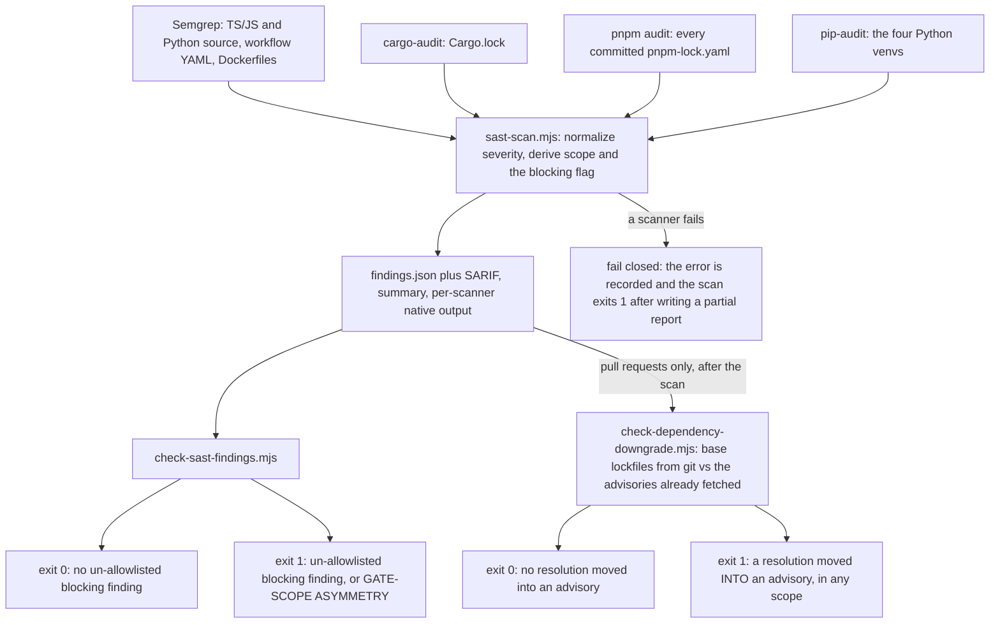
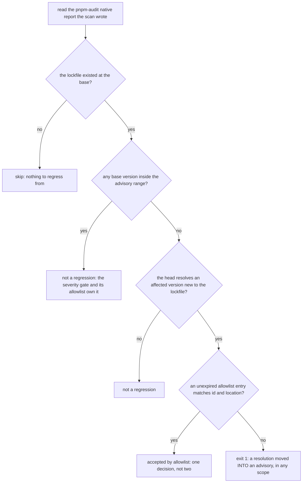
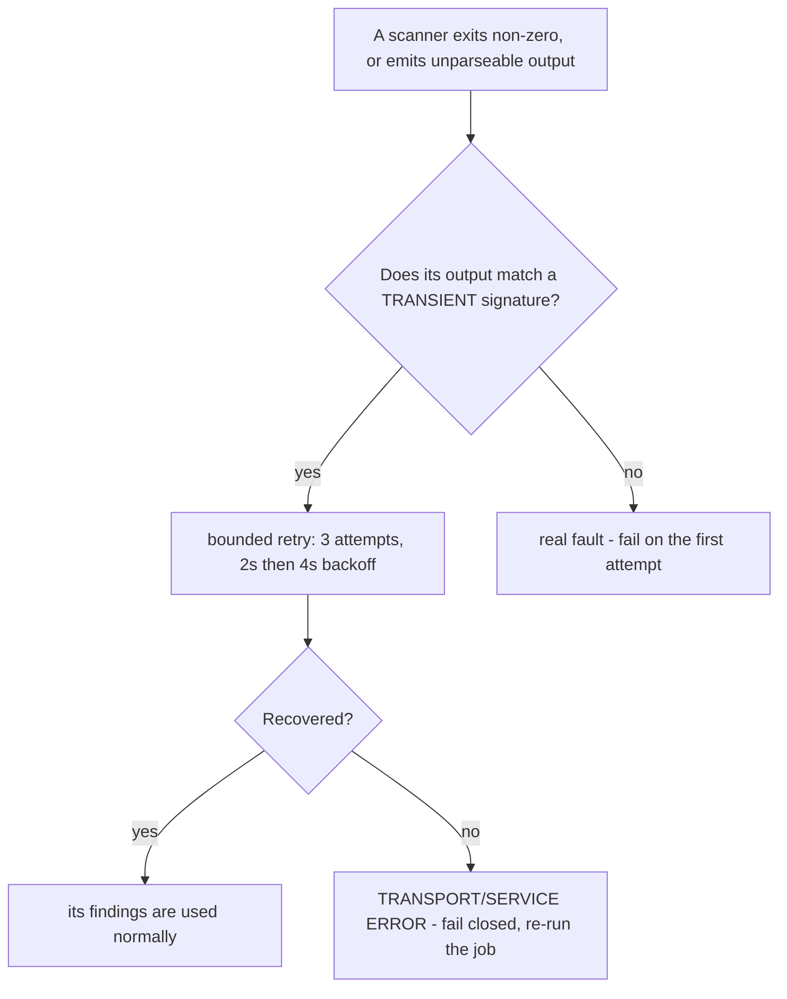
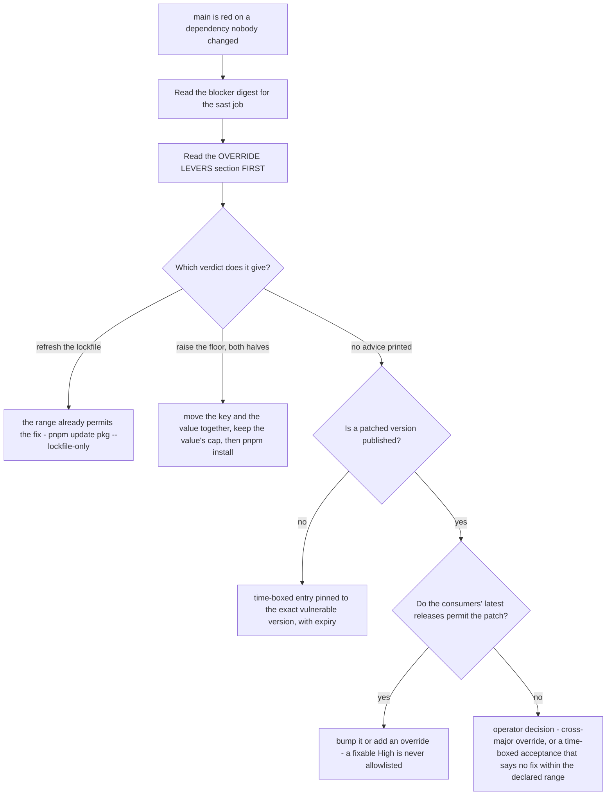

# SAST & SCA static scanning

Four scanners — Semgrep over first-party TS/JS and Python source (the target filter also admits the two
workflow trees and first-party Dockerfiles), cargo audit over Rust dependencies, pnpm audit over **every
committed `pnpm-lock.yaml`** (root and nested workspace alike), and pip-audit over **all four** Python
venvs — feed one normalized findings report and one blocking `sast` CI job, which holds **two** gates
over that report: the severity × scope gate (`check-sast-findings.mjs`) and a pull-request-only gate
over what the change did *to* the dependency graph (`check-dependency-downgrade.mjs`). It complements
[DAST scanning](./dast-scanning.md): DAST exercises the running app, this scans source and the dependency
graph at rest. It is also disjoint from [infra-image scanning](./infra-image-scanning.md), which scans
pulled third-party container images rather than first-party code or first-party dependency graphs. For
how the pieces fit together architecturally, see [SAST & SCA static security scanning](../projects/sast.md).



Four scanners, one normalization step, one report, and one gate with exactly two blocking exit paths —
the second of which is about the gate's own coverage rather than about the code. A second, PR-only gate
reads the same report's already-fetched advisories against the base lockfiles, so a change that makes an
advisory newly applicable is caught even where the severity × scope rule cannot fire.

## Running it, and where the output lands

Both entry points are static — no application stack is required:

```bash
pnpm nx sast infrastructure-as-code        # → node scripts/sast-scan.mjs --scope full
node scripts/check-sast-findings.mjs       # the gate: exit 0 pass / 1 fail / 2 bad input
```

Reports land in `security/sast/reports/` (gitignored): `findings.json` is the severity gate's input
contract, `pnpm-audit-native.json` is the downgrade gate's input, and `findings.sarif`, `summary.txt`
and the remaining `<scanner>-native.json` are for triage. `--scope changed --base <ref>`
narrows Semgrep to the files changed against `<ref>` (SCA still runs full), `--only <scanner,...>`
restricts the scanners — the lever that gets you the SCA half when Semgrep's registry is unreachable —
and `--emit-allowlist` writes a proposed baseline for triage.

The blocking `sast` job in [guardrails.yml](../../.forgejo/workflows/guardrails.yml) runs on every pull
request and every push to `main`, with **no `paths:` filter**. It installs the toolchain, `uv sync`s all
four Python surfaces, runs the gate's `--selftest` and the custom rules' fixtures *before* the scan, then
the scan (`--scope changed` on a PR, `--scope full` on push) and the gate — then, **on pull requests
only**, the dependency-downgrade gate, which is positioned there because it consumes the native report
the scan just wrote — and uploads the `sast-report` artifact unconditionally (14-day retention — a
diagnostic, not a record).

**Read a red `sast` from the failure digest, never from runner logs** — the forge API exposes no log,
artifact or per-run-jobs endpoint at all, so there is nothing to hunt. Every `run:` step in this job is
wrapped in `scripts/ci-log-step.sh`, which mirrors its combined stdout+stderr into a run- and
job-scoped directory the digest collector reads at the highest priority; the digest therefore names
the failing step (`sast-gate`, `sast-static-scan`, `sast-downgrade-gate`, …) and carries its output tail
as a `step:sast-…` excerpt:

```bash
node scripts/ci-status.mjs failure --pr <n> --job sast        # the digest comment (--job takes the bare
                                                             # name or the `guardrails / sast` context form)
node scripts/ci-status.mjs failure --pr <n> --job sast --full # + the full evidence bundle
node scripts/ci-status.mjs failure --sha "$(git rev-parse origin/main)"   # push: no comment exists, so
                                                             # each failed job's digest is read from its bundle
```

On a pull request the digest is upserted as a PR comment keyed by job, so a retry edits rather than
stacks; a `main` push posts no comment at all and the digest lives only inside the bundle, named
`<runId>--sast`, which is why the `--sha` form is the one to use after a merge. The `sast-report`
artifact (`findings.json` plus `summary.txt`) is the other route, but it is reachable only from the
forge web UI — the API has no artifact endpoint. See
[CI self-serve diagnostics](./ci-diagnostics.md) for the digest's three-way published/broken/absent
outcome and the bundle layout.

## The downgrade gate — a PR must not move a package INTO an advisory, in any scope

The `sast` job carries a **second** gate over the same report, and it is the one that closes the shape
the severity × scope rule structurally cannot see. `check-dependency-downgrade.mjs --base origin/<base>`
runs on **pull requests only**, in the `sast` job, **after** the scan step — and that position is
architectural rather than convenient: its input is the pnpm-audit native report the scan already wrote
(`security/sast/reports/pnpm-audit-native.json`) plus the base lockfiles read out of git
(`git show <base>:<lockfile>`). So it costs **no extra registry round-trip** and it **cannot disagree
with the report the main gate read** — the two are looking at the same advisories. A push has no base to
have regressed from, which is why the step is PR-scoped.

The rule, per committed lockfile and per advisory:

- the package was resolved at the **base**, and **none** of its base versions is inside that advisory's
  `vulnerable_versions` range — it was clean for this advisory; and
- the **head** resolves a version that **is** inside the range, and that version is new to the lockfile.

It is deliberately **scope-blind**: a regression fails in every scope, dev included. "Clean" is a fact
about the advisory's own range, not an inference from version order, so a *sideways* move into a range
blocks exactly as a downgrade does. Two shapes are deliberately **not** regressions: a package already
exposed at the base (the severity × scope gate and its allowlist own it), and a package — or a whole
lockfile — new in this change (an ordinary finding, not a change *from* anything).

**Why it exists (item #776, measured 2026-10-17 on spec 081 US3 PR 3b, #774):** `nx@23.3.0` pins
`undici: 7.29.0` **exactly**, and the nx 23 bump re-resolved undici DOWN from 7.29.1, back into **ten**
advisories (two High) that 7.29.1 fixes. All ten read as `pnpm-audit/dev` — which never blocks — so the
severity × scope gate stayed green and the regression was caught only by diffing the lockfile by hand.
The fix was the floor `undici@>=7.0.0 <7.29.1: '>=7.29.1 <8'` in `pnpm-workspace.yaml`; removing that
floor today re-resolves 7.30.1 → 7.29.0 and this gate fails, naming **18** advisories (six High) — that
mutation was run on 2026-11-01.

**Accepting a version is one decision, not two.** The gate reuses `evaluate` and `loadAllowlist` from
`check-sast-findings.mjs` and `pnpmAdvisoryId` / `pnpmFindingLocation` from `sast-scan.mjs`, so the
entry that suppresses the finding in the main gate — matched on the same `id` and the same location
string, including a nested tree's `<workspace>:` prefix — suppresses it here too, under the same expiry
rule. **It fails closed**: a missing or empty native report, an unreadable lockfile, or a
`vulnerable_versions` range the parser does not understand is a failure with the reason printed, never a
pass — a range it cannot read is a range it cannot judge. Exit codes: **0** no regression, **1** a
regression or an input it could not read, **2** usage error.

```bash
node scripts/check-dependency-downgrade.mjs --base origin/main
node scripts/check-dependency-downgrade.mjs --base <ref> --native <path> --allowlist <path>
```



*The downgrade gate's decision path: a base-versus-head resolution comparison, limited to advisories this
change newly made applicable, with the main gate's own allowlist as the only acceptance route.*

`--base` is required; `--native`/`--allowlist` point the gate at a throwaway pair. An unrecognised flag
or a missing value is a usage error (exit 2) through the shared `scripts/lib/argv-contract.mjs`
contract. Two mechanical details follow from the fail-closed stance: there is deliberately **no
`semver` dependency** (the root workspace declares none, and adding one would move the very lockfile
this gate judges), so the range parser handles only the small regular subset npm advisories actually
use and throws on anything else; and a pnpm 11+ lockfile is **two** YAML documents, so resolved versions
are read line by line from the `packages:` sections, with `snapshots:` keys deliberately not read
because they carry peer suffixes.

### Decision (2026-11-01, item #776): dev-scope High/Critical stays non-blocking

Should a dev-scope High/Critical in a package that runs in a **credentialed** CI job (nx holds the
remote-cache token, for example) block like a runtime one? **No — the dev/runtime split stays as it is**,
for three stated reasons:

- **The failure that motivated the question is now gated directly.** What went wrong on #774 was a
  change that made the dev tree *worse*, and the downgrade gate blocks exactly that, in every scope.
- **Blocking standing dev advisories would block PRs that changed nothing.** A newly published advisory
  in build tooling would turn every PR red until someone allowlisted it — the advisory-churn shape,
  multiplied across the whole dev tree. Most of those packages have no patched release either (braces,
  node-forge), so the allowlist would grow with entries that carry no decision.
- **"Runs in a credentialed job" is not something the scan can see.** The audit knows dev from runtime.
  It does not know which jobs a package executes in, or which secrets those jobs hold. A rule keyed on
  it would need a hand-kept package list, which goes stale silently.

**Revisit** if a dev-scope advisory with a credential-exfiltration impact lands on a package that CI
runs with secrets. Handle that case by its own triage (a pnpm override, or removing the secret from
that job), not by flipping the whole tier.

## Gotchas

- **pip-audit audits the INSTALLED venv, not a requirements file — and now audits all four Python
  surfaces.** Since feature 068 pip-audit runs against `agents/movie-assistant`, `mcp-servers/movie-mcp`,
  `mcp-servers/spreadsheet-mcp`, and `mcp-servers/web-api-mcp` — each with its **own** dep graph and
  runtime classification. `uv sync` all four before a local run; an unsynced surface **fails** the
  scan, it is never silently skipped. CI provisions all four venvs. `pip-audit -r <requirements>` resolves
  an ephemeral venv (hangs >11 min, chokes on yanked versions) — do not use that form.
- **pip-audit findings are project-qualified; allowlist `locationPattern`s should be surface-anchored.**
  Since feature 068 each finding's location names its surface: `mcp-servers/web-api-mcp:click@8.5.0`,
  not `click@8.5.0`. An allowlist entry should normally be anchored:
  `^mcp-servers/web-api-mcp:click@.*`. Two static checks enforce this at scan time, before any findings
  are compared: (1) `assertKnownPythonSurfaces` fails the scan if a Python project directory carrying a
  `uv.lock` is not registered in `PYTHON_SURFACES` (`scripts/sast-scan.mjs`) — adding a project without
  registering it produces a hard error, not a silent omission; (2) `assertPipAuditAllowlistShape` fails
  the scan if an anchored `locationPattern` (leading `^`) names a surface that does not exist in
  `PYTHON_SURFACES` — a dead anchor can never match, so it suppresses nothing: a real finding would
  still block, and the failure exists so nobody believes a suppression is in force when it is not. Drop the leading `^` only when you deliberately mean the suppression to span every
  Python surface. **Adding a new Python project?** Register it in `PYTHON_SURFACES` and add a `uv sync`
  step to the `sast` CI job.
- **Keyless and fail-closed.** All advisory data (Semgrep registry, RustSec, npm advisories, OSV) is
  fetched anonymously at scan time; if any fetch fails, that scanner fails the job rather than
  reporting a false clean. No secret is ever required — see
  [Secrets management](../invariants/secrets-management.md) for the broader no-clear-text-secrets
  posture this fits into.
- **A red `sast-downgrade-gate` is not a new advisory — it is your change's side effect, and the scope
  argument does not apply to it.** The message names a package, its base version(s), the version it now
  resolves to, and the advisory it entered, with the fixing range. Because the gate is scope-blind by
  decision (the dev tree runs in CI jobs that hold credentials), "it's only a dev dep" is not a response
  here; the response is to restore the clean resolution — normally the override floor the message
  suggests — or to record an operator-approved allowlist entry. If you take the override route, the
  floor obeys the two-halves rule below, or `check-override-consistency.mjs` fails the same PR for a
  different reason. Two shapes are *not* regressions and should not be argued about as if they were: a
  package already exposed at the base, and a package or lockfile new in this change — both are ordinary
  findings the severity × scope gate and its allowlist already own. Note also that the gate **cannot run
  locally without a native report**: `--native` points it at one, and an absent or empty report is exit
  1 by design, so a local invocation against a clean checkout fails rather than reporting "no
  regression". Its guard test checks the **wiring** as well as the rule, because a gate that is never
  invoked is indistinguishable from no gate — that `guardrails.yml` invokes it inside the `sast` job,
  PR-scoped, and *after* the scan step that writes its input. The rule-side cases pin the comparator
  forms npm advisories use, a range it cannot parse throwing rather than judging, `packages:` keys read
  from both lockfile documents while `snapshots:` keys are ignored, a sideways move into a range
  blocking, and a nested workspace reported under the same `<workspace>:pkg@version` location
  `sast-scan.mjs` uses.
- **The SCA half runs full on every push, unconditionally** — a newly published advisory can hit an
  unchanged dependency, so it is never path-gated. This means `main` can legitimately go red on a
  dependency nobody touched; that is the gate working, not a defect, and it recurs.
- **Only runtime-scope SCA blocks the gate.** A dependency's blocking status depends on whether it is
  reachable from a runtime path across the whole workspace, not just the root package — checking scope
  by hand requires a recursive, workspace-spanning query, not a root-only one; getting this wrong has
  previously produced a false "gate bug" report.
- **…and dev-scope High/Critical STAYS non-blocking — that was decided, not overlooked (2026-11-01,
  item #776).** A dev-scope High/Critical in a package that runs in a *credentialed* CI job (nx holds
  the remote-cache token, for example) does **not** block, and the three reasons are recorded in the
  decision section of
  [docs/runbooks/sast-scanning.md](../../docs/runbooks/sast-scanning.md): the #774 failure shape is now
  gated directly by the downgrade gate, blocking standing dev advisories would redden PRs that changed
  nothing across a tree whose packages mostly have no patched release, and "runs in a credentialed job"
  is not something the audit can see. Revisit if a dev-scope advisory with a credential-exfiltration
  impact lands on a package CI runs with secrets — and handle that case by its own triage (a pnpm
  override, or removing the secret from that job), not by flipping the whole tier.
- **…but the `runtime` tag is the AUDIT's scoping, not a reachability finding — do not read it as one
  when writing a justification.** The tag answers "does the whole-workspace `--prod` audit see this
  package", which is a different question from "is the vulnerable code path exercised". The two live
  no-fix acceptances in the root tree are tagged runtime purely because `expo` lists `@expo/cli` as a
  production dependency: node-forge arrives only through Expo CLI / code-signing tooling, and braces
  only through `micromatch` in build and test tooling — Metro's file map, Jest, and (added at the
  2026-10-10 re-measurement) `fast-glob` and `http-proxy-middleware`. Neither is imported by
  first-party code, neither ships in the web or server bundle, and the glob patterns those tools
  expand come from repository configuration rather than a request. The same distinction governed the
  now-deleted `@graphql-tools/utils` acceptance, which was tagged runtime through
  `@copilotkit/runtime` while only being listed as a dependency rather than reached on a request
  path. That reasoning has to be **checked and written into the justification**, because the tag
  alone would have said the opposite. **And the check can come back the other way:** the third live
  braces acceptance — the one anchored to `tools/openwiki-generator` (item #721) — is *genuinely
  reachable*, because `deepagents`' `glob`/`grep` tools pass the model's tool-call arguments to
  `fast-glob`/`micromatch.isMatch`, and a ~40 KB nested-brace pattern aborts the Node process (V8
  `RegExpCompiler` OOM, exit 134). It is accepted as availability-only impact on one unattended,
  non-required job. Same package, same advisory, opposite reachability verdict — which is why each
  workspace's entry carries its own evidence rather than inheriting the root one's.
- **`pnpm why <pkg> --prod` without `-r` reports the wrong scope.** Without `-r` the command runs at
  the repo root only and prints nothing for a dep that is runtime-reachable via a sub-package (e.g.
  `mcm-app > @copilotkit/runtime > … > fast-uri`). That empty output is **not** "dev-only" — it is
  the wrong scope. The gate itself uses `pnpm audit --prod` across the whole workspace; when in
  doubt, trust the digest's tag (`[pnpm-audit] runtime` vs `[pnpm-audit/dev]`). This exact mistake
  wrongly accused the gate of a bug on 2026-07-21; the gate was right.
- **`pnpm audit` reads ONE lockfile — every committed lockfile is now audited, and a nested
  workspace's findings do not inherit the root entries.** Run at the repo root, `pnpm audit` never
  sees `tools/openwiki-generator/`, a directory with its own `pnpm-workspace.yaml` and lockfile; that
  tree — which runs with a model-provider credential in the wiki-maintain job — was audited by
  nothing until item #721. The audit set is now discovered from git (`git ls-files '*pnpm-lock.yaml'`)
  rather than hard-coded, and `sast-scan.guard.test.mjs` compares it with an independent `git ls-files`
  so a new nested workspace — or a hand-written exclusion — fails the guard by name. A nested
  workspace is audited as `pnpm --dir <ws> audit --json` **from the repo root**, so corepack resolves
  the root manifest's `packageManager` (a nested `package.json` declaring none, run from its own
  directory with no parent manifest, resolved pnpm 12.10.1 instead of the then-pinned 11.25.0 —
  measured 2026-10-10; the root pin has since moved to `pnpm@12.13.0`, and the nested audit's finding
  set was measured **identical** under both pins — 30 findings, the `tools/openwiki-generator:`
  entries included — on 2026-10-17). The audit is lockfile-only, so the `sast` job installs nothing
  extra. **The locations differ:** a root finding keeps the bare `pkg@version` the existing entries
  anchor to
  (`^braces@3\.0\.3$`), while a nested workspace's is prefixed `<workspace>:pkg@version`
  (`tools/openwiki-generator:braces@3.0.3`). A root entry therefore never silently covers the same
  package in another tree, which needs its own entry with its own reachability justification — and
  that distinction is not academic: the root `braces` copy has no input path, while the generator's
  copy IS reachable because `deepagents`' `glob`/`grep` tools pass model-chosen patterns to
  `micromatch`. The `OVERRIDE LEVERS` advice is root-only for the same reason: the root
  `pnpm-workspace.yaml`'s overrides do not govern a nested workspace, so its
  `pnpm update <pkg> --lockfile-only` would refresh the wrong lockfile.
- **A fixable High must be bumped, never allowlisted.** The allowlist is for findings with no fix
  yet; suppression is gate-only and the finding stays visible in the report regardless.
- **A rule's documented limitation is triaged into the allowlist, never "fixed" by working around it.**
  `mcm-auth-before-authz` only recognizes a `requireAuth`/`requireMcUser` call textually earlier in the
  *same function*, so service-layer modules that receive an already-authenticated jwt from a route
  wrapper are false positives by construction — the backups reader/writer and the account-deletion
  pipeline are exactly that shape, and the account-deletion entry is additionally guarded by a
  step-up proof. The entries are pinned to individual files, so a new unguarded upstream client
  anywhere else still fails the gate, and the residual risk is stated in each justification rather
  than implied. Pushing a `requireMcUser` call down into those functions would contradict the
  constitution's [role-enforcement-is-a-layer rule](../gotchas/role-enforcement-is-a-layer.md) by
  reintroducing the per-call-site check that rule exists to prevent.
- **`p/secrets` is deliberately OFF.** `secret-scan.mjs` owns credential detection, so enabling it here
  would double-gate and split the allowlist across two owners.
- **Rust source itself is out of Semgrep's scope** — clippy covers Rust source patterns and
  cargo-audit covers only Rust dependencies, so the mc-service Rust surface relies on clippy + review
  for the patterns Semgrep enforces elsewhere.
- **`semgrep.dev` is now in the egress allowlist — but adding it to the canonical list is only
  HALF the change (item #222, 2026-08-22).** Semgrep resolves the five `p/*` community packs in
  `security/sast/semgrep.yaml` from its public registry at scan time. That host was unallowlisted
  from day one, so Semgrep failed closed and left `security/sast/reports/findings.json` **empty**;
  `check-sast-findings.mjs` then exited 0 — a green that proved nothing. It was added to
  `.devcontainer/egress-allowlist.json`, but egress is enforced in **two layers**, and only one
  re-reads the committed file by itself: the in-VM iptables half re-applies from `init-firewall.sh`,
  while the **host-side sandbox policy is scoped per sandbox** and does not pick up a new destination
  until an operator re-applies it (`sbx policy allow network semgrep.dev --sandbox mcm` on the
  Windows host — see
  [the egress allowlist section of the devcontainer-sandbox runbook](../../docs/runbooks/devcontainer-sandbox.md#4-egress-allowlist)). The
  committed entry does not tell you which world you are in. One command does:
  ```bash
  curl -sS -o /dev/null -w '%{http_code}\n' https://semgrep.dev/   # DNS failure / 000 => still vacuous
  node scripts/sast-scan.mjs --scope full --only semgrep            # exit 1 + "[semgrep] scan failed … rules/registry may be unreachable" => unreachable (exit 2 is bad arguments only)
  ```
  A Semgrep result you did not sanity-check this way is the same green either way — which is the
  whole trap. **To test an allowlist entry locally when Semgrep is unreachable, hand the gate a
  synthetic `findings.json`** carrying the exact `scanner`/`id`/location triples you expect, plus a
  **negative control** (a finding the entry must NOT suppress). Otherwise push and let CI answer.
- **…but "the tier cannot run here" is the wrong conclusion — `--only` gets you the SCA half.**
  The vacuous pass above is a fact about **Semgrep**, not about the gate. Only Semgrep needs
  `semgrep.dev`; `pnpm-audit`, `cargo-audit` and `pip-audit` resolve their advisory data from sources
  the egress allowlist already permits (pip-audit's OSV host, `api.osv.dev`, is itself allowlisted —
  item #394, and it was another merge-gating tier retired to CI-only by accident until then). So the
  whole SCA half runs to completion locally:
  ```bash
  node scripts/sast-scan.mjs --scope full --only pnpm-audit   # a real report (30 findings measured 2026-10-17, nested-workspace entries included)
  node scripts/check-sast-findings.mjs
  ```
  This matters because every dependency-floor remediation is an SCA finding, and those are exactly
  the changes you want to verify before pushing. Measured on feature 057: the full-scope run
  fail-closed on Semgrep and left a 0-finding report the gate passed vacuously, while
  `--only pnpm-audit` proved both target advisories were genuinely suppressed beforehand and genuinely
  gone afterwards. **Check the finding COUNT, not the exit code** — a report with 0 findings and a
  report with no blocking findings print the same green.
- **An override floor has TWO halves and both must move.** Entries in `pnpm-workspace.yaml`'s
  `overrides:` map are a range keyed on a range — `fast-uri@<3.1.5: '>=3.1.5 <4'` — where the key
  names the vulnerable span excluded and the value the patched floor forced. Raise the value alone
  and you get an override that reads as remediated while no longer excluding the version its own key
  names. `scripts/check-override-consistency.mjs` enforces `key's exclusive upper bound == value's
  inclusive lower bound` on every pull request, scoped to keys carrying an `@<range>` suffix. A key
  with no range half is a **plain pin** — out of scope, not a violation: `react-dom`, `postcss`,
  `@expo/dom-webview`, and, added 2026-11-06 by feature 089, `'@ag-ui/client>zod': ^4.4.3` and
  `'@ag-ui/proto>zod': ^4.4.3`. The parser splits on the LAST `@`, so that `pkg>dep` pair carries no
  `@<range>` suffix and is treated exactly like a plain pin — which is right, because those two
  entries are **not security floors**. They are the map's one non-advisory use: they force
  `@ag-ui/client` and `@ag-ui/proto`, which declare `zod ^3.25.76` outside the app's own `^4.4.3`
  range, onto the app's copy, so the assistant chunk carries one zod 4 engine instead of a second one
  whose `new Function("")` availability probe the strict `script-src` blocks and reports. The override
  is only half of that fix, though: the app's own zod 4 engine runs the same probe, so the assistant
  chunk's **first** import is `@/utils/zod-jitless` — on web `src/utils/zod-jitless.web.ts` sets zod's
  `jitless` config before any schema is built, and the native module is deliberately empty because
  Hermes' evaluation behaviour was never measured — while `web-security-headers.js` keeps
  `'unsafe-eval'` out of `script-src` and records that a new `eval` violation on this path is a
  **finding, not a known line**. `scripts/__tests__/single-zod-engine.guard.test.mjs` pins both halves
  (that every `@ag-ui/client` lockfile snapshot resolves a `(zod@4…)` copy of `@ag-ui/core`, and that
  the panel's first import line is `import '@/utils/zod-jitless';`), because the app works either way
  and only the browser logs the extra violation; `src/utils/unit-tests/zod-jitless.test.ts` counts real
  `Function` constructions with a control run proving the counter can see a probe, so a zero from the
  jitless path is not a blind counter reading as success. The file
  records its own recheck rule for them: recheck at each AG-UI upgrade, and keep the value equal to
  the app's own zod range so they stay one copy. Two consequences are worth carrying. The gate skips a
  plain pin *before* it reads the value, so a caret like `^4.4.3` passes there where the same caret on
  a keyed floor is refused with exit 2 (below). And read the entry before assuming an edit to this map
  is a security edit. A *compound* key such as `js-yaml@>=3.0.0 <3.15.1` is in scope but only its `<`
  bound is compared.
  Note **which job owns it**: the guard runs as a step of the `naming` job in
  [guardrails.yml](../../.forgejo/workflows/guardrails.yml) (`--selftest`, then the scan), not as part
  of `sast`, so a half-bumped floor reddens `guardrails / naming` and no `sast` output will mention it.
  A half the guard cannot parse — a vulnerable-range key with no `<` bound, or a patched-floor value
  with no `>=` bound — is refused out loud with exit 2 rather than skipped, because silently passing
  over the entry it cannot read is how a gate comes to protect nothing.
  **The value has a second half the guard also owns: its CAP (feature 081, US5a).** Renovate's npm
  manager reads a keyed override's value as a plain range and *widens* its upper bound to admit the
  newest major — `undici@<6.27.0: '>=6.27.0 <7'` arrives as `'>=6.27.0 <9'` — which closes no
  advisory (the floor is untouched, so the equality rule above stays green) while silently handing
  every dependent that resolved into the vulnerable span a different major than it declared. The cap
  rule is therefore: the value's exclusive upper bound must be at most the key's major + 1. A cap
  *tighter* than the next major is fine, and a genuine floor raise inside the major — both halves
  moved, cap kept — still passes, so the security stream stays open. A value with **no** cap admits
  every major already; four such floors pre-date the rule and are out of its scope but are **named on
  every run** rather than passed in silence. A value not written as `>=A` or `>=A <B` (a `<=` cap, a
  `||` union, a caret) is refused with exit 2, because the gate cannot say which majors such a cap
  admits. Six widening proposals were pending on the Dependency Dashboard on 2026-10-18, which is why
  `renovate.json` now disables `major` updates for this file outright (see [Renovate](./renovate.md)).
  Renovate produces exactly this mismatch when it proposes a floor raise, so expect bot PRs against
  this map to need their key half fixed by hand. **A floor is not always raised against an advisory
  that already exists** — a keyed entry added on 2026-10-17 (feature 081),
  `undici@>=7.0.0 <7.29.1: '>=7.29.1 <8'`, exists because an *upgrade* would have downgraded a
  transitive into ten advisories: `nx@23.3.0` depends on `undici: 7.29.0` exactly, where nx 22 used
  `axios`, and 7.29.0 carries ten advisories that 7.29.1 fixes (two High). The lock's only other
  7.x — 7.29.1, via `@module-federation/dts-plugin` — leaves with nx 22's plugin tree, so without the
  floor the nx bump would resolve *below* the patched version. Same keyed shape, same guard. **The
  map keeps growing along that shape rather than standing still:** `body-parser@>=2.0.0 <2.4.0:
  '>=2.4.0 <3'` was added 2026-10-23 for GHSA-27r3-jxmh-p828 (express 5, the BFF's `server.js`,
  depends on `body-parser ^2`), and the 6.x `undici` key was raised to `undici@<6.29.1: '>=6.29.1
  <7'` on 2026-10-24 for GHSA-xjj6-f33q-929c — both floor-within-major moves that move key and value
  together and keep the value's cap at the next major, which is why the guard stays green while the
  cap rule keeps the Renovate widening out. Note also **where** these
  live: the map is in `pnpm-workspace.yaml`, not `package.json`'s `pnpm` field — pnpm 11 stopped
  reading that field and says so with an "ignored keys" warning, which is a security event rather than
  cosmetics, because a keyed entry silently dropped re-admits the vulnerable transitive it was forcing
  to a patched version.
- **Unmatched allowlist entries are reported but do not block.** An entry that matches nothing this
  run is listed under `UNMATCHED ENTRIES`. The trap: pip-audit switched from CVE ids to PYSEC
  aliases; entries keyed on the old CVE ids silently matched nothing rather than expiring — an entry
  keyed on an exact advisory id does not expire, it just quietly stops suppressing. Detection is
  deliberately suppressed for any scanner that produced **no** findings in the run, so a skipped,
  failed or genuinely clean scanner never flags its whole entry set as stale. Read `UNMATCHED ENTRIES`
  whenever an advisory you thought was accepted re-blocks.
- **Expiry has a 14-day warning window before it blocks.** Allowlist entries with an `expiry` date
  surface `EXPIRING SOON` warnings for the 14 days before the date, then re-block when expired; both
  window boundaries are inclusive. The window length is defined once in `scripts/allowlist-expiry.mjs`
  (`WARNING_WINDOW_DAYS = 14`) and imported by both gates. A dedicated `--check-expiring` mode runs
  **twice weekly — Tuesday and Friday, 04:00 UTC** — in the `infra-image-scan` workflow and fails on
  any expiring or expired entry (and, where the run has a report to judge against, on an entry that
  matched nothing); this mode is never run on pull requests. **For the SAST allowlist it
  cannot fail on an unmatched entry** — that job produces no SAST report, so unmatched detection is
  skipped there, and an entry that quietly matches nothing (the CVE→PYSEC trap above) is visible
  *only* in the report-only output of a normal gate run. Read it there. Three properties of that
  scheduled step are load-bearing. First, a missing report is **announced** rather than assumed clean
  (a report that exists but will not parse is still exit 2 on both paths), and the report-absent path
  must not throw — when it did, the step aborted and `bash -e` skipped the infra-image expiry check on
  the next line, so **both** expiry tiers were dead from 2026-09-12 until the 2026-09-25 weekly
  sweep's own output exposed it. Second, the step is `always()`-guarded *inside* its schedule guard
  (item #484): a red CVE gate earlier in the same job used to skip it entirely, so the week the gate
  was red — the week the warning mattered most — it did not run at all. Third, a superseded
  (cancelled) run is skipped from inside the step body via `job.status` rather than in the `if:`, so a
  cancelled run cannot be turned into a failure for a commit that was never broken.
- **Remediate, do not re-date — and a no-fix acceptance is pinned to the exact vulnerable version and
  short-dated.** Deleting or extending an `expiry` is how a time-box becomes permanent. Two
  legitimate exceptions exist, and **both** require the evidence written into the justification: no
  published fix exists, or a fix exists only outside the range the advisory's consumers declare. The
  second is an operator decision, never the reader's alone — the runbook's step 4 puts a cross-major
  override and a time-boxed acceptance side by side — and its worked example is
  `@graphql-tools/utils`: patched only in 12.0.1 while `graphql-yoga` and
  `@graphql-yoga/plugin-defer-stream` still declared `^11.2.0`, so the only bump forced a major the
  consumer did not support (the operator chose the acceptance, 2026-10-06). That acceptance has since
  been **discharged by the first route its backlog item named** rather than renewed: graphql-yoga
  5.24.4 and the defer-stream plugin 3.24.4 declare `@graphql-tools/utils: ^12.0.3`, a lock refresh
  resolved both, and the entry was deleted on 2026-10-09 (item #674) with the vulnerable 11.2.2 gone
  from `pnpm-lock.yaml`. A time-boxed acceptance can also be discharged by a route its own
  justification did not anticipate (the `image-size` pair was cleared when the dependency left the
  tree entirely, not by the fix its entry predicted). Check npm before assuming: on feature 057 both
  "needs an acceptance" advisories turned out to have published fixes. Where no patched version exists
  at all, the convention the file has settled into is: pin the `locationPattern` to the **exact
  vulnerable version** (`^node-forge@1\.4\.0$`, `^braces@3\.0\.3$`,
  `^tools/openwiki-generator:braces@3\.0\.3$`) and date the entry shortly ahead, so a *different*
  version re-blocks for a fresh assessment and the entry stops suppressing on its own. The
  justification then carries the reachability check that was actually done — which tree the
  package arrives through, whether any first-party code imports it, and whether the input path the
  advisory needs exists at all — because the audit's runtime tag alone is not evidence (see the
  runtime-scope gotcha above). A renewal is not a re-date: the no-fix entries were renewed only after
  re-measuring that no patched release had shipped and re-listing the dependents (items #633/#648,
  2026-10-10, all three moved to the shared 2026-12-01 date so they re-triage in one sitting), and the
  generator entry was added the same day the nested workspace first became audited at all. A renewal
  whose only change is the date is exactly the re-dating this rule forbids.
- **A suppression that matches nothing is not harmless, so delete rather than re-anchor it.** The
  retired click entry and the feature-034 remediations were deleted, not renewed, for the same
  reason: a dead entry would have absorbed a genuine regression on that package, silently, until its
  expiry date. Deleting it means a regression re-blocks. This is the same reasoning whether the
  premise fell away (the deep transitive cap freed, so click resolves clean everywhere), the fix
  landed, or the dependency left the tree.
- **Before raising a floor, check whether the lockfile is the lever, not the override.** Since
  feature 058 the gate prints an `OVERRIDE LEVERS` advisory section for an SCA finding whose
  `fixAvailable` names a floor and whose resolved version sits inside a keyed override's range. Example
  output:
  ```
  OVERRIDE LEVERS (advisory — does not affect this gate's result)
    Already permitted by an existing override — REFRESH THE LOCKFILE:
      • hono 4.12.29 — the override `>=4.12.25` ALREADY PERMITS 4.12.34; the lockfile is what pins
        4.12.29. The override needs no edit — refresh the lockfile: `pnpm update hono --lockfile-only`.
  ```
  The same section carries the opposite verdict — `Not reachable by the current override — RAISE THE
  FLOOR (both halves):`, naming the exact key/value pair to write — for a finding the current range
  cannot reach. Four properties are load-bearing. It is **advisory only and never changes the exit
  code**; it **prints for non-blocking findings too**, deliberately, because a finding in this state
  is cheap to clear before its severity promotes it into a merge blocker; it is computed **per
  *resolution*, not per package**, so a second resolution the override does not govern gets no advice
  rather than wrong advice; and an unreadable or absent `pnpm-workspace.yaml` costs the advice and
  nothing else — the map is read outside `gate()` and swallowed to an empty object, because the gate's
  result must never depend on this file. **This distinction cost ten days of red once already.**
  `fast-uri`'s override `>=3.1.4 <4` already
  permitted the published fix 3.1.5; the lockfile pinned 3.1.4. The fix predated the advisory by three
  days. A four-week allowlist acceptance was written for something `pnpm update fast-uri --lockfile-only`
  would have cleared. `nanoid` repeated it eight days later. If the section says *refresh the lockfile*,
  editing the override is wasted work — the range is already correct. Most of these are now cleared
  weekly by Renovate's `lockFileMaintenance` (see
  [Renovate](./renovate.md)) without anyone reading an advisory.

  **Two gotchas about Renovate `lockFileMaintenance` (feature 058, 2026-08-13):**
  - Its `schedule` key in `renovate.json` looks like a duplicate of the top-level schedule and
    **is not** — the option carries its own default (`before 4am on monday`) that beats the inherited
    value, and that window intersects neither cron under either DST offset. Delete the key as redundant
    and the refresh is enabled but can never fire, silently. `renovate-workflow.guard.test.mjs` fails
    if the key goes missing.
  - These refresh PRs now run `app-e2e`: a bad transitive floor is a **build-time** break that
    `nx test` passes straight over, so the E2E tier is the only one that catches it.

  What remains manual is the case the bot cannot propose: a floor that must rise past its own ceiling.
  Renovate essentially never raises the lower bound of a keyed override — and when it rewrites one it
  half-bumps — so the `check-override-consistency.mjs` guard is the answer.

- **Paths in `locationPattern` must use forward slashes.** Allowlist entries are matched against
  paths normalized to forward slashes so they are portable across the Windows dev host and the Linux
  CI runner. A pattern written with backslashes matches nothing on the runner and passes silently on
  the Windows side — the gate accepts it, but the finding re-blocks in CI.
- **A rule that has gone BLIND produces the same output as a remediated one — check the error count,
  not the finding count.** A Semgrep rule it could not RUN is reported in the native output's
  `errors[]`, never in `results[]`, so it contributes zero findings and its allowlist entry lands in
  `UNMATCHED ENTRIES` reading as "remediated already". Measured on `main` 2026-09-06:
  `gha-curl-pipe-shell` (from `p/owasp-top-ten`) re-parses a step's `run:` block as Bash, cannot read
  the ci-log-step heredoc that wraps nearly every run-step here, and produced **36 errors and 0
  findings** while six `curl … | sh` lines sat in the workflows. The gate now names this itself:
  `RULES THAT COULD NOT RUN` lists each rule with its error and file counts, and any `UNMATCHED`
  entry it explains is annotated `↳ this rule could not run`. Both are advisory and never move the
  exit code — these rules error on every run, and a gate that goes red on a standing condition stops
  being read. **The attribution itself needed care:** the pinned Semgrep populates the structured
  `rule_id` on an `Internal matching error` but not on a `PartialParsing` one, where the rule name
  appears only in the message prose. That run carried 36 errors out of 39, and keying on the field
  alone attributed **3** of them — an order of magnitude of understatement, and a rule that saw
  nothing at all reading as a rounding error. Coverage for the pattern is restored by the text-level
  custom rule `mcm-ci-curl-pipe-shell`; its accepted, pinned installer URLs live in the rule, not the
  allowlist.
- **On a pull request, only the CHANGED targets are scanned — a rule cannot fire on a file that was
  never handed to Semgrep.** `--scope changed` (the PR path) builds an explicit target list, so the
  extension filter in `isScanTarget()`, not the rule's own `paths:`, decides what a PR is gated on.
  Workflow YAML was absent from that list until item #224, which meant a `curl … | sh` added to a
  workflow was gated on nothing and first appeared on the post-merge full scan. Both workflow trees
  are now included; everything else non-code stays out deliberately.
- **The same gap opened a second time through Dockerfiles — and the gate now refuses to let it happen
  a third time.** A `Dockerfile` has **no extension**, so it matched neither the code-extension nor
  the workflow filter. Observed, not reasoned: PR #422 added the from-source object-store image's
  Dockerfile (feature 069), its `guardrails / sast` was a real 3m30s run that **passed**, and the
  post-merge full scan on `main` then failed on `dockerfile.security.missing-user-entrypoint` — staying
  red until a follow-up landed an accepted-risk entry. That finding, its entry and the Dockerfile
  itself are all gone now: the image set `USER 1000:1000` before its `ENTRYPOINT` (feature 070), and
  feature 080 then deleted the whole from-source build — workflow, Dockerfile and promotion script — in
  favour of an upstream-pulled object-store image. No `dockerfile.*` entry remains in the allowlist, so
  a regression re-blocks. A genuinely unwanted finding would have merged just as silently. Dockerfiles
  are now in the filter (item #426), and the whole surface was **enumerated once** rather than waiting
  for a third instance: on a full-scope report, a blocking SAST finding whose file `isScanTarget()`
  rejects now fails the gate with its own section and its own exit path,
  `GATE-SCOPE ASYMMETRY`. Three properties make that guard real rather than decorative: it counts
  **suppressed** findings too (an un-allowlisted one already fails loudly — the object-store Dockerfile
  case was *allowlisted*, so the gate was green and the asymmetry invisible); it excludes SCA (audits
  ignore `--scope` entirely, so a lockfile finding cannot be scope-asymmetric) and changed-scope
  reports (every file there was by definition a target); and a report with no usable
  `generatedAtScope` is a **hard error**, because a missing field must not be able to switch off the
  guard the way a missing file class switched off the thing it guards. The one exemption is keyed on
  the explicit `reportAbsent` marker the gate synthesises when no report exists at all, never on a
  missing field. The remedy it names is to widen the changed-scope
  filter — **an allowlist entry does not fix this**, it is what concealed the Dockerfile case for a
  merge cycle. The residual is a snapshot and is named: a pack update that raised a Medium rule on the
  two still-invisible classes (`renovate.json`, `pnpm-workspace.yaml`) to ERROR would reopen the gap
  silently, so re-run the enumeration when the pack set changes.
- **`node scripts/sast-scan.mjs --test-rules` proves the custom rules before you trust a scan.** It
  runs `semgrep --test` over `security/sast/rules/` and fails if any rule lacks a fixture — that
  second check matters because `semgrep --test` SKIPS an unfixtured rule and still prints `N/N ✓`
  (measured: `4/4 ✓ All tests passed` with five rule files present). The Semgrep pin lives only in
  `sast-scan.mjs`, so the workflow step carries no second copy to drift.
- **A red `sast` gate whose output says `TRANSPORT/SERVICE ERROR` is an outage — re-run it (item #449).**
  Three scanners reach a third party on the required gate's critical path: `pip-audit` queries
  **osv.dev**, `cargo-audit` fetches the **RustSec advisory DB**, and `pnpm audit` queries the **npm
  registry**. Measured 2026-09-13 on run 3328: `guardrails / sast` went red on a pip-audit
  `ServiceError` from osv.dev while the scan had otherwise completed clean (`findings=16 blocking=0`).
  osv.dev recovered 200 minutes later. Since item #449, `sast-scan.mjs` classifies these as transport
  or service failures and **retries 3 times with exponential backoff (2 s, 4 s)** before giving a
  verdict — the job log will say `transient transport/service failure on attempt N/3 — retrying`.
  Two properties preserved: (1) **fail-closed** — after retries are exhausted the gate still fails;
  (2) **classification is narrow** — a real fault (unsynced venv, unparseable lockfile) fails on the
  first attempt without burning the backoff budget. `scripts/__tests__/sast-scan-retry.guard.test.mjs`
  pins both directions. Distinguishing a service outage from a genuine finding is the whole point:
  the output explicitly states "This is NOT a security finding."
- **The retry classifier is shared, and its HTTP signatures require the status CODE — not just the
  phrase.** The mechanism lives in `scripts/lib/scanner-retry.mjs`, **shared with
  `infra-image-scan.mjs` since item #495** (Trivy's vulnerability-DB fetch needed the same thing). It
  was extracted rather than copied on purpose: the hard part is the signature list, and a signature
  learned from one scanner's outage is exactly the one the other needs next. Both narrowings were
  measured, and both are the same defect: a bare `Service Unavailable` / `Bad Gateway` / `Too Many
  Requests` matched the advisory *title* `net/http: HTTP/2 server does not limit Service Unavailable
  responses` (item #495), and a bare `Read timed out` matched ordinary English in an OpenSSL advisory
  title (item #499) — so a genuine finding would have been retried three times and then reported
  anyway, slower, with a retry line misdescribing it as a blip. The classifier is handed
  `stderr + stdout`, so finding titles really do reach it on the cargo-audit and pip-audit paths. The
  module also owns the shared **tail**-truncation helper: the captured failure output must keep its
  last lines, where the status code is, not its first — truncating the head is what once left a
  Trivy digest ending mid-URL, unable to name a 403, a 429 or a 500 (item #495).

## Outage or finding? — the retry decision



The decision that separates a red gate meaning "re-run it" from one meaning "read the findings". The
other two ways this scan goes green while proving nothing — an empty `findings.json` from a registry
that could not be reached, and a rule that could not RUN — are invisible unless you read the finding
count and the error count instead of the exit code.

## `main` went red on a dependency nobody touched — the lever decision

The SCA half runs full every time, so a freshly published advisory legitimately reds the gate against
a tree nobody changed. The playbook that keeps a green from lying here is to read the **`OVERRIDE
LEVERS`** section before reaching for a floor raise, because the fix may already be permitted and only
the lockfile is stale.



`pnpm why <pkg> --prod -r` (recursive, workspace-spanning) is the by-hand cross-check; the digest's
tag is authoritative for what the gate saw. Only when the section says *raise the floor* — or says
nothing because there is no override yet — does the override edit apply, and then both halves move
together while the value's cap stays within the key's major, or `check-override-consistency.mjs` fails
the PR by name. One case gets no advice at all and
is not a bug: a **nested** workspace's finding, because the root `pnpm-workspace.yaml`'s overrides do
not govern `tools/openwiki-generator` — advice to refresh "the lockfile" would name the wrong one, so
the lever has to be chosen by hand there (`pnpm --dir tools/openwiki-generator audit` /
`pnpm --dir tools/openwiki-generator why <pkg>` to cross-check). A time-boxed acceptance is the last
resort, never the first — and when the "fix" exists only outside the range its consumers declare, the
choice between a cross-major override and an acceptance is the operator's, not the reader's: the
worked example was `@graphql-tools/utils`, patched only in 12.0.1 while `graphql-yoga` and
`@graphql-yoga/plugin-defer-stream` still declared `^11.2.0`. That acceptance was itself discharged
when the consumers widened to `^12.0.3` and a lock refresh carried the patched version — a reminder
that a time-box is a holding position, not a fix.

Full scanner matrix, local invocation, the CI gate steps, the triage/allowlist workflow, the
downgrade gate's full procedure and the 2026-11-01 dev-scope decision, and the step-by-step "gate went
red on an untouched dep" playbook:
[docs/runbooks/sast-scanning.md](../../docs/runbooks/sast-scanning.md). Field rules for allowlist
entries and the full expiry semantics:
[security/sast/README.md](../../security/sast/README.md).
