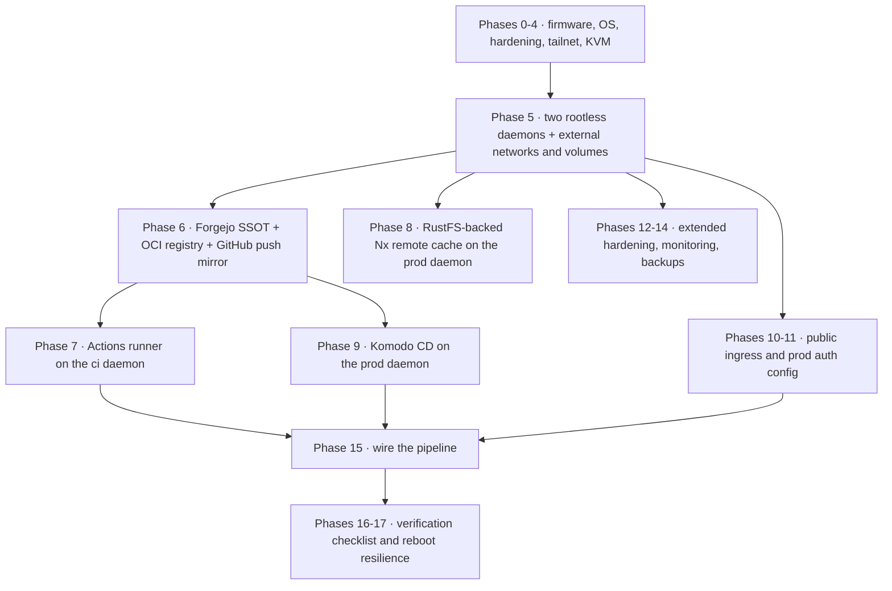
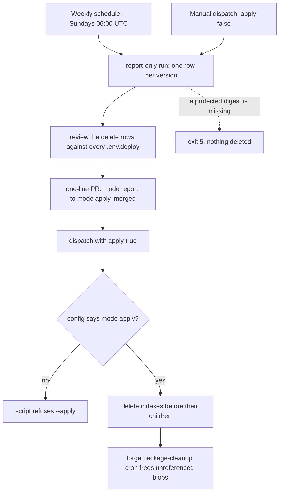

# Homelab server setup (CI/CD + production host)

The end-to-end runbook for provisioning the single physical headless host that backs this project's CI
and production: OS install and hardening, Tailscale-only remote access, two segregated rootless Docker
daemons (one per service user — `ci` and `prod` — each with its own socket, data root, networks, and
volumes so a breakout in one cannot reach the other or the host as root), Forgejo as the
source-of-truth forge with its own OCI registry and generic package registry (push-mirrored to
GitHub), a self-hosted Nx remote cache, and Komodo driving CD to production. Every literal in the
source is a placeholder, and the topology-scrub gate forbids the real ones from entering git.

This document was relocated here from `docs/proposals/homelab-setup/` because it is a live operator
reference, not pre-specification ideation — see the
[proposal → spec → plan → tasks → implementation lifecycle](../process/spec-driven-development.md)
for why that distinction matters and why proposals themselves are out of scope for this wiki.

The literal commands, package lists, placeholder values and troubleshooting asides live in
[`docs/runbooks/Server-Setup-Runbook.md`](../../docs/runbooks/Server-Setup-Runbook.md), which is
authoritative; this page is the distilled map of what each phase achieves and which failures are
load-bearing.

## Phase map — what each phase achieves

The source is genuinely a from-scratch, **phase-ordered** procedure: each phase assumes the prior
phase's state (the two service users and their networks/volumes must exist before Forgejo or the app
stacks are deployed), so a partial rebuild cannot skip ahead. The phases, in order:

- **0 — BIOS/firmware.** AMD SVM (hardware virtualization, required for the KVM-backed Android
  emulator) and IOMMU enabled, power-on behavior set to "Always On" so the headless box self-recovers
  after a power blip.
- **1 — OS install.** Ubuntu Server LTS, minimized footprint, OpenSSH enabled, full-disk LVM. Two
  traps: the guided installer caps the root logical volume at roughly 100 GB of a 1 TB drive and
  leaves the rest of the volume group unallocated (extend it online — the symptom is `df -h /` and
  Komodo agreeing on ~98 GB), and the old `qemu-kvm` transitional package is gone, so the `kvm` binary
  now arrives with `qemu-system-x86`.
- **2 — Hardening.** SSH key-only (verify key login *before* disabling passwords, and confirm the
  effective `sshd -T` output, because an installer/cloud-init drop-in often re-enables password auth),
  `ufw` default-deny inbound with only OpenSSH allowed, unattended-upgrades, fail2ban.
- **3 — Remote management.** Tailscale with `--ssh`, plus the `ufw allow in on tailscale0` rule —
  without it, Phase 2's default-deny blocks every admin UI (Cockpit, Forgejo, Komodo, Grafana) even
  over the tailnet. Cockpit for browser-based host admin.
- **4 — KVM.** Enable hardware virtualization and put the (future) `ci` user in the `kvm` group so
  the emulator job can use `/dev/kvm`. The device is **not** passed into a job container: the job
  executes **on the host** as the unprivileged `ci` user through a host-type runner label defined as
  `kvm:host` (Phase 7), which is precisely why `ci` must be in the group. On this host `/dev/kvm` is
  mode **666** (`crw-rw-rw- root kvm`, measured 2026-10-12); 660 via a udev rule is the tighter option,
  and the group membership is what keeps the job working if it is applied. Passing
  `--device /dev/kvm --group-add kvm` into a job container was the setup until commit `235f2f4c`. Only
  the emulator job needs the device; the other host jobs that share the label — the DAST scan and the
  image build/scan jobs — need a reachable Docker daemon instead, which is why the same `DOCKER_HOST`
  assertion guards each of them.
- **5 — Two segregated rootless Docker daemons.** The core of the design: two unprivileged service
  users, each running its own rootless `dockerd` at its own socket with data under its own home, plus
  per-daemon `daemon.json` (log rotation, `live-restore`), the `kvm`-group membership and `kvm:host`
  host-execution label that let the emulator and Docker-image-building jobs run as `ci` on the host
  rather than in a job container, and the pre-created external networks/volumes the prod stacks
  expect. This phase owns the daemon-installation, subordinate-UID and cgroup-delegation gotchas
  below.
- **6 — Forgejo (source of truth) + OCI registry + GitHub push mirror.** Runs on the prod daemon with
  Postgres behind it; `packages` (the registry) and `actions` are enabled by env, the GitHub mirror is
  a push mirror so Forgejo stays SSOT, and every automated consumer gets its own minimally-scoped
  named access token. The same phase documents the generic package registry that carries the release
  APK, and — since spec 084 US5 — the **registry retention** sweep that is the only thing that ever
  deletes from the OCI registry; the weekly schedule only ever reports, and a delete needs both
  `mode: apply` in the committed config and a dispatch with `apply: true`. Its gotchas are below.
- **7 — Forgejo Actions runner.** `forgejo-runner` v12 as a **binary** under the `ci` user's
  systemd-user manager (a container runner would fight container↔Forgejo networking), registered with
  the UUID + secret the web UI hands out — the older registration-token flow is deprecated. The runner
  advertises **two labels**: `ubuntu-latest`, which is where it becomes a plain Node image, and the
  host-type `kvm:host` (referenced as `runs-on: kvm`, the label *name*), on which jobs execute directly
  on the host as the unprivileged `ci` user with no job container — the emulator job, which needs
  `/dev/kvm` plus a single-host view of `localhost:8082` / `10.0.2.2:8082`, and the
  Docker-image-building jobs, which need a reachable `ci` rootless daemon. The runbook's Phase 7 block
  still names only three tenants — `app-e2e`, `dast` and `build-deploy`; the tracked workflows have
  grown since, and the *complete* set today is `app-e2e` and `dast` and `app-image-scan` (`app-ci`),
  `build-deploy` (`cd-deploy`) and `build-publish` (`devcontainer-image`).
- **8 — Self-hosted Nx remote cache, RustFS-backed (feature 080).** The open-source Rust
  `nx-cache-server` binary runs as a `prod`-user systemd-user service implementing Nx's built-in
  custom remote-cache-server API (Nx ≥ 20.8) — the first-party `@nx/s3-cache` / `@nx/shared-fs-cache`
  packages are deprecated over an unpatchable CVE and must not be used. The backing store is an S3
  object store, **RustFS** since feature 080, run from a host-managed compose beside a one-shot
  bucket-creating init container on the same pinned image the git-tracked observability stack uses,
  with its console disabled and only the S3 port published. Moving an existing cache was an in-place,
  verified copy driven by `scripts/object-store-migration.sh` (since deleted; `manifest` → `inventory` →
  `copy` → `verify`); recreating it empty is an accepted alternative, because the cache is rebuildable — a
  cold cache costs time, not correctness. The migration ran **on the host**, from a checkout, through that
  wrapper: the host has no `node`, so the tool ran in a digest-pinned node container with the host's
  rootless Docker socket mounted and took the store's credentials **by name** from the shell, never as
  command-line values — driving it from the dev container instead would have put standing control of the
  prod daemon in the sandbox. The tool refused rather than guessed (`copy` required `--apply`, and an
  existing target or a source volume still mounted by a running container stopped it), and a passing copy
  recorded `targetPreexisted: false`, zero entries not owned by the image's runtime uid, and an unchanged
  source digest. The tool's default helper image was not hard-coded either — it read the single
  digest-pinned `rustfs/rustfs` ref out of the git-tracked observability prod compose and refused anything
  unpinned or ambiguous, so the uid it chowned the copy to came from the real production pin.
  **That cutover is finished, and its machinery is gone.** It was performed on prod on 2026-10-21 (spec
  080 T044) as a copy rather than a recreate, and `verify` reported 1360 → 1360 objects. The rollback
  window was then closed early at the operator's choice (item #826, 2026-10-24/25): the retired store's
  containers and volume, its config directory and its Komodo Variable were removed, and the cleanup PR
  (spec 080 T048, 2026-11-01) deleted the migration tool, its two test files and the wrapper — the
  `pinnedRustfsRef` helper that resolved the production pin moved into the object-store service guard,
  its only remaining consumer. The runbook's cutover text is now wrapped in `<!-- history:begin -->`
  blocks as the record of how it was done, and the retired-store reference guard
  (`scripts/__tests__/no-minio-references.guard.test.mjs`) lost its temporary exemptions for the tool's
  files and the retired store's production resources with them. Client wiring is entirely env-driven, so
  local runs without the token fall back to the local cache and no remote-cache config leaks into the
  repo.
- **9 — Komodo (CD to the prod daemon).** Core + Periphery agent + database, deployed from Komodo's
  own compose files with three changes: Periphery repointed at the rootless socket, **FerretDB
  instead of MongoDB** (the unpinned Mongo image crash-loops on this new-kernel + rootless
  combination), and **`PERIPHERY_ROOT_DIRECTORY` bootstrapped onto persistent disk** (a directory
  under the `prod` user's home) instead of the stock `/etc/komodo` default. The last one is not
  cosmetic: under rootless Docker `/etc` is copy-up'd to a per-daemon tmpfs, so a default Periphery
  root is wiped on every reboot — along with the cloned repo checkout that every stack's relative
  bind-mounts resolve against, after which Docker auto-creates each missing bind-mount source *file*
  as a directory and the Mongo and Vault containers die with `not a directory` (exit 127). Bootstrap
  the persistent root here so a rebuild cannot reintroduce the tmpfs default; the failure and its
  fix are recorded in [Prod reboot resilience](./prod-reboot-resilience.md).
  The prod stacks are not defined by hand: one **ResourceSync** reconciles the seven
  `[[stack]]` blocks in `infrastructure-as-code/komodo/stacks.toml` (`branch = main`) and, because
  each carries `deploy = true` + `after = [...]`, *deploys* them too in dependency order
  (`prod-auth → prod-mc-service → prod-mcm-bff → prod-movie-assistant`, plus `prod-audit`,
  `prod-observability` and `prod-vault`). The four core stacks were created manually during Phase 15
  and the `prod-app → prod-mcm-bff` rename was done by hand, so the sync **adopts** them in place — a
  config diff, not a create-from-scratch — which is why the first apply is previewed as a diff.
- **10 — Public ingress, TLS and DNS.** Pick exactly one ingress model. The confirmed one is direct
  edge-TLS — the tunnel terminates TLS at the edge and dials the containers over plain HTTP on a
  shared external network, with no Caddy — and only two hostnames are public; everything else stays
  tailnet or behind an access gate.
- **11 — Keycloak and BFF production config.** The step that makes off-network login actually work:
  the public origin wired through Keycloak and the BFF, shipped as config-as-code in Komodo stacks
  rather than hand-run compose, with secrets as masked Komodo Variables materialized into a gitignored
  env file (see [Secrets management](../invariants/secrets-management.md)). Also where the realm
  sanitizing/rendering and client-reference gotchas live.
- **12 — Extended hardening.** Close public SSH entirely, gate admin UIs to the tailnet, 2FA, image
  pinning + scanning + Renovate, NTP, and **performance** isolation between the CI and prod user
  slices via host cgroup caps — rootless daemons isolate security, not CPU/memory contention.
  Two risks are recorded as consciously **deferred and accepted**, not overlooked: a
  **docker-socket-proxy** in front of the daemon Komodo mounts (Komodo is tailnet-only with
  registration disabled, and Periphery needs broad write access anyway — the rule that survives is to
  never mount the prod socket into an internet-exposed container), and **Vault** as the secrets store
  (secrets are already out-of-git masked Komodo Variables, behind a 2FA tailnet and inside encrypted,
  restore-verified backups, so Vault's unseal-on-reboot burden buys little for a single-tenant host —
  see [Secrets management](../invariants/secrets-management.md)). CrowdSec is met at the edge instead
  of on the host: with direct edge-TLS there is no reverse-proxy access log to parse, so the
  protection is Cloudflare's managed ruleset, bot fight mode and one per-IP rate-limit rule, plus
  Keycloak's own realm brute-force detection for credential stuffing on the IdP itself.
- **13 — Monitoring and alerting.** A lean infra profile on the prod daemon. As built, one probe
  service is the pager, and disk SMART runs as host-level `smartd` rather than in a container (raw
  NVMe SMART needs root device access a rootless container cannot get). The observability and audit
  stacks themselves — and the one-time stateful cutovers they have carried, each with its own ordering
  and rollback window — are [Prod control tower](./prod-control-tower.md).
- **14 — Backups, disaster recovery and UPS.** An encrypted, offsite, scheduled snapshot of every
  stateful service on a timer, a restore procedure whose current format the 2026-10-31 restore drill
  proved (and whose predecessor it still documents for snapshots inside the retention window),
  a graceful-shutdown drain unit that stops containers cleanly before the runtime is killed, and UPS +
  NUT for power loss. The runbook warns explicitly that this host-level DR is not the same thing as the
  application's per-user collection backups — [Prod host backup](../projects/backup.md) is the snapshot
  side of that pair, and [Per-user collection backups](./backups.md) the application side.
  - **The restore drill is what proves the format, and the drill log is the record.** The tracked
    backup's format — `forge-db` (a `pg_dump -Fc` custom dump, dependency-ordered, so one `pg_restore`
    pass suffices) plus `forge-data` (the uncompressed data tar) — is **proven**: the runbook's
    "Restore the forge (the format since spec 084 US4)" heading now reads *Proven by the restore drill
    of 2026-10-31 (FR-006)*. The drill log carries the passing row: snapshot `443ebb58`, `forge-db`
    restored in 14 s with 0 errors and 2 repos / 1 user matching live, `forge-data` untarred in 23 s
    with `fsck ok=2 bad=0`, and `mc-service-mongo` in 2 s with 2,315 documents across 2 collections.
    Before that drill, the only restore proven on this host was the **old** `forgejo dump` format
    (2026-07-05) — xorm-generated SQL that is *not* dependency-ordered, so it has to be loaded twice
    with errors ignored; that procedure is still documented, because old-format snapshots stay inside
    restic's retention window. The drill log, not CI, is what records which format has actually been
    restored. Read the
    [Phase 14 section of the runbook](../../docs/runbooks/Server-Setup-Runbook.md#phase-14--backups-disaster-recovery--ups)
    for both procedures and for the log.
  - **The drill has one hard ordering constraint and a measured cost.** It restores the three dumps that
    matter most — `forge-db`, `forge-data` and `mc-service-mongo` — into scratch containers and a scratch
    directory, and never touches a live service: the scratch containers run with `--network none`, and
    every block reads the live containers only to copy their image or count their rows. It must **not**
    run between **03:00 and 04:00**, because restic's `forget --prune` needs an exclusive lock, so a
    drill still reading at 03:30 fails that night's backup run — loudly, through the alert. It wants
    about 2 GB free under `~/backup` and downloads about 1.5 GB from the NAS, and the rule is to run it
    after any change to what the backup carries and at least quarterly.
  - **The new format is also much faster.** A whole nightly run takes about **65 s** (2026-10-29),
    against **8–10 min** with the old `forgejo dump` (2026-10-22..26), because the forge is now a
    custom-format database dump plus an uncompressed data tar instead of one large `tar.gz`.
  - **The script is no longer host-only state.** Spec 084 (2026-10-27) moved the whole backup into
    [`infrastructure-as-code/backup/`](../../infrastructure-as-code/backup/), which is now the source of
    truth: `backup.sh`, `backup-alert.sh`, `backup-staleness.sh`, the five systemd units, a README with
    the install/update/verify contract, and `INSTALLED.sha256`. The host runs copies, and
    `cd ~ && sha256sum -c <checkout>/infrastructure-as-code/backup/INSTALLED.sha256` is the operator's
    one-line proof that the copies match the repository — so a change to what gets dumped, what is
    excluded, or when the alert fires is a reviewed commit rather than an edit made on the host.
  - **The dump list is the part that has to grow with the host — and it is now a tracked file.** The
    original script captured only the service config directories and no application database at all, so
    a reboot that corrupted Forgejo's Postgres left Forgejo the only stateful service with a real
    backup. The standing rule the runbook draws from that is that adding a stateful service means
    adding its dump — with a minimum size and a format check — and since spec 084 (2026-10-27) that
    edit lands in
    [`infrastructure-as-code/backup/backup.sh`](../../infrastructure-as-code/backup/backup.sh), so it
    is reviewed and the host copy is checked against the repository rather than drifting. The same
    obligation is what put the Nx-cache store's config directory on the `restic backup` path list.
    The list is now **eight** dumps — `forge-db`, `forge-data`, `komodo`, `keycloak`, `agent-db`,
    `mc-service-mongo`, `bff-mongo` and `release-apks` — each written through `run_dump` so that one
    failure cannot skip the rest, each checked in its own format against a minimum and against last
    night's size, and each verdict recorded in a `dump-manifest.tsv` that travels **inside** the
    snapshot. Two of the eight carry a shape that needs explaining: `forge-data` is an **uncompressed**
    tar (a gzip stream changes from its first changed byte, so the old `forgejo dump --type tar.gz`
    de-duplicated nothing and added 19.8–21.1 GiB to the repository every night), and `komodo`'s dump
    excludes `cron.job_run_details` — pg_cron's own run history, 11.9 M rows and 2,147 MB by
    2026-10-27 with nothing purging it — with `komodo-cron-retention.sql` installing an hourly job that
    deletes runs older than 3 days and a **500 MB maximum** on the dump so the history's return alerts
    (`komodo-oversize`) instead of silently re-inflating it.
  - **The shrink check and its one-run acknowledgement are how an operator keeps a check honest without
    weakening it.** A dump that comes in under **50 %** of its size in the last good run raises a
    `shrink` alert naming both sizes, the snapshot is still uploaded, and that run does **not** comment
    `recovered` — so the run that raised the alert cannot also close the item it opened. When a shrink is
    expected (data deliberately deleted, or a new exclusion), it is acknowledged **before** the next run
    with `~/backup/backup.sh --ack-shrink <dump>`, which covers exactly one run; the threshold is never
    raised instead. The other operator-facing mode is check-only: `backup.sh --check-staging` prints the
    staging filesystem without backing anything up, which is the one-line proof that staging is on disk
    rather than on the RAM-backed `/tmp` the three-month outage came from.
  - **The `release-apks` dump is the one that reads the forge rather than the host.** Every file of every
    `mcm-app-android` version is fetched through the forge's generic-package API with a host token scoped
    **`package: read` only**, so the host can back up the APKs it cannot otherwise reproduce without
    being able to publish or delete a package — a narrower credential than the `write:package` token CI
    pushes with.
  - **A backup that fails silently is the failure mode this phase is now built against.** The original
    script failed every night from **2026-07-27 to 2026-10-22** and nothing said so: dumps were staged
    in `/tmp`, which on this host is a **29 G tmpfs** (RAM), and the forge dump — then still including
    the 100 G+ registry — outgrew it with `write /dev/stdout: no space left on device`. The forge dump
    was the only step with no fallback, so under `set -e` it took every database dump and the offsite
    upload down with it, and the journal's `Failed with result 'exit-code'` was read by nobody; the
    failure was found by chance on 2026-10-22. Staging is therefore on disk now — the script refuses a
    tmpfs staging directory, and `backup.sh --check-staging` prints the filesystem without backing
    anything up — and a silent failure is made impossible by two **independent** paths: the unit's
    `OnFailure=` alert on a failed or hung run, and a separate 6-hourly staleness check that reads the
    newest snapshot **from the repository itself** and alerts past **36 h**. Both open or comment on
    one backlog item, titled `Prod backup: failed or stale`. The mechanics and the alerting are
    [Prod host backup](../projects/backup.md); the restore procedures and the drill are the
    [Backups part of Phase 14](../../docs/runbooks/Server-Setup-Runbook.md#phase-14--backups-disaster-recovery--ups).
- **15 — Wire the pipeline.** The trigger ordering, digest-by-git promotion and Komodo ResourceSync
  deploy; the current shape is documented in
  [CI/CD pipeline](../projects/ci-cd-pipeline.md) and
  [Infrastructure stacks](../projects/infrastructure-stacks.md), with the bring-up history in
  [Phase 15 operator checklist](./phase-15-operator-checklist.md).
- **16 — Verification checklist.** The acceptance list for the whole build-out, including the two
  daemons reporting rootless with distinct data roots.
- **17 — Reboot resilience.** The post-reboot fixes; the *current* reboot procedure is
  [Prod reboot resilience](./prod-reboot-resilience.md). The fixes are config-as-code and
  self-enforcing: `scripts/check-prod-restart-policy.mjs` requires `restart: always` on every
  long-running prod service and forbids `unless-stopped` — which does not bring a cleanly stopped
  container back after a reboot — and runs selftest + scan alongside the port-collision gate in
  `guardrails.yml`'s `naming` job.
- **Appendix — quick reference.** A single table of what runs where: each service, the daemon it lives on
  (host, `ci` or `prod`) and the tailnet URL that reaches it, plus the rule the runbook closes on — pin
  every production image to a specific tag or digest and let Komodo manage promotion, and keep CI's
  throwaway stack on the `ci` daemon so a failed or poisoned build can never reach prod data. The same
  table records the local-dev equivalent of the prod stacks (the named stacks under `stacks/`, feature
  020), which is why it stays a quick reference rather than a second copy of the topology.



The bring-up spine: every phase consumes state an earlier one created, so a rebuild cannot start in the middle.

## Gotchas

- **Two rootless daemons, one host, one port space.** CI and prod are isolated at the daemon and
  filesystem level, but they still publish into the same host's port space — this is the origin of the
  collision class documented in
  [Published-port reservation](../invariants/published-port-reservation.md); a port assigned here
  without checking that convention can silently starve a prod redeploy later.
  - **A `machinectl shell <user>@` session is required to install rootless Docker for a service user,
    not `sudo -iu`/`su`.** The setup tool needs a real systemd user session to install its auto-start
    unit; the wrong session type silently falls back to a manual-start mode that looks successful but
    does not survive a reboot. Ordering the rootless user manager after the tailnet daemon is an
    optional defense-in-depth extra, not a substitute. The requirement does not end at bring-up:
    `systemctl --user` and the rootless `docker` CLI both need that user's session, so every later
    operation as `prod` goes through the same `machinectl shell prod@` — see
    [Prod reboot resilience](./prod-reboot-resilience.md) Part 6 for the host-operation rules that
    depend on it.
  - **Subordinate UID/GID ranges must be exactly one, non-overlapping line per user.** `useradd -m`
    already assigns one, so normally there is nothing to do but verify; adding a second range manually
    creates an overlap that breaks rootless Docker's user-namespace mapping with an opaque `newuidmap`
    error.
  - **Cgroup delegation must be enabled at the systemd `user@.service` level, or rootless Docker only
    enforces memory/pids limits**, silently ignoring CPU/IO limits — required for the CI-vs-prod
    resource isolation above.
- **`/dev/kvm` is host state, not something handed to a container.** The emulator job reaches it by
  running **on the ci host** through the `kvm:host` runner label (`runs-on: kvm` uses the label
  *name*), so what has to hold is: KVM enabled on the host, `ci` in the `kvm` group, and the runner
  still advertising that label. On this host the device is mode **666** (`crw-rw-rw- root kvm`,
  measured 2026-10-12); 660 via a udev rule is the tighter option, and the group membership is what
  keeps the job working if it is applied. A host job must also provision its own Docker CLI and prove
  it reaches the `ci` rootless daemon at the job's `DOCKER_HOST` — there is no fallback socket — and a
  missing `/dev/kvm` **fails the job loudly** rather than skipping the mobile suite. The same
  `kvm:host` label carries the Docker-image-building jobs, which a `node:22-bookworm` job container
  could not run at all (no Docker CLI or daemon). See [Android emulator](./android-emulator.md) for the
  job-side view.
  - **KVM is the emulator job's requirement, not the label's.** Five jobs share the label today —
    `app-e2e` and `dast` and `app-image-scan` in `app-ci`, `build-deploy` in `cd-deploy`, and
    `build-publish` in `devcontainer-image` — and only `app-e2e` needs `/dev/kvm`; the rest need the
    Docker CLI and the `ci` daemon, which is why the runbook's Phase 7 note still enumerates a shorter
    set (emulator, DAST, image build) and the tracked workflows have grown past it.
  - **One host job's own error text still describes the pre-`235f2f4c` container setup.**
    `cd-deploy`'s Docker guard tells the operator to "mount `/run/user/1001/docker.sock` into the kvm
    job (runner `config.yaml` `container.options`)" — advice for a job container that no longer exists;
    `app-ci`'s equivalent was corrected on 2026-10-04 to name the host execution. The *host* runs the
    corrected reality (the jobs execute on the host and reach the socket through `DOCKER_HOST`), so
    read the message as stale wording, not as a setup step.
- **A default Periphery root lives on a tmpfs and is wiped by every reboot.** Rootless Docker
  copy-ups `/etc` into a per-daemon tmpfs, so Komodo's stock `/etc/komodo` root — and with it the
  cloned repo checkout that every stack's relative bind-mounts resolve against — does not survive.
  Docker then auto-creates each missing bind-mount *source file* as a directory, and the Mongo/Vault
  containers fail with `not a directory` (exit 127). Phase 9 therefore bootstraps
  `PERIPHERY_ROOT_DIRECTORY` onto persistent disk at install time, so a rebuild cannot reintroduce the
  default; the recovery ordering when a reboot does land dirty is in
  [Prod reboot resilience](./prod-reboot-resilience.md).
- **The Nx-cache store is host state, so nothing in CI keeps its image pin fresh.** Phase 8's RustFS
  compose lives under the `prod` user's home like the other host-managed composes, which means
  Renovate never sees it: its image pin has to be copied by hand from the git-tracked RustFS instance
  in the observability stack whenever that moves — so check the pin against that file rather than
  against the runbook's example, which lags (the Phase 8 snippet still carries `rustfs/rustfs:1.0.1`
  while the tracked observability compose has moved to `1.0.4@sha256:ed9210d6…`; every git-tracked
  RustFS service must share one digest-pinned Alpine tag). The store's volume and network names are host state
  too, so confirm them by ownership *and* contents — and the backup script's path list has to name each
  store's config directory, which is why the live store's directory is on it.
  The guard that fails on any *live* reference to the retired object store — with a closed list of
  reasoned exemptions, and the history blocks under `docs/runbooks/` that may keep a case study —
  belongs to [Infra-image CVE scanning](./infra-image-scanning.md).
  - **The cutover landed as a copy, and the retired store is now gone — including from the backup
    list.** The move was performed on prod on 2026-10-21 (spec 080 T044) as a copy rather than a
    recreate, with `verify` reporting 1360 → 1360 objects. The rollback window was closed early at the
    operator's choice (spec 080 T047, item #826, 2026-10-24/25): the retired store's containers and
    volume, its config directory `/home/prod/minio/`, its Komodo Variable and its registry package were
    all removed, so the tracked `restic backup` path list reads
    `"$HOME/forgejo" "$HOME/komodo" "$HOME/rustfs" "$HOME/nx-cache"` and the runbook's Phase 8 sentence
    that once kept the old directory on the list is history inside a `<!-- history:begin -->` block. The
    one point where the runbook and the tracked script disagreed has therefore been resolved in the
    script's favour.
  - **The store's credentials live in two files and both must change together.** The cache server's
    own env file carries the store's access/secret pair as its `AWS_ACCESS_KEY_ID` /
    `AWS_SECRET_ACCESS_KEY`, while the store's compose reads the same pair from the store's own `.env`.
    On this host that env file's endpoint and bucket name were already correct, so the cutover changed
    only those two credential lines — the failure mode of leaving them behind is a cache server that
    starts healthy and cannot read the store.
  - **The store's volume is an external volume nothing creates for you.** Its compose declares the
    volume `external: true` under the explicit name `nx-cache-rustfs-data`, so compose never creates it:
    the migration tool's `copy --apply` used to, and now that the tool is deleted, a new host creates it
    empty with an explicit `docker volume create nx-cache-rustfs-data`. Referencing it before it exists
    aborts the compose up with an `external volume … not found` error and creates **no** containers —
    the deploy fails instead of starting on an empty store, so the volume must exist before anything
    mounts it. The failure is loud rather than destructive: measured 2026-10-11 against the shipped
    observability compose (in the dev container, via a scratch project), a failed `up` of this kind
    leaves the previously deployed containers running and unchanged — so an early merge leaves the old
    store serving while you recover. [Prod control tower](./prod-control-tower.md) owns
    the ordering for that stack's identical cutover. For the *git-tracked* RustFS services this property
    is asserted, not merely documented — `scripts/__tests__/object-store-service.guard.test.mjs` fails
    the build unless the prod RustFS data volume is `external: true` under its canonical name (contract
    S9). That guard also inherited the `pinnedRustfsRef` helper from the deleted migration tool (it was
    the helper's only other consumer) and still asserts the production compose carries exactly one
    digest-pinned `rustfs/rustfs` reference, so the production pin keeps a CI check even though the tool
    that used to read it is gone. The host-managed Nx-cache compose sits outside that scan, so for it the
    same property rests on this runbook and on the volume actually existing rather than on a CI gate.

    ```mermaid
    flowchart TD
      Quiesce["stop the cache server, the only writer"] --> Manifest["manifest against the old store"]
      Manifest --> Inventory["stop the old store, inventory its volume"]
      Inventory --> Copy["copy --apply creates the new external volume"]
      Copy --> Up["up the RustFS compose on the copy"]
      Up --> Creds["repoint the cache server's two AWS credential lines"]
      Creds --> Verify["verify for parity against the manifest"]
      Copy -.->|"skipped"| Fail["compose aborts: external volume not found, zero containers created"]
    ```

    *The ordering the 2026-10-21 cutover followed, kept as the record: the copy was what brought the
    external volume into existence, so it had to run before anything that mounted it. The tool no
    longer exists, so on a host with no prior data the equivalent step is an explicit
    `docker volume create`.*
  - **Two env-file reading traps cost a re-run each.** Take each store's secret from its own env file
    with a `sed -n` extraction rather than typing it into a `read -rs` inside a pasted block, which
    consumes the next pasted line as its input; and list env-file keys with a pattern that admits
    digits, since a letters-only pattern silently skips every `S3_…` line.
- **The forge's Actions-artifact API is a missing route, not an empty result.** `GET
  /api/v1/repos/.../actions/artifacts` answers `404 page not found` on this build
  (15.0.3+gitea-1.22.0), so `upload-artifact` APKs are reachable only by a human clicking through the
  run page and only until they expire. The `cd-deploy` `prod-apk` job therefore publishes every
  release APK to the **generic package registry** (`mcm-app-android` package, version
  `<expo.version>-<sha7>`) via `scripts/cd/publish-apk.mjs`, alongside the artifact. Use a
  `read:package` token to fetch it; the download recipe uses `/api/packages` (not `/api/v1`) and pulls
  a `.apk.sha256` sidecar written in `sha256sum -c` format — see §6.7 of the runbook.
  - **APK retention is count-based, not time-based.** The measured release APK size is **109 MB** (run
    #6036, `114,365,972` bytes — universal build), and every deploy produces one, so unbounded
    accumulation is a disk-exhaustion path on this host. `publish-apk.mjs` prunes to the newest **5
    versions** by `created_at` — **not** a 30-day window, because a quiet month would delete every
    installable APK while a busy week would keep far more than the disk affords (5 × 109 MB ≈ 550 MB
    ceiling). **To pin a build so it survives pruning**, re-upload it under `<version>-keep`; pinned
    versions are kept and do not consume a retention slot.
  - **The pruning logic has three non-obvious properties.** Listing is paginated because the forge
    orders packages by name and defaults to page 1 at 30 items — an unpaginated call silently degrades
    retention to a no-op with no error. Sorting is by `created_at`, never by name, since `1.10.0` sorts
    before `1.9.0` as a string and would prune the newest build first. And a version whose `created_at`
    will not parse is *kept*, because deleting on a parse failure is the destructive direction. A
    re-upload of an existing version is a `409`, handled as "already published" rather than a failure.
  - **The script always exits 0 and is `continue-on-error` on the workflow step.** `prod-apk` is
    non-blocking by design; a registry hiccup must not turn a deploy red. Every failure path emits
    `::error::` so it is visible in the job log without failing the job.
- **Registry retention is a repository script whose protections come from git, with a two-key apply,
  not the forge's cleanup rules (spec 084 US5).** Until spec 084 nothing ever deleted from the OCI
  registry: every CI push of the six app images and of the dev-container image since June was still
  there. Retention is
  [`scripts/registry-retention.mjs`](../../scripts/registry-retention.mjs), configured by
  [`infrastructure-as-code/forgejo/registry-retention.yaml`](../../infrastructure-as-code/forgejo/registry-retention.yaml)
  and run weekly by `.forgejo/workflows/registry-retention.yml` (Sundays 06:00 UTC, after the Friday
  Renovate window and outside the nightly backup). The forge's own cleanup rules are deliberately
  unused: they match versions by name regex, so they **cannot protect a digest a git file names**; they
  live only in the web UI; and they have no report-only run. The script instead computes every
  protection from git **before** its first API call. The full procedure and the current report are the
  [retention section of Phase 6](../../docs/runbooks/Server-Setup-Runbook.md#retention--what-the-registry-keeps-spec-084-us5).
  - **The committed mode is now `apply` — and getting there was the reviewed first report, not a
    default.** The config reads `mode: apply` since the first report (run 6350, reviewed on backlog item
    #863), so the weekly schedule still only ever reports while a dispatch with `apply: true` really
    deletes. FR-023 is what keeps that honest: the script refuses a `mode` other than `report`/`apply`,
    and the test refuses `mode: apply` unless the config's own header names the report-only run that was
    reviewed and the item it was reviewed on — so apply cannot land without a reviewed report behind it,
    and the mode is a value in a reviewed file rather than a forge setting.
  - **Each version is kept by its first reason, else deleted.** `keep:protected` — its digest is pinned
    in an `infrastructure-as-code/docker/*/.env.deploy` at the newest promotion **or one of the 5 before
    it** (the deployed set plus the rollback targets, because a rollback is a `git revert` of a
    promotion commit). `keep:newest` / `keep:recent` — among the newest `keepNewest` tags, or younger
    than `keepDays` (the app images 40 / 30 days; the dev-container image 4 / 21). `keep:referenced` — a
    `sha256:` child a kept index points at, whatever its age. `keep:all` — `mcm-app-android`, whose
    release APKs are not rebuildable. `keep:unconfigured` — a package not in the config: **reported,
    never deleted**. The config is validated rather than half-read (an unknown key, a duplicate package,
    `keepAll` together with a window, or a `mode` other than `report`/`apply` is refused), because a
    config that is silently half-parsed keeps less than its author believes.
  - **Children are kept by reference, not by age — measured 2026-10-31.** One push creates two kinds of
    version: the tag `<sha>`, whose `manifest.json` *is* the digest `.env.deploy` pins (an OCI image
    **index**), and the `sha256:` children that index references (the platform manifest, which owns the
    layers, plus an attestation). An unchanged image **reuses** the previous push's platform manifest:
    on `mc-service` the 07:48 deployed index pointed at a platform manifest created at 03:14 by an
    earlier push. "Delete what is old" would therefore delete the layers of the image that is *running*.
    A child is kept while any kept index references it, and when a kept index cannot be read **no** child
    of that package is deleted (`keep:unverified`).
  - **Three protections the script enforces.** It refuses a **shallow clone**, because the rollback
    targets are read from git history — so the workflow checks out with `fetch-depth: 0`. When a
    protected digest is not found in the registry it **exits 5** and deletes nothing: that is a real
    alarm, meaning a deployed or rollback image is gone or the pin is wrong. Indexes are deleted
    **before** their children, so no index that survives a partial run points at a deleted child.
  - **Report → review → apply is two independent keys, held in two places — and the config's key is now
    turned.** The weekly schedule and any dispatch without `apply: true` are **report-only**; the report
    has one row per version, so the job summary carries only the `delete` rows and the totals, and the
    full report is available as `--json` or locally as
    `MCM_FORGE_URL=<forge> MCM_FORGE_TOKEN=… node scripts/registry-retention.mjs --json`
    (`MCM_FORGE_URL` has no default — the script refuses without it). Enabling deletion takes a
    **one-line PR** flipping `mode: report` → `mode: apply` that links the reviewed report, **and then**
    a `registry-retention` dispatch with `apply: true`. That flip has been made — the committed config
    reads `mode: apply` since the reviewed first report (run 6350, item #863) — so a delete today is the
    dispatch alone. The guards stay because they are what the flip rests on: the schedule never passes
    `--apply`, the script refuses `--apply` while the config says `report`, and the test refuses
    `mode: apply` unless the config's own header cites the report-only run that was reviewed and the
    item it was reviewed on (FR-023), so the mode is a reviewed value rather than a forge setting. What
    a reviewer checks is that no `delete` row's `digest` appears in any `.env.deploy` of the last 6
    promotions.
  - **The freed-space figure is an upper bound, and the forge frees the storage — not the script.** A blob
    shared with a kept version is not freed by deleting the version that named it, so the report's bytes
    are an upper bound (its own output says so). Real space returns only when the forge's own
    package-cleanup cron removes unreferenced blobs: check `du -sh` of the package store **after that has
    run**, not right after an apply.
  - **The apply uses its own `write:package` token.** The workflow reads `REGISTRY_CLEANUP_TOKEN` (token
    `registry-cleanup`, §6.5 of the runbook) — deliberately separate from `actions-ci-push`, so rotating
    either cannot break the other. A report is satisfiable with any read token.
  - **The dev-container digest cannot be protected by git, and that is why its numbers differ.** The
    `mcm-devcontainer` image's digest is pinned only in each developer's **gitignored**
    `MCM_DEVCONTAINER_IMAGE`, so no `.env.deploy` names it and `keep:protected` can never cover it: the
    newest **4** or **21 days** is what keeps a developer's pin alive, against the app images' 40 / 30. A
    stale pin must be refreshed from the newest `devcontainer-image` run within 21 days.
  - **`ci-failures` is pruned elsewhere, so the config only enforces a floor.** `ci-failure-digest.mjs`
    already deletes its own bundles at **30 days** on every publish; the config's `ci-failures` entry
    exists to keep the floor `ci-status durations` needs — 25 runs × every bundle-publishing job, rounded
    up — and its `keepDays` may not fall below the config's `evidenceWindowDays` (45). The job count is
    computed from the workflows, so a new job that publishes a bundle fails the config until the floor is
    raised.
  - **The Actions-artifact shelf is capped server-side as well.**
    `FORGEJO__actions__ARTIFACT_RETENTION_DAYS=30` is the backstop for any upload without its own
    `retention-days` (the Forgejo default is 90), while this repository's uploads set **14** (a
    diagnostic, not a record) or **7** (the APK, which also lives in the `mcm-app-android` package) —
    honoured by Forgejo 15, verified 2026-10-31.



*The two keys: a report never deletes, and an apply needs both `mode: apply` in the committed config and the dispatch.*
- **`ubuntu-latest` on this forge is `node:22-bookworm` — GitHub-hosted-runner recipes do not transfer
  (item #457).** The runner label maps `ubuntu-latest` to a plain Node image, not a GitHub-hosted
  Ubuntu runner. Two consequences bite copied workflow snippets:
  - **There is no `sudo`.** The container process is already root, so `sudo` is absent and
    unnecessary. A copied `sudo …` line dies on its first word with `sudo: command not found`. If the
    step carries the customary `|| true`, it goes **green having done nothing**. That is what
    `cd-deploy`'s `prod-apk` "Free disk space" step did on every run it ever made. (The `kvm` runner is
    the same story for a different reason: it runs on the host as the unprivileged `ci` user, which
    also has no sudo.)
  - **Dropping `sudo` is WORSE than the no-op.** Measured 2026-09-15 with `docker run --rm
    node:22-bookworm`: `/usr/share/dotnet`, `/opt/ghc`, `/usr/local/.ghcup`, `/usr/share/swift`, and
    `/usr/local/share/powershell` do not exist. The one sizeable removable directory,
    `/usr/local/lib/node_modules` (19 MB), holds `corepack` and `npm`, which `pnpm/action-setup`
    needs — so "just drop the `sudo`" turns a harmless no-op into a broken job. Deleting files from an
    image's lower layers also writes whiteouts to the container layer, so host usage goes UP. **To free
    real disk from a job, prune the rootless daemon** (`docker image prune -af`), which needs no
    privileges and is what `app-e2e`, `dast`, and `build-deploy` all do. `prod-apk` has no Docker CLI
    and builds no images, so it has nothing to prune.
  - **The rewritten disk step is pinned in all three directions.**
    `scripts/__tests__/prod-apk-disk-step.guard.test.mjs` fails *any* workflow step that invokes
    `sudo` (no runner here provides it); fails the disk step if it deletes
    `/usr/local/lib/node_modules`; and fails it if it attempts any `rm` at all or carries a `|| true`.
    The step must state in its own output that "No reclamation is attempted here", and its *name* must
    not promise a reclamation — otherwise a cosmetic fix reintroduces the false green.
  - **Doing nothing leaves no trace, so the measurement is published to the commit.** On a green run
    nobody can read a job log (this forge exposes no run/jobs/logs endpoint and `cd-deploy` posts no
    statuses), so a recorder step posts the disk figures as a commit status under
    `cd-deploy/prod-apk-disk`. It is `always()` + `continue-on-error` so a *failed* `prod-apk` still
    leaves the record, it never posts a non-success state, and it is asserted to match none of `main`'s
    required status globs — observability, never a second gate.
- **Komodo's webhook is a git-style branch redeploy, not a digest body — so promotion is
  digest-by-git.** The ResourceSync's "Execute Sync" webhook validates the branch in a GitHub-shaped
  payload with `X-Hub-Signature-256` (HMAC using the global `KOMODO_WEBHOOK_SECRET` from
  `compose.env`, which is also the CI `KOMODO_WEBHOOK_AUTH` secret) and then reconciles and redeploys
  the branch's stacks in `after` order. It will **not** consume a posted image digest, so CI resolves
  the immutable `…@sha256:` digest, writes it into a tracked host-free `.env.deploy` beside the
  component's prod compose, commits and pushes, and only then fires the signed webhook. There is no
  rollback endpoint — rollback is redeploying the prior digest, which `cd-deploy` does by reverting the
  promotion commit and re-firing the webhook. The single sync URL replaced the earlier per-stack
  redeploy webhooks, which left `prod-mc-service` and `prod-movie-assistant` on stale images; the
  committed `stacks.toml` stays host-free because the git host lives in the bootstrapped `mcm-repo`
  Repo resource and the domain/tailnet/registry values are masked Komodo Variables.
- **Never commit the real forge hostname, production domain, or tailnet address.** Every literal in
  this runbook is a placeholder; the topology-scrub and secret-scan gates block a real value from
  landing in git, matching the redaction posture in
  [Secrets management](../invariants/secrets-management.md).

Full phase-by-phase commands (BIOS/firmware through registry/token hygiene), the exact package lists,
the token inventory, the restore procedures, and every troubleshooting aside:
[`docs/runbooks/Server-Setup-Runbook.md`](../../docs/runbooks/Server-Setup-Runbook.md).
