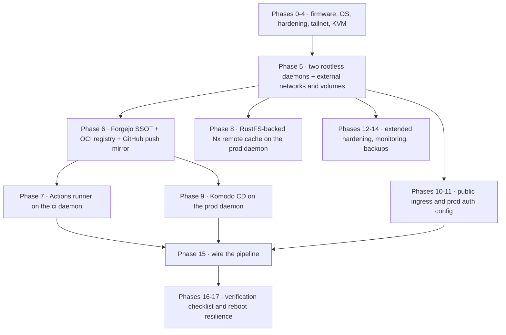

# Homelab server setup (CI/CD + production host)

The end-to-end runbook for provisioning the single physical headless host that backs this project's CI
and production: OS install and hardening, Tailscale-only remote access, two segregated rootless Docker
daemons (one per service user — `ci` and `prod` — each with its own socket, data root, networks, and
volumes so a breakout in one cannot reach the other or the host as root), Forgejo as the
source-of-truth forge with its own OCI registry and generic package registry (push-mirrored to
GitHub), a self-hosted Nx remote cache, and Komodo driving CD to production. Every literal in the
source is a placeholder, and the topology-scrub gate forbids the real ones from entering git.

This document was relocated here from `docs/proposals/homelab-setup/` because it is a live operator
reference, not pre-specification ideation — see the
[proposal → spec → plan → tasks → implementation lifecycle](../process/spec-driven-development.md)
for why that distinction matters and why proposals themselves are out of scope for this wiki.

The literal commands, package lists, placeholder values and troubleshooting asides live in
[`docs/runbooks/Server-Setup-Runbook.md`](../../docs/runbooks/Server-Setup-Runbook.md), which is
authoritative; this page is the distilled map of what each phase achieves and which failures are
load-bearing.

## Phase map — what each phase achieves

The source is genuinely a from-scratch, **phase-ordered** procedure: each phase assumes the prior
phase's state (the two service users and their networks/volumes must exist before Forgejo or the app
stacks are deployed), so a partial rebuild cannot skip ahead. The phases, in order:

- **0 — BIOS/firmware.** AMD SVM (hardware virtualization, required for the KVM-backed Android
  emulator) and IOMMU enabled, power-on behavior set to "Always On" so the headless box self-recovers
  after a power blip.
- **1 — OS install.** Ubuntu Server LTS, minimized footprint, OpenSSH enabled, full-disk LVM. Two
  traps: the guided installer caps the root logical volume at roughly 100 GB of a 1 TB drive and
  leaves the rest of the volume group unallocated (extend it online — the symptom is `df -h /` and
  Komodo agreeing on ~98 GB), and the old `qemu-kvm` transitional package is gone, so the `kvm` binary
  now arrives with `qemu-system-x86`.
- **2 — Hardening.** SSH key-only (verify key login *before* disabling passwords, and confirm the
  effective `sshd -T` output, because an installer/cloud-init drop-in often re-enables password auth),
  `ufw` default-deny inbound with only OpenSSH allowed, unattended-upgrades, fail2ban.
- **3 — Remote management.** Tailscale with `--ssh`, plus the `ufw allow in on tailscale0` rule —
  without it, Phase 2's default-deny blocks every admin UI (Cockpit, Forgejo, Komodo, Grafana) even
  over the tailnet. Cockpit for browser-based host admin.
- **4 — KVM.** Enable hardware virtualization and put the (future) `ci` user in the `kvm` group so
  the emulator job can use `/dev/kvm`. The device is **not** passed into a job container: the job
  executes **on the host** as the unprivileged `ci` user through a host-type runner label defined as
  `kvm:host` (Phase 7), which is precisely why `ci` must be in the group. On this host `/dev/kvm` is
  mode **666** (`crw-rw-rw- root kvm`, measured 2026-10-12); 660 via a udev rule is the tighter option,
  and the group membership is what keeps the job working if it is applied. Passing
  `--device /dev/kvm --group-add kvm` into a job container was the setup until commit `235f2f4c`.
- **5 — Two segregated rootless Docker daemons.** The core of the design: two unprivileged service
  users, each running its own rootless `dockerd` at its own socket with data under its own home, plus
  per-daemon `daemon.json` (log rotation, `live-restore`), the `kvm`-group membership and `kvm:host`
  host-execution label that let the emulator and Docker-image-building jobs run as `ci` on the host
  rather than in a job container, and the pre-created external networks/volumes the prod stacks
  expect. This phase owns the daemon-installation, subordinate-UID and cgroup-delegation gotchas
  below.
- **6 — Forgejo (source of truth) + OCI registry + GitHub push mirror.** Runs on the prod daemon with
  Postgres behind it; `packages` (the registry) and `actions` are enabled by env, the GitHub mirror is
  a push mirror so Forgejo stays SSOT, and every automated consumer gets its own minimally-scoped
  named access token. The same phase documents the generic package registry that carries the release
  APK.
- **7 — Forgejo Actions runner.** `forgejo-runner` v12 as a **binary** under the `ci` user's
  systemd-user manager (a container runner would fight container↔Forgejo networking), registered with
  the UUID + secret the web UI hands out — the older registration-token flow is deprecated. The runner
  advertises **two labels**: `ubuntu-latest`, which is where it becomes a plain Node image, and the
  host-type `kvm:host` (referenced as `runs-on: kvm`, the label *name*), on which jobs execute directly
  on the host as the unprivileged `ci` user with no job container — the emulator job and the
  Docker-image-building jobs, which need `/dev/kvm`, a single-host view of `localhost:8082` /
  `10.0.2.2:8082`, and a reachable `ci` rootless daemon.
- **8 — Self-hosted Nx remote cache, RustFS-backed (feature 080).** The open-source Rust
  `nx-cache-server` binary runs as a `prod`-user systemd-user service implementing Nx's built-in
  custom remote-cache-server API (Nx ≥ 20.8) — the first-party `@nx/s3-cache` / `@nx/shared-fs-cache`
  packages are deprecated over an unpatchable CVE and must not be used. The backing store is an S3
  object store, **RustFS** since feature 080, run from a host-managed compose beside a one-shot
  bucket-creating init container on the same pinned image the git-tracked observability stack uses,
  with its console disabled and only the S3 port published. Moving an existing cache is an in-place,
  verified copy driven by `scripts/object-store-migration.sh` (`manifest` → `inventory` → `copy` →
  `verify`); recreating it empty is an accepted alternative, because the cache is rebuildable — a cold
  cache costs time, not correctness. The migration runs **on the host**, from a checkout, through that
  wrapper: the host has no `node`, so the tool runs in a digest-pinned node container with the host's
  rootless Docker socket mounted and takes the store's credentials **by name** from the shell, never as
  command-line values — driving it from the dev container instead would put standing control of the prod
  daemon in the sandbox. The tool refuses rather than guesses (`copy` requires `--apply`, and an existing
  target or a source volume still mounted by a running container stops it), and a passing copy records
  `targetPreexisted: false`, zero entries not owned by the image's runtime uid, and an unchanged source
  digest. Both the tool and the wrapper are **temporary**: they exist for the three feature-080 cutovers
  and are deleted, with the guard exemption, in the cleanup PR after the rollback window. The tool's
  default helper image is not hard-coded either — it reads the single digest-pinned `rustfs/rustfs` ref
  out of the git-tracked observability prod compose and refuses anything unpinned or ambiguous, so the
  uid it chowns the copy to comes from the real production pin. That cutover
  was performed on prod on 2026-10-21 (spec 080 T044) as a copy rather than a
  recreate, and `verify` reported 1360 → 1360 objects. Client wiring is entirely env-driven, so local
  runs without the token fall back to the local cache and no remote-cache config leaks into the repo.
- **9 — Komodo (CD to the prod daemon).** Core + Periphery agent + database, deployed from Komodo's
  own compose files with three changes: Periphery repointed at the rootless socket, **FerretDB
  instead of MongoDB** (the unpinned Mongo image crash-loops on this new-kernel + rootless
  combination), and **`PERIPHERY_ROOT_DIRECTORY` bootstrapped onto persistent disk** (a directory
  under the `prod` user's home) instead of the stock `/etc/komodo` default. The last one is not
  cosmetic: under rootless Docker `/etc` is copy-up'd to a per-daemon tmpfs, so a default Periphery
  root is wiped on every reboot — along with the cloned repo checkout that every stack's relative
  bind-mounts resolve against, after which Docker auto-creates each missing bind-mount source *file*
  as a directory and the Mongo and Vault containers die with `not a directory` (exit 127). Bootstrap
  the persistent root here so a rebuild cannot reintroduce the tmpfs default; the failure and its
  fix are recorded in [Prod reboot resilience](./prod-reboot-resilience.md).
  The prod stacks are not defined by hand: one **ResourceSync** reconciles the seven
  `[[stack]]` blocks in `infrastructure-as-code/komodo/stacks.toml` (`branch = main`) and, because
  each carries `deploy = true` + `after = [...]`, *deploys* them too in dependency order
  (`prod-auth → prod-mc-service → prod-mcm-bff → prod-movie-assistant`, plus `prod-audit`,
  `prod-observability` and `prod-vault`). The four core stacks were created manually during Phase 15
  and the `prod-app → prod-mcm-bff` rename was done by hand, so the sync **adopts** them in place — a
  config diff, not a create-from-scratch — which is why the first apply is previewed as a diff.
- **10 — Public ingress, TLS and DNS.** Pick exactly one ingress model. The confirmed one is direct
  edge-TLS — the tunnel terminates TLS at the edge and dials the containers over plain HTTP on a
  shared external network, with no Caddy — and only two hostnames are public; everything else stays
  tailnet or behind an access gate.
- **11 — Keycloak and BFF production config.** The step that makes off-network login actually work:
  the public origin wired through Keycloak and the BFF, shipped as config-as-code in Komodo stacks
  rather than hand-run compose, with secrets as masked Komodo Variables materialized into a gitignored
  env file (see [Secrets management](../invariants/secrets-management.md)). Also where the realm
  sanitizing/rendering and client-reference gotchas live.
- **12 — Extended hardening.** Close public SSH entirely, gate admin UIs to the tailnet, 2FA, image
  pinning + scanning + Renovate, NTP, and **performance** isolation between the CI and prod user
  slices via host cgroup caps — rootless daemons isolate security, not CPU/memory contention.
- **13 — Monitoring and alerting.** A lean infra profile on the prod daemon. As built, one probe
  service is the pager, and disk SMART runs as host-level `smartd` rather than in a container (raw
  NVMe SMART needs root device access a rootless container cannot get). The observability and audit
  stacks themselves — and the one-time stateful cutovers they have carried, each with its own ordering
  and rollback window — are [Prod control tower](./prod-control-tower.md).
- **14 — Backups, disaster recovery and UPS.** An encrypted, offsite, scheduled snapshot of every
  stateful service on a timer, a *proven* restore procedure, a graceful-shutdown drain unit that stops
  containers cleanly before the runtime is killed, and UPS + NUT for power loss. The runbook warns
  explicitly that this host-level DR is not the same thing as the application's per-user collection
  backups — [Prod host backup](../projects/backup.md) is the snapshot side of that pair, and
  [Per-user collection backups](./backups.md) the application side.
  - **The script is no longer host-only state.** Spec 084 (2026-10-27) moved the whole backup into
    [`infrastructure-as-code/backup/`](../../infrastructure-as-code/backup/), which is now the source of
    truth: `backup.sh`, `backup-alert.sh`, `backup-staleness.sh`, the five systemd units, a README with
    the install/update/verify contract, and `INSTALLED.sha256`. The host runs copies, and
    `cd ~ && sha256sum -c <checkout>/infrastructure-as-code/backup/INSTALLED.sha256` is the operator's
    one-line proof that the copies match the repository — so a change to what gets dumped, what is
    excluded, or when the alert fires is a reviewed commit rather than an edit made on the host.
  - **The dump list is the part that has to grow with the host — and it is now a tracked file.** The
    original script captured only the service config directories and no application database at all, so
    a reboot that corrupted Forgejo's Postgres left Forgejo the only stateful service with a real
    backup. The standing rule the runbook draws from that is that adding a stateful service means
    adding its dump — with a minimum size and a format check — and since spec 084 (2026-10-27) that
    edit lands in
    [`infrastructure-as-code/backup/backup.sh`](../../infrastructure-as-code/backup/backup.sh), so it
    is reviewed and the host copy is checked against the repository rather than drifting. The same
    obligation is what put the Nx-cache store's config directory on the `restic backup` path list.
- **15 — Wire the pipeline.** The trigger ordering, digest-by-git promotion and Komodo ResourceSync
  deploy; the current shape is documented in
  [CI/CD pipeline](../projects/ci-cd-pipeline.md) and
  [Infrastructure stacks](../projects/infrastructure-stacks.md), with the bring-up history in
  [Phase 15 operator checklist](./phase-15-operator-checklist.md).
- **16 — Verification checklist.** The acceptance list for the whole build-out, including the two
  daemons reporting rootless with distinct data roots.
- **17 — Reboot resilience.** The post-reboot fixes; the *current* reboot procedure is
  [Prod reboot resilience](./prod-reboot-resilience.md). The fixes are config-as-code and
  self-enforcing: `scripts/check-prod-restart-policy.mjs` requires `restart: always` on every
  long-running prod service and forbids `unless-stopped` — which does not bring a cleanly stopped
  container back after a reboot — and runs selftest + scan alongside the port-collision gate in
  `guardrails.yml`'s `naming` job.



The bring-up spine: every phase consumes state an earlier one created, so a rebuild cannot start in the middle.

## Gotchas

- **Two rootless daemons, one host, one port space.** CI and prod are isolated at the daemon and
  filesystem level, but they still publish into the same host's port space — this is the origin of the
  collision class documented in
  [Published-port reservation](../invariants/published-port-reservation.md); a port assigned here
  without checking that convention can silently starve a prod redeploy later.
  - **A `machinectl shell <user>@` session is required to install rootless Docker for a service user,
    not `sudo -iu`/`su`.** The setup tool needs a real systemd user session to install its auto-start
    unit; the wrong session type silently falls back to a manual-start mode that looks successful but
    does not survive a reboot. Ordering the rootless user manager after the tailnet daemon is an
    optional defense-in-depth extra, not a substitute. The requirement does not end at bring-up:
    `systemctl --user` and the rootless `docker` CLI both need that user's session, so every later
    operation as `prod` goes through the same `machinectl shell prod@` — see
    [Prod reboot resilience](./prod-reboot-resilience.md) Part 6 for the host-operation rules that
    depend on it.
  - **Subordinate UID/GID ranges must be exactly one, non-overlapping line per user.** `useradd -m`
    already assigns one, so normally there is nothing to do but verify; adding a second range manually
    creates an overlap that breaks rootless Docker's user-namespace mapping with an opaque `newuidmap`
    error.
  - **Cgroup delegation must be enabled at the systemd `user@.service` level, or rootless Docker only
    enforces memory/pids limits**, silently ignoring CPU/IO limits — required for the CI-vs-prod
    resource isolation above.
- **`/dev/kvm` is host state, not something handed to a container.** The emulator job reaches it by
  running **on the ci host** through the `kvm:host` runner label (`runs-on: kvm` uses the label
  *name*), so what has to hold is: KVM enabled on the host, `ci` in the `kvm` group, and the runner
  still advertising that label. On this host the device is mode **666** (`crw-rw-rw- root kvm`,
  measured 2026-10-12); 660 via a udev rule is the tighter option, and the group membership is what
  keeps the job working if it is applied. A host job must also provision its own Docker CLI and prove
  it reaches the `ci` rootless daemon at the job's `DOCKER_HOST` — there is no fallback socket — and a
  missing `/dev/kvm` **fails the job loudly** rather than skipping the mobile suite. The same
  `kvm:host` label carries the Docker-image-building jobs, which a `node:22-bookworm` job container
  could not run at all (no Docker CLI or daemon). See [Android emulator](./android-emulator.md) for the
  job-side view.
- **A default Periphery root lives on a tmpfs and is wiped by every reboot.** Rootless Docker
  copy-ups `/etc` into a per-daemon tmpfs, so Komodo's stock `/etc/komodo` root — and with it the
  cloned repo checkout that every stack's relative bind-mounts resolve against — does not survive.
  Docker then auto-creates each missing bind-mount *source file* as a directory, and the Mongo/Vault
  containers fail with `not a directory` (exit 127). Phase 9 therefore bootstraps
  `PERIPHERY_ROOT_DIRECTORY` onto persistent disk at install time, so a rebuild cannot reintroduce the
  default; the recovery ordering when a reboot does land dirty is in
  [Prod reboot resilience](./prod-reboot-resilience.md).
- **The Nx-cache store is host state, so nothing in CI keeps its image pin fresh.** Phase 8's RustFS
  compose lives under the `prod` user's home like the other host-managed composes, which means
  Renovate never sees it: its image pin has to be copied by hand from the git-tracked RustFS instance
  in the observability stack whenever that moves — so check the pin against that file rather than
  against the runbook's example, which lags (the Phase 8 snippet still carries `rustfs/rustfs:1.0.1`
  while the tracked observability compose has moved to `1.0.3`; every git-tracked RustFS service must
  share one digest-pinned Alpine tag). The store's volume and network names are host state
  too, so confirm them by ownership *and* contents before running the migration copy — and the backup
  script's path list has to name each store's config directory, which is why the new store's directory
  is on it. Whether the retired store's directory should still be on that list is the one point where
  the runbook and the tracked script disagree (below).
  The guard that fails on any *live* reference to the retired object store — with a closed list of
  reasoned exemptions, and the history blocks under `docs/runbooks/` that may keep a case study —
  belongs to [Infra-image CVE scanning](./infra-image-scanning.md).
  - **The cutover landed as a copy, and the tracked backup list disagrees with the runbook about the
    retired store's directory.** The move was performed on prod on 2026-10-21 (spec 080 T044) as a copy
    rather than a recreate, with `verify` reporting 1360 → 1360 objects. The tracked `restic backup`
    path list is now `"$HOME/forgejo" "$HOME/komodo" "$HOME/rustfs" "$HOME/nx-cache"` — it does **not**
    name the retired store's directory, while the runbook's Phase 8 says that directory stays on the
    list until the deferred cleanup (spec 080 T047) deletes it. The retired store is still the
    documented rollback (its volume and directory names remain exempt in the object-store guard as
    resources that exist until M7), so treat the runbook's Phase 8 sentence as the rule and the tracked
    script as what the host actually runs.
  - **The store's credentials live in two files and both must change together.** The cache server's
    own env file carries the store's access/secret pair as its `AWS_ACCESS_KEY_ID` /
    `AWS_SECRET_ACCESS_KEY`, while the store's compose reads the same pair from the store's own `.env`.
    On this host that env file's endpoint and bucket name were already correct, so the cutover changed
    only those two credential lines — the failure mode of leaving them behind is a cache server that
    starts healthy and cannot read the store.
  - **The store's volume is an external volume that nothing but the migration tool creates.** Its
    compose declares the volume `external: true` under the explicit name `nx-cache-rustfs-data`, so
    compose never creates it: `copy --apply` brings it into existence (a new host with no prior data
    creates it empty instead). Referencing it before it exists aborts the compose up with an
    `external volume … not found` error and creates **no** containers — the deploy fails instead of
    starting on an empty store, so the copy must precede anything that mounts the volume. The
    failure is loud rather than destructive: measured 2026-10-11 against the shipped observability
    compose (in the dev container, via a scratch project), a failed `up` of this kind leaves the
    previously deployed containers running and unchanged — so an early merge leaves the old store
    serving while you recover. [Prod control tower](./prod-control-tower.md) owns
    the ordering for that stack's identical cutover. For the *git-tracked* RustFS services this property
    is asserted, not merely documented — `scripts/__tests__/object-store-service.guard.test.mjs` fails
    the build unless the prod RustFS data volume is `external: true` under its canonical name (contract
    S9). The host-managed Nx-cache compose sits outside that scan, so for it the same property rests on
    this runbook and on the volume actually existing rather than on a CI gate.

    ```mermaid
    flowchart TD
      Quiesce["stop the cache server, the only writer"] --> Manifest["manifest against the old store"]
      Manifest --> Inventory["stop the old store, inventory its volume"]
      Inventory --> Copy["copy --apply creates the new external volume"]
      Copy --> Up["up the RustFS compose on the copy"]
      Up --> Creds["repoint the cache server's two AWS credential lines"]
      Creds --> Verify["verify for parity against the manifest"]
      Copy -.->|"skipped"| Fail["compose aborts: external volume not found, zero containers created"]
    ```

    *The cutover's ordering: the copy is what brings the external volume into existence, so it must
    run before anything that mounts it.*
  - **Two env-file reading traps cost a re-run each.** Take each store's secret from its own env file
    with a `sed -n` extraction rather than typing it into a `read -rs` inside a pasted block, which
    consumes the next pasted line as its input; and list env-file keys with a pattern that admits
    digits, since a letters-only pattern silently skips every `S3_…` line.
- **The forge's Actions-artifact API is a missing route, not an empty result.** `GET
  /api/v1/repos/.../actions/artifacts` answers `404 page not found` on this build
  (15.0.3+gitea-1.22.0), so `upload-artifact` APKs are reachable only by a human clicking through the
  run page and only until they expire. The `cd-deploy` `prod-apk` job therefore publishes every
  release APK to the **generic package registry** (`mcm-app-android` package, version
  `<expo.version>-<sha7>`) via `scripts/cd/publish-apk.mjs`, alongside the artifact. Use a
  `read:package` token to fetch it; the download recipe uses `/api/packages` (not `/api/v1`) and pulls
  a `.apk.sha256` sidecar written in `sha256sum -c` format — see §6.7 of the runbook.
  - **APK retention is count-based, not time-based.** The measured release APK size is **109 MB** (run
    #6036, `114,365,972` bytes — universal build), and every deploy produces one, so unbounded
    accumulation is a disk-exhaustion path on this host. `publish-apk.mjs` prunes to the newest **5
    versions** by `created_at` — **not** a 30-day window, because a quiet month would delete every
    installable APK while a busy week would keep far more than the disk affords (5 × 109 MB ≈ 550 MB
    ceiling). **To pin a build so it survives pruning**, re-upload it under `<version>-keep`; pinned
    versions are kept and do not consume a retention slot.
  - **The pruning logic has three non-obvious properties.** Listing is paginated because the forge
    orders packages by name and defaults to page 1 at 30 items — an unpaginated call silently degrades
    retention to a no-op with no error. Sorting is by `created_at`, never by name, since `1.10.0` sorts
    before `1.9.0` as a string and would prune the newest build first. And a version whose `created_at`
    will not parse is *kept*, because deleting on a parse failure is the destructive direction. A
    re-upload of an existing version is a `409`, handled as "already published" rather than a failure.
  - **The script always exits 0 and is `continue-on-error` on the workflow step.** `prod-apk` is
    non-blocking by design; a registry hiccup must not turn a deploy red. Every failure path emits
    `::error::` so it is visible in the job log without failing the job.
- **`ubuntu-latest` on this forge is `node:22-bookworm` — GitHub-hosted-runner recipes do not transfer
  (item #457).** The runner label maps `ubuntu-latest` to a plain Node image, not a GitHub-hosted
  Ubuntu runner. Two consequences bite copied workflow snippets:
  - **There is no `sudo`.** The container process is already root, so `sudo` is absent and
    unnecessary. A copied `sudo …` line dies on its first word with `sudo: command not found`. If the
    step carries the customary `|| true`, it goes **green having done nothing**. That is what
    `cd-deploy`'s `prod-apk` "Free disk space" step did on every run it ever made. (The `kvm` runner is
    the same story for a different reason: it runs on the host as the unprivileged `ci` user, which
    also has no sudo.)
  - **Dropping `sudo` is WORSE than the no-op.** Measured 2026-09-15 with `docker run --rm
    node:22-bookworm`: `/usr/share/dotnet`, `/opt/ghc`, `/usr/local/.ghcup`, `/usr/share/swift`, and
    `/usr/local/share/powershell` do not exist. The one sizeable removable directory,
    `/usr/local/lib/node_modules` (19 MB), holds `corepack` and `npm`, which `pnpm/action-setup`
    needs — so "just drop the `sudo`" turns a harmless no-op into a broken job. Deleting files from an
    image's lower layers also writes whiteouts to the container layer, so host usage goes UP. **To free
    real disk from a job, prune the rootless daemon** (`docker image prune -af`), which needs no
    privileges and is what `app-e2e`, `dast`, and `build-deploy` all do. `prod-apk` has no Docker CLI
    and builds no images, so it has nothing to prune.
  - **The rewritten disk step is pinned in all three directions.**
    `scripts/__tests__/prod-apk-disk-step.guard.test.mjs` fails *any* workflow step that invokes
    `sudo` (no runner here provides it); fails the disk step if it deletes
    `/usr/local/lib/node_modules`; and fails it if it attempts any `rm` at all or carries a `|| true`.
    The step must state in its own output that "No reclamation is attempted here", and its *name* must
    not promise a reclamation — otherwise a cosmetic fix reintroduces the false green.
  - **Doing nothing leaves no trace, so the measurement is published to the commit.** On a green run
    nobody can read a job log (this forge exposes no run/jobs/logs endpoint and `cd-deploy` posts no
    statuses), so a recorder step posts the disk figures as a commit status under
    `cd-deploy/prod-apk-disk`. It is `always()` + `continue-on-error` so a *failed* `prod-apk` still
    leaves the record, it never posts a non-success state, and it is asserted to match none of `main`'s
    required status globs — observability, never a second gate.
- **Komodo's webhook is a git-style branch redeploy, not a digest body — so promotion is
  digest-by-git.** The ResourceSync's "Execute Sync" webhook validates the branch in a GitHub-shaped
  payload with `X-Hub-Signature-256` (HMAC using the global `KOMODO_WEBHOOK_SECRET` from
  `compose.env`, which is also the CI `KOMODO_WEBHOOK_AUTH` secret) and then reconciles and redeploys
  the branch's stacks in `after` order. It will **not** consume a posted image digest, so CI resolves
  the immutable `…@sha256:` digest, writes it into a tracked host-free `.env.deploy` beside the
  component's prod compose, commits and pushes, and only then fires the signed webhook. There is no
  rollback endpoint — rollback is redeploying the prior digest, which `cd-deploy` does by reverting the
  promotion commit and re-firing the webhook. The single sync URL replaced the earlier per-stack
  redeploy webhooks, which left `prod-mc-service` and `prod-movie-assistant` on stale images; the
  committed `stacks.toml` stays host-free because the git host lives in the bootstrapped `mcm-repo`
  Repo resource and the domain/tailnet/registry values are masked Komodo Variables.
- **Never commit the real forge hostname, production domain, or tailnet address.** Every literal in
  this runbook is a placeholder; the topology-scrub and secret-scan gates block a real value from
  landing in git, matching the redaction posture in
  [Secrets management](../invariants/secrets-management.md).

Full phase-by-phase commands (BIOS/firmware through registry/token hygiene), the exact package lists,
the token inventory, the restore procedures, and every troubleshooting aside:
[`docs/runbooks/Server-Setup-Runbook.md`](../../docs/runbooks/Server-Setup-Runbook.md).
